# Library Module Pages and User Interfaces

<cite>
**Referenced Files in This Document**   
- [BooksPage.tsx](file://src/modules/library/pages/BooksPage.tsx)
- [BookLoansPage.tsx](file://src/modules/library/pages/BookLoansPage.tsx)
- [FinesPage.tsx](file://src/modules/library/pages/FinesPage.tsx)
- [LibraryDashboardPage.tsx](file://src/modules/library/pages/LibraryDashboardPage.tsx)
- [UserLibraryPortalPage.tsx](file://src/modules/library/pages/UserLibraryPortalPage.tsx)
- [useBookData.ts](file://src/modules/library/data/useBookData.ts)
- [useLoanData.ts](file://src/modules/library/data/useLoanData.ts)
- [useFineData.ts](file://src/modules/library/data/useFineData.ts)
- [rbac.ts](file://src/modules/library/rbac.ts)
- [accessibility.ts](file://src/utils/accessibility.ts)
- [responsive.ts](file://src/utils/responsive.ts)
- [library.json](file://src/i18n/locales/en/library.json)
</cite>

## Table of Contents
1. [Introduction](#introduction)
2. [Core Library Pages Overview](#core-library-pages-overview)
3. [Books Management](#books-management)
4. [Loan Tracking and Management](#loan-tracking-and-management)
5. [Fine Management](#fine-management)
6. [Library Dashboard](#library-dashboard)
7. [User Self-Service Portal](#user-self-service-portal)
8. [Data Consumption and Custom Hooks](#data-consumption-and-custom-hooks)
9. [UI Components and Integration Patterns](#ui-components-and-integration-patterns)
10. [Navigation and Role-Based Access](#navigation-and-role-based-access)
11. [Form Validation Examples](#form-validation-examples)
12. [Responsive Design Considerations](#responsive-design-considerations)
13. [Accessibility Features](#accessibility-features)
14. [Conclusion](#conclusion)

## Introduction
The Library module in schoolpilot3 provides a comprehensive suite of user interface pages for managing library operations in an educational institution. This document details the functionality, architecture, and user experience of the key pages within this module: BooksPage for catalog management, BookLoansPage for tracking active loans, FinesPage for managing overdue payments, LibraryDashboardPage for operational overview, and UserLibraryPortalPage for student self-service. The system leverages custom React hooks for data management, implements role-based access control, and incorporates responsive design and accessibility features to ensure a robust and inclusive user experience.

## Core Library Pages Overview
The Library module consists of several interconnected pages that serve different user roles and operational needs. These pages are built using a consistent design system and share common UI components and data access patterns. The primary pages include BooksPage for managing the book catalog, BookLoansPage for issuing and tracking book loans, FinesPage for managing overdue payments, LibraryDashboardPage for providing an operational overview, and UserLibraryPortalPage for enabling students and staff to manage their own library activities.

## Books Management

### BooksPage Functionality
The BooksPage serves as the central interface for managing the library's book catalog. It allows librarians to view, create, edit, and delete book records. The page displays a comprehensive list of all books in the library, including their title, author, ISBN, accession number, status (available, on loan, damaged, lost), and category. Users can filter and sort the book list to quickly find specific items.

**Section sources**
- [BooksPage.tsx](file://src/modules/library/pages/BooksPage.tsx)

## Loan Tracking and Management

### BookLoansPage Functionality
The BookLoansPage is designed for tracking active book loans and managing the book lending process. It provides a DataGrid that displays all current and past loans, showing key information such as loan ID, book title, borrower name, loan date, due date, return date, and actions. The page includes functionality for issuing new loans and marking books as returned.

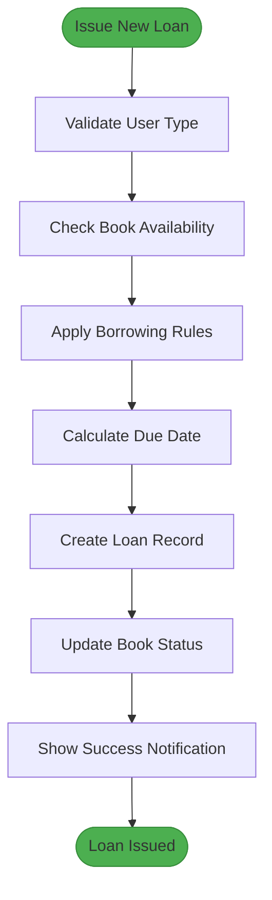

**Diagram sources**
- [BookLoansPage.tsx](file://src/modules/library/pages/BookLoansPage.tsx)

**Section sources**
- [BookLoansPage.tsx](file://src/modules/library/pages/BookLoansPage.tsx)

### Loan Issuance Workflow
The loan issuance process begins when a librarian clicks the "Issue New Loan" button, which opens a modal form. The form requires selecting a book from the available inventory and choosing a borrower from the list of active students and staff. The system automatically validates borrowing rules based on the user's role (student or staff), checking limits on the maximum number of books that can be borrowed simultaneously.

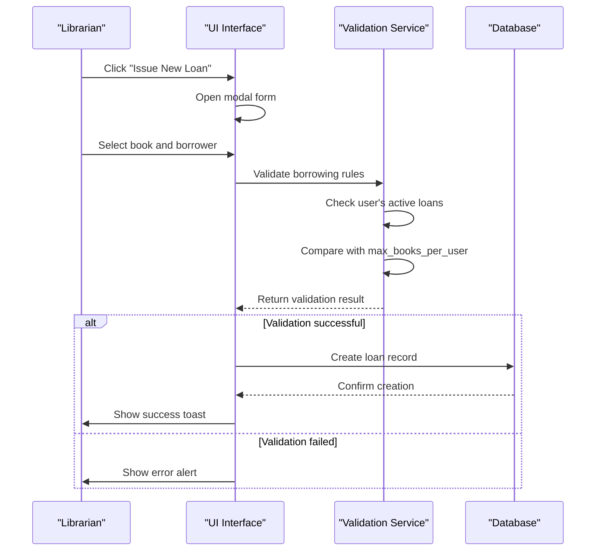

**Diagram sources**
- [BookLoansPage.tsx](file://src/modules/library/pages/BookLoansPage.tsx)

## Fine Management

### FinesPage Functionality
The FinesPage provides an interface for managing library fines, both those generated automatically for overdue books and manual fines that may be added for other reasons. The page displays a DataGrid with columns for Fine ID, Book Title, User Name, Amount (KES), Reason, Status, and Actions. Fine statuses are visually represented with colored badges: green for PAID, yellow for PENDING, blue for BILLED, and gray for WAIVED.

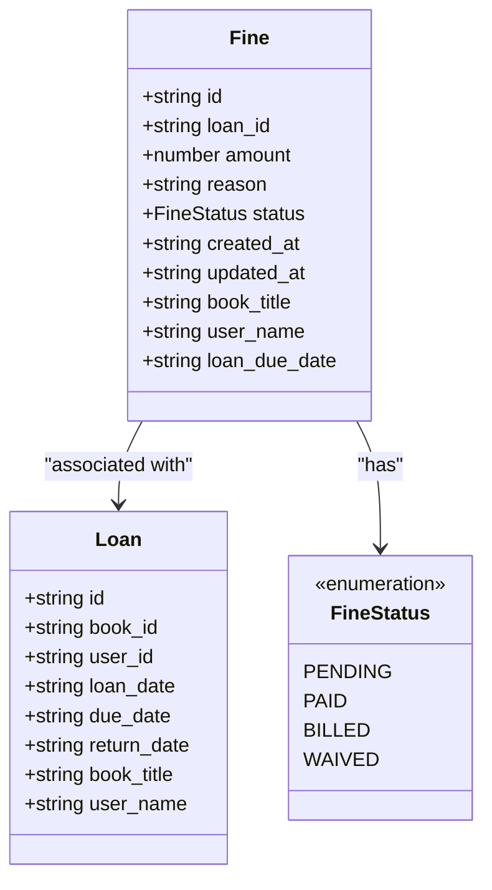

**Diagram sources**
- [FinesPage.tsx](file://src/modules/library/pages/FinesPage.tsx)

**Section sources**
- [FinesPage.tsx](file://src/modules/library/pages/FinesPage.tsx)

### Fine Management Workflow
The FinesPage allows administrators to add manual fines or update the status of existing fines. When adding a new fine, the administrator must select an associated loan, specify the fine amount, provide a reason, and set the initial status. The form includes validation to ensure all required fields are completed and the amount is positive. For existing fines, the "Update Status" button opens a modal where the status can be changed, but the loan association, amount, and reason are typically fixed once created.

## Library Dashboard

### LibraryDashboardPage Functionality
The LibraryDashboardPage provides a comprehensive operational overview of the library's status and key metrics. It features a series of StatCards that display important statistics: Total Books, Books on Loan, Overdue Books, Damaged Books, Lost Books, and Pending Fines. The dashboard also includes visualizations such as a DonutChart showing the distribution of books by category and a list of the top borrowed books.

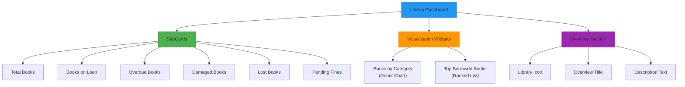

**Diagram sources**
- [LibraryDashboardPage.tsx](file://src/modules/library/pages/LibraryDashboardPage.tsx)

**Section sources**
- [LibraryDashboardPage.tsx](file://src/modules/library/pages/LibraryDashboardPage.tsx)

### Dashboard Data Processing
The dashboard calculates its metrics by processing data from multiple sources. The total number of books is derived from the books collection, while books on loan are filtered based on their status. Overdue books are identified by comparing the current date with the due date of active loans (those without a return date). The top borrowed books are determined by counting loan records for each book title and sorting them in descending order.

## User Self-Service Portal

### UserLibraryPortalPage Functionality
The UserLibraryPortalPage provides a self-service interface for students and staff to manage their own library activities. It displays a personalized view of the user's active loans, including book title, loan date, due date, extended due date (if applicable), renewal status, and action buttons for renewing or returning books. The portal also shows the user's borrowing limits and current usage statistics.

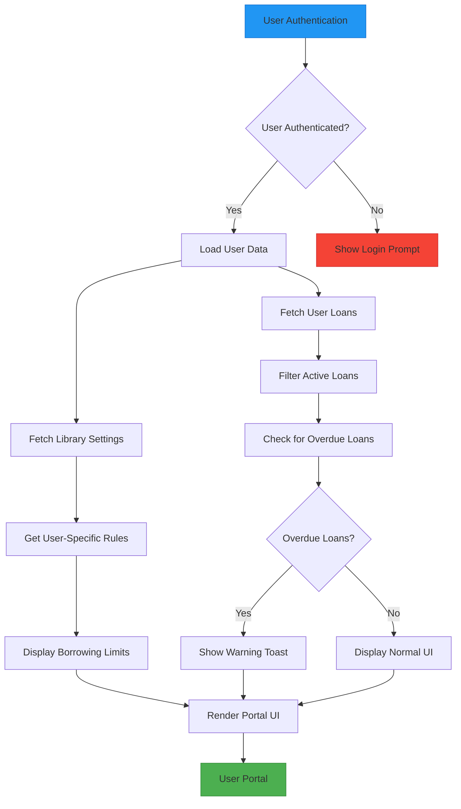

**Diagram sources**
- [UserLibraryPortalPage.tsx](file://src/modules/library/pages/UserLibraryPortalPage.tsx)

**Section sources**
- [UserLibraryPortalPage.tsx](file://src/modules/library/pages/UserLibraryPortalPage.tsx)

### Self-Service Workflows
The UserLibraryPortalPage implements two primary self-service workflows: loan renewal and book return. When a user clicks the "Renew" button, the system checks if the loan is eligible for renewal by verifying that it is not overdue and that the user has not exceeded the maximum number of renewals allowed by their borrowing rules. If eligible, the due date is extended by the standard loan period. The "Return" button immediately marks the book as returned by setting the return date to the current date.

## Data Consumption and Custom Hooks

### Custom Hooks Architecture
The Library module utilizes a set of custom React hooks to manage data access and state. These hooks abstract the complexity of data fetching, caching, and mutation operations, providing a clean and consistent API for the UI components. The primary hooks used in the library pages are useBookData.ts, useLoanData.ts, and useFineData.ts, each responsible for managing the data for their respective entities.

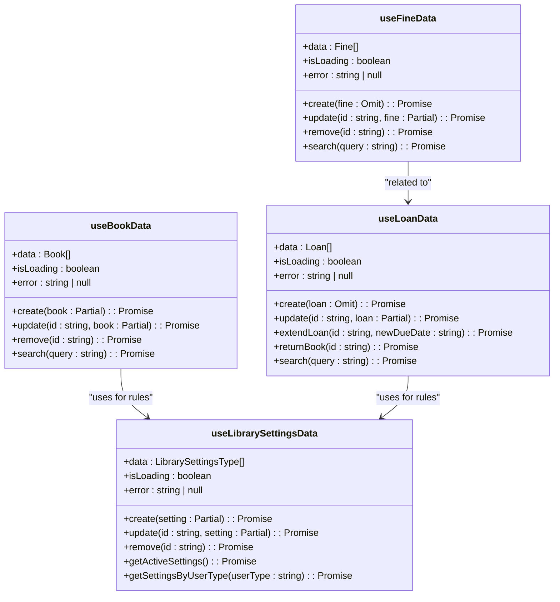

**Diagram sources**
- [useBookData.ts](file://src/modules/library/data/useBookData.ts)
- [useLoanData.ts](file://src/modules/library/data/useLoanData.ts)
- [useFineData.ts](file://src/modules/library/data/useFineData.ts)
- [useLibrarySettingsData.ts](file://src/modules/library/data/useLibrarySettingsData.ts)

**Section sources**
- [useBookData.ts](file://src/modules/library/data/useBookData.ts)
- [useLoanData.ts](file://src/modules/library/data/useLoanData.ts)
- [useFineData.ts](file://src/modules/library/data/useFineData.ts)

## UI Components and Integration Patterns

### Core UI Components
The Library module leverages a set of reusable UI components from the application's design system. Key components include DataGrid for displaying tabular data, Modal for forms and confirmations, Toast for notifications, Button for actions, Card for content grouping, Select for dropdown inputs, and Input for text entry. These components ensure visual consistency and provide built-in accessibility features.

```mermaid
graph TD
A[Library Pages] --> B[DataGrid]
A --> C[Modal]
A --> D[Toast]
A --> E[Button]
A --> F[Card]
A --> G[Select]
A --> H[Input]
B --> B1["Column configuration"]
B --> B2["Sorting and filtering"]
B --> B3["Empty state handling"]
C --> C1["Header and title"]
C --> C2["Footer actions"]
C --> C3["Close functionality"]
D --> D1["Success messages"]
D --> D2["Error messages"]
D --> D3["Warning messages"]
D --> D4["Info messages"]
E --> E1["Variants: primary, secondary, ghost"]
E --> E2["Sizes: sm, md, lg"]
E --> E3["Loading states"]
F --> F1["Title and subtitle"]
F --> F2["Actions slot"]
F --> F3["Content area"]
G --> G1["Options list"]
G --> G2["Value binding"]
G --> G3["Disabled state"]
H --> H1["Types: text, number, date"]
H --> H2["Label and placeholder"]
H --> H3["Validation states"]
style A fill:#2196F3,stroke:#1976D2
style B fill:#4CAF50,stroke:#388E3C
style C fill:#FF9800,stroke:#F57C00
style D fill:#9C27B0,stroke:#7B1FA2
style E fill:#03A9F4,stroke:#0288D1
style F fill:#8BC34A,stroke:#689F38
style G fill:#FF5722,stroke:#D84315
style H fill:#795548,stroke:#5D4037
```

**Diagram sources**
- [BookLoansPage.tsx](file://src/modules/library/pages/BookLoansPage.tsx)
- [FinesPage.tsx](file://src/modules/library/pages/FinesPage.tsx)
- [UserLibraryPortalPage.tsx](file://src/modules/library/pages/UserLibraryPortalPage.tsx)

**Section sources**
- [BookLoansPage.tsx](file://src/modules/library/pages/BookLoansPage.tsx)
- [FinesPage.tsx](file://src/modules/library/pages/FinesPage.tsx)
- [UserLibraryPortalPage.tsx](file://src/modules/library/pages/UserLibraryPortalPage.tsx)

### Component Integration Patterns
The integration of UI components follows consistent patterns across the library pages. DataGrid is used as the primary data display component, configured with columns that define headers, sorting, filtering, and custom rendering functions. Modal components are used for forms and confirmations, with footer actions that adapt based on the context (e.g., "Cancel" and "Save" for editing, "Cancel" and "Add" for creation). Toast notifications are used to provide feedback on operations, with different variants for success, error, warning, and information messages.

## Navigation and Role-Based Access

### Navigation Structure
The Library module follows a hierarchical navigation structure defined in the moduleDefinition.tsx file. The main navigation includes links to the Library Dashboard, Books, Book Categories, Book Loans, Fines, User Portal, Digital Resources, Damaged/Lost Books, and Import Books. This structure is reflected in the URL routing, with each page having a corresponding path under the /library base.

```mermaid
graph TD
A[/library] --> B[/library/dashboard]
A --> C[/library/books]
A --> D[/library/book-categories]
A --> E[/library/book-loans]
A --> F[/library/fines]
A --> G[/library/user-portal]
A --> H[/library/digital-resources]
A --> I[/library/damaged-lost-books]
A --> J[/library/import-books]
A --> K[/library/settings]
style A fill:#2196F3,stroke:#1976D2
style B fill:#4CAF50,stroke:#388E3C
style C fill:#4CAF50,stroke:#388E3C
style D fill:#4CAF50,stroke:#388E3C
style E fill:#4CAF50,stroke:#388E3C
style F fill:#4CAF50,stroke:#388E3C
style G fill:#4CAF50,stroke:#388E3C
style H fill:#4CAF50,stroke:#388E3C
style I fill:#4CAF50,stroke:#388E3C
style J fill:#4CAF50,stroke:#388E3C
style K fill:#4CAF50,stroke:#388E3C
```

**Diagram sources**
- [moduleDefinition.tsx](file://src/modules/library/moduleDefinition.tsx)

**Section sources**
- [moduleDefinition.tsx](file://src/modules/library/moduleDefinition.tsx)

### Role-Based Visibility Rules
Access to library pages and functionality is controlled by role-based access control (RBAC) defined in the rbac.ts file. Different user roles have varying levels of access: administrators have full access to all features, librarians can manage books, loans, and fines, teachers can view the catalog and manage their own loans, and students can only access the user portal to manage their personal loans. These rules are enforced both at the navigation level (hiding inaccessible pages) and at the component level (disabling or hiding specific actions).

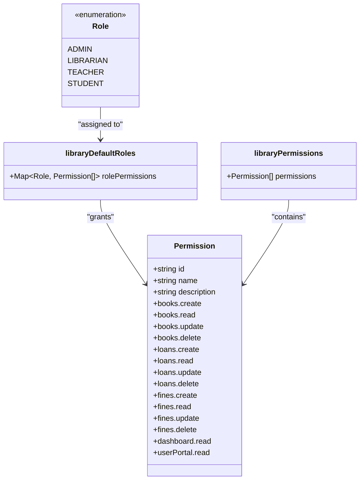

**Diagram sources**
- [rbac.ts](file://src/modules/library/rbac.ts)

**Section sources**
- [rbac.ts](file://src/modules/library/rbac.ts)

## Form Validation Examples

### Book Creation Workflow
The book creation form includes validation to ensure data integrity. Required fields such as title, author, and ISBN are marked as required in the form. The accession number must be unique across all books. The form uses client-side validation to provide immediate feedback, with visual indicators for invalid fields. When the form is submitted, the useBookData hook performs additional validation before creating the record in the database.

### Loan Assignment Workflow
The loan assignment workflow includes several validation steps. First, the system validates that both a book and borrower are selected. Then, it checks the borrowing rules for the user type, ensuring the user has not exceeded the maximum number of books allowed. The due date is automatically calculated based on the user type's borrowing rules, but can be manually adjusted if necessary. If the book is already on loan or the user has reached their borrowing limit, the system displays an appropriate error message.

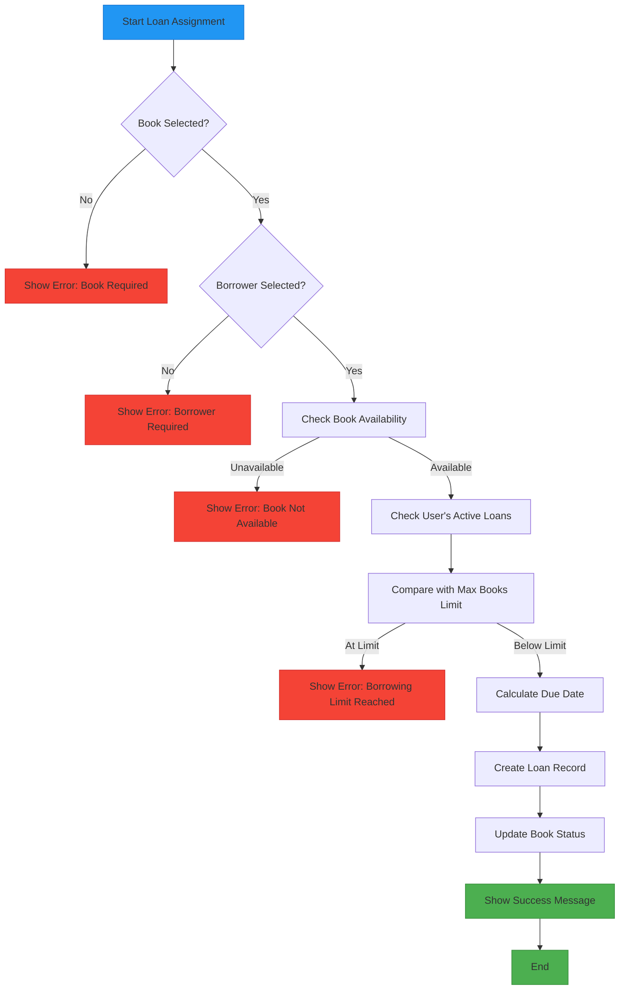

**Diagram sources**
- [BookLoansPage.tsx](file://src/modules/library/pages/BookLoansPage.tsx)

## Responsive Design Considerations
The library pages implement responsive design principles to ensure usability across different device sizes. The layout uses a flexible grid system that adapts to the viewport width, with cards and data tables reflowing appropriately on smaller screens. The DataGrid component includes features like horizontal scrolling on mobile devices and responsive column hiding based on screen size. Breakpoints are defined in the responsive.ts utility file, with specific CSS classes applied at different screen widths to optimize the user experience.

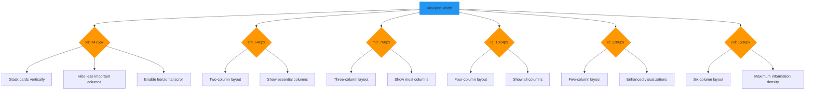

**Diagram sources**
- [responsive.ts](file://src/utils/responsive.ts)

**Section sources**
- [responsive.ts](file://src/utils/responsive.ts)

## Accessibility Features
The library pages incorporate several accessibility features to ensure the application is usable by people with disabilities. These include proper ARIA labels and roles, keyboard navigation support, screen reader announcements, sufficient color contrast, and reduced motion support. The accessibility.ts utility file provides functions for managing focus, announcing messages to screen readers, and detecting user preferences for reduced motion. All interactive elements are keyboard accessible, and focus is managed appropriately when modals are opened or closed.

```mermaid
graph TD
A[Accessibility Features] --> B[WCAG Compliance]
A --> C[Focus Management]
A --> D[Screen Reader Support]
A --> E[Keyboard Navigation]
A --> F[Reduced Motion]
B --> B1["Color contrast checking"]
B --> B2["meetsWCAGAA()"]
B --> B3["meetsWCAGAAA()"]
C --> C1["trapFocus()"]
C --> C2["restoreFocus()"]
C --> C3["getFocusableElements()"]
D --> D1["announceToScreenReader()"]
D --> D2["aria-live regions"]
D --> D3["ARIA labels and descriptions"]
E --> E1["useKeyboardNavigation()"]
E --> E2["Arrow key navigation"]
E --> E3["Home/End support"]
F --> F1["useReducedMotion()"]
F --> F2["prefers-reduced-motion"]
F --> F3["Animation toggling"]
style A fill:#2196F3,stroke:#1976D2
style B fill:#4CAF50,stroke:#388E3C
style C fill:#4CAF50,stroke:#388E3C
style D fill:#4CAF50,stroke:#388E3C
style E fill:#4CAF50,stroke:#388E3C
style F fill:#4CAF50,stroke:#388E3C
```

**Diagram sources**
- [accessibility.ts](file://src/utils/accessibility.ts)

**Section sources**
- [accessibility.ts](file://src/utils/accessibility.ts)

## Conclusion
The Library module in schoolpilot3 provides a comprehensive and user-friendly interface for managing library operations. Through a suite of specialized pages, the system enables efficient catalog management, loan tracking, fine management, and user self-service. The implementation leverages custom React hooks for data management, follows consistent UI component patterns, and incorporates responsive design and accessibility features to ensure a high-quality user experience across different devices and user needs. The role-based access control system ensures that users only have access to the functionality appropriate to their role, maintaining data security and operational integrity.