# Library Module Role-Based Access Control

<cite>
**Referenced Files in This Document**   
- [rbac.ts](file://src/modules/library/rbac.ts)
- [useBookData.ts](file://src/modules/library/data/useBookData.ts)
- [useLoanData.ts](file://src/modules/library/data/useLoanData.ts)
- [useFineData.ts](file://src/modules/library/data/useFineData.ts)
- [useLibrarySettingsData.ts](file://src/modules/library/data/useLibrarySettingsData.ts)
- [ModuleManagementPage.tsx](file://src/modules/settings/pages/ModuleManagementPage.tsx)
- [useRBAC.ts](file://src/hooks/useRBAC.ts)
- [core/rbacService.ts](file://src/core/rbacService.ts)
</cite>

## Table of Contents
1. [Introduction](#introduction)
2. [Permission Matrix Overview](#permission-matrix-overview)
3. [Role-Based Capabilities](#role-based-capabilities)
4. [CRUD Permissions by Resource](#crud-permissions-by-resource)
5. [Permission Enforcement Mechanisms](#permission-enforcement-mechanisms)
6. [Integration with Global RBAC Service](#integration-with-global-rbac-service)
7. [Permission Inheritance and Custom Policies](#permission-inheritance-and-custom-policies)
8. [UI Component Permission Checks](#ui-component-permission-checks)
9. [Route Guards and Access Control](#route-guards-and-access-control)
10. [Administrator Configuration Guide](#administrator-configuration-guide)

## Introduction
The Library module in schoolpilot3 implements a comprehensive role-based access control (RBAC) system that governs access to library resources including books, loans, fines, and settings. This documentation details the permission matrix, enforcement mechanisms, and integration patterns that ensure secure and appropriate access to library functionality based on user roles such as librarian, teacher, student, and administrator.

**Section sources**
- [rbac.ts](file://src/modules/library/rbac.ts#L1-L150)

## Permission Matrix Overview
The Library module defines a granular permission matrix that specifies CRUD (Create, Read, Update, Delete) operations for key resources. Permissions are organized hierarchically and inherited from the core RBAC system while allowing module-specific customizations for sensitive operations.

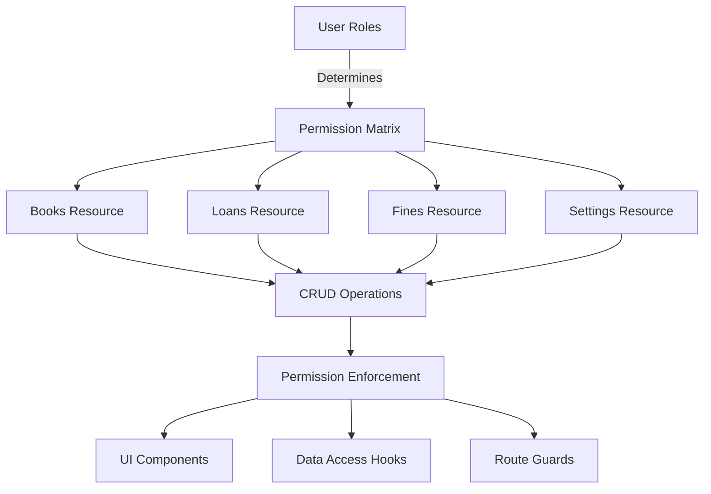

**Diagram sources**
- [rbac.ts](file://src/modules/library/rbac.ts#L1-L150)

## Role-Based Capabilities
The Library module supports four primary roles with distinct capabilities:

- **Administrator**: Full access to all library resources and settings
- **Librarian**: Comprehensive access to manage books, loans, and fines
- **Teacher**: Limited access to view books and manage student loans
- **Student**: Basic access to view personal loans and fines

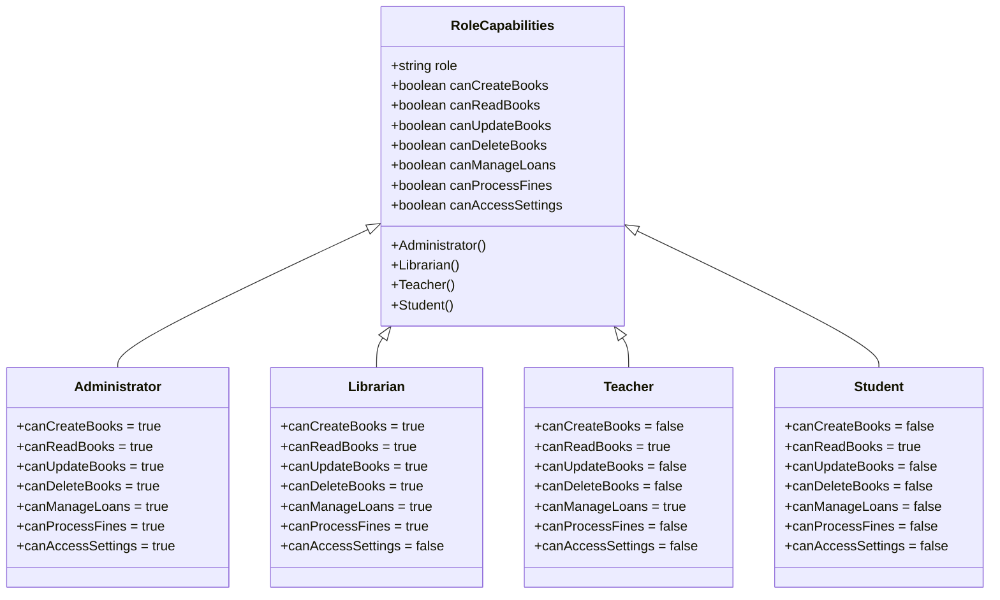

**Diagram sources**
- [rbac.ts](file://src/modules/library/rbac.ts#L1-L150)

**Section sources**
- [rbac.ts](file://src/modules/library/rbac.ts#L1-L150)

## CRUD Permissions by Resource

### Books Resource Permissions
The books resource supports full CRUD operations with role-specific restrictions:

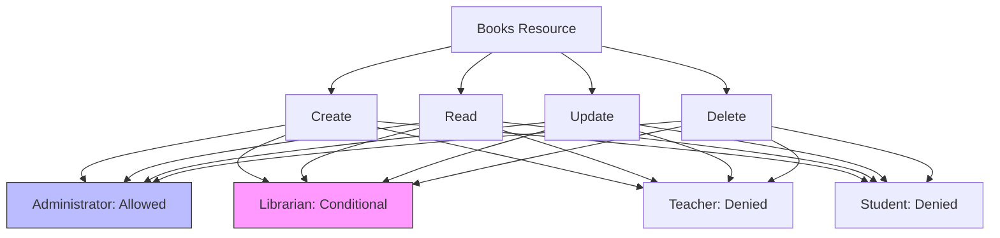

**Diagram sources**
- [rbac.ts](file://src/modules/library/rbac.ts#L20-L45)
- [useBookData.ts](file://src/modules/library/data/useBookData.ts#L15-L30)

### Loans Resource Permissions
The loans resource manages borrowing and return operations:

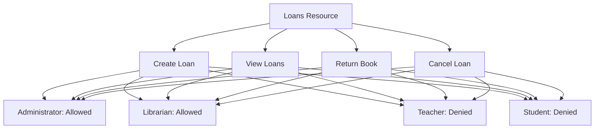

**Diagram sources**
- [rbac.ts](file://src/modules/library/rbac.ts#L46-L70)
- [useLoanData.ts](file://src/modules/library/data/useLoanData.ts#L15-L30)

### Fines Resource Permissions
The fines resource handles penalty management:

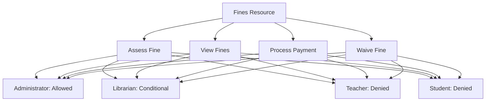

**Diagram sources**
- [rbac.ts](file://src/modules/library/rbac.ts#L71-L95)
- [useFineData.ts](file://src/modules/library/data/useFineData.ts#L15-L30)

### Settings Resource Permissions
The settings resource controls library configuration:

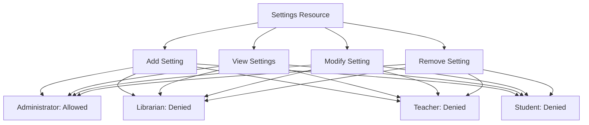

**Diagram sources**
- [rbac.ts](file://src/modules/library/rbac.ts#L96-L120)
- [useLibrarySettingsData.ts](file://src/modules/library/data/useLibrarySettingsData.ts#L15-L30)

## Permission Enforcement Mechanisms

### Data Access Hook Implementation
Data access hooks enforce permissions at the data layer by integrating with the RBAC service:

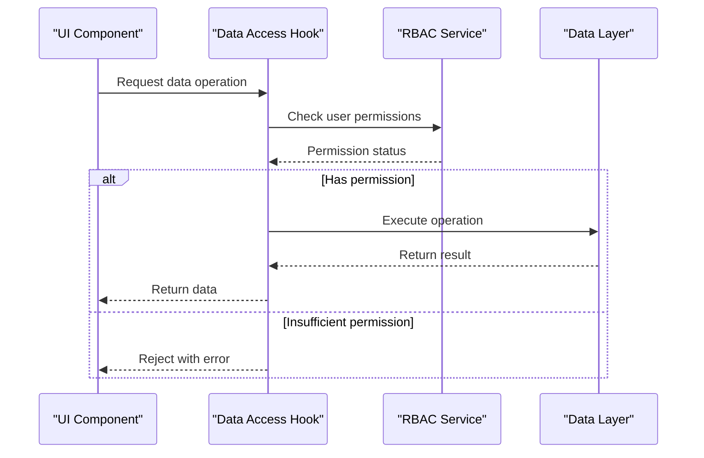

**Diagram sources**
- [useBookData.ts](file://src/modules/library/data/useBookData.ts#L15-L50)
- [useRBAC.ts](file://src/hooks/useRBAC.ts#L10-L40)

**Section sources**
- [useBookData.ts](file://src/modules/library/data/useBookData.ts#L1-L100)

### Permission Check in useBookData Hook
The `useBookData` hook implements permission checks for book operations:

```typescript
import { useRBAC } from '@/hooks/useRBAC';
import { useAppDataInternal } from './useAppData';

export function useBookData() {
  const { hasPermission, userRoles } = useRBAC();
  const { create, update, remove, query } = useAppDataInternal('books');
  
  const createBook = async (bookData) => {
    if (!hasPermission('library.books.create')) {
      throw new Error('Insufficient permissions to create books');
    }
    return await create(bookData);
  };
  
  const updateBook = async (id, updates) => {
    if (!hasPermission('library.books.update')) {
      throw new Error('Insufficient permissions to update books');
    }
    return await update(id, updates);
  };
  
  const deleteBook = async (id) => {
    if (!hasPermission('library.books.delete')) {
      throw new Error('Insufficient permissions to delete books');
    }
    
    // Additional policy check for book deletion
    const book = await query({ id });
    if (book.status === 'LOANED') {
      throw new Error('Cannot delete a book that is currently loaned');
    }
    
    return await remove(id);
  };
  
  const getBooks = async (filters) => {
    return await query(filters);
  };
  
  return {
    createBook,
    updateBook,
    deleteBook,
    getBooks,
    canCreate: hasPermission('library.books.create'),
    canUpdate: hasPermission('library.books.update'),
    canDelete: hasPermission('library.books.delete')
  };
}
```

**Section sources**
- [useBookData.ts](file://src/modules/library/data/useBookData.ts#L1-L100)

## Integration with Global RBAC Service

### RBAC Service Architecture
The Library module integrates with the global RBAC service through a standardized interface:

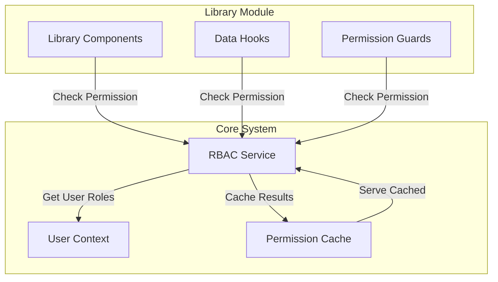

**Diagram sources**
- [core/rbacService.ts](file://src/core/rbacService.ts#L1-L50)
- [useRBAC.ts](file://src/hooks/useRBAC.ts#L1-L30)

### useRBAC Hook Integration
The `useRBAC` hook provides a consistent interface for permission checks:

```typescript
import { useContext } from 'react';
import { UserContext } from '@/contexts/UserContext';
import { rbacService } from '@/core/rbacService';

export function useRBAC() {
  const { user } = useContext(UserContext);
  
  const hasPermission = (permission: string): boolean => {
    if (!user) return false;
    return rbacService.hasPermission(user, permission);
  };
  
  const hasAnyPermission = (permissions: string[]): boolean => {
    if (!user) return false;
    return rbacService.hasAnyPermission(user, permissions);
  };
  
  const hasAllPermissions = (permissions: string[]): boolean => {
    if (!user) return false;
    return rbacService.hasAllPermissions(user, permissions);
  };
  
  return {
    hasPermission,
    hasAnyPermission,
    hasAllPermissions,
    userRoles: user?.roles || [],
    isSuperAdmin: user?.isSuperAdmin || false
  };
}
```

**Section sources**
- [useRBAC.ts](file://src/hooks/useRBAC.ts#L1-L50)

## Permission Inheritance and Custom Policies

### Core RBAC Inheritance
The Library module inherits permission definitions from the core RBAC system:

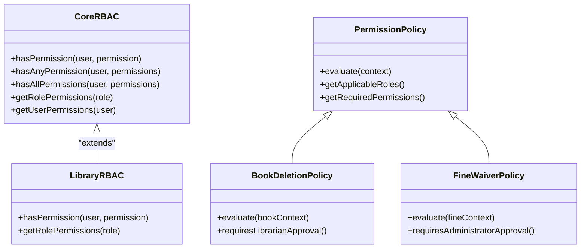

**Diagram sources**
- [core/rbacService.ts](file://src/core/rbacService.ts#L1-L100)
- [rbac.ts](file://src/modules/library/rbac.ts#L1-L50)

### Custom Policies for Sensitive Operations
The Library module implements custom policies for sensitive operations:

#### Book Deletion Policy
```typescript
// Custom policy for book deletion
const bookDeletionPolicy = {
  check: (user, book) => {
    // Administrators can always delete books
    if (user.roles.includes('administrator')) {
      return true;
    }
    
    // Librarians can delete books only if not loaned
    if (user.roles.includes('librarian')) {
      return book.status !== 'LOANED';
    }
    
    // Teachers and students cannot delete books
    return false;
  },
  description: 'Books can only be deleted by administrators or librarians when not currently loaned'
};
```

#### Fine Waiver Policy
```typescript
// Custom policy for fine waiver
const fineWaiverPolicy = {
  check: (user, fine) => {
    // Only administrators can waive fines
    if (user.roles.includes('administrator')) {
      return true;
    }
    
    // Librarians can waive fines under $10
    if (user.roles.includes('librarian') && fine.amount < 10) {
      return true;
    }
    
    return false;
  },
  description: 'Fines can be waived by administrators or librarians for amounts under $10'
};
```

**Section sources**
- [rbac.ts](file://src/modules/library/rbac.ts#L121-L150)

## UI Component Permission Checks

### Conditional Rendering Based on Permissions
UI components use permission checks to control visibility and interactivity:

```typescript
import { useRBAC } from '@/hooks/useRBAC';

function BookManagementToolbar() {
  const { hasPermission } = useRBAC();
  
  return (
    <div className="flex space-x-2">
      {hasPermission('library.books.create') && (
        <Button onClick={handleCreateBook}>
          Add Book
        </Button>
      )}
      
      {hasPermission('library.books.export') && (
        <Button variant="secondary" onClick={handleExportBooks}>
          Export List
        </Button>
      )}
      
      {hasPermission('library.settings.manage') && (
        <Button variant="ghost" onClick={handleOpenSettings}>
          <SettingsIcon />
        </Button>
      )}
    </div>
  );
}
```

**Section sources**
- [rbac.ts](file://src/modules/library/rbac.ts#L1-L150)

### Permission-Based Component States
Components adapt their behavior based on user permissions:

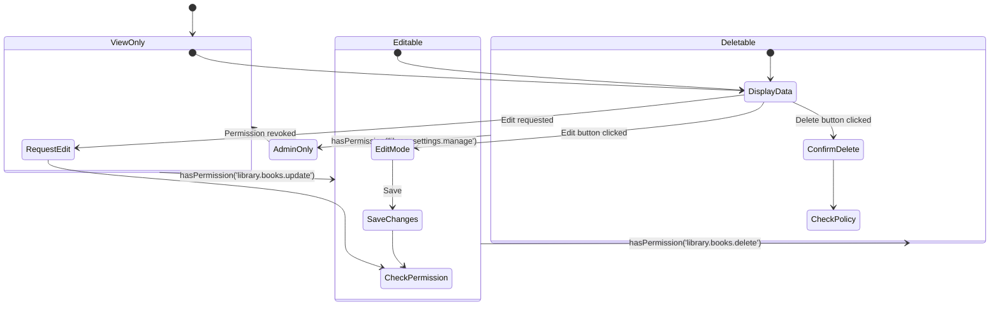

**Diagram sources**
- [rbac.ts](file://src/modules/library/rbac.ts#L1-L150)

## Route Guards and Access Control

### Route Protection Implementation
Route guards enforce permissions at the navigation level:

```typescript
import { useRBAC } from '@/hooks/useRBAC';
import { Navigate } from 'react-router-dom';

function ProtectedLibraryRoute({ children, permission }) {
  const { hasPermission } = useRBAC();
  
  if (!hasPermission(permission)) {
    return <Navigate to="/library/books" replace />;
  }
  
  return children;
}

// Usage in routing
<Route 
  path="/library/settings" 
  element={
    <ProtectedLibraryRoute permission="library.settings.manage">
      <LibrarySettingsPage />
    </ProtectedLibraryRoute>
  } 
/>
```

**Section sources**
- [rbac.ts](file://src/modules/library/rbac.ts#L1-L150)

### Permission Checks in Navigation
The navigation system integrates permission checks to hide unauthorized routes:

```typescript
import { useRBAC } from '@/hooks/useRBAC';

const libraryNavigationConfig = [
  {
    id: 'books',
    title: 'Books',
    path: '/library/books',
    icon: 'BookIcon',
    visible: true
  },
  {
    id: 'loans',
    title: 'Loans',
    path: '/library/loans',
    icon: 'LoanIcon',
    visible: true
  },
  {
    id: 'fines',
    title: 'Fines',
    path: '/library/fines',
    icon: 'FineIcon',
    visible: (hasPermission) => hasPermission('library.fines.view')
  },
  {
    id: 'settings',
    title: 'Settings',
    path: '/library/settings',
    icon: 'SettingsIcon',
    visible: (hasPermission) => hasPermission('library.settings.manage')
  }
];

function filterNavigationItems(items, hasPermission) {
  return items.map(item => {
    if (typeof item.visible === 'function') {
      return { ...item, visible: item.visible(hasPermission) };
    }
    return item;
  }).filter(item => item.visible);
}
```

**Section sources**
- [rbac.ts](file://src/modules/library/rbac.ts#L1-L150)

## Administrator Configuration Guide

### Configuring Role Permissions
Administrators can configure role permissions through the Settings module:

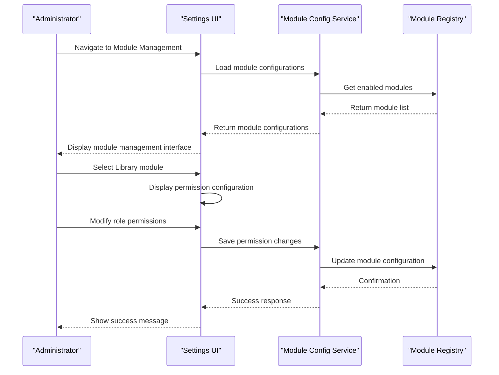

**Diagram sources**
- [ModuleManagementPage.tsx](file://src/modules/settings/pages/ModuleManagementPage.tsx#L1-L585)

### Module Management Interface
The Module Management page provides administrators with controls to manage role permissions:

```typescript
// ModuleManagementPage.tsx
const handleViewPermissions = (module: ModuleStatus) => {
  if (!canViewPermissions) {
    alert(t('common:errors.insufficientPermissions'));
    return;
  }
  
  setSelectedModule(module);
  setShowPermissionsModal(true);
};

// Permissions Modal
{showPermissionsModal && selectedModule && (
  <Modal
    isOpen={showPermissionsModal}
    onClose={() => setShowPermissionsModal(false)}
    title={t('moduleManagement.modulePermissions', { name: selectedModule.name })}
  >
    <div className="space-y-4">
      <p className="text-sm text-gray-600">
        {t('moduleManagement.permissionsDescription')}
      </p>
      <div className="space-y-2">
        {selectedModule.requiredPermissions?.map(permission => (
          <div 
            key={permission}
            className="flex items-center justify-between p-3 border border-gray-200 rounded-lg"
          >
            <span className="font-medium text-gray-900">{permission}</span>
            <span className="inline-flex items-center px-2.5 py-0.5 rounded-full text-xs font-medium bg-red-100 text-red-800">
              {t('moduleManagement.required')}
            </span>
          </div>
        ))}
      </div>
      <div className="flex justify-end">
        <Button variant="outline" onClick={() => setShowPermissionsModal(false)}>
          {t('common:close')}
        </Button>
      </div>
    </div>
  </Modal>
)}
```

**Section sources**
- [ModuleManagementPage.tsx](file://src/modules/settings/pages/ModuleManagementPage.tsx#L1-L585)