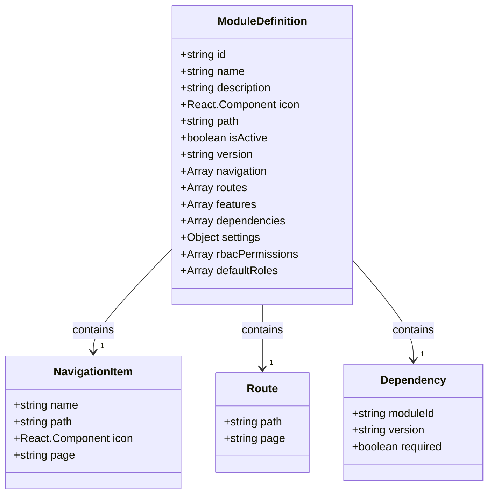
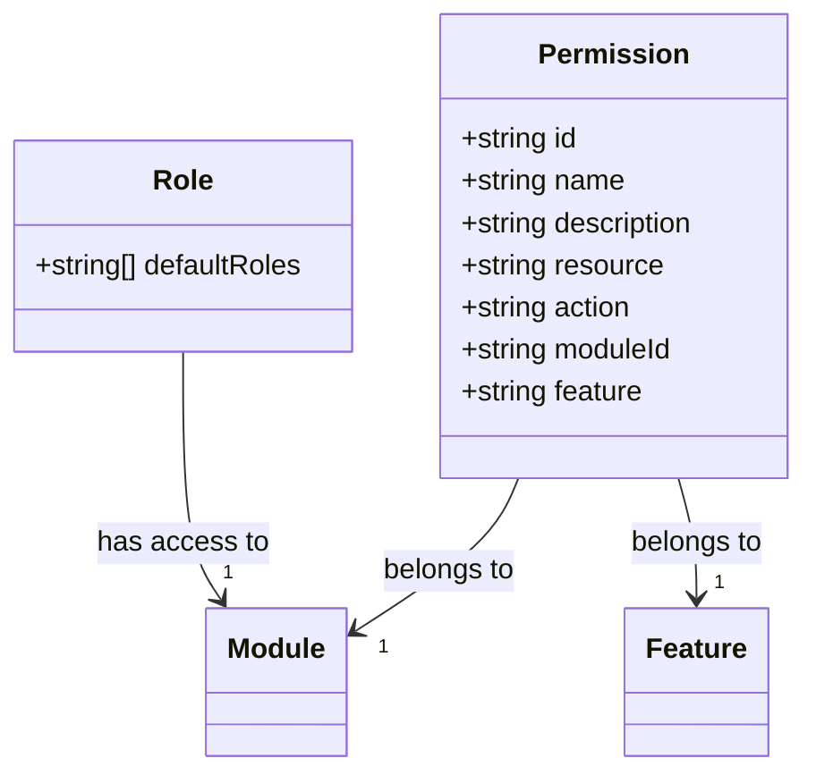
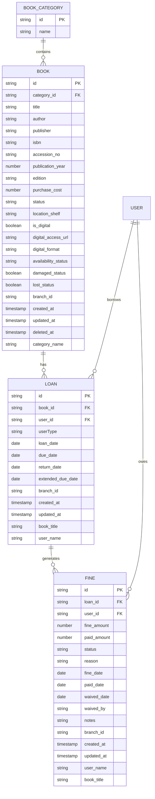
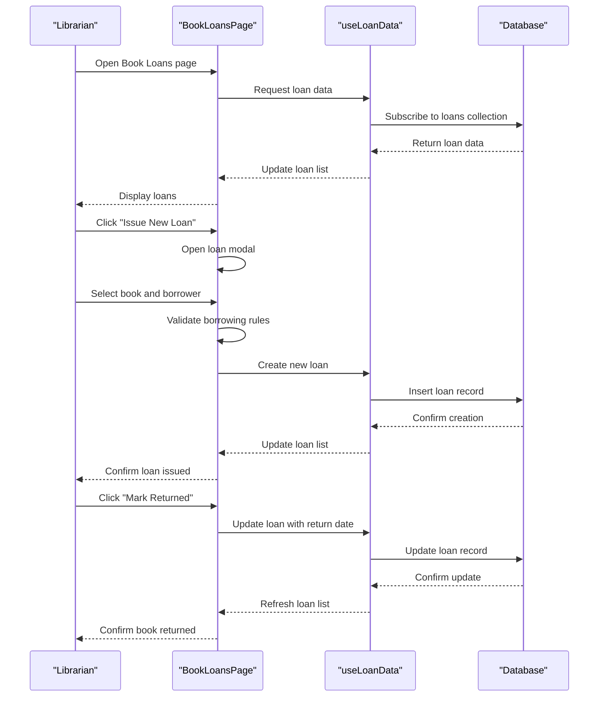
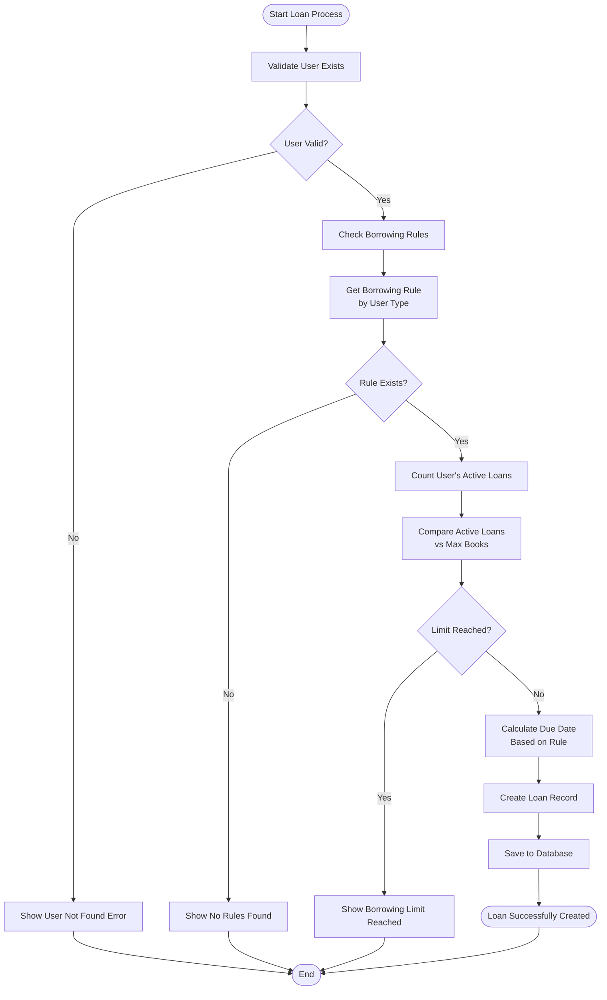
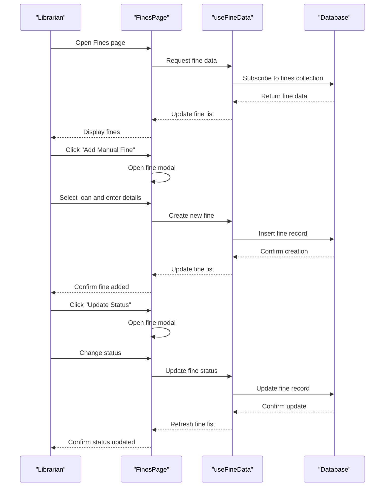
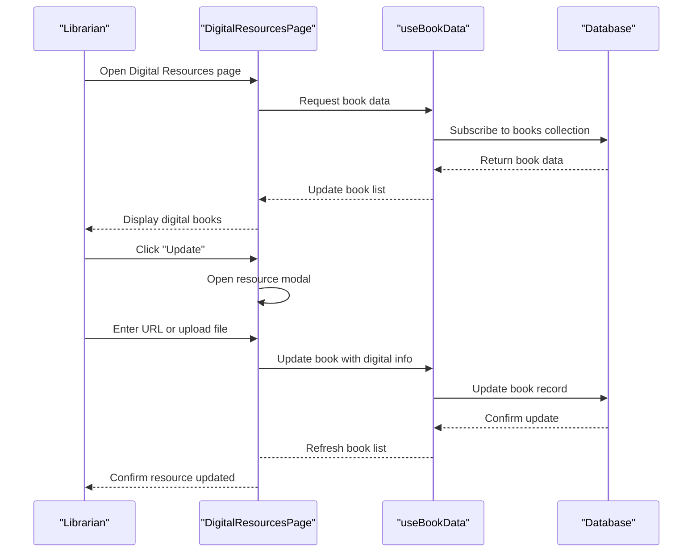
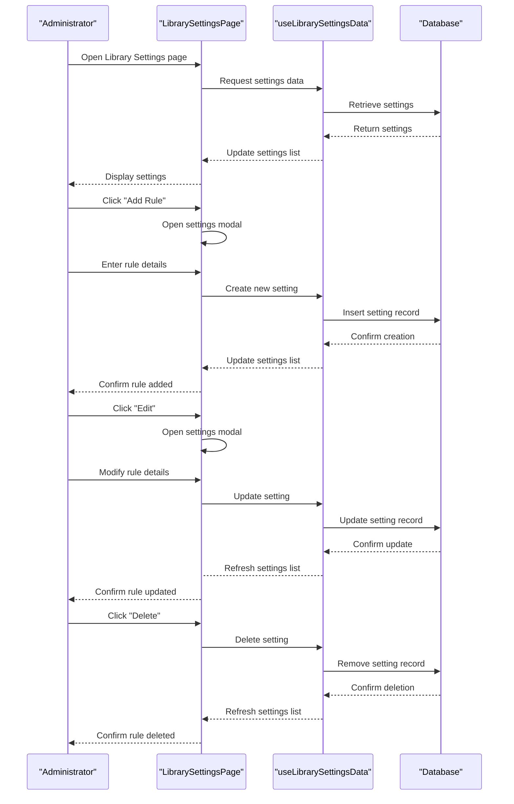

# Library Module

<cite>
**Referenced Files in This Document**   
- [moduleDefinition.tsx](file://src/modules/library/moduleDefinition.tsx)
- [rbac.ts](file://src/modules/library/rbac.ts)
- [schema.ts](file://src/modules/library/data/schema.ts)
- [types.ts](file://src/modules/library/data/types.ts)
- [BookLoansPage.tsx](file://src/modules/library/pages/BookLoansPage.tsx)
- [FinesPage.tsx](file://src/modules/library/pages/FinesPage.tsx)
- [useLoanData.ts](file://src/modules/library/data/useLoanData.ts)
- [useFineData.ts](file://src/modules/library/data/useFineData.ts)
- [useLibrarySettingsData.ts](file://src/modules/library/data/useLibrarySettingsData.ts)
- [DamagedLostBooksPage.tsx](file://src/modules/library/pages/DamagedLostBooksPage.tsx)
- [DigitalResourcesPage.tsx](file://src/modules/library/pages/DigitalResourcesPage.tsx)
- [LibrarySettingsPage.tsx](file://src/modules/library/pages/LibrarySettingsPage.tsx)
</cite>

## Table of Contents
1. [Introduction](#introduction)
2. [Module Registration and Dependencies](#module-registration-and-dependencies)
3. [Access Control and Permissions](#access-control-and-permissions)
4. [Data Model](#data-model)
5. [Key Library Operations](#key-library-operations)
6. [Book Management](#book-management)
7. [Loan Processing](#loan-processing)
8. [Fine Calculation and Management](#fine-calculation-and-management)
9. [Overdue Reports and Tracking](#overdue-reports-and-tracking)
10. [Digital Resource Management](#digital-resource-management)
11. [Lost and Damaged Book Tracking](#lost-and-damaged-book-tracking)
12. [Library Settings and Configuration](#library-settings-and-configuration)
13. [Integration with Administration Module](#integration-with-administration-module)
14. [Best Practices](#best-practices)
15. [Conclusion](#conclusion)

## Introduction
The Library module in schoolpilot3 is a comprehensive system designed to manage all aspects of a school library, including book inventory, loan processing, fine management, and digital resources. This document provides a detailed analysis of the module's implementation, covering its architecture, data model, key operations, and integration points. The module is designed to be user-friendly while providing robust functionality for librarians and administrators to efficiently manage library resources and services.

## Module Registration and Dependencies
The Library module is registered within the application through its module definition file, which specifies its configuration, navigation structure, and dependencies. The module is self-contained and follows a consistent pattern for integration with the larger schoolpilot3 system.

**Diagram sources**
- [moduleDefinition.tsx](file://src/modules/library/moduleDefinition.tsx)

**Section sources**
- [moduleDefinition.tsx](file://src/modules/library/moduleDefinition.tsx)

The module is registered with the following key properties:
- **ID**: 'library'
- **Name**: 'navigation:library.title' (localized)
- **Path**: '/library'
- **Version**: '1.0.0'
- **Dependencies**: Requires the 'administration' module (version ^1.0.0)

The module defines ten navigation items that correspond to different functional areas within the library system, including dashboard, books, book categories, book loans, fines, user portal, digital resources, damaged/lost books, import books, and settings. Each navigation item is associated with a specific page component that handles the UI and functionality for that area.

## Access Control and Permissions
The Library module implements a role-based access control (RBAC) system to manage user permissions and ensure appropriate access to library functions. The RBAC configuration is defined in a separate file that specifies the permissions available within the module and the default roles that have access.

**Diagram sources**
- [rbac.ts](file://src/modules/library/rbac.ts)

**Section sources**
- [rbac.ts](file://src/modules/library/rbac.ts)

The module defines 9 specific permissions that are organized by resource and action:
- **Book Management Permissions**:
  - library.books.read: View books
  - library.books.create: Add books
  - library.books.update: Update book information
  - library.books.delete: Remove books
- **Loan Tracking Permissions**:
  - library.loans.read: View loans
  - library.loans.create: Create loans
  - library.loans.update: Update loan information

The module specifies that the default roles with access are 'librarian' and 'administrator'. This ensures that only authorized personnel can perform critical library operations. The permissions are granular, allowing for fine-tuned control over what actions users can perform within the library system.

## Data Model
The Library module implements a comprehensive data model to represent books, categories, loans, and fines. The data schema is defined in a database-agnostic format that can be used across different database implementations.

**Diagram sources**
- [schema.ts](file://src/modules/library/data/schema.ts)
- [types.ts](file://src/modules/library/data/types.ts)

**Section sources**
- [schema.ts](file://src/modules/library/data/schema.ts)
- [types.ts](file://src/modules/library/data/types.ts)

### Book Category Schema
The book category schema defines the structure for book categories with the following properties:
- **id**: Unique identifier (primary key)
- **name**: Category name (required, max length 100 characters)

### Book Schema
The book schema is comprehensive, capturing both physical and digital book attributes:
- **Core Information**: title, author, publisher, isbn, accession_no
- **Publication Details**: publication_year, edition
- **Financial Data**: purchase_cost
- **Status Information**: status (enum), availability_status (enum), damaged_status, lost_status
- **Location Data**: location_shelf, branch_id
- **Digital Information**: is_digital, digital_access_url, digital_format
- **Metadata**: created_at, updated_at, deleted_at
- **Denormalized Data**: category_name (for efficient querying)

### Loan Schema
The loan schema tracks book borrowing with the following properties:
- **References**: book_id, user_id
- **User Information**: userType (Staff, Student, Parent, Supplier)
- **Dates**: loan_date, due_date, return_date, extended_due_date
- **Branch Information**: branch_id
- **Metadata**: created_at, updated_at
- **Denormalized Data**: book_title, user_name

### Fine Schema
The fine schema manages financial penalties with the following properties:
- **References**: loan_id, user_id
- **Financial Data**: fine_amount, paid_amount
- **Status Information**: status (enum)
- **Reason and Notes**: reason, notes
- **Dates**: fine_date, paid_date, waived_date
- **Waiver Information**: waived_by
- **Branch Information**: branch_id
- **Metadata**: created_at, updated_at
- **Denormalized Data**: user_name, book_title

## Key Library Operations
The Library module supports a range of operations essential to library management, including book management, loan processing, fine calculation, and reporting. These operations are implemented through dedicated page components and data hooks that provide a consistent user experience and robust functionality.

## Book Management
The book management functionality allows librarians to add, view, update, and remove books from the library collection. The BooksPage component provides a user interface for managing the book inventory, while the useBookData hook handles the underlying data operations.

The book data model includes support for both physical and digital books, with specific fields for digital resources such as digital_access_url and digital_format. Books can be categorized using the book category system, which helps organize the collection and facilitates searching and browsing.

Books have multiple status indicators:
- **Status**: Available, On Loan, Reserved, Lost, Damaged, Archived
- **Availability Status**: Available, On Loan, Reserved
- **Condition Flags**: damaged_status, lost_status

These status indicators allow for comprehensive tracking of book conditions and availability, enabling librarians to manage the collection effectively.

## Loan Processing
The loan processing functionality is implemented in the BookLoansPage component and supported by the useLoanData hook. This system handles the core operation of lending books to users and tracking their return.

**Diagram sources**
- [BookLoansPage.tsx](file://src/modules/library/pages/BookLoansPage.tsx)
- [useLoanData.ts](file://src/modules/library/data/useLoanData.ts)

**Section sources**
- [BookLoansPage.tsx](file://src/modules/library/pages/BookLoansPage.tsx)
- [useLoanData.ts](file://src/modules/library/data/useLoanData.ts)

### Borrowing Rules Validation
The loan processing system includes comprehensive validation of borrowing rules to prevent policy violations:

**Diagram sources**
- [BookLoansPage.tsx](file://src/modules/library/pages/BookLoansPage.tsx)

**Section sources**
- [BookLoansPage.tsx](file://src/modules/library/pages/BookLoansPage.tsx)

The borrowing rules validation process:
1. Verifies that the selected user exists in the system
2. Retrieves the appropriate borrowing rule based on the user's type (Student, Staff, etc.)
3. Counts the user's active loans (loans without a return date)
4. Compares the active loan count against the maximum allowed by the borrowing rule
5. If the limit is reached, displays an error message with details
6. If valid, calculates the due date based on the borrowing rule's max_loan_days
7. Creates and saves the loan record to the database

The system also provides real-time feedback to librarians through a borrowing status panel that displays:
- Current number of active loans
- Maximum allowed loans
- Maximum loan duration
- Fine per day rate
- Warning when the borrowing limit is reached

## Fine Calculation and Management
The fine management system is implemented in the FinesPage component and supported by the useFineData hook. This system handles both automatic and manual fine creation, as well as fine status updates.

**Diagram sources**
- [FinesPage.tsx](file://src/modules/library/pages/FinesPage.tsx)
- [useFineData.ts](file://src/modules/library/data/useFineData.ts)

**Section sources**
- [FinesPage.tsx](file://src/modules/library/pages/FinesPage.tsx)
- [useFineData.ts](file://src/modules/library/data/useFineData.ts)

### Fine Status Management
The fine system supports four status states:
- **Pending**: Fine has been created but not yet billed
- **Billed**: Fine has been included in a billing cycle
- **Paid**: Fine has been paid
- **Waived**: Fine has been forgiven

The system provides dedicated functions for common status transitions:
- **markAsPaid**: Updates the status to Paid and records the payment date
- **waiveFine**: Updates the status to Waived
- **billFine**: Updates the status to Billed

The UI displays fines with color-coded status indicators:
- **Paid**: Green badge
- **Pending**: Yellow badge
- **Billed**: Blue badge
- **Waived**: Gray badge

## Overdue Reports and Tracking
The Library module includes functionality for tracking overdue loans and generating reports. The useLoanData hook provides a getOverdueLoans function that filters loans based on their due date and return status.

The system also includes proactive notifications through the notifyOverdueLoans function, which checks for overdue loans when the data is loaded and displays a warning toast notification for each overdue loan. This helps librarians stay aware of overdue books and take appropriate action.

The BookLoansPage component visually indicates overdue loans by displaying a warning message in the return date column for loans that are past their due date. This provides immediate visibility into overdue items when viewing the loan list.

## Digital Resource Management
The DigitalResourcesPage component provides functionality for managing digital resources linked to books. This system allows librarians to associate digital files with physical books, creating a hybrid collection that supports both physical and digital access.

**Diagram sources**
- [DigitalResourcesPage.tsx](file://src/modules/library/pages/DigitalResourcesPage.tsx)
- [useBookData.ts](file://src/modules/library/data/useBookData.ts)

**Section sources**
- [DigitalResourcesPage.tsx](file://src/modules/library/pages/DigitalResourcesPage.tsx)

The digital resource management system:
- Filters books to show only those marked as digital (is_digital = true)
- Allows entry of a digital access URL for web-based resources
- Supports file upload for local digital resources
- Captures the digital format (PDF, EPUB, etc.)
- Provides direct access links in the UI

This functionality enables the library to manage e-books, digital textbooks, and other electronic resources alongside physical books, providing a unified interface for resource management.

## Lost and Damaged Book Tracking
The DamagedLostBooksPage component provides specialized functionality for tracking books that are damaged or lost. This system helps librarians manage the condition of the collection and take appropriate actions for damaged or missing books.

```mermaid
sequenceDiagram
participant User as "Librarian"
participant UI as "DamagedLostBooksPage"
participant Hook as "useBookData"
participant DB as "Database"
User->>UI : Open Damaged/Lost Books page
UI->>Hook : Request book data
Hook->>DB : Subscribe to books collection
DB-->>Hook : Return book data
Hook-->>UI : Update book list
UI-->>User : Display filtered books
User->>UI : Select filter type
UI->>UI : Apply filter
UI->>UI : Display filtered results
User->>UI : Click "Update"
UI->>UI : Open status modal
User->>UI : Modify damaged/lost flags
UI->>Hook : Update book status
Hook->>DB : Update book record
DB-->>Hook : Confirm update
Hook-->UI : Refresh book list
UI-->>User : Confirm status updated
User->>UI : Click "Mark Repaired" or "Mark Found"
UI->>Hook : Update book with repaired/found status
Hook->>DB : Update book record
DB-->>Hook : Confirm update
Hook-->>UI : Refresh book list
UI-->>User : Confirm status updated
```

**Diagram sources**
- [DamagedLostBooksPage.tsx](file://src/modules/library/pages/DamagedLostBooksPage.tsx)
- [useBookData.ts](file://src/modules/library/data/useBookData.ts)

**Section sources**
- [DamagedLostBooksPage.tsx](file://src/modules/library/pages/DamagedLostBooksPage.tsx)

The system includes several key features:
- **Filtering**: Allows filtering by damaged only, lost only, both, or all issues
- **Status Automation**: Automatically updates the book status based on the damaged and lost flags:
  - Lost flag → Status: Lost (takes precedence)
  - Damaged flag only → Status: Damaged
  - Both flags → Status: Lost
  - Neither flag → Status: Available
- **Quick Actions**: Provides "Mark Repaired" and "Mark Found" buttons for common status changes
- **Visual Indicators**: Uses color-coded badges and checkmarks to clearly show the condition status
- **Summary Statistics**: Displays counts of damaged, lost, and total issue books

This comprehensive tracking system helps maintain accurate inventory records and supports decision-making about book replacement, repair, or removal from the collection.

## Library Settings and Configuration
The LibrarySettingsPage component allows administrators to configure borrowing rules that govern loan policies. These settings define the parameters for different user types and book categories.

**Diagram sources**
- [LibrarySettingsPage.tsx](file://src/modules/library/pages/LibrarySettingsPage.tsx)
- [useLibrarySettingsData.ts](file://src/modules/library/data/useLibrarySettingsData.ts)

**Section sources**
- [LibrarySettingsPage.tsx](file://src/modules/library/pages/LibrarySettingsPage.tsx)
- [useLibrarySettingsData.ts](file://src/modules/library/data/useLibrarySettingsData.ts)

The borrowing rules include the following configurable parameters:
- **Max Loan Days**: Maximum duration a book can be borrowed
- **Max Renewals**: Number of times a loan can be renewed
- **Fine per Day**: Penalty amount for each day a book is overdue
- **Max Books per User**: Maximum number of books a user can have on loan simultaneously
- **Applicable Book Categories**: Categories to which the rule applies
- **Applicable User Types**: User types to which the rule applies (Student, Staff, etc.)
- **Active Status**: Whether the rule is currently in effect

The system includes sample rules for different user types:
- **Student Standard Rule**: 14-day loan period, 3-book limit, KES 5.00 daily fine
- **Staff Extended Rule**: 30-day loan period, 10-book limit, KES 10.00 daily fine

These rules are used by the loan processing system to validate borrowing requests and calculate due dates automatically.

## Integration with Administration Module
The Library module integrates with the Administration module to access student and staff records. This dependency is declared in the module definition, requiring the 'administration' module to be present and active.

The integration enables the library system to:
- Access user information (name, type, status)
- Validate user existence when creating loans
- Display user names in loan and fine records
- Apply user-type-specific borrowing rules

The useAppData hook, which is used in several library components, likely provides access to this shared user data from the Administration module. This integration ensures data consistency across the system and eliminates the need for duplicate user records in the library module.

## Best Practices
Based on the implementation of the Library module, the following best practices are recommended for managing digital resources and maintaining accurate inventory records:

### Digital Resource Management
1. **Consistent Naming**: Use a standardized naming convention for digital files to facilitate searching and organization
2. **Format Standardization**: Prefer open, non-proprietary formats (PDF, EPUB) over proprietary formats when possible
3. **Access Control**: Ensure digital resources respect copyright and licensing agreements
4. **Backup Strategy**: Implement regular backups of digital resources to prevent data loss
5. **Metadata Completeness**: Always fill in digital format and access URL fields for digital books

### Inventory Management
1. **Regular Audits**: Conduct periodic physical inventory checks to verify the accuracy of digital records
2. **Immediate Updates**: Update book status immediately when damage or loss is discovered
3. **Condition Documentation**: Use the notes field to document details about damage or circumstances of loss
4. **Preventive Maintenance**: Implement a schedule for inspecting high-use books for potential damage
5. **Clear Policies**: Establish and communicate clear policies for book damage, loss, and replacement

### Loan Management
1. **Rule Consistency**: Apply borrowing rules consistently to all users
2. **Proactive Monitoring**: Regularly review overdue reports to identify patterns and address issues
3. **User Communication**: Notify users of upcoming due dates and overdue books
4. **Fine Transparency**: Clearly communicate fine policies and calculations to users
5. **Data Accuracy**: Verify user and book information before processing loans

### System Maintenance
1. **Regular Updates**: Keep the library system updated with the latest software versions
2. **User Training**: Provide adequate training for librarians on all system features
3. **Backup Procedures**: Implement regular database backups to protect against data loss
4. **Performance Monitoring**: Monitor system performance and address any issues promptly
5. **Feedback Collection**: Gather feedback from users to identify areas for improvement

## Conclusion
The Library module in schoolpilot3 provides a comprehensive and well-structured system for managing school library operations. Its modular design, clear data model, and robust functionality make it a powerful tool for librarians and administrators. The module effectively handles core library functions including book management, loan processing, fine calculation, and digital resource management.

Key strengths of the implementation include:
- **Modular Architecture**: Clear separation of concerns with dedicated components for different functions
- **Comprehensive Data Model**: Rich schema that captures both physical and digital book attributes
- **Robust Validation**: Thorough validation of borrowing rules to prevent policy violations
- **User-Friendly Interface**: Consistent UI components and intuitive workflows
- **Flexible Configuration**: Configurable borrowing rules that can be tailored to different user types
- **Proactive Notifications**: Automatic alerts for overdue loans to support timely follow-up

The module's integration with the Administration module ensures data consistency across the system, while its self-contained design makes it easy to maintain and extend. By following the best practices outlined in this document, schools can maximize the effectiveness of their library management system and provide excellent service to students and staff.