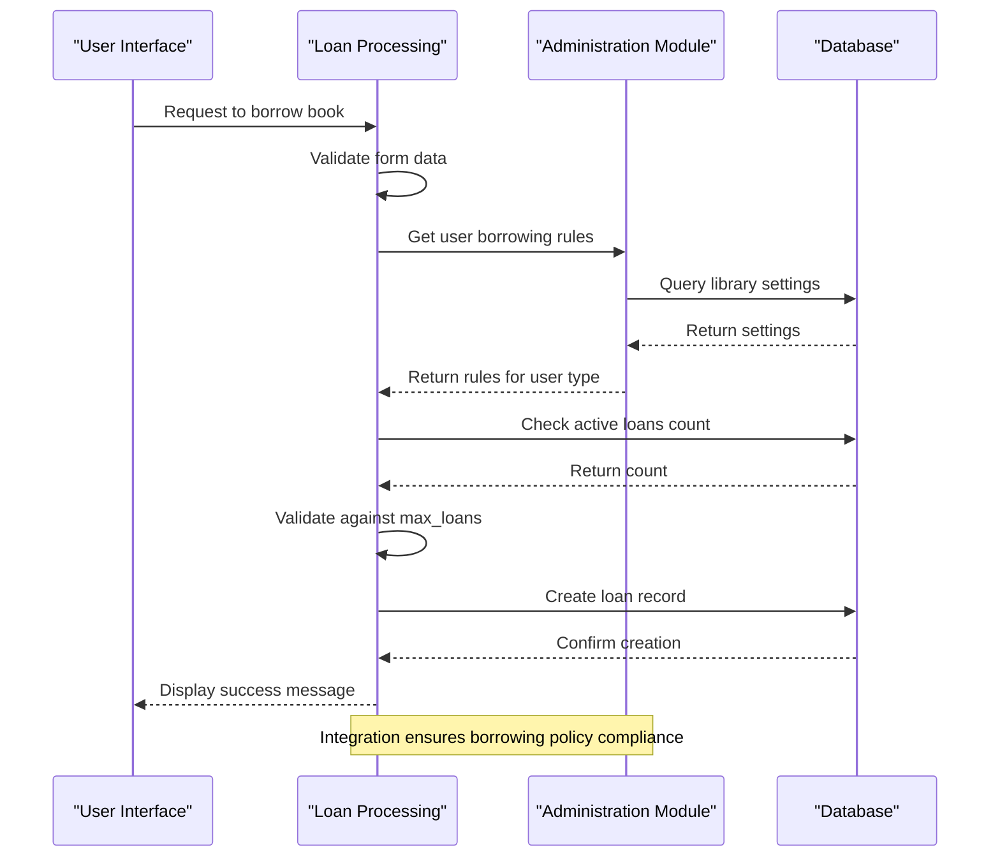
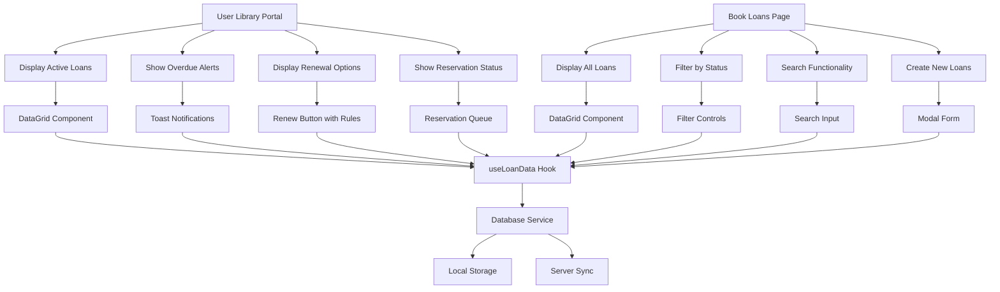
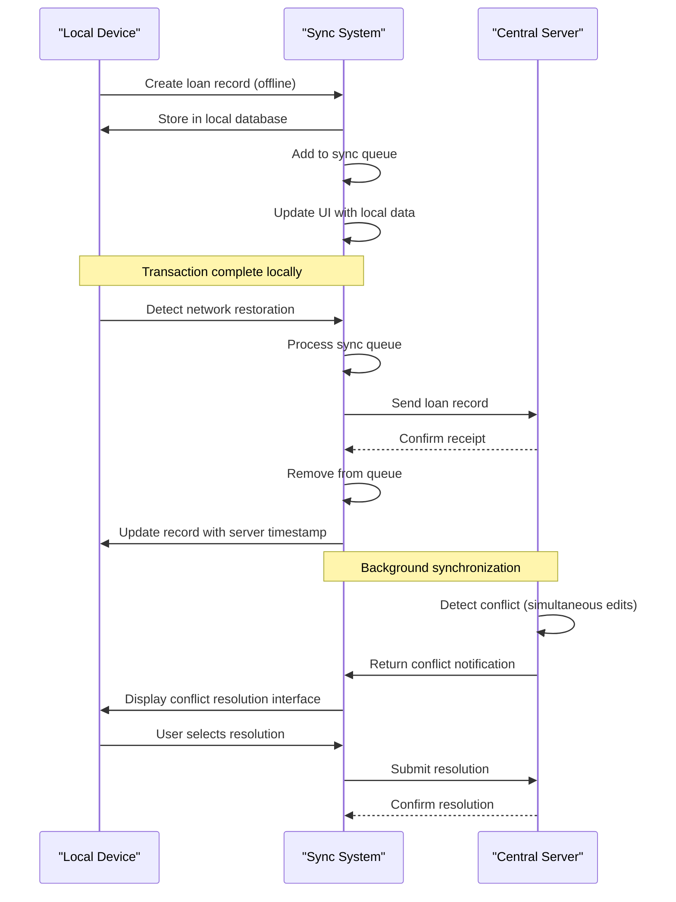

# Loan Processing

<cite>
**Referenced Files in This Document**   
- [useLoanData.ts](file://src/modules/library/data/useLoanData.ts#L1-L170)
- [UserLibraryPortalPage.tsx](file://src/modules/library/pages/UserLibraryPortalPage.tsx#L1-L250)
- [BookLoansPage.tsx](file://src/modules/library/pages/BookLoansPage.tsx#L1-L200)
- [databaseService.ts](file://src/services/database/databaseService.ts#L1-L308)
- [OfflineCapability.tsx](file://src/components/OfflineCapability.tsx#L1-L687)
- [DataStrategyManager.ts](file://src/services/DataStrategyManager.ts#L1-L600)
- [DataSyncMonitoringService.ts](file://src/services/DataSyncMonitoringService.ts#L1-L150)
</cite>

## Table of Contents
1. [Loan Processing Workflow](#loan-processing-workflow)
2. [Loan Lifecycle Management with useLoanData Hook](#loan-lifecycle-management-with-useloandata-hook)
3. [Integration with Administration Module](#integration-with-administration-module)
4. [User Interface Components](#user-interface-components)
5. [Offline Capability and Synchronization](#offline-capability-and-synchronization)
6. [Common Issues and Error Handling](#common-issues-and-error-handling)
7. [Best Practices for Data Consistency](#best-practices-for-data-consistency)

## Loan Processing Workflow

The loan processing system in the Library module manages the complete lifecycle of book loans, from checkout to return, including reservation management and renewal requests. The workflow begins when a user requests to borrow a book. The system first validates the user's eligibility through integration with the Administration module, checking factors such as active status, borrowing limits, and overdue loans. Once eligibility is confirmed, the system creates a new loan record with the current date as the loan date and calculates the due date based on the user's borrowing rules (typically 14 days for students, 28 days for staff).

When a book is checked out, the system updates the book's status to "Loaned" and creates a loan record that includes the book ID, user ID, loan date, due date, and user type. The loan record is stored in the local database and queued for synchronization with the central server. Users can view their active loans in the User Library Portal, where they can also request renewals if eligible. Renewals extend the due date by another loan period, subject to renewal limits and overdue status. When a book is returned, the system updates the loan record with the return date and updates the book's status back to "Available."

Reservations are handled through the same interface, allowing users to reserve books that are currently loaned. When a reserved book is returned, the system notifies the next person in the reservation queue. The system also handles edge cases such as offline checkouts, where transactions are stored locally and synchronized when connectivity is restored.

**Section sources**
- [UserLibraryPortalPage.tsx](file://src/modules/library/pages/UserLibraryPortalPage.tsx#L1-L250)
- [BookLoansPage.tsx](file://src/modules/library/pages/BookLoansPage.tsx#L1-L200)

## Loan Lifecycle Management with useLoanData Hook

The `useLoanData` hook is a self-contained component that manages the complete loan lifecycle without depending on the global AppDataContext. This hook provides CRUD operations for loan records and includes specialized functions for common loan processing tasks. The hook uses React's useState and useEffect hooks to manage local state and subscribe to database changes.

```mermaid
classDiagram
class useLoanData {
+data : LibLoanType[]
+isLoading : boolean
+error : Error | null
+create(newItem : Partial~LibLoanType~) : Promise~any~
+update(id : string, updatedData : Partial~LibLoanType~) : Promise~void~
+remove(id : string) : Promise~void~
+search(query : string) : Promise~LibLoanType[]~
+getOverdueLoans() : Promise~LibLoanType[]~
+getActiveLoans() : Promise~LibLoanType[]~
+extendLoan(id : string, newDueDate : string) : Promise~void~
+returnBook(id : string) : Promise~void~
}
class LibLoanType {
+id : string
+book_id : string
+book_title : string
+user_id : string
+user_name : string
+userType : string
+loan_date : string
+due_date : string
+return_date : string | null
+extended_due_date : string | null
+branch_id : string
+created_at : string
+updated_at : string
}
useLoanData --> LibLoanType : "manages"
useLoanData --> "databaseService" : "uses"
```

**Diagram sources**
- [useLoanData.ts](file://src/modules/library/data/useLoanData.ts#L1-L170)

**Section sources**
- [useLoanData.ts](file://src/modules/library/data/useLoanData.ts#L1-L170)

The hook initializes by subscribing to changes in the loans collection, ensuring that the local state is always synchronized with the database. When new loan data is received, the hook automatically checks for overdue loans and displays notifications using the toast system. The create function generates a new loan record with a unique ID and timestamps, while the update function ensures that the updated_at field is always current. The hook also provides convenience methods like returnBook, which sets the return_date to the current date, and extendLoan, which updates the extended_due_date field for renewals.

The search functionality allows filtering loans by book title, user name, branch ID, or user type. Advanced search helpers include getOverdueLoans, which returns all loans where the due date has passed and no return date has been recorded, and getActiveLoans, which returns all loans without a return date. These functions are used throughout the application to display relevant loan information to users and administrators.

## Integration with Administration Module

The loan processing system integrates with the Administration module to validate student eligibility and enforce borrowing limits. This integration occurs through shared data structures and cross-module function calls, rather than direct dependencies. When a loan is created or renewed, the system checks the user's borrowing rules, which are stored in the library settings and linked to user types defined in the Administration module.



**Diagram sources**
- [UserLibraryPortalPage.tsx](file://src/modules/library/pages/UserLibraryPortalPage.tsx#L1-L250)
- [BookLoansPage.tsx](file://src/modules/library/pages/BookLoansPage.tsx#L1-L200)

The borrowing rules include maximum loan days, maximum number of loans allowed, and maximum renewals. These rules are retrieved based on the user's role (student or staff) and are used to validate loan requests. For example, when a student attempts to borrow a book, the system checks if they have reached their maximum of 5 active loans. Similarly, when processing a renewal request, the system checks both the overdue status and the number of previous renewals.

The integration also includes validation of user status. Before approving a loan, the system verifies that the user is active and has no outstanding fines exceeding a threshold amount. This information is retrieved from the Administration module's user data, which maintains student and staff records, including financial obligations and disciplinary status.

## User Interface Components

The loan processing system provides two primary user interfaces: the BookLoansPage for library staff and the UserLibraryPortalPage for students and staff. These components display real-time availability indicators and loan history, providing a comprehensive view of the user's interaction with the library system.



**Diagram sources**
- [UserLibraryPortalPage.tsx](file://src/modules/library/pages/UserLibraryPortalPage.tsx#L1-L250)
- [BookLoansPage.tsx](file://src/modules/library/pages/BookLoansPage.tsx#L1-L200)

The UserLibraryPortalPage displays a DataGrid of the user's current loans, including book title, loan date, due date, and return status. For each loan, the interface shows renewal and return buttons, with the renewal button disabled when renewal rules are not met. The component uses the useLoanData hook to retrieve loan data and the useLibrarySettingsData hook to obtain borrowing rules. It also implements real-time availability indicators by checking the book's status in the database.

The BookLoansPage provides a more comprehensive view for library staff, showing all active loans with filtering and search capabilities. Staff can create new loans through a modal form that validates user eligibility before submission. The form includes fields for book selection, user selection, and due date, with the due date pre-populated based on borrowing rules. Both interfaces use the same underlying data hooks, ensuring consistency across user roles.

## Offline Capability and Synchronization

The loan processing system includes robust offline capabilities, allowing library staff to continue operations even when internet connectivity is lost. The OfflineCapability component manages network status and provides visual indicators of the current connection state. When offline, loan transactions are stored locally and synchronized with the server when connectivity is restored.



**Diagram sources**
- [OfflineCapability.tsx](file://src/components/OfflineCapability.tsx#L1-L687)
- [DataStrategyManager.ts](file://src/services/DataStrategyManager.ts#L1-L600)
- [DataSyncMonitoringService.ts](file://src/services/DataSyncMonitoringService.ts#L1-L150)

The synchronization system uses a queue-based approach, where pending operations are processed in batches according to the sync policy. The DataStrategyManager handles the sync queue, prioritizing critical operations and implementing retry logic for failed transactions. The system supports conflict resolution through the ConflictResolutionComponent, which presents differences between local and server versions when conflicts occur.

The database service implements a dynamic provider detection system, attempting to use RxDB first and falling back to PouchDB if unavailable. This ensures compatibility across different environments and devices. The service creates collections based on RxDB definitions and manages the lifecycle of the database connection, including initialization, error handling, and destruction.

## Common Issues and Error Handling

The loan processing system addresses several common issues that can arise during library operations. Overdue loans are automatically detected and flagged through the notifyOverdueLoans function, which runs whenever loan data is updated. This function compares the current date with the due date and displays a warning toast for any overdue items. The system also prevents renewal of overdue loans through the canRenewLoan function, which checks both the due date and the number of previous renewals.

Reservation conflicts are managed through a first-come, first-served queue system. When multiple users reserve the same book, they are added to a reservation list in chronological order. The system prevents a user from reserving a book they already have on loan or have reserved previously. When a book is returned, the system automatically notifies the next person in the reservation queue.

Offline checkout scenarios are handled by storing transactions in the local database and queuing them for synchronization. The system provides visual feedback through the NetworkStatusIndicator, showing when the device is offline or operating in local-only mode. When connectivity is restored, the SyncStatusComponent displays the synchronization progress and allows users to force synchronization or clear the sync queue if needed.

The system implements comprehensive error handling at multiple levels. The useLoanData hook catches database errors and propagates them as standardized error objects. The DataStrategyManager handles network errors and implements retry logic with exponential backoff. The ConflictResolutionComponent provides a user interface for resolving data conflicts that occur when the same record is modified on multiple devices simultaneously.

**Section sources**
- [useLoanData.ts](file://src/modules/library/data/useLoanData.ts#L1-L170)
- [OfflineCapability.tsx](file://src/components/OfflineCapability.tsx#L1-L687)
- [DataStrategyManager.ts](file://src/services/DataStrategyManager.ts#L1-L600)

## Best Practices for Data Consistency

To ensure data consistency across devices and prevent conflicts, the loan processing system implements several best practices. The use of timestamps (created_at and updated_at) on all records provides an audit trail and helps resolve conflicts by identifying the most recent modification. The system implements optimistic locking through the use of version numbers or timestamps, preventing overwrites of concurrent edits.

For handling concurrent access, the system uses a combination of client-side validation and server-side enforcement. Before allowing a loan transaction, the client checks user eligibility and book availability, but the server performs the same validation to prevent race conditions. The database uses unique constraints and foreign key relationships to maintain referential integrity.

The audit trail is maintained through comprehensive logging of all loan transactions. Each create, update, and delete operation is recorded with timestamps and user information. The system also logs synchronization events, including successful transfers and failed attempts, providing visibility into data flow across the network.

To prevent data inconsistencies, the system implements transactional operations where possible. When creating a loan, both the loan record and the book status update are performed as a single atomic operation. The synchronization system uses batch processing with error isolation, ensuring that a failure in one transaction does not block the processing of others.

Regular data validation checks are performed to identify and correct inconsistencies. The system includes monitoring tools that track synchronization metrics, conflict rates, and error frequencies. These metrics help identify systemic issues and inform improvements to the data management strategy.

**Section sources**
- [useLoanData.ts](file://src/modules/library/data/useLoanData.ts#L1-L170)
- [databaseService.ts](file://src/services/database/databaseService.ts#L1-L308)
- [DataSyncMonitoringService.ts](file://src/services/DataSyncMonitoringService.ts#L1-L150)