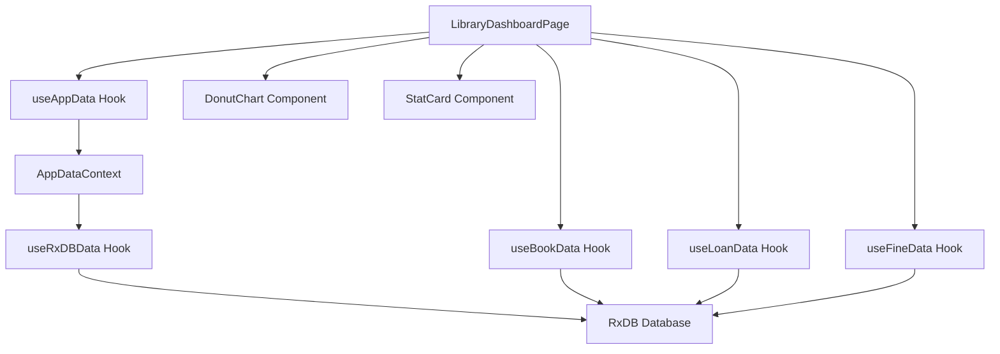
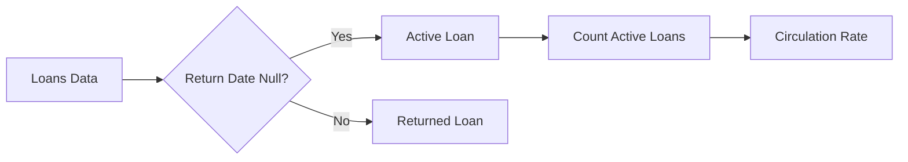
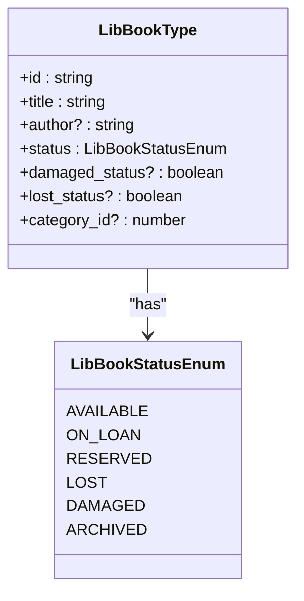
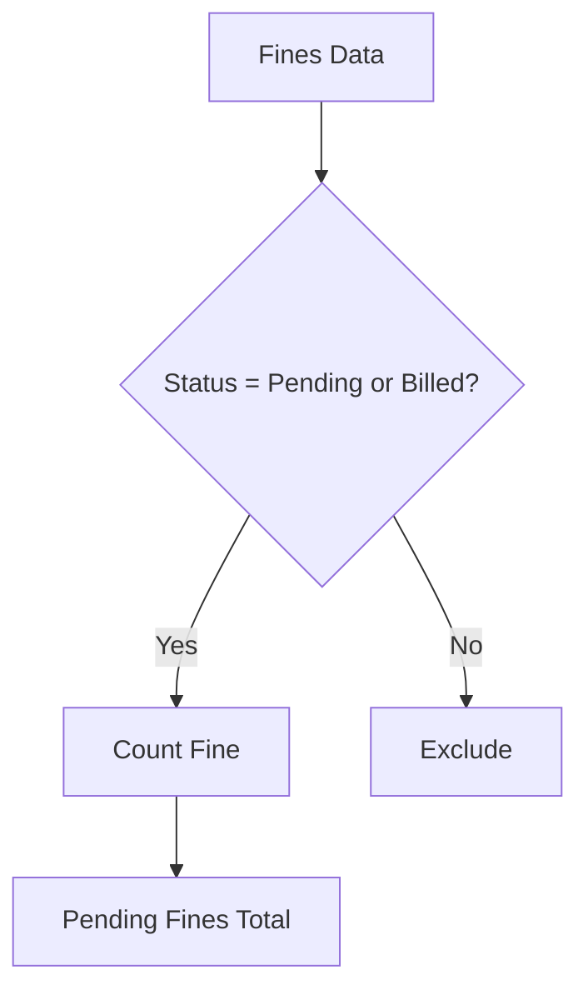
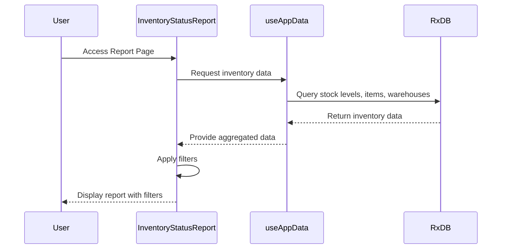
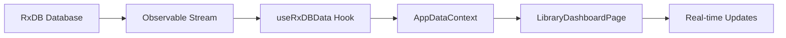
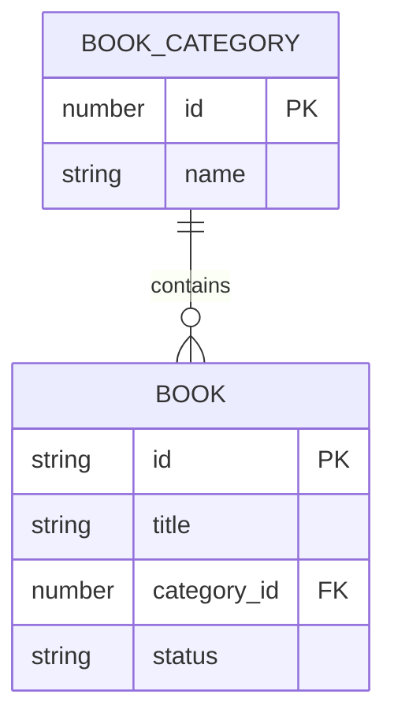
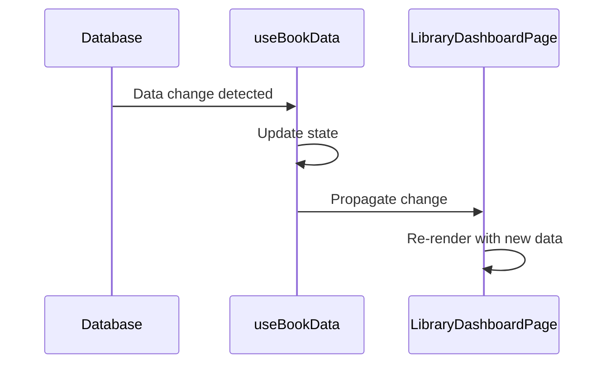
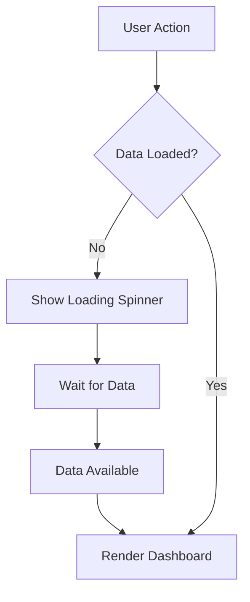

# Reports and Analytics

<cite>
**Referenced Files in This Document**   
- [LibraryDashboardPage.tsx](file://src/modules/library/pages/LibraryDashboardPage.tsx)
- [useLoanData.ts](file://src/modules/library/data/useLoanData.ts)
- [useBookData.ts](file://src/modules/library/data/useBookData.ts)
- [useFineData.ts](file://src/modules/library/data/useFineData.ts)
- [types.ts](file://src/modules/library/data/types.ts)
- [InventoryStatusReport.tsx](file://src/modules/reports/library/InventoryStatusReport.tsx)
- [AppDataContext.tsx](file://src/contexts/AppDataContext.tsx)
- [useAppData.ts](file://src/hooks/useAppData.ts)
- [useRxDBData.ts](file://src/hooks/useRxDBData.ts)
</cite>

## Table of Contents
1. [Introduction](#introduction)
2. [Library Dashboard Implementation](#library-dashboard-implementation)
3. [Key Performance Indicators](#key-performance-indicators)
4. [Report Integration](#report-integration)
5. [Data Aggregation Methods](#data-aggregation-methods)
6. [Visualization Techniques](#visualization-techniques)
7. [Real-time Updates and Export Functionality](#real-time-updates-and-export-functionality)
8. [Common Issues and Solutions](#common-issues-and-solutions)
9. [Best Practices](#best-practices)
10. [Conclusion](#conclusion)

## Introduction
The Library module in the EduGen system provides comprehensive reporting and analytics capabilities to monitor library operations, track resource utilization, and support data-driven decision making. This document details the implementation of the LibraryDashboardPage, its integration with the Reports module, and the underlying data aggregation and visualization techniques. The system leverages React components, custom hooks, and RxDB for real-time data access, enabling librarians to monitor key performance indicators such as circulation rates, collection utilization, and fine revenue.

**Section sources**
- [LibraryDashboardPage.tsx](file://src/modules/library/pages/LibraryDashboardPage.tsx#L1-L129)

## Library Dashboard Implementation
The LibraryDashboardPage serves as the central hub for library analytics, displaying key metrics and visualizations that provide insights into library operations. The dashboard is implemented as a React functional component that consumes data through the useAppData hook, which aggregates information from multiple data sources.



**Diagram sources**
- [LibraryDashboardPage.tsx](file://src/modules/library/pages/LibraryDashboardPage.tsx#L1-L129)
- [useAppData.ts](file://src/hooks/useAppData.ts#L1-L21)
- [AppDataContext.tsx](file://src/contexts/AppDataContext.tsx#L1-L168)

**Section sources**
- [LibraryDashboardPage.tsx](file://src/modules/library/pages/LibraryDashboardPage.tsx#L1-L129)
- [AppDataContext.tsx](file://src/contexts/AppDataContext.tsx#L1-L168)

## Key Performance Indicators
The LibraryDashboardPage displays several key performance indicators that provide insights into library operations and resource utilization.

### Circulation Rates
Circulation rates are calculated by analyzing loan data to determine the number of books currently on loan. The implementation uses the useLoanData hook to retrieve loan records and filters them based on the return_date field.



**Diagram sources**
- [useLoanData.ts](file://src/modules/library/data/useLoanData.ts#L1-L169)

### Collection Utilization
Collection utilization is measured by tracking the status of books in the library collection. The dashboard displays the distribution of books by category and identifies damaged and lost books.



**Diagram sources**
- [types.ts](file://src/modules/library/data/types.ts#L1-L111)

### Fine Revenue
Fine revenue is tracked by monitoring the status of fines in the system. The dashboard displays the number of pending fines, which represents potential revenue that can be collected.



**Diagram sources**
- [useFineData.ts](file://src/modules/library/data/useFineData.ts#L1-L159)

**Section sources**
- [LibraryDashboardPage.tsx](file://src/modules/library/pages/LibraryDashboardPage.tsx#L1-L129)
- [types.ts](file://src/modules/library/data/types.ts#L1-L111)
- [useLoanData.ts](file://src/modules/library/data/useLoanData.ts#L1-L169)
- [useFineData.ts](file://src/modules/library/data/useFineData.ts#L1-L159)

## Report Integration
The Library module integrates with the Reports module to provide detailed reports on overdue items and inventory status. The OverdueReport and InventoryStatusReport components are implemented as standalone pages that can be accessed from the library navigation.

### Overdue Report
The OverdueReport component uses the useLoanData hook to identify loans that are past their due date. It calculates overdue status by comparing the due_date with the current date.

### Inventory Status Report
The InventoryStatusReport provides a comprehensive view of inventory status, including stock levels and valuation. It integrates with the inventory management system to display real-time inventory data.



**Diagram sources**
- [InventoryStatusReport.tsx](file://src/modules/reports/library/InventoryStatusReport.tsx#L1-L288)

**Section sources**
- [InventoryStatusReport.tsx](file://src/modules/reports/library/InventoryStatusReport.tsx#L1-L288)

## Data Aggregation Methods
The reporting system employs several data aggregation methods to transform raw data into meaningful insights.

### Real-time Data Subscription
The system uses RxJS observables to subscribe to database changes in real-time, ensuring that dashboard metrics are always up-to-date.



**Diagram sources**
- [useRxDBData.ts](file://src/hooks/useRxDBData.ts#L1-L199)

### Data Filtering and Transformation
Data is filtered and transformed on the client side to provide specific views of the information. The InventoryStatusReport, for example, applies multiple filters to narrow down the results.

```typescript
// Example from InventoryStatusReport.tsx
const handleGenerateReport = useCallback(() => {
  setIsGenerating(true);
  
  let inventoryItems = generateInventoryStatus();

  // Apply filters
  if (selectedWarehouse !== 'all') {
    const warehouse = (warehouses || []).find(w => w.id === selectedWarehouse);
    if (warehouse) {
      inventoryItems = inventoryItems.filter(item => item.warehouseName === warehouse.name);
    }
  }

  if (selectedCategory !== 'all') {
    const category = (itemCategoriesInv || []).find(c => c.id === selectedCategory);
    if (category) {
      inventoryItems = inventoryItems.filter(item => item.categoryName === category.name);
    }
  }

  if (selectedStatus !== 'all') {
    inventoryItems = inventoryItems.filter(item => item.status === selectedStatus);
  }

  setFilteredInventoryItems(inventoryItems);
  setIsGenerating(false);
}, [generateInventoryStatus, selectedWarehouse, selectedCategory, selectedStatus, warehouses, itemCategoriesInv]);
```

**Section sources**
- [InventoryStatusReport.tsx](file://src/modules/reports/library/InventoryStatusReport.tsx#L1-L288)
- [useRxDBData.ts](file://src/hooks/useRxDBData.ts#L1-L199)

## Visualization Techniques
The dashboard employs various visualization techniques to present data in an accessible and intuitive manner.

### Donut Chart for Category Distribution
The DonutChart component visualizes the distribution of books across different categories, helping librarians understand collection composition.



**Diagram sources**
- [LibraryDashboardPage.tsx](file://src/modules/library/pages/LibraryDashboardPage.tsx#L1-L129)

### Stat Cards for Key Metrics
Statistical cards display key metrics with icons and color coding to quickly convey information about the library's status.

```typescript
// Example from LibraryDashboardPage.tsx
const StatCard: React.FC<{ title: string; value: string | number; icon: React.ReactNode }> = ({ title, value, icon }) => (
  <Card className="shadow-md">
    <div className="flex items-center p-4">
      <div className="p-3 rounded-full bg-green-100 text-green-600">
        {icon}
      </div>
      <div className="ml-4">
        <p className="text-sm font-medium text-gray-500 truncate">{title}</p>
        <p className="text-2xl font-semibold text-gray-900">{value}</p>
      </div>
    </div>
  </Card>
);
```

**Section sources**
- [LibraryDashboardPage.tsx](file://src/modules/library/pages/LibraryDashboardPage.tsx#L1-L129)

## Real-time Updates and Export Functionality
The reporting system provides both real-time updates and export capabilities to support different user needs.

### Real-time Updates
The dashboard automatically updates when data changes in the database, thanks to the reactive data subscription model.



**Diagram sources**
- [useBookData.ts](file://src/modules/library/data/useBookData.ts#L1-L168)

### Export Functionality
Users can export reports in CSV format for further analysis or record keeping.

```typescript
// Example from InventoryStatusReport.tsx
const handleExportCSV = () => {
  const headers = ['Item Name', 'Category', 'Warehouse', 'Current Stock', 'Unit', 'Unit Cost', 'Total Value', 'Status'];
  const rows = (filteredInventoryItems || []).map(item => [
    item.itemName,
    item.categoryName,
    item.warehouseName,
    item.currentStock.toString(),
    item.unitOfMeasure,
    item.unitCost?.toFixed(2) || '0.00',
    item.totalValue.toFixed(2),
    item.status.replace('_', ' ')
  ]);

  const csvContent = [headers, ...rows]
    .map(row => row.map(cell => `"${String(cell).replace(/"/g, '""')}"`).join(','))
    .join('\n');

  const blob = new Blob([csvContent], { type: 'text/csv;charset=utf-8;' });
  const link = document.createElement('a');
  if (link.download !== undefined) {
    const url = URL.createObjectURL(blob);
    const today = new Date().toISOString().split('T')[0];
    link.setAttribute('href', url);
    link.setAttribute('download', `inventory_status_report_${today}.csv`);
    link.style.visibility = 'hidden';
    document.body.appendChild(link);
    link.click();
    document.body.removeChild(link);
  }
};
```

**Section sources**
- [InventoryStatusReport.tsx](file://src/modules/reports/library/InventoryStatusReport.tsx#L1-L288)
- [useBookData.ts](file://src/modules/library/data/useBookData.ts#L1-L168)

## Common Issues and Solutions
The reporting system addresses several common issues that can affect data accuracy and performance.

### Data Latency
Data latency can occur when there are delays in database synchronization. The system mitigates this by using real-time subscriptions and displaying loading states.



### Report Accuracy
Report accuracy is maintained by using consistent data sources and applying filters in a predictable order.

### Performance with Large Datasets
For large datasets, the system uses client-side filtering and pagination to maintain responsiveness.

```typescript
// Example optimization from useLoanData.ts
const getOverdueLoans = async () => {
  const today = new Date().toISOString().split('T')[0];
  return data.filter(loan => !loan.return_date && loan.due_date < today);
};
```

**Section sources**
- [useLoanData.ts](file://src/modules/library/data/useLoanData.ts#L1-L169)
- [InventoryStatusReport.tsx](file://src/modules/reports/library/InventoryStatusReport.tsx#L1-L288)

## Best Practices
To maximize the effectiveness of the analytics system, follow these best practices:

### Collection Development
Use the top borrowed books analysis to inform collection development decisions. Books with high circulation rates may warrant additional copies.

### Staffing Schedules
Monitor circulation patterns to optimize staffing schedules. Higher loan volumes during certain periods may require additional staff.

### Service Improvements
Track overdue books and fine collection rates to identify opportunities for service improvements, such as implementing automated reminders.

**Section sources**
- [LibraryDashboardPage.tsx](file://src/modules/library/pages/LibraryDashboardPage.tsx#L1-L129)

## Conclusion
The reporting and analytics capabilities in the Library module provide valuable insights into library operations through the LibraryDashboardPage and integrated reports. By leveraging real-time data aggregation, intuitive visualizations, and export functionality, the system enables librarians to make data-driven decisions that improve collection development, staffing, and services. The architecture, built on React components and RxDB, ensures that data is accurate, up-to-date, and accessible.