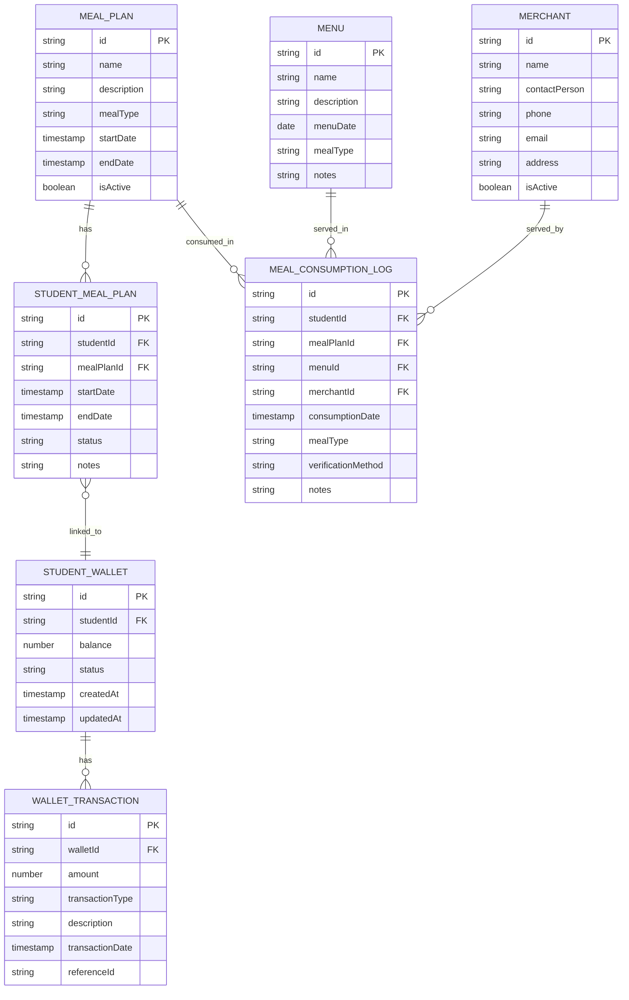

# Data Model & Schema

<cite>
**Referenced Files in This Document**   
- [collections.ts](file://src/modules/nutrition/data/collections.ts)
- [moduleDefinition.tsx](file://src/modules/nutrition/moduleDefinition.tsx)
- [useMealPlanData.ts](file://src/modules/nutrition/data/useMealPlanData.ts)
- [index.ts](file://src/modules/nutrition/data/index.ts)
- [rbac.ts](file://src/modules/nutrition/rbac.ts)
- [moduleActions.ts](file://src/services/moduleActions.ts)
</cite>

## Table of Contents
1. [Introduction](#introduction)
2. [Entity Relationship Model](#entity-relationship-model)
3. [Collection Definitions](#collection-definitions)
4. [Field Definitions and Constraints](#field-definitions-and-constraints)
5. [Business Rules](#business-rules)
6. [Data Access Patterns](#data-access-patterns)
7. [Security and Permissions](#security-and-permissions)
8. [Data Lifecycle Management](#data-lifecycle-management)

## Introduction
This document provides comprehensive documentation for the Nutrition module's database schema. The module manages meal planning, student meal assignments, merchant integration, student wallets, and meal consumption tracking within an educational institution. The data model is implemented using RxDB collections with a NoSQL document-based structure. The schema supports offline-first capabilities and synchronization with backend systems.

**Section sources**
- [moduleDefinition.tsx](file://src/modules/nutrition/moduleDefinition.tsx#L0-L64)

## Entity Relationship Model



**Diagram sources**
- [collections.ts](file://src/modules/nutrition/data/collections.ts#L0-L30)
- [moduleDefinition.tsx](file://src/modules/nutrition/moduleDefinition.tsx#L15-L39)

## Collection Definitions

The Nutrition module defines seven RxDB collections that store different aspects of the meal management system. These collections are registered through the `nutritionCollections` object which maps collection names to their respective schemas.

```typescript
export const nutritionCollections = {
  meal_plans: {
    schema: schemas.mealPlanSchema,
  },
  student_meal_plans: {
    schema: schemas.studentMealPlanSchema,
  },
  menus: {
    schema: schemas.menuSchema,
  },
  meal_consumption_logs: {
    schema: schemas.mealConsumptionLogSchema,
  },
  merchants: {
    schema: schemas.merchantSchema,
  },
  student_wallets: {
    schema: schemas.studentWalletSchema,
  },
  wallet_transactions: {
    schema: schemas.walletTransactionSchema,
  },
};
```

Each collection corresponds to a specific entity in the nutrition management system and is accessed through dedicated data hooks exported from the module's data layer.

**Section sources**
- [collections.ts](file://src/modules/nutrition/data/collections.ts#L0-L30)
- [index.ts](file://src/modules/nutrition/data/index.ts#L0-L27)

## Field Definitions and Constraints

### MealPlan Collection
Stores standardized meal plan templates that can be assigned to students.

**Fields:**
- `id`: Unique identifier (Primary Key)
- `name`: Name of the meal plan (e.g., "Standard Daily Plan")
- `description`: Detailed description of the plan contents
- `mealType`: Type of meal (e.g., breakfast, lunch, dinner, snack)
- `startDate`: Effective start date of the plan
- `endDate`: Expiration date of the plan
- `isActive`: Boolean flag indicating if the plan is currently available

### StudentMealPlan Collection
Represents individual student enrollments in specific meal plans.

**Fields:**
- `id`: Unique identifier (Primary Key)
- `studentId`: Reference to the student (Foreign Key)
- `mealPlanId`: Reference to the meal plan template (Foreign Key)
- `startDate`: When the student's plan becomes active
- `endDate`: When the student's plan expires
- `status`: Current status (active, suspended, expired, cancelled)
- `notes`: Administrative notes about the student's meal plan

### Menu Collection
Contains daily menu offerings that may be linked to meal plans.

**Fields:**
- `id`: Unique identifier (Primary Key)
- `name`: Menu name or title
- `description`: Detailed menu items and descriptions
- `menuDate`: Date when this menu is served
- `mealType`: Type of meal (breakfast, lunch, etc.)
- `notes`: Special instructions or information

### Merchant Collection
Stores information about food service providers.

**Fields:**
- `id`: Unique identifier (Primary Key)
- `name`: Merchant business name
- `contactPerson`: Primary contact person
- `phone`: Contact phone number
- `email`: Contact email address
- `address`: Physical address of the merchant
- `isActive`: Boolean indicating if the merchant is currently contracted

### StudentWallet Collection
Manages student wallet accounts for meal payments.

**Fields:**
- `id`: Unique identifier (Primary Key)
- `studentId`: Reference to the student (Foreign Key)
- `balance`: Current monetary balance in the wallet
- `status`: Wallet status (active, suspended, closed)
- `createdAt`: Timestamp when wallet was created
- `updatedAt`: Timestamp of last balance update

### WalletTransaction Collection
Tracks all financial transactions affecting student wallets.

**Fields:**
- `id`: Unique identifier (Primary Key)
- `walletId`: Reference to the student wallet (Foreign Key)
- `amount`: Transaction amount (positive for credits, negative for debits)
- `transactionType`: Type of transaction (topup, purchase, refund, adjustment)
- `description`: Description of the transaction
- `transactionDate`: Timestamp of transaction
- `referenceId`: External reference ID (e.g., payment gateway ID)

### MealConsumptionLog Collection
Records individual meal consumption events.

**Fields:**
- `id`: Unique identifier (Primary Key)
- `studentId`: Reference to the consuming student (Foreign Key)
- `mealPlanId`: Reference to the applicable meal plan (Foreign Key)
- `menuId`: Reference to the consumed menu (Foreign Key)
- `merchantId`: Reference to the serving merchant (Foreign Key)
- `consumptionDate`: Timestamp of meal consumption
- `mealType`: Type of meal consumed
- `verificationMethod`: Method used to verify consumption (QR code, biometrics, manual)
- `notes`: Additional notes about the consumption event

**Section sources**
- [collections.ts](file://src/modules/nutrition/data/collections.ts#L0-L30)

## Business Rules

### Meal Plan Validity Rules
- Meal plans must have non-overlapping date ranges when assigned to a student
- A student cannot have multiple active meal plans of the same meal type simultaneously
- Meal plan assignments require explicit start and end dates
- Expired meal plans are automatically deactivated but retained for historical reporting

### Wallet Balance Validation
- Wallet balances cannot go below zero for standard accounts
- Transactions that would result in a negative balance are rejected
- Wallet balance updates must be accompanied by corresponding wallet transaction records
- All balance changes require audit trail through transaction logging

### Consumption Logging Requirements
- Each meal consumption must be linked to an active student meal plan
- Consumption records must include timestamp, student identifier, and verification method
- Duplicate consumption records for the same student and meal type on the same day are prevented
- Consumption can only be recorded for menus that exist in the system

### Data Integrity Constraints
- Foreign key relationships are enforced through application logic
- Required fields must be populated for all record creation
- Date fields must follow chronological consistency rules
- Financial amounts must be represented with appropriate precision

**Section sources**
- [moduleDefinition.tsx](file://src/modules/nutrition/moduleDefinition.tsx#L33-L64)
- [useMealPlanData.ts](file://src/modules/nutrition/data/useMealPlanData.ts#L0-L26)

## Data Access Patterns

### RxDB Collections and Indexing
The Nutrition module utilizes RxDB collections with optimized indexing strategies for performance. Each collection is configured with appropriate indexes on frequently queried fields:

- `meal_plans`: Indexed on `mealType` and date ranges
- `student_meal_plans`: Indexed on `studentId`, `mealPlanId`, and date ranges
- `menus`: Indexed on `menuDate` and `mealType`
- `meal_consumption_logs`: Indexed on `studentId`, `consumptionDate`, and `mealType`
- `student_wallets`: Indexed on `studentId`
- `wallet_transactions`: Indexed on `walletId` and `transactionDate`
- `merchants`: Indexed on `isActive`

### Data Access Hooks
The module provides standardized data access hooks that abstract the underlying RxDB operations:

```typescript
export {
  useMealConsumptionLogData,
  useMealPlanData,
  useMenuData,
  useMerchantData,
  useStudentMealPlanData,
  useStudentWalletData,
  useWalletTransactionData
};
```

These hooks implement the data hook factory pattern, ensuring consistent CRUD operations across all collections. They integrate with the AppDataContext and support offline functionality with synchronization capabilities.

### Performance Optimization
- Collections are configured with appropriate sync priorities
- Data hooks implement caching strategies to minimize database queries
- Indexes are optimized for common query patterns in the nutrition module
- The system supports offline data access with background synchronization

**Section sources**
- [collections.ts](file://src/modules/nutrition/data/collections.ts#L0-L30)
- [index.ts](file://src/modules/nutrition/data/index.ts#L0-L27)
- [useMealPlanData.ts](file://src/modules/nutrition/data/useMealPlanData.ts#L0-L26)

## Security and Permissions

### Role-Based Access Control
The Nutrition module implements RBAC through defined permissions and roles:

**Permissions:**
- `nutrition.meals.read`: View meal information
- `nutrition.meals.create`: Create meal plans
- `nutrition.meals.update`: Update meal information
- `nutrition.meals.delete`: Delete meal plans

**Default Roles:**
- `nutrition_officer`: Primary role for nutrition management staff
- `administrator`: System administrators with full access

### Data Security Requirements
- Sensitive dietary information is protected through access controls
- Financial transaction data requires elevated permissions for access
- All financial operations are logged for audit purposes
- Meal consumption data is considered personally identifiable information

### Module Settings
The module includes configurable settings that control functionality:

- `enableMealPlanning`: Enables or disables meal planning features
- `enableStudentNutrition`: Controls access to student nutrition features
- `enableWalletManagement`: Toggles wallet management capabilities

These settings allow administrators to enable or disable specific features based on institutional requirements.

**Section sources**
- [rbac.ts](file://src/modules/nutrition/rbac.ts#L0-L41)
- [moduleDefinition.tsx](file://src/modules/nutrition/moduleDefinition.tsx#L33-L64)
- [moduleActions.ts](file://src/services/moduleActions.ts#L433-L495)

## Data Lifecycle Management

### Retention Policies
- Meal consumption logs are retained for 7 years to comply with nutritional program requirements
- Wallet transaction records are maintained indefinitely for financial auditing
- Historical meal plans and menus are preserved for reporting and analysis
- Inactive merchant records are archived after 2 years of inactivity

### Archival Procedures
- Data older than the retention threshold is moved to cold storage
- Archival processes run during off-peak hours to minimize system impact
- Archived data remains searchable through the reporting interface
- Restoration procedures are documented for compliance audits

### Data Access Patterns
- Recent data (last 90 days) is kept in hot storage for optimal performance
- Medium-term data (90 days to 1 year) is stored in warm storage
- Long-term historical data is moved to archival storage
- The system automatically manages data tiering based on access patterns

The data lifecycle management strategy ensures compliance with institutional policies while maintaining optimal system performance.

**Section sources**
- [moduleDefinition.tsx](file://src/modules/nutrition/moduleDefinition.tsx#L33-L64)
- [collections.ts](file://src/modules/nutrition/data/collections.ts#L0-L30)