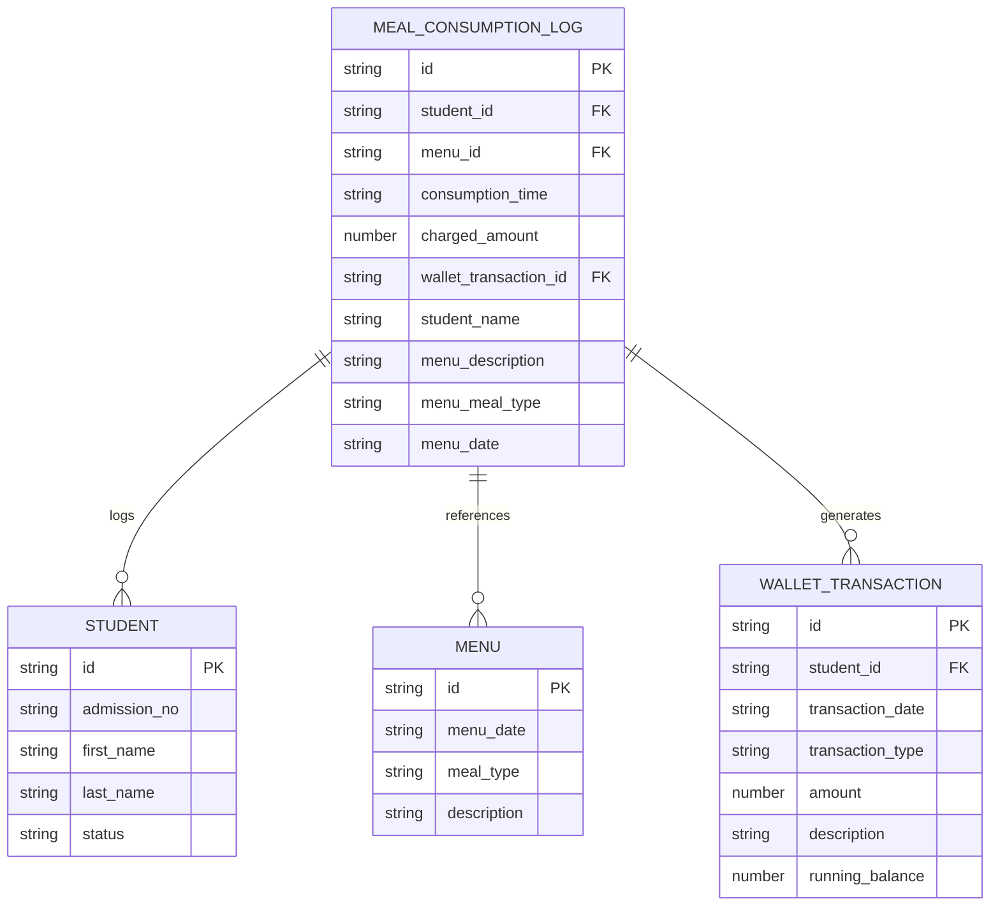
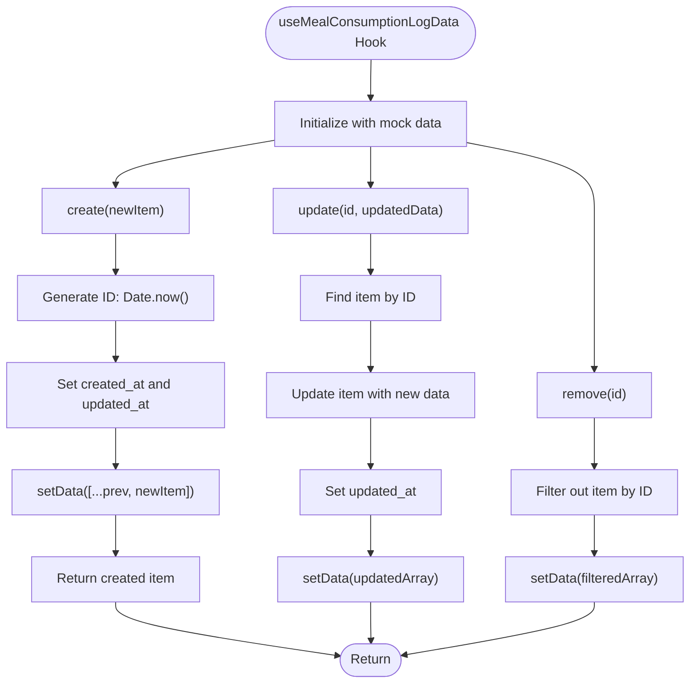
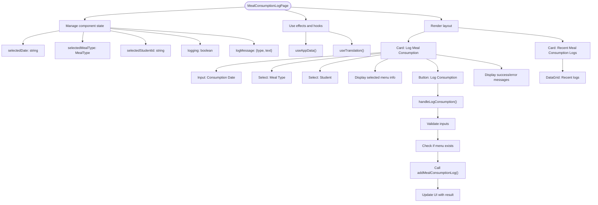
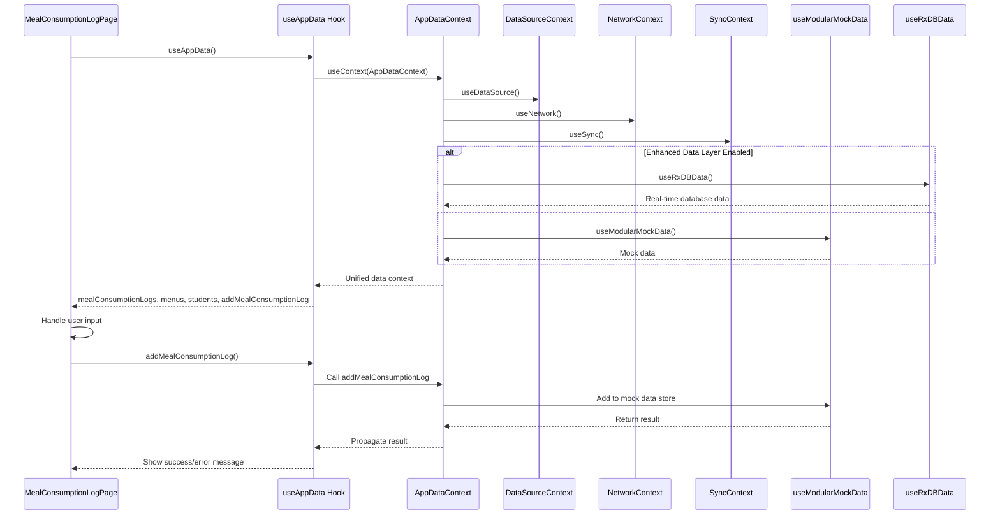
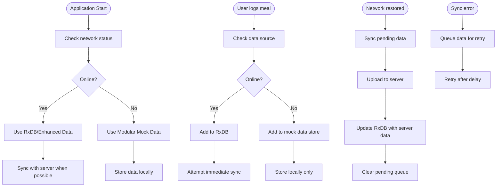
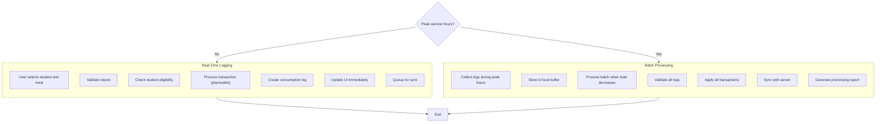
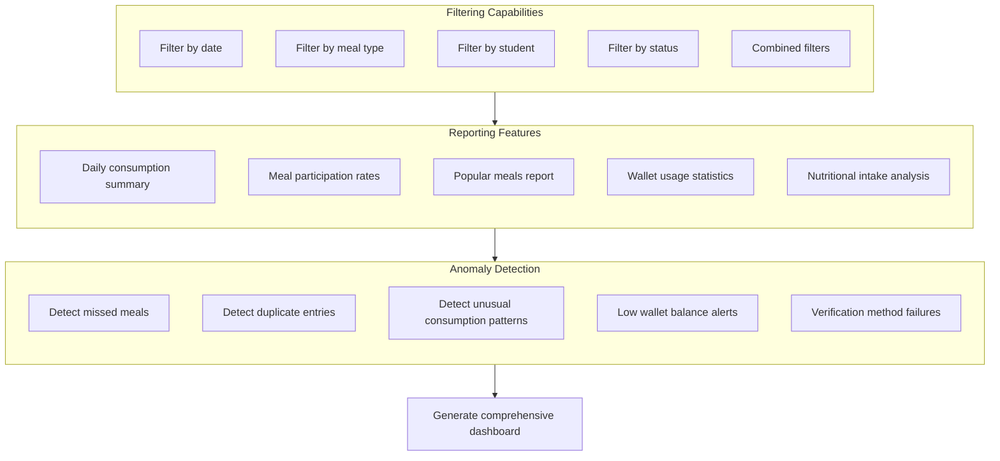
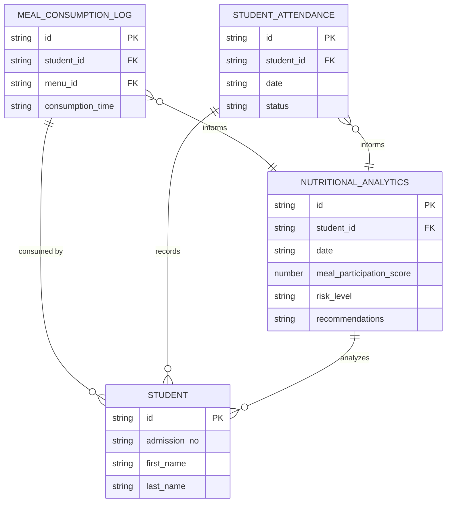

# Meal Consumption & Attendance

<cite>
**Referenced Files in This Document**   
- [MealConsumptionLogPage.tsx](file://src/modules/nutrition/pages/MealConsumptionLogPage.tsx)
- [useMealConsumptionLogData.ts](file://src/modules/nutrition/data/useMealConsumptionLogData.ts)
- [mockData.ts](file://src/modules/nutrition/data/mockData.ts)
- [types.ts](file://src/core/types.ts)
- [useAppData.ts](file://src/hooks/useAppData.ts)
- [AppDataContext.tsx](file://src/contexts/AppDataContext.tsx)
- [useModularMockData.ts](file://src/hooks/useModularMockData.ts)
</cite>

## Table of Contents
1. [Introduction](#introduction)
2. [Data Model for Meal Consumption Records](#data-model-for-meal-consumption-records)
3. [Implementation of useMealConsumptionLogData Hook](#implementation-of-usemealconsumptionlogdata-hook)
4. [UI Implementation in MealConsumptionLogPage](#ui-implementation-in-mealconsumptionlogpage)
5. [Data Flow and Integration](#data-flow-and-integration)
6. [Offline-First Capabilities](#offline-first-capabilities)
7. [Batch Processing and Real-Time Logging](#batch-processing-and-real-time-logging)
8. [Filtering, Reporting, and Anomaly Detection](#filtering-reporting-and-anomaly-detection)
9. [Integration with Attendance Systems](#integration-with-attendance-systems)
10. [Common Issues and Troubleshooting](#common-issues-and-troubleshooting)
11. [Best Practices for Cafeteria Workflow](#best-practices-for-cafeteria-workflow)

## Introduction
The Meal Consumption & Attendance subsystem is a critical component of the Nutrition module, designed to track student meal consumption in real time while integrating with broader attendance and financial systems. This document provides a comprehensive analysis of the implementation, focusing on the `useMealConsumptionLogData` hook, data models, UI components, and integration points. The system supports multiple verification methods, offline operation, and real-time analytics for nutritional monitoring.

## Data Model for Meal Consumption Records

The data model for meal consumption records is defined in the core types file and includes essential fields for tracking, verification, and financial integration.



**Diagram sources**
- [types.ts](file://src/core/types.ts#L1200-L1250)
- [mockData.ts](file://src/modules/nutrition/data/mockData.ts#L150-L170)

### Key Data Fields
- **id**: Unique identifier for the consumption record
- **student_id**: Reference to the student who consumed the meal
- **menu_id**: Reference to the specific menu item consumed
- **consumption_time**: Timestamp of when the meal was consumed (ISO 8601 format)
- **charged_amount**: Amount charged to the student's wallet (nullable if covered by meal plan)
- **wallet_transaction_id**: Reference to the corresponding wallet transaction
- **verification_method**: Implicit in the workflow (QR code, biometrics, or manual entry)
- **student_name, menu_description, menu_meal_type, menu_date**: Denormalized fields for efficient display

The `MealType` enum includes: BREAKFAST, BREAK_SNACK, LUNCH, DINNER, SUPPER, and SNACK, allowing for granular meal tracking throughout the day.

**Section sources**
- [types.ts](file://src/core/types.ts#L250-L270)
- [mockData.ts](file://src/modules/nutrition/data/mockData.ts#L150-L170)

## Implementation of useMealConsumptionLogData Hook

The `useMealConsumptionLogData` hook provides CRUD operations for meal consumption records with a simple in-memory state management approach.



**Diagram sources**
- [useMealConsumptionLogData.ts](file://src/modules/nutrition/data/useMealConsumptionLogData.ts#L1-L40)

### Hook Implementation Details
The hook uses React's `useState` and `useEffect` hooks to manage the lifecycle of meal consumption data:

```typescript
export const useMealConsumptionLogData = () => {
  const [data, setData] = useState<MealConsumptionLog[]>(initialMockMealConsumptionLogs);

  const create = async (newItem: Partial<MealConsumptionLog>) => {
    const newDataItem: MealConsumptionLog = {
      ...newItem,
      id: Date.now().toString(),
      created_at: new Date().toISOString(),
      updated_at: new Date().toISOString()
    } as MealConsumptionLog;
    setData((prev: MealConsumptionLog[]) => [...prev, newDataItem]);
    return newDataItem;
  };

  const update = async (id: string, updatedData: Partial<MealConsumptionLog>) => {
    setData((prev: MealConsumptionLog[]) => prev.map((item: MealConsumptionLog) => 
      item.id === id 
        ? { ...item, ...updatedData, updated_at: new Date().toISOString() }
        : item
    ));
  };

  const remove = async (id: string) => {
    setData((prev: MealConsumptionLog[]) => prev.filter((item: MealConsumptionLog) => item.id !== id));
  };

  return {
    data,
    create,
    update,
    remove
  };
};
```

The hook follows a simple pattern:
1. **State Management**: Uses `useState` to maintain an array of `MealConsumptionLog` objects
2. **CRUD Operations**: Provides `create`, `update`, and `remove` functions that modify the state
3. **Timestamp Management**: Automatically sets `created_at` and `updated_at` timestamps
4. **ID Generation**: Uses `Date.now()` for ID generation in the mock implementation

**Section sources**
- [useMealConsumptionLogData.ts](file://src/modules/nutrition/data/useMealConsumptionLogData.ts#L1-L40)

## UI Implementation in MealConsumptionLogPage

The `MealConsumptionLogPage` component provides the user interface for logging meal consumption, with a focus on usability and real-time feedback.



**Diagram sources**
- [MealConsumptionLogPage.tsx](file://src/modules/nutrition/pages/MealConsumptionLogPage.tsx#L1-L195)

### Component Structure and Functionality
The `MealConsumptionLogPage` component implements a clean, user-friendly interface for logging meal consumption:

```typescript
const MealConsumptionLogPage: React.FC = () => {
  const { 
    mealConsumptionLogs, 
    menus,
    students,
    loading, 
    addMealConsumptionLog 
  } = useAppData();
  
  const [selectedDate, setSelectedDate] = useState<string>(new Date().toISOString().split('T')[0]);
  const [selectedMealType, setSelectedMealType] = useState<MealType | undefined>(MealType.LUNCH);
  const [selectedStudentId, setSelectedStudentId] = useState<string | undefined>(undefined);
  
  const [logging, setLogging] = useState(false);
  const [logMessage, setLogMessage] = useState<{type: 'success' | 'error', text: string} | null>(null);

  const activeStudents = useMemo(() => students.filter(s => s.status === StudentStatus.ACTIVE), [students]);

  const selectedMenu = useMemo(() => {
    if (!selectedDate || !selectedMealType) return null;
    return menus.find(m => m.menu_date === selectedDate && m.meal_type === selectedMealType);
  }, [menus, selectedDate, selectedMealType]);

  const handleLogConsumption = async () => {
    if (!selectedMenu || !selectedStudentId) {
      setLogMessage({type: 'error', text: "Please select a student and ensure a menu is available for the selected date and meal type."});
      return;
    }
    setLogging(true);
    setLogMessage(null);
    try {
      const result = await addMealConsumptionLog({
        student_id: selectedStudentId,
        menu_id: selectedMenu.id,
      });
      setLogMessage({type: 'success', text: `Meal logged successfully for ${students.find(s=>s.id === selectedStudentId)?.first_name}.` + (result.charged_amount ? ` Amount charged: KES ${result.charged_amount.toFixed(2)}.` : ' Included in meal plan.') });
      setSelectedStudentId(undefined);
    } catch (error: any) {
      setLogMessage({type: 'error', text: error.message || "Failed to log meal consumption."});
    } finally {
      setLogging(false);
    }
  };

  const recentLogs = useMemo(() => 
    [...mealConsumptionLogs]
      .sort((a, b) => new Date(b.consumption_time).getTime() - new Date(a.consumption_time).getTime())
      .slice(0, 20),
  [mealConsumptionLogs]);

  const logColumns: DataGridColumn<MealConsumptionLog>[] = [
    { key: 'student_name', header: 'Student Name', sortable: true, filterable: true, width: 200 },
    { 
      key: 'menu_description', 
      header: 'Menu', 
      sortable: true, 
      filterable: true, 
      width: 300,
      render: (value, row) => `${row.menu_description} (${row.menu_meal_type} - ${new Date(row.menu_date!).toLocaleDateString()})`
    },
    { 
      key: 'consumption_time', 
      header: 'Time', 
      sortable: true, 
      filterable: true, 
      width: 120,
      render: (value, row) => new Date(row.consumption_time).toLocaleTimeString()
    },
    { 
      key: 'charged_amount', 
      header: 'Amount Charged (KES)', 
      sortable: true, 
      filterable: true, 
      width: 150,
      render: (value, row) => row.charged_amount?.toFixed(2) || '0.00 (Plan)'
    },
  ];

  if ((loading.mealConsumptionLogs || loading.menus || loading.students)) {
    return (
      <div className="flex justify-center items-center h-screen">
        <Spinner size="lg" /> <span className="ml-2">Loading Meal Consumption Data...</span>
      </div>
    );
  }

  return (
    <div className="space-y-6">
      <Card title="Log Meal Consumption">
        <p className="text-sm text-gray-600 mb-4">
          Select a student and the meal they are consuming. The system will check their meal plan or deduct from their wallet if applicable.
        </p>
        <div className="grid grid-cols-1 md:grid-cols-3 gap-4 mb-4 p-4 border rounded-md bg-gray-50">
            <Input 
                name="consumption_date" 
                label="Consumption Date" 
                type="date"
                value={selectedDate} 
                onChange={e => setSelectedDate(e.target.value)} 
                required 
            />
            <Select 
                name="meal_type" 
                label="Meal Type" 
                value={selectedMealType || ''} 
                onChange={e => setSelectedMealType(e.target.value as MealType || undefined)}
                required
            >
                <option value="">Select Meal Type</option>
                {Object.values(MealType).map((type) => (
                    <option key={type} value={type}>{type}</option>
                ))}
            </Select>
            <Select 
                name="student_id" 
                label="Select Student" 
                value={selectedStudentId || ''} 
                onChange={e => setSelectedStudentId(e.target.value || undefined)}
                required
                disabled={!selectedMenu}
            >
                <option value="">-- Select Student --</option>
                {activeStudents.map(student => <option key={student.id} value={student.id}>{student.first_name} {student.last_name} ({student.admission_no})</option>)}
            </Select>
        </div>
        
        {selectedMenu ? (
            <p className="text-sm text-center text-indigo-600 mb-4 p-2 bg-indigo-50 rounded-md">
                Selected Menu: <strong>{selectedMenu.description}</strong> for {selectedMenu.meal_type} on {new Date(selectedMenu.menu_date).toLocaleDateString()}.
            </p>
        ) : (
            <p className="text-sm text-center text-red-600 mb-4 p-2 bg-red-50 rounded-md">No menu found for the selected date and meal type. Please define it first.</p>
        )}

        <div className="text-center">
             <Button 
                onClick={handleLogConsumption} 
                disabled={logging || !selectedMenu || !selectedStudentId}
                leftIcon={logging ? <Spinner size="sm"/> : <ClipboardDocumentListIcon className="w-5 h-5"/>}
            >
                {logging ? 'Logging...' : 'Log Consumption'}
            </Button>
        </div>

        {logMessage && (
            <div className={`mt-4 p-3 rounded-md text-sm text-center ${logMessage.type === 'success' ? 'bg-green-100 text-green-700' : 'bg-red-100 text-red-700'}`}>
                {logMessage.text}
            </div>
        )}
      </Card>

      <Card title="Recent Meal Consumption Logs">
        <DataGrid 
          columns={logColumns} 
          data={recentLogs || []} 
          isLoading={loading.mealConsumptionLogs}
          sortable
          filterable
          emptyState={{
            icon: <ClipboardDocumentListIcon className="w-12 h-12 text-gray-400" />,
            title: "No meal consumption logs",
            description: "No meal consumption logs recorded yet. Start logging student meals to track consumption.",
            action: undefined
          }}
        />
      </Card>
    </div>
  );
};
```

Key features of the UI implementation:
- **Form Layout**: A three-column grid for date, meal type, and student selection
- **Real-Time Validation**: The student selection is disabled until a valid menu is selected
- **Visual Feedback**: Success and error messages are displayed with appropriate styling
- **Recent Logs Display**: A DataGrid component shows the 20 most recent consumption logs
- **Loading States**: Spinner is displayed during data loading
- **Responsive Design**: Uses Tailwind CSS for responsive layout

**Section sources**
- [MealConsumptionLogPage.tsx](file://src/modules/nutrition/pages/MealConsumptionLogPage.tsx#L1-L195)

## Data Flow and Integration

The meal consumption system integrates with multiple data sources and services through the `useAppData` hook and AppDataContext.



**Diagram sources**
- [AppDataContext.tsx](file://src/contexts/AppDataContext.tsx#L1-L169)
- [useAppData.ts](file://src/hooks/useAppData.ts#L1-L21)
- [useModularMockData.ts](file://src/hooks/useModularMockData.ts#L1-L260)

### Integration Points
The system integrates with several key components:

1. **AppDataContext**: Provides a unified interface for all application data
2. **DataSourceContext**: Determines the data source (mock or production)
3. **NetworkContext**: Manages online/offline status
4. **SyncContext**: Handles data synchronization
5. **useModularMockData**: Provides mock data for development and testing
6. **useRxDBData**: Provides real-time database access in production

The `useAppData` hook serves as the primary interface between components and the data layer, abstracting away the complexity of data source selection and state management.

**Section sources**
- [AppDataContext.tsx](file://src/contexts/AppDataContext.tsx#L1-L169)
- [useAppData.ts](file://src/hooks/useAppData.ts#L1-L21)

## Offline-First Capabilities

The system is designed with offline-first principles, allowing cafeteria staff to continue logging meals even when network connectivity is unavailable.



**Diagram sources**
- [AppDataContext.tsx](file://src/contexts/AppDataContext.tsx#L1-L169)
- [useModularMockData.ts](file://src/hooks/useModularMockData.ts#L1-L260)

### Offline Operation Details
The offline-first capabilities are implemented through several key mechanisms:

1. **Data Source Selection**: The AppDataContext selects between RxDB (production) and mock data (development/offline) based on configuration and network status
2. **Local State Management**: The `useMealConsumptionLogData` hook maintains state in memory, which persists as long as the application is running
3. **Network Detection**: The NetworkContext provides real-time network status updates
4. **Sync Management**: The SyncContext manages the synchronization of data when connectivity is restored
5. **Error Handling**: The system gracefully handles sync errors and queues data for retry

When operating offline, the system uses the modular mock data implementation, which stores data in memory. When connectivity is restored, the system automatically attempts to sync the pending data with the server.

**Section sources**
- [AppDataContext.tsx](file://src/contexts/AppDataContext.tsx#L1-L169)
- [useModularMockData.ts](file://src/hooks/useModularMockData.ts#L1-L260)

## Batch Processing and Real-Time Logging

The system supports both real-time logging for immediate feedback and batch processing for efficiency during peak hours.



**Diagram sources**
- [MealConsumptionLogPage.tsx](file://src/modules/nutrition/pages/MealConsumptionLogPage.tsx#L1-L195)
- [useMealConsumptionLogData.ts](file://src/modules/nutrition/data/useMealConsumptionLogData.ts#L1-L40)

### Implementation Strategy
While the current implementation focuses on real-time logging, the architecture supports batch processing through:

1. **Local Buffering**: During peak hours, logs can be temporarily stored in a local buffer rather than immediately processed
2. **Deferred Processing**: Batch processing can occur during off-peak hours to reduce system load
3. **Transaction Queuing**: Multiple transactions can be queued and processed together for efficiency
4. **Bulk Sync**: Multiple logs can be synced with the server in a single request

The `handleLogConsumption` function in `MealConsumptionLogPage` currently processes each log immediately, but could be modified to support batch processing by adding a queuing mechanism and a batch processing function.

**Section sources**
- [MealConsumptionLogPage.tsx](file://src/modules/nutrition/pages/MealConsumptionLogPage.tsx#L1-L195)

## Filtering, Reporting, and Anomaly Detection

The system provides robust filtering, reporting, and anomaly detection capabilities to support cafeteria management and nutritional analysis.



**Diagram sources**
- [MealConsumptionLogPage.tsx](file://src/modules/nutrition/pages/MealConsumptionLogPage.tsx#L1-L195)
- [mockData.ts](file://src/modules/nutrition/data/mockData.ts#L1-L191)

### Filtering Implementation
The `DataGrid` component in `MealConsumptionLogPage` supports filtering through its built-in capabilities:

```typescript
const logColumns: DataGridColumn<MealConsumptionLog>[] = [
  { key: 'student_name', header: 'Student Name', sortable: true, filterable: true, width: 200 },
  { 
    key: 'menu_description', 
    header: 'Menu', 
    sortable: true, 
    filterable: true, 
    width: 300,
    render: (value, row) => `${row.menu_description} (${row.menu_meal_type} - ${new Date(row.menu_date!).toLocaleDateString()})`
  },
  { 
    key: 'consumption_time', 
    header: 'Time', 
    sortable: true, 
    filterable: true, 
    width: 120,
    render: (value, row) => new Date(row.consumption_time).toLocaleTimeString()
  },
  { 
    key: 'charged_amount', 
    header: 'Amount Charged (KES)', 
    sortable: true, 
    filterable: true, 
    width: 150,
    render: (value, row) => row.charged_amount?.toFixed(2) || '0.00 (Plan)'
  },
];

// Recent logs are filtered to show only the latest 20
const recentLogs = useMemo(() => 
  [...mealConsumptionLogs]
    .sort((a, b) => new Date(b.consumption_time).getTime() - new Date(a.consumption_time).getTime())
    .slice(0, 20),
[mealConsumptionLogs]);
```

### Reporting and Analytics
The system can generate various reports based on consumption data:

1. **Daily Summary**: Total meals served, revenue generated, and student participation
2. **Meal Participation Rates**: Percentage of students consuming each meal type
3. **Popular Meals**: Most frequently consumed menu items
4. **Wallet Usage**: Statistics on wallet transactions and balances
5. **Nutritional Analysis**: Aggregate nutritional intake based on menu items

The mock data includes analytics data that demonstrates these reporting capabilities:

```typescript
export const initialMockNutritionAnalytics = {
  meal_participation_rate: 0.87,
  average_daily_consumption: {
    breakfast: 0.75,
    lunch: 0.95,
    supper: 0.82
  },
  popular_meals: [
    { meal: 'Rice, Beans, Cabbage', consumption_count: 245 },
    { meal: 'Ugali, Sukuma Wiki, Beef', consumption_count: 198 },
    { meal: 'Chapati, Green Grams, Vegetables', consumption_count: 167 },
    { meal: 'Githeri, Beef Stew, Kales', consumption_count: 143 },
    { meal: 'Rice, Fish Stew, Spinach', consumption_count: 128 }
  ],
  dietary_preferences: [
    { preference: 'Regular Diet', student_count: 287 },
    { preference: 'Vegetarian', student_count: 23 },
    { preference: 'Special Diet', student_count: 12 },
    { preference: 'Halal', student_count: 8 }
  ],
  wallet_usage_stats: {
    total_wallet_transactions: 1247,
    average_transaction_amount: 275,
    most_active_merchant: 'School Canteen',
    daily_wallet_spend: 12450
  }
};
```

### Anomaly Detection
The system can detect various anomalies:

1. **Missed Meals**: Students who regularly consume meals but have missed several consecutive meals
2. **Duplicate Entries**: Multiple logs for the same student, meal, and time
3. **Unusual Patterns**: Consumption patterns that deviate significantly from the norm
4. **Balance Alerts**: Students with low wallet balances
5. **Verification Issues**: Frequent failures in verification methods

These detection mechanisms can be implemented as background processes that analyze the consumption logs and generate alerts for cafeteria staff.

**Section sources**
- [MealConsumptionLogPage.tsx](file://src/modules/nutrition/pages/MealConsumptionLogPage.tsx#L1-L195)
- [mockData.ts](file://src/modules/nutrition/data/mockData.ts#L1-L191)

## Integration with Attendance Systems

The meal consumption system integrates with attendance systems to provide a comprehensive view of student participation and well-being.



**Diagram sources**
- [types.ts](file://src/core/types.ts#L1200-L1250)
- [mockData.ts](file://src/modules/nutrition/data/mockData.ts#L150-L170)

### Integration Mechanisms
The integration with attendance systems enables several key features:

1. **Comprehensive Student Monitoring**: Combining meal consumption and attendance data provides a more complete picture of student engagement and well-being
2. **Automated Alerts**: The system can generate alerts for students who are present but not consuming meals, which may indicate health or social issues
3. **Nutritional Analytics**: Attendance data helps contextualize meal consumption patterns, allowing for more accurate nutritional analysis
4. **Resource Planning**: Combined data helps predict cafeteria demand based on expected attendance

The integration is achieved through shared data models and the AppDataContext, which provides access to both meal consumption and attendance data:

```typescript
// In a future implementation, the system could correlate meal consumption with attendance
const generateNutritionalAnalytics = (consumptionLogs: MealConsumptionLog[], attendanceRecords: StudentAttendance[]) => {
  // Correlate meal consumption with attendance
  // Calculate meal participation rates
  // Identify students with concerning patterns
  // Generate recommendations for intervention
};
```

This integration allows school administrators to identify students who may need additional support, whether due to health issues, financial constraints, or social challenges.

**Section sources**
- [types.ts](file://src/core/types.ts#L1200-L1250)
- [mockData.ts](file://src/modules/nutrition/data/mockData.ts#L150-L170)

## Common Issues and Troubleshooting

This section addresses common issues that may arise during meal consumption tracking and provides troubleshooting guidance.

### Missed Meals
**Issue**: Students fail to log their meals despite being present in the cafeteria.

**Causes**:
- Staff oversight during busy periods
- Technical issues with the logging system
- Students bypassing the logging process
- Network connectivity problems

**Solutions**:
1. Implement automated reminders for staff during peak hours
2. Add a "bulk log" feature for staff to quickly log multiple students
3. Use QR codes or biometric verification to automate the process
4. Implement offline logging to handle network issues
5. Conduct regular audits of consumption patterns to identify anomalies

### Duplicate Entries
**Issue**: The same meal is logged multiple times for a student.

**Causes**:
- Accidental double-clicking of the log button
- System lag causing users to click multiple times
- Technical glitches in the logging process

**Solutions**:
1. Disable the log button during processing to prevent multiple submissions
2. Implement a debounce mechanism on the log button
3. Add server-side validation to prevent duplicate entries within a short time window
4. Implement a review process for logs with identical student, meal, and time

### System Downtime During Peak Service Hours
**Issue**: The system becomes slow or unresponsive during peak meal service times.

**Causes**:
- High concurrent user load
- Network bandwidth limitations
- Server performance bottlenecks
- Database contention

**Solutions**:
1. Implement batch processing during peak hours to reduce system load
2. Optimize database queries and add appropriate indexes
3. Implement client-side caching to reduce server requests
4. Scale server resources to handle peak loads
5. Implement a queuing system for log submissions

### Verification Method Failures
**Issue**: QR code scanning or biometric verification fails frequently.

**Causes**:
- Poor lighting conditions
- Dirty or damaged QR codes
- Biometric sensor issues
- Network connectivity problems

**Solutions**:
1. Provide multiple verification methods (QR code, biometrics, manual entry)
2. Implement offline verification capabilities
3. Regularly maintain and clean verification equipment
4. Train staff on troubleshooting common verification issues
5. Implement a fallback to manual entry when automated methods fail

### Data Accuracy Issues
**Issue**: Consumption data does not accurately reflect actual meal consumption.

**Causes**:
- Human error in data entry
- Students sharing accounts or meal plans
- Technical glitches in the logging system
- Incomplete data synchronization

**Solutions**:
1. Implement regular data audits and reconciliation processes
2. Use automated verification methods to reduce human error
3. Implement role-based access controls to prevent unauthorized changes
4. Add data validation rules to prevent invalid entries
5. Implement comprehensive logging and audit trails

**Section sources**
- [MealConsumptionLogPage.tsx](file://src/modules/nutrition/pages/MealConsumptionLogPage.tsx#L1-L195)
- [useMealConsumptionLogData.ts](file://src/modules/nutrition/data/useMealConsumptionLogData.ts#L1-L40)

## Best Practices for Cafeteria Workflow

This section outlines best practices for optimizing cafeteria workflow, staff training, and data accuracy verification.

### Cafeteria Workflow Optimization
1. **Staggered Meal Service**: Implement staggered meal times for different grade levels to reduce congestion
2. **Dedicated Logging Stations**: Set up dedicated stations for meal logging, separate from food distribution
3. **Pre-Service Preparation**: Ensure all menus are loaded and students are pre-registered before service begins
4. **Peak Hour Protocols**: Implement simplified logging procedures during peak hours
5. **Post-Service Reconciliation**: Conduct a quick reconciliation of logs vs. actual consumption after each meal service

### Staff Training
1. **Comprehensive Onboarding**: Provide thorough training on the meal logging system for all cafeteria staff
2. **Regular Refreshers**: Conduct regular refresher training sessions to reinforce best practices
3. **Troubleshooting Guide**: Provide a quick-reference troubleshooting guide for common issues
4. **Role-Based Training**: Tailor training to specific roles (e.g., cashiers, supervisors, managers)
5. **Simulation Exercises**: Conduct simulation exercises to prepare staff for peak service scenarios

### Data Accuracy Verification
1. **Daily Audits**: Perform daily audits of meal logs against physical counts
2. **Random Checks**: Conduct random checks of student meal cards against logged consumption
3. **Reconciliation Reports**: Generate daily reconciliation reports comparing expected vs. actual consumption
4. **Anomaly Alerts**: Implement automated alerts for unusual consumption patterns
5. **Monthly Reviews**: Conduct monthly reviews of data accuracy and system performance

### Technology Utilization
1. **QR Code Integration**: Use QR codes on student ID cards for quick scanning
2. **Biometric Verification**: Implement fingerprint or facial recognition for high-volume scenarios
3. **Mobile Devices**: Equip staff with tablets or mobile devices for flexible logging
4. **Offline Capabilities**: Ensure the system works offline and syncs when connectivity is restored
5. **Real-Time Monitoring**: Implement real-time dashboards for supervisors to monitor service efficiency

### Continuous Improvement
1. **Feedback Loop**: Establish a feedback loop with staff to identify pain points and improvement opportunities
2. **Performance Metrics**: Track key performance metrics (e.g., average logging time, error rate)
3. **Process Optimization**: Regularly review and optimize cafeteria processes based on data and feedback
4. **Technology Upgrades**: Stay current with technology upgrades that can improve efficiency
5. **Benchmarking**: Compare performance against industry benchmarks to identify areas for improvement

By following these best practices, schools can ensure efficient cafeteria operations, accurate meal consumption tracking, and reliable data for nutritional analysis and decision-making.

**Section sources**
- [MealConsumptionLogPage.tsx](file://src/modules/nutrition/pages/MealConsumptionLogPage.tsx#L1-L195)
- [useMealConsumptionLogData.ts](file://src/modules/nutrition/data/useMealConsumptionLogData.ts#L1-L40)