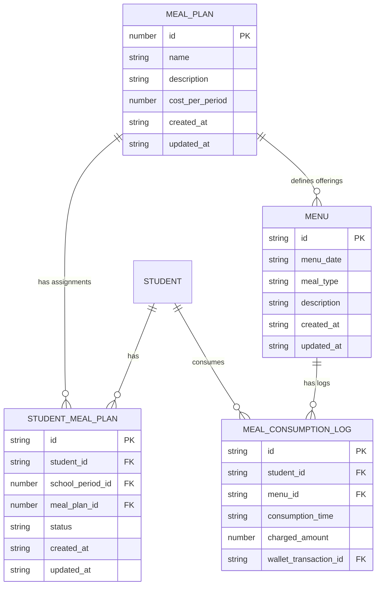
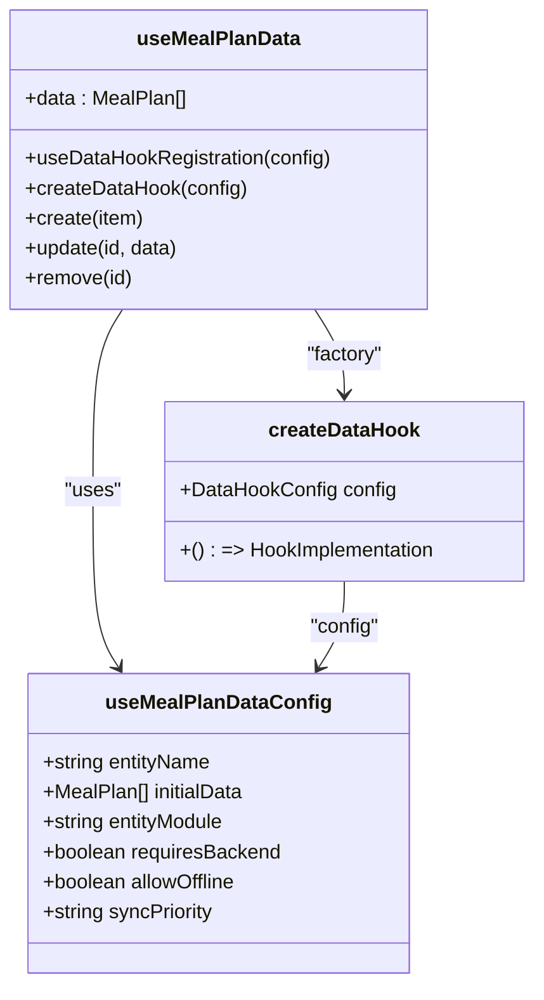
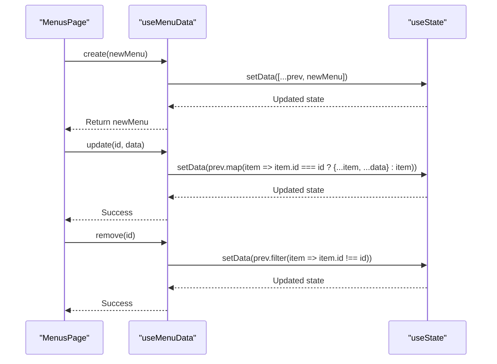
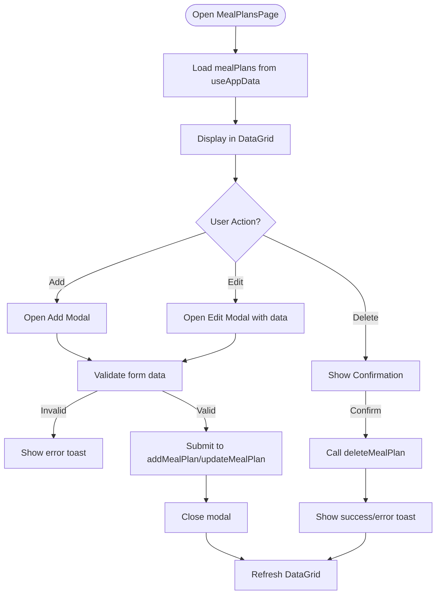
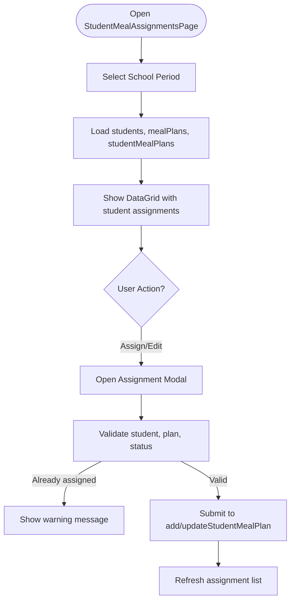

# Meal Planning & Menus

<cite>
**Referenced Files in This Document**   
- [useMealPlanData.ts](file://src/modules/nutrition/data/useMealPlanData.ts)
- [useMenuData.ts](file://src/modules/nutrition/data/useMenuData.ts)
- [types.ts](file://src/modules/nutrition/data/types.ts)
- [core/types.ts](file://src/core/types.ts)
- [schema.ts](file://src/modules/nutrition/data/schema.ts)
- [collections.ts](file://src/modules/nutrition/data/collections.ts)
- [mockData.ts](file://src/modules/nutrition/data/mockData.ts)
- [MealPlansPage.tsx](file://src/modules/nutrition/pages/MealPlansPage.tsx)
- [MenusPage.tsx](file://src/modules/nutrition/pages/MenusPage.tsx)
- [StudentMealAssignmentsPage.tsx](file://src/modules/nutrition/pages/StudentMealAssignmentsPage.tsx)
</cite>

## Table of Contents
1. [Introduction](#introduction)
2. [Core Entities and Data Structure](#core-entities-and-data-structure)
3. [Data Fetching and State Management](#data-fetching-and-state-management)
4. [Meal Plan and Menu Lifecycle](#meal-plan-and-menu-lifecycle)
5. [UI Components and User Interactions](#ui-components-and-user-interactions)
6. [Dietary Management and Student Assignment](#dietary-management-and-student-assignment)
7. [Validation and Error Handling](#validation-and-error-handling)
8. [Best Practices and Operational Considerations](#best-practices-and-operational-considerations)

## Introduction
The Meal Planning & Menus subsystem within the Nutrition module provides a comprehensive solution for managing student meal programs in an educational institution. This system enables administrators to define meal plans, schedule daily menus, assign plans to students, and track consumption. The architecture is built on a modular, data-driven approach using React hooks for state management, with a clear separation between template-based meal plans and scheduled menu instances. The system supports dietary restrictions, real-time updates, and integration with financial systems for billing and wallet management.

## Core Entities and Data Structure

### MealPlan vs. Menu: Template and Instance Pattern
The system implements a clear distinction between **MealPlan** (a template) and **Menu** (a scheduled instance). A MealPlan defines a recurring meal offering (e.g., "Standard Lunch Plan"), while a Menu represents a specific meal served on a particular date (e.g., "Lunch on 2024-07-29"). This pattern allows for flexible planning and efficient data management.



**Diagram sources**
- [types.ts](file://src/modules/nutrition/data/types.ts#L1200-L1230)
- [core/types.ts](file://src/core/types.ts#L1200-L1230)
- [schema.ts](file://src/modules/nutrition/data/schema.ts#L10-L45)

### Entity Definitions
The core data structures are defined in TypeScript interfaces, ensuring type safety and consistency across the application.

**MealPlan Interface**
```typescript
export interface MealPlan {
    id: number;
    name: string;
    description?: string | null;
    cost_per_period?: number | null;
    created_at: string;
    updated_at: string;
}
```
This entity serves as a reusable template for meal offerings. The `cost_per_period` field is used for billing students who are enrolled in the plan.

**Menu Interface**
```typescript
export interface Menu {
    id: string;
    menu_date: string;
    meal_type: MealType;
    description: string;
    created_at: string;
    updated_at: string;
}
```
The Menu entity represents a specific meal instance. The `meal_type` is an enum (BREAKFAST, LUNCH, etc.), and the `description` contains the actual food items served.

**Section sources**
- [core/types.ts](file://src/core/types.ts#L1200-L1230)
- [types.ts](file://src/modules/nutrition/data/types.ts#L1200-L1230)

## Data Fetching and State Management

### useMealPlanData Hook: Factory-Based Data Management
The `useMealPlanData` hook is a standardized data management hook created using a factory pattern. It integrates with the global `AppDataContext` and provides consistent CRUD operations across the application.



**Diagram sources**
- [useMealPlanData.ts](file://src/modules/nutrition/data/useMealPlanData.ts#L1-L28)
- [hooks/useDataHookFactory.ts](file://src/hooks/useDataHookFactory.ts)

The hook is configured with metadata that defines its behavior:
- **entityName**: 'mealPlans' - used for data context access
- **initialData**: Mock data for initialization
- **entityModule**: 'nutrition' - module ownership
- **requiresBackend**: false - can operate offline
- **allowOffline**: true - supports offline data entry
- **syncPriority**: 'medium' - synchronization priority

This configuration enables the hook to automatically register with the global data context and inherit standardized CRUD operations, caching, and synchronization logic.

### useMenuData Hook: Self-Contained State Management
In contrast to `useMealPlanData`, the `useMenuData` hook is self-contained and does not depend on the global `AppDataContext`. It manages its own state using React's `useState` and provides direct CRUD operations.



**Diagram sources**
- [useMenuData.ts](file://src/modules/nutrition/data/useMenuData.ts#L1-L41)

The hook uses in-memory state initialized with mock data. While this approach is simpler, it lacks the advanced features of the factory-based hook, such as automatic backend synchronization and offline support. This design choice may reflect a different data lifecycle or a transitional implementation.

**Section sources**
- [useMealPlanData.ts](file://src/modules/nutrition/data/useMealPlanData.ts)
- [useMenuData.ts](file://src/modules/nutrition/data/useMenuData.ts)

## Meal Plan and Menu Lifecycle

### CRUD Operations Implementation
The system provides full CRUD (Create, Read, Update, Delete) operations for both meal plans and menus through dedicated UI components.

**MealPlansPage.tsx** implements a comprehensive interface for managing meal plan templates:
- **Create**: Modal form with validation for name, description, and cost
- **Read**: DataGrid with sorting, searching, and pagination
- **Update**: Edit functionality via modal with pre-filled form data
- **Delete**: Single and bulk deletion with confirmation dialogs



**Diagram sources**
- [MealPlansPage.tsx](file://src/modules/nutrition/pages/MealPlansPage.tsx#L1-L227)

**MenusPage.tsx** follows a similar pattern but with date-specific considerations:
- The form includes a date picker for `menu_date`
- The `meal_type` is selected from a dropdown populated by the `MealType` enum
- Validation ensures all fields are completed before submission

### Data Validation and Error Handling
Both components implement client-side validation to ensure data integrity:
- **Required fields**: Name, date, meal type, and description are mandatory
- **Type validation**: Numbers are parsed and validated (e.g., cost_per_period)
- **Business logic validation**: Prevents duplicate active assignments for the same student and period

Error handling is implemented through:
- **Toast notifications**: Success and error messages with appropriate styling
- **Modal state management**: Forms are reset on close/cancel
- **Loading states**: Spinners indicate asynchronous operations
- **Confirmation dialogs**: Prevent accidental deletions

**Section sources**
- [MealPlansPage.tsx](file://src/modules/nutrition/pages/MealPlansPage.tsx)
- [MenusPage.tsx](file://src/modules/nutrition/pages/MenusPage.tsx)

## UI Components and User Interactions

### Component Architecture
The UI is built using a component-based architecture with reusable elements from the design system:
- **Card**: Container for the main interface with title and action buttons
- **DataGrid**: Table component with sorting, filtering, and selection capabilities
- **Modal**: Dialog for form input with header, body, and footer
- **Form elements**: Input, Select, Textarea with consistent styling
- **Buttons**: Primary, secondary, and danger variants for different actions
- **Icons**: Visual indicators for actions (Plus, Edit, Delete)

The **MealPlansPage** features:
- **Bulk operations**: Select multiple meal plans for deletion
- **Responsive design**: Adapts to different screen sizes
- **Accessibility**: Proper labeling and keyboard navigation
- **Internationalization**: Uses `useTranslation` hook for multilingual support

### User Interaction Flow
The user experience is designed to be intuitive and efficient:
1. **View**: Users see a list of existing meal plans with key information
2. **Action**: Buttons allow adding new plans or editing existing ones
3. **Input**: Modal forms provide a focused environment for data entry
4. **Confirmation**: System validates input and provides feedback
5. **Result**: Changes are reflected immediately in the UI

The **MenusPage** follows a similar flow but is optimized for daily menu planning, with emphasis on date selection and meal type categorization.

**Section sources**
- [MealPlansPage.tsx](file://src/modules/nutrition/pages/MealPlansPage.tsx)
- [MenusPage.tsx](file://src/modules/nutrition/pages/MenusPage.tsx)
- [components/ui](file://src/components/ui)

## Dietary Management and Student Assignment

### Student Meal Plan Assignment
The **StudentMealAssignmentsPage** component manages the assignment of meal plans to individual students. This is a critical function that links the template (MealPlan) with the student population.

Key features include:
- **School period filtering**: Assignments are scoped to specific academic periods
- **Student selection**: Dropdown populated with active students
- **Status management**: Tracks ACTIVE, INACTIVE, and CANCELLED states
- **Duplicate prevention**: Validates that a student doesn't have multiple active plans



**Diagram sources**
- [StudentMealAssignmentsPage.tsx](file://src/modules/nutrition/pages/StudentMealAssignmentsPage.tsx#L1-L248)

The assignment process ensures data consistency by checking for existing active plans before creating new ones, preventing billing errors and operational confusion.

### Dietary Category Support
The system supports various dietary categories through the `initialMockDietaryRestrictions` data structure:
- Vegetarian
- Vegan
- Halal
- Gluten-Free
- Dairy-Free
- Nut Allergy
- Diabetic
- Low Sodium

These dietary restrictions can be assigned to students in the `initialMockStudentDietaryInfo`, allowing the kitchen staff to prepare appropriate meals. The system could be extended to automatically flag menu items that contain allergens or to generate special meal plans for students with dietary restrictions.

**Section sources**
- [StudentMealAssignmentsPage.tsx](file://src/modules/nutrition/pages/StudentMealAssignmentsPage.tsx)
- [mockData.ts](file://src/modules/nutrition/data/mockData.ts#L150-L190)

## Validation and Error Handling

### Client-Side Validation
The system implements robust client-side validation at multiple levels:
- **Form validation**: Required fields are checked before submission
- **Type validation**: Numbers are parsed and validated
- **Business rule validation**: Prevents logical errors (e.g., duplicate assignments)
- **User confirmation**: Critical actions require explicit confirmation

The **MealPlansPage** uses a combination of:
- **Inline validation**: Immediate feedback on form fields
- **Toast notifications**: Persistent messages for success/error states
- **Modal state management**: Ensures forms are reset properly
- **Loading indicators**: Shows progress during asynchronous operations

### Error Recovery Patterns
The system follows best practices for error handling:
- **Graceful degradation**: The UI remains functional even if data loading fails
- **Meaningful error messages**: Users receive specific information about what went wrong
- **Retry capability**: Users can attempt operations again after failure
- **Data consistency**: Failed operations do not leave the system in an inconsistent state

The use of React's state management ensures that the UI always reflects the current data state, preventing display inconsistencies.

**Section sources**
- [MealPlansPage.tsx](file://src/modules/nutrition/pages/MealPlansPage.tsx#L100-L150)
- [MenusPage.tsx](file://src/modules/nutrition/pages/MenusPage.tsx#L100-L150)

## Best Practices and Operational Considerations

### Seasonal Menu Planning
The system supports seasonal menu planning through:
- **Date-based scheduling**: Menus can be planned weeks or months in advance
- **Template reuse**: Popular menu combinations can be replicated
- **Historical data**: Consumption logs can inform future planning
- **Nutritional tracking**: Integration with nutrition analytics

Best practices include:
- Planning menus at least one week in advance
- Incorporating seasonal ingredients
- Balancing nutritional content across the week
- Gathering student feedback on popular items

### Vendor Coordination
The **Merchants** entity facilitates coordination with food vendors:
- Each merchant is linked to a GL account for financial tracking
- Transactions are recorded in the wallet system
- Sales data can be used for inventory planning
- Vendor performance can be monitored through sales volume

### Allergy Management
Critical considerations for allergy management:
- **Student records**: Dietary restrictions must be accurately recorded
- **Staff training**: Kitchen staff must be aware of allergen protocols
- **Menu labeling**: All menu items should indicate potential allergens
- **Cross-contamination**: Separate preparation areas for allergen-free meals
- **Emergency procedures**: Staff should be trained on allergy response

### Handling Common Issues
**Last-minute menu changes**: The system allows quick updates to menu descriptions, with changes immediately visible to all users. Consumption logs maintain a record of what was actually served.

**Ingredient substitutions**: When substitutions are necessary, the menu description should be updated to reflect the change, ensuring transparency and accurate nutritional tracking.

**Nutritional compliance tracking**: The system can be extended to include nutritional information for each menu item, allowing administrators to ensure compliance with dietary guidelines and regulations.

**Operational best practices**:
- Regularly review consumption logs to identify trends
- Conduct periodic audits of meal plan assignments
- Maintain up-to-date dietary information for all students
- Coordinate with finance department for accurate billing
- Implement backup procedures for menu data

**Section sources**
- [mockData.ts](file://src/modules/nutrition/data/mockData.ts)
- [schema.ts](file://src/modules/nutrition/data/schema.ts)
- [StudentMealAssignmentsPage.tsx](file://src/modules/nutrition/pages/StudentMealAssignmentsPage.tsx)