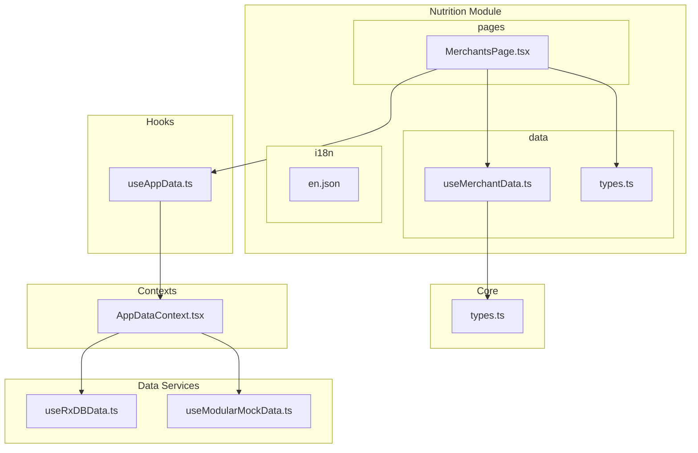
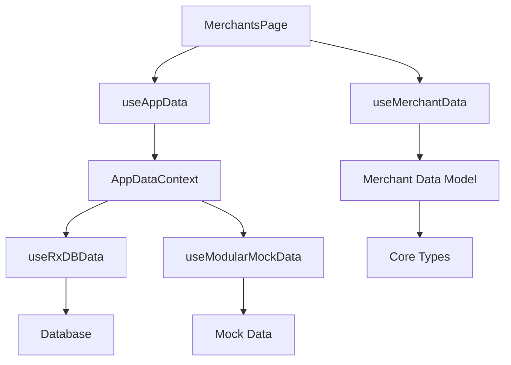
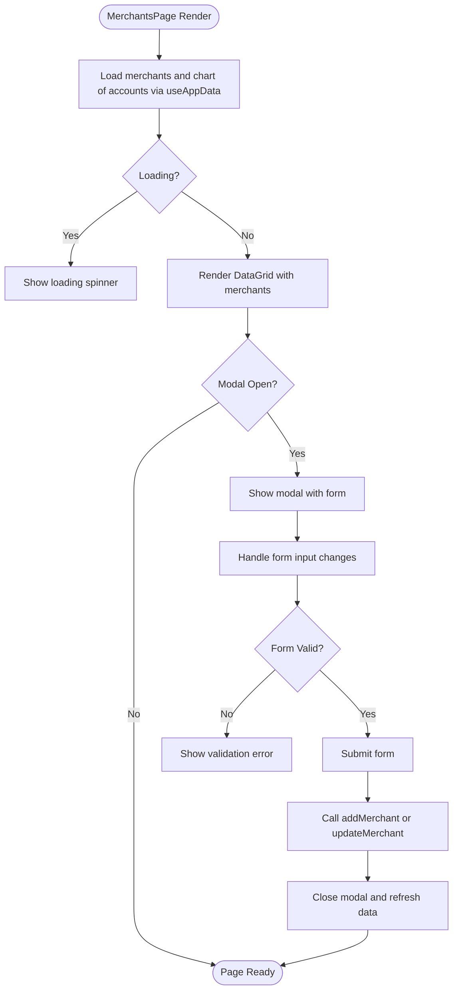
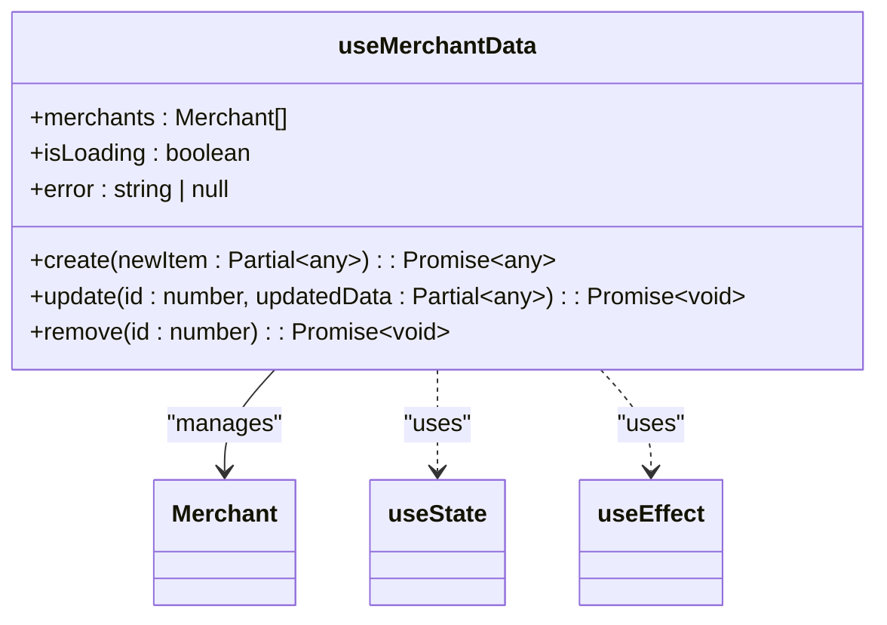
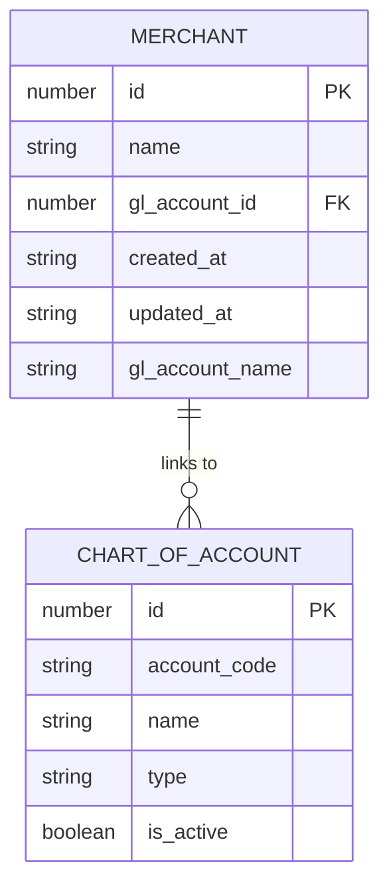
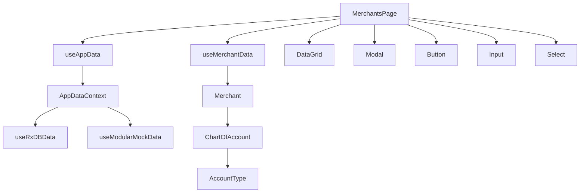

# Merchant Management

<cite>
**Referenced Files in This Document**   
- [MerchantsPage.tsx](file://src/modules/nutrition/pages/MerchantsPage.tsx)
- [useMerchantData.ts](file://src/modules/nutrition/data/useMerchantData.ts)
- [types.ts](file://src/modules/nutrition/data/types.ts)
- [types.ts](file://src/core/types.ts)
- [useAppData.ts](file://src/hooks/useAppData.ts)
- [AppDataContext.tsx](file://src/contexts/AppDataContext.tsx)
- [useRxDBData.ts](file://src/hooks/useRxDBData.ts)
- [useModularMockData.ts](file://src/hooks/useModularMockData.ts)
</cite>

## Table of Contents
1. [Introduction](#introduction)
2. [Project Structure](#project-structure)
3. [Core Components](#core-components)
4. [Architecture Overview](#architecture-overview)
5. [Detailed Component Analysis](#detailed-component-analysis)
6. [Dependency Analysis](#dependency-analysis)
7. [Performance Considerations](#performance-considerations)
8. [Troubleshooting Guide](#troubleshooting-guide)
9. [Conclusion](#conclusion)

## Introduction
This document provides a comprehensive overview of the merchant management subsystem within the Nutrition module of the SchoolPilot system. The subsystem enables schools to manage vendors (such as canteens) where students can make purchases using their digital wallets. It integrates with the financial system by linking merchants to revenue General Ledger (GL) accounts, ensuring proper accounting of sales. The system supports full CRUD operations, validation, and user interface components for managing merchant data. This documentation covers the data model, user interface implementation, backend integration, and best practices for usage.

## Project Structure
The merchant management functionality is located within the `nutrition` module of the application. The key components are organized in a modular structure with separation of concerns between data, UI, and business logic.

**Diagram sources**
- [MerchantsPage.tsx](file://src/modules/nutrition/pages/MerchantsPage.tsx)
- [useMerchantData.ts](file://src/modules/nutrition/data/useMerchantData.ts)
- [types.ts](file://src/modules/nutrition/data/types.ts)
- [types.ts](file://src/core/types.ts)
- [useAppData.ts](file://src/hooks/useAppData.ts)
- [AppDataContext.tsx](file://src/contexts/AppDataContext.tsx)
- [useRxDBData.ts](file://src/hooks/useRxDBData.ts)
- [useModularMockData.ts](file://src/hooks/useModularMockData.ts)

## Core Components
The merchant management system consists of several key components that work together to provide a complete solution for managing vendors in the school nutrition program. The primary components include the `MerchantsPage` UI component, the `useMerchantData` hook for data management, the `Merchant` data model, and the integration with the application data context through `useAppData`. These components are designed to work in both development (mock data) and production (database) environments, providing a consistent interface for managing merchant information.

**Section sources**
- [MerchantsPage.tsx](file://src/modules/nutrition/pages/MerchantsPage.tsx)
- [useMerchantData.ts](file://src/modules/nutrition/data/useMerchantData.ts)
- [types.ts](file://src/modules/nutrition/data/types.ts)
- [types.ts](file://src/core/types.ts)

## Architecture Overview
The merchant management subsystem follows a layered architecture with clear separation between presentation, business logic, and data access layers. The UI layer is responsible for rendering the merchant management interface and handling user interactions. The business logic layer, implemented through custom hooks, manages the state and operations for merchant data. The data access layer integrates with the application's data context to provide access to merchant data from either a database (in production) or mock data (in development). This architecture enables the system to be flexible, maintainable, and testable.

**Diagram sources**
- [MerchantsPage.tsx](file://src/modules/nutrition/pages/MerchantsPage.tsx)
- [useAppData.ts](file://src/hooks/useAppData.ts)
- [AppDataContext.tsx](file://src/contexts/AppDataContext.tsx)
- [useRxDBData.ts](file://src/hooks/useRxDBData.ts)
- [useModularMockData.ts](file://src/hooks/useModularMockData.ts)
- [useMerchantData.ts](file://src/modules/nutrition/data/useMerchantData.ts)
- [types.ts](file://src/modules/nutrition/data/types.ts)
- [types.ts](file://src/core/types.ts)

## Detailed Component Analysis

### MerchantsPage Component Analysis
The `MerchantsPage` component is the primary user interface for managing merchants in the nutrition system. It provides a data grid for viewing all merchants, a modal form for adding and editing merchants, and controls for performing CRUD operations. The component uses the `useAppData` hook to access merchant data and operations, and integrates with the financial system by allowing merchants to be linked to revenue GL accounts.

**Diagram sources**
- [MerchantsPage.tsx](file://src/modules/nutrition/pages/MerchantsPage.tsx)

**Section sources**
- [MerchantsPage.tsx](file://src/modules/nutrition/pages/MerchantsPage.tsx)

### useMerchantData Hook Analysis
The `useMerchantData` hook provides a self-contained solution for managing merchant data. It encapsulates the state and operations for creating, reading, updating, and deleting merchants. The hook uses React's useState and useEffect hooks to manage local state and initialize data. Although currently implemented with mock data, the hook is designed to be easily extended to support API calls or database operations.

**Diagram sources**
- [useMerchantData.ts](file://src/modules/nutrition/data/useMerchantData.ts)

**Section sources**
- [useMerchantData.ts](file://src/modules/nutrition/data/useMerchantData.ts)

### Merchant Data Model Analysis
The Merchant data model defines the structure of merchant entities in the system. It includes essential fields such as ID, name, GL account ID, and timestamps. The model also includes denormalized fields for improved performance, such as the GL account name, which avoids the need for additional lookups when displaying merchant information.

**Diagram sources**
- [types.ts](file://src/core/types.ts)
- [types.ts](file://src/modules/nutrition/data/types.ts)

**Section sources**
- [types.ts](file://src/core/types.ts)
- [types.ts](file://src/modules/nutrition/data/types.ts)

## Dependency Analysis
The merchant management subsystem has several key dependencies that enable its functionality. The primary dependency is the application data context, which provides access to merchant data and operations through the `useAppData` hook. The system also depends on the financial module through the Chart of Accounts, allowing merchants to be linked to revenue accounts for proper accounting. The UI components depend on shared UI components for consistent styling and behavior. The data model depends on core types defined in the application's core module to ensure consistency across the system.

**Diagram sources**
- [MerchantsPage.tsx](file://src/modules/nutrition/pages/MerchantsPage.tsx)
- [useAppData.ts](file://src/hooks/useAppData.ts)
- [AppDataContext.tsx](file://src/contexts/AppDataContext.tsx)
- [useRxDBData.ts](file://src/hooks/useRxDBData.ts)
- [useModularMockData.ts](file://src/hooks/useModularMockData.ts)
- [useMerchantData.ts](file://src/modules/nutrition/data/useMerchantData.ts)
- [types.ts](file://src/core/types.ts)

**Section sources**
- [MerchantsPage.tsx](file://src/modules/nutrition/pages/MerchantsPage.tsx)
- [useAppData.ts](file://src/hooks/useAppData.ts)
- [AppDataContext.tsx](file://src/contexts/AppDataContext.tsx)
- [useRxDBData.ts](file://src/hooks/useRxDBData.ts)
- [useModularMockData.ts](file://src/hooks/useModularMockData.ts)
- [useMerchantData.ts](file://src/modules/nutrition/data/useMerchantData.ts)
- [types.ts](file://src/core/types.ts)

## Performance Considerations
The merchant management system is designed with performance in mind. The use of React's useMemo hook for filtering revenue accounts ensures that this operation is only performed when the chart of accounts data changes, reducing unnecessary computations. The integration with the application data context allows for efficient data loading and caching, minimizing the number of requests to the data source. The use of controlled components for form inputs ensures that the UI remains responsive and updates efficiently. In production, the system leverages the RxDB database for fast, local data access, while in development, mock data provides a quick and reliable data source.

## Troubleshooting Guide
When encountering issues with the merchant management system, consider the following common problems and solutions:

1. **Merchants not loading**: Check the network connection and ensure the database is accessible. Verify that the `useAppData` hook is properly initialized and that the data source is correctly configured in the application settings.

2. **Form validation errors**: Ensure all required fields are filled out correctly. The merchant name is required and cannot be empty. When linking to a GL account, ensure a valid revenue account is selected.

3. **GL account dropdown empty**: Verify that there are active revenue accounts in the chart of accounts. The dropdown only shows accounts of type REVENUE that are active.

4. **CRUD operations failing**: Check the console for error messages. Ensure the data source is writable and that the user has the necessary permissions to perform the operation.

5. **Performance issues**: If the merchant list is large, consider implementing pagination or virtual scrolling in the DataGrid component.

**Section sources**
- [MerchantsPage.tsx](file://src/modules/nutrition/pages/MerchantsPage.tsx)
- [useAppData.ts](file://src/hooks/useAppData.ts)
- [AppDataContext.tsx](file://src/contexts/AppDataContext.tsx)

## Conclusion
The merchant management subsystem provides a robust solution for managing vendors in the school nutrition program. It offers a user-friendly interface for performing CRUD operations, integrates with the financial system for proper accounting, and is designed to work in both development and production environments. The system follows best practices for React development, with clear separation of concerns, efficient state management, and reusable components. By leveraging the application's data context and core types, the system ensures consistency and maintainability across the application. Future enhancements could include support for vendor contracts, performance tracking, and compliance certifications.