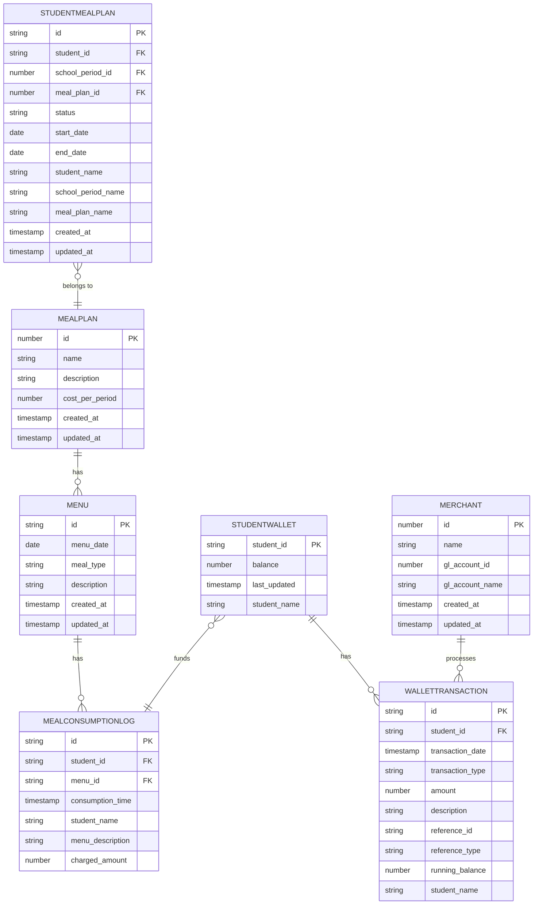
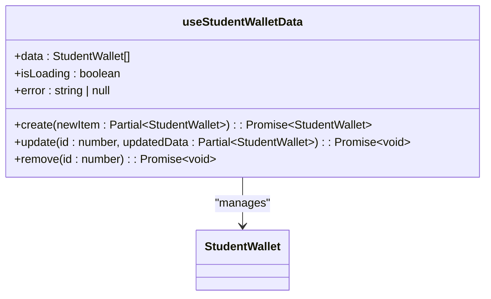
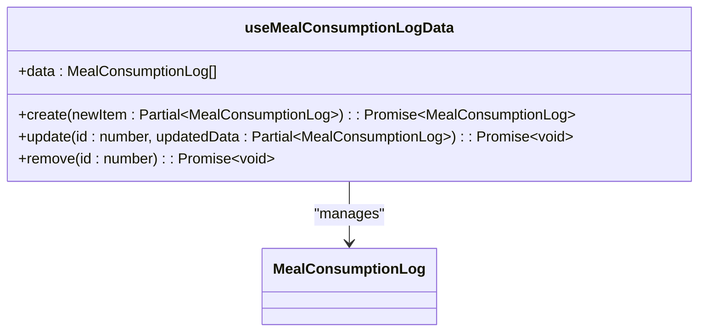

# Nutrition Data Model

<cite>
**Referenced Files in This Document**   
- [schema.ts](file://src/modules/nutrition/data/schema.ts)
- [mockData.ts](file://src/modules/nutrition/data/mockData.ts)
- [useStudentWalletData.ts](file://src/modules/nutrition/data/useStudentWalletData.ts)
- [useMealConsumptionLogData.ts](file://src/modules/nutrition/data/useMealConsumptionLogData.ts)
- [types.ts](file://src/modules/nutrition/data/types.ts)
</cite>

## Table of Contents
1. [Introduction](#introduction)
2. [Core Entities](#core-entities)
3. [Entity Relationships](#entity-relationships)
4. [Field Definitions and Constraints](#field-definitions-and-constraints)
5. [Business Rules](#business-rules)
6. [Data Access Patterns](#data-access-patterns)
7. [Sample Data Records](#sample-data-records)
8. [Data Lifecycle Management](#data-lifecycle-management)
9. [Privacy and Compliance](#privacy-and-compliance)

## Introduction
The Nutrition module in schoolpilot3 manages meal planning, student meal assignments, wallet transactions, and consumption tracking for students. This document provides comprehensive documentation of the data model, including core entities, relationships, field definitions, business rules, and data access patterns. The system supports various meal plans, dietary restrictions, and financial transactions through student wallets, with detailed logging of meal consumption.

## Core Entities
The Nutrition module consists of seven core entities that work together to manage student nutrition services:
- **MealPlan**: Defines available meal plans with cost and description
- **Menu**: Specifies meals available on specific dates and meal types
- **StudentMealPlan**: Associates students with meal plans for specific school periods
- **StudentWallet**: Tracks student wallet balances for pay-as-you-eat scenarios
- **WalletTransaction**: Records all transactions affecting student wallets
- **Merchant**: Defines merchants where wallet funds can be used
- **MealConsumptionLog**: Logs each instance of meal consumption by students

These entities form a comprehensive system for managing student nutrition services, from planning to consumption tracking and financial management.

**Section sources**
- [schema.ts](file://src/modules/nutrition/data/schema.ts#L1-L150)

## Entity Relationships
The Nutrition module entities are interconnected through well-defined relationships that support the business processes of meal planning, assignment, and consumption tracking.



**Diagram sources**
- [schema.ts](file://src/modules/nutrition/data/schema.ts#L1-L150)

**Section sources**
- [schema.ts](file://src/modules/nutrition/data/schema.ts#L1-L150)

## Field Definitions and Constraints
This section documents the field definitions, data types, primary/foreign keys, and constraints for each entity in the Nutrition module based on the schema.ts file.

### MealPlan Entity
The MealPlan entity defines available meal plans with associated costs and descriptions.

**Field Definitions:**
- **id**: Unique identifier for the meal plan (Primary Key, number)
- **name**: Meal plan name (string, max length: 150, required)
- **description**: Meal plan description (string, max length: 500)
- **cost_per_period**: Cost per period (number, required)
- **created_at**: Record creation timestamp (timestamp, required)
- **updated_at**: Record last update timestamp (timestamp, required)

**Constraints:**
- Primary Key: id
- Required fields: id, name, created_at, updated_at
- Indexes: name

**Section sources**
- [schema.ts](file://src/modules/nutrition/data/schema.ts#L1-L29)

### StudentMealPlan Entity
The StudentMealPlan entity associates students with meal plans for specific school periods.

**Field Definitions:**
- **id**: Unique identifier for the student meal plan (Primary Key, string)
- **student_id**: Reference to the student (Foreign Key, string, required)
- **school_period_id**: Reference to the school period (Foreign Key, number, required)
- **meal_plan_id**: Reference to the meal plan (Foreign Key, number, required)
- **status**: Meal plan status (string, enum values, max length: 50, required)
- **start_date**: Start date of the meal plan (date)
- **end_date**: End date of the meal plan (date)
- **student_name**: Student name (denormalized, string, max length: 200)
- **school_period_name**: School period name (denormalized, string, max length: 100)
- **meal_plan_name**: Meal plan name (denormalized, string, max length: 150)
- **created_at**: Record creation timestamp (timestamp, required)
- **updated_at**: Record last update timestamp (timestamp, required)

**Constraints:**
- Primary Key: id
- Foreign Keys: student_id → students, school_period_id → school_periods, meal_plan_id → meal_plans
- Required fields: id, student_id, school_period_id, meal_plan_id, status, created_at, updated_at
- Indexes: None specified

**Section sources**
- [schema.ts](file://src/modules/nutrition/data/schema.ts#L25-L42)

### Menu Entity
The Menu entity specifies meals available on specific dates and meal types.

**Field Definitions:**
- **id**: Unique identifier for the menu (Primary Key, string)
- **menu_date**: Date of the menu (date, required)
- **meal_type**: Type of meal (string, enum values, max length: 50, required)
- **description**: Menu description (string, max length: 500, required)
- **created_at**: Record creation timestamp (timestamp, required)
- **updated_at**: Record last update timestamp (timestamp, required)

**Constraints:**
- Primary Key: id
- Required fields: id, menu_date, meal_type, description, created_at, updated_at
- Indexes: menu_date, meal_type

**Section sources**
- [schema.ts](file://src/modules/nutrition/data/schema.ts#L44-L62)

### StudentWallet Entity
The StudentWallet entity tracks student wallet balances for pay-as-you-eat scenarios.

**Field Definitions:**
- **student_id**: Reference to the student (Primary Key, string, required)
- **balance**: Current wallet balance (number, required)
- **last_updated**: Timestamp of last balance update (timestamp, required)
- **student_name**: Student name (denormalized, string, max length: 200)

**Constraints:**
- Primary Key: student_id
- Foreign Key: student_id → students
- Required fields: student_id, balance, last_updated
- Indexes: None specified

**Section sources**
- [schema.ts](file://src/modules/nutrition/data/schema.ts#L64-L82)

### WalletTransaction Entity
The WalletTransaction entity records all transactions affecting student wallets.

**Field Definitions:**
- **id**: Unique identifier for the wallet transaction (Primary Key, string)
- **student_id**: Reference to the student (Foreign Key, string, required)
- **transaction_date**: Date and time of transaction (timestamp, required)
- **transaction_type**: Type of transaction (string, enum values, max length: 50, required)
- **amount**: Transaction amount (positive for deposits, negative for purchases) (number, required)
- **description**: Transaction description (string, max length: 255, required)
- **reference_id**: Reference ID for related records (string, max length: 100)
- **reference_type**: Type of referenced record (string, max length: 50)
- **running_balance**: Running balance after transaction (number, required)
- **student_name**: Student name (denormalized, string, max length: 200)

**Constraints:**
- Primary Key: id
- Foreign Key: student_id → students
- Required fields: id, student_id, transaction_date, transaction_type, amount, description, running_balance
- Indexes: student_id, transaction_date

**Section sources**
- [schema.ts](file://src/modules/nutrition/data/schema.ts#L84-L112)

### Merchant Entity
The Merchant entity defines merchants where wallet funds can be used.

**Field Definitions:**
- **id**: Unique identifier for the merchant (Primary Key, number)
- **name**: Merchant name (string, max length: 150, required)
- **gl_account_id**: General ledger account ID (number, required)
- **gl_account_name**: General ledger account name (string, max length: 200)
- **created_at**: Record creation timestamp (timestamp, required)
- **updated_at**: Record last update timestamp (timestamp, required)

**Constraints:**
- Primary Key: id
- Required fields: id, name, gl_account_id, created_at, updated_at
- Indexes: name

**Section sources**
- [schema.ts](file://src/modules/nutrition/data/schema.ts#L114-L132)

### MealConsumptionLog Entity
The MealConsumptionLog entity logs each instance of meal consumption by students.

**Field Definitions:**
- **id**: Unique identifier for the meal consumption log (Primary Key, string)
- **student_id**: Reference to the student (Foreign Key, string, required)
- **menu_id**: Reference to the menu (Foreign Key, string, required)
- **consumption_time**: Timestamp of meal consumption (timestamp, required)
- **student_name**: Student name (denormalized, string, max length: 200)
- **menu_description**: Menu description (denormalized, string, max length: 500)
- **charged_amount**: Amount charged for the meal (number)

**Constraints:**
- Primary Key: id
- Foreign Keys: student_id → students, menu_id → menus
- Required fields: id, student_id, menu_id, consumption_time
- Indexes: student_id, menu_id, consumption_time

**Section sources**
- [schema.ts](file://src/modules/nutrition/data/schema.ts#L134-L150)

## Business Rules
The Nutrition module enforces several business rules to ensure data integrity and proper operation of the system.

### Wallet Balance Validation
The system implements strict validation rules for wallet transactions to prevent invalid operations:

1. **Positive Amount Validation**: All transaction amounts must be positive values, with negative amounts used internally for purchases.
2. **Balance Protection**: The system prevents transactions that would result in negative wallet balances for pay-as-you-eat plans.
3. **Running Balance Calculation**: Each transaction updates the running balance, which is calculated as the previous balance plus the transaction amount.
4. **Transaction Type Restrictions**: Manual transactions are limited to deposits and adjustments (debit/credit), preventing direct creation of purchase transactions.

The wallet system also enforces configuration-based limits:
- Daily spending limit: 1,000 KES
- Low balance alert threshold: 200 KES
- Minimum balance requirement: 50 KES

**Section sources**
- [schema.ts](file://src/modules/nutrition/data/schema.ts#L84-L112)
- [mockData.ts](file://src/modules/nutrition/data/mockData.ts#L164-L169)

### Meal Plan Validity Periods
Meal plans have defined validity periods that control when they are active:

1. **Start and End Dates**: Each StudentMealPlan record includes start_date and end_date fields that define the period during which the meal plan is valid.
2. **Status Management**: Meal plans have a status field with values including ACTIVE, PENDING, and other states to track their lifecycle.
3. **School Period Association**: Meal plans are associated with specific school periods through the school_period_id field.
4. **Advance Booking**: The system allows meal plan bookings up to 7 days in advance.
5. **Cancellation Deadline**: Meal plan cancellations must be made at least 2 hours before the meal period.

These rules ensure that meal plans are only available during their designated periods and that changes follow established procedures.

**Section sources**
- [schema.ts](file://src/modules/nutrition/data/schema.ts#L25-L42)
- [mockData.ts](file://src/modules/nutrition/data/mockData.ts#L169-L171)

### Consumption Logging Requirements
The system enforces specific requirements for logging meal consumption:

1. **Mandatory Fields**: Consumption logs require student_id, menu_id, and consumption_time to be recorded.
2. **Menu Availability**: A valid menu must exist for the specified date and meal type before consumption can be logged.
3. **Duplicate Prevention**: The system prevents duplicate consumption logs for the same student and menu combination.
4. **Timing Validation**: Consumption times must be within the configured meal serving periods:
   - Breakfast: 07:00 - 09:00
   - Lunch: 12:00 - 14:00
   - Supper: 18:00 - 20:00
5. **Canteen Hours**: The canteen operates from 07:00-20:00 on weekdays, 08:00-19:00 on weekends, and is closed on holidays.

These rules ensure accurate tracking of meal consumption while preventing invalid entries.

**Section sources**
- [schema.ts](file://src/modules/nutrition/data/schema.ts#L134-L150)
- [mockData.ts](file://src/modules/nutrition/data/mockData.ts#L164-L174)

## Data Access Patterns
The Nutrition module uses custom React hooks to provide data access patterns that abstract the underlying data storage mechanisms.

### useStudentWalletData Hook
The useStudentWalletData hook provides CRUD operations for managing student wallet data:



**Key Features:**
- State management using useState hooks for data, loading status, and error handling
- useEffect hook to initialize data from mock sources
- create method that generates new wallet records with timestamps
- update method that modifies existing records and updates timestamps
- remove method that filters out records by ID
- Returns data array, loading status, error state, and CRUD operations

This hook follows the self-contained pattern, not depending on AppDataContext, making it reusable across different components.

**Section sources**
- [useStudentWalletData.ts](file://src/modules/nutrition/data/useStudentWalletData.ts#L7-L54)

### useMealConsumptionLogData Hook
The useMealConsumptionLogData hook provides data management for meal consumption logs:



**Key Features:**
- Simple state management with useState for the data array
- create method that generates new consumption log records with timestamps
- update method that modifies existing records and updates timestamps
- remove method that filters out records by ID
- Returns data array and CRUD operations

Like useStudentWalletData, this hook is self-contained and provides a clean interface for managing meal consumption data.

**Section sources**
- [useMealConsumptionLogData.ts](file://src/modules/nutrition/data/useMealConsumptionLogData.ts#L7-L39)

## Sample Data Records
This section provides sample data records for each entity in the Nutrition module, based on the mockData.ts file.

### MealPlan Sample Data
```json
{
  "id": 1,
  "name": "Standard Lunch Plan",
  "description": "Daily lunch for students",
  "cost_per_period": 7500,
  "created_at": "2024-07-28T10:00:00Z",
  "updated_at": "2024-07-28T10:00:00Z"
}
```

### StudentMealPlan Sample Data
```json
{
  "id": "SMP001",
  "student_id": "STU001",
  "school_period_id": 3,
  "meal_plan_id": 2,
  "status": "ACTIVE",
  "created_at": "2024-07-28T10:00:00Z",
  "updated_at": "2024-07-28T10:00:00Z",
  "student_name": "Kevin Malone",
  "school_period_name": "Term 3 - AY 2023/2024",
  "meal_plan_name": "Full Board Plan (All Meals)"
}
```

### Menu Sample Data
```json
{
  "id": "MENU001",
  "menu_date": "2024-07-29",
  "meal_type": "LUNCH",
  "description": "Rice, Beans, Cabbage",
  "created_at": "2024-07-28T10:00:00Z",
  "updated_at": "2024-07-28T10:00:00Z"
}
```

### StudentWallet Sample Data
```json
{
  "student_id": "STU003",
  "balance": 1500.00,
  "last_updated": "2024-07-28T10:00:00Z",
  "student_name": "Jim Halpert"
}
```

### WalletTransaction Sample Data
```json
{
  "id": "WTX001",
  "student_id": "STU003",
  "transaction_date": "2024-07-28T10:00:00Z",
  "transaction_type": "DEPOSIT",
  "amount": 2000,
  "description": "Pocket money deposit by parent",
  "running_balance": 2000,
  "student_name": "Jim Halpert"
}
```

### Merchant Sample Data
```json
{
  "id": 1,
  "name": "School Canteen",
  "gl_account_id": 410,
  "created_at": "2024-07-28T10:00:00Z",
  "updated_at": "2024-07-28T10:00:00Z",
  "gl_account_name": "Canteen Sales Revenue"
}
```

### MealConsumptionLog Sample Data
```json
{
  "id": "MCL001",
  "student_id": "STU001",
  "menu_id": "MENU001",
  "consumption_time": "2024-07-29T13:05:00Z",
  "student_name": "Kevin Malone",
  "menu_description": "Rice, Beans, Cabbage"
}
```

**Section sources**
- [mockData.ts](file://src/modules/nutrition/data/mockData.ts#L1-L190)

## Data Lifecycle Management
The Nutrition module implements data lifecycle management practices to ensure data integrity and compliance.

### Retention Policies
While specific retention policies are not explicitly defined in the code, the system design suggests the following data lifecycle patterns:

1. **Consumption Logs**: Retained for the duration of the school period plus a reasonable archival period for reporting and auditing purposes.
2. **Transaction History**: Maintained indefinitely for financial auditing and compliance requirements.
3. **Meal Plans**: Archived after the end date but retained for historical reporting.
4. **Student Meal Assignments**: Kept for the duration of the student's enrollment plus a retention period.

The system uses created_at and updated_at timestamps on all entities to support audit trails and data retention policies.

### Migration Strategies
The collection configurations in collections.ts (not available in the current context) would typically define migration strategies for schema changes. Based on standard practices in the codebase, migrations would likely include:

1. Versioning of database schemas
2. Data transformation functions for schema changes
3. Index creation and optimization
4. Data validation during migration
5. Backup and rollback procedures

The system appears to use a database-agnostic schema definition approach, which facilitates migration between different database technologies.

**Section sources**
- [schema.ts](file://src/modules/nutrition/data/schema.ts#L1-L150)
- [mockData.ts](file://src/modules/nutrition/data/mockData.ts#L1-L190)

## Privacy and Compliance
The Nutrition module addresses privacy and compliance considerations for sensitive student data.

### Privacy Considerations for Dietary Preference Data
The system handles sensitive dietary preference data with appropriate privacy considerations:

1. **Dietary Restrictions**: The system supports various dietary restrictions including Vegetarian, Vegan, Halal, Gluten-Free, Dairy-Free, Nut Allergy, Diabetic, and Low Sodium.
2. **Medical Notes**: Students with special dietary needs can have notes recorded, such as "Severe peanut allergy - carry EpiPen" or "Type 1 diabetes - monitor carbohydrate intake."
3. **Data Minimization**: Only necessary dietary information is collected and stored.
4. **Access Control**: Access to dietary information is likely restricted through RBAC (Role-Based Access Control) permissions.

The system includes specific permissions for tracking allergies and managing dietary requirements, indicating that this data is treated as sensitive.

**Section sources**
- [mockData.ts](file://src/modules/nutrition/data/mockData.ts#L145-L168)
- [rbac.ts](file://src/modules/nutrition/rbac.ts#L0-L41)

### Compliance with Nutritional Reporting Standards
The Nutrition module supports compliance with nutritional reporting standards through several features:

1. **Reporting Capabilities**: The system includes a "Nutrition Report" action, indicating built-in reporting functionality.
2. **Analytics Data**: The system tracks meal participation rates, average daily consumption, popular meals, and dietary preferences.
3. **Audit Trails**: All transactions and changes are timestamped with created_at and updated_at fields.
4. **Data Integrity**: Required fields and constraints ensure data completeness and accuracy.
5. **Access Permissions**: Specific permissions control access to nutrition data and reporting functions.

The system's design supports compliance with educational and health regulations by providing comprehensive tracking of meal services, student participation, and dietary accommodations.

**Section sources**
- [mockData.ts](file://src/modules/nutrition/data/mockData.ts#L110-L145)
- [moduleDefinition.tsx](file://src/modules/nutrition/moduleDefinition.tsx#L33-L64)
- [rbac.ts](file://src/modules/nutrition/rbac.ts#L0-L41)