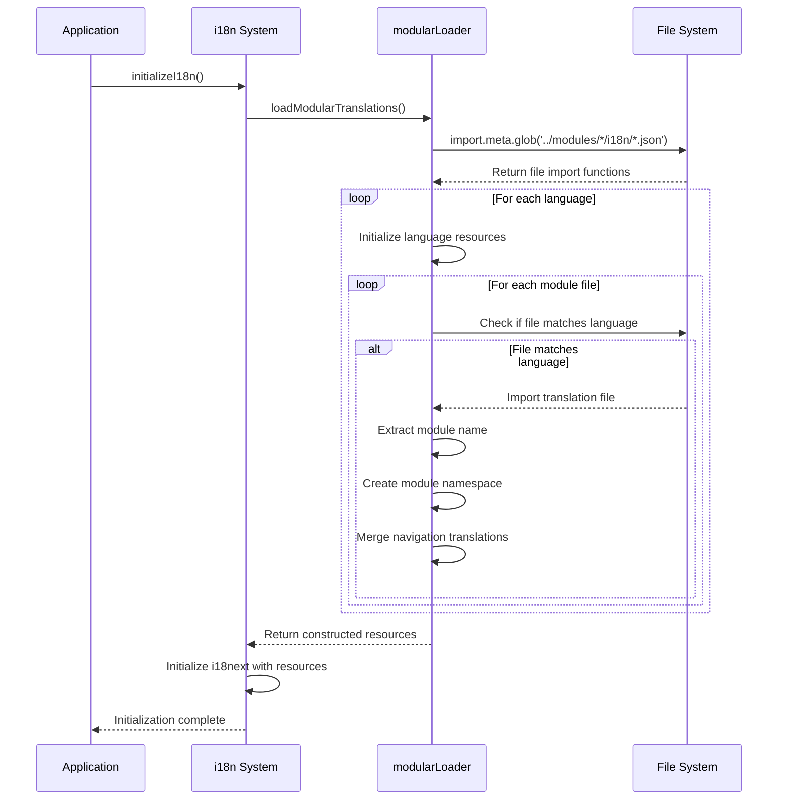
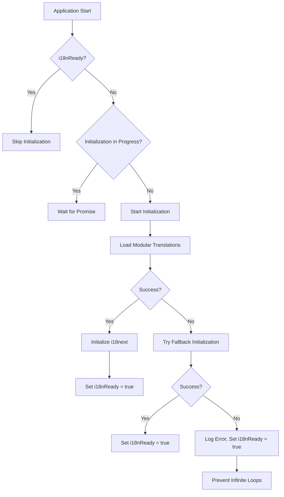

# Nutrition Module Internationalization

<cite>
**Referenced Files in This Document**   
- [i18n.ts](file://src/i18n/i18n.ts)
- [modularLoader.ts](file://src/i18n/modularLoader.ts)
- [en.json](file://src/modules/nutrition/i18n/en.json)
- [fr.json](file://src/modules/nutrition/i18n/fr.json)
- [rw.json](file://src/modules/nutrition/i18n/rw.json)
- [sw.json](file://src/modules/nutrition/i18n/sw.json)
- [nutrition.json](file://src/i18n/locales/en/nutrition.json)
- [loader.ts](file://src/i18n/loader.ts)
- [NutritionDashboardPage.tsx](file://src/modules/nutrition/pages/NutritionDashboardPage.tsx)
- [analyze-nutrition-keys.js](file://scripts/debug/analyze-nutrition-keys.js)
- [translation_status_report.md](file://translation_status_report.md)
</cite>

## Table of Contents
1. [Introduction](#introduction)
2. [Translation Structure and Supported Languages](#translation-structure-and-supported-languages)
3. [Translation Key Naming Conventions](#translation-key-naming-conventions)
4. [Modular Translation Loading Mechanism](#modular-translation-loading-mechanism)
5. [Integration with Global i18n System](#integration-with-global-i18n-system)
6. [Translation Completeness and Validation](#translation-completeness-and-validation)
7. [Implementation in UI Components](#implementation-in-ui-components)
8. [Guidelines for Adding New Languages](#guidelines-for-adding-new-languages)
9. [Special Considerations for Nutritional Terminology](#special-considerations-for-nutritional-terminology)
10. [Conclusion](#conclusion)

## Introduction
The Nutrition module in schoolpilot3 implements a comprehensive internationalization (i18n) system to support multiple languages across different regions. This documentation details the translation structure, loading mechanism, key conventions, and integration patterns used in the Nutrition module. The system supports English (en), French (fr), Kinyarwanda (rw), and Swahili (sw) locales, with a modular architecture that enables dynamic loading of translation resources based on user preferences and module requirements.

**Section sources**
- [i18n.ts](file://src/i18n/i18n.ts#L1-L116)
- [modularLoader.ts](file://src/i18n/modularLoader.ts#L1-L66)

## Translation Structure and Supported Languages
The Nutrition module maintains its translation files in a dedicated i18n directory within the module structure. Each supported language has its own JSON file containing all translatable strings specific to the Nutrition module.

The module supports four languages:
- English (en): `src/modules/nutrition/i18n/en.json`
- French (fr): `src/modules/nutrition/i18n/fr.json`
- Kinyarwanda (rw): `src/modules/nutrition/i18n/rw.json`
- Swahili (sw): `src/modules/nutrition/i18n/sw.json`

Each language file follows the same structure with hierarchical organization of translation keys. The primary categories include navigation elements, meal plans, menus, merchants, student meal assignments, meal consumption logs, and student wallets.

```mermaid
graph TD
A[Nutrition Module i18n] --> B[en.json]
A --> C[fr.json]
A --> D[rw.json]
A --> E[sw.json]
B --> F[title: "Nutrition"]
B --> G[navigation]
G --> H[dashboard: "Dashboard"]
G --> I[mealPlans: "Meal Plans"]
G --> J[menus: "Menus"]
G --> K[merchants: "Merchants"]
G --> L[studentMealAssignments: "Student Meal Assignments"]
G --> M[mealConsumptionLog: "Meal Consumption Log"]
G --> N[studentWallet: "Student Wallet"]
```

**Diagram sources**
- [en.json](file://src/modules/nutrition/i18n/en.json#L1-L16)
- [fr.json](file://src/modules/nutrition/i18n/fr.json#L1-L44)
- [rw.json](file://src/modules/nutrition/i18n/rw.json#L1-L16)
- [sw.json](file://src/modules/nutrition/i18n/sw.json#L1-L16)

**Section sources**
- [en.json](file://src/modules/nutrition/i18n/en.json#L1-L16)
- [fr.json](file://src/modules/nutrition/i18n/fr.json#L1-L44)
- [rw.json](file://src/modules/nutrition/i18n/rw.json#L1-L16)
- [sw.json](file://src/modules/nutrition/i18n/sw.json#L1-L16)

## Translation Key Naming Conventions
The Nutrition module follows a consistent naming convention for translation keys, organized hierarchically by functional area. The key structure uses camelCase for multi-word keys and follows a parent-child relationship to group related translations.

The primary categories of translation keys include:

**Navigation Structure**
- **title**: Module title displayed in the interface
- **navigation.nutrition.title**: Navigation menu title
- **navigation.nutrition.description**: Module description in navigation
- **navigation.nutrition.dashboard**: Dashboard link text
- **navigation.nutrition.mealPlans**: Meal Plans link text
- **navigation.nutrition.menus**: Menus link text
- **navigation.nutrition.merchants**: Merchants link text
- **navigation.nutrition.studentMealAssignments**: Student Meal Assignments link text
- **navigation.nutrition.mealConsumptionLog**: Meal Consumption Log link text
- **navigation.nutrition.studentWallet**: Student Wallet link text

**Meal Plans Management**
- **mealPlans.managementTitle**: "Gestion des Plans de Repas" (French)
- **mealPlans.managementDescription**: "Définir et gérer les plans de repas offerts par l'école." (French)
- **mealPlans.addMealPlan**: "Ajouter Plan de Repas" (French)
- **mealPlans.addNewMealPlan**: "Ajouter Nouveau Plan de Repas" (French)
- **mealPlans.editMealPlan**: "Modifier Plan de Repas" (French)
- **mealPlans.planName**: "Nom du Plan" (French)
- **mealPlans.description**: "Description (Optionnel)" (French)
- **mealPlans.costPerPeriod**: "Coût par Période (KES)" (French)
- **mealPlans.cancel**: "Annuler" (French)
- **mealPlans.saveChanges**: "Enregistrer Modifications" (French)
- **mealPlans.addPlan**: "Ajouter Plan" (French)

**Menus Management**
- **menus.management.title**: "Gestion des Menus Quotidiens/Hebdomadaires" (French)
- **menus.management.description**: "Créer et gérer les menus pour différents types de repas à des dates spécifiques." (French)
- **menus.add.button**: "Ajouter Menu" (French)
- **menus.add.title**: "Ajouter Nouveau Menu" (French)
- **menus.edit.title**: "Modifier Menu" (French)
- **menus.date.label**: "Date du Menu" (French)
- **menus.mealType.label**: "Type de Repas" (French)
- **menus.description.label**: "Description du Menu / Articles" (French)
- **menus.description.placeholder**: "ex: Riz, Ragoût de Bœuf, Chou, et une Banane" (French)
- **menus.cancel.button**: "Annuler" (French)
- **menus.save.button**: "Enregistrer Modifications" (French)

The naming convention prioritizes clarity and consistency, with keys organized by functional area (mealPlans, menus) followed by specific UI elements or actions. This hierarchical structure enables easy maintenance and ensures that related translations are grouped together.

**Section sources**
- [en.json](file://src/modules/nutrition/i18n/en.json#L1-L16)
- [fr.json](file://src/modules/nutrition/i18n/fr.json#L1-L44)

## Modular Translation Loading Mechanism
The Nutrition module utilizes a dynamic modular loading system for translations, implemented through the `modularLoader.ts` file. This system leverages Vite's import.meta.glob functionality to dynamically import translation files based on the user's language preference.

The loading process follows these steps:

1. **Resource Initialization**: The `loadModularTranslations` function initializes an empty resources object with support for English (en), French (fr), Swahili (sw), and Kinyarwanda (rw) languages.

2. **Dynamic Import**: Using `import.meta.glob('../modules/*/i18n/*.json')`, the system dynamically imports all translation files from module i18n directories without requiring explicit imports.

3. **Language Processing**: For each supported language, the system iterates through all module translation files, identifying those that match the current language.

4. **Namespace Creation**: Each module's translations are assigned to a module-specific namespace (e.g., "nutrition") within the language resources.

5. **Navigation Consolidation**: Navigation translations from all modules are extracted and merged into a unified "navigation" namespace, ensuring consistent navigation elements across the application.



**Diagram sources**
- [modularLoader.ts](file://src/i18n/modularLoader.ts#L1-L66)
- [i18n.ts](file://src/i18n/i18n.ts#L1-L116)

**Section sources**
- [modularLoader.ts](file://src/i18n/modularLoader.ts#L1-L66)

## Integration with Global i18n System
The Nutrition module's translations are integrated into the global i18n system through the main `i18n.ts` configuration file. This integration follows a structured initialization process that ensures translations are available when the application loads.

The global i18n system is configured with the following key parameters:

- **Fallback Language**: English (en) is set as the fallback language (`fallbackLng: 'en'`)
- **Debug Mode**: Enabled in development environment only
- **Default Namespace**: 'common' is set as the default namespace
- **Supported Namespaces**: Includes 'common', 'navigation', 'dashboard', 'academics', 'administration', 'finance', 'hr', 'inventory', 'library', 'settings', 'student', and 'teacher'
- **Interpolation**: Disabled value escaping (`escapeValue: false`)
- **React Integration**: Configured with suspense enabled and specific bind events
- **Language Detection**: Ordered detection from localStorage, browser navigator, and HTML tag

The initialization process includes error handling with a fallback mechanism that ensures basic functionality even if the primary initialization fails. If the modular translation loading fails, the system falls back to a minimal set of translations for essential modules (common, navigation, settings).



**Diagram sources**
- [i18n.ts](file://src/i18n/i18n.ts#L1-L116)

**Section sources**
- [i18n.ts](file://src/i18n/i18n.ts#L1-L116)

## Translation Completeness and Validation
The translation system includes mechanisms for validating translation completeness and identifying missing keys. According to the translation_status_report.md, the Nutrition module is currently marked as "Incomplete" with 10 missing keys across the supported languages.

The validation process is supported by the `analyze-nutrition-keys.js` script, which analyzes the codebase to extract all translation keys used in the Nutrition module's pages. This script uses regular expressions to identify translation function calls (`t('key')`) and compiles a comprehensive list of required keys.

The validation workflow includes:
1. **Key Extraction**: Scanning all TypeScript/JavaScript files in the Nutrition module's pages directory
2. **Pattern Matching**: Using regex `/t\(['"`]([^'"`]+)['"`]\)/g` to identify translation keys
3. **Deduplication**: Using a Set to collect unique keys
4. **Reporting**: Outputting the total count and list of unique keys

The system also maintains a separate set of translation keys in the global locales directory (`src/i18n/locales/en/nutrition.json`), which contains additional keys not present in the module-specific files:
- **meals**: "Meal Planning"
- **menu**: "Menu Management"
- **dietary**: "Dietary Requirements"
- **allergies**: "Allergies"
- **nutrition**: "Nutritional Information"
- **kitchen**: "Kitchen Management"
- **inventory**: "Food Inventory"
- **suppliers**: "Food Suppliers"
- **safety**: "Food Safety"
- **reports**: "Nutrition Reports"
- **compliance**: "Health Compliance"
- **catering**: "Catering Services"
- **feedback**: "Meal Feedback"

This discrepancy between module-specific and global locale keys indicates a potential inconsistency in the translation system that should be addressed.

**Section sources**
- [analyze-nutrition-keys.js](file://scripts/debug/analyze-nutrition-keys.js#L1-L68)
- [translation_status_report.md](file://translation_status_report.md#L53-L102)
- [nutrition.json](file://src/i18n/locales/en/nutrition.json#L1-L15)

## Implementation in UI Components
The Nutrition module's UI components implement translations through the `useTranslation` hook from react-i18next. The `NutritionDashboardPage.tsx` serves as a primary example of how translations are integrated into the user interface.

In the dashboard component, translations are used for:
- Page title and section headers
- Statistic card labels
- Button text and tooltips
- Navigation links and quick actions
- Descriptive text and status messages

The implementation pattern follows these steps:
1. Import the `useTranslation` hook
2. Initialize the translation function with the module namespace
3. Use the translation function to retrieve localized strings
4. Apply translations to UI elements

For example, in the NutritionDashboardPage:
```typescript
const { t } = useTranslation();
// Used for static text like "Nutrition & Wallet Dashboard"
// Used for button labels like "Manage Meal Plans"
// Used for statistic labels like "Total Meal Plans"
```

The component also uses translation keys in navigation links and quick action buttons, ensuring that all user-facing text is localized. The dashboard displays key statistics related to meal plans, student assignments, menus, merchants, and wallet balances, with all labels translated according to the user's language preference.

**Section sources**
- [NutritionDashboardPage.tsx](file://src/modules/nutrition/pages/NutritionDashboardPage.tsx#L1-L110)

## Guidelines for Adding New Languages
To add a new language to the Nutrition module, follow these steps:

1. **Create Language File**: Add a new JSON file in `src/modules/nutrition/i18n/` using the language code (e.g., `es.json` for Spanish).

2. **Copy Structure**: Use an existing language file as a template, maintaining the same hierarchical structure.

3. **Translate Content**: Provide translations for all keys, ensuring cultural and contextual accuracy.

4. **Update Modular Loader**: The `modularLoader.ts` automatically detects new language files through the glob pattern, so no code changes are required in the loader.

5. **Add to Global Resources**: If using the global locales system, add the language file to `src/i18n/locales/[language_code]/nutrition.json`.

6. **Validation**: Run the `analyze-nutrition-keys.js` script to ensure all required keys are present and complete.

7. **Testing**: Verify the translations in the application by switching to the new language and checking all UI elements.

The system's dynamic import mechanism means that once the language file is created in the correct location, it will be automatically loaded when users select that language. The fallback mechanism ensures that if any keys are missing, the system will use the English translation as a fallback.

**Section sources**
- [modularLoader.ts](file://src/i18n/modularLoader.ts#L1-L66)
- [i18n.ts](file://src/i18n/i18n.ts#L1-L116)
- [analyze-nutrition-keys.js](file://scripts/debug/analyze-nutrition-keys.js#L1-L68)

## Special Considerations for Nutritional Terminology
When translating nutritional content, several special considerations must be addressed:

1. **Cultural Relevance**: Food items and meal descriptions should be culturally appropriate. For example, the French translation includes examples like "Riz, Ragoût de Bœuf, Chou, et une Banane" which are common in French-speaking regions.

2. **Currency Localization**: The system displays costs in Kenyan Shillings (KES), which should be properly formatted in each language context.

3. **Date/Time Formats**: Meal consumption logs should use locale-appropriate date and time formats, though this specific implementation detail is not visible in the provided files.

4. **Technical Terms**: Nutritional terminology should be accurately translated while remaining accessible to non-specialist users.

5. **Consistency**: Ensure consistent translation of key terms across all modules (e.g., "meal plan" should have the same translation in Nutrition and Administration modules).

6. **Placeholder Text**: Form placeholders should provide clear examples relevant to the local cuisine and dietary patterns.

The current implementation shows attention to these considerations, particularly in the French translation which uses culturally relevant food examples and proper French culinary terminology.

**Section sources**
- [fr.json](file://src/modules/nutrition/i18n/fr.json#L1-L44)
- [en.json](file://src/modules/nutrition/i18n/en.json#L1-L16)

## Conclusion
The Nutrition module in schoolpilot3 implements a robust internationalization system that supports multiple languages through a modular, dynamically loaded architecture. The system effectively separates translation concerns from business logic, allowing for easy maintenance and expansion. Key strengths include the dynamic loading mechanism, consistent naming conventions, and integration with the global i18n system.

However, the system has some areas for improvement:
- Address the 10 missing keys identified in the translation status report
- Resolve the inconsistency between module-specific and global locale keys
- Ensure all pages are using the translation system consistently
- Implement proper date/time localization for consumption logs

The modular approach provides a solid foundation for future expansion, making it relatively straightforward to add new languages or update existing translations. By following the established patterns and validation processes, the team can ensure high-quality, consistent translations across all supported languages.

**Section sources**
- [translation_status_report.md](file://translation_status_report.md#L53-L102)
- [i18n.ts](file://src/i18n/i18n.ts#L1-L116)
- [modularLoader.ts](file://src/i18n/modularLoader.ts#L1-L66)