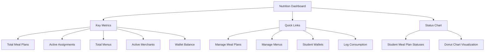
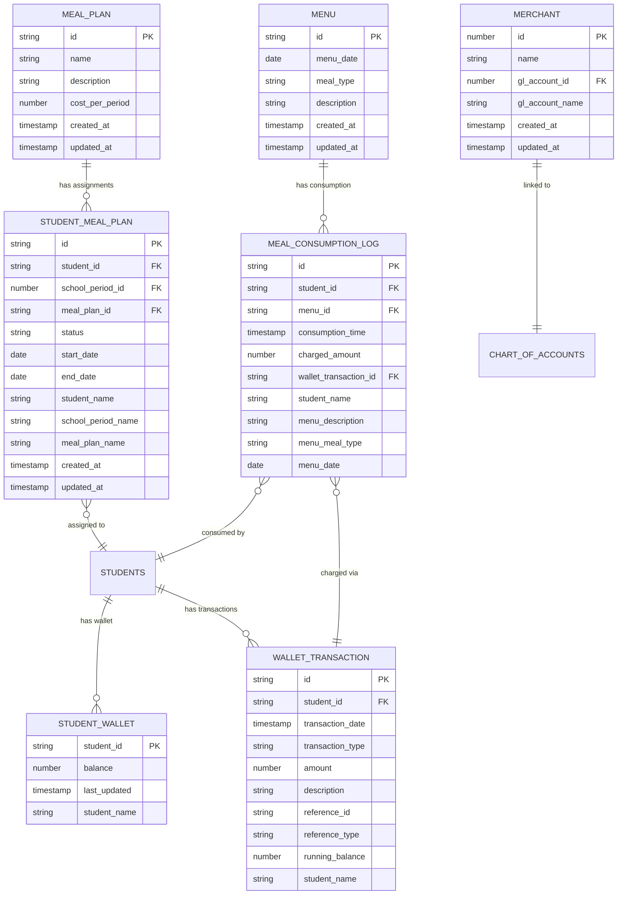

# Nutrition Module Overview

<cite>
**Referenced Files in This Document**   
- [moduleDefinition.tsx](file://src/modules/nutrition/moduleDefinition.tsx)
- [rbac.ts](file://src/modules/nutrition/rbac.ts)
- [NutritionDashboardPage.tsx](file://src/modules/nutrition/pages/NutritionDashboardPage.tsx)
- [schema.ts](file://src/modules/nutrition/data/schema.ts)
- [types.ts](file://src/modules/nutrition/data/types.ts)
- [unifiedConfig.ts](file://src/config/unifiedConfig.ts)
- [useStudentHealthRecordData.ts](file://src/modules/administration/data/useStudentHealthRecordData.ts)
</cite>

## Table of Contents
1. [Introduction](#introduction)
2. [Module Purpose and Functionality](#module-purpose-and-functionality)
3. [System Integration](#system-integration)
4. [Module Registration and Dependencies](#module-registration-and-dependencies)
5. [Role-Based Access Control (RBAC)](#role-based-access-control-rbac)
6. [Nutrition Dashboard Overview](#nutrition-dashboard-overview)
7. [Data Model and Schema](#data-model-and-schema)
8. [Configuration and Feature Flags](#configuration-and-feature-flags)
9. [Implementation Challenges](#implementation-challenges)
10. [Conclusion](#conclusion)

## Introduction
The Nutrition module in schoolpilot3 serves as a centralized system for managing meal planning, dietary tracking, student nutrition assignments, and wallet-based meal transactions. This comprehensive documentation provides an in-depth overview of the module's architecture, functionality, and integration points within the broader school management ecosystem. The module is designed to streamline cafeteria operations, ensure proper nutrition for students, and provide financial tracking for meal-related transactions.

## Module Purpose and Functionality
The Nutrition module is a self-contained system that manages all aspects of school meal programs. Its primary purpose is to provide a centralized platform for nutrition management, enabling schools to efficiently plan meals, track student dietary needs, assign meal plans, and manage student wallet transactions for meal purchases.

The module offers several key functionalities:
- **Meal Planning**: Create and manage meal plans with associated costs and nutritional information
- **Menu Management**: Schedule daily menus with specific meal types (breakfast, lunch, supper, etc.)
- **Student Meal Assignments**: Assign meal plans to students for specific school periods
- **Meal Consumption Tracking**: Log when students consume meals and automatically charge their wallets
- **Student Wallet Management**: Manage student pocket money accounts for meal purchases
- **Merchant Management**: Track cafeteria vendors and their financial accounts

The module supports various meal types through the `NutrMealTypeEnum` enumeration, including Breakfast, Morning Snack, Lunch, Evening Snack, and Supper. It also tracks student meal plan statuses through the `NutrStudentMealPlanStatusEnum` with values for Active, Inactive, and Cancelled plans.

**Section sources**
- [moduleDefinition.tsx](file://src/modules/nutrition/moduleDefinition.tsx#L15-L32)
- [types.ts](file://src/modules/nutrition/data/types.ts#L3-L10)

## System Integration
The Nutrition module is designed to integrate seamlessly with other modules within the schoolpilot3 ecosystem, creating a comprehensive school management solution. These integrations enable data sharing and coordinated functionality across different aspects of school administration.

### Integration with Administration Module
The Nutrition module has a direct dependency on the Administration module, which is required for its operation. This integration is critical for accessing student information and health records. The module relies on student data from the Administration module to create meal assignments and track consumption. Specifically, it uses the `useStudentHealthRecordData` hook to access student health information, which is essential for managing special dietary needs and allergies.

The dependency is explicitly defined in the module definition:
```typescript
dependencies: [
  {
    moduleId: 'administration',
    version: '^1.0.0',
    required: true
  }
]
```

This integration allows the Nutrition module to consider student health records when planning meals and making dietary recommendations, ensuring that students with specific medical conditions or allergies receive appropriate meal options.

### Integration with Finance Module
The Nutrition module integrates with the Finance module through wallet-based meal transactions. When students purchase meals, transactions are recorded in the wallet system and linked to the general ledger through merchant accounts. The data schema shows this integration through the `gl_account_id` field in the merchant schema, which references the chart of accounts from the Finance module.

Wallet transactions are recorded with details including transaction type (Deposit, Purchase, Meal Charge, Adjustment), amount, and running balance. The integration ensures that meal purchases are properly accounted for in the school's financial records and that student wallet balances are accurately maintained.

### Integration with Reporting Module
While not a direct dependency, the Nutrition module provides data for the Reporting module to generate nutrition-related reports. The module actions include a "Nutrition Report" function that likely interfaces with the reporting system to generate analytics on meal consumption patterns, nutritional intake, and financial transactions related to meals.

The reporting integration enables administrators to:
- Track meal participation rates
- Analyze nutritional content of meals served
- Monitor financial performance of the cafeteria
- Generate compliance reports for nutritional guidelines
- Identify students with special dietary needs

**Section sources**
- [moduleDefinition.tsx](file://src/modules/nutrition/moduleDefinition.tsx#L33-L40)
- [schema.ts](file://src/modules/nutrition/data/schema.ts#L110-L115)
- [modules.json](file://src/config/modules.json#L68-L73)
- [moduleActions.ts](file://src/services/moduleActions.ts#L470-L475)

## Module Registration and Dependencies
The Nutrition module is registered within the schoolpilot3 application through the `moduleDefinition.tsx` file, which defines its properties, navigation structure, dependencies, and configuration settings. This registration process follows the modular architecture of the application, allowing the Nutrition module to be loaded and initialized alongside other system components.

### Module Definition
The module is defined with the following key properties:
- **id**: 'nutrition' - Unique identifier for the module
- **name**: 'navigation:nutrition.title' - Localized display name
- **description**: 'navigation:nutrition.description' - Localized description
- **icon**: CakeIcon - Visual representation in the UI
- **path**: '/nutrition' - Base URL path for the module
- **isActive**: true - Indicates the module is enabled
- **version**: '1.0.0' - Current version of the module

### Navigation Structure
The module defines a comprehensive navigation structure with seven main sections:
- Dashboard: Overview of nutrition and wallet metrics
- Meal Plans: Management of meal plan templates
- Menus: Daily menu scheduling and management
- Merchants: Cafeteria vendor management
- Student Meal Assignments: Assignment of meal plans to students
- Meal Consumption Log: Tracking of meal consumption
- Student Wallet: Management of student pocket money accounts

Each navigation item includes a localized name, path, icon, and reference to the corresponding page component.

### Dependencies
The Nutrition module has a required dependency on the Administration module, which must be present and active for the Nutrition module to function properly. This dependency ensures that student data and health records are available when needed for meal planning and dietary management.

### Initialization Sequence
The module initialization follows the application's modular loading pattern:
1. The core module loader detects the Nutrition module in the modules directory
2. The module definition is loaded and registered with the module registry
3. Dependencies are resolved (Administration module must be loaded first)
4. RBAC permissions and default roles are registered
5. Navigation items are added to the global navigation system
6. The module becomes available in the application interface

**Section sources**
- [moduleDefinition.tsx](file://src/modules/nutrition/moduleDefinition.tsx#L15-L64)

## Role-Based Access Control (RBAC)
The Nutrition module implements a role-based access control (RBAC) system to manage user permissions and ensure appropriate access to sensitive functionality. The RBAC structure is defined in the `rbac.ts` file and integrated into the module definition.

### Permissions
The module defines four core permissions related to meal management:
- **nutrition.meals.read**: View meal information and meal plans
- **nutrition.meals.create**: Create new meal plans
- **nutrition.meals.update**: Modify existing meal plans
- **nutrition.meals.delete**: Remove meal plans from the system

These permissions are organized around the "meal-planning" feature and apply to the "nutrition.meals" resource. Each permission includes a descriptive name, detailed description, module identifier, and feature association.

### Roles
The module defines default roles that are granted access to its functionality:
- **nutrition_officer**: Primary role for nutrition management staff
- **administrator**: System administrator with full access to all modules

The current implementation shows a relatively simple role structure, with the administrator role inheriting all permissions from the nutrition_officer role. This suggests that while specialized roles are anticipated (such as NutritionManager and CafeteriaStaff mentioned in the documentation objective), the current implementation may use broader role categories.

The RBAC system is integrated with the application's global permission management service, allowing for consistent access control across all modules. Permissions are checked when users attempt to perform actions within the Nutrition module, ensuring that only authorized personnel can create, modify, or delete meal plans.

**Section sources**
- [rbac.ts](file://src/modules/nutrition/rbac.ts#L0-L41)
- [moduleDefinition.tsx](file://src/modules/nutrition/moduleDefinition.tsx#L60-L62)

## Nutrition Dashboard Overview
The NutritionDashboardPage provides a comprehensive overview of the nutrition and wallet system, serving as the primary entry point for users of the Nutrition module. The dashboard is designed to present key metrics, quick access to common functions, and visual representations of important data.

### Key Metrics
The dashboard displays five key metrics in a grid layout:
- **Total Meal Plans**: Number of meal plan templates available
- **Active Meal Assignments**: Number of students currently enrolled in meal plans
- **Total Menus Created**: Count of scheduled menus
- **Active Merchants**: Number of cafeteria vendors currently active
- **Total Student Wallet Balance**: Aggregate balance across all student wallets

These metrics provide an immediate snapshot of the nutrition program's status and financial health.

### Navigation and Quick Links
The dashboard includes a "Quick Links" section with four primary action buttons:
- **Manage Meal Plans**: Navigate to meal plan management
- **Manage Menus**: Access menu scheduling interface
- **Student Wallets**: Open student wallet management
- **Log Consumption**: Record meal consumption

These quick links enable users to rapidly access the most frequently used functions without navigating through the main menu.

### Visual Data Representation
The dashboard includes a donut chart that visualizes the distribution of student meal plan assignment statuses. This chart displays the count of plans in each status category (Active, Inactive, Cancelled), providing a visual representation of meal plan enrollment patterns.

The dashboard also features a welcoming message with a cake icon, reinforcing the module's purpose and providing context for new users. The design emphasizes usability with a clean layout, consistent spacing, and clear visual hierarchy.



**Diagram sources**
- [NutritionDashboardPage.tsx](file://src/modules/nutrition/pages/NutritionDashboardPage.tsx#L45-L110)

**Section sources**
- [NutritionDashboardPage.tsx](file://src/modules/nutrition/pages/NutritionDashboardPage.tsx#L45-L110)

## Data Model and Schema
The Nutrition module employs a comprehensive data model designed to support all aspects of meal planning, dietary tracking, and financial transactions. The data schema is defined in the `schema.ts` file and implemented using database-agnostic schema definitions that can work with various database providers.

### Core Entities
The module defines seven core entities through its schema:

#### Meal Plan
The meal plan entity represents a template for a recurring meal program. It includes:
- **id**: Unique identifier
- **name**: Plan name
- **description**: Detailed description
- **cost_per_period**: Cost for the meal plan period
- **created_at/updated_at**: Timestamps for record management

#### Student Meal Plan
This entity represents the assignment of a meal plan to a specific student. It includes:
- **student_id**: Reference to the student
- **school_period_id**: Reference to the academic period
- **meal_plan_id**: Reference to the meal plan template
- **status**: Current status (Active, Inactive, Cancelled)
- **start_date/end_date**: Validity period for the assignment
- Denormalized fields for student, school period, and meal plan names for efficient display

#### Menu
The menu entity represents a daily meal schedule. It includes:
- **menu_date**: Date when the menu is served
- **meal_type**: Type of meal (Breakfast, Lunch, etc.)
- **description**: Detailed menu description

#### Meal Consumption Log
This entity tracks when students consume meals. It includes:
- **student_id**: Reference to the student
- **menu_id**: Reference to the menu consumed
- **consumption_time**: Timestamp of consumption
- **charged_amount**: Amount charged for the meal
- **wallet_transaction_id**: Reference to the financial transaction
- Denormalized fields for student name, menu description, meal type, and date

#### Merchant
The merchant entity represents cafeteria vendors. It includes:
- **name**: Merchant name
- **gl_account_id**: Reference to the general ledger account
- **gl_account_name**: Denormalized GL account name

#### Student Wallet
This entity manages student pocket money accounts. It includes:
- **student_id**: Primary key, reference to the student
- **balance**: Current wallet balance
- **last_updated**: Timestamp of last balance update
- **student_name**: Denormalized student name

#### Wallet Transaction
This entity records all transactions affecting student wallets. It includes:
- **transaction_type**: Type of transaction (Deposit, Purchase, Meal Charge, etc.)
- **amount**: Transaction amount (positive for deposits, negative for purchases)
- **description**: Transaction description
- **reference_id/type**: References to related records
- **running_balance**: Balance after the transaction

### Data Relationships
The schema establishes several important relationships:
- Meal plans can be assigned to multiple students through student meal plan records
- Menus are consumed by multiple students, with each consumption logged
- Wallet transactions are linked to meal consumption logs when meals are purchased
- Merchants are associated with general ledger accounts from the Finance module
- Student data is referenced from the Administration module

The use of denormalized fields (student_name, meal_plan_name, etc.) improves query performance by reducing the need for joins when displaying data in the user interface.



**Diagram sources**
- [schema.ts](file://src/modules/nutrition/data/schema.ts#L0-L137)

**Section sources**
- [schema.ts](file://src/modules/nutrition/data/schema.ts#L0-L137)
- [types.ts](file://src/modules/nutrition/data/types.ts#L0-L92)

## Configuration and Feature Flags
The Nutrition module supports configurable behavior through both module-specific settings and global feature flags. These configuration options allow administrators to customize the module's functionality based on their specific needs and operational requirements.

### Module-Specific Settings
The module defines three boolean configuration options in its module definition:
- **enableMealPlanning**: Controls whether meal planning functionality is available
- **enableStudentNutrition**: Determines if student nutrition features are enabled
- **enableWalletManagement**: Toggles the student wallet management system

These settings are defined in the module's settings configuration with default values set to true, indicating that all core functionalities are enabled by default. The settings are categorized under 'nutrition' for organizational purposes in the system configuration interface.

### Global Feature Flags
The unified configuration system in schoolpilot3 includes global feature flags that can affect the Nutrition module's behavior. While the module-specific settings provide direct control over functionality, global feature flags in the unified configuration can enable or disable broader system capabilities that impact nutrition management.

The unified configuration includes a comprehensive feature configuration interface with flags for various system capabilities. Although the specific nutrition-related feature flags are not explicitly detailed in the provided code, the system supports module-specific feature control through the `enableNutritionModule` flag and potentially other nutrition-related flags.

The configuration system also supports feature-specific flags for tabbed mode, performance monitoring, error reporting, and other cross-cutting concerns that may indirectly affect the Nutrition module's user experience and functionality.

### Configuration Management
The module's configuration is managed through the application's unified configuration system, which provides:
- Persistent storage of settings in localStorage
- Event subscription for configuration changes
- Configuration presets for different environments
- Backend status integration
- Data mode management (demo/production)

This centralized approach ensures consistent configuration management across all modules and enables features like environment-specific settings and configuration migration between versions.

**Section sources**
- [moduleDefinition.tsx](file://src/modules/nutrition/moduleDefinition.tsx#L41-L53)
- [unifiedConfig.ts](file://src/config/unifiedConfig.ts#L0-L199)

## Implementation Challenges
The Nutrition module addresses several common challenges in school nutrition management systems. These challenges relate to handling special dietary needs, managing meal subsidies, ensuring compliance with nutritional guidelines, and integrating with financial systems.

### Handling Special Dietary Needs
One of the primary challenges in school nutrition is accommodating students with special dietary requirements due to allergies, medical conditions, or religious/cultural preferences. The module addresses this challenge through integration with the Administration module's student health records system.

By accessing student health records, the Nutrition module can identify students with specific dietary restrictions and ensure they are not assigned meals containing allergens or prohibited ingredients. The system could be extended to include specific fields for dietary restrictions in the student meal plan records, allowing for customized meal planning based on individual needs.

The current implementation suggests that while the integration with health records exists, specific functionality for managing dietary restrictions may need further development. The module actions include a "Track Allergies" function, indicating that this capability is planned or partially implemented.

### Managing Meal Subsidies
Schools often provide meal subsidies for students from low-income families. The Nutrition module supports this requirement through its flexible meal plan costing system and wallet management functionality.

The `cost_per_period` field in the meal plan schema allows for different pricing structures, which could be used to implement subsidized rates for eligible students. The wallet system enables direct funding of student accounts, which could be used to deposit subsidy amounts that can only be used for meal purchases.

However, the current implementation does not show explicit support for subsidy eligibility tracking or automated subsidy distribution. This functionality would likely require additional fields in the student or student meal plan records to track eligibility status and subsidy amounts.

### Ensuring Compliance with Nutritional Guidelines
School nutrition programs must comply with various nutritional guidelines and regulations. The module supports compliance through its structured meal planning and menu management system.

By defining meal plans and menus with detailed descriptions, the system can ensure that meals meet specific nutritional requirements. The menu schema includes a description field that could contain nutritional information, and the system could be extended to include specific nutritional content fields (calories, protein, carbohydrates, etc.).

The reporting integration enables monitoring of nutritional compliance through analytics on meal content and consumption patterns. Administrators can generate reports to verify that meals meet regulatory requirements and make adjustments as needed.

### Integration Challenges
The module faces integration challenges related to data consistency and synchronization between the Nutrition module and its dependencies. Since it relies on student data from the Administration module and financial data from the Finance module, changes in those systems must be properly reflected in the Nutrition module.

The use of denormalized data (student names, meal plan names, etc.) improves performance but creates potential consistency issues if the source data changes. The system would need mechanisms to update denormalized fields when source records are modified.

The wallet transaction system must maintain strict financial accuracy, requiring robust error handling and reconciliation processes to ensure that meal charges are properly recorded and student balances are accurate.

**Section sources**
- [useStudentHealthRecordData.ts](file://src/modules/administration/data/useStudentHealthRecordData.ts#L0-L42)
- [schema.ts](file://src/modules/nutrition/data/schema.ts#L0-L137)
- [moduleActions.ts](file://src/services/moduleActions.ts#L455-L460)

## Conclusion
The Nutrition module in schoolpilot3 provides a comprehensive solution for managing school meal programs, integrating meal planning, dietary tracking, and financial transactions into a unified system. The module is well-structured with a clear data model, defined RBAC permissions, and strategic integration points with other modules in the school management ecosystem.

Key strengths of the module include its centralized approach to nutrition management, integration with student health records for special dietary needs, and wallet-based transaction system for meal purchases. The dashboard provides an effective overview of key metrics, and the modular design allows for flexible configuration and future enhancements.

Areas for potential improvement include more sophisticated handling of dietary restrictions, explicit support for meal subsidies, enhanced nutritional content tracking, and more granular role definitions for different staff roles (NutritionManager, CafeteriaStaff, etc.).

The module's architecture follows the application's modular design principles, with clear separation of concerns, reusable components, and consistent integration patterns. As schools continue to prioritize student nutrition and efficient cafeteria operations, this module provides a solid foundation that can be extended to meet evolving requirements.