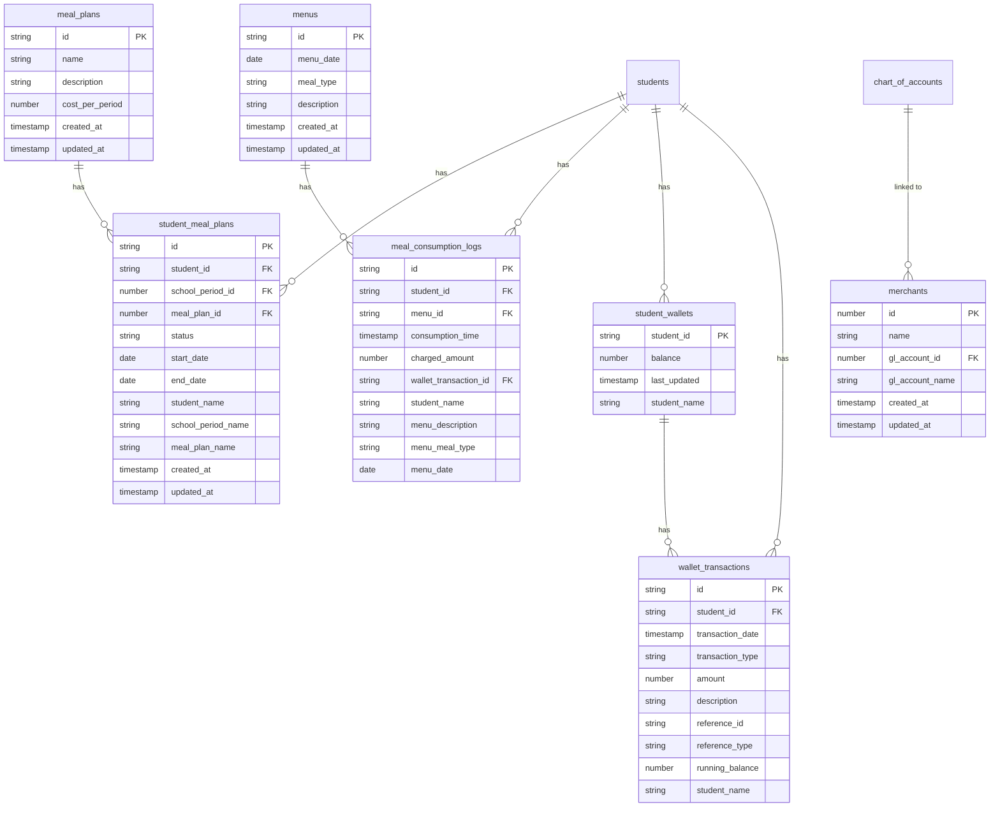
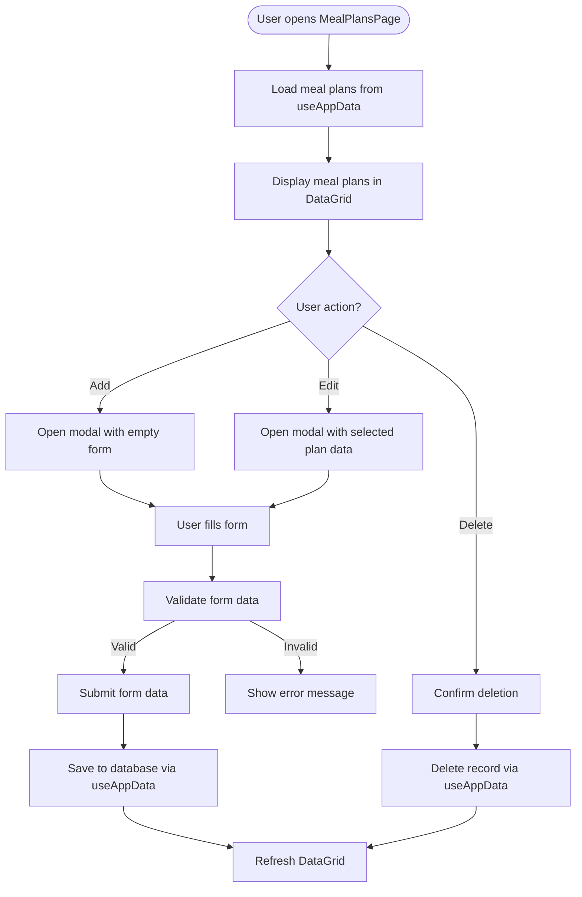
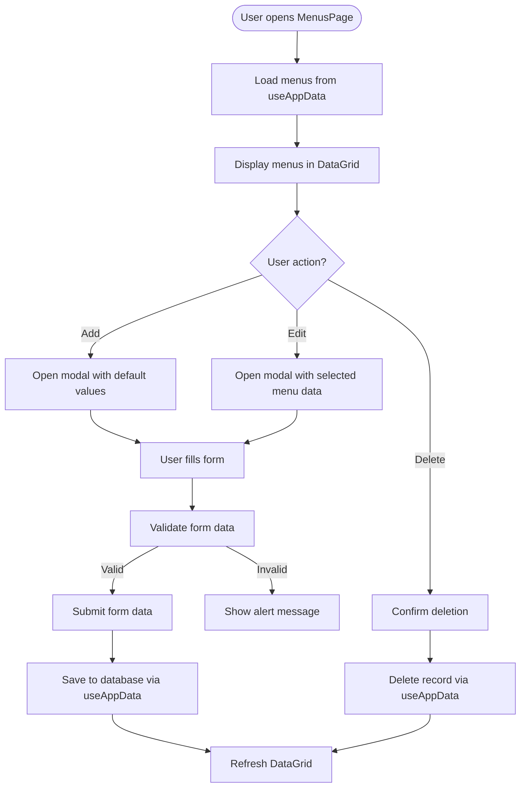
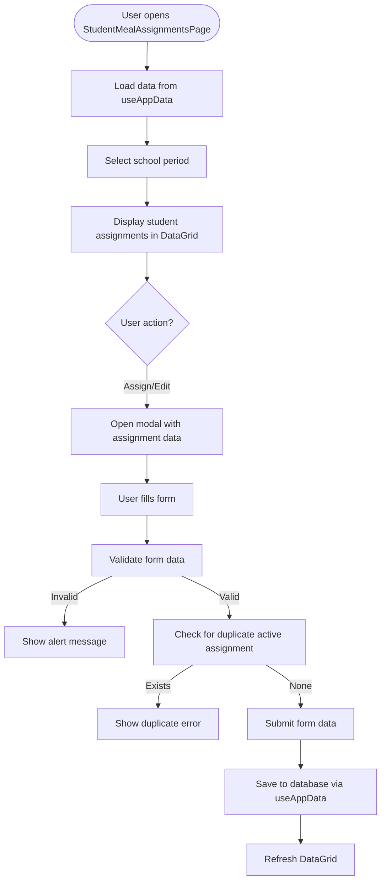
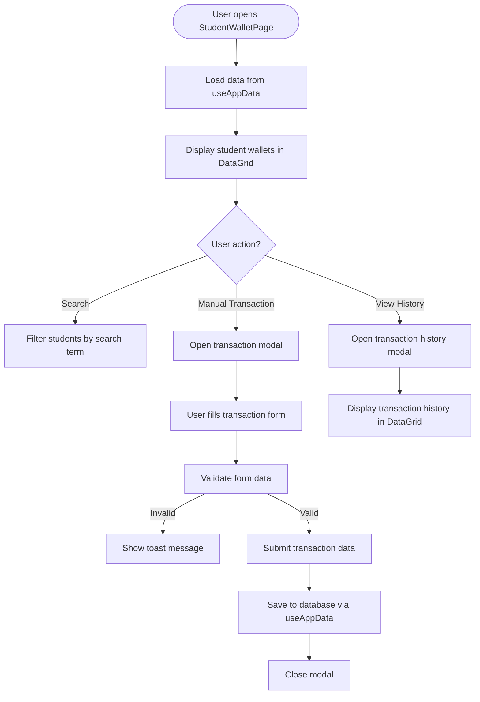
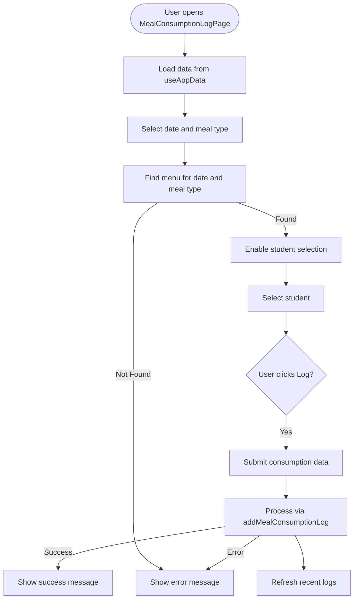

# Nutrition Module Pages and Features

<cite>
**Referenced Files in This Document**   
- [MealPlansPage.tsx](file://src/modules/nutrition/pages/MealPlansPage.tsx)
- [MenusPage.tsx](file://src/modules/nutrition/pages/MenusPage.tsx)
- [StudentMealAssignmentsPage.tsx](file://src/modules/nutrition/pages/StudentMealAssignmentsPage.tsx)
- [StudentWalletPage.tsx](file://src/modules/nutrition/pages/StudentWalletPage.tsx)
- [MealConsumptionLogPage.tsx](file://src/modules/nutrition/pages/MealConsumptionLogPage.tsx)
- [MerchantsPage.tsx](file://src/modules/nutrition/pages/MerchantsPage.tsx)
- [collections.ts](file://src/modules/nutrition/data/collections.ts)
- [schema.ts](file://src/modules/nutrition/data/schema.ts)
- [types.ts](file://src/modules/nutrition/data/types.ts)
- [en.json](file://src/modules/nutrition/i18n/en.json)
- [rbac.ts](file://src/modules/nutrition/rbac.ts)
</cite>

## Table of Contents
1. [Introduction](#introduction)
2. [Data Model Overview](#data-model-overview)
3. [MealPlansPage](#mealplanspage)
4. [MenusPage](#menupage)
5. [StudentMealAssignmentsPage](#studentmealassignmentspage)
6. [StudentWalletPage](#studentwalletpage)
7. [MealConsumptionLogPage](#mealconsumptionlogpage)
8. [MerchantsPage](#merchantspage)
9. [UI Components and Patterns](#ui-components-and-patterns)
10. [Data Fetching and State Management](#data-fetching-and-state-management)
11. [Form Validation and Error Handling](#form-validation-and-error-handling)
12. [User Workflows and Edge Cases](#user-workflows-and-edge-cases)

## Introduction
The Nutrition module in schoolpilot3 provides a comprehensive system for managing student meal programs, including meal planning, menu creation, student meal assignments, wallet management, and consumption tracking. This document details the functionality, implementation, and user experience of each page within the Nutrition module. The module integrates with the administration module and uses a database-agnostic schema system for data storage. The pages follow a consistent design pattern using the DataGrid component for data display and modal forms for data entry.

**Section sources**
- [MealPlansPage.tsx](file://src/modules/nutrition/pages/MealPlansPage.tsx)
- [MenusPage.tsx](file://src/modules/nutrition/pages/MenusPage.tsx)
- [StudentMealAssignmentsPage.tsx](file://src/modules/nutrition/pages/StudentMealAssignmentsPage.tsx)
- [StudentWalletPage.tsx](file://src/modules/nutrition/pages/StudentWalletPage.tsx)
- [MealConsumptionLogPage.tsx](file://src/modules/nutrition/pages/MealConsumptionLogPage.tsx)
- [MerchantsPage.tsx](file://src/modules/nutrition/pages/MerchantsPage.tsx)

## Data Model Overview
The Nutrition module uses a set of related data entities to manage meal programs. These entities are defined using a database-agnostic schema system and are stored in collections managed by RxDB.

**Diagram sources**
- [collections.ts](file://src/modules/nutrition/data/collections.ts)
- [schema.ts](file://src/modules/nutrition/data/schema.ts)
- [types.ts](file://src/modules/nutrition/data/types.ts)

**Section sources**
- [collections.ts](file://src/modules/nutrition/data/collections.ts)
- [schema.ts](file://src/modules/nutrition/data/schema.ts)
- [types.ts](file://src/modules/nutrition/data/types.ts)

## MealPlansPage
The MealPlansPage provides an interface for creating and managing meal plans, including duration, nutritional targets, and pricing. The page displays a list of existing meal plans in a DataGrid and allows users to add, edit, and delete meal plans through a modal form.

### Key Features
- **Meal Plan Management**: Create, edit, and delete meal plans
- **Pricing Configuration**: Set cost per period for each meal plan
- **Bulk Operations**: Delete multiple meal plans at once
- **Search and Filter**: Find meal plans by name or description

### Data Structure
The meal_plan entity contains the following fields:
- **id**: Unique identifier
- **name**: Meal plan name (required)
- **description**: Meal plan description
- **cost_per_period**: Cost per period in KES
- **created_at**: Record creation timestamp
- **updated_at**: Record last update timestamp

### User Interface
The page uses a Card component with a DataGrid to display meal plans. The DataGrid includes columns for ID, Plan Name, Description, and Cost per Period. Actions are available in each row for editing and deleting meal plans. A bulk delete option is available when multiple rows are selected.

### Form Validation
The form validates that the meal plan name is required. The cost per period field accepts numeric values with two decimal places.

**Diagram sources**
- [MealPlansPage.tsx](file://src/modules/nutrition/pages/MealPlansPage.tsx)
- [schema.ts](file://src/modules/nutrition/data/schema.ts)

**Section sources**
- [MealPlansPage.tsx](file://src/modules/nutrition/pages/MealPlansPage.tsx)

## MenusPage
The MenusPage enables menu creation with meal items, serving times, and dietary tags. Users can create menus for specific dates and meal types, which are then used for meal consumption tracking.

### Key Features
- **Menu Creation**: Create menus for specific dates and meal types
- **Meal Type Selection**: Choose from predefined meal types (Breakfast, Morning Snack, Lunch, Evening Snack, Supper)
- **Description Field**: Enter menu items and details
- **Filtering**: Filter menus by date and meal type

### Data Structure
The menu entity contains the following fields:
- **id**: Unique identifier
- **menu_date**: Date of the menu
- **meal_type**: Type of meal (Breakfast, Lunch, etc.)
- **description**: Menu description and items
- **created_at**: Record creation timestamp
- **updated_at**: Record last update timestamp

### User Interface
The page uses a Card component with a DataGrid to display menus. The DataGrid includes columns for Date, Meal Type, and Description. The Date column displays dates in a localized format. A modal form is used for creating and editing menus, with fields for date, meal type (dropdown), and description.

### Form Validation
The form requires menu date, meal type, and description to be filled before submission.

**Diagram sources**
- [MenusPage.tsx](file://src/modules/nutrition/pages/MenusPage.tsx)
- [schema.ts](file://src/modules/nutrition/data/schema.ts)

**Section sources**
- [MenusPage.tsx](file://src/modules/nutrition/pages/MenusPage.tsx)

## StudentMealAssignmentsPage
The StudentMealAssignmentsPage provides functionality for linking students to meal plans, handling subsidies, and special dietary accommodations. The page allows administrators to assign meal plans to students for specific school periods.

### Key Features
- **School Period Filtering**: View and manage assignments for a specific school period
- **Student Assignment**: Assign meal plans to individual students
- **Status Management**: Set assignment status (Active, Inactive, Cancelled)
- **Duplicate Prevention**: Prevents assigning multiple active plans to the same student

### Data Structure
The student_meal_plan entity contains the following fields:
- **id**: Unique identifier
- **student_id**: Reference to the student
- **school_period_id**: Reference to the school period
- **meal_plan_id**: Reference to the meal plan
- **status**: Assignment status (Active, Inactive, Cancelled)
- **start_date**: Start date of the meal plan
- **end_date**: End date of the meal plan
- **student_name**: Student name (denormalized)
- **school_period_name**: School period name (denormalized)
- **meal_plan_name**: Meal plan name (denormalized)
- **created_at**: Record creation timestamp
- **updated_at**: Record last update timestamp

### User Interface
The page uses a filter dropdown to select a school period. Below the filter, a DataGrid displays all active students with their current meal plan assignment status. The grid shows the student name, class, assigned meal plan, status (with color-coded badge), and an action button to assign or edit the plan. A modal form is used for creating and editing assignments, with dropdowns for student, school period, meal plan, and status.

### Form Validation
The form requires student, school period, meal plan, and status to be selected. It checks for existing active assignments before allowing a new active assignment for the same student and period.

**Diagram sources**
- [StudentMealAssignmentsPage.tsx](file://src/modules/nutrition/pages/StudentMealAssignmentsPage.tsx)
- [schema.ts](file://src/modules/nutrition/data/schema.ts)

**Section sources**
- [StudentMealAssignmentsPage.tsx](file://src/modules/nutrition/pages/StudentMealAssignmentsPage.tsx)

## StudentWalletPage
The StudentWalletPage features tools for viewing balances, transaction history, and funding mechanisms. It provides a comprehensive view of student financial transactions related to meal programs.

### Key Features
- **Wallet Balance Display**: View current wallet balance for each student
- **Transaction History**: View detailed transaction history for any student
- **Manual Transactions**: Add deposits or adjustments to student wallets
- **Search Functionality**: Search students by name or admission number

### Data Structure
The student_wallet entity contains the following fields:
- **student_id**: Reference to the student (primary key)
- **balance**: Current wallet balance
- **last_updated**: Last update timestamp
- **student_name**: Student name (denormalized)

The wallet_transaction entity contains the following fields:
- **id**: Unique identifier
- **student_id**: Reference to the student
- **transaction_date**: Date and time of transaction
- **transaction_type**: Type of transaction (Deposit, Purchase, Meal Charge, Adjustment Debit, Adjustment Credit)
- **amount**: Transaction amount (positive for deposits, negative for purchases)
- **description**: Transaction description
- **reference_id**: Reference ID for related records
- **reference_type**: Type of referenced record
- **running_balance**: Running balance after transaction
- **student_name**: Student name (denormalized)

### User Interface
The page uses a Card component with a DataGrid to display student wallets. The grid shows student name, admission number, wallet balance, last updated timestamp, and a "View History" button. A search field allows filtering students. Two modals are used: one for manual transactions and one for viewing transaction history. The transaction history modal shows a detailed DataGrid of all transactions for the selected student, including date, type, amount, description, and running balance.

### Form Validation
The manual transaction form requires a student to be selected, a positive amount, and a description. It validates that the transaction type is appropriate for manual entry (Deposit, Adjustment Debit, or Adjustment Credit).

**Diagram sources**
- [StudentWalletPage.tsx](file://src/modules/nutrition/pages/StudentWalletPage.tsx)
- [schema.ts](file://src/modules/nutrition/data/schema.ts)

**Section sources**
- [StudentWalletPage.tsx](file://src/modules/nutrition/pages/StudentWalletPage.tsx)

## MealConsumptionLogPage
The MealConsumptionLogPage is used for recording meal redemptions with timestamp, location, and verification methods. It allows staff to log when students consume meals, with automatic handling of payment through meal plans or wallet balances.

### Key Features
- **Date and Meal Type Selection**: Select the date and type of meal being consumed
- **Student Selection**: Choose the student consuming the meal
- **Automatic Payment Processing**: Deducts from wallet or checks meal plan eligibility
- **Recent Logs Display**: Shows recently logged meal consumptions

### Data Structure
The meal_consumption_log entity contains the following fields:
- **id**: Unique identifier
- **student_id**: Reference to the student
- **menu_id**: Reference to the menu
- **consumption_time**: Time when meal was consumed
- **charged_amount**: Amount charged for the meal
- **wallet_transaction_id**: Reference to wallet transaction
- **student_name**: Student name (denormalized)
- **menu_description**: Menu description (denormalized)
- **menu_meal_type**: Menu meal type (denormalized)
- **menu_date**: Menu date (denormalized)

### User Interface
The page has two main sections: a form for logging new meal consumptions and a DataGrid showing recent logs. The form includes fields for consumption date, meal type, and student selection. The student selection is disabled until a valid menu is found for the selected date and meal type. When a valid menu is found, a message displays the menu details. A "Log Consumption" button submits the form, with a spinner during processing. After logging, a success or error message is displayed. The recent logs section shows the 20 most recent meal consumptions.

### Form Validation
The form requires a student to be selected and a valid menu to exist for the selected date and meal type. The backend logic (not shown in the component) handles checking the student's meal plan or wallet balance.

**Diagram sources**
- [MealConsumptionLogPage.tsx](file://src/modules/nutrition/pages/MealConsumptionLogPage.tsx)
- [schema.ts](file://src/modules/nutrition/data/schema.ts)

**Section sources**
- [MealConsumptionLogPage.tsx](file://src/modules/nutrition/pages/MealConsumptionLogPage.tsx)

## MerchantsPage
The MerchantsPage is used for managing cafeteria vendors and payment processing integration. It allows administrators to define merchants where students can make purchases using their wallets.

### Key Features
- **Merchant Management**: Add, edit, and delete merchants
- **GL Account Integration**: Link merchants to revenue GL accounts for financial reporting
- **Revenue Tracking**: All sales through merchants are recorded against the linked GL account

### Data Structure
The merchant entity contains the following fields:
- **id**: Unique identifier
- **name**: Merchant name
- **gl_account_id**: Reference to GL account for sales
- **gl_account_name**: GL account name (denormalized)
- **created_at**: Record creation timestamp
- **updated_at**: Record last update timestamp

### User Interface
The page uses a Card component with a DataGrid to display merchants. The grid shows merchant ID, name, and linked GL account name. Actions are available for editing and deleting merchants. A modal form is used for creating and editing merchants, with fields for merchant name and GL account selection. The GL account dropdown only shows active revenue accounts.

### Form Validation
The form requires the merchant name to be filled before submission.

**Diagram sources**
- [MerchantsPage.tsx](file://src/modules/nutrition/pages/MerchantsPage.tsx)
- [schema.ts](file://src/modules/nutrition/data/schema.ts)

**Section sources**
- [MerchantsPage.tsx](file://src/modules/nutrition/pages/MerchantsPage.tsx)

## UI Components and Patterns
The Nutrition module pages follow a consistent design pattern using shared UI components from the component library.

### Common Components
- **Card**: Used as a container for each page section
- **DataGrid**: Primary component for displaying tabular data with sorting, filtering, and pagination
- **Modal**: Used for data entry forms
- **Button**: Standard buttons with variants (primary, secondary, danger, ghost)
- **Input, Select, Textarea**: Form controls for data entry
- **Spinner**: Indicates loading states
- **Toast**: Displays temporary success/error messages

### Design Patterns
- **Modal-First Editing**: All data entry and editing is done through modal dialogs
- **Bulk Actions**: Support for selecting multiple rows and performing bulk operations
- **Loading States**: Full-page spinners during initial load, inline spinners during form submission
- **Empty States**: Custom messages and actions when no data is available
- **Consistent Actions**: Action buttons in the Card header for primary actions

**Section sources**
- [MealPlansPage.tsx](file://src/modules/nutrition/pages/MealPlansPage.tsx)
- [MenusPage.tsx](file://src/modules/nutrition/pages/MenusPage.tsx)
- [StudentMealAssignmentsPage.tsx](file://src/modules/nutrition/pages/StudentMealAssignmentsPage.tsx)
- [StudentWalletPage.tsx](file://src/modules/nutrition/pages/StudentWalletPage.tsx)
- [MealConsumptionLogPage.tsx](file://src/modules/nutrition/pages/MealConsumptionLogPage.tsx)
- [MerchantsPage.tsx](file://src/modules/nutrition/pages/MerchantsPage.tsx)

## Data Fetching and State Management
The Nutrition module uses a centralized data management approach through the useAppData hook.

### Data Fetching Strategy
- **useAppData Hook**: Centralized hook that provides access to all nutrition-related data and CRUD operations
- **Initial Loading**: Each page checks loading states and displays a spinner during data retrieval
- **Real-time Updates**: The DataGrid automatically updates when data changes
- **Error Handling**: Errors are caught and displayed as toast messages or alerts

### State Management
- **Local State**: Each page manages its own local state for form data, modal visibility, and filters
- **Form State**: Form data is stored in useState hooks and updated through change handlers
- **Selection State**: Row selection in DataGrid is managed through selectedRows state
- **Modal State**: Modal visibility is controlled by boolean state variables

**Section sources**
- [MealPlansPage.tsx](file://src/modules/nutrition/pages/MealPlansPage.tsx)
- [MenusPage.tsx](file://src/modules/nutrition/pages/MenusPage.tsx)
- [StudentMealAssignmentsPage.tsx](file://src/modules/nutrition/pages/StudentMealAssignmentsPage.tsx)
- [StudentWalletPage.tsx](file://src/modules/nutrition/pages/StudentWalletPage.tsx)
- [MealConsumptionLogPage.tsx](file://src/modules/nutrition/pages/MealConsumptionLogPage.tsx)
- [MerchantsPage.tsx](file://src/modules/nutrition/pages/MerchantsPage.tsx)

## Form Validation and Error Handling
The Nutrition module implements form validation and error handling to ensure data integrity.

### Validation Approaches
- **Required Fields**: Most forms require key fields to be filled
- **Type Validation**: Numeric fields validate input type
- **Business Logic Validation**: Some forms include business rules (e.g., preventing duplicate active meal plan assignments)
- **Frontend Validation**: Immediate feedback through alerts or inline messages

### Error Handling
- **Toast Messages**: Success and error messages displayed as temporary toasts
- **Alert Dialogs**: Critical errors or confirmations use browser alert dialogs
- **Form-Level Errors**: Invalid form submissions show specific error messages
- **Backend Error Handling**: API errors are caught and user-friendly messages are displayed

**Section sources**
- [MealPlansPage.tsx](file://src/modules/nutrition/pages/MealPlansPage.tsx)
- [MenusPage.tsx](file://src/modules/nutrition/pages/MenusPage.tsx)
- [StudentMealAssignmentsPage.tsx](file://src/modules/nutrition/pages/StudentMealAssignmentsPage.tsx)
- [StudentWalletPage.tsx](file://src/modules/nutrition/pages/StudentWalletPage.tsx)
- [MealConsumptionLogPage.tsx](file://src/modules/nutrition/pages/MealConsumptionLogPage.tsx)
- [MerchantsPage.tsx](file://src/modules/nutrition/pages/MerchantsPage.tsx)

## User Workflows and Edge Cases
This section documents common user workflows and edge cases for the Nutrition module.

### Common Workflows
1. **Creating a Meal Plan**: User navigates to Meal Plans page, clicks "Add Meal Plan", fills in name, description, and cost, and submits.
2. **Assigning Meal Plans**: User selects a school period, finds a student in the grid, clicks "Assign Plan", selects a meal plan and status, and submits.
3. **Logging a Meal**: User selects date and meal type, chooses a student, and clicks "Log Consumption". The system processes the transaction.
4. **Adding Wallet Funds**: User opens Student Wallet page, clicks "Manual Transaction", selects a student, chooses "Deposit", enters amount and description, and submits.

### Edge Cases
- **No Active School Period**: The Student Meal Assignments page requires a school period to be selected before displaying data.
- **Missing Menu**: The Meal Consumption Log page prevents logging if no menu exists for the selected date and meal type.
- **Insufficient Funds**: When logging a meal for a student without a meal plan, the system checks wallet balance and prevents logging if insufficient.
- **Duplicate Assignments**: The system prevents assigning multiple active meal plans to the same student in the same period.
- **Inactive Merchants**: The Merchants page only allows linking to active revenue GL accounts.

**Section sources**
- [MealPlansPage.tsx](file://src/modules/nutrition/pages/MealPlansPage.tsx)
- [MenusPage.tsx](file://src/modules/nutrition/pages/MenusPage.tsx)
- [StudentMealAssignmentsPage.tsx](file://src/modules/nutrition/pages/StudentMealAssignmentsPage.tsx)
- [StudentWalletPage.tsx](file://src/modules/nutrition/pages/StudentWalletPage.tsx)
- [MealConsumptionLogPage.tsx](file://src/modules/nutrition/pages/MealConsumptionLogPage.tsx)
- [MerchantsPage.tsx](file://src/modules/nutrition/pages/MerchantsPage.tsx)