# Nutrition Module

<cite>
**Referenced Files in This Document**   
- [moduleDefinition.tsx](file://src/modules/nutrition/moduleDefinition.tsx)
- [rbac.ts](file://src/modules/nutrition/rbac.ts)
- [types.ts](file://src/modules/nutrition/data/types.ts)
- [schema.ts](file://src/modules/nutrition/data/schema.ts)
- [MealPlansPage.tsx](file://src/modules/nutrition/pages/MealPlansPage.tsx)
- [StudentWalletPage.tsx](file://src/modules/nutrition/pages/StudentWalletPage.tsx)
- [mockData.ts](file://src/modules/nutrition/data/mockData.ts)
- [useStudentWalletData.ts](file://src/modules/nutrition/data/useStudentWalletData.ts)
- [useMealConsumptionLogData.ts](file://src/modules/nutrition/data/useMealConsumptionLogData.ts)
- [MealConsumptionLogPage.tsx](file://src/modules/nutrition/pages/MealConsumptionLogPage.tsx)
- [StudentMealAssignmentsPage.tsx](file://src/modules/nutrition/pages/StudentMealAssignmentsPage.tsx)
- [MenusPage.tsx](file://src/modules/nutrition/pages/MenusPage.tsx)
- [MerchantsPage.tsx](file://src/modules/nutrition/pages/MerchantsPage.tsx)
</cite>

## Table of Contents
1. [Introduction](#introduction)
2. [Module Registration and Configuration](#module-registration-and-configuration)
3. [Permission Structure](#permission-structure)
4. [Core Data Model](#core-data-model)
5. [Meal Planning Implementation](#meal-planning-implementation)
6. [Menu Management](#menu-management)
7. [Student Wallet Management](#student-wallet-management)
8. [Meal Consumption Tracking](#meal-consumption-tracking)
9. [Merchant Integration](#merchant-integration)
10. [Integration with Finance Module](#integration-with-finance-module)
11. [Integration with Administration Module](#integration-with-administration-module)
12. [Special Dietary Requirements Management](#special-dietary-requirements-management)
13. [Common Issues and Best Practices](#common-issues-and-best-practices)

## Introduction
The Nutrition Module in schoolpilot3 is a comprehensive system designed to manage all aspects of student nutrition, meal planning, and wallet-based transactions within an educational institution. This module provides administrators with tools to create meal plans, manage menus, track student consumption, and handle financial transactions through student wallets. The system integrates with both the Finance and Administration modules to ensure seamless operation across financial transactions and student information management. The module supports various meal types, dietary restrictions, and provides detailed reporting capabilities for nutritional analytics.

## Module Registration and Configuration
The Nutrition Module is registered within the application through its module definition file, which specifies its metadata, navigation structure, dependencies, and configuration settings. The module is self-contained and follows a standardized registration pattern used throughout the application.

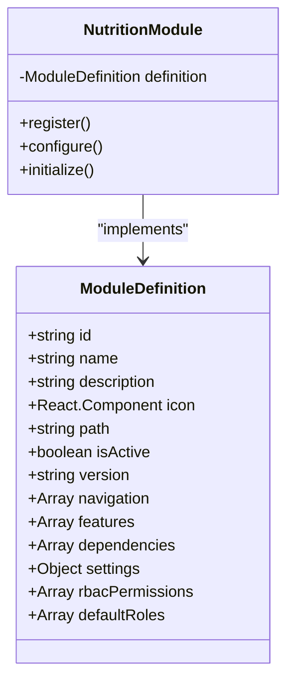

**Diagram sources**
- [moduleDefinition.tsx](file://src/modules/nutrition/moduleDefinition.tsx#L15-L64)

**Section sources**
- [moduleDefinition.tsx](file://src/modules/nutrition/moduleDefinition.tsx#L15-L64)

The module definition includes several key properties:
- **id**: "nutrition" - the unique identifier for the module
- **name**: "navigation:nutrition.title" - a localized string for the module title
- **description**: "navigation:nutrition.description" - a localized string for the module description
- **icon**: CakeIcon - the visual representation of the module
- **path**: "/nutrition" - the base URL path for the module
- **isActive**: true - indicates the module is enabled
- **version**: "1.0.0" - the current version of the module

The navigation property defines the various pages within the module, each with its own path, icon, and corresponding page component. These include:
- Dashboard (/nutrition/dashboard)
- Meal Plans (/nutrition/meal-plans)
- Menus (/nutrition/menus)
- Merchants (/nutrition/merchants)
- Student Meal Assignments (/nutrition/student-meal-assignments)
- Meal Consumption Log (/nutrition/meal-consumption-log)
- Student Wallet (/nutrition/student-wallet)

The module has a dependency on the Administration module, which is required for accessing student information and other administrative data. The configuration settings include boolean flags to enable or disable specific features such as meal planning, student nutrition tracking, and wallet management.

## Permission Structure
The Nutrition Module implements a Role-Based Access Control (RBAC) system to manage user permissions for various operations within the module. The permission structure is defined in the rbac.ts file and includes specific permissions for meal-related operations.

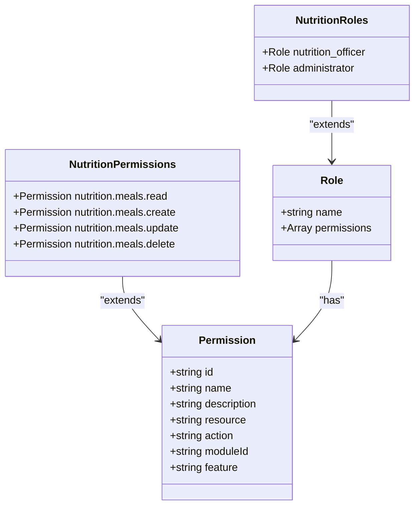

**Diagram sources**
- [rbac.ts](file://src/modules/nutrition/rbac.ts#L1-L41)

**Section sources**
- [rbac.ts](file://src/modules/nutrition/rbac.ts#L1-L41)

The module defines four specific permissions for meal management:
- **nutrition.meals.read**: Allows users to view meal information
- **nutrition.meals.create**: Allows users to create meal plans
- **nutrition.meals.update**: Allows users to update meal information
- **nutrition.meals.delete**: Allows users to delete meal plans

These permissions are organized by resource ("nutrition.meals") and action (read, create, update, delete), following a consistent naming convention. The permissions are associated with the "meal-planning" feature, allowing for feature-based access control.

The module defines two default roles that have access to these permissions:
- **nutrition_officer**: A role specifically for nutrition management staff
- **administrator**: A system-wide administrative role with broad permissions

This permission structure ensures that only authorized personnel can modify meal plans and related data, while allowing appropriate access levels for different user types. The RBAC system integrates with the core authorization service to enforce these permissions throughout the application.

## Core Data Model
The Nutrition Module implements a comprehensive data model to manage meals, menus, merchants, student meal plans, consumption logs, and wallet transactions. The data model is defined through TypeScript interfaces and database schemas, ensuring type safety and data integrity.

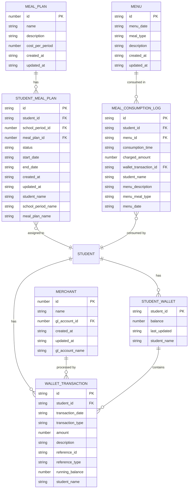

**Diagram sources**
- [types.ts](file://src/modules/nutrition/data/types.ts#L15-L92)
- [schema.ts](file://src/modules/nutrition/data/schema.ts#L1-L137)

**Section sources**
- [types.ts](file://src/modules/nutrition/data/types.ts#L15-L92)
- [schema.ts](file://src/modules/nutrition/data/schema.ts#L1-L137)

The data model consists of several key entities:

### Meal Plan
The MealPlan entity represents a predefined meal package that students can be enrolled in. It includes:
- **id**: Unique identifier
- **name**: Name of the meal plan (e.g., "Standard Lunch Plan")
- **description**: Detailed description of the plan
- **cost_per_period**: Cost of the plan per academic period
- **created_at/updated_at**: Timestamps for record management

### Student Meal Plan
The StudentMealPlan entity represents a student's enrollment in a specific meal plan for a school period. It includes:
- **id**: Unique identifier
- **student_id**: Reference to the student
- **school_period_id**: Reference to the academic period
- **meal_plan_id**: Reference to the meal plan
- **status**: Current status (Active, Inactive, Cancelled)
- **start_date/end_date**: Validity period of the enrollment
- Denormalized fields for student, school period, and meal plan names for efficient querying

### Menu
The Menu entity represents a specific meal served on a particular date. It includes:
- **id**: Unique identifier
- **menu_date**: Date when the meal is served
- **meal_type**: Type of meal (Breakfast, Lunch, Supper, etc.)
- **description**: Description of the meal items
- **created_at/updated_at**: Timestamps for record management

### Meal Consumption Log
The MealConsumptionLog entity tracks when a student consumes a meal. It includes:
- **id**: Unique identifier
- **student_id**: Reference to the student
- **menu_id**: Reference to the menu consumed
- **consumption_time**: Timestamp of consumption
- **charged_amount**: Amount charged (if applicable)
- **wallet_transaction_id**: Reference to the corresponding wallet transaction
- Denormalized fields for reporting and display purposes

### Merchant
The Merchant entity represents locations where students can make purchases. It includes:
- **id**: Unique identifier
- **name**: Name of the merchant (e.g., "School Canteen")
- **gl_account_id**: Reference to the General Ledger account for sales revenue
- **created_at/updated_at**: Timestamps for record management
- **gl_account_name**: Denormalized GL account name

### Student Wallet
The StudentWallet entity manages a student's digital wallet balance. It includes:
- **student_id**: Primary key, referencing the student
- **balance**: Current wallet balance
- **last_updated**: Timestamp of last balance update
- **student_name**: Denormalized student name

### Wallet Transaction
The WalletTransaction entity records all transactions affecting a student's wallet. It includes:
- **id**: Unique identifier
- **student_id**: Reference to the student
- **transaction_date**: Timestamp of the transaction
- **transaction_type**: Type of transaction (Deposit, Purchase, Meal Charge, etc.)
- **amount**: Transaction amount (positive for credits, negative for debits)
- **description**: Description of the transaction
- **reference_id/reference_type**: References to related records
- **running_balance**: Balance after the transaction
- **student_name**: Denormalized student name

The database schemas for these entities are defined using a database-agnostic schema system, allowing for flexibility in database implementation. Each schema specifies primary keys, required fields, indexes, and field constraints to ensure data integrity.

## Meal Planning Implementation
The meal planning functionality is implemented through the MealPlansPage component, which provides a user interface for creating, viewing, updating, and deleting meal plans. This component leverages the core data model and integrates with the application's data management system.

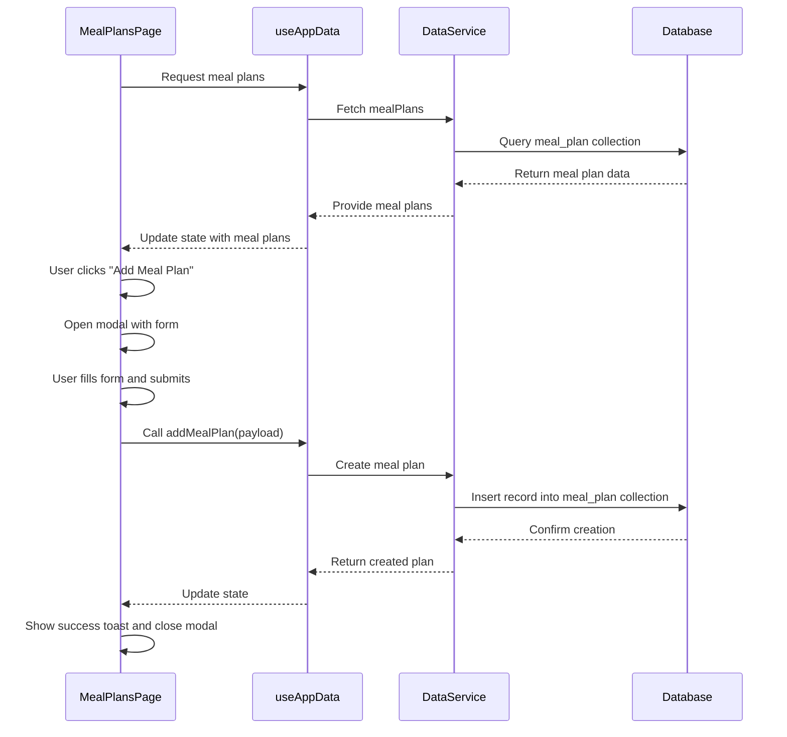

**Diagram sources**
- [MealPlansPage.tsx](file://src/modules/nutrition/pages/MealPlansPage.tsx#L0-L199)

**Section sources**
- [MealPlansPage.tsx](file://src/modules/nutrition/pages/MealPlansPage.tsx#L0-L199)

The MealPlansPage component implements several key features:

### User Interface
The component displays meal plans in a DataGrid with columns for ID, Plan Name, Description, and Cost per Period. The interface includes:
- A card container with a title and action buttons
- A "Add Meal Plan" button that opens a modal form
- Bulk delete functionality for selected meal plans
- Search and sorting capabilities
- Pagination for large datasets

### Form Management
When creating or editing a meal plan, a modal dialog appears with a form containing:
- Name field (required)
- Description field (optional)
- Cost per Period field (number input)

The form handles input validation, ensuring that the meal plan name is provided before submission. The cost field automatically converts text input to a number, defaulting to 0 if the input is invalid.

### Data Operations
The component uses the useAppData hook to access meal plan data and perform CRUD operations:
- **Reading**: The component subscribes to meal plan data and displays it in the grid
- **Creating**: The addMealPlan function creates a new meal plan with the provided payload
- **Updating**: The updateMealPlan function modifies an existing meal plan
- **Deleting**: The deleteMealPlan function removes a meal plan, with confirmation prompts

### State Management
The component manages several state variables:
- **isModalOpen**: Controls the visibility of the form modal
- **editingPlan**: Stores the meal plan being edited (null for new plans)
- **formData**: Contains the current form data
- **toast**: Manages notification messages for user feedback
- **selectedRows**: Tracks selected meal plans for bulk operations

Error handling is implemented through try-catch blocks around data operations, with user-friendly error messages displayed via toast notifications. Success messages confirm when operations complete successfully.

The component also handles loading states, displaying a spinner when data is being fetched or saved. This provides visual feedback to users during asynchronous operations.

## Menu Management
The menu management functionality is implemented through the MenusPage component, which allows administrators to create and manage meal menus for specific dates and meal types. This component provides a comprehensive interface for planning daily meals across the institution.

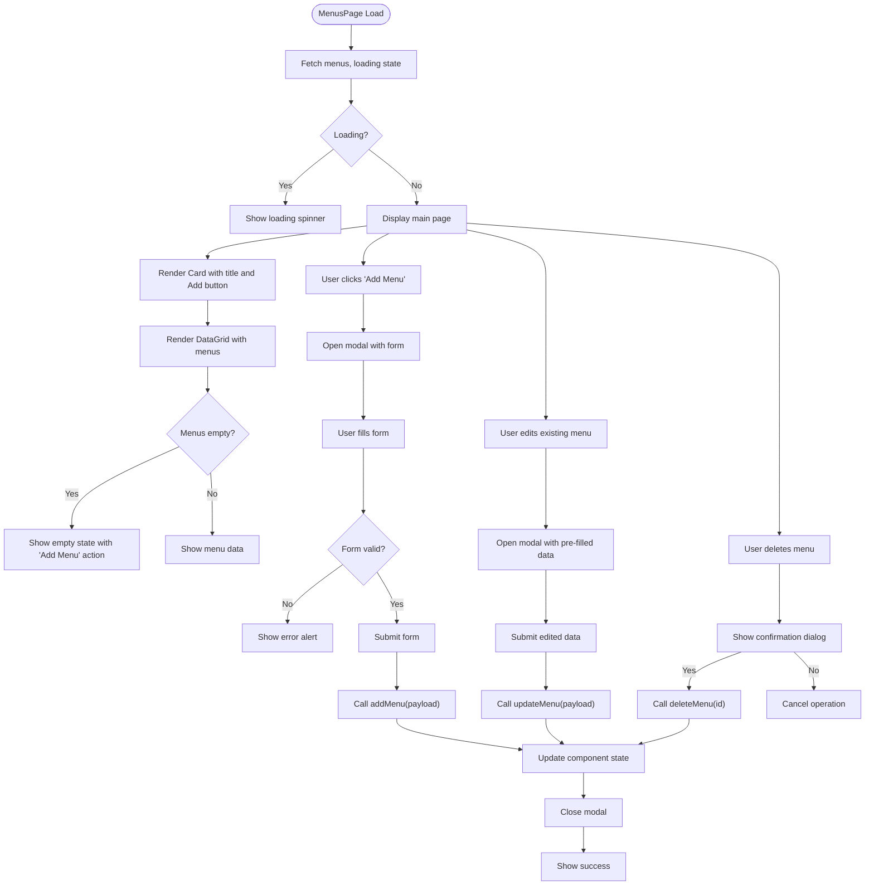

**Diagram sources**
- [MenusPage.tsx](file://src/modules/nutrition/pages/MenusPage.tsx#L0-L196)

**Section sources**
- [MenusPage.tsx](file://src/modules/nutrition/pages/MenusPage.tsx#L0-L196)

The MenusPage component implements the following functionality:

### User Interface
The component features a clean interface with:
- A card containing the main content
- An "Add Menu" button in the card header
- A DataGrid displaying existing menus with columns for Date, Meal Type, Description, and Actions
- A modal form for creating or editing menus

The DataGrid includes filtering and sorting capabilities, allowing administrators to easily find specific menus. An empty state is displayed when no menus exist, encouraging users to create their first menu.

### Form Implementation
The modal form includes three fields:
- **Menu Date**: A date input for selecting when the menu will be served
- **Meal Type**: A dropdown selection for the type of meal (Breakfast, Lunch, Supper, etc.)
- **Description**: A textarea for detailing the meal items

All fields are required, and client-side validation ensures data completeness before submission. The form uses callback functions for input changes and form submission, with proper dependency management using useCallback to prevent unnecessary re-renders.

### Data Operations
The component leverages the useAppData hook to perform CRUD operations on menu data:
- **Reading**: Menus are retrieved from the application data context
- **Creating**: The addMenu function creates a new menu record
- **Updating**: The updateMenu function modifies an existing menu
- **Deleting**: The deleteMenu function removes a menu with user confirmation

The component handles loading states during data operations, disabling the submit button and showing a spinner during asynchronous operations to prevent duplicate submissions.

### State Management
Key state variables include:
- **isModalOpen**: Controls modal visibility
- **editingMenu**: Stores the menu being edited (null for new menus)
- **formData**: Contains current form data
- **columns**: Memoized column definitions for the DataGrid

The component uses useMemo to optimize performance by memoizing expensive calculations like column definitions. This ensures that the DataGrid doesn't re-render unnecessarily when the component state changes.

## Student Wallet Management
The student wallet management functionality is implemented through the StudentWalletPage component, which provides a comprehensive interface for managing student wallet balances and transactions. This component integrates financial operations with student nutrition services.

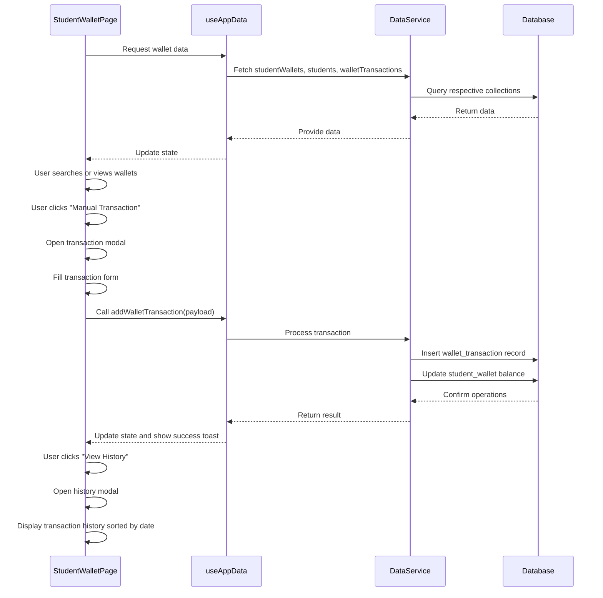

**Diagram sources**
- [StudentWalletPage.tsx](file://src/modules/nutrition/pages/StudentWalletPage.tsx#L0-L199)

**Section sources**
- [StudentWalletPage.tsx](file://src/modules/nutrition/pages/StudentWalletPage.tsx#L0-L199)

The StudentWalletPage component implements several key features:

### Wallet Overview
The main interface displays a DataGrid of all student wallets with columns for:
- Student Name
- Admission Number
- Wallet Balance (formatted to two decimal places)
- Last Updated timestamp
- Actions (View History button)

The component filters student wallets based on the student's first name, last name, and admission number, providing a search functionality that helps administrators quickly find specific students.

### Transaction Management
The component supports manual transaction entry through a modal form with fields for:
- **Student**: Dropdown selection of students
- **Transaction Type**: Selection of deposit, debit adjustment, or credit adjustment
- **Amount**: Numeric input for the transaction amount
- **Description**: Text input for transaction details

The form validates that a student is selected, the amount is positive, and a description is provided. It also validates that only approved transaction types are used for manual entry (excluding purchase and meal charge types which are system-generated).

### Transaction Processing
When processing transactions, the component handles the sign of the amount based on the transaction type:
- Deposits and credit adjustments are positive amounts
- Debit adjustments are negative amounts (achieved by negating a positive input)

The running balance is automatically calculated by the backend system, ensuring accurate financial records. The component displays a success message upon successful transaction posting.

### Transaction History
The component allows administrators to view a student's complete transaction history in a modal dialog. The history is displayed in a DataGrid with columns for:
- Date and time
- Transaction type
- Amount (formatted)
- Description
- Running balance (formatted)

Transactions are sorted in reverse chronological order, showing the most recent transactions first. This provides a clear audit trail of all wallet activity.

### State and Data Management
The component uses several React hooks to manage state and optimize performance:
- useState for managing modal visibility, form data, and search terms
- useMemo for filtering student wallets and calculating transaction history
- useEffect for initializing form data

The component handles loading states for all data dependencies, ensuring a smooth user experience during data retrieval.

## Meal Consumption Tracking
The meal consumption tracking functionality is implemented through the MealConsumptionLogPage component, which allows staff to record when students consume meals. This component integrates meal planning, menu management, and financial systems to provide a complete meal tracking solution.

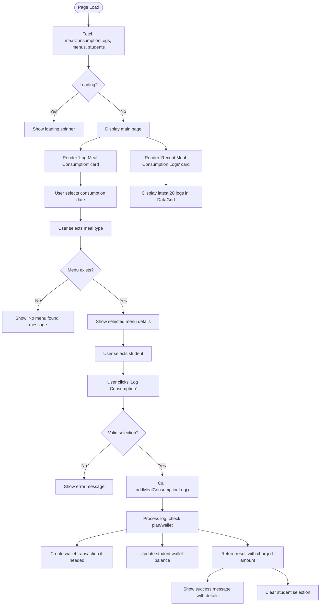

**Diagram sources**
- [MealConsumptionLogPage.tsx](file://src/modules/nutrition/pages/MealConsumptionLogPage.tsx#L0-L194)

**Section sources**
- [MealConsumptionLogPage.tsx](file://src/modules/nutrition/pages/MealConsumptionLogPage.tsx#L0-L194)

The MealConsumptionLogPage component implements the following workflow:

### Logging Interface
The component provides a form for logging meal consumption with three selection fields:
- **Consumption Date**: A date input for when the meal was consumed
- **Meal Type**: A dropdown for the type of meal (Breakfast, Lunch, Supper, etc.)
- **Student**: A dropdown of active students

The student selection is disabled until a valid menu is found for the selected date and meal type, preventing invalid entries.

### Menu Validation
When the date and meal type are selected, the component checks if a menu exists for that combination. If a menu is found, it displays the menu details prominently. If no menu exists, it shows an error message prompting administrators to create the menu first.

### Consumption Processing
When logging a meal, the system determines how to handle the transaction based on the student's meal plan:
- If the student has an active meal plan that covers the meal type, the meal is included in the plan at no additional cost
- If the student is on a pay-as-you-eat plan or has no meal plan, the system deducts the appropriate amount from their wallet balance

The addMealConsumptionLog function handles this logic, creating a wallet transaction if needed and updating the student's wallet balance accordingly.

### Feedback and Results
After logging a meal, the component provides detailed feedback:
- Success messages indicate the student's name and whether an amount was charged
- If charged, the exact amount is displayed
- If covered by a meal plan, this is explicitly stated

This immediate feedback helps staff verify that meals are being processed correctly.

### Recent Logs Display
The component also displays the 20 most recent meal consumption logs in a DataGrid with columns for:
- Student Name
- Menu details (description, meal type, date)
- Consumption time
- Amount charged (or indication that it was covered by a plan)

This provides a quick audit trail of recent meal activity.

## Merchant Integration
The merchant integration functionality is implemented through the MerchantsPage component, which allows administrators to define and manage merchants where students can make purchases using their wallets. This component bridges the nutrition system with the financial accounting system.

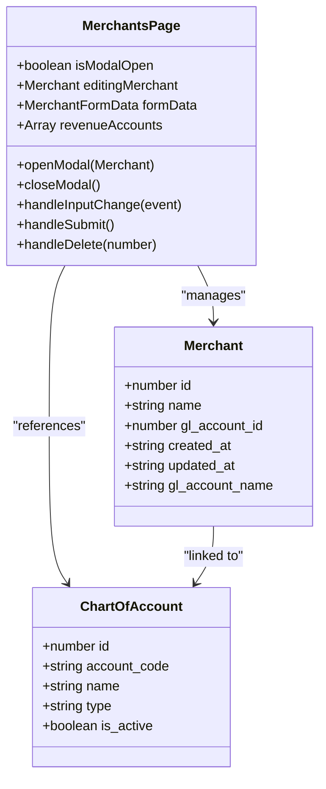

**Diagram sources**
- [MerchantsPage.tsx](file://src/modules/nutrition/pages/MerchantsPage.tsx#L0-L189)

**Section sources**
- [MerchantsPage.tsx](file://src/modules/nutrition/pages/MerchantsPage.tsx#L0-L189)

The MerchantsPage component provides the following functionality:

### Merchant Management
The component displays a DataGrid of merchants with columns for:
- ID
- Merchant Name
- Sales GL Account (with denormalized name)
- Actions (Edit and Delete buttons)

An empty state encourages administrators to add their first merchant when none exist.

### Merchant Form
The modal form for adding or editing merchants includes:
- **Merchant Name**: Required text input
- **GL Account for Sales**: Dropdown selection of active revenue accounts

The component filters the chart of accounts to show only active revenue accounts, ensuring that merchants are linked to appropriate financial accounts.

### Financial Integration
The key integration point is the linkage between merchants and General Ledger (GL) accounts. When a student makes a purchase at a merchant:
- A wallet transaction is created with type "PURCHASE"
- The transaction references the merchant ID
- Sales revenue is recorded against the linked GL account
- The student's wallet balance is reduced

This integration ensures that all merchant sales are properly accounted for in the financial system while maintaining accurate student wallet balances.

### Data Operations
The component supports full CRUD operations for merchants:
- **Reading**: Merchants are retrieved from the application data context
- **Creating**: New merchants are added with a name and GL account reference
- **Updating**: Existing merchants can have their name or GL account changed
- **Deleting**: Merchants can be removed with user confirmation

The component handles loading states during data operations and provides appropriate user feedback.

## Integration with Finance Module
The Nutrition Module integrates closely with the Finance Module to manage financial transactions related to student meals and wallet operations. This integration ensures that all financial activities are properly recorded in the accounting system.

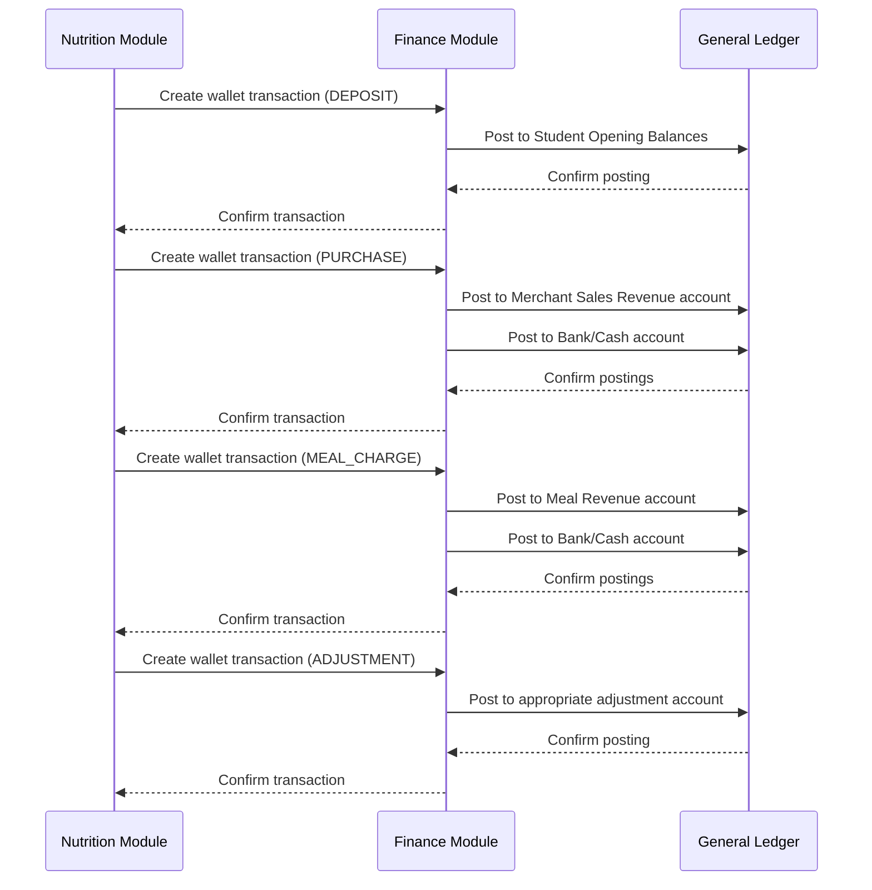

**Diagram sources**
- [StudentWalletPage.tsx](file://src/modules/nutrition/pages/StudentWalletPage.tsx#L0-L199)
- [mockData.ts](file://src/modules/nutrition/data/mockData.ts#L100-L130)

**Section sources**
- [StudentWalletPage.tsx](file://src/modules/nutrition/pages/StudentWalletPage.tsx#L0-L199)
- [mockData.ts](file://src/modules/nutrition/data/mockData.ts#L100-L130)

The integration occurs through several key mechanisms:

### Wallet Transactions
All wallet transactions are recorded in the wallet_transaction collection and synchronized with the Finance Module. The transaction types include:
- **DEPOSIT**: Funds added to a student's wallet, typically from parents or guardians
- **PURCHASE**: Purchases made at merchants (canteen, uniform shop, etc.)
- **MEAL_CHARGE**: Charges for meals not covered by a meal plan
- **ADJUSTMENT_DEBIT**: Manual deductions from a wallet
- **ADJUSTMENT_CREDIT**: Manual additions to a wallet

Each transaction includes a running balance, providing a complete audit trail of wallet activity.

### General Ledger Posting
When transactions occur, they are posted to the appropriate General Ledger accounts:
- Wallet deposits are posted to student opening balances or receivables
- Merchant purchases are posted to the merchant's designated revenue account
- Meal charges are posted to meal revenue accounts
- Adjustments are posted to appropriate adjustment accounts

The merchant configuration links each merchant to a specific GL revenue account, ensuring accurate financial reporting.

### Financial Reporting
The integration enables comprehensive financial reporting, including:
- Daily sales reports by merchant
- Student wallet balance summaries
- Meal plan revenue tracking
- Transaction reconciliation reports

These reports help administrators monitor financial performance and ensure accurate accounting.

### Transaction Reconciliation
The system supports transaction reconciliation through:
- Unique transaction IDs for audit trails
- Reference IDs linking transactions to source records
- Timestamps for all transactions
- Running balances to detect discrepancies

Administrators can reconcile wallet transactions with bank deposits and merchant sales to ensure financial accuracy.

## Integration with Administration Module
The Nutrition Module integrates with the Administration Module to access student information, dietary restrictions, and other administrative data essential for nutrition management.

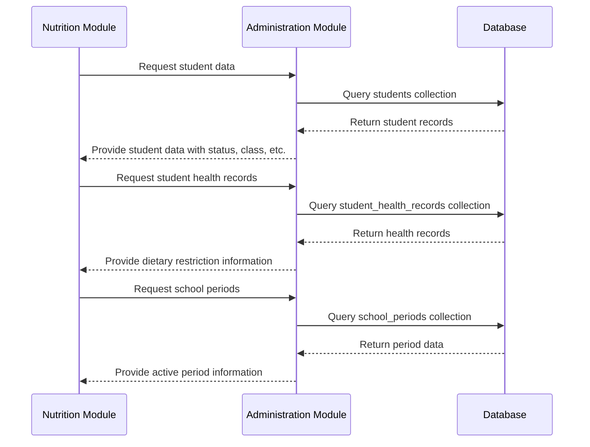

**Diagram sources**
- [moduleDefinition.tsx](file://src/modules/nutrition/moduleDefinition.tsx#L33-L41)
- [mockData.ts](file://src/modules/nutrition/data/mockData.ts#L145-L168)
- [StudentMealAssignmentsPage.tsx](file://src/modules/nutrition/pages/StudentMealAssignmentsPage.tsx#L0-L199)

**Section sources**
- [moduleDefinition.tsx](file://src/modules/nutrition/moduleDefinition.tsx#L33-L41)
- [mockData.ts](file://src/modules/nutrition/data/mockData.ts#L145-L168)
- [StudentMealAssignmentsPage.tsx](file://src/modules/nutrition/pages/StudentMealAssignmentsPage.tsx#L0-L199)

The integration includes several key aspects:

### Student Information
The Nutrition Module accesses comprehensive student data from the Administration Module, including:
- Personal information (name, admission number)
- Academic information (class, stream)
- Status (active, inactive)
- Contact information

This data is used to populate student selections in various interfaces and ensure that only active students are included in meal planning.

### Dietary Restrictions
The module accesses student health records to identify dietary restrictions and special requirements. The mock data shows several dietary restriction types:
- Vegetarian
- Vegan
- Halal
- Gluten-Free
- Dairy-Free
- Nut Allergy
- Diabetic
- Low Sodium

Students with special dietary needs are flagged in the system, allowing nutrition officers to plan appropriate meals and ensure food safety.

### School Periods
The integration with school periods ensures that meal plans are associated with the correct academic period. This allows for:
- Term-based meal planning
- Proper enrollment tracking
- Accurate billing and reporting

The StudentMealAssignmentsPage uses school period data to filter meal plan assignments and ensure that students are enrolled in the correct period.

### Data Synchronization
The integration ensures that changes in student status (e.g., withdrawal, transfer) are reflected in the nutrition system. For example:
- When a student becomes inactive, their meal plan can be automatically suspended
- When a student transfers classes, their meal preferences can be maintained
- When a student's health status changes, their dietary restrictions are updated

This synchronization helps maintain data accuracy across the system.

## Special Dietary Requirements Management
The Nutrition Module includes functionality to manage special dietary requirements, ensuring that students with specific nutritional needs receive appropriate meals. This feature is critical for food safety and student well-being.

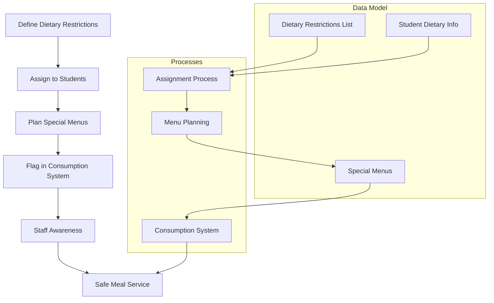

**Diagram sources**
- [mockData.ts](file://src/modules/nutrition/data/mockData.ts#L145-L168)

**Section sources**
- [mockData.ts](file://src/modules/nutrition/data/mockData.ts#L145-L168)

The special dietary requirements management system includes:

### Dietary Restriction Types
The system defines a comprehensive list of dietary restriction types, including:
- Vegetarian and Vegan
- Religious requirements (Halal)
- Allergies (Nut Allergy)
- Medical conditions (Diabetic, Celiac/Gluten-Free)
- Other health considerations (Dairy-Free, Low Sodium)

Each restriction type includes a description to ensure staff understand the requirements.

### Student Assignment
Students are assigned dietary restrictions through the administration system. The assignment includes:
- The specific restriction type
- Detailed notes about the student's needs
- Emergency information (e.g., EpiPen for severe allergies)

This information is accessible to nutrition staff to ensure proper meal planning and service.

### Menu Planning
When planning menus, nutrition officers can:
- Create special menus for students with dietary restrictions
- Ensure that alternative options are available
- Flag menus that contain common allergens
- Plan balanced meals that meet nutritional requirements

The system could be extended to include automated checks that flag potential issues when planning menus for students with restrictions.

### Staff Awareness
The consumption logging system can be configured to alert staff when serving students with special dietary needs. This ensures that:
- Staff are aware of a student's restrictions
- Appropriate meals are served
- Cross-contamination is prevented
- Emergency procedures are followed when needed

### Food Safety Compliance
The system supports food safety compliance by:
- Maintaining accurate records of dietary restrictions
- Providing audit trails of meals served to students with restrictions
- Ensuring that staff are informed of special requirements
- Supporting documentation for regulatory compliance

Best practices for managing special dietary requirements include:
- Regular review of student dietary information
- Staff training on food allergies and special diets
- Clear labeling of meals with allergens
- Separate preparation areas for special meals
- Emergency response plans for allergic reactions
- Communication with parents about dietary management

## Common Issues and Best Practices
This section addresses common issues encountered when using the Nutrition Module and provides best practices for optimal operation.

### Common Issues

**Meal Plan Changes**
When students change meal plans mid-period, the system must handle the transition properly. Issues can arise if:
- The old plan is not properly deactivated
- Charges are incorrectly applied
- The new plan doesn't take effect immediately

Best practice: Always review the student's current plan status before making changes, and use the system's start and end date fields to schedule plan changes.

**Transaction Reconciliation**
Discrepancies between wallet balances and financial records can occur due to:
- Manual adjustments not properly documented
- System errors during high-traffic periods
- Duplicate transactions

Best practice: Perform daily reconciliation of wallet transactions against bank deposits and merchant sales. Use the transaction reference IDs to trace any discrepancies.

**Menu Planning Errors**
Common menu planning issues include:
- Creating menus for dates with no school
- Forgetting to plan for special events or holidays
- Not accounting for student absences

Best practice: Use the school calendar when planning menus, and review attendance patterns to adjust meal quantities appropriately.

### Best Practices

**Food Safety Compliance**
- Maintain up-to-date records of all student dietary restrictions
- Train all staff on food allergy awareness and emergency procedures
- Implement strict cross-contamination prevention measures
- Regularly audit meal service procedures
- Keep emergency medications (like EpiPens) accessible and up-to-date

**Special Dietary Requirements**
- Conduct regular meetings with parents of students with special dietary needs
- Document all dietary requirements and updates
- Create standardized procedures for preparing special meals
- Label all special meals clearly
- Train kitchen staff on preparing meals for various dietary restrictions
- Maintain a log of special meals served

**System Management**
- Regularly review and clean up inactive meal plans
- Ensure all merchants are properly linked to GL accounts
- Perform regular backups of nutrition data
- Monitor wallet balances for unusually low or high values
- Review consumption patterns to identify potential issues
- Train all users on proper data entry procedures

**Financial Management**
- Reconcile wallet transactions daily
- Verify that all merchant sales are properly recorded
- Monitor for unusual transaction patterns that might indicate errors
- Ensure proper approval processes for manual adjustments
- Generate regular financial reports for management review

By following these best practices, administrators can ensure the Nutrition Module operates efficiently, maintains food safety standards, and provides accurate financial reporting.