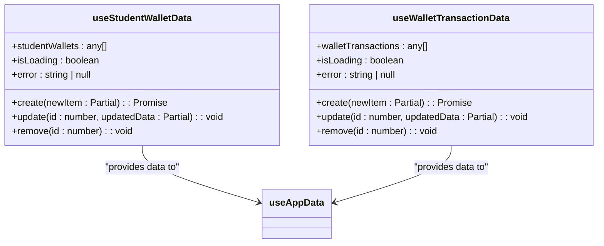
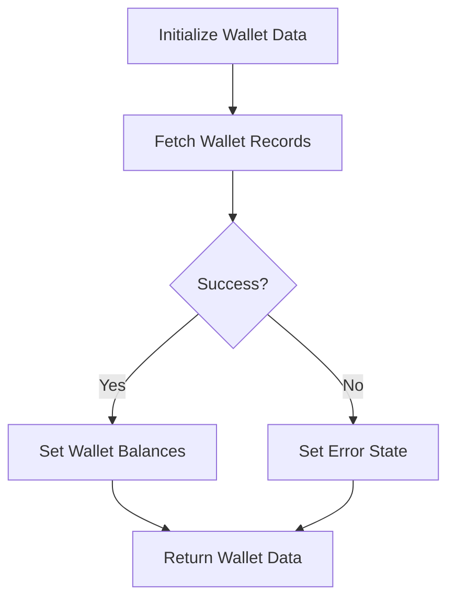
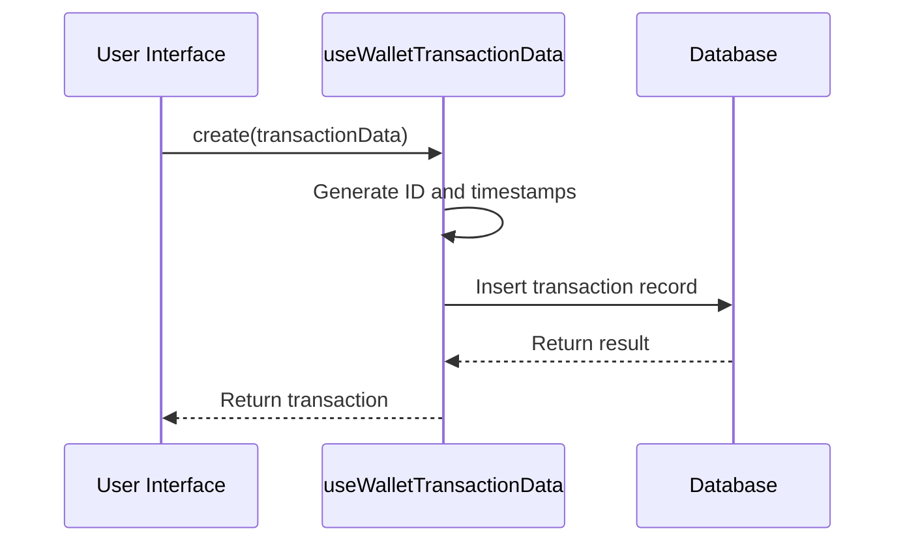
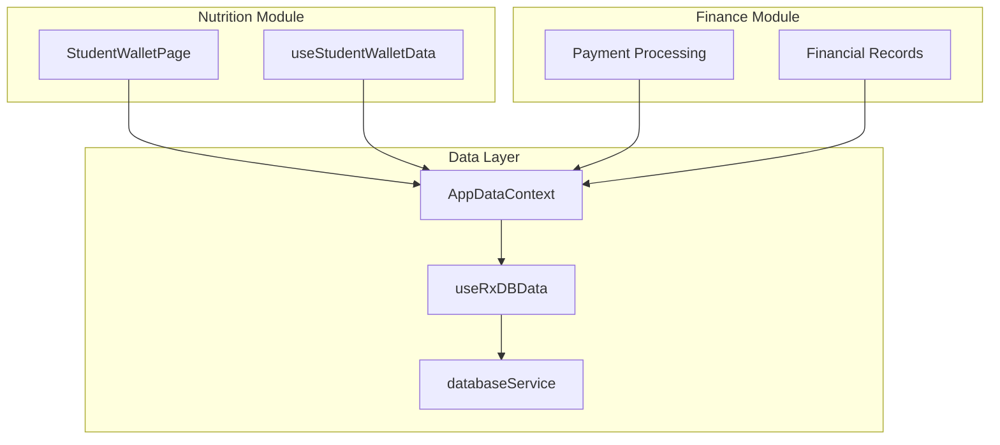
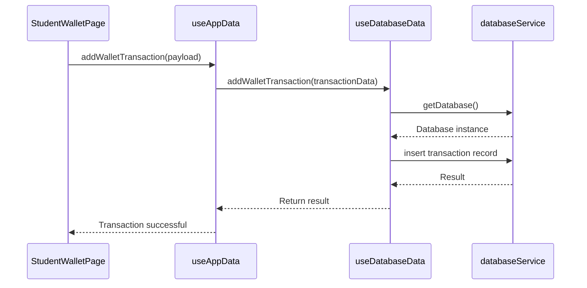
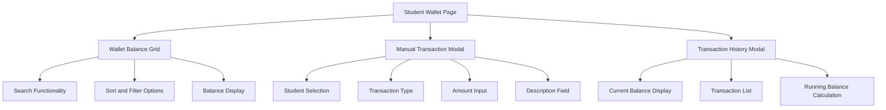
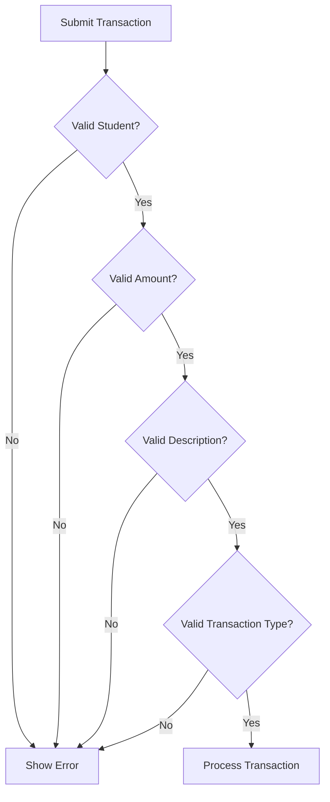
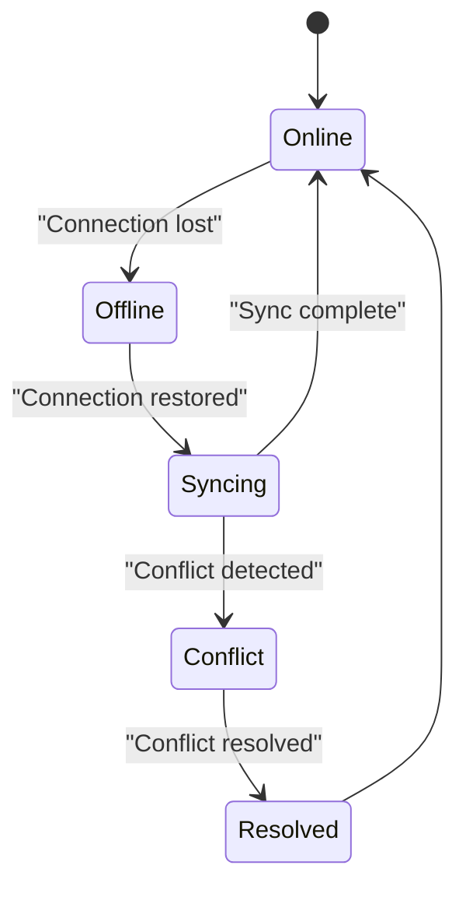

# Student Wallet System

<cite>
**Referenced Files in This Document**   
- [useStudentWalletData.ts](file://src/modules/nutrition/data/useStudentWalletData.ts)
- [useWalletTransactionData.ts](file://src/modules/nutrition/data/useWalletTransactionData.ts)
- [StudentWalletPage.tsx](file://src/modules/nutrition/pages/StudentWalletPage.tsx)
- [StudentMealAssignmentsPage.tsx](file://src/modules/nutrition/pages/StudentMealAssignmentsPage.tsx)
- [useAppData.ts](file://src/hooks/useAppData.ts)
- [AppDataContext.tsx](file://src/contexts/AppDataContext.tsx)
- [useRxDBData.ts](file://src/hooks/useRxDBData.ts)
- [types.ts](file://src/core/types.ts)
- [useDatabaseData.ts](file://src/hooks/useDatabaseData.ts)
</cite>

## Table of Contents
1. [Introduction](#introduction)
2. [Core Components](#core-components)
3. [Balance Management and Transaction Logging](#balance-management-and-transaction-logging)
4. [Integration with Finance Module](#integration-with-finance-module)
5. [User Interface Components](#user-interface-components)
6. [Security and Validation](#security-and-validation)
7. [Error Handling and Synchronization](#error-handling-and-synchronization)
8. [Best Practices](#best-practices)

## Introduction
The Student Wallet System is a subsystem within the Nutrition module designed to manage student financial transactions related to meal plans and other nutrition services. It provides functionality for wallet balance management, transaction logging, and integration with the Finance module for top-ups and payment processing. The system supports both online and offline modes, with synchronization capabilities to ensure data consistency across devices.

**Section sources**
- [StudentWalletPage.tsx](file://src/modules/nutrition/pages/StudentWalletPage.tsx#L1-L282)
- [StudentMealAssignmentsPage.tsx](file://src/modules/nutrition/pages/StudentMealAssignmentsPage.tsx#L1-L248)

## Core Components

The Student Wallet System consists of several key components that work together to provide a comprehensive financial management solution for student nutrition services. The core components include data hooks for wallet management, user interface components for interaction, and integration points with other modules.

### Data Hooks

The system utilizes two primary custom hooks for data management: `useStudentWalletData` and `useWalletTransactionData`. These hooks provide CRUD operations for student wallet information and transaction records.

**Diagram sources**
- [useStudentWalletData.ts](file://src/modules/nutrition/data/useStudentWalletData.ts#L7-L54)
- [useWalletTransactionData.ts](file://src/modules/nutrition/data/useWalletTransactionData.ts#L7-L54)

**Section sources**
- [useStudentWalletData.ts](file://src/modules/nutrition/data/useStudentWalletData.ts#L7-L54)
- [useWalletTransactionData.ts](file://src/modules/nutrition/data/useWalletTransactionData.ts#L7-L54)

## Balance Management and Transaction Logging

The Student Wallet System implements a comprehensive balance management system that tracks student wallet balances and maintains a detailed transaction history. The system ensures accurate balance calculations and provides reconciliation capabilities.

### Balance Management

The `useStudentWalletData` hook manages student wallet balances by maintaining a collection of wallet records. Each wallet record contains the current balance and associated metadata.

The balance management system uses client-side state to store wallet information. When a new transaction is processed, the system updates the relevant wallet balance accordingly.

**Section sources**
- [useStudentWalletData.ts](file://src/modules/nutrition/data/useStudentWalletData.ts#L7-L54)
- [StudentWalletPage.tsx](file://src/modules/nutrition/pages/StudentWalletPage.tsx#L20-L282)

### Transaction Logging

The `useWalletTransactionData` hook handles transaction logging by maintaining a collection of transaction records. Each transaction includes details such as amount, type, description, and timestamp.

When a transaction is created, the system generates a unique ID and timestamps for creation and updates. The transaction types are defined in the `WalletTransactionType` enum, which includes:

- DEPOSIT: Funds added to the wallet
- WITHDRAWAL: Funds removed from the wallet
- TRANSFER_OUT: Funds transferred to another account
- TRANSFER_IN: Funds received from another account
- PURCHASE: Funds used for purchases

**Diagram sources**
- [useWalletTransactionData.ts](file://src/modules/nutrition/data/useWalletTransactionData.ts#L7-L54)
- [types.ts](file://src/core/types.ts#L266-L272)

**Section sources**
- [useWalletTransactionData.ts](file://src/modules/nutrition/data/useWalletTransactionData.ts#L7-L54)
- [types.ts](file://src/core/types.ts#L266-L272)

## Integration with Finance Module

The Student Wallet System integrates with the Finance module to enable wallet top-ups and payment processing. This integration is facilitated through the `useAppData` hook and the underlying data service architecture.

### Data Integration Architecture

The integration between the Nutrition and Finance modules is achieved through a shared data context that provides access to both modules' data. The `AppDataContext` serves as the central data provider, aggregating data from various sources.

**Diagram sources**
- [AppDataContext.tsx](file://src/contexts/AppDataContext.tsx#L22-L168)
- [useRxDBData.ts](file://src/hooks/useRxDBData.ts#L7-L305)

**Section sources**
- [AppDataContext.tsx](file://src/contexts/AppDataContext.tsx#L22-L168)
- [useRxDBData.ts](file://src/hooks/useRxDBData.ts#L7-L305)

### Transaction Processing

The `addWalletTransaction` function in the `useDatabaseData` hook is responsible for processing wallet transactions and integrating them with the Finance module. When a transaction is added, it is persisted to the database and made available to both modules.

The transaction processing flow ensures that all financial operations are properly recorded and synchronized across the system.

**Diagram sources**
- [useDatabaseData.ts](file://src/hooks/useDatabaseData.ts#L1943-L1958)
- [useAppData.ts](file://src/hooks/useAppData.ts#L7-L21)

**Section sources**
- [useDatabaseData.ts](file://src/hooks/useDatabaseData.ts#L1943-L1958)
- [useAppData.ts](file://src/hooks/useAppData.ts#L7-L21)

## User Interface Components

The Student Wallet System provides two primary user interface components: `StudentWalletPage` and `StudentMealAssignmentsPage`. These components offer intuitive interfaces for managing wallet balances and meal plan assignments.

### Student Wallet Page

The `StudentWalletPage` component displays a comprehensive view of student wallet information, including balances and transaction history. It allows administrators to perform manual transactions and view detailed transaction logs.

Key features of the Student Wallet Page include:

- **Wallet Balance Display**: Shows current balances for all students with search and filtering capabilities
- **Manual Transaction Entry**: Allows administrators to create deposit, credit, and debit transactions
- **Transaction History**: Provides detailed transaction history for individual students
- **Real-time Updates**: Displays current balance and transaction details in real-time

**Section sources**
- [StudentWalletPage.tsx](file://src/modules/nutrition/pages/StudentWalletPage.tsx#L1-L282)

### Student Meal Assignments Page

The `StudentMealAssignmentsPage` component manages the assignment of meal plans to students. It integrates with the wallet system to ensure students have sufficient funds for their meal plans.

Key features of the Student Meal Assignments Page include:

- **Meal Plan Assignment**: Allows administrators to assign meal plans to students
- **Status Management**: Tracks the status of meal plan assignments (Active, Inactive)
- **Conflict Detection**: Prevents duplicate active assignments for the same period
- **Cost Display**: Shows the cost of meal plans to inform assignment decisions

The component ensures that students can only be assigned to meal plans if they have sufficient wallet balance, although this validation is not explicitly shown in the code.

**Section sources**
- [StudentMealAssignmentsPage.tsx](file://src/modules/nutrition/pages/StudentMealAssignmentsPage.tsx#L1-L248)

## Security and Validation

The Student Wallet System implements several security measures and validation rules to protect financial data and ensure transaction integrity.

### Transaction Validation

The system enforces validation rules for all transactions to prevent invalid operations. When creating a manual transaction, the system validates:

- **Required Fields**: Student, amount, and description are required
- **Positive Amount**: Amount must be greater than zero
- **Valid Transaction Type**: Only approved transaction types can be manually entered
- **Student Status**: Only active students can receive transactions

The validation occurs in the `handleTxSubmit` function of the `StudentWalletPage` component, ensuring that only valid transactions are processed.

**Section sources**
- [StudentWalletPage.tsx](file://src/modules/nutrition/pages/StudentWalletPage.tsx#L120-L150)

### Data Security

The system protects financial data through several mechanisms:

- **Context Protection**: The `useAppData` hook ensures it is used within the proper context provider
- **Error Handling**: Comprehensive error handling prevents data corruption
- **Type Safety**: TypeScript interfaces ensure data consistency
- **Audit Trail**: All transactions are timestamped and recorded

The `AppDataContext` includes error handling for production environments, displaying user-friendly error messages while logging detailed errors for debugging.

**Section sources**
- [AppDataContext.tsx](file://src/contexts/AppDataContext.tsx#L120-L150)

## Error Handling and Synchronization

The Student Wallet System includes robust error handling and synchronization capabilities to address common issues and ensure data consistency.

### Common Issues and Solutions

The system addresses several common issues that may arise during operation:

#### Negative Balances
While the code does not explicitly prevent negative balances, the transaction system allows for debit adjustments that could result in negative balances. This might be intentional for certain administrative operations, but could lead to issues if not properly managed.

#### Disputed Transactions
The system does not include a specific workflow for handling disputed transactions. However, the audit trail and transaction history provide the necessary information to investigate and resolve disputes.

#### Synchronization Errors
The system supports both online and offline modes, with synchronization handled by the underlying data service architecture. When operating offline, transactions are stored locally and synchronized when connectivity is restored.

The synchronization process is managed by the `SyncContext` and `DataSourceContext`, which coordinate data flow between the client and server.

**Diagram sources**
- [AppDataContext.tsx](file://src/contexts/AppDataContext.tsx#L10-L168)

**Section sources**
- [AppDataContext.tsx](file://src/contexts/AppDataContext.tsx#L10-L168)

## Best Practices

To ensure optimal operation of the Student Wallet System, the following best practices are recommended:

### Parental Notifications
Implement automated notifications to parents when:
- Wallet balance falls below a threshold
- Large transactions occur
- Meal plan assignments are made
- Wallet is topped up

These notifications help parents stay informed about their child's nutrition expenses and encourage timely top-ups.

### Spending Limits
Establish spending limits to prevent excessive expenditures:
- Daily spending caps
- Meal-specific limits
- Category-based restrictions
- Approval workflows for large transactions

While not implemented in the current code, these limits could be added through additional validation rules.

### Financial Reporting
Generate comprehensive financial reports including:
- Daily transaction summaries
- Student spending patterns
- Revenue by meal type
- Top-up sources and volumes
- Balance reconciliation reports

These reports provide valuable insights for financial management and planning.

### Audit Trails
Maintain comprehensive audit trails by:
- Recording all transaction types
- Storing timestamps for creation and modification
- Preserving historical balance information
- Logging user actions and system events

The current system provides a solid foundation for audit trails through its transaction logging capabilities.

**Section sources**
- [useWalletTransactionData.ts](file://src/modules/nutrition/data/useWalletTransactionData.ts#L7-L54)
- [StudentWalletPage.tsx](file://src/modules/nutrition/pages/StudentWalletPage.tsx#L1-L282)