# Pickup Module Overview

<cite>
**Referenced Files in This Document**
- [types.ts](file://src/modules/administration/data/pickup/types.ts)
- [schema.ts](file://src/modules/administration/data/pickup/schema.ts)
- [usePickupData.ts](file://src/modules/administration/data/pickup/usePickupData.ts)
- [mockData.ts](file://src/modules/administration/data/pickup/mockData.ts)
- [collections.ts](file://src/modules/administration/data/pickup/collections.ts)
- [PickupDashboardPage.tsx](file://src/modules/administration/pages/pickup/PickupDashboardPage.tsx)
- [PickupCodesPage.tsx](file://src/modules/administration/pages/pickup/PickupCodesPage.tsx)
- [PickupAuthorizedPersonsPage.tsx](file://src/modules/administration/pages/pickup/PickupAuthorizedPersonsPage.tsx)
- [PickupLogsPage.tsx](file://src/modules/administration/pages/pickup/PickupLogsPage.tsx)
- [PickupReportsPage.tsx](file://src/modules/administration/pages/pickup/PickupReportsPage.tsx)
- [index.ts](file://src/modules/administration/index.ts)
- [rbac.ts](file://src/modules/administration/rbac.ts)
</cite>

## Table of Contents
1. [Introduction](#introduction)
2. [Module Architecture](#module-architecture)
3. [Core Data Model](#core-data-model)
4. [Data Management Layer](#data-management-layer)
5. [User Interface Components](#user-interface-components)
6. [Database Integration](#database-integration)
7. [Security and Access Control](#security-and-access-control)
8. [Report Generation](#report-generation)
9. [Development Roadmap](#development-roadmap)
10. [Conclusion](#conclusion)

## Introduction

The Pickup Module is a comprehensive student dismissal and release management system designed to enhance child safety through secure, trackable pickup processes. Built as part of the SchoolPilot3 educational management platform, this module provides a complete solution for managing student pickup authorization, code generation, verification, and activity tracking.

The module implements a QR-code based verification system that allows authorized personnel to securely release students while maintaining detailed audit trails. It supports multiple verification methods including QR scanning, code entry, and manual verification, ensuring flexibility for various school environments and security requirements.

## Module Architecture

The Pickup Module follows a modular architecture pattern that integrates seamlessly with the broader SchoolPilot3 ecosystem. The system is structured around four core domains: data management, user interface, security, and reporting.

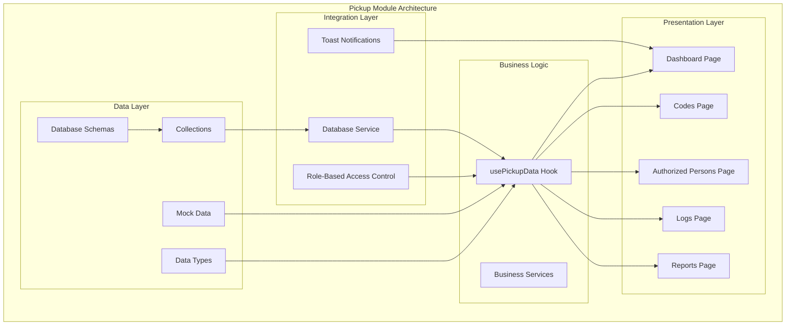

**Diagram sources**
- [index.ts:1-41](file://src/modules/administration/index.ts#L1-L41)
- [usePickupData.ts:1-256](file://src/modules/administration/data/pickup/usePickupData.ts#L1-L256)

The architecture emphasizes separation of concerns with clear boundaries between data persistence, business logic, presentation, and integration layers. This design enables maintainability, testability, and extensibility while ensuring robust data integrity and user experience.

**Section sources**
- [index.ts:1-41](file://src/modules/administration/index.ts#L1-L41)
- [collections.ts:1-22](file://src/modules/administration/data/pickup/collections.ts#L1-L22)

## Core Data Model

The Pickup Module defines a comprehensive data model centered around four primary entities that work together to manage the complete pickup lifecycle.

### Pickup Code Entity

The Pickup Code entity serves as the foundation of the verification system, containing all necessary information for secure student release verification.

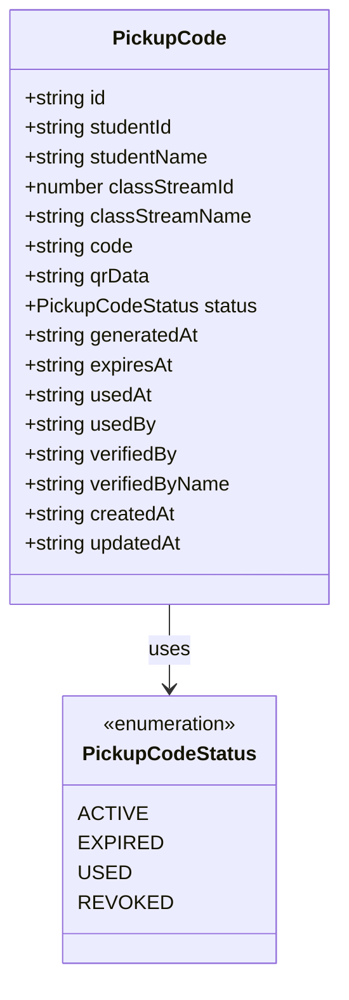

**Diagram sources**
- [types.ts:14-31](file://src/modules/administration/data/pickup/types.ts#L14-L31)

### Authorized Person Entity

The Authorized Person entity manages individuals permitted to pick up students, including their personal information and relationship to the student.

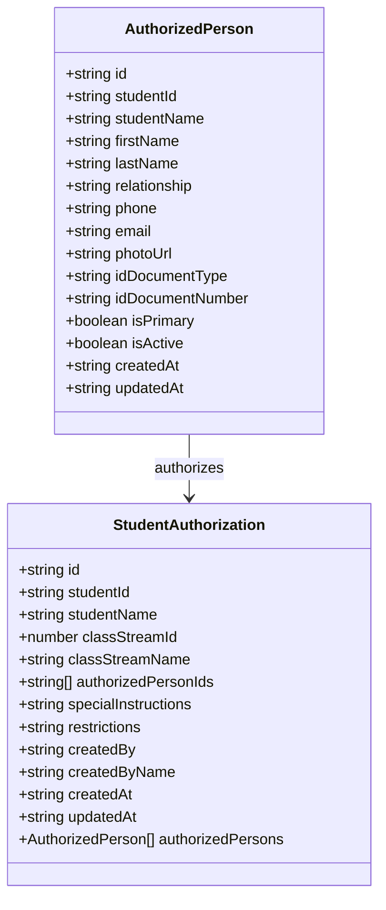

**Diagram sources**
- [types.ts:35-70](file://src/modules/administration/data/pickup/types.ts#L35-L70)

### Pickup Log Entity

The Pickup Log entity maintains comprehensive audit trails of all pickup activities, providing essential information for security and compliance purposes.

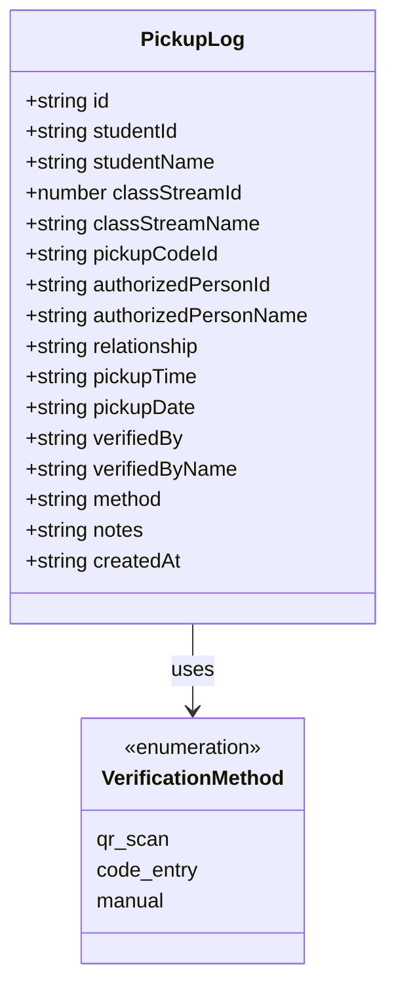

**Diagram sources**
- [types.ts:74-91](file://src/modules/administration/data/pickup/types.ts#L74-L91)

**Section sources**
- [types.ts:1-98](file://src/modules/administration/data/pickup/types.ts#L1-L98)

## Data Management Layer

The data management layer provides a comprehensive React hook-based API for interacting with the Pickup Module's data services, implementing both local state management and database integration.

### usePickupData Hook

The central `usePickupData` hook orchestrates all data operations, providing a unified interface for CRUD operations across all entities while handling database connectivity and fallback mechanisms.

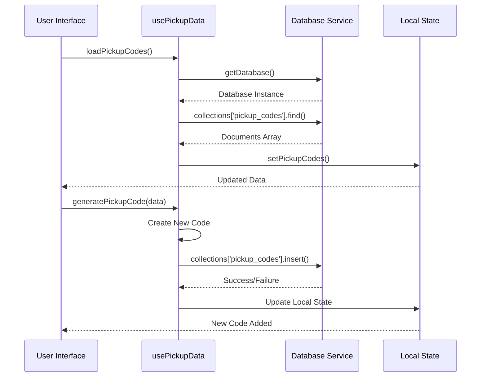

**Diagram sources**
- [usePickupData.ts:34-77](file://src/modules/administration/data/pickup/usePickupData.ts#L34-L77)

The hook implements several key patterns:

**State Management**: Maintains separate state for each entity type with loading and error states for robust user experience.

**Fallback Mechanisms**: Automatically falls back to mock data when database operations fail, ensuring system reliability.

**Real-time Updates**: Provides immediate UI updates while asynchronously persisting to database.

**Data Validation**: Implements client-side validation and sanitization before database operations.

### Database Integration

The module integrates with a database-agnostic schema system that supports multiple database backends while maintaining consistent data structures.

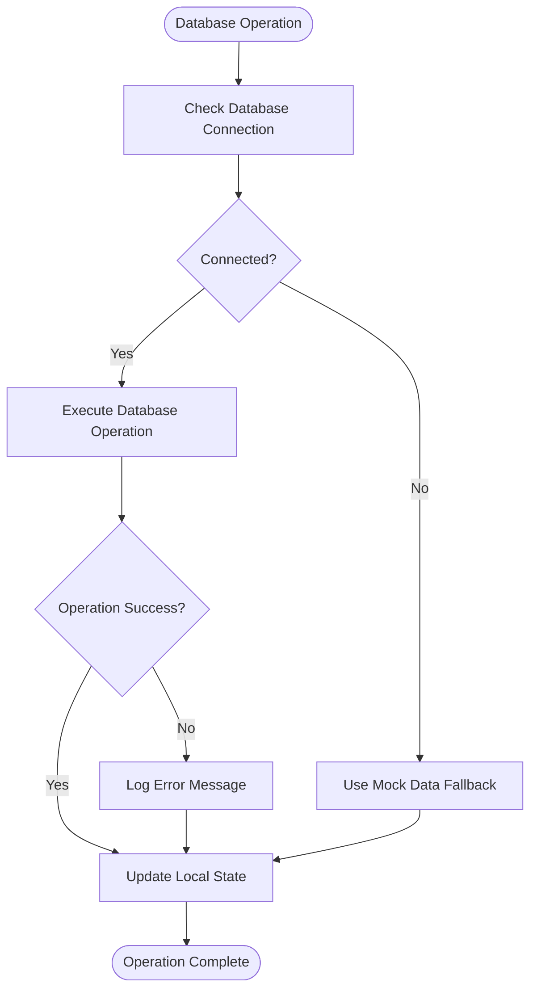

**Diagram sources**
- [usePickupData.ts:38-47](file://src/modules/administration/data/pickup/usePickupData.ts#L38-L47)

**Section sources**
- [usePickupData.ts:1-256](file://src/modules/administration/data/pickup/usePickupData.ts#L1-L256)
- [schema.ts:1-101](file://src/modules/administration/data/pickup/schema.ts#L1-L101)

## User Interface Components

The Pickup Module provides five primary user interface pages, each designed to handle specific aspects of the pickup management workflow.

### Dashboard Page

The Dashboard Page serves as the central hub for monitoring pickup activities and accessing key functionalities.

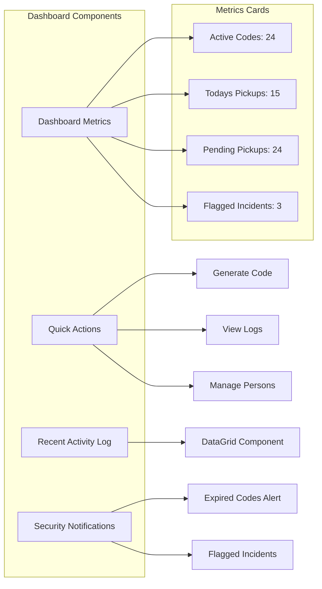

**Diagram sources**
- [PickupDashboardPage.tsx:43-110](file://src/modules/administration/pages/pickup/PickupDashboardPage.tsx#L43-L110)

The dashboard implements real-time metrics calculation, notification systems for security alerts, and quick access to frequently used functions.

### Codes Management Page

The Codes Management Page provides comprehensive functionality for generating, viewing, and managing pickup codes.

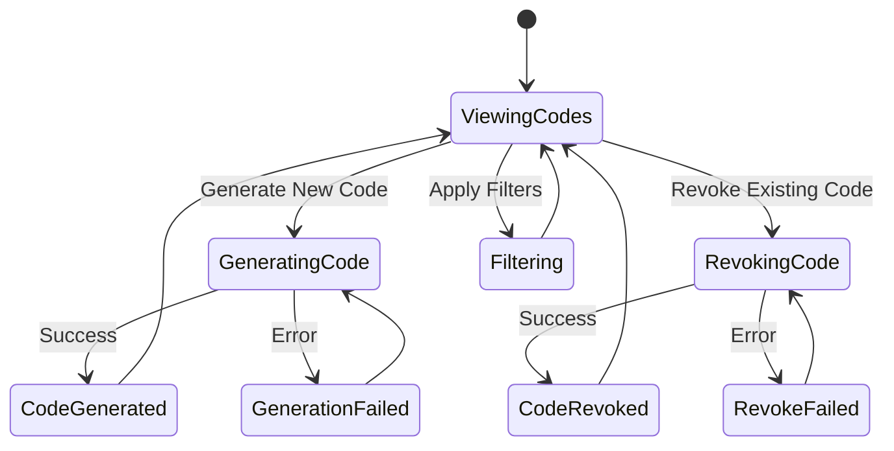

**Diagram sources**
- [PickupCodesPage.tsx:102-144](file://src/modules/administration/pages/pickup/PickupCodesPage.tsx#L102-L144)

Key features include:
- Real-time code filtering and search
- Bulk operations for code management
- Status-based color coding for quick visual identification
- Copy-to-clipboard functionality
- Confirmation dialogs for destructive operations

### Authorized Persons Management

The Authorized Persons Management Page handles the registration and management of individuals authorized to pick up students.

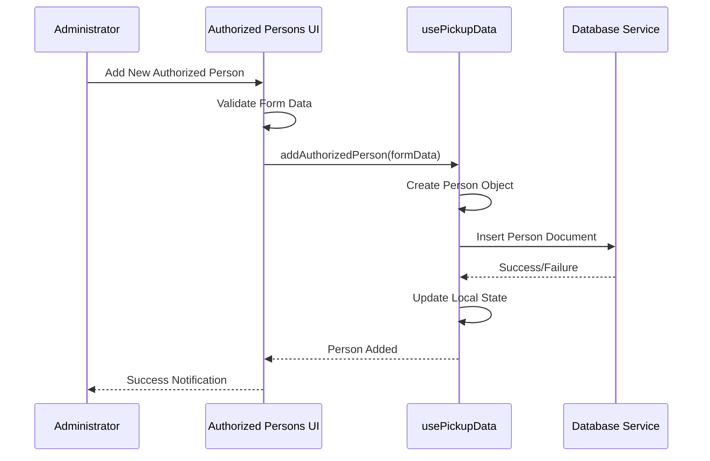

**Diagram sources**
- [PickupAuthorizedPersonsPage.tsx:124-150](file://src/modules/administration/pages/pickup/PickupAuthorizedPersonsPage.tsx#L124-L150)

The interface supports comprehensive person management including:
- Multi-field form validation
- Relationship type selection with predefined options
- Student assignment capabilities
- Identification document management
- Primary contact designation

### Logs Management Page

The Logs Management Page provides detailed oversight of all pickup activities through comprehensive logging and reporting capabilities.

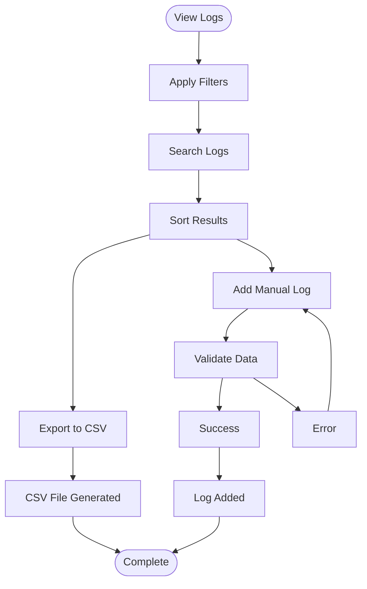

**Diagram sources**
- [PickupLogsPage.tsx:152-190](file://src/modules/administration/pages/pickup/PickupLogsPage.tsx#L152-L190)

Advanced features include:
- Multi-criteria filtering system
- Flag detection for security incidents
- CSV export functionality
- Manual log entry for edge cases
- Comprehensive search capabilities

### Reports Generation Page

The Reports Generation Page offers sophisticated analytical capabilities for pickup activity analysis and trend identification.

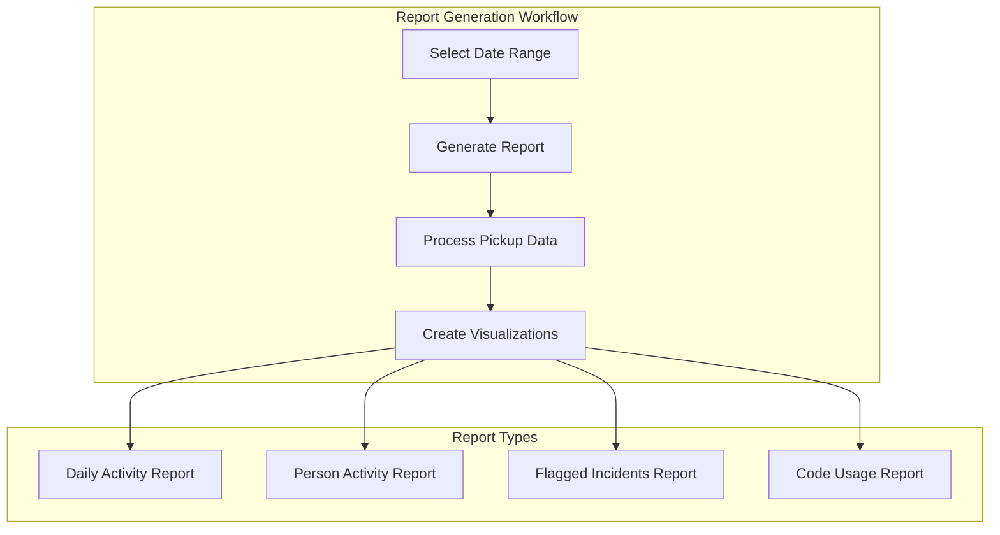

**Diagram sources**
- [PickupReportsPage.tsx:99-190](file://src/modules/administration/pages/pickup/PickupReportsPage.tsx#L99-L190)

The reporting system provides:
- Customizable date range selection
- Automated statistical calculations
- Interactive data visualizations
- Export capabilities for external analysis

**Section sources**
- [PickupDashboardPage.tsx:1-178](file://src/modules/administration/pages/pickup/PickupDashboardPage.tsx#L1-L178)
- [PickupCodesPage.tsx:1-428](file://src/modules/administration/pages/pickup/PickupCodesPage.tsx#L1-L428)
- [PickupAuthorizedPersonsPage.tsx:1-546](file://src/modules/administration/pages/pickup/PickupAuthorizedPersonsPage.tsx#L1-L546)
- [PickupLogsPage.tsx:1-495](file://src/modules/administration/pages/pickup/PickupLogsPage.tsx#L1-L495)
- [PickupReportsPage.tsx:1-442](file://src/modules/administration/pages/pickup/PickupReportsPage.tsx#L1-L442)

## Database Integration

The Pickup Module implements a robust database integration layer that supports multiple database backends while maintaining consistent data structures and operations.

### Collection Definitions

Each data entity is represented by a dedicated database collection with carefully designed schemas optimized for query performance and data integrity.

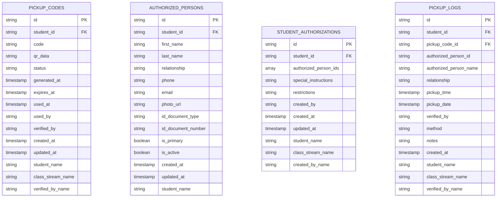

**Diagram sources**
- [schema.ts:10-100](file://src/modules/administration/data/pickup/schema.ts#L10-L100)

### Indexing Strategy

The database schemas implement strategic indexing to optimize common query patterns and improve performance for frequently accessed data.

| Collection | Indexed Fields | Purpose |
|------------|----------------|---------|
| pickup_codes | student_id, code, status, expires_at | Code lookup, status filtering, expiration checks |
| authorized_persons | student_id, phone, is_active | Person lookup, contact search, active filtering |
| student_authorizations | student_id, created_by | Authorization lookup, creator filtering |
| pickup_logs | student_id, pickup_date, authorized_person_id, verified_by | Activity reporting, temporal queries |

### Data Migration Support

The modular design supports seamless data migration and schema evolution through the database-agnostic schema system, allowing for future enhancements without disrupting existing functionality.

**Section sources**
- [collections.ts:1-22](file://src/modules/administration/data/pickup/collections.ts#L1-L22)
- [schema.ts:1-101](file://src/modules/administration/data/pickup/schema.ts#L1-L101)

## Security and Access Control

The Pickup Module implements comprehensive security measures through role-based access control (RBAC) and multiple verification layers to ensure student safety and data protection.

### Role-Based Access Control

The module defines granular permissions for different user roles, ensuring appropriate access levels for each function within the pickup system.

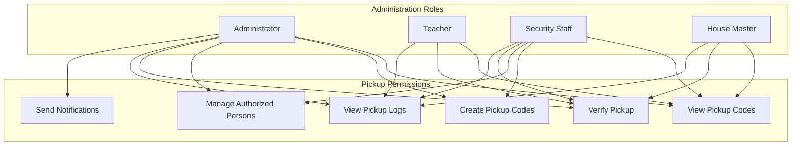

**Diagram sources**
- [rbac.ts:342-405](file://src/modules/administration/rbac.ts#L342-L405)

### Verification Methods

The system supports multiple verification methods to accommodate different security requirements and operational scenarios:

**QR Code Verification**: Primary method using scannable QR codes for fast, reliable verification
**Code Entry Verification**: Alternative method for devices without camera capability
**Manual Verification**: Backup method for exceptional circumstances requiring human judgment

### Audit Trail Security

Every pickup transaction generates a comprehensive audit trail with timestamped records, verification method tracking, and staff accountability measures.

**Section sources**
- [rbac.ts:342-405](file://src/modules/administration/rbac.ts#L342-L405)

## Report Generation

The Pickup Module provides sophisticated reporting capabilities that enable administrators to analyze pickup patterns, identify security concerns, and generate compliance documentation.

### Statistical Analysis

The reporting system performs automated calculations on pickup data to provide actionable insights:

**Daily Activity Analysis**: Tracks pickup volume, unique student counts, and authorized person utilization
**Person Activity Tracking**: Identifies most frequent pickup persons and their relationship patterns
**Security Incident Detection**: Automatically flags suspicious activities based on keyword analysis
**Code Lifecycle Monitoring**: Tracks code generation, usage, and expiration rates

### Report Customization

Administrators can customize reports through flexible date range selection and filtering criteria:

- **Temporal Filters**: Custom date ranges for historical analysis
- **Entity Filters**: Student, person, and location-based filtering
- **Status Filters**: Active, expired, or used code tracking
- **Method Filters**: Verification method analysis

### Export Capabilities

Generated reports can be exported in multiple formats for external analysis and compliance requirements:

- **CSV Export**: Structured data for spreadsheet analysis
- **PDF Reports**: Professional documentation for administrative review
- **Interactive Dashboards**: Real-time data visualization for monitoring

**Section sources**
- [PickupReportsPage.tsx:78-190](file://src/modules/administration/pages/pickup/PickupReportsPage.tsx#L78-L190)

## Development Roadmap

The Pickup Module represents a mature, production-ready system with comprehensive functionality, but ongoing development efforts continue to enhance capabilities and user experience.

### Current Implementation Status

The module currently includes:

**Core Functionality**: Complete pickup code management, authorized person tracking, and comprehensive logging
**User Interface**: Five fully functional pages covering all major use cases
**Data Persistence**: Robust database integration with fallback mechanisms
**Security Features**: Multi-layered verification and comprehensive audit trails
**Reporting**: Advanced analytics and customizable reporting capabilities

### Future Enhancements

Planned improvements include:

**QR Scanner Integration**: Dedicated QR scanner component for improved verification accuracy
**Mobile Optimization**: Enhanced mobile interface for field verification scenarios
**Notification System**: Automated SMS and email notifications for pickup events
**Integration APIs**: External system integration for enhanced workflow automation
**Advanced Analytics**: Predictive analytics for pickup pattern forecasting

### Module Structure Evolution

The module continues to evolve as part of the broader SchoolPilot3 ecosystem:

- **Microservice Architecture**: Potential decomposition into specialized services
- **Plugin System**: Extensible architecture supporting third-party integrations
- **Multi-Tenant Support**: Enhanced support for district-wide deployment scenarios
- **API Standardization**: Consistent RESTful APIs for external system integration

## Conclusion

The Pickup Module represents a comprehensive, secure, and scalable solution for student dismissal management within educational institutions. Its modular architecture, robust data model, and user-friendly interface design demonstrate careful consideration of both functional requirements and operational realities.

The system's emphasis on security through multiple verification methods, comprehensive audit trails, and role-based access control ensures student safety while maintaining operational efficiency. The integration of advanced reporting capabilities provides valuable insights for administrative decision-making and compliance documentation.

Built on modern React patterns and database-agnostic principles, the module offers excellent maintainability and extensibility for future enhancements. The comprehensive testing infrastructure and error handling mechanisms ensure reliable operation in diverse educational environments.

This module serves as an exemplary implementation of educational technology solutions, balancing security requirements with usability considerations to create a system that enhances both safety and operational efficiency.