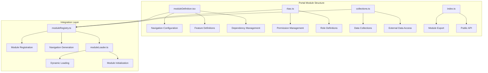
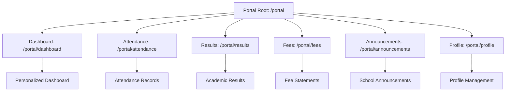
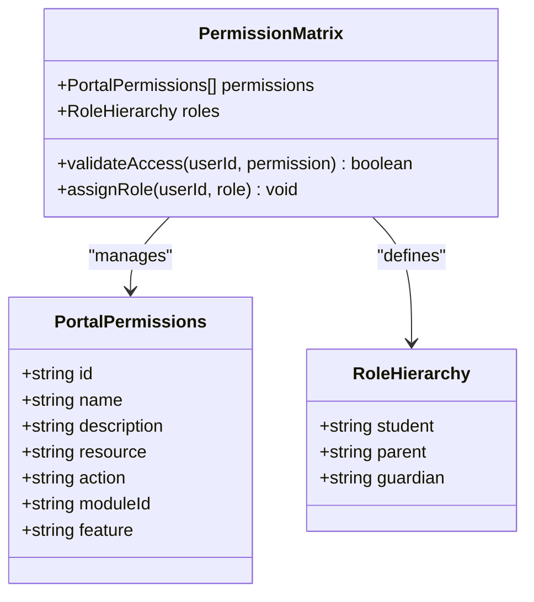
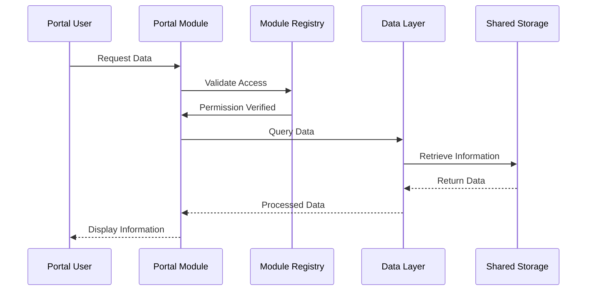
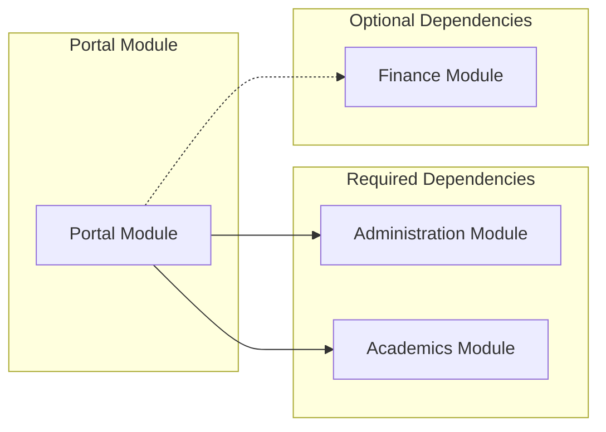
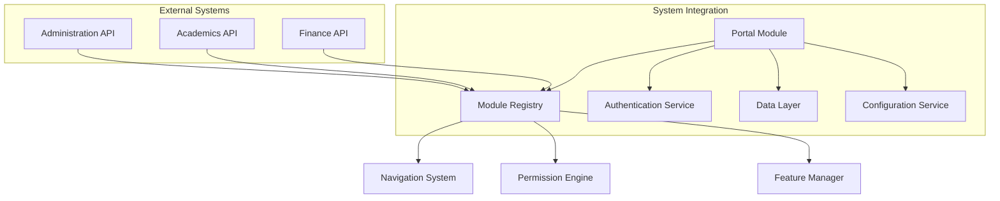

# Portal Module Overview

<cite>
**Referenced Files in This Document**
- [moduleDefinition.tsx](file://src/modules/portal/moduleDefinition.tsx)
- [rbac.ts](file://src/modules/portal/rbac.ts)
- [collections.ts](file://src/modules/portal/data/collections.ts)
- [index.ts](file://src/modules/portal/index.ts)
- [moduleRegistry.ts](file://src/core/moduleRegistry.ts)
- [moduleLoader.ts](file://src/core/moduleLoader.ts)
</cite>

## Table of Contents
1. [Introduction](#introduction)
2. [Module Architecture](#module-architecture)
3. [Core Components](#core-components)
4. [Navigation Structure](#navigation-structure)
5. [Role-Based Access Control](#role-based-access-control)
6. [Data Management](#data-management)
7. [Module Dependencies](#module-dependencies)
8. [Configuration System](#configuration-system)
9. [Integration Points](#integration-points)
10. [Conclusion](#conclusion)

## Introduction

The Portal Module represents a self-contained educational portal system designed for students and parents/guardians within the SchoolPilot3 ecosystem. This module provides a comprehensive interface for accessing academic information, attendance records, fee statements, announcements, and personal profiles. Built with a modern React architecture and integrated into the broader module system, the Portal Module serves as a centralized access point for stakeholder engagement and information retrieval.

The module operates as a micro-frontend within the larger SchoolPilot3 application, leveraging dynamic module loading capabilities and maintaining strict separation of concerns while integrating seamlessly with core system services.

## Module Architecture

The Portal Module follows a structured architecture pattern that emphasizes modularity, maintainability, and scalability. The module is designed as a cohesive unit that can be independently managed and configured while maintaining strong integration points with the broader system.

**Diagram sources**
- [moduleDefinition.tsx:16-120](file://src/modules/portal/moduleDefinition.tsx#L16-L120)
- [rbac.ts:1-79](file://src/modules/portal/rbac.ts#L1-L79)
- [moduleRegistry.ts:46-265](file://src/core/moduleRegistry.ts#L46-L265)
- [moduleLoader.ts:1-87](file://src/core/moduleLoader.ts#L1-L87)

**Section sources**
- [moduleDefinition.tsx:1-123](file://src/modules/portal/moduleDefinition.tsx#L1-L123)
- [moduleRegistry.ts:1-281](file://src/core/moduleRegistry.ts#L1-L281)
- [moduleLoader.ts:1-87](file://src/core/moduleLoader.ts#L1-L87)

## Core Components

### Module Definition System

The Portal Module's core identity is defined through its comprehensive module definition, which establishes the foundation for navigation, permissions, and operational characteristics.

The module definition encompasses several critical aspects:
- **Identity and Metadata**: Unique module identification, versioning, and descriptive information
- **Navigation Structure**: Hierarchical menu system with iconography and routing configuration
- **Feature Matrix**: Comprehensive list of capabilities and functional areas
- **Dependency Graph**: Strategic relationships with core modules and external systems

### Navigation Configuration

The navigation system provides intuitive access to all portal functionalities through a well-organized menu structure. Each navigation item includes metadata for proper rendering and user experience optimization.

**Diagram sources**
- [moduleDefinition.tsx:24-61](file://src/modules/portal/moduleDefinition.tsx#L24-L61)

**Section sources**
- [moduleDefinition.tsx:16-61](file://src/modules/portal/moduleDefinition.tsx#L16-L61)

## Navigation Structure

The Portal Module implements a comprehensive navigation system that provides structured access to all stakeholder-facing features. The navigation structure follows established UX patterns while accommodating the diverse needs of students, parents, and guardians.

### Navigation Hierarchy

The navigation system consists of six primary sections, each serving distinct informational and transactional purposes:

1. **Dashboard**: Personalized overview with key metrics and quick access
2. **Attendance**: Historical and current attendance tracking
3. **Results**: Academic performance and grade reporting
4. **Fees**: Financial obligations and payment history
5. **Announcements**: School-wide communications and updates
6. **Profile**: Personal information and account settings

Each navigation item includes associated metadata such as iconography, routing paths, and page identifiers that integrate with the broader routing system.

**Section sources**
- [moduleDefinition.tsx:24-61](file://src/modules/portal/moduleDefinition.tsx#L24-L61)

## Role-Based Access Control

The Portal Module implements a sophisticated RBAC system that manages access permissions across all functional areas. This system ensures appropriate information disclosure while maintaining security boundaries between different stakeholder types.

### Permission Architecture

The RBAC system defines granular permissions organized by functional domains:

| Permission Category | Description | Associated Features |
|-------------------|-------------|-------------------|
| Student Access | Basic student information viewing | student-dashboard, view-attendance, view-results, view-announcements |
| Parent/Guardian Access | Family member record viewing | parent-dashboard, view-children-records |
| Profile Management | Personal information updates | profile-management |
| Financial Access | Fee and payment information | view-fees |

### Role Definitions

The module supports three primary roles with distinct permission sets:

1. **Student**: Limited access to personal academic and attendance information
2. **Parent/Guardian**: Expanded access including family member records
3. **Guardian**: Full parental access rights with comprehensive monitoring capabilities

**Diagram sources**
- [rbac.ts:3-76](file://src/modules/portal/rbac.ts#L3-L76)

**Section sources**
- [rbac.ts:1-79](file://src/modules/portal/rbac.ts#L1-L79)

## Data Management

The Portal Module employs a data-first approach that emphasizes efficient data access and integration with existing system infrastructure. Rather than creating isolated data silos, the module leverages shared collections and established data access patterns.

### Collection Strategy

The module utilizes a pragmatic collection approach where data is accessed through established system interfaces rather than creating new storage mechanisms. This strategy ensures data consistency and reduces maintenance overhead.

**Diagram sources**
- [moduleRegistry.ts:148-202](file://src/core/moduleRegistry.ts#L148-L202)
- [collections.ts:1-7](file://src/modules/portal/data/collections.ts#L1-L7)

**Section sources**
- [collections.ts:1-7](file://src/modules/portal/data/collections.ts#L1-L7)

## Module Dependencies

The Portal Module maintains strategic dependencies on core educational modules while providing flexibility for optional integrations. These dependencies ensure comprehensive functionality while allowing for modular deployment configurations.

### Required Dependencies

The module requires two core dependencies for full functionality:

1. **Administration Module**: Provides essential administrative framework and user management capabilities
2. **Academics Module**: Supplies academic data structures, grading systems, and student information management

### Optional Dependencies

The module includes an optional financial integration that enhances functionality when available:

1. **Finance Module**: Extends capabilities with detailed fee tracking and payment processing

**Diagram sources**
- [moduleDefinition.tsx:70-86](file://src/modules/portal/moduleDefinition.tsx#L70-L86)

**Section sources**
- [moduleDefinition.tsx:70-86](file://src/modules/portal/moduleDefinition.tsx#L70-L86)

## Configuration System

The Portal Module incorporates a flexible configuration system that enables administrators to customize functionality based on organizational needs and stakeholder requirements.

### Configuration Categories

The module supports five primary configuration categories:

| Configuration Key | Type | Default Value | Purpose |
|------------------|------|---------------|---------|
| enableStudentDashboard | boolean | true | Controls student dashboard availability |
| enableParentDashboard | boolean | true | Enables parent/guardian dashboard features |
| showAttendanceWidget | boolean | true | Displays attendance summary widgets |
| showResultsWidget | boolean | true | Shows academic performance indicators |
| showFeesWidget | boolean | true | Presents financial information summaries |

### Feature Flag Implementation

The configuration system integrates with the module's feature flag architecture, allowing for granular control over individual functional areas. This approach enables progressive rollout and customization based on institutional requirements.

**Section sources**
- [moduleDefinition.tsx:87-116](file://src/modules/portal/moduleDefinition.tsx#L87-L116)

## Integration Points

The Portal Module participates in multiple integration layers that ensure seamless operation within the broader SchoolPilot3 ecosystem. These integration points facilitate data sharing, authentication, and cross-module functionality.

### Module Registry Integration

Through the central module registry, the Portal Module gains access to:
- Dynamic module loading capabilities
- Navigation item generation
- Feature discovery and management
- Configuration service integration

### Authentication Integration

The module requires authentication for all user interactions, ensuring secure access to sensitive educational information. This integration aligns with the system's broader security architecture.

### Data Layer Integration

The module leverages the shared data layer infrastructure, enabling efficient data access patterns and maintaining consistency with other system components.

**Diagram sources**
- [moduleRegistry.ts:148-202](file://src/core/moduleRegistry.ts#L148-L202)
- [moduleLoader.ts:30-35](file://src/core/moduleLoader.ts#L30-L35)

**Section sources**
- [moduleRegistry.ts:148-202](file://src/core/moduleRegistry.ts#L148-L202)
- [moduleLoader.ts:30-35](file://src/core/moduleLoader.ts#L30-L35)

## Conclusion

The Portal Module represents a well-architected solution for stakeholder engagement within the SchoolPilot3 educational ecosystem. Through its comprehensive RBAC system, flexible configuration options, and strategic integration patterns, the module provides a robust foundation for student and parent/guardian access to educational information.

The module's design emphasizes maintainability, scalability, and security while providing the flexibility needed for diverse institutional requirements. Its integration with the broader module system ensures consistent user experiences and streamlined development processes.

Future enhancements could focus on expanding widget functionality, implementing advanced analytics dashboards, and strengthening mobile responsiveness to support increasingly diverse access patterns.