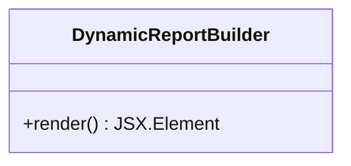
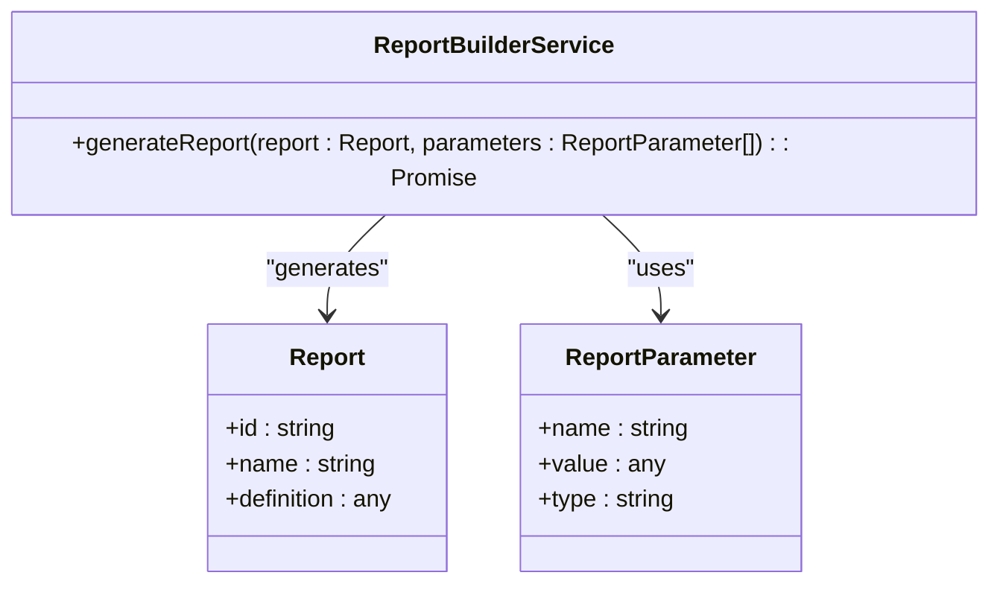
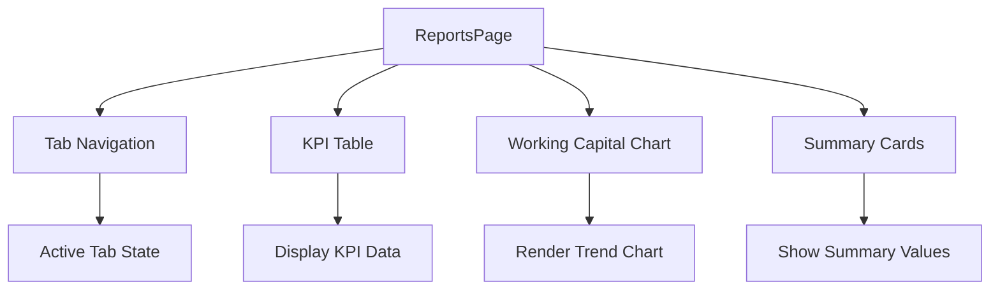
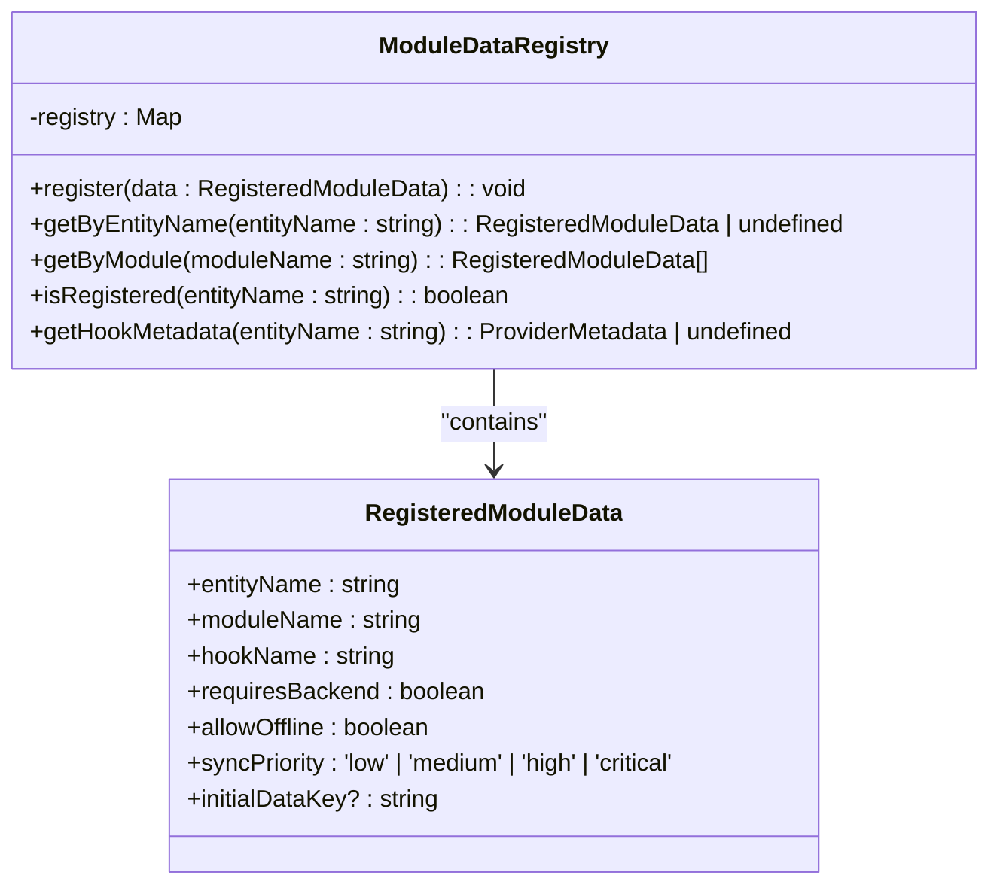
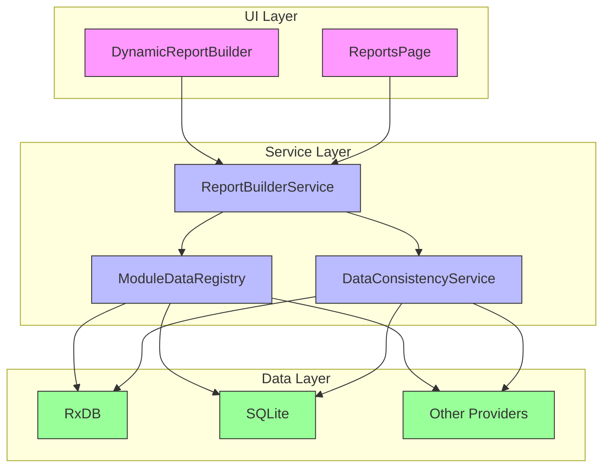

# Dynamic Reporting System

<cite>
**Referenced Files in This Document**   
- [DynamicReportBuilder.tsx](file://src/modules/reports/components/DynamicReportBuilder.tsx)
- [ReportBuilderService.ts](file://src/modules/reports/services/ReportBuilderService.ts)
- [ReportsPage.tsx](file://src/modules/reports/pages/ReportsPage.tsx)
- [ModuleDataRegistry.ts](file://src/services/ModuleDataRegistry.ts)
- [DataConsistencyService.ts](file://src/services/DataConsistencyService.ts)
</cite>

## Table of Contents
1. [Introduction](#introduction)
2. [Core Components Overview](#core-components-overview)
3. [Dynamic Report Builder UI](#dynamic-report-builder-ui)
4. [Report Builder Service](#report-builder-service)
5. [Reports Page Integration](#reports-page-integration)
6. [Module Data Registry](#module-data-registry)
7. [Data Consistency Service](#data-consistency-service)
8. [Architecture and Data Flow](#architecture-and-data-flow)
9. [Performance and Error Handling](#performance-and-error-handling)
10. [Troubleshooting Guide](#troubleshooting-guide)

## Introduction
The Dynamic Reporting System in schoolpilot3 provides a flexible framework for creating custom reports across various educational modules. This system enables users to construct reports through a drag-and-drop interface, apply filters, group data, and sort results. The architecture integrates multiple database providers and ensures data consistency across different modules. This document details the implementation of key components including the UI builder, query service, module integration, and performance optimization strategies.

## Core Components Overview
The Dynamic Reporting System consists of several interconnected components that work together to provide a comprehensive reporting solution. These components include the user interface for report creation, the backend service for query execution, the module registry for cross-module data access, and the consistency service for data validation.

**Section sources**
- [DynamicReportBuilder.tsx](file://src/modules/reports/components/DynamicReportBuilder.tsx#L1-L10)
- [ReportBuilderService.ts](file://src/modules/reports/services/ReportBuilderService.ts#L1-L9)
- [ReportsPage.tsx](file://src/modules/reports/pages/ReportsPage.tsx#L1-L115)
- [ModuleDataRegistry.ts](file://src/services/ModuleDataRegistry.ts#L1-L123)
- [DataConsistencyService.ts](file://src/services/DataConsistencyService.ts#L1-L468)

## Dynamic Report Builder UI
The DynamicReportBuilder component provides a user interface for constructing custom reports through a drag-and-drop interface. This component allows users to select fields, apply filters, group data, and define sorting criteria for their reports.



**Diagram sources**
- [DynamicReportBuilder.tsx](file://src/modules/reports/components/DynamicReportBuilder.tsx#L4-L10)

**Section sources**
- [DynamicReportBuilder.tsx](file://src/modules/reports/components/DynamicReportBuilder.tsx#L1-L10)

## Report Builder Service
The ReportBuilderService class handles the construction and execution of report queries. It processes report definitions and parameters to generate data from multiple database sources. The service is designed to work with various database providers and can aggregate data from different modules.



**Diagram sources**
- [ReportBuilderService.ts](file://src/modules/reports/services/ReportBuilderService.ts#L4-L9)

**Section sources**
- [ReportBuilderService.ts](file://src/modules/reports/services/ReportBuilderService.ts#L1-L11)

## Reports Page Integration
The ReportsPage component serves as the main interface for accessing and managing reports within the system. It provides a dashboard-style overview with KPIs, charts, and tabbed navigation for different report categories. The page displays financial metrics and working capital trends through visual components.



**Diagram sources**
- [ReportsPage.tsx](file://src/modules/reports/pages/ReportsPage.tsx#L40-L113)

**Section sources**
- [ReportsPage.tsx](file://src/modules/reports/pages/ReportsPage.tsx#L1-L115)

## Module Data Registry
The ModuleDataRegistry provides a centralized system for managing module data entities and their relationships. It enables cross-module data access by maintaining a registry of data hooks and their metadata. This service is crucial for resolving relationships between entities across different modules in the application.



**Diagram sources**
- [ModuleDataRegistry.ts](file://src/services/ModuleDataRegistry.ts#L19-L108)

**Section sources**
- [ModuleDataRegistry.ts](file://src/services/ModuleDataRegistry.ts#L1-L123)

## Data Consistency Service
The DataConsistencyService ensures data integrity across different modes of operation (demo and production). It provides validation, referential integrity checks, and consistency verification for data operations. This service plays a critical role in maintaining data quality and preventing corruption during CRUD operations.

```mermaid
classDiagram
class DataConsistencyService {
-validator : DataValidator
-config : DataConsistencyConfig
-lastReport : ConsistencyReport | null
+validateEntity(entityName : string, data : EntityData, operation : 'create' | 'update' | 'delete', context? : any) : Promise<ValidationResult>
+runConsistencyCheck(dataContext : Record<string, any[]>, mode : 'demo' | 'production') : Promise<ConsistencyReport>
+validateDataMigration(fromData : Record<string, any[]>, toData : Record<string, any[]>, fromVersion : string, toVersion : string) : Promise<DataMigrationResult>
+getLastReport() : ConsistencyReport | null
}
class DataConsistencyConfig {
+enableValidation : boolean
+enableReferentialIntegrity : boolean
+enableConsistencyChecks : boolean
+validationMode : 'strict' | 'lenient' | 'disabled'
+autoFix : boolean
+logErrors : boolean
}
class ConsistencyReport {
+timestamp : Date
+mode : 'demo' | 'production'
+totalEntities : number
+totalRecords : number
+validationErrors : ValidationError[]
+consistencyErrors : ValidationError[]
+warnings : number
+criticalErrors : number
+summary : {
isConsistent : boolean
entitiesWithErrors : string[]
errorsByType : Record<string, number>
}
}
class DataMigrationResult {
+success : boolean
+fromVersion : string
+toVersion : string
+migratedEntities : string[]
+errors : ValidationError[]
+warnings : string[]
+backupCreated : boolean
+backupPath? : string
}
DataConsistencyService --> DataConsistencyConfig : "uses"
DataConsistencyService --> ConsistencyReport : "produces"
DataConsistencyService --> DataMigrationResult : "produces"
```

**Diagram sources**
- [DataConsistencyService.ts](file://src/services/DataConsistencyService.ts#L48-L465)

**Section sources**
- [DataConsistencyService.ts](file://src/services/DataConsistencyService.ts#L1-L468)

## Architecture and Data Flow
The Dynamic Reporting System follows a modular architecture with clear separation of concerns between UI components, service layers, and data management. The system integrates various modules through the ModuleDataRegistry, which enables cross-module queries and relationships.



**Diagram sources**
- [DynamicReportBuilder.tsx](file://src/modules/reports/components/DynamicReportBuilder.tsx#L4-L10)
- [ReportBuilderService.ts](file://src/modules/reports/services/ReportBuilderService.ts#L4-L9)
- [ReportsPage.tsx](file://src/modules/reports/pages/ReportsPage.tsx#L40-L113)
- [ModuleDataRegistry.ts](file://src/services/ModuleDataRegistry.ts#L19-L108)
- [DataConsistencyService.ts](file://src/services/DataConsistencyService.ts#L48-L465)

## Performance and Error Handling
The system incorporates several performance optimization and error handling mechanisms to ensure efficient operation and data integrity. The DataConsistencyService provides comprehensive validation and error reporting, while the modular architecture allows for targeted performance improvements.

Key performance considerations include:
- **Caching mechanisms**: The DataConsistencyService maintains a last report cache to avoid redundant consistency checks
- **Validation optimization**: The service uses configurable validation modes (strict, lenient, disabled) to balance thoroughness and performance
- **Error categorization**: Errors are classified by severity (critical, error, warning) to prioritize handling
- **Batch processing**: The consistency check processes all entities in a single pass to minimize overhead

The system also implements referential integrity checks and cascade delete constraints to prevent data corruption. These checks are configurable through the DataConsistencyConfig interface, allowing administrators to adjust validation strictness based on operational requirements.

**Section sources**
- [DataConsistencyService.ts](file://src/services/DataConsistencyService.ts#L48-L465)

## Troubleshooting Guide
This section provides guidance for common issues encountered when working with the Dynamic Reporting System.

### Common Issues and Solutions

**Data Type Mismatches**
- **Symptom**: Report generation fails with type conversion errors
- **Solution**: Verify that field types in the report definition match the actual data types in the database. Use the DataConsistencyService to validate data before report generation.

**Slow Query Execution**
- **Symptom**: Reports take excessive time to generate, especially with large datasets
- **Solutions**:
  1. Implement pagination in the ReportBuilderService to limit result sets
  2. Ensure proper indexing on frequently queried fields
  3. Use the ModuleDataRegistry to optimize cross-module queries
  4. Consider caching frequently accessed reports

**Missing Cross-Module Data**
- **Symptom**: Related data from other modules is not available in reports
- **Solution**: Verify that the required modules are properly registered in the ModuleDataRegistry. Check that the entity relationships are correctly defined in the registry.

**Data Consistency Errors**
- **Symptom**: Data validation fails during CRUD operations
- **Solution**: Review the DataConsistencyService configuration. Check for referential integrity violations and cascade delete constraints. Use the runConsistencyCheck method to identify specific issues.

**Report Template Issues**
- **Symptom**: Saved report templates do not load or display incorrectly
- **Solution**: Verify that the template format is compatible with the current version of the ReportBuilderService. Check for deprecated fields or parameters.

**Section sources**
- [DataConsistencyService.ts](file://src/services/DataConsistencyService.ts#L48-L465)
- [ReportBuilderService.ts](file://src/modules/reports/services/ReportBuilderService.ts#L4-L9)
- [ModuleDataRegistry.ts](file://src/services/ModuleDataRegistry.ts#L19-L108)