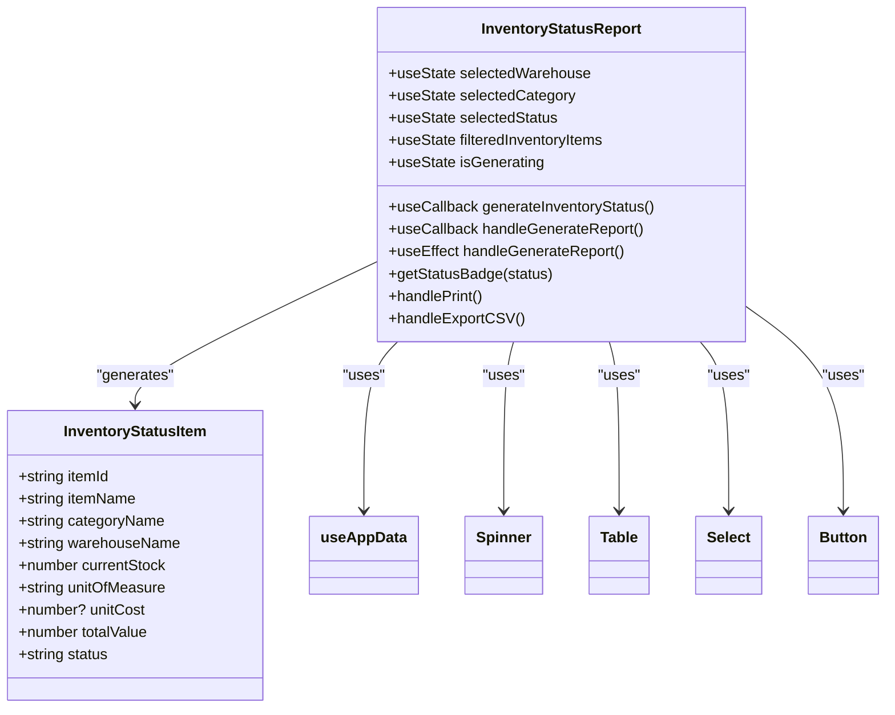
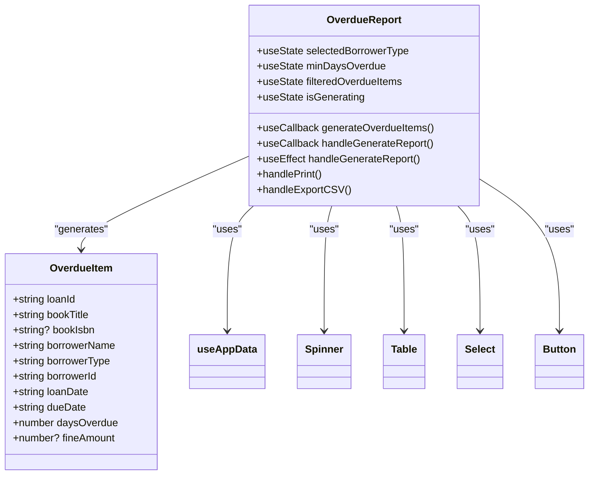
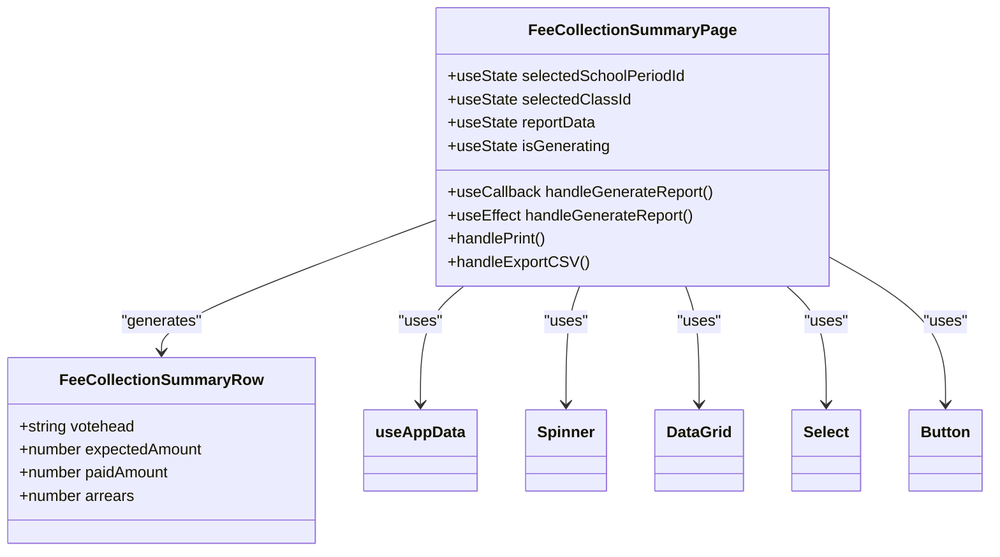
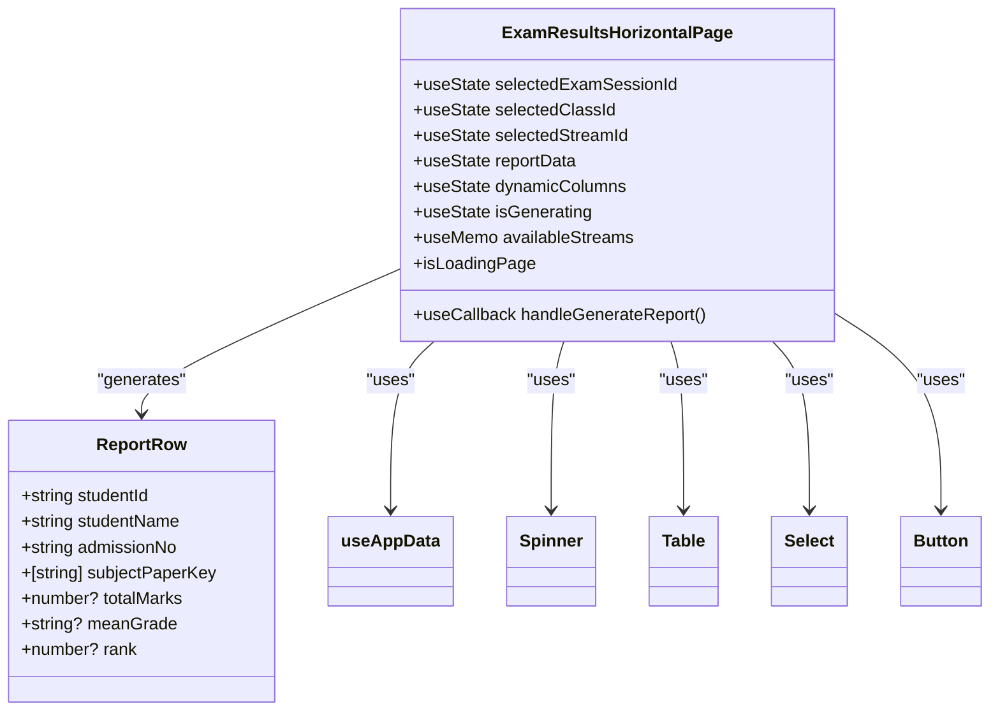
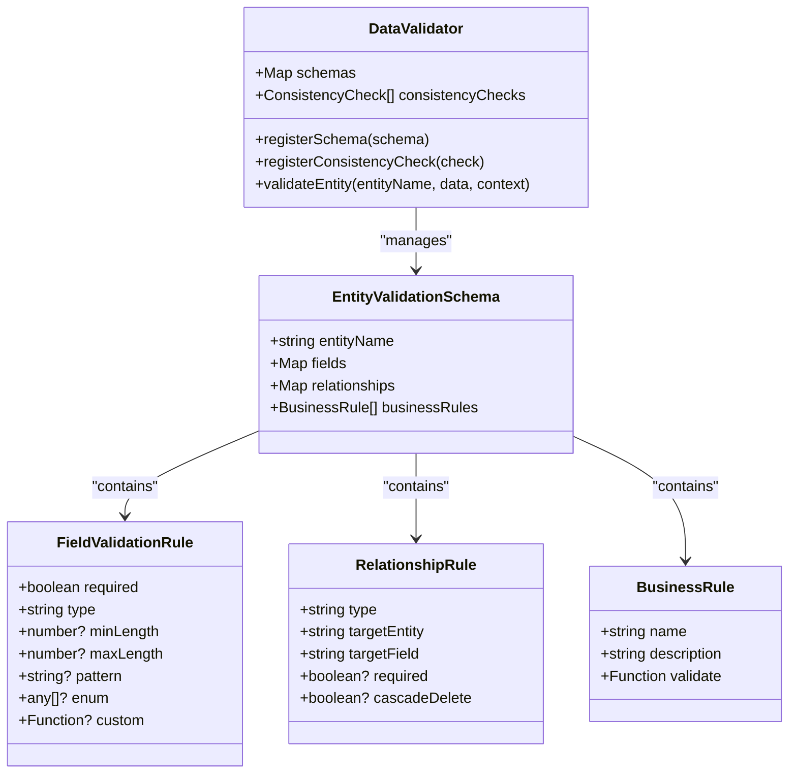

# Report Data Models

<cite>
**Referenced Files in This Document**   
- [types.ts](file://src/modules/reports/data/types.ts)
- [InventoryStatusReport.tsx](file://src/modules/reports/library/InventoryStatusReport.tsx)
- [OverdueReport.tsx](file://src/modules/reports/library/OverdueReport.tsx)
- [FeeCollectionSummaryPage.tsx](file://src/modules/finance/pages/FeeCollectionSummaryPage.tsx)
- [ExamResultsHorizontalPage.tsx](file://src/modules/reports/pages/ExamResultsHorizontalPage.tsx)
- [validationSchemas.ts](file://src/utils/validationSchemas.ts)
</cite>

## Table of Contents
1. [Introduction](#introduction)
2. [Core Data Models](#core-data-models)
3. [Pre-built Report Templates](#pre-built-report-templates)
4. [Cross-module Report Extensions](#cross-module-report-extensions)
5. [Schema Validation Process](#schema-validation-process)
6. [Data Consistency and Conflict Resolution](#data-consistency-and-conflict-resolution)

## Introduction
This document provides comprehensive documentation for the Report Data Models in the schoolpilot3 system. It details the entity relationships, type definitions, pre-built report templates, and cross-module report extensions that define the reporting capabilities of the system. The documentation covers the core data structures, validation processes, and strategies for handling data consistency challenges when combining real-time and historical data.

## Core Data Models

The core data model for reports is defined in the `types.ts` file within the reports module. The primary interface is `ReportsEntity`, which serves as the base structure for all report entities in the system.

```typescript
// reports module types
export interface ReportsEntity {
  id: string;
  name: string;
  created_at: string;
  updated_at: string;
}
```

This interface provides the fundamental properties for report entities, including a unique identifier, name, and timestamps for creation and update. These properties enable tracking and management of reports throughout their lifecycle.

**Section sources**
- [types.ts](file://src/modules/reports/data/types.ts#L1-L8)

## Pre-built Report Templates

### Inventory Status Report

The Inventory Status Report is a pre-built template designed for inventory management, providing a comprehensive view of inventory status including stock levels and basic tracking.



**Diagram sources**
- [InventoryStatusReport.tsx](file://src/modules/reports/library/InventoryStatusReport.tsx#L1-L289)

**Section sources**
- [InventoryStatusReport.tsx](file://src/modules/reports/library/InventoryStatusReport.tsx#L1-L289)

The report uses data from multiple sources including items, warehouses, item categories, and stock levels. The business logic involves generating inventory status by combining these data sources, calculating total value, and determining status based on current stock levels. The report provides filtering capabilities by warehouse, category, and status, with summary statistics for total items, out-of-stock items, and total value.

### Overdue Report

The Overdue Report is a pre-built template for the library module, showing all books that are currently overdue with borrower details.



**Diagram sources**
- [OverdueReport.tsx](file://src/modules/reports/library/OverdueReport.tsx#L1-L257)

**Section sources**
- [OverdueReport.tsx](file://src/modules/reports/library/OverdueReport.tsx#L1-L257)

The report uses data from loans, books, students, and staff to identify overdue books. The business logic calculates days overdue by comparing the current date with the due date, and calculates potential fines based on a fixed rate per day. The report provides filtering by borrower type and minimum days overdue, with summary statistics for total overdue books, books overdue by more than two weeks, and total potential fines.

## Cross-module Report Extensions

### Fee Collection Summary Report

The Fee Collection Summary Report extends the base report models with finance-specific fields and calculations, demonstrating how cross-module reports integrate with the finance module.



**Diagram sources**
- [FeeCollectionSummaryPage.tsx](file://src/modules/finance/pages/FeeCollectionSummaryPage.tsx#L1-L226)

**Section sources**
- [FeeCollectionSummaryPage.tsx](file://src/modules/finance/pages/FeeCollectionSummaryPage.tsx#L1-L226)

This report extends the base report model by incorporating finance-specific data such as voteheads, expected amounts, paid amounts, and arrears. The business logic involves aggregating student invoices and payment applications to calculate financial summaries by votehead. The report allows filtering by school period and class, and calculates arrears as the difference between expected and paid amounts.

### Exam Results Horizontal Report

The Exam Results Horizontal Report extends the base report models with academic-specific fields and calculations, demonstrating how cross-module reports integrate with the academics module.



**Diagram sources**
- [ExamResultsHorizontalPage.tsx](file://src/modules/reports/pages/ExamResultsHorizontalPage.tsx#L1-L182)

**Section sources**
- [ExamResultsHorizontalPage.tsx](file://src/modules/reports/pages/ExamResultsHorizontalPage.tsx#L1-L182)

This report extends the base report model by incorporating academic-specific data such as exam results, subject papers, total marks, mean grades, and ranks. The business logic involves dynamically generating columns based on exam paper settings, aggregating student exam results, and calculating rankings based on total marks. The report allows filtering by exam session and class stream, with dynamic column generation for each subject paper.

## Schema Validation Process

The schema validation process for report definitions is implemented in the `validationSchemas.ts` file, which defines validation rules for core entities in the system. The validation system uses a combination of field validation rules, relationship rules, and business rules to ensure data integrity.



**Diagram sources**
- [validationSchemas.ts](file://src/utils/validationSchemas.ts#L1-L520)

**Section sources**
- [validationSchemas.ts](file://src/utils/validationSchemas.ts#L1-L520)

The validation process involves several key components:
- **Field validation**: Validates individual fields against type, required status, length constraints, patterns, and custom validation functions
- **Relationship validation**: Ensures referential integrity by validating foreign key relationships between entities
- **Business rule validation**: Applies domain-specific rules such as unique admission numbers, age validation for students, and date range validation for financial years
- **Consistency checks**: Validates data integrity across multiple entities, such as ensuring student financial records are consistent and academic enrollment records are valid

The system handles malformed report definitions by returning detailed error information including field, message, error code, and severity level. This allows for targeted error handling and user feedback.

## Data Consistency and Conflict Resolution

The system addresses data consistency challenges when combining real-time and historical data through a comprehensive validation and consistency checking framework. The conflict resolution strategy used during data aggregation involves several key approaches:

1. **Duplicate detection**: The system checks for duplicate IDs within each entity type to prevent data integrity issues during aggregation.

2. **Referential integrity**: The system validates that all foreign key references point to existing entities, preventing orphaned records.

3. **Temporal consistency**: Business rules ensure that dates are logically consistent (e.g., end dates after start dates, due dates after issue dates).

4. **Numerical consistency**: Business rules prevent invalid financial states such as overpayments (amount paid exceeding amount billed).

5. **Contextual validation**: The system uses context information to validate data against related entities, such as ensuring admission numbers are unique across all students.

The conflict resolution strategy prioritizes data integrity by rejecting invalid data rather than attempting to automatically resolve conflicts. When conflicts are detected, the system provides detailed error messages that identify the specific issue, allowing users or administrators to correct the data before proceeding.

**Section sources**
- [validationSchemas.ts](file://src/utils/validationSchemas.ts#L1-L520)