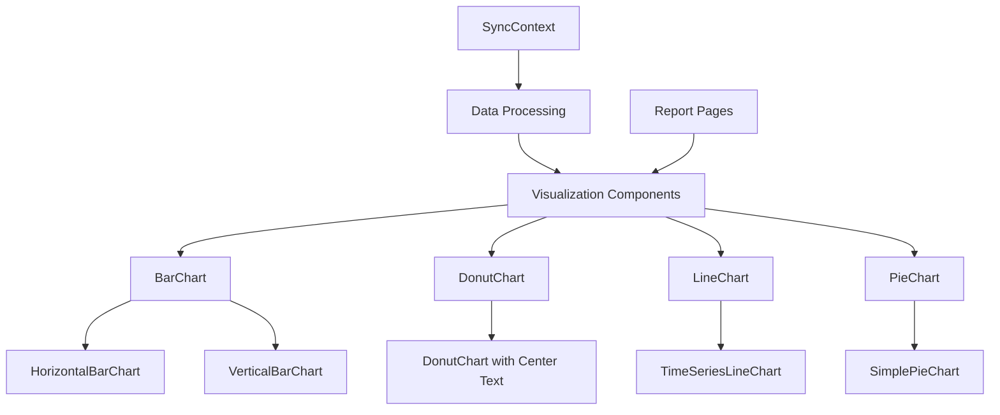
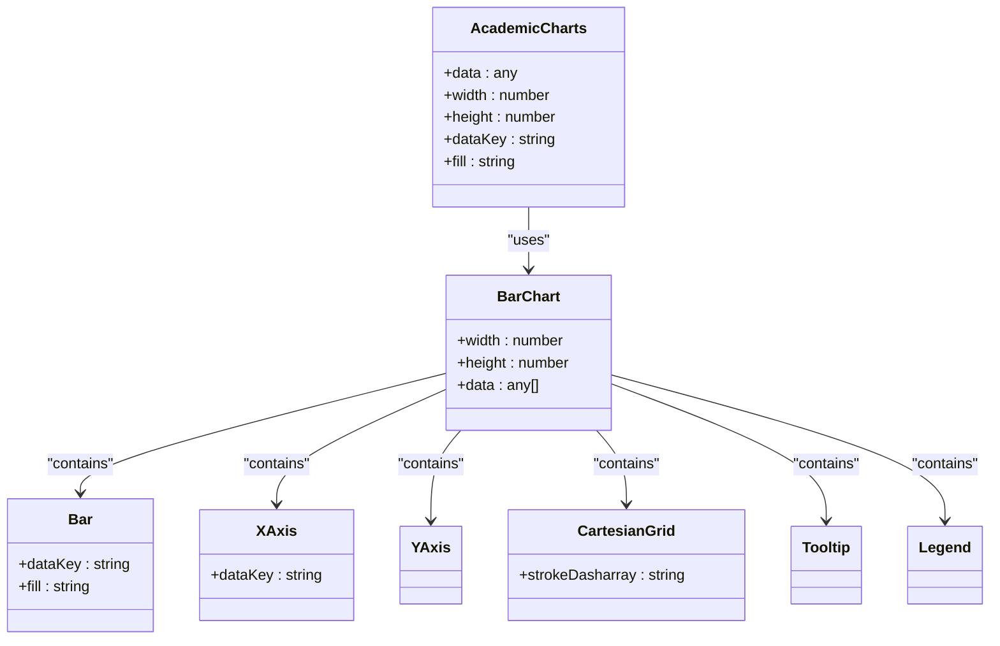
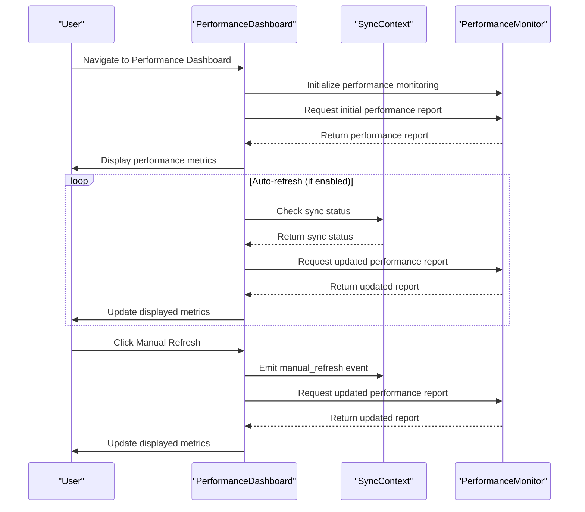
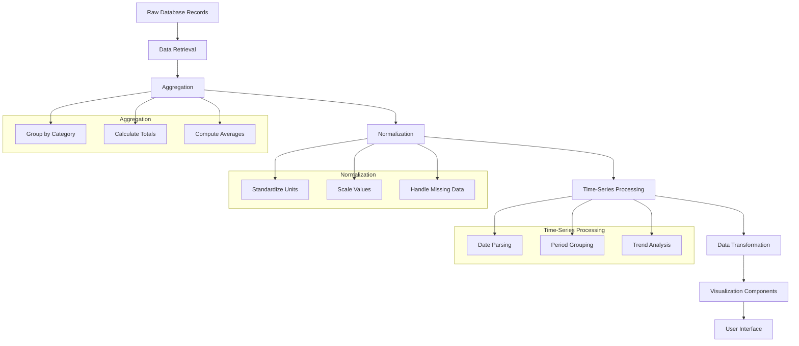
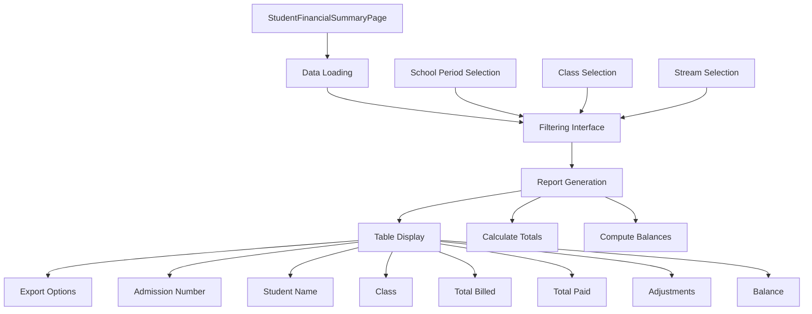
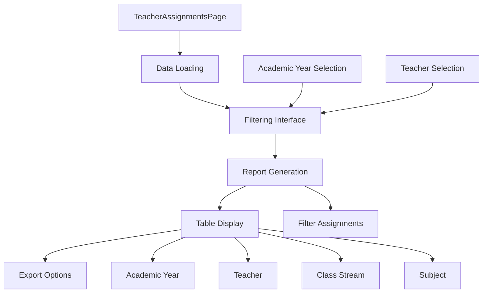
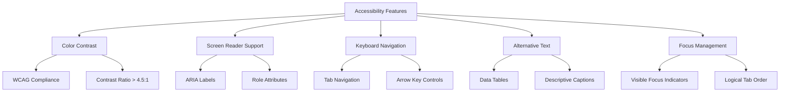

# Report Visualizations

<cite>
**Referenced Files in This Document**   
- [AcademicCharts.tsx](file://src/modules/reports/components/AcademicCharts.tsx)
- [PerformanceDashboard.tsx](file://src/components/PerformanceDashboard.tsx)
- [StudentFinancialSummaryPage.tsx](file://src/modules/reports/pages/StudentFinancialSummaryPage.tsx)
- [TeacherAssignmentsPage.tsx](file://src/modules/reports/pages/TeacherAssignmentsPage.tsx)
- [SyncContext.tsx](file://src/contexts/SyncContext.tsx)
- [BarChart.tsx](file://src/components/ui/BarChart.tsx)
- [DonutChart.tsx](file://src/components/ui/DonutChart.tsx)
</cite>

## Table of Contents
1. [Introduction](#introduction)
2. [Core Visualization Components](#core-visualization-components)
3. [AcademicCharts Implementation](#academiccharts-implementation)
4. [Performance Dashboard Architecture](#performance-dashboard-architecture)
5. [Data Transformation Pipeline](#data-transformation-pipeline)
6. [Report Page Implementations](#report-page-implementations)
7. [Customization and Accessibility](#customization-and-accessibility)
8. [Performance Optimization](#performance-optimization)
9. [Conclusion](#conclusion)

## Introduction
The Report Visualizations subsystem in schoolpilot3 provides a comprehensive framework for presenting academic, financial, and operational data through interactive charts and dashboards. Built on Recharts, this system enables the creation of reusable visualization components that transform raw database records into meaningful insights. The architecture integrates real-time data updates through SyncContext, ensuring that performance metrics and reports reflect the most current information. This document details the implementation of key visualization components, their integration across various modules, and the data processing pipeline that supports complex reporting requirements.

## Core Visualization Components

The visualization system in schoolpilot3 is built around reusable chart components that provide consistent styling and functionality across the application. These components are designed to be flexible, accessible, and performant, supporting various chart types including bar, line, pie, and donut charts. The core components are implemented using Recharts, a React-based charting library that provides a declarative API for creating responsive visualizations.

**Diagram sources**
- [BarChart.tsx](file://src/components/ui/BarChart.tsx)
- [DonutChart.tsx](file://src/components/ui/DonutChart.tsx)
- [AcademicCharts.tsx](file://src/modules/reports/components/AcademicCharts.tsx)

**Section sources**
- [BarChart.tsx](file://src/components/ui/BarChart.tsx#L0-L58)
- [DonutChart.tsx](file://src/components/ui/DonutChart.tsx#L0-L15)

## AcademicCharts Implementation

The AcademicCharts component serves as a foundational visualization module for academic performance metrics. Implemented in `AcademicCharts.tsx`, this component provides a reusable bar chart that can be easily integrated into various academic reporting interfaces. The implementation leverages Recharts to create responsive and interactive visualizations that support tooltips, legends, and customizable data series.

**Diagram sources**
- [AcademicCharts.tsx](file://src/modules/reports/components/AcademicCharts.tsx#L0-L22)

**Section sources**
- [AcademicCharts.tsx](file://src/modules/reports/components/AcademicCharts.tsx#L0-L22)

The AcademicCharts component accepts data as a prop and renders a bar chart with two data series (pv and uv) by default. The chart includes essential visualization features such as a Cartesian grid for better readability, X and Y axes with appropriate labeling, interactive tooltips that display data values on hover, and a legend that identifies each data series. The component is designed to be flexible, allowing for customization of colors, dimensions, and data keys through props.

## Performance Dashboard Architecture

The PerformanceDashboard component aggregates key performance indicators across various modules and provides real-time updates through the SyncContext. This dashboard serves as a central monitoring interface for application performance, displaying metrics related to startup time, memory usage, module loading, and user interactions. The implementation uses an event-driven architecture to ensure efficient updates without unnecessary re-renders.

**Diagram sources**
- [PerformanceDashboard.tsx](file://src/components/PerformanceDashboard.tsx#L0-L383)
- [SyncContext.tsx](file://src/contexts/SyncContext.tsx#L0-L198)

**Section sources**
- [PerformanceDashboard.tsx](file://src/components/PerformanceDashboard.tsx#L0-L383)

The PerformanceDashboard implements several key features to enhance user experience and performance monitoring. It supports multiple views including Overview, Modules, Data Operations, User Interactions, Charts, and Benchmarks, allowing users to drill down into specific performance aspects. The dashboard includes auto-refresh functionality (disabled by default to prevent flickering) and manual refresh controls. Performance metrics are color-coded with grades (A, B, C) based on predefined thresholds, making it easy to identify areas that require attention.

## Data Transformation Pipeline

The data transformation pipeline in schoolpilot3 converts raw database records into visual representations through a series of aggregation, normalization, and processing steps. This pipeline ensures that data from various sources is consistently formatted and optimized for visualization. The process begins with data retrieval from the database, followed by aggregation based on relevant dimensions, normalization to ensure consistent units and scales, and finally transformation into the format required by the visualization components.

**Diagram sources**
- [StudentFinancialSummaryPage.tsx](file://src/modules/reports/pages/StudentFinancialSummaryPage.tsx#L0-L163)
- [TeacherAssignmentsPage.tsx](file://src/modules/reports/pages/TeacherAssignmentsPage.tsx#L0-L97)

**Section sources**
- [StudentFinancialSummaryPage.tsx](file://src/modules/reports/pages/StudentFinancialSummaryPage.tsx#L0-L163)
- [TeacherAssignmentsPage.tsx](file://src/modules/reports/pages/TeacherAssignmentsPage.tsx#L0-L97)

For financial data in the StudentFinancialSummaryPage, the pipeline aggregates student invoices, payments, and fee adjustments by student and school period. It calculates total billed amounts, total payments, adjustments, and final balances. The data is then transformed into a summary format with calculated fields for display in the report table. Similarly, for teacher assignments, the pipeline filters and transforms teacher-subject allocation data based on academic year and teacher selection, presenting it in a structured format for the report.

## Report Page Implementations

The report pages in schoolpilot3 demonstrate how visualization components are utilized to present complex data in an accessible format. Two key examples are the StudentFinancialSummaryPage and TeacherAssignmentsPage, which leverage the underlying visualization framework to provide meaningful insights into financial and academic operations.

### Student Financial Summary Page

The StudentFinancialSummaryPage provides a comprehensive overview of student fee balances, allowing administrators to monitor financial status across different classes and periods. The page implements a filtering interface with dropdowns for school period, class, and stream selection, enabling users to generate targeted reports.

**Diagram sources**
- [StudentFinancialSummaryPage.tsx](file://src/modules/reports/pages/StudentFinancialSummaryPage.tsx#L0-L163)

**Section sources**
- [StudentFinancialSummaryPage.tsx](file://src/modules/reports/pages/StudentFinancialSummaryPage.tsx#L0-L163)

The page uses the useAppData hook to retrieve student, class, and financial data, implementing memoization to optimize performance. When the user clicks "Generate Report," the handleGenerateReport function processes the data, calculating financial metrics for each student. The results are displayed in a responsive table with currency formatting and fixed decimal places for consistency.

### Teacher Assignments Page

The TeacherAssignmentsPage presents information about teacher-subject allocations, helping administrators manage academic staffing and identify potential gaps in course coverage. The page allows filtering by academic year and specific teachers, providing flexibility in report generation.

**Diagram sources**
- [TeacherAssignmentsPage.tsx](file://src/modules/reports/pages/TeacherAssignmentsPage.tsx#L0-L97)

**Section sources**
- [TeacherAssignmentsPage.tsx](file://src/modules/reports/pages/TeacherAssignmentsPage.tsx#L0-L97)

The page implements a clean, intuitive interface with dropdown filters and a generate button. It uses useMemo to optimize the list of active teachers and useCallback to memoize the report generation function. The resulting data is displayed in a table showing academic year, teacher name, class stream, and subject assignments, providing a clear overview of teaching responsibilities.

## Customization and Accessibility

The visualization components in schoolpilot3 support extensive customization options to meet diverse reporting requirements. These include configurable color schemes, customizable tooltips, and interactive features like drill-down and filtering. The components are also designed with accessibility in mind, ensuring that users with disabilities can effectively interact with the visualizations.

### Color Schemes and Styling

The chart components support customizable color schemes through props, allowing developers to match the visualizations with the application's branding or specific reporting themes. The default colors are defined in constants, but can be overridden when instantiating the components.

### Tooltips and Interactivity

Interactive features enhance the user experience by providing additional context and enabling data exploration. Tooltips display detailed information when users hover over data points, while legends allow users to toggle data series on and off. The components also support click events for drill-down functionality, enabling users to explore data at different levels of granularity.

### Accessibility Considerations

Accessibility is a key consideration in the design of the visualization components. The components ensure adequate color contrast for users with visual impairments and provide screen reader support through appropriate ARIA attributes. Keyboard navigation is supported, allowing users to interact with charts using keyboard controls. Data tables provide alternative text representations of the visual data, ensuring that information is accessible to all users.

**Diagram sources**
- [BarChart.tsx](file://src/components/ui/BarChart.tsx#L0-L58)
- [DonutChart.tsx](file://src/components/ui/DonutChart.tsx#L0-L15)

**Section sources**
- [BarChart.tsx](file://src/components/ui/BarChart.tsx#L0-L58)
- [DonutChart.tsx](file://src/components/ui/DonutChart.tsx#L0-L15)

## Performance Optimization

The visualization system in schoolpilot3 incorporates several optimization techniques to ensure smooth rendering of large datasets and prevent memory leaks in long-running dashboard sessions. These optimizations are critical for maintaining application performance and responsiveness, especially when dealing with complex reports and real-time data updates.

### Rendering Large Datasets

To optimize the rendering of large datasets, the system implements several strategies:
- Virtualization of table rows to render only visible content
- Data sampling for time-series visualizations with high data density
- Debounced updates to prevent excessive re-renders during rapid data changes
- Memoization of expensive calculations using useMemo and useCallback hooks

### Memory Leak Prevention

The system includes safeguards to prevent memory leaks in long-running dashboard sessions:
- Proper cleanup of event listeners and subscriptions in useEffect cleanup functions
- Use of useCallback to prevent unnecessary function recreations
- Implementation of shouldComponentUpdate patterns through React.memo for pure components
- Regular garbage collection of unused data objects

### Performance Monitoring

The PerformanceDashboard itself serves as a tool for monitoring application performance, providing insights into:
- Startup time and module loading performance
- Memory usage trends over time
- Average response times for user interactions
- Data operation durations and success rates

These metrics help identify performance bottlenecks and guide optimization efforts across the application.

## Conclusion

The Report Visualizations subsystem in schoolpilot3 provides a robust framework for creating interactive, accessible, and performant data visualizations. By leveraging Recharts and implementing a well-structured data transformation pipeline, the system enables the creation of meaningful reports that support data-driven decision making. The integration with SyncContext ensures real-time updates, while careful attention to accessibility and performance optimization ensures a high-quality user experience. The modular design of the visualization components promotes reusability and consistency across different reporting interfaces, making it easier to maintain and extend the system over time.