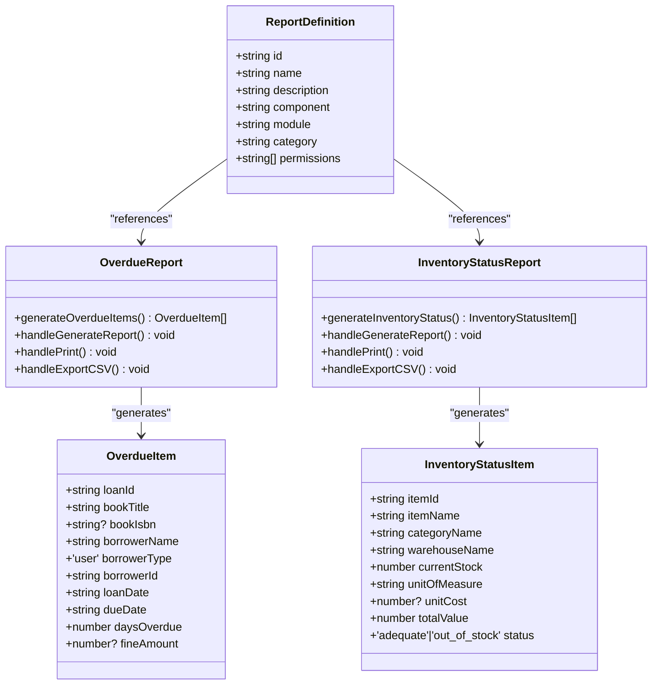
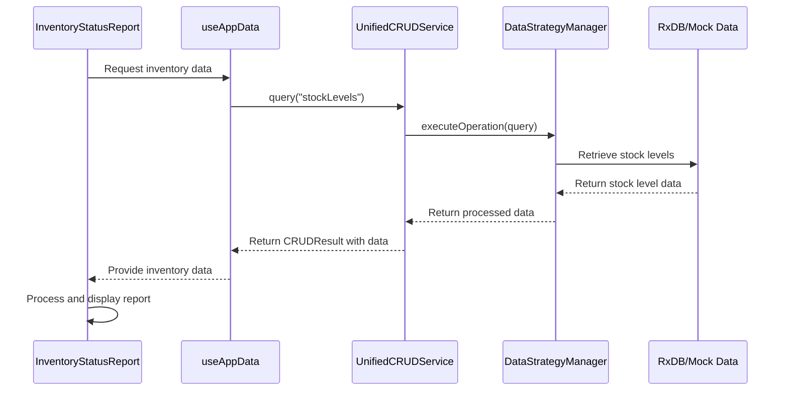
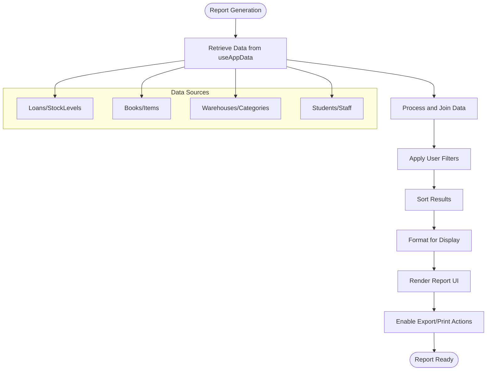
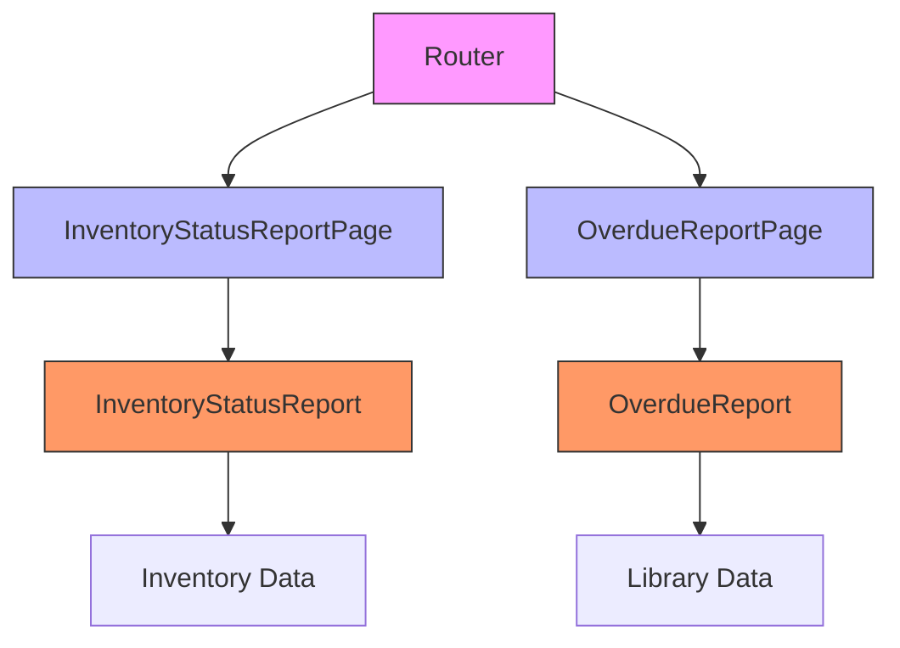

# Data Models and Types

<cite>
**Referenced Files in This Document**   
- [types.ts](file://src/modules/reports/data/types.ts)
- [index.ts](file://src/modules/reports/library/index.ts)
- [OverdueReport.tsx](file://src/modules/reports/library/OverdueReport.tsx)
- [InventoryStatusReport.tsx](file://src/modules/reports/library/InventoryStatusReport.tsx)
- [InventoryStatusReportPage.tsx](file://src/modules/reports/pages/InventoryStatusReportPage.tsx)
- [OverdueReportPage.tsx](file://src/modules/reports/pages/OverdueReportPage.tsx)
- [UnifiedCRUDService.ts](file://src/services/UnifiedCRUDService.ts)
- [types.ts](file://src/modules/library/data/types.ts)
- [types.ts](file://src/modules/inventory/data/types.ts)
- [types.ts](file://src/types.ts)
</cite>

## Table of Contents
1. [Introduction](#introduction)
2. [Report Data Models](#report-data-models)
3. [Report Library Architecture](#report-library-architecture)
4. [Integration with UnifiedCRUDService](#integration-with-unifiedcrudservice)
5. [Type Safety and Generics](#type-safety-and-generics)
6. [Report Generation Examples](#report-generation-examples)
7. [Relationship Between Reports and Page Components](#relationship-between-reports-and-page-components)
8. [Common Type Errors and Compilation Issues](#common-type-errors-and-compilation-issues)
9. [Conclusion](#conclusion)

## Introduction
This document provides comprehensive documentation for the Reports module in the EduGen school management system. It details the data models, type definitions, and architecture that enable the creation and management of various reports across different modules. The documentation covers the type definitions in types.ts, the report library architecture in index.ts, and how these components integrate with the UnifiedCRUDService for cross-module data access. The focus is on providing a clear understanding of the report system's structure and functionality, making it accessible to developers and technical stakeholders.

**Section sources**
- [types.ts](file://src/modules/reports/data/types.ts)
- [index.ts](file://src/modules/reports/library/index.ts)

## Report Data Models

### Core Report Entity Definition
The foundation of the reports system is the `ReportsEntity` interface defined in the reports module's types.ts file. This interface establishes the basic structure for all report entities in the system.

```typescript
export interface ReportsEntity {
  id: string;
  name: string;
  created_at: string;
  updated_at: string;
}
```

This interface defines the essential properties that all reports must have:
- **id**: A unique identifier for the report
- **name**: The display name of the report
- **created_at**: Timestamp when the report was created
- **updated_at**: Timestamp when the report was last updated

### Overdue Report Data Model
The OverdueReport component defines a specific data model for tracking overdue library books. The `OverdueItem` interface structures the data displayed in the overdue books report:

```typescript
interface OverdueItem {
  loanId: string;
  bookTitle: string;
  bookIsbn?: string;
  borrowerName: string;
  borrowerType: 'user';
  borrowerId: string;
  loanDate: string;
  dueDate: string;
  daysOverdue: number;
  fineAmount?: number;
}
```

This model captures comprehensive information about overdue items, including loan details, book information, borrower data, and financial implications. The report uses data from multiple entities:
- **Loan**: From the library module, containing loan transaction details
- **Book**: From the library module, containing book catalog information
- **Student/Staff**: From the administration module, containing borrower details

### Inventory Status Report Data Model
The InventoryStatusReport component defines a data model for tracking inventory levels and status. The `InventoryStatusItem` interface structures the data displayed in the inventory status report:

```typescript
interface InventoryStatusItem {
  itemId: string;
  itemName: string;
  categoryName: string;
  warehouseName: string;
  currentStock: number;
  unitOfMeasure: string;
  unitCost?: number;
  totalValue: number;
  status: 'adequate' | 'out_of_stock';
}
```

This model provides a comprehensive view of inventory status, including:
- **Item identification**: Item ID and name
- **Categorization**: Category and warehouse location
- **Stock levels**: Current quantity and unit of measure
- **Financial data**: Unit cost and total value
- **Status indicators**: Stock status (adequate or out of stock)

The report integrates data from multiple inventory-related entities:
- **ItemInv**: Inventory items with pricing and categorization
- **Warehouse**: Storage locations for inventory
- **ItemCategoryInv**: Categories for organizing inventory items
- **StockLevel**: Current stock quantities for items in warehouses

**Section sources**
- [OverdueReport.tsx](file://src/modules/reports/library/OverdueReport.tsx#L15-L40)
- [InventoryStatusReport.tsx](file://src/modules/reports/library/InventoryStatusReport.tsx#L15-L35)
- [types.ts](file://src/modules/library/data/types.ts)
- [types.ts](file://src/modules/inventory/data/types.ts)

## Report Library Architecture

### Report Registration and Categorization
The reports library architecture is centered around the index.ts file in the reports/library directory, which serves as the central registry for all available reports. This file exports report components and defines their metadata through the `reportDefinitions` array.

```typescript
export const reportDefinitions = [
  {
    id: 'overdue-report',
    name: 'Overdue Books Report',
    description: 'Shows all books that are currently overdue with borrower details',
    component: 'OverdueReport',
    module: 'library',
    category: 'Library',
    permissions: ['library.reports.view', 'library.view'],
  },
  {
    id: 'inventory-status-report',
    name: 'Inventory Status Report',
    description: 'Shows comprehensive inventory status including stock levels and alerts',
    component: 'InventoryStatusReport',
    module: 'inventory',
    category: 'Inventory',
    permissions: ['inventory.reports.view', 'inventory.view'],
  },
];
```

Each report definition includes key metadata:
- **id**: Unique identifier for the report
- **name**: Display name shown to users
- **description**: Brief explanation of the report's purpose
- **component**: Reference to the React component that renders the report
- **module**: Parent module that owns the report data
- **category**: Organizational category for grouping reports
- **permissions**: Required permissions to access the report

### Report Component Structure
The architecture follows a modular pattern where report components are stored in the library directory and imported into page components. This separation allows for:
- **Reusability**: Report components can be embedded in multiple contexts
- **Maintainability**: Report logic is isolated from routing and page structure
- **Dynamic loading**: The system can programmatically access reports based on metadata

The export pattern in index.ts enables both direct component imports and programmatic access to report definitions:

```typescript
export { default as OverdueReport } from './OverdueReport';
export { default as InventoryStatusReport } from './InventoryStatusReport';
```

This dual export strategy supports both static imports for direct usage and dynamic access through the reportDefinitions array for registry-based operations.



**Diagram sources**
- [index.ts](file://src/modules/reports/library/index.ts#L5-L27)
- [OverdueReport.tsx](file://src/modules/reports/library/OverdueReport.tsx)
- [InventoryStatusReport.tsx](file://src/modules/reports/library/InventoryStatusReport.tsx)

**Section sources**
- [index.ts](file://src/modules/reports/library/index.ts)
- [OverdueReport.tsx](file://src/modules/reports/library/OverdueReport.tsx)
- [InventoryStatusReport.tsx](file://src/modules/reports/library/InventoryStatusReport.tsx)

## Integration with UnifiedCRUDService

### Cross-Module Data Access
The reports system integrates with the UnifiedCRUDService to access data across different modules. This service provides a consistent interface for data operations regardless of the underlying data source or storage mechanism.

The UnifiedCRUDService class implements a comprehensive CRUD (Create, Read, Update, Delete) interface with the following key methods:

```typescript
export class UnifiedCRUDService {
  async create<T extends EntityData>(entityName: string, data: Partial<T>, options: CRUDOptions = {}): Promise<CRUDResult<T>>
  async read<T extends EntityData>(entityName: string, id: string | number, options: CRUDOptions = {}): Promise<CRUDResult<T>>
  async query<T extends EntityData>(entityName: string, queryOptions: QueryOptions = {}, options: CRUDOptions = {}): Promise<CRUDResult<T[]>>
  async update<T extends EntityData>(entityName: string, id: string | number, updates: Partial<T>, options: CRUDOptions = {}): Promise<CRUDResult<T>>
  async delete<T extends EntityData>(entityName: string, id: string | number, options: CRUDOptions = {}): Promise<CRUDResult<boolean>>
}
```

### Type Safety with Generics
The service uses TypeScript generics to ensure type safety across all operations. The generic type parameter `T` extends `EntityData`, allowing the service to maintain type information throughout the CRUD operations.

For report generation, the `query` method is particularly important as it enables fetching multiple records of a specific type:

```typescript
async query<T extends EntityData>(
  entityName: string,
  queryOptions: QueryOptions = {},
  options: CRUDOptions = {}
): Promise<CRUDResult<T[]>>
```

This method returns a `CRUDResult<T[]>` where T is the specific entity type being queried, ensuring that the data returned from the service maintains its type information.

### Data Flow in Report Generation
When generating reports, the components use the `useAppData` hook which likely interfaces with the UnifiedCRUDService to fetch the required data. The data flow follows this pattern:

1. Report component requests data through `useAppData`
2. `useAppData` uses UnifiedCRUDService to query relevant entities
3. Service retrieves data from the appropriate source (RxDB, mock data, etc.)
4. Data is returned to the component with proper typing
5. Component processes and displays the data in the report

The service's ability to work with different data sources (RxDB, mock data, etc.) through the DataStrategyManager makes the report system flexible and adaptable to different environments.



**Diagram sources**
- [UnifiedCRUDService.ts](file://src/services/UnifiedCRUDService.ts)
- [InventoryStatusReport.tsx](file://src/modules/reports/library/InventoryStatusReport.tsx)
- [useAppData.ts](file://src/hooks/useAppData.ts)

**Section sources**
- [UnifiedCRUDService.ts](file://src/services/UnifiedCRUDService.ts)
- [InventoryStatusReport.tsx](file://src/modules/reports/library/InventoryStatusReport.tsx)
- [OverdueReport.tsx](file://src/modules/reports/library/OverdueReport.tsx)

## Type Safety and Generics

### Centralized Type Management
The application employs a centralized type management strategy through the main types.ts file in the src directory. This file serves as a consolidation point for cross-module types, ensuring consistency and reusability.

```typescript
// Main types export file that consolidates global and cross-module types.
export * from './core/types';
export * from './modules/finance/data/types';
export * from './modules/administration/data/types';
export * from './modules/academics/data/types';
export * from './modules/hr/data/types';
export * from './modules/inventory/data/types';
export * from './modules/library/data/types';
export * from './modules/nutrition/data/types';
```

This approach provides several benefits:
- **Single source of truth**: Types are defined once and reused across modules
- **Consistency**: Ensures uniform type definitions across the application
- **Maintainability**: Changes to shared types only need to be made in one location
- **Discoverability**: Developers can easily find and use shared types

### TypeScript Configuration
The tsconfig.json file reveals important type safety configurations that support the application's type system:

```json
{
  "compilerOptions": {
    "strict": true,
    "noUnusedLocals": false,
    "noUnusedParameters": false,
    "noFallthroughCasesInSwitch": true,
    "noUncheckedSideEffectImports": true
  }
}
```

The `strict: true` setting enables a suite of strict type-checking options that help catch potential errors at compile time, including:
- **strictNullChecks**: Prevents null and undefined from being assigned to types accidentally
- **strictFunctionTypes**: Ensures function parameters are checked more thoroughly
- **strictBindCallApply**: Ensures bind, call, and apply methods are used correctly
- **strictPropertyInitialization**: Ensures class properties are initialized properly

### Generic Patterns in Data Access
The UnifiedCRUDService extensively uses generics to maintain type safety across data operations. The service methods are parameterized with generic types that extend `EntityData`:

```typescript
async read<T extends EntityData>(entityName: string, id: string | number, options: CRUDOptions = {}): Promise<CRUDResult<T>>
```

This pattern ensures that:
- The return type matches the expected entity type
- Type information is preserved throughout the data access pipeline
- Compile-time type checking prevents type-related errors
- IDEs can provide accurate autocompletion and error detection

The `CRUDResult<T>` type further enhances type safety by providing a consistent response structure:

```typescript
interface CRUDResult<T> {
  success: boolean;
  data?: T;
  error?: Error;
  validation?: ValidationResult;
  cached: boolean;
  source: 'cache' | 'rxdb' | 'mock' | 'error' | 'validation';
  timestamp: Date;
}
```

This structure ensures that consumers of the service can safely handle responses with proper type checking.

**Section sources**
- [types.ts](file://src/types.ts)
- [tsconfig.json](file://tsconfig.json)
- [UnifiedCRUDService.ts](file://src/services/UnifiedCRUDService.ts)

## Report Generation Examples

### Overdue Report Generation Process
The OverdueReport component demonstrates a comprehensive report generation process that combines data from multiple sources to create a meaningful report.

```typescript
const generateOverdueItems = useCallback(() => {
  const today = new Date();
  const overdueItems: OverdueItem[] = [];

  (loans || []).forEach(loan => {
    if (loan.return_date || !loan.due_date) return;

    const dueDate = new Date(loan.due_date);
    const daysOverdue = Math.floor((today.getTime() - dueDate.getTime()) / (1000 * 60 * 60 * 24));

    if (daysOverdue <= 0) return;

    const book = (books || []).find(b => b.id === loan.book_id);
    
    const borrowerName = loan.user_name || 'Unknown User';
    const borrowerType: 'user' = 'user';

    const fineAmount = daysOverdue * 10;

    overdueItems.push({
      loanId: loan.id,
      bookTitle: book?.title || 'Unknown Book',
      bookIsbn: book?.isbn,
      borrowerName,
      borrowerType,
      borrowerId: loan.user_id,
      loanDate: loan.loan_date,
      dueDate: loan.due_date,
      daysOverdue,
      fineAmount
    });
  });

  return overdueItems.sort((a, b) => b.daysOverdue - a.daysOverdue);
}, [loans, books, students, staff]);
```

Key aspects of this process:
- **Data filtering**: Only active loans (not returned) with past due dates are included
- **Date calculation**: Days overdue is calculated by comparing current date with due date
- **Data enrichment**: Book and borrower information is joined with loan data
- **Financial calculation**: Potential fines are calculated based on days overdue
- **Sorting**: Results are sorted by days overdue (most overdue first)

### Inventory Status Report Generation Process
The InventoryStatusReport component demonstrates a similar but distinct report generation process focused on inventory data.

```typescript
const generateInventoryStatus = useCallback(() => {
  const inventoryItems: InventoryStatusItem[] = [];

  (stockLevels || []).forEach(stockLevel => {
    const item = (itemsInv || []).find(i => i.id === stockLevel.item_id);
    const warehouse = (warehouses || []).find(w => w.id === stockLevel.warehouse_id);
    const category = item ? (itemCategoriesInv || []).find(c => c.id === item.category_id) : null;

    if (!item || !warehouse) return;

    const currentStock = stockLevel.quantity || 0;
    const unitCost = item.current_price || 0;
    const totalValue = currentStock * unitCost;

    let status: 'adequate' | 'out_of_stock' = 'adequate';
    if (currentStock === 0) {
      status = 'out_of_stock';
    }

    inventoryItems.push({
      itemId: item.id,
      itemName: item.name,
      categoryName: category?.name || 'Uncategorized',
      warehouseName: warehouse.name,
      currentStock,
      unitOfMeasure: item.unit_of_measure || 'pcs',
      unitCost: item.current_price || 0,
      totalValue,
      status
    });
  });

  return inventoryItems.sort((a, b) => {
    const statusPriority = { out_of_stock: 4, low: 3, overstocked: 2, adequate: 1 };
    return statusPriority[b.status] - statusPriority[a.status];
  });
}, [stockLevels, itemsInv, warehouses, itemCategoriesInv]);
```

Key aspects of this process:
- **Data joining**: Stock levels are joined with item, warehouse, and category data
- **Value calculation**: Total inventory value is calculated (quantity × unit cost)
- **Status determination**: Items are categorized based on stock levels
- **Sorting**: Results are sorted by status priority (critical issues first)

Both reports include additional functionality such as:
- **Filtering**: Users can filter results based on various criteria
- **Export**: Reports can be exported to CSV format
- **Printing**: Reports can be printed directly
- **Real-time updates**: Reports regenerate when underlying data changes



**Diagram sources**
- [OverdueReport.tsx](file://src/modules/reports/library/OverdueReport.tsx)
- [InventoryStatusReport.tsx](file://src/modules/reports/library/InventoryStatusReport.tsx)

**Section sources**
- [OverdueReport.tsx](file://src/modules/reports/library/OverdueReport.tsx)
- [InventoryStatusReport.tsx](file://src/modules/reports/library/InventoryStatusReport.tsx)

## Relationship Between Reports and Page Components

### Component Architecture Pattern
The reports system follows a clear architectural pattern that separates report components from page components. This separation of concerns enhances maintainability and reusability.

The pattern consists of:
- **Library components**: Contain the actual report logic and UI
- **Page components**: Serve as routing wrappers for library components

### Page Component Implementation
The page components are minimal wrappers that import and render the corresponding report components. For example, the InventoryStatusReportPage:

```typescript
import React from 'react';
import InventoryStatusReport from '../library/InventoryStatusReport';

const InventoryStatusReportPage: React.FC = () => {
  return <InventoryStatusReport />;
};

export default InventoryStatusReportPage;
```

Similarly, the OverdueReportPage:

```typescript
import React from 'react';
import OverdueReport from '../library/OverdueReport';

const OverdueReportPage: React.FC = () => {
  return <OverdueReport />;
};

export default OverdueReportPage;
```

### Benefits of the Architecture
This architectural pattern provides several key benefits:

1. **Reusability**: Report components can be embedded in multiple pages or contexts
2. **Separation of concerns**: Routing and navigation are separated from report logic
3. **Easier testing**: Report components can be tested independently of routing
4. **Dynamic loading**: The system can programmatically load reports based on metadata
5. **Consistent styling**: All reports share a common structure and behavior

### Navigation and Routing
The page components enable routing to reports through the application's navigation system. When a user navigates to a report URL, the corresponding page component is loaded, which in turn renders the report component.

This pattern allows for:
- **Clean URLs**: /reports/inventory-status, /reports/overdue
- **Route parameters**: Additional parameters can be passed to customize reports
- **Authentication**: Page components can include authentication checks
- **Analytics**: Page views can be tracked at the page component level

The relationship between components can be visualized as:



**Diagram sources**
- [InventoryStatusReportPage.tsx](file://src/modules/reports/pages/InventoryStatusReportPage.tsx)
- [OverdueReportPage.tsx](file://src/modules/reports/pages/OverdueReportPage.tsx)
- [InventoryStatusReport.tsx](file://src/modules/reports/library/InventoryStatusReport.tsx)
- [OverdueReport.tsx](file://src/modules/reports/library/OverdueReport.tsx)

**Section sources**
- [InventoryStatusReportPage.tsx](file://src/modules/reports/pages/InventoryStatusReportPage.tsx)
- [OverdueReportPage.tsx](file://src/modules/reports/pages/OverdueReportPage.tsx)

## Common Type Errors and Compilation Issues

### Type Definition Conflicts
One potential issue in the codebase is the potential for type definition conflicts between module-specific types and core types. In the library module's types.ts file, there are comments indicating that certain interfaces are imported from core/types to avoid conflicts:

```typescript
// Note: BookCategory and Book interfaces are now imported from core/types to avoid conflicts
// Note: Loan interface is now imported from core/types to avoid conflicts
// Note: Fine interface is now imported from core/types to avoid conflicts
```

This suggests that there were previously duplicate type definitions that could cause compilation errors. The solution implemented is to centralize these shared types in the core/types file and import them where needed.

### Data Validation and Error Handling
The application includes comprehensive data validation mechanisms to catch type-related issues at runtime. The DataConsistencyService performs validation checks and generates reports on data integrity:

```typescript
const report: ConsistencyReport = {
  timestamp: new Date(),
  mode,
  totalEntities,
  totalRecords,
  validationErrors,
  consistencyErrors,
  warnings,
  criticalErrors,
  summary: {
    isConsistent: allErrors.length === 0,
    entitiesWithErrors,
    errorsByType
  }
};
```

Common validation errors that might occur with report data structures include:
- **INVALID_TYPE**: When a field contains data of the wrong type
- **REQUIRED_REFERENCE**: When a required foreign key is missing
- **UNKNOWN_TYPE**: When an unrecognized validation type is specified

### Error Boundary Implementation
The application uses error boundaries to handle rendering errors gracefully, particularly for data-intensive components like reports. The TableErrorBoundary component catches rendering errors and provides a fallback UI:

```typescript
class TableErrorBoundary extends Component<Props, State> {
  static getDerivedStateFromError(error: Error): State {
    return {
      hasError: true,
      error,
      errorId: `table-error-${Date.now()}`
    };
  }

  componentDidCatch(error: Error, errorInfo: ErrorInfo) {
    console.error(`Table rendering error:`, { error, errorInfo });
  }
}
```

This prevents the entire application from crashing when a report encounters a rendering error.

### Common Issues and Solutions
Based on the codebase analysis, here are common type-related issues and their solutions:

1. **Missing Type Definitions**: Ensure all shared types are properly exported from the main types.ts file
2. **Type Conflicts**: Use centralized type definitions in core/types to avoid duplicates
3. **Incomplete Data**: Handle null and undefined values gracefully in report components
4. **Version Mismatches**: Use the ModuleDependencyValidator to check for compatibility issues
5. **Circular Dependencies**: Avoid circular imports between modules

The test suite includes specific tests for common issues:

```javascript
// Test for common issues
testUtils.testCommonIssues = () => {
  // Check for potential issues in the codebase
  // This helps catch type-related problems before they cause runtime errors
};
```

**Section sources**
- [types.ts](file://src/modules/library/data/types.ts)
- [DataConsistencyService.ts](file://src/services/DataConsistencyService.ts)
- [TableErrorBoundary.tsx](file://src/components/ui/data/TableErrorBoundary.tsx)
- [ModuleDependencyValidator.ts](file://src/core/services/ModuleDependencyValidator.ts)

## Conclusion
The Reports module in the EduGen school management system demonstrates a well-structured approach to data modeling and report generation. The architecture effectively separates concerns between data models, report components, and page components, enabling reusability and maintainability.

Key strengths of the system include:
- **Centralized type management**: Shared types are consolidated in a single location
- **Type safety**: Extensive use of TypeScript generics ensures compile-time type checking
- **Modular architecture**: Clear separation between library components and page components
- **Cross-module integration**: The UnifiedCRUDService enables seamless data access across modules
- **Comprehensive error handling**: Robust validation and error boundary mechanisms

The system successfully balances flexibility with type safety, allowing for the creation of diverse reports while maintaining data integrity and preventing common type-related errors. The architectural patterns employed provide a solid foundation for extending the reporting capabilities in the future.