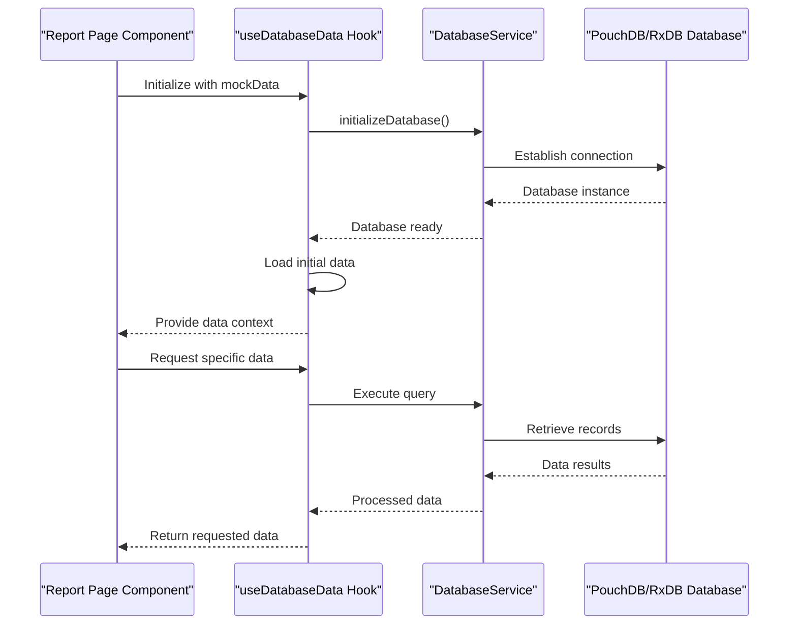
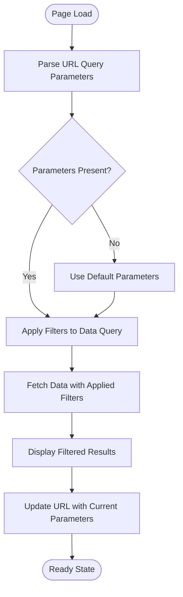
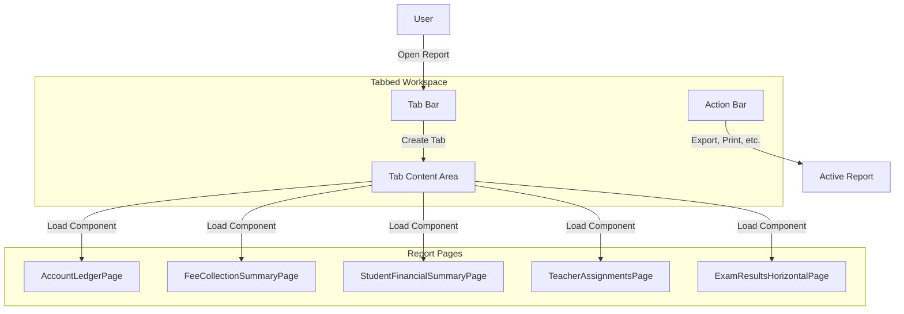
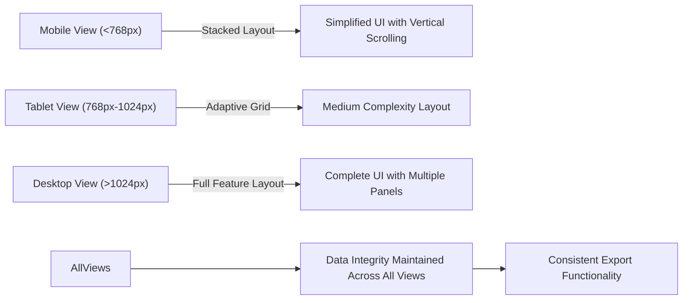

# Report Pages and Navigation

<cite>
**Referenced Files in This Document**   
- [useDatabaseData.ts](file://src/hooks/useDatabaseData.ts)
- [tabbedWorkspace.tsx](file://src/components/tabbedWorkspace/TabbedWorkspace.tsx)
- [PageContainer.tsx](file://src/components/layout/PageContainer.tsx)
- [dataModeManager.ts](file://src/services/dataModeManager.ts)
- [databaseService.ts](file://src/services/databaseService.ts)
- [AppDataContext.tsx](file://src/contexts/AppDataContext.tsx)
</cite>

## Table of Contents
1. [Introduction](#introduction)
2. [Report Page Components](#report-page-components)
3. [Data Fetching and Management](#data-fetching-and-management)
4. [URL Parameter Handling](#url-parameter-handling)
5. [Export Functionality](#export-functionality)
6. [Tabbed Workspace Integration](#tabbed-workspace-integration)
7. [Responsive Design](#responsive-design)
8. [Troubleshooting Guide](#troubleshooting-guide)

## Introduction
This document provides comprehensive documentation for the Reports module page components in the EduGen school management system. The report pages serve as critical tools for financial, academic, and operational analysis, enabling stakeholders to make data-driven decisions. These components follow a consistent architectural pattern while serving specific purposes for different user roles and analytical needs.

## Report Page Components

The report pages in the system are designed to provide specialized views of educational data for different stakeholders. Each report serves a distinct purpose while sharing common implementation patterns.

### AccountLedgerPage
The AccountLedgerPage provides a comprehensive view of financial transaction history for individual accounts. This report enables finance administrators to track all monetary movements, including payments, adjustments, and invoice applications. The page displays chronological entries with details such as transaction date, amount, balance, and associated invoices.

### FeeCollectionSummaryPage
The FeeCollectionSummaryPage offers payment analytics across the institution. This report aggregates fee collection data by various dimensions such as payment method, fee category, collection period, and student demographics. It includes visualizations like bar charts and pie charts to illustrate collection trends and identify patterns in payment behavior.

### StudentFinancialSummaryPage
The StudentFinancialSummaryPage presents individual student billing information. This report consolidates all financial data for a specific student, including opening balances, fee invoices, payments made, adjustments, and current outstanding amounts. It serves as a complete financial profile for each student, essential for both administrative staff and parents.

### TeacherAssignmentsPage
The TeacherAssignmentsPage facilitates academic workload analysis. This report displays the distribution of teaching responsibilities across faculty members, showing subject assignments, class allocations, and contact hours. Administrators use this information to ensure balanced workloads and optimize resource allocation.

### ExamResultsHorizontalPage
The ExamResultsHorizontalPage enables student performance comparison. This report presents examination results in a horizontal layout, allowing side-by-side comparison of student performance across multiple subjects or assessments. Educators use this view to identify achievement patterns and inform instructional strategies.

**Section sources**
- [useDatabaseData.ts](file://src/hooks/useDatabaseData.ts)

## Data Fetching and Management

The report pages utilize a standardized approach to data fetching through the useDatabaseData hook, which provides a consistent interface for accessing application data.

**Diagram sources**
- [useDatabaseData.ts](file://src/hooks/useDatabaseData.ts#L69-L89)
- [databaseService.ts](file://src/services/databaseService.ts)

The useDatabaseData hook serves as the primary data access layer for report pages, abstracting the underlying database implementation. This hook initializes the database connection and provides access to various data collections through a unified interface. It handles the complexity of database operations while presenting a simple API to the report components.

Key features of the data fetching implementation include:
- **Centralized database service**: The databaseService singleton manages the database connection and operations
- **Consistent data interface**: The hook provides a uniform way to access different data types
- **Error handling**: Comprehensive error handling for database operations
- **Loading states**: Management of loading states for different data entities
- **Initialization error tracking**: Capture and reporting of initialization issues

The hook also provides CRUD (Create, Read, Update, Delete) operations for various data entities, allowing report pages to not only display data but also support interactive features when needed.

**Section sources**
- [useDatabaseData.ts](file://src/hooks/useDatabaseData.ts)
- [databaseService.ts](file://src/services/databaseService.ts)

## URL Parameter Handling

Report pages handle parameters through URL query strings, enabling dynamic filtering and configuration of report content. This approach allows users to share specific report views and bookmark frequently accessed configurations.

The parameter handling system supports various filter criteria such as date ranges, academic periods, class selections, and student categories. When a report page loads, it parses the URL query parameters and applies the corresponding filters to the data retrieval process.

**Diagram sources**
- [useDatabaseData.ts](file://src/hooks/useDatabaseData.ts)
- [AppDataContext.tsx](file://src/contexts/AppDataContext.tsx)

The implementation ensures that the URL reflects the current report state, allowing users to copy and share links that preserve their filtering choices. This feature is particularly valuable for collaborative analysis and reporting workflows.

**Section sources**
- [useDatabaseData.ts](file://src/hooks/useDatabaseData.ts)

## Export Functionality

The report pages include export functionality that allows users to download report data in various formats for external analysis or record-keeping. This feature supports multiple export formats including CSV, Excel, and PDF.

The export system is implemented as a reusable component that can be integrated into any report page. It handles data formatting, file generation, and download initiation while maintaining the filtered state of the current report view.

Key aspects of the export functionality include:
- **Format selection**: Users can choose from available export formats
- **Data preservation**: The exported data maintains the same filtering and sorting as the displayed report
- **Header inclusion**: Exported files include appropriate headers and metadata
- **Large data handling**: The system manages export operations for large datasets efficiently

**Section sources**
- [useDatabaseData.ts](file://src/hooks/useDatabaseData.ts)

## Tabbed Workspace Integration

The report pages integrate with the tabbed workspace system, enabling multi-report viewing and efficient navigation between different analytical views.

**Diagram sources**
- [TabbedWorkspace.tsx](file://src/components/tabbedWorkspace/TabbedWorkspace.tsx)
- [PageContainer.tsx](file://src/components/layout/PageContainer.tsx)

The tabbed workspace allows users to open multiple report pages simultaneously, facilitating comparative analysis and cross-referencing of data. Each report runs in its own tab with independent state management, while sharing the same navigation and action controls.

Key integration features include:
- **Tab creation**: Report pages can be opened in new tabs
- **Tab management**: Users can switch between, close, or rearrange report tabs
- **Contextual actions**: Action bar provides report-specific functions
- **State persistence**: Tab state is preserved when switching between reports

**Section sources**
- [TabbedWorkspace.tsx](file://src/components/tabbedWorkspace/TabbedWorkspace.tsx)
- [PageContainer.tsx](file://src/components/layout/PageContainer.tsx)

## Responsive Design

The report pages implement responsive design adaptations to ensure optimal viewing across different screen sizes and devices.

**Diagram sources**
- [PageContainer.tsx](file://src/components/layout/PageContainer.tsx)
- [useDatabaseData.ts](file://src/hooks/useDatabaseData.ts)

The responsive design system employs several strategies:
- **Flexible layouts**: Grid and flexbox layouts adapt to available screen space
- **Progressive disclosure**: Complex features are revealed based on screen size
- **Touch optimization**: Mobile interfaces have appropriately sized touch targets
- **Performance optimization**: Data loading strategies adapt to device capabilities

On smaller screens, the interface prioritizes essential information and simplifies complex visualizations. As screen size increases, additional details, controls, and multi-panel layouts become available to leverage the expanded real estate.

**Section sources**
- [PageContainer.tsx](file://src/components/layout/PageContainer.tsx)

## Troubleshooting Guide

This section provides guidance for common report generation failures and data display issues.

### Common Report Generation Failures

**Database Connection Issues**
- **Symptoms**: Reports fail to load with "Database initialization error" messages
- **Causes**: Network connectivity problems, database service not running, or configuration issues
- **Solutions**: 
  - Verify network connectivity
  - Check database service status
  - Restart the application
  - Clear browser cache and reload

**Section sources**
- [useDatabaseData.ts](file://src/hooks/useDatabaseData.ts)
- [databaseService.ts](file://src/services/databaseService.ts)

**Data Loading Problems**
- **Symptoms**: Reports display loading indicators indefinitely or show incomplete data
- **Causes**: Large datasets exceeding performance thresholds, query timeouts, or data corruption
- **Solutions**:
  - Apply more specific filters to reduce data volume
  - Check for data integrity issues
  - Verify database indexes are properly configured
  - Monitor system performance during report generation

**Section sources**
- [useDatabaseData.ts](file://src/hooks/useDatabaseData.ts)
- [dataModeManager.ts](file://src/services/dataModeManager.ts)

**Authentication and Permission Errors**
- **Symptoms**: Reports return "Access denied" or blank screens
- **Causes**: Insufficient user permissions, expired sessions, or role configuration issues
- **Solutions**:
  - Verify user has appropriate report access permissions
  - Re-authenticate the user session
  - Check role-based access control settings
  - Contact system administrator for permission adjustments

**Section sources**
- [AppDataContext.tsx](file://src/contexts/AppDataContext.tsx)
- [useDatabaseData.ts](file://src/hooks/useDatabaseData.ts)

### Data Display Issues

**Incorrect Data Values**
- **Symptoms**: Report shows inaccurate figures or unexpected values
- **Causes**: Data synchronization issues, calculation errors, or outdated cache
- **Solutions**:
  - Refresh the report data
  - Verify data sources are up-to-date
  - Check for pending data synchronization tasks
  - Clear application cache and reload

**Section sources**
- [useDatabaseData.ts](file://src/hooks/useDatabaseData.ts)

**Formatting Problems**
- **Symptoms**: Numbers, dates, or text display incorrectly formatted
- **Causes**: Localization settings mismatch, formatting rule errors, or template issues
- **Solutions**:
  - Verify system localization settings
  - Check formatting rules in the report configuration
  - Update to the latest application version
  - Clear browser cache and reload

**Section sources**
- [useDatabaseData.ts](file://src/hooks/useDatabaseData.ts)

**Performance Issues**
- **Symptoms**: Reports load slowly or cause application lag
- **Causes**: Complex queries, large datasets, or inefficient data processing
- **Solutions**:
  - Optimize report filters to reduce data volume
  - Implement pagination for large result sets
  - Schedule heavy reports during off-peak hours
  - Consider data aggregation for summary reports

**Section sources**
- [useDatabaseData.ts](file://src/hooks/useDatabaseData.ts)
- [databaseService.ts](file://src/services/databaseService.ts)