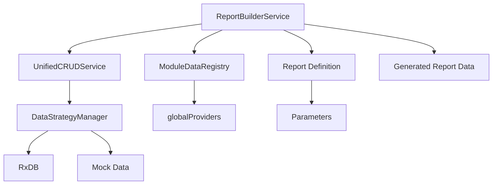
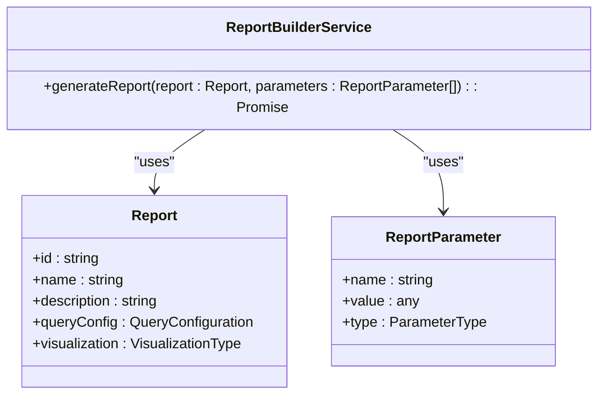
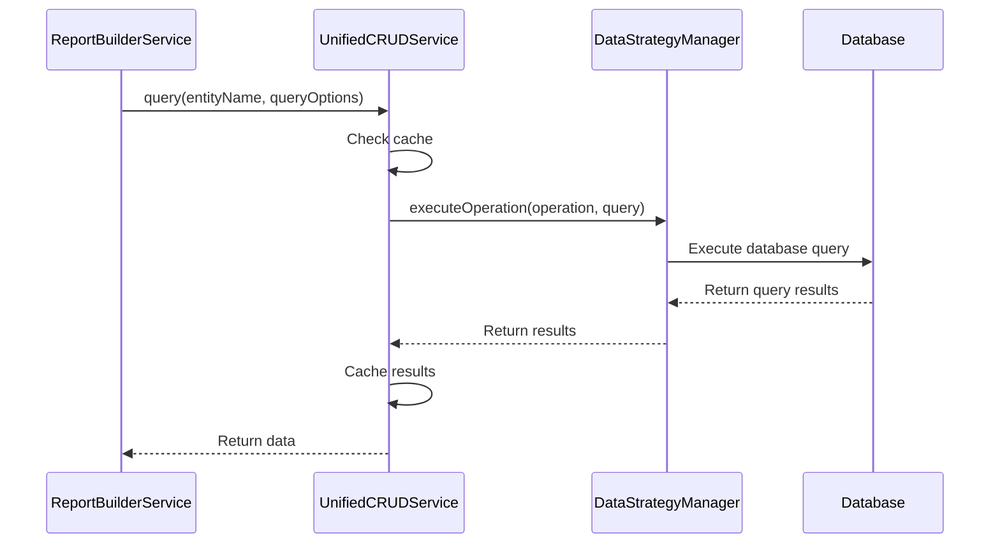
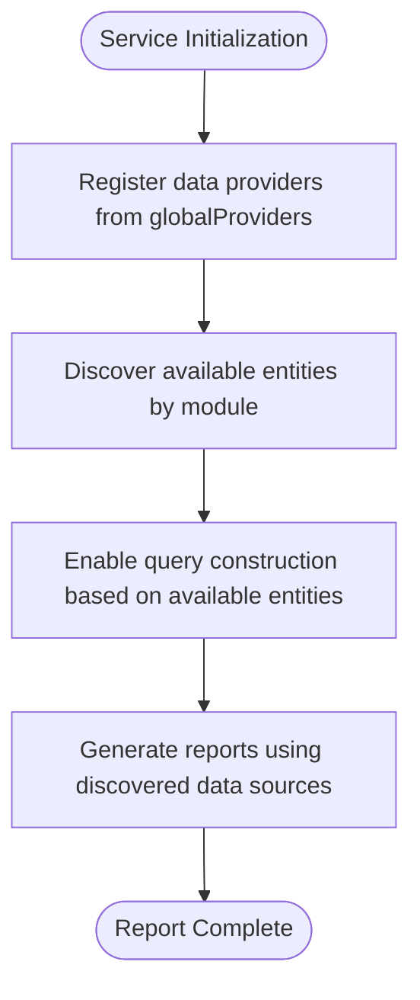
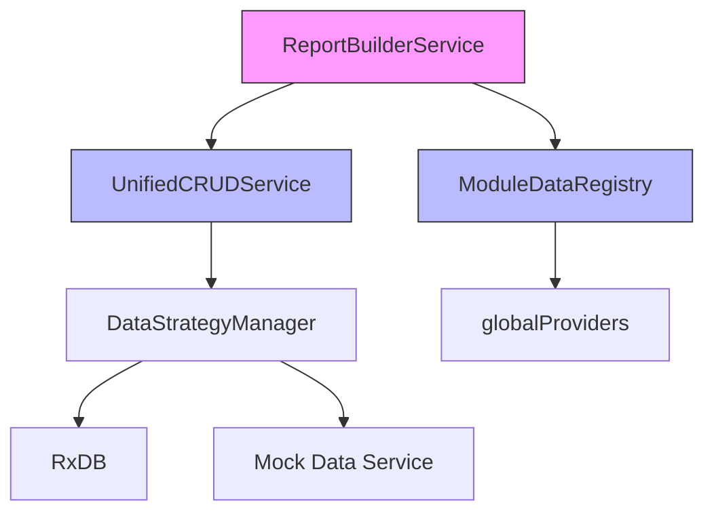

# Reporting Services

<cite>
**Referenced Files in This Document**   
- [ReportBuilderService.ts](file://src/modules/reports/services/ReportBuilderService.ts)
- [UnifiedCRUDService.ts](file://src/services/UnifiedCRUDService.ts)
- [ModuleDataRegistry.ts](file://src/services/ModuleDataRegistry.ts)
- [types.ts](file://src/modules/reports/data/types.ts)
</cite>

## Table of Contents
1. [Introduction](#introduction)
2. [Core Components](#core-components)
3. [Architecture Overview](#architecture-overview)
4. [Detailed Component Analysis](#detailed-component-analysis)
5. [Dependency Analysis](#dependency-analysis)
6. [Performance Considerations](#performance-considerations)
7. [Conclusion](#conclusion)

## Introduction
The ReportBuilderService is the central engine for report generation within the Reports module of the SchoolPilot3 education management system. It serves as the primary orchestrator for constructing, executing, and aggregating data from multiple modules to produce comprehensive reports. This service enables cross-module querying through integration with UnifiedCRUDService and dynamically discovers available data sources via ModuleDataRegistry. Designed with scalability and modularity in mind, it supports complex reporting requirements across academic, financial, administrative, and attendance domains.

**Section sources**
- [ReportBuilderService.ts](file://src/modules/reports/services/ReportBuilderService.ts#L1-L10)

## Core Components
The ReportBuilderService provides a unified interface for generating reports by coordinating data retrieval from various modules. It accepts a report definition and parameters, then constructs and executes queries against registered data sources. The service leverages dependency injection to integrate with UnifiedCRUDService for data operations and ModuleDataRegistry for data source discovery. Its design follows a clean separation of concerns, focusing solely on report orchestration rather than data access or storage logic.

**Section sources**
- [ReportBuilderService.ts](file://src/modules/reports/services/ReportBuilderService.ts#L4-L9)

## Architecture Overview
The reporting architecture follows a modular, service-oriented design where ReportBuilderService acts as the central coordinator. It interacts with ModuleDataRegistry to discover available data entities across modules and uses UnifiedCRUDService to execute queries against these entities. This decoupled approach allows the system to support dynamic data source registration and flexible query construction without tight coupling between components.

**Diagram sources**
- [ReportBuilderService.ts](file://src/modules/reports/services/ReportBuilderService.ts#L4-L9)
- [UnifiedCRUDService.ts](file://src/services/UnifiedCRUDService.ts#L112-L684)
- [ModuleDataRegistry.ts](file://src/services/ModuleDataRegistry.ts#L19-L108)

## Detailed Component Analysis

### ReportBuilderService Analysis
The ReportBuilderService is responsible for orchestrating the entire report generation process. It receives a report configuration and parameters, then coordinates data retrieval from multiple modules through the UnifiedCRUDService. The service currently contains a placeholder implementation that returns empty data, indicating it is designed to be extended with actual query construction and data aggregation logic.

#### Class Structure

**Diagram sources**
- [ReportBuilderService.ts](file://src/modules/reports/services/ReportBuilderService.ts#L4-L9)
- [types.ts](file://src/modules/reports/data/types.ts)

### UnifiedCRUDService Integration
The ReportBuilderService integrates with UnifiedCRUDService to execute cross-module queries. UnifiedCRUDService provides a standardized interface for create, read, update, delete, and query operations across different data sources. It includes built-in caching, validation, and error handling mechanisms that are leveraged by the reporting system to ensure data consistency and performance.

#### Query Execution Flow

**Diagram sources**
- [UnifiedCRUDService.ts](file://src/services/UnifiedCRUDService.ts#L112-L684)
- [ReportBuilderService.ts](file://src/modules/reports/services/ReportBuilderService.ts#L4-L9)

### ModuleDataRegistry Integration
The ModuleDataRegistry enables the ReportBuilderService to discover available data sources across modules. As a singleton, it maintains a registry of all registered data entities, allowing the reporting system to dynamically identify what data is available for querying. This facilitates the creation of flexible reports that can adapt to the available modules and data structures.

#### Data Discovery Mechanism

**Diagram sources**
- [ModuleDataRegistry.ts](file://src/services/ModuleDataRegistry.ts#L19-L108)
- [ReportBuilderService.ts](file://src/modules/reports/services/ReportBuilderService.ts#L4-L9)

## Dependency Analysis
The ReportBuilderService has well-defined dependencies on core system services that enable its functionality. It depends on ModuleDataRegistry for data source discovery and UnifiedCRUDService for data retrieval operations. These dependencies are managed through direct imports rather than dependency injection, suggesting a need for potential refactoring to improve testability and flexibility.

**Diagram sources**
- [ReportBuilderService.ts](file://src/modules/reports/services/ReportBuilderService.ts#L4-L9)
- [UnifiedCRUDService.ts](file://src/services/UnifiedCRUDService.ts#L112-L684)
- [ModuleDataRegistry.ts](file://src/services/ModuleDataRegistry.ts#L19-L108)

## Performance Considerations
The current implementation of ReportBuilderService includes several performance considerations through its integration with UnifiedCRUDService. The UnifiedCRUDService provides built-in caching mechanisms that can significantly improve report generation performance by reducing redundant database queries. Query results are cached for 2 minutes, while individual entity reads have longer cache durations. The service also supports batch operations and includes performance monitoring capabilities, though these features are not yet utilized by the reporting system.

The architecture allows for query optimization through the DataStrategyManager, which can route queries to the most appropriate data source based on availability and performance characteristics. However, the current placeholder implementation in ReportBuilderService does not yet implement query optimization techniques such as query planning, result set filtering, or parallel execution of independent queries.

**Section sources**
- [UnifiedCRUDService.ts](file://src/services/UnifiedCRUDService.ts#L112-L684)

## Conclusion
The ReportBuilderService is designed as the central engine for report generation in the SchoolPilot3 system, providing a foundation for cross-module reporting capabilities. While the current implementation contains a placeholder, its architecture demonstrates a well-thought-out design that leverages the UnifiedCRUDService for data operations and ModuleDataRegistry for data source discovery. The service is positioned to support complex reporting requirements across multiple domains, with built-in support for caching, error handling, and data consistency. Future implementation should focus on developing the actual query construction and data aggregation logic, potentially enhancing the service with dependency injection for improved testability and flexibility.