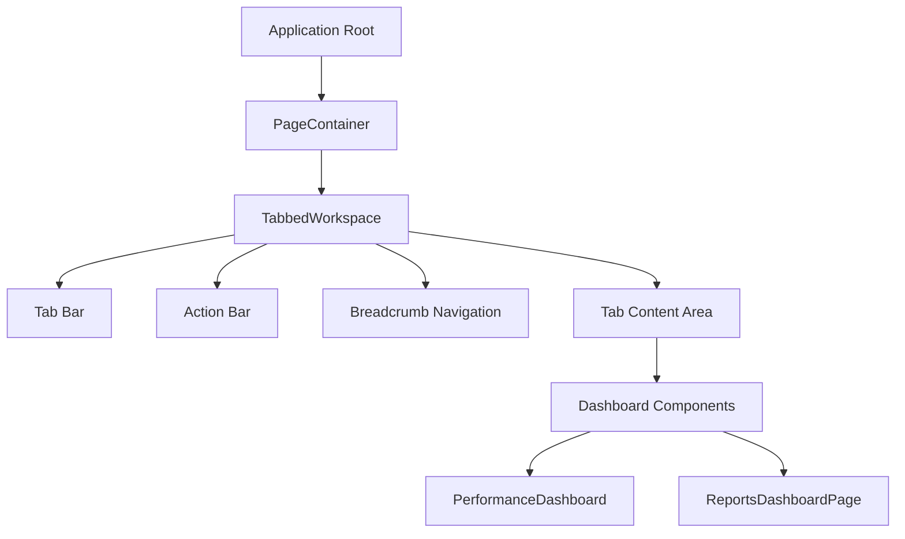
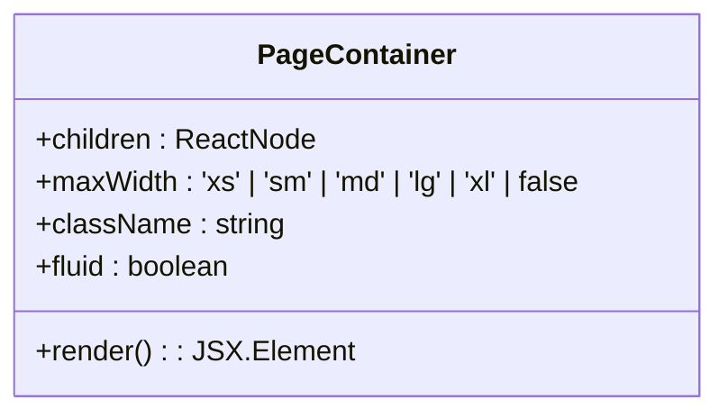
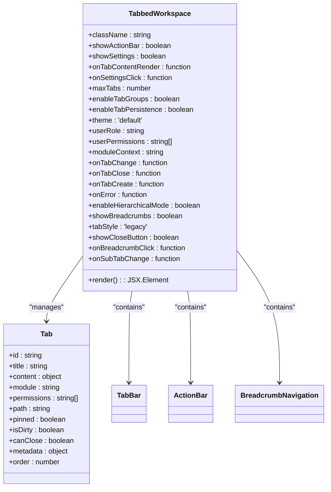
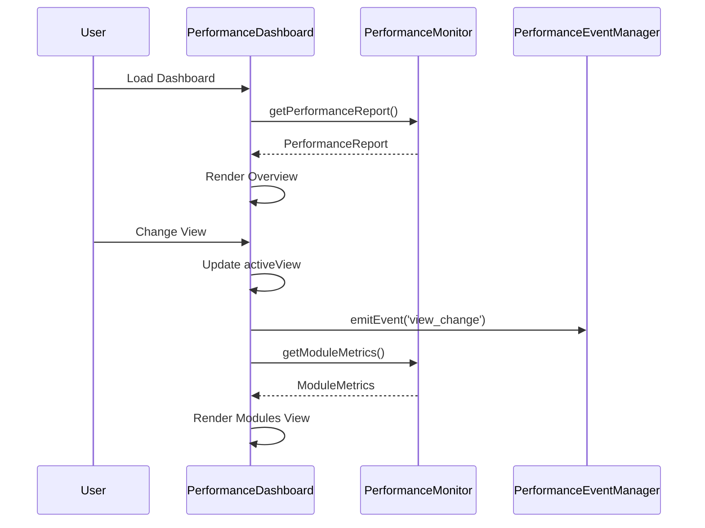
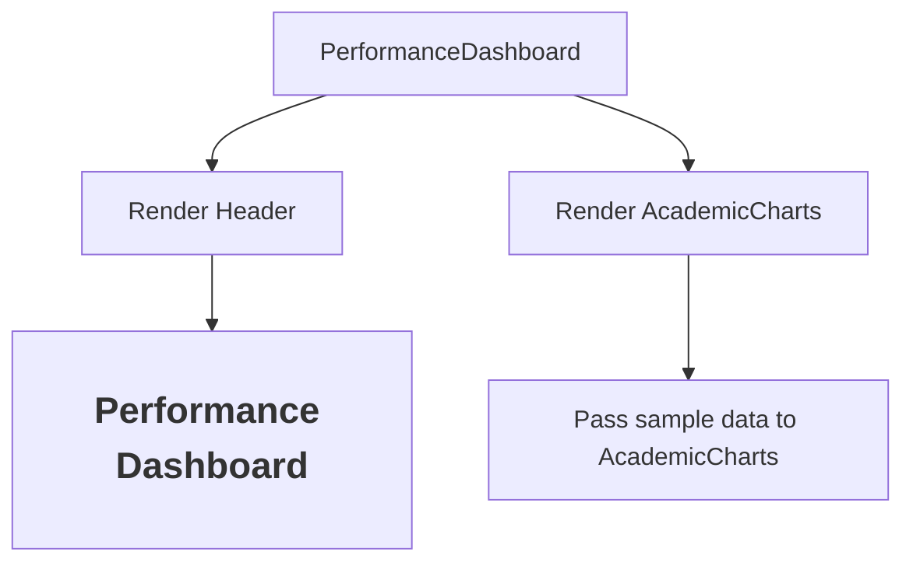
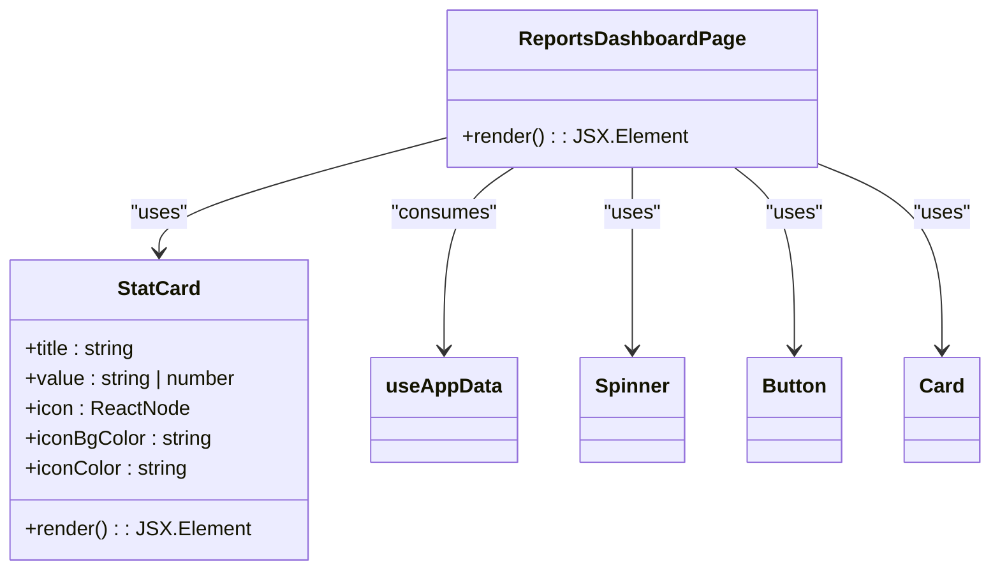
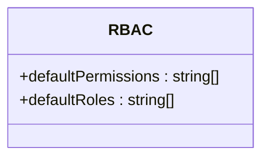

# Reports Dashboards

<cite>
**Referenced Files in This Document**   
- [PageContainer.tsx](file://src/components/layout/PageContainer.tsx)
- [TabbedWorkspace.tsx](file://src/components/tabbedWorkspace/TabbedWorkspace.tsx)
- [PerformanceDashboard.tsx](file://src/components/PerformanceDashboard.tsx)
- [PerformanceDashboard.tsx](file://src/modules/reports/dashboards/PerformanceDashboard.tsx)
- [ReportsDashboardPage.tsx](file://src/modules/reports/pages/ReportsDashboardPage.tsx)
- [rbac.ts](file://src/modules/reports/rbac.ts)
</cite>

## Table of Contents
1. [Introduction](#introduction)
2. [Layout Architecture](#layout-architecture)
3. [Core Dashboard Components](#core-dashboard-components)
4. [Performance Dashboard Analysis](#performance-dashboard-analysis)
5. [Reports Dashboard Page Analysis](#reports-dashboard-page-analysis)
6. [Role-Based Access Control](#role-based-access-control)
7. [Responsive Design Considerations](#responsive-design-considerations)
8. [Troubleshooting Guide](#troubleshooting-guide)

## Introduction
This document provides comprehensive documentation for the Reports module dashboards in the EduGen school management system. It details the architecture, functionality, and implementation of two key dashboard components: PerformanceDashboard.tsx, which serves as a specialized view for system and data performance metrics, and ReportsDashboardPage.tsx, which functions as the main navigation hub for all report categories. The document also covers the layout architecture using PageContainer and TabbedWorkspace components, dashboard widget loading based on user permissions, personalization features, and troubleshooting guidance for common issues.

## Layout Architecture

The Reports dashboards utilize a hierarchical layout architecture composed of two primary components: PageContainer and TabbedWorkspace. These components work together to provide a consistent, responsive, and feature-rich user interface across the application.



**Diagram sources**
- [PageContainer.tsx](file://src/components/layout/PageContainer.tsx)
- [TabbedWorkspace.tsx](file://src/components/tabbedWorkspace/TabbedWorkspace.tsx)

### PageContainer Component
The PageContainer component serves as the foundational layout wrapper for all pages in the application, providing consistent padding, maximum width constraints, and responsive design features.



**Diagram sources**
- [PageContainer.tsx](file://src/components/layout/PageContainer.tsx#L1-L43)

The PageContainer component accepts several props that control its behavior:
- **maxWidth**: Determines the maximum width of the container with options ranging from 'xs' to 'xl', defaulting to 'xl' which corresponds to 'max-w-7xl' in Tailwind CSS
- **fluid**: When true, removes the maximum width constraint and applies fluid layout with consistent padding
- **className**: Allows additional CSS classes to be applied to the container
- **children**: The content to be rendered within the container

When not in fluid mode, the component applies responsive padding (px-4 on small screens, px-6 on medium screens, and px-8 on large screens) and centers the content with mx-auto. It also ensures a minimum height of the viewport with min-h-screen and provides a white background with rounded corners and subtle shadow for the main content area.

**Section sources**
- [PageContainer.tsx](file://src/components/layout/PageContainer.tsx#L1-L43)

### TabbedWorkspace Component
The TabbedWorkspace component provides a sophisticated tabbed interface for managing multiple views within the application. It serves as the primary workspace container for dashboards and other complex interfaces.



**Diagram sources**
- [TabbedWorkspace.tsx](file://src/components/tabbedWorkspace/TabbedWorkspace.tsx#L13-L536)

The TabbedWorkspace component implements several key features:
- **Tab Management**: Supports creating, closing, reordering, pinning, and duplicating tabs
- **Hierarchical Navigation**: Optional breadcrumb navigation for hierarchical tab structures
- **Action Bar**: Contextual action buttons that can be customized based on the current module and user permissions
- **Persistence**: Optional tab persistence to maintain state across sessions
- **Drag and Drop**: Uses react-beautiful-dnd for intuitive tab reordering
- **Error Boundary**: Wraps content in a TabWorkspaceErrorBoundary to handle rendering errors gracefully

The component uses React hooks extensively for state management, including useState for local state, useRef for mutable references, useCallback for memoizing functions, and useMemo for memoizing computed values. It also integrates with a global tab store via useTabStore to maintain tab state across the application.

**Section sources**
- [TabbedWorkspace.tsx](file://src/components/tabbedWorkspace/TabbedWorkspace.tsx#L1-L539)

## Core Dashboard Components

The Reports module contains two primary dashboard components with distinct purposes and implementations. Understanding the differences between these components is essential for effective use and customization of the reporting system.

### Component Comparison
The following table highlights the key differences between the two dashboard components:

| Feature | PerformanceDashboard.tsx | ReportsDashboardPage.tsx |
|--------|-------------------------|-------------------------|
| **Location** | src/components/PerformanceDashboard.tsx | src/modules/reports/pages/ReportsDashboardPage.tsx |
| **Purpose** | System and data performance monitoring | Main navigation hub for report categories |
| **Data Source** | Performance monitoring services | Application data via useAppData hook |
| **User Interaction** | Detailed performance analysis | Navigation to various report categories |
| **Visualization** | Performance metrics and benchmarks | Summary statistics and navigation buttons |
| **Permissions** | Global performance monitoring | Reports module specific |

## Performance Dashboard Analysis

The PerformanceDashboard component serves as a specialized view for monitoring system and data performance metrics. It provides comprehensive insights into application performance, including response time graphs, module loading times, and system health indicators.



**Diagram sources**
- [PerformanceDashboard.tsx](file://src/components/PerformanceDashboard.tsx#L13-L380)

### Implementation Details
The PerformanceDashboard component is implemented in src/components/PerformanceDashboard.tsx and provides a comprehensive interface for monitoring application performance. Key features include:

- **Multiple Views**: The dashboard offers six different views accessible through a navigation tab interface:
  - Overview: Summary of key performance metrics
  - Modules: Detailed module loading performance
  - Data Ops: Data operation performance metrics
  - User Actions: User interaction response times
  - Charts: Performance trend visualizations (placeholder)
  - Benchmarks: Performance benchmark comparisons

- **Performance Metrics**: The component displays several key performance indicators:
  - Startup Time: Application startup duration
  - Memory Usage: Current memory consumption
  - Module Loading: Average module load time
  - User Interactions: Average interaction response time

- **Interactive Features**: Users can:
  - Toggle auto-refresh (disabled by default to prevent flickering)
  - Manually refresh performance data
  - Clear collected performance metrics
  - Export performance reports

The component uses the usePerformanceMonitoring hook to track user interactions and the usePerformanceEvents hook to respond to performance-related events. It retrieves performance data from the performanceMonitor service, which collects metrics on startup time, memory usage, module loading times, and user interaction durations.

**Section sources**
- [PerformanceDashboard.tsx](file://src/components/PerformanceDashboard.tsx#L1-L383)

### Alternative Implementation
An alternative implementation of the PerformanceDashboard exists in the reports module at src/modules/reports/dashboards/PerformanceDashboard.tsx. This version is significantly simpler and appears to be a placeholder or example implementation:



**Diagram sources**
- [PerformanceDashboard.tsx](file://src/modules/reports/dashboards/PerformanceDashboard.tsx#L5-L17)

This implementation simply renders a header and passes sample data to an AcademicCharts component. It lacks the comprehensive performance monitoring features of the main PerformanceDashboard component and appears to be intended for demonstration purposes or as a template for academic performance visualizations rather than system performance monitoring.

**Section sources**
- [PerformanceDashboard.tsx](file://src/modules/reports/dashboards/PerformanceDashboard.tsx#L1-L22)

## Reports Dashboard Page Analysis

The ReportsDashboardPage component serves as the main navigation hub for all report categories within the Reports module. It provides quick access to various report types and displays key statistics about the school's operations.



**Diagram sources**
- [ReportsDashboardPage.tsx](file://src/modules/reports/pages/ReportsDashboardPage.tsx#L27-L101)

### Implementation Details
The ReportsDashboardPage component is implemented in src/modules/reports/pages/ReportsDashboardPage.tsx and serves as the primary entry point for the Reports module. Its key features include:

- **Key Statistics Display**: Shows summary statistics for:
  - Total Students
  - Total Staff
  - Total Classes
  - Total Subjects

- **Report Category Navigation**: Provides buttons to access various report categories:
  - Student Reports
  - Exam Results
  - Financial Reports
  - Teacher Reports
  - Account Ledger
  - Fee Collection

- **Loading State Management**: Displays a spinner while data is being loaded from the useAppData hook

- **Internationalization**: Uses the useTranslation hook with the 'reports' namespace for localized text

The component retrieves data through the useAppData hook, which provides access to students, staff, classes, and subjects. It calculates basic statistics from this data and displays them in visually distinct cards with appropriate icons. The navigation buttons use React Router's Link component to navigate to specific report pages within the Reports module.

**Section sources**
- [ReportsDashboardPage.tsx](file://src/modules/reports/pages/ReportsDashboardPage.tsx#L1-L104)

## Role-Based Access Control

The Reports module implements role-based access control (RBAC) to manage user permissions and restrict access to certain features based on user roles. This is handled through the rbac.ts file in the reports module.



**Diagram sources**
- [rbac.ts](file://src/modules/reports/rbac.ts#L1-L9)

The rbac.ts file in src/modules/reports/rbac.ts is minimal, defining only default permissions and roles:

```typescript
export const defaultPermissions = [];
export const defaultRoles = [];

export default {
  defaultPermissions,
  defaultRoles
};
```

This implementation suggests that the Reports module does not define custom permissions or roles, possibly relying on a global RBAC system or inheriting permissions from a parent module. The comment indicates that this file is used primarily to silence dynamic loader warnings rather than to implement comprehensive access control.

In practice, dashboard widgets are likely loaded based on user permissions from a global RBAC system, but the Reports module itself does not appear to implement granular permission controls for its components. This could indicate that access to the Reports module is controlled at a higher level, with all users who can access the module having access to all its features.

**Section sources**
- [rbac.ts](file://src/modules/reports/rbac.ts#L1-L10)

## Responsive Design Considerations

Both dashboard components implement responsive design principles to ensure optimal user experience across different device sizes and screen resolutions.

### PageContainer Responsiveness
The PageContainer component applies responsive padding based on screen size:
- Mobile: px-4
- Tablet: px-6
- Desktop: px-8

It also uses a max-width constraint that scales with screen size, ensuring content remains readable on large displays while utilizing available space on smaller screens.

### ReportsDashboardPage Grid Layout
The ReportsDashboardPage component uses a responsive grid layout for its statistics cards:
- 1 column on small screens
- 2 columns on medium screens
- 4 columns on large screens

This is implemented using Tailwind CSS grid classes: grid-cols-1 md:grid-cols-2 lg:grid-cols-4.

### PerformanceDashboard View Adaptation
The PerformanceDashboard component adapts its layout based on screen size:
- On smaller screens, the overview metrics are displayed in a single column
- On larger screens, they are arranged in a 4-column grid
- The tab navigation uses a horizontal layout that wraps appropriately on narrow screens

Both components use Tailwind CSS utility classes for responsive design, ensuring consistent behavior across the application. They also implement proper loading states and error handling to maintain usability under various network conditions and data availability scenarios.

## Troubleshooting Guide

This section provides guidance for resolving common issues encountered with the Reports dashboards.

### Dashboard Loading Issues
**Symptoms**: Dashboard fails to load, displays loading spinner indefinitely, or shows error messages.

**Potential Causes and Solutions**:
1. **Data Loading Failures**: 
   - Check network connectivity
   - Verify that the useAppData hook is properly configured
   - Ensure required data services are running
   - Review browser console for API errors

2. **Permission Issues**:
   - Verify user has appropriate roles and permissions
   - Check RBAC configuration
   - Ensure the user is properly authenticated

3. **Component Rendering Errors**:
   - Check for JavaScript errors in the browser console
   - Verify all required dependencies are loaded
   - Ensure component imports are correct

### Data Refresh Problems
**Symptoms**: Performance data is stale, auto-refresh not working, or manual refresh fails.

**Potential Causes and Solutions**:
1. **Auto-Refresh Disabled**:
   - Auto-refresh is disabled by default to prevent flickering
   - Users must explicitly enable it via the checkbox
   - Verify the autoRefresh state is properly updated

2. **Event System Issues**:
   - Check that usePerformanceEvents is properly configured
   - Verify event listeners are registered correctly
   - Ensure event emission is working as expected

3. **Performance Monitor Service**:
   - Verify the performanceMonitor service is initialized
   - Check that metrics are being collected properly
   - Ensure the getPerformanceReport method returns valid data

### Common Error Scenarios
1. **"Access Denied" Message**:
   - User lacks required permissions for the tab
   - Verify user role and permissions
   - Check validateTabAccess implementation

2. **"Tab not found" Error**:
   - Active tab ID does not match any existing tabs
   - Check tab initialization and routing
   - Verify tab persistence is working correctly

3. **Performance Data Not Updating**:
   - Check updateReport function implementation
   - Verify useEffect dependencies are correct
   - Ensure performance events are being emitted properly

For persistent issues, consult the browser developer tools, check server logs, and verify the integrity of the application's data services and API endpoints.

**Section sources**
- [PerformanceDashboard.tsx](file://src/components/PerformanceDashboard.tsx)
- [ReportsDashboardPage.tsx](file://src/modules/reports/pages/ReportsDashboardPage.tsx)
- [TabbedWorkspace.tsx](file://src/components/tabbedWorkspace/TabbedWorkspace.tsx)