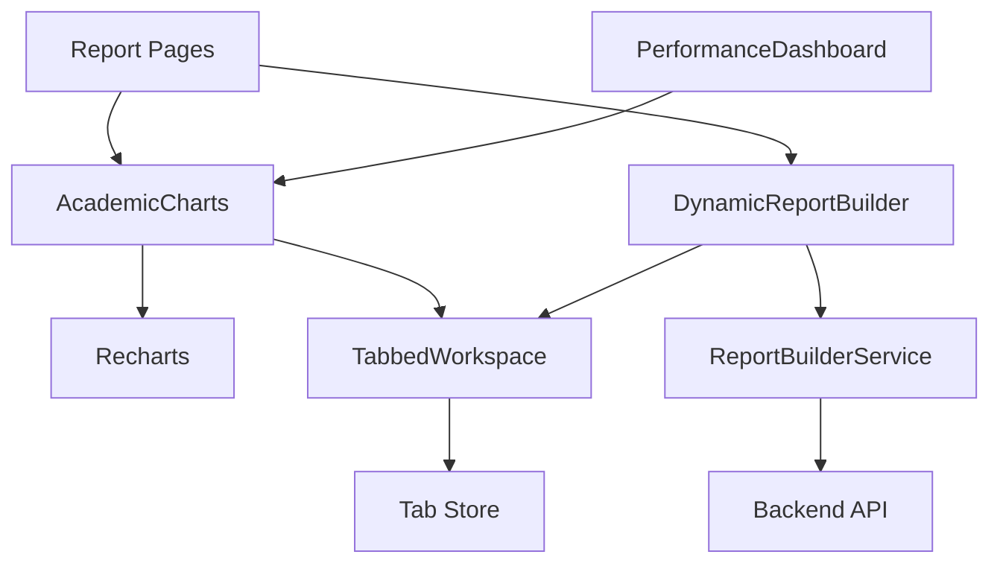
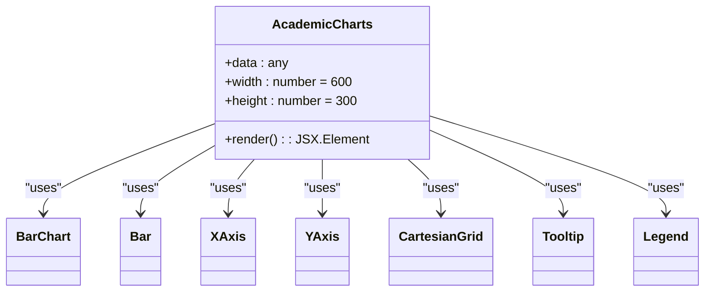
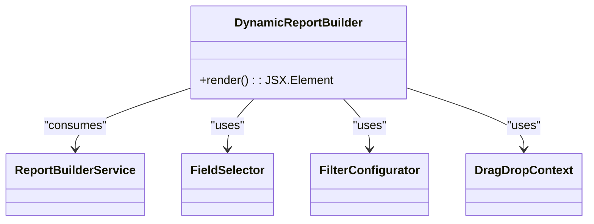
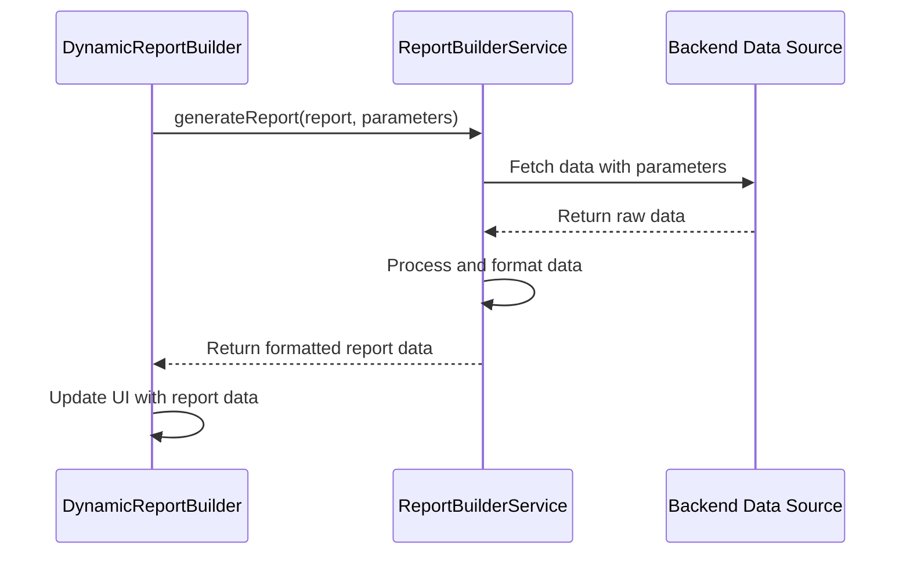
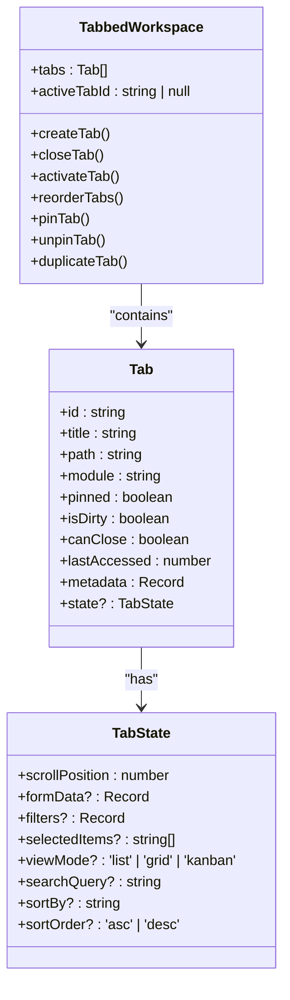
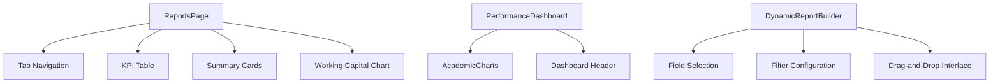
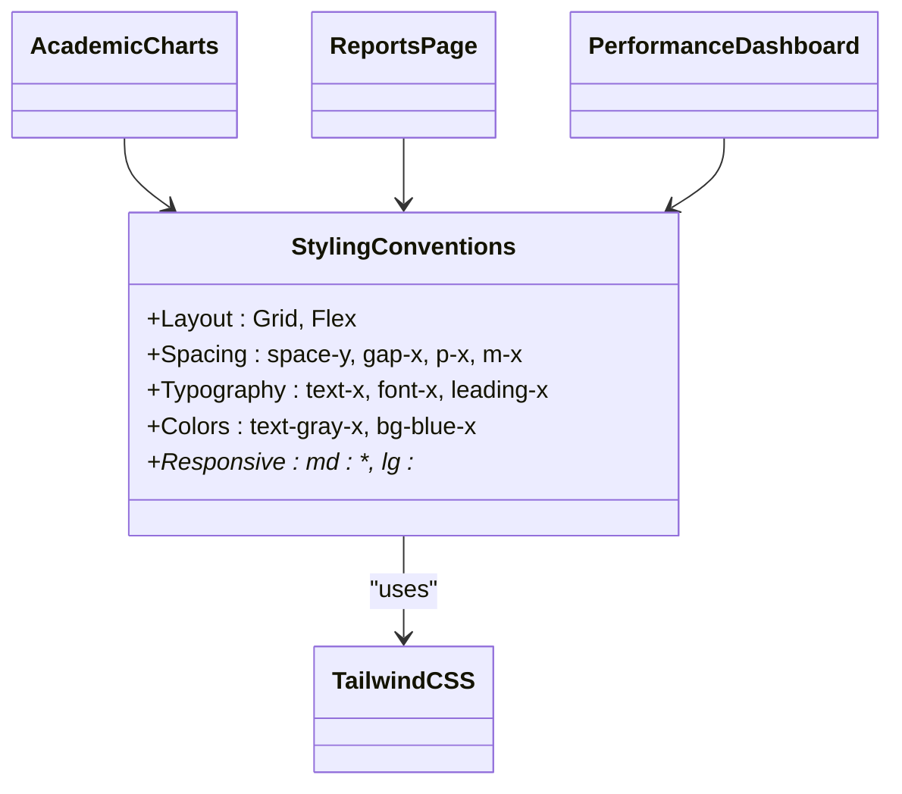
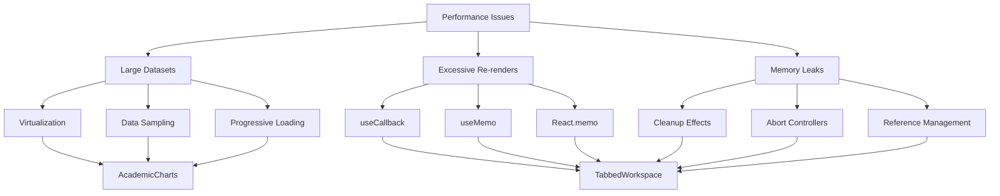

# Reports Module Components

<cite>
**Referenced Files in This Document**   
- [AcademicCharts.tsx](file://src/modules/reports/components/AcademicCharts.tsx)
- [DynamicReportBuilder.tsx](file://src/modules/reports/components/DynamicReportBuilder.tsx)
- [ReportBuilderService.ts](file://src/modules/reports/services/ReportBuilderService.ts)
- [types.ts](file://src/modules/reports/data/types.ts)
- [PerformanceDashboard.tsx](file://src/modules/reports/dashboards/PerformanceDashboard.tsx)
- [ReportsPage.tsx](file://src/modules/reports/pages/ReportsPage.tsx)
- [TabbedWorkspace.tsx](file://src/components/tabbedWorkspace/TabbedWorkspace.tsx)
- [tabbedWorkspace.ts](file://src/types/tabbedWorkspace.ts)
- [BarChart.tsx](file://src/components/ui/BarChart.tsx)
- [types.ts](file://src/core/types.ts)
</cite>

## Table of Contents
1. [Introduction](#introduction)
2. [Core Components Overview](#core-components-overview)
3. [AcademicCharts Component Implementation](#academiccharts-component-implementation)
4. [DynamicReportBuilder Component Architecture](#dynamicreportbuilder-component-architecture)
5. [ReportBuilderService Integration](#reportbuilderservice-integration)
6. [Tabbed Workspace Integration](#tabbed-workspace-integration)
7. [Component Composition in Report Pages](#component-composition-in-report-pages)
8. [Styling Conventions and Tailwind CSS](#styling-conventions-and-tailwind-css)
9. [Data Structures and Type Definitions](#data-structures-and-type-definitions)
10. [Performance Optimization and Rendering Issues](#performance-optimization-and-rendering-issues)

## Introduction
The Reports module in the EduGen school management system provides comprehensive reporting capabilities for academic and administrative data. This document details the implementation of key UI components that enable visualization of academic performance data and creation of custom reports. The module leverages React with Recharts for data visualization, implements a tabbed workspace for persistent editing sessions, and follows a component-based architecture with clear separation of concerns. The documentation covers the AcademicCharts component for visualizing academic data, the DynamicReportBuilder for creating custom reports, and their integration with backend services and workspace management systems.

**Section sources**
- [AcademicCharts.tsx](file://src/modules/reports/components/AcademicCharts.tsx#L1-L20)
- [DynamicReportBuilder.tsx](file://src/modules/reports/components/DynamicReportBuilder.tsx#L1-L13)

## Core Components Overview
The Reports module consists of two primary UI components: AcademicCharts for data visualization and DynamicReportBuilder for report creation. These components work in conjunction with the ReportBuilderService to fetch and process data, and integrate with the tabbed workspace system for persistent editing sessions. The AcademicCharts component uses Recharts to render bar charts that visualize academic performance metrics, while the DynamicReportBuilder provides an interactive interface for building custom reports through field selection and filter configuration. Both components are designed to be reusable across different report pages and dashboards within the application.



**Diagram sources**
- [AcademicCharts.tsx](file://src/modules/reports/components/AcademicCharts.tsx#L1-L20)
- [DynamicReportBuilder.tsx](file://src/modules/reports/components/DynamicReportBuilder.tsx#L1-L13)
- [ReportBuilderService.ts](file://src/modules/reports/services/ReportBuilderService.ts#L1-L10)
- [TabbedWorkspace.tsx](file://src/components/tabbedWorkspace/TabbedWorkspace.tsx#L1-L20)

**Section sources**
- [AcademicCharts.tsx](file://src/modules/reports/components/AcademicCharts.tsx#L1-L20)
- [DynamicReportBuilder.tsx](file://src/modules/reports/components/DynamicReportBuilder.tsx#L1-L13)

## AcademicCharts Component Implementation
The AcademicCharts component is a React functional component that leverages the Recharts library to visualize academic performance data. It accepts data as a prop and renders a bar chart with configurable dimensions, axes, and visual elements. The component implements a simple API that allows parent components to pass data in a standardized format, with support for multiple data series through the use of different data keys (pv and uv). The chart includes standard visualization elements such as Cartesian grid, X and Y axes, tooltip for data point inspection, and legend for series identification.



**Diagram sources**
- [AcademicCharts.tsx](file://src/modules/reports/components/AcademicCharts.tsx#L1-L20)

**Section sources**
- [AcademicCharts.tsx](file://src/modules/reports/components/AcademicCharts.tsx#L1-L20)

### Supported Chart Types and Data Binding
The AcademicCharts component currently supports bar charts with multiple data series, as demonstrated by the inclusion of two Bar components with different data keys (pv and uv) and fill colors. The data binding pattern follows Recharts conventions, where the main chart component receives a data array, and individual series components specify which property to use via the dataKey prop. The XAxis is configured to use the "name" property as the categorical axis, while the YAxis automatically scales based on the numeric values. This binding pattern allows for flexible data visualization with minimal configuration required from parent components.

**Section sources**
- [AcademicCharts.tsx](file://src/modules/reports/components/AcademicCharts.tsx#L1-L20)

## DynamicReportBuilder Component Architecture
The DynamicReportBuilder component serves as the interactive interface for creating custom reports within the system. Currently implemented as a placeholder component, it is designed to provide drag-and-drop functionality, field selection, and filter configuration capabilities. The component follows React functional component patterns and is intended to be extended with state management for report configuration, field selection controls, and filter parameters. Its minimal implementation suggests that the core functionality will be developed through composition with other UI components and integration with the ReportBuilderService.



**Diagram sources**
- [DynamicReportBuilder.tsx](file://src/modules/reports/components/DynamicReportBuilder.tsx#L1-L13)
- [ReportBuilderService.ts](file://src/modules/reports/services/ReportBuilderService.ts#L1-L10)

**Section sources**
- [DynamicReportBuilder.tsx](file://src/modules/reports/components/DynamicReportBuilder.tsx#L1-L13)

### Interactive Features and Configuration
The DynamicReportBuilder is designed to support interactive report creation through several key features: drag-and-drop functionality for arranging report elements, field selection for choosing data points to include, and filter configuration for narrowing data scope. These features will be implemented using the react-beautiful-dnd library for drag-and-drop operations, custom form components for field selection, and filter controls that allow users to specify criteria for data inclusion. The component will maintain its state to track the current report configuration, including selected fields, applied filters, and layout arrangement.

**Section sources**
- [DynamicReportBuilder.tsx](file://src/modules/reports/components/DynamicReportBuilder.tsx#L1-L13)

## ReportBuilderService Integration
The ReportBuilderService provides the backend integration layer for the DynamicReportBuilder component, handling the generation of reports based on user-defined parameters. Implemented as a TypeScript class, it exposes an async generateReport method that takes a report definition and an array of parameters, returning a promise that resolves to the generated report data. The service acts as an abstraction layer between the UI components and the underlying data sources, allowing for flexible report generation across different data domains. The current implementation serves as a placeholder, with the actual data retrieval and processing logic to be implemented.



**Diagram sources**
- [ReportBuilderService.ts](file://src/modules/reports/services/ReportBuilderService.ts#L1-L10)

**Section sources**
- [ReportBuilderService.ts](file://src/modules/reports/services/ReportBuilderService.ts#L1-L10)

### Data Flow and Parameter Handling
The ReportBuilderService follows a clean data flow pattern where report parameters are passed from the UI layer and used to query and filter data from backend sources. The Report and ReportParameter types, imported from the module's data types, define the structure of report definitions and their associated parameters. This type-safe approach ensures that both the UI and service layers have a consistent understanding of the data contract. The service is designed to handle various parameter types, including date ranges, category filters, and aggregation options, enabling the creation of highly customized reports.

**Section sources**
- [ReportBuilderService.ts](file://src/modules/reports/services/ReportBuilderService.ts#L1-L10)
- [types.ts](file://src/modules/reports/data/types.ts#L1-L7)

## Tabbed Workspace Integration
The Reports module integrates with the tabbed workspace system to provide persistent editing sessions for report creation and viewing. The TabbedWorkspace component manages multiple report tabs, allowing users to work on several reports simultaneously and maintain their state between sessions. This integration is facilitated through the use of a centralized tab store that tracks active tabs, their state, and user preferences. The workspace supports features like tab pinning, reordering, and persistence, enhancing the user experience for complex reporting tasks.



**Diagram sources**
- [TabbedWorkspace.tsx](file://src/components/tabbedWorkspace/TabbedWorkspace.tsx#L1-L20)
- [tabbedWorkspace.ts](file://src/types/tabbedWorkspace.ts#L1-L20)

**Section sources**
- [TabbedWorkspace.tsx](file://src/components/tabbedWorkspace/TabbedWorkspace.tsx#L1-L20)
- [tabbedWorkspace.ts](file://src/types/tabbedWorkspace.ts#L1-L20)

### Persistent Editing Sessions
The tabbed workspace system enables persistent editing sessions by storing tab state in a centralized store that can be serialized and persisted across application sessions. Each tab maintains its own state object that can store various UI states, including scroll position, form data, applied filters, view mode preferences, and search queries. This state persistence ensures that users can return to their reports exactly as they left them, preserving their workflow and reducing the need to reconfigure reports. The system also supports tab pinning to keep frequently used reports readily accessible.

**Section sources**
- [TabbedWorkspace.tsx](file://src/components/tabbedWorkspace/TabbedWorkspace.tsx#L1-L20)
- [tabbedWorkspace.ts](file://src/types/tabbedWorkspace.ts#L1-L20)

## Component Composition in Report Pages
The Reports module components are composed within various report pages to create comprehensive reporting interfaces. The ReportsPage serves as the main landing page, organizing reports into categories through a tabbed interface and displaying key performance indicators through summary cards and charts. The PerformanceDashboard demonstrates the integration of the AcademicCharts component within a dashboard context, showing how academic performance data can be visualized. These pages follow a consistent composition pattern, combining data visualization components with UI controls and layout elements to create cohesive reporting experiences.



**Diagram sources**
- [ReportsPage.tsx](file://src/modules/reports/pages/ReportsPage.tsx#L1-L115)
- [PerformanceDashboard.tsx](file://src/modules/reports/dashboards/PerformanceDashboard.tsx#L1-L20)

**Section sources**
- [ReportsPage.tsx](file://src/modules/reports/pages/ReportsPage.tsx#L1-L115)
- [PerformanceDashboard.tsx](file://src/modules/reports/dashboards/PerformanceDashboard.tsx#L1-L20)

### Example Composition Patterns
The composition of components in report pages follows several established patterns. The ReportsPage uses a grid layout to organize KPI data in a table format alongside summary cards, demonstrating responsive design principles with different column arrangements for various screen sizes. The PerformanceDashboard composes the AcademicCharts component with a header element, showing how visualization components can be integrated into larger dashboard layouts. These composition patterns emphasize clarity and usability, ensuring that complex data is presented in an accessible manner.

**Section sources**
- [ReportsPage.tsx](file://src/modules/reports/pages/ReportsPage.tsx#L1-L115)
- [PerformanceDashboard.tsx](file://src/modules/reports/dashboards/PerformanceDashboard.tsx#L1-L20)

## Styling Conventions and Tailwind CSS
The Reports module components follow consistent styling conventions using Tailwind CSS for utility-first styling. The AcademicCharts component uses Tailwind classes for layout and typography, such as text-center for centering the chart title and text-gray-700 for text color. The ReportsPage demonstrates the use of Tailwind's spacing utilities (space-y-6, gap-2) and layout classes (grid, flex) to create responsive layouts. The styling approach emphasizes consistency across components while allowing for customization through props and CSS variables.



**Diagram sources**
- [ReportsPage.tsx](file://src/modules/reports/pages/ReportsPage.tsx#L1-L115)
- [BarChart.tsx](file://src/components/ui/BarChart.tsx#L1-L58)

**Section sources**
- [ReportsPage.tsx](file://src/modules/reports/pages/ReportsPage.tsx#L1-L115)
- [BarChart.tsx](file://src/components/ui/BarChart.tsx#L1-L58)

### Responsive Design Implementation
The components implement responsive design principles through the use of Tailwind's responsive prefixes (md:, lg:) and flexible layout systems. The ReportsPage uses a grid layout that adapts from single column on small screens to three columns on large screens, ensuring optimal use of available space. The BarChart component uses a ResponsiveContainer from Recharts to ensure the chart scales appropriately with its container. These responsive design patterns ensure that reports are accessible and usable across different device sizes and screen resolutions.

**Section sources**
- [ReportsPage.tsx](file://src/modules/reports/pages/ReportsPage.tsx#L1-L115)
- [BarChart.tsx](file://src/components/ui/BarChart.tsx#L1-L58)

## Data Structures and Type Definitions
The Reports module relies on a well-defined set of data structures and type definitions to ensure type safety and consistency across components. The BarChartData interface defines the structure of data used by chart components, with a required name property and optional uv and pv properties for numeric values. The Tab interface in the tabbed workspace system defines the structure of tabs, including metadata, state, and permissions. These type definitions serve as contracts between components, ensuring that data is passed correctly and reducing the potential for runtime errors.

```mermaid
erDiagram
BARCHARTDATA {
string name PK
number uv
number pv
any [key: string]
}
TAB {
string id PK
string title
string path
string module
boolean pinned
boolean isDirty
boolean canClose
number lastAccessed
json metadata
json state
}
TABSTATE {
number scrollPosition
json formData
json filters
string[] selectedItems
string viewMode
string searchQuery
string sortBy
string sortOrder
}
REPORT {
string id PK
string name
string created_at
string updated_at
}
BARCHARTDATA ||--o{ REPORT : "used in"
TAB ||--o{ TABSTATE : "has"
```

**Diagram sources**
- [types.ts](file://src/core/types.ts#L20-L31)
- [tabbedWorkspace.ts](file://src/types/tabbedWorkspace.ts#L1-L20)
- [types.ts](file://src/modules/reports/data/types.ts#L1-L7)

**Section sources**
- [types.ts](file://src/core/types.ts#L20-L31)
- [tabbedWorkspace.ts](file://src/types/tabbedWorkspace.ts#L1-L20)
- [types.ts](file://src/modules/reports/data/types.ts#L1-L7)

### Type Safety and Data Contracts
The use of TypeScript interfaces throughout the Reports module establishes clear data contracts between components and services. The BarChartData interface ensures that chart components receive data in the expected format, with the index signature allowing for additional properties as needed. The Tab and TabState interfaces define the structure of tab state, enabling type-safe access to properties and reducing the risk of runtime errors. These type definitions are imported and used consistently across components, creating a robust type system that enhances code maintainability and developer productivity.

**Section sources**
- [types.ts](file://src/core/types.ts#L20-L31)
- [tabbedWorkspace.ts](file://src/types/tabbedWorkspace.ts#L1-L20)
- [types.ts](file://src/modules/reports/data/types.ts#L1-L7)

## Performance Optimization and Rendering Issues
The Reports module components implement several performance optimization techniques to handle large datasets and prevent rendering issues. The TabbedWorkspace component uses React's useCallback and useMemo hooks to memoize expensive computations and prevent unnecessary re-renders. The component also implements cleanup logic in useEffect hooks to prevent memory leaks and abort ongoing operations when components unmount. For large datasets, the AcademicCharts component can be enhanced with virtualization techniques to render only visible data points, improving performance with minimal impact on user experience.



**Diagram sources**
- [TabbedWorkspace.tsx](file://src/components/tabbedWorkspace/TabbedWorkspace.tsx#L1-L20)
- [AcademicCharts.tsx](file://src/modules/reports/components/AcademicCharts.tsx#L1-L20)

**Section sources**
- [TabbedWorkspace.tsx](file://src/components/tabbedWorkspace/TabbedWorkspace.tsx#L1-L20)
- [AcademicCharts.tsx](file://src/modules/reports/components/AcademicCharts.tsx#L1-L20)

### Common Rendering Solutions
To address common rendering issues, the components implement several best practices. The TabbedWorkspace component uses a ref to track mounted state and prevent state updates on unmounted components, avoiding the "can't perform a React state update on an unmounted component" warning. The use of memoization hooks (useCallback, useMemo) prevents unnecessary re-renders of child components. For large datasets, implementing pagination or virtual scrolling in the AcademicCharts component would prevent performance degradation and ensure smooth user interactions. These optimization techniques collectively enhance the responsiveness and reliability of the reporting interface.

**Section sources**
- [TabbedWorkspace.tsx](file://src/components/tabbedWorkspace/TabbedWorkspace.tsx#L1-L20)
- [AcademicCharts.tsx](file://src/modules/reports/components/AcademicCharts.tsx#L1-L20)