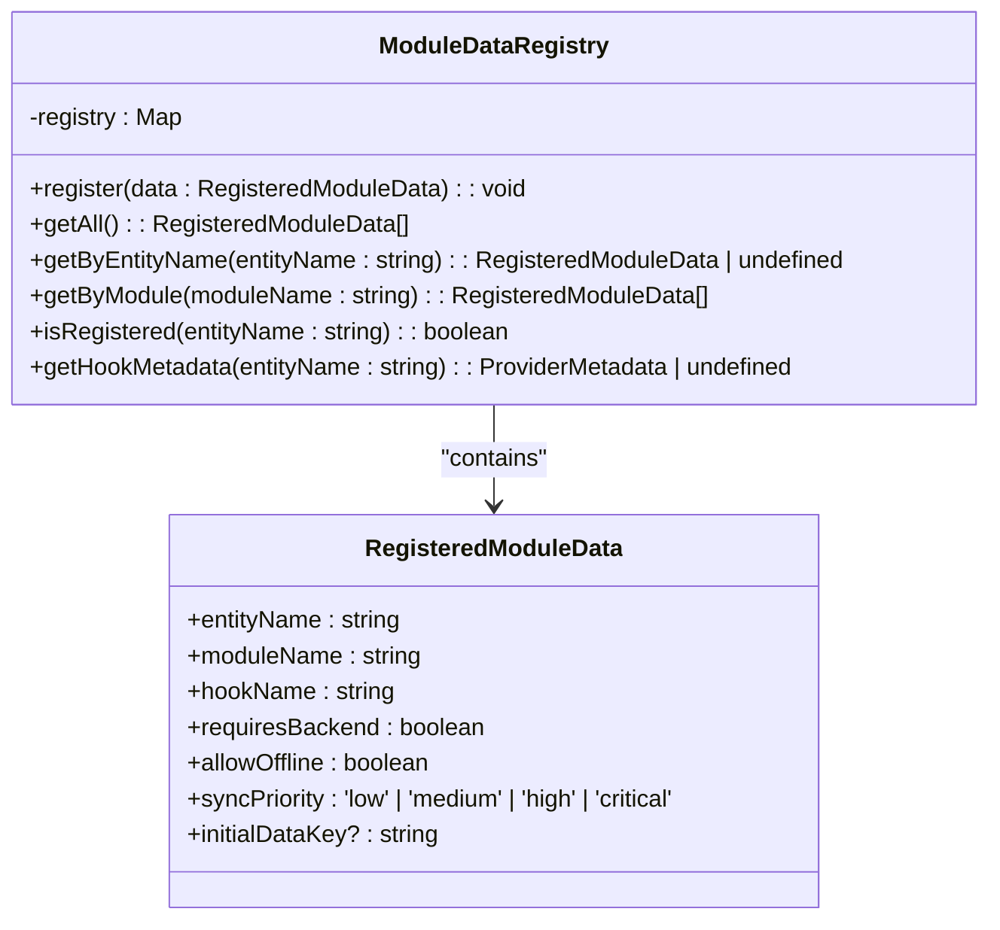
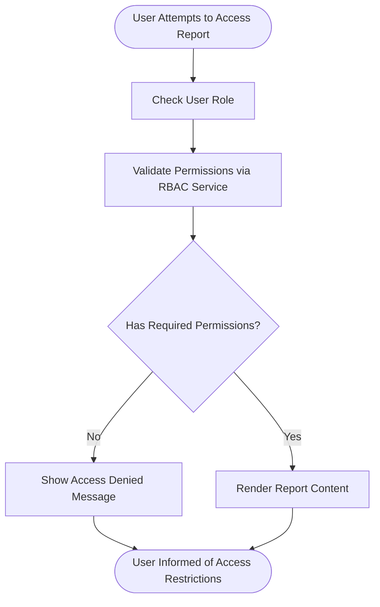
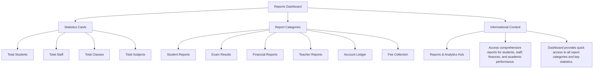
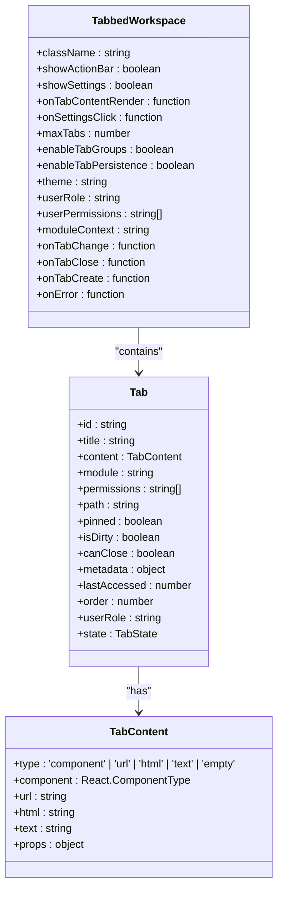
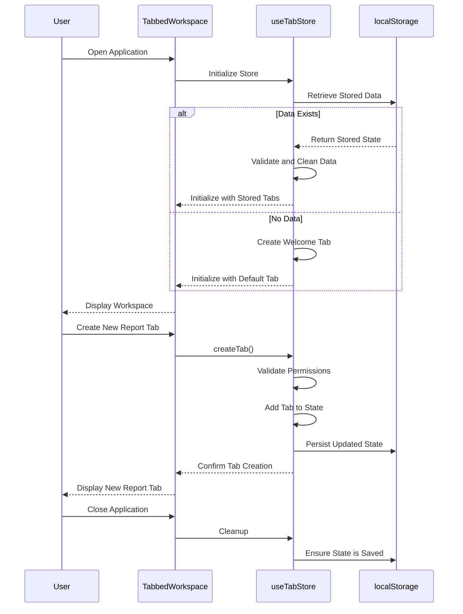
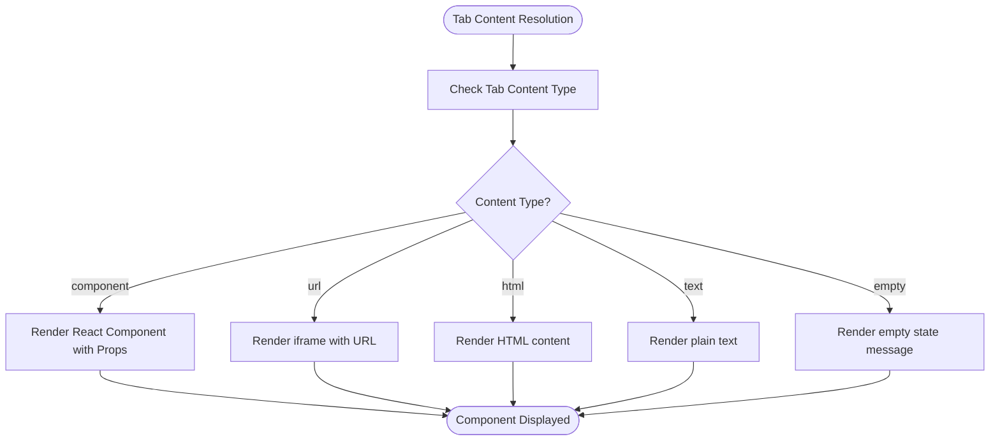
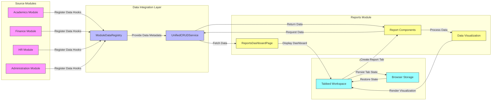

# Reports Module Overview

<cite>
**Referenced Files in This Document**   
- [ModuleDataRegistry.ts](file://src/services/ModuleDataRegistry.ts)
- [TabbedWorkspace.tsx](file://src/components/tabbedWorkspace/TabbedWorkspace.tsx)
- [tabStore.ts](file://src/stores/tabStore.ts)
- [resolveTabContent.tsx](file://src/components/tabbedWorkspace/resolveTabContent.tsx)
- [ReportsDashboardPage.tsx](file://src/modules/reports/pages/ReportsDashboardPage.tsx)
- [moduleDefinition.tsx](file://src/modules/reports/moduleDefinition.tsx)
- [rbac.ts](file://src/modules/reports/rbac.ts)
</cite>

## Table of Contents
1. [Introduction](#introduction)
2. [Module Purpose and Functionality](#module-purpose-and-functionality)
3. [Data Aggregation Architecture](#data-aggregation-architecture)
4. [Module Registration Process](#module-registration-process)
5. [RBAC Access Control](#rbac-access-control)
6. [Dashboard Layout and Navigation](#dashboard-layout-and-navigation)
7. [Tabbed Workspace Integration](#tabbed-workspace-integration)
8. [Data Flow Diagram](#data-flow-diagram)
9. [Configuration Requirements](#configuration-requirements)
10. [Common Setup Issues](#common-setup-issues)

## Introduction
The Reports module in schoolpilot3 serves as the central hub for data analysis and reporting across all functional domains of the educational institution. This comprehensive documentation provides detailed insights into the module's architecture, functionality, and integration patterns within the larger system.

## Module Purpose and Functionality
The Reports module functions as the primary analytics and reporting center for schoolpilot3, aggregating data from all functional domains including academics, finance, HR, and administration. It enables users to generate comprehensive reports, analyze key performance indicators, and extract actionable insights from institutional data.

**Key Features:**
- Centralized reporting interface for all system modules
- Cross-domain data analysis capabilities
- Persistent report views through tabbed workspace integration
- Role-based access to different report categories
- Real-time data visualization and statistical summaries

**Section sources**
- [ReportsDashboardPage.tsx](file://src/modules/reports/pages/ReportsDashboardPage.tsx#L27-L101)

## Data Aggregation Architecture
The Reports module leverages a sophisticated data aggregation system that collects information from multiple modules through two primary services: UnifiedCRUDService and ModuleDataRegistry.

### ModuleDataRegistry Implementation
The ModuleDataRegistry acts as a centralized registry for module data hooks, providing automatic registration and discovery of module data entities. It ensures consistent data access patterns across all modules by maintaining a registry of data entities with their associated metadata.

**Diagram sources**
- [ModuleDataRegistry.ts](file://src/services/ModuleDataRegistry.ts#L0-L123)

The registry is initialized from global providers and automatically discovers data entities based on their metadata type and entity name. Each registered data entity includes information about its module affiliation, required backend connectivity, offline capabilities, and synchronization priority.

### UnifiedCRUDService Integration
The UnifiedCRUDService provides a standardized interface for Create, Read, Update, and Delete operations across all modules. The Reports module utilizes this service to access data from various domains while maintaining consistent error handling, authentication, and data validation patterns.

## Module Registration Process
The Reports module is registered within the schoolpilot3 system through the moduleDefinition.tsx file, which follows a standardized module registration pattern used across the application.

The registration process involves:
1. Defining the module's metadata including name, description, and version
2. Specifying the module's routes and navigation structure
3. Registering the module's data hooks with the global providers registry
4. Configuring the module's integration with the tabbed workspace interface

This registration enables the module to be discovered and loaded by the core module loader, making its functionality available to authorized users.

**Section sources**
- [moduleDefinition.tsx](file://src/modules/reports/moduleDefinition.tsx)

## RBAC Access Control
Access to the Reports module is controlled through a Role-Based Access Control (RBAC) system defined in the rbac.ts file. The system implements fine-grained permission management based on user roles and responsibilities.

### RBAC Implementation
The RBAC system evaluates user permissions at multiple levels:
- Module-level access: Determines whether a user can access the Reports module at all
- Report category access: Controls access to specific report categories (student, financial, academic, etc.)
- Individual report access: Manages permissions for specific reports within categories

The system integrates with the tabbed workspace to enforce access controls when users attempt to create or activate tabs containing reports. If a user lacks the necessary permissions, they receive an "Access Denied" message instead of the report content.

**Diagram sources**
- [rbac.ts](file://src/modules/reports/rbac.ts)
- [TabbedWorkspace.tsx](file://src/components/tabbedWorkspace/TabbedWorkspace.tsx#L13-L536)

## Dashboard Layout and Navigation
The ReportsDashboardPage.tsx file defines the layout and navigation structure of the Reports module's main interface.

### Dashboard Components
The dashboard features a clean, intuitive layout with the following key components:

1. **Statistics Cards**: Display key metrics such as total students, staff, classes, and subjects
2. **Report Categories**: Organized buttons providing quick access to different report types
3. **Central Messaging**: Informative text explaining the purpose and capabilities of the Reports module

**Diagram sources**
- [ReportsDashboardPage.tsx](file://src/modules/reports/pages/ReportsDashboardPage.tsx#L27-L101)

The navigation structure uses React Router links to direct users to specific report pages, maintaining a consistent user experience across the application.

**Section sources**
- [ReportsDashboardPage.tsx](file://src/modules/reports/pages/ReportsDashboardPage.tsx#L27-L101)

## Tabbed Workspace Integration
The Reports module integrates seamlessly with the tabbed workspace interface, enabling users to maintain multiple report views simultaneously and persist their workspace state between sessions.

### TabbedWorkspace Configuration
The TabbedWorkspace component is configured with several key properties that support the Reports module's functionality:

- **enableTabPersistence**: Set to true by default, allowing users' tab configurations to be saved and restored
- **maxTabs**: Limits the number of open tabs to prevent performance degradation
- **showActionBar**: Displays action buttons relevant to the current context
- **enableHierarchicalMode**: Supports breadcrumb navigation for complex report hierarchies

**Diagram sources**
- [TabbedWorkspace.tsx](file://src/components/tabbedWorkspace/TabbedWorkspace.tsx#L13-L536)

### Tab State Management
The useTabStore hook manages the state of all tabs within the workspace, including those created by the Reports module. The store uses Zustand with persistence middleware to save tab configurations to localStorage, ensuring that users' workspaces are preserved between sessions.

Key features of the tab state management include:
- Automatic initialization with a welcome tab when no stored data exists
- Validation of tab data integrity to prevent corruption
- Support for pinning important tabs to keep them open
- Recently closed tabs tracking for easy restoration
- Hierarchical tab support with breadcrumb navigation

**Diagram sources**
- [tabStore.ts](file://src/stores/tabStore.ts#L0-L199)
- [TabbedWorkspace.tsx](file://src/components/tabbedWorkspace/TabbedWorkspace.tsx#L13-L536)

### Tab Content Resolution
The resolveTabContent function determines how tab content is rendered based on its type. For the Reports module, this typically involves rendering React components that display specific reports.

**Diagram sources**
- [resolveTabContent.tsx](file://src/components/tabbedWorkspace/resolveTabContent.tsx#L0-L34)

## Data Flow Diagram
The following diagram illustrates the complete data flow from source modules to report generation in the Reports module:

**Diagram sources**
- [ModuleDataRegistry.ts](file://src/services/ModuleDataRegistry.ts)
- [TabbedWorkspace.tsx](file://src/components/tabbedWorkspace/TabbedWorkspace.tsx)
- [ReportsDashboardPage.tsx](file://src/modules/reports/pages/ReportsDashboardPage.tsx)

## Configuration Requirements
To enable cross-module reporting functionality, several configuration requirements must be met:

1. **Module Registration**: All source modules must properly register their data hooks with the ModuleDataRegistry
2. **Data Hook Configuration**: Data hooks must include proper metadata specifying entity names, module affiliations, and synchronization priorities
3. **RBAC Configuration**: User roles and permissions must be properly defined to control access to sensitive reports
4. **Tabbed Workspace Settings**: The tabbed workspace must be configured with persistence enabled to support persistent report views
5. **Storage Configuration**: Browser localStorage must be available and accessible for storing tab state

**Section sources**
- [ModuleDataRegistry.ts](file://src/services/ModuleDataRegistry.ts)
- [tabStore.ts](file://src/stores/tabStore.ts)
- [rbac.ts](file://src/modules/reports/rbac.ts)

## Common Setup Issues
When configuring the Reports module for cross-module reporting, several common issues may arise:

### Data Aggregation Problems
- **Missing Data Hooks**: Source modules fail to register their data hooks with the ModuleDataRegistry
- **Incorrect Metadata**: Data hooks contain incorrect or incomplete metadata, preventing proper data discovery
- **Synchronization Issues**: Data synchronization priorities are not properly configured, leading to stale or missing data

### Access Control Issues
- **Permission Gaps**: RBAC configurations do not properly define permissions for new report types
- **Role Conflicts**: User roles have conflicting permissions that create access ambiguities
- **Module Context Errors**: The tabbed workspace is initialized with an incorrect module context

### Persistence Problems
- **LocalStorage Restrictions**: Browser settings or extensions block localStorage access
- **Corrupted State**: Tab state becomes corrupted, preventing workspace restoration
- **Size Limitations**: The volume of tab data exceeds browser storage limits

### Performance Issues
- **Excessive Tabs**: Users open too many report tabs simultaneously, degrading performance
- **Large Data Sets**: Reports attempt to load excessively large data sets, causing delays
- **Inefficient Queries**: Data queries are not optimized, leading to slow report generation

Troubleshooting these issues typically involves verifying module registration, checking RBAC configurations, validating data hook metadata, and ensuring proper browser storage functionality.

**Section sources**
- [ModuleDataRegistry.ts](file://src/services/ModuleDataRegistry.ts)
- [tabStore.ts](file://src/stores/tabStore.ts)
- [rbac.ts](file://src/modules/reports/rbac.ts)
- [TabbedWorkspace.tsx](file://src/components/tabbedWorkspace/TabbedWorkspace.tsx)