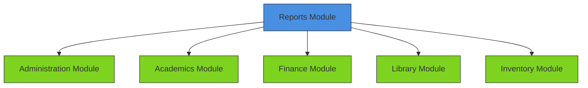
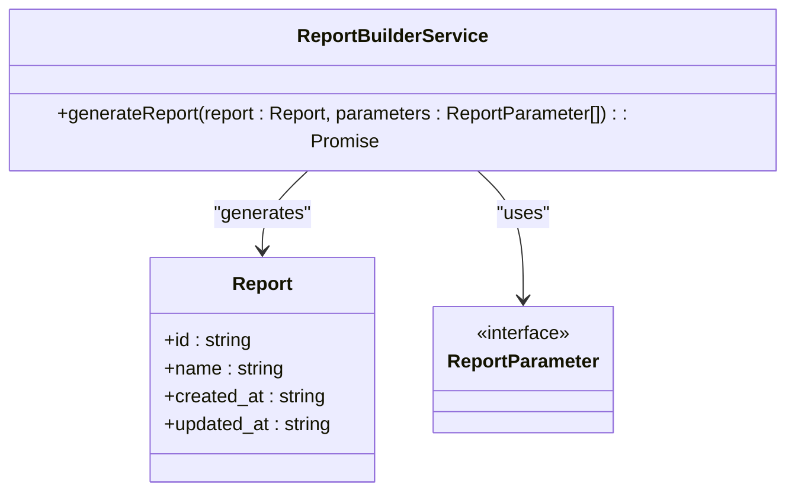
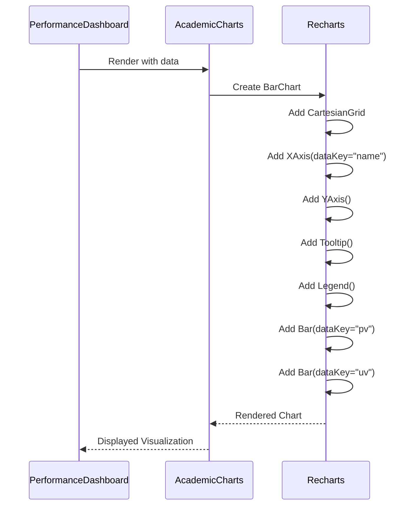
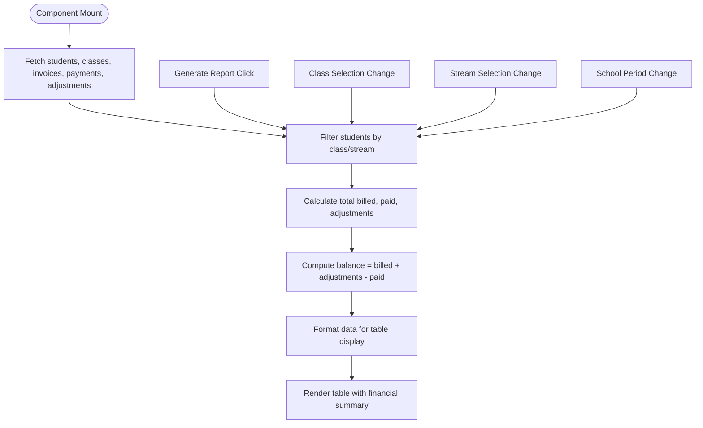
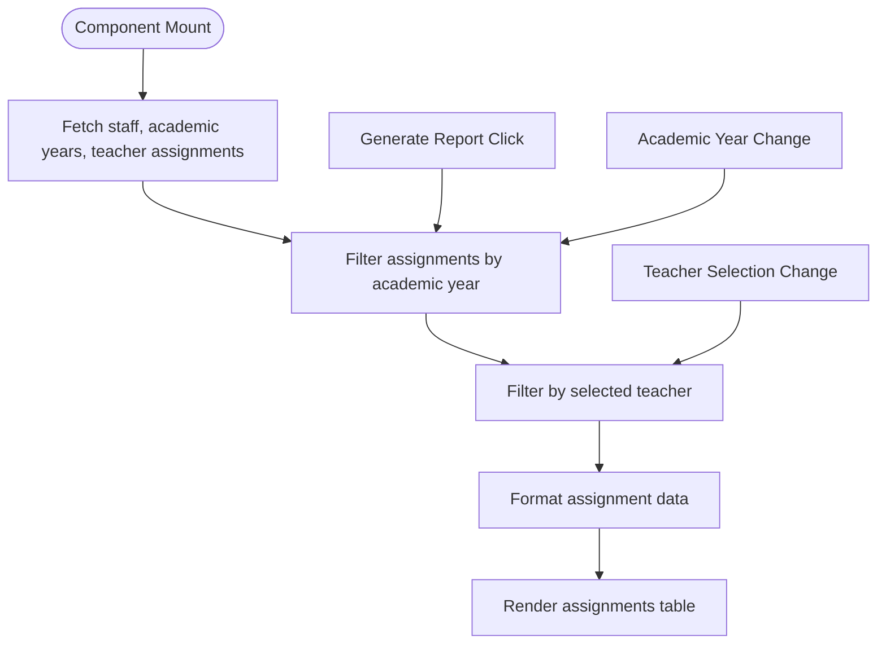
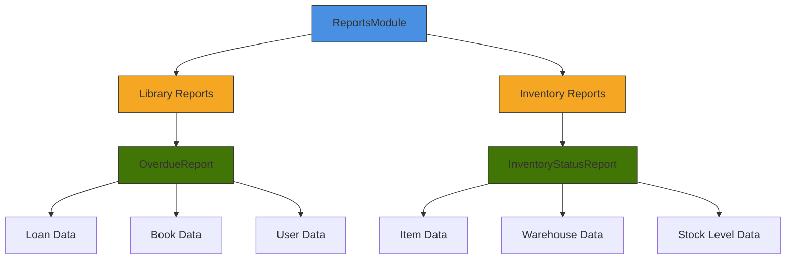
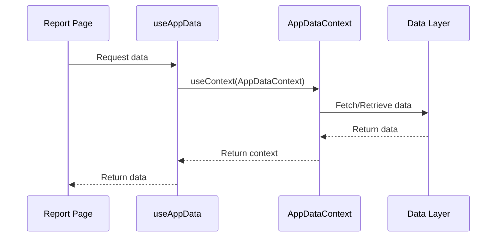

# Reports Module

<cite>
**Referenced Files in This Document**   
- [ReportBuilderService.ts](file://src/modules/reports/services/ReportBuilderService.ts)
- [types.ts](file://src/modules/reports/data/types.ts)
- [DynamicReportBuilder.tsx](file://src/modules/reports/components/DynamicReportBuilder.tsx)
- [AcademicCharts.tsx](file://src/modules/reports/components/AcademicCharts.tsx)
- [PerformanceDashboard.tsx](file://src/modules/reports/dashboards/PerformanceDashboard.tsx)
- [StudentFinancialSummaryPage.tsx](file://src/modules/reports/pages/StudentFinancialSummaryPage.tsx)
- [TeacherAssignmentsPage.tsx](file://src/modules/reports/pages/TeacherAssignmentsPage.tsx)
- [moduleDefinition.tsx](file://src/modules/reports/moduleDefinition.tsx)
- [rbac.ts](file://src/modules/reports/rbac.ts)
- [ReportsDashboardPage.tsx](file://src/modules/reports/pages/ReportsDashboardPage.tsx)
- [ReportsPage.tsx](file://src/modules/reports/pages/ReportsPage.tsx)
- [index.ts](file://src/modules/reports/library/index.ts)
- [OverdueReport.tsx](file://src/modules/reports/library/OverdueReport.tsx)
- [InventoryStatusReport.tsx](file://src/modules/reports/library/InventoryStatusReport.tsx)
- [useAppData.ts](file://src/hooks/useAppData.ts)
</cite>

## Table of Contents
1. [Introduction](#introduction)
2. [Module Registration and Access Permissions](#module-registration-and-access-permissions)
3. [Report Generation Architecture](#report-generation-architecture)
4. [Data Visualization Components](#data-visualization-components)
5. [Concrete Report Examples](#concrete-report-examples)
6. [Cross-Module Reporting Integration](#cross-module-reporting-integration)
7. [Performance Considerations and Optimization](#performance-considerations-and-optimization)
8. [Conclusion](#conclusion)

## Introduction

The Reports module in schoolpilot3 serves as a centralized hub for data analysis, reporting, and visualization across various educational domains. It provides dynamic report generation capabilities, dashboard visualizations, and data export functionality. The module integrates data from multiple subsystems including academics, finance, administration, library, and inventory to deliver comprehensive insights into school operations.

This documentation provides a detailed analysis of the Reports module's architecture, implementation details, and key components. It covers module registration, access control, the ReportBuilderService architecture, data visualization with AcademicCharts and PerformanceDashboard, concrete examples such as StudentFinancialSummaryPage and TeacherAssignmentsPage, and addresses performance considerations for handling large datasets.

## Module Registration and Access Permissions

The Reports module is registered within the schoolpilot3 application through its moduleDefinition.tsx file, which defines its metadata, navigation structure, and dependencies. The module requires integration with administration, academics, and finance modules to access necessary data for reporting purposes.

**Diagram sources**
- [moduleDefinition.tsx](file://src/modules/reports/moduleDefinition.tsx#L1-L45)

The module defines a comprehensive navigation structure with multiple report categories accessible through dedicated routes. These include financial reports (student financial summary, fee collection), academic reports (exam results), personnel reports (teacher assignments), and operational reports (account ledger, student masterlist).

Access permissions for the Reports module are currently defined in the rbac.ts file, which contains default permission and role configurations. The current implementation does not define custom permissions, relying instead on the default RBAC system for access control.

**Section sources**
- [moduleDefinition.tsx](file://src/modules/reports/moduleDefinition.tsx#L1-L45)
- [rbac.ts](file://src/modules/reports/rbac.ts#L1-L9)

## Report Generation Architecture

The core of the Reports module's functionality is centered around the ReportBuilderService, which provides the foundation for dynamic report generation. This service is designed to create reports based on report definitions and parameters, though the current implementation contains placeholder logic.

**Diagram sources**
- [ReportBuilderService.ts](file://src/modules/reports/services/ReportBuilderService.ts#L4-L9)
- [types.ts](file://src/modules/reports/data/types.ts#L1-L7)

The ReportBuilderService currently exports a single method, generateReport, which accepts a Report object and an array of ReportParameter objects, returning a Promise that resolves to an array of any data type. The service imports type definitions from the module's data layer, establishing a clear contract for report data structures.

While the current implementation returns an empty array as a placeholder, the architecture suggests a future implementation that would process report definitions, apply parameters, query relevant data sources, and return formatted report data. The service is designed to be extensible, allowing for the addition of various report types and data processing strategies.

The DynamicReportBuilder component provides the user interface for creating custom reports, though its current implementation is minimal, containing only a placeholder div for the dynamic report builder UI.

**Section sources**
- [ReportBuilderService.ts](file://src/modules/reports/services/ReportBuilderService.ts#L1-L11)
- [DynamicReportBuilder.tsx](file://src/modules/reports/components/DynamicReportBuilder.tsx#L1-L14)
- [types.ts](file://src/modules/reports/data/types.ts#L1-L7)

## Data Visualization Components

The Reports module includes specialized components for data visualization, enabling the presentation of complex data in intuitive formats. The AcademicCharts component leverages the Recharts library to create bar charts for academic performance data, while the PerformanceDashboard component integrates these visualizations into a comprehensive dashboard interface.

**Diagram sources**
- [PerformanceDashboard.tsx](file://src/modules/reports/dashboards/PerformanceDashboard.tsx#L1-L21)
- [AcademicCharts.tsx](file://src/modules/reports/components/AcademicCharts.tsx#L1-L21)

The AcademicCharts component accepts data as a prop and renders a bar chart with configurable data keys for primary and secondary value series. It includes standard chart elements such as Cartesian grid lines, X and Y axes, tooltips for data point inspection, and a legend to distinguish between data series.

The PerformanceDashboard component utilizes AcademicCharts to display sample performance data, demonstrating the integration of visualization components within dashboard layouts. It includes a heading and passes hardcoded data to the AcademicCharts component, suggesting a pattern where actual data would be fetched from backend services or context providers in a production implementation.

**Section sources**
- [AcademicCharts.tsx](file://src/modules/reports/components/AcademicCharts.tsx#L1-L21)
- [PerformanceDashboard.tsx](file://src/modules/reports/dashboards/PerformanceDashboard.tsx#L1-L21)

## Concrete Report Examples

The Reports module includes several concrete implementations that demonstrate the practical application of its reporting capabilities. Two notable examples are the StudentFinancialSummaryPage and TeacherAssignmentsPage, which showcase data aggregation, filtering, and presentation patterns.

### Student Financial Summary Report

The StudentFinancialSummaryPage provides a comprehensive view of student financial data, aggregating information from multiple sources including student invoices, payments, and fee adjustments. The component uses the useAppData hook to access application data and implements sophisticated filtering and calculation logic.

**Diagram sources**
- [StudentFinancialSummaryPage.tsx](file://src/modules/reports/pages/StudentFinancialSummaryPage.tsx#L1-L162)

The report allows users to filter by school period, class, and stream, dynamically recalculating financial summaries based on the selected criteria. For each student, it calculates the total amount billed from invoices, total payments received, total fee adjustments, and the resulting balance. The data is presented in a tabular format with currency formatting and supports export functionality (currently placeholder).

### Teacher Assignments Report

The TeacherAssignmentsPage displays information about teacher-subject assignments across academic years. It demonstrates cross-module data integration by combining staff data, academic year information, and teacher subject assignments.

**Diagram sources**
- [TeacherAssignmentsPage.tsx](file://src/modules/reports/pages/TeacherAssignmentsPage.tsx#L1-L96)

The component filters assignments based on academic year and teacher selection, presenting the data in a clean table format that shows the academic year, teacher name, class stream, and subject. It uses internationalization for UI text and includes loading states and empty result handling.

Both report implementations follow a consistent pattern using React hooks for state management, data fetching through useAppData, and responsive UI components from the application's design system.

**Section sources**
- [StudentFinancialSummaryPage.tsx](file://src/modules/reports/pages/StudentFinancialSummaryPage.tsx#L1-L162)
- [TeacherAssignmentsPage.tsx](file://src/modules/reports/pages/TeacherAssignmentsPage.tsx#L1-L96)

## Cross-Module Reporting Integration

The Reports module extends its functionality beyond the core application by providing reporting capabilities for other modules such as library and inventory. This is achieved through the library subdirectory, which contains specialized reports that integrate with these modules.

The OverdueReport component generates a list of overdue library books, combining data from loans, books, students, and staff entities. It calculates the number of days each book is overdue and estimates potential fines based on a configurable rate. The report includes filtering options for borrower type and minimum days overdue, with summary statistics showing the total number of overdue items and potential fine amounts.

Similarly, the InventoryStatusReport provides comprehensive inventory tracking, displaying stock levels, unit costs, and total values for inventory items. It categorizes items by status (adequate, out of stock) and includes filtering by warehouse, category, and status. The report calculates total inventory value and highlights items that require attention.

**Diagram sources**
- [index.ts](file://src/modules/reports/library/index.ts#L1-L27)
- [OverdueReport.tsx](file://src/modules/reports/library/OverdueReport.tsx#L1-L256)
- [InventoryStatusReport.tsx](file://src/modules/reports/library/InventoryStatusReport.tsx#L1-L288)

The library/index.ts file exports these reports and defines their metadata, including permissions required to access them. This structure allows the Reports module to serve as a unified interface for reporting across different functional areas of the school management system.

**Section sources**
- [index.ts](file://src/modules/reports/library/index.ts#L1-L27)
- [OverdueReport.tsx](file://src/modules/reports/library/OverdueReport.tsx#L1-L256)
- [InventoryStatusReport.tsx](file://src/modules/reports/library/InventoryStatusReport.tsx#L1-L288)

## Performance Considerations and Optimization

The Reports module faces several performance challenges when handling large datasets, particularly in reports that aggregate data from multiple sources. The current implementation addresses these challenges through several strategies:

1. **Data Fetching and Caching**: The useAppData hook provides centralized data access, potentially enabling data caching and reducing redundant API calls. The hook acts as a bridge to the AppDataContext, which likely manages the application's global state.

**Diagram sources**
- [useAppData.ts](file://src/hooks/useAppData.ts#L1-L20)
- [StudentFinancialSummaryPage.tsx](file://src/modules/reports/pages/StudentFinancialSummaryPage.tsx#L1-L162)

2. **Memoization**: Both report examples use React's useMemo and useCallback hooks to optimize performance by memoizing computed values and function instances, preventing unnecessary recalculations during re-renders.

3. **Incremental Data Processing**: Reports process data incrementally, first filtering the dataset and then performing calculations on the filtered results, reducing computational overhead.

4. **Loading States**: Comprehensive loading states are implemented to provide feedback during data fetching and report generation, improving user experience when dealing with large datasets.

Potential optimization strategies for future implementation include:

- Implementing server-side pagination for large result sets
- Adding debouncing to filter inputs to prevent excessive re-renders
- Implementing data virtualization for large tables
- Adding caching mechanisms for frequently accessed reports
- Optimizing database queries through indexing and query optimization
- Implementing background report generation for complex reports

The placeholder ReportBuilderService suggests a future architecture where report generation could be abstracted into a service layer with optimized query execution and caching mechanisms.

**Section sources**
- [useAppData.ts](file://src/hooks/useAppData.ts#L1-L20)
- [StudentFinancialSummaryPage.tsx](file://src/modules/reports/pages/StudentFinancialSummaryPage.tsx#L1-L162)
- [TeacherAssignmentsPage.tsx](file://src/modules/reports/pages/TeacherAssignmentsPage.tsx#L1-L96)
- [ReportBuilderService.ts](file://src/modules/reports/services/ReportBuilderService.ts#L1-L11)

## Conclusion

The Reports module in schoolpilot3 provides a comprehensive framework for data analysis and reporting across various educational domains. Its architecture is designed to integrate data from multiple modules, including academics, finance, administration, library, and inventory, to deliver actionable insights through dynamic reports and dashboards.

Key strengths of the module include its modular design, consistent UI patterns, and integration with the application's global data context. The implementation demonstrates effective use of React hooks for state management and data fetching, along with responsive design principles for optimal user experience.

While the current implementation contains placeholder services and limited functionality in some areas, the architectural foundation is solid and extensible. Future enhancements could include implementing the ReportBuilderService with robust data querying capabilities, adding more sophisticated visualization options, and enhancing performance optimization for large datasets.

The module successfully serves as a centralized reporting hub, providing administrators, teachers, and staff with the tools they need to monitor school operations, track financial performance, and make data-driven decisions to improve educational outcomes.