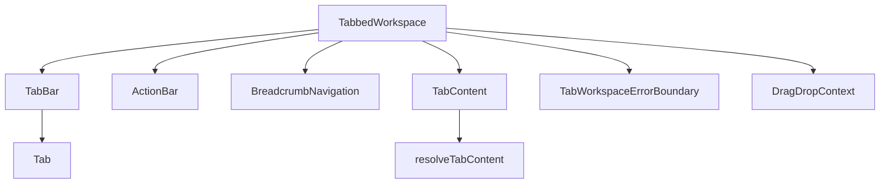
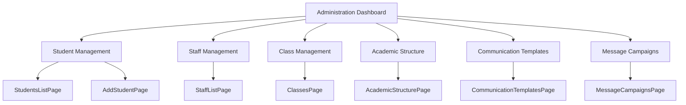

# Getting Started

<cite>
**Referenced Files in This Document**   
- [package.json](file://package.json)
- [vite.config.ts](file://vite.config.ts)
- [tailwind.config.js](file://tailwind.config.js)
- [environmentMatrix.ts](file://src/config/environmentMatrix.ts)
- [TabbedWorkspace.tsx](file://src/components/tabbedWorkspace/TabbedWorkspace.tsx)
- [TabBar.tsx](file://src/components/tabbedWorkspace/TabBar.tsx)
- [TabContent.tsx](file://src/components/tabbedWorkspace/TabContent.tsx)
- [resolveTabContent.tsx](file://src/components/tabbedWorkspace/resolveTabContent.tsx)
</cite>

## Table of Contents
1. [System Requirements and Prerequisites](#system-requirements-and-prerequisites)
2. [Installation Instructions](#installation-instructions)
3. [Development Server Configuration](#development-server-configuration)
4. [Building for Production](#building-for-production)
5. [Running Tests](#running-tests)
6. [Environment Variables and Backend Configuration](#environment-variables-and-backend-configuration)
7. [Launching the Tabbed Workspace Interface](#launching-the-tabbed-workspace-interface)
8. [Accessing the Administration Dashboard](#accessing-the-administration-dashboard)
9. [Troubleshooting Common Issues](#troubleshooting-common-issues)

## System Requirements and Prerequisites

To successfully set up the schoolpilot3 development environment, ensure your system meets the following requirements:

- **Node.js**: Version 18.0.0 or higher (LTS recommended)
- **npm**: Version 8.0.0 or higher, or **Yarn**: Version 1.22.0 or higher
- **Git**: Version 2.0.0 or higher for version control
- **Operating System**: Windows 10/11, macOS 10.15+, or Linux (Ubuntu 20.04+ recommended)
- **Memory**: Minimum 8GB RAM (16GB recommended for optimal performance)
- **Disk Space**: At least 500MB of free space for dependencies

The application uses modern JavaScript features and requires a compatible Node.js environment. The package.json file specifies dependencies that require Node.js 18+ for proper functionality, particularly due to the use of ES modules and modern JavaScript APIs.

**Section sources**
- [package.json](file://package.json)

## Installation Instructions

Follow these step-by-step instructions to install and set up the schoolpilot3 development environment:

### Using npm
```bash
# Navigate to the project directory
cd 

# Install all dependencies
npm install

# Verify installation
npm list
```

### Using Yarn
```bash
# Navigate to the project directory
cd 

# Install Yarn if not already installed
npm install -g yarn

# Install all dependencies
yarn install

# Verify installation
yarn list
```

The installation process will download all dependencies specified in the package.json file, including:
- React 19.1.1 for UI components
- Vite 6.2.0 as the build tool and development server
- RxDB 16.15.0 for reactive database operations
- Tailwind CSS 3.4.4 for styling
- TypeScript 5.7.2 for type safety

After installation, verify that the node_modules directory has been created and contains the required packages.

**Section sources**
- [package.json](file://package.json)

## Development Server Configuration

The development server is configured using Vite, which provides fast hot module replacement (HMR) and an optimized development experience.

### Starting the Development Server
```bash
# Start the development server
npm run dev

# Or using Yarn
yarn dev
```

This command launches the Vite development server, which will be available at `http://localhost:5201`. The server configuration is defined in vite.config.ts with the following key settings:

- **Port**: 5201 (configurable in vite.config.ts)
- **Host**: Set to `true` to allow connections from network devices
- **Headers**: Includes Cross-Origin Opener Policy and Cross-Origin Embedder Policy for security
- **Alias**: `@` is aliased to `./src` for easier imports
- **Build Optimization**: Configured with manual chunks for vendor libraries

### Custom Server Configuration
To modify the server settings, edit the vite.config.ts file:

```typescript
export default defineConfig(({ mode }) => {
    const env = loadEnv(mode, '.', '');
    return {
      plugins: [react()],
      server: {
        port: 5201,
        host: true,
        fs: { strict: false },
        headers: {
          'Cross-Origin-Opener-Policy': 'same-origin',
          'Cross-Origin-Embedder-Policy': 'require-corp',
        },
      },
      // ... other configuration
    };
});
```

The server automatically detects environment variables and configures the application accordingly.

**Section sources**
- [vite.config.ts](file://vite.config.ts)
- [package.json](file://package.json)

## Building for Production

To create a production-ready build of the application, use the following commands:

### Build Process
```bash
# Create a production build
npm run build

# Or using Yarn
yarn build
```

This command executes Vite's build process, which:
- Optimizes and minifies JavaScript and CSS
- Generates static assets with content hashing
- Creates a dist directory with the production build
- Applies rollup optimizations with manual chunks for vendor libraries

### Build Configuration
The build configuration in vite.config.ts includes:

```typescript
build: {
  rollupOptions: {
    output: {
      manualChunks: {
        'react-vendor': ['react', 'react-dom'],
        'router-vendor': ['react-router-dom'],
        'pouchdb-vendor': ['pouchdb', 'pouchdb-find']
      }
    }
  },
  chunkSizeWarningLimit: 1000
}
```

This configuration optimizes loading performance by separating vendor libraries into their own chunks.

### Previewing the Production Build
After building, you can preview the production build locally:

```bash
# Preview the production build
npm run preview

# Or using Yarn
yarn preview
```

This starts a local server to serve the production build, typically available at `http://localhost:4173`.

**Section sources**
- [vite.config.ts](file://vite.config.ts)
- [package.json](file://package.json)

## Running Tests

The application includes a comprehensive test suite using Vitest for unit and integration testing.

### Test Commands
```bash
# Run tests in watch mode (development)
npm run test

# Run all tests once
npm run test:run

# Run tests with UI interface
npm run test:ui

# Or using Yarn
yarn test
yarn test:run
yarn test:ui
```

### Test Configuration
The test suite is configured in vitest.config.ts (not shown in file listing but standard for Vite projects) and includes:

- **Testing Library**: @testing-library/react for component testing
- **Jest DOM**: For DOM assertions
- **User Event**: For simulating user interactions
- **Playwright**: For end-to-end testing (via @playwright/test)

### Running Specific Tests
To run specific test files or directories:

```bash
# Run all tests in a specific directory
npx vitest src/components/tabbedWorkspace

# Run a specific test file
npx vitest src/components/tabbedWorkspace/TabbedWorkspace.test.tsx
```

The test suite includes various types of tests:
- Unit tests for individual components
- Integration tests for component interactions
- Performance tests for critical components
- Render loop prevention tests

**Section sources**
- [package.json](file://package.json)

## Environment Variables and Backend Configuration

The application uses environment variables and a sophisticated configuration system to manage different environments and backend connections.

### Environment Configuration
The environment system is defined in src/config/environmentMatrix.ts and supports three environments:

```typescript
export type Environment = 'development' | 'staging' | 'production';
```

Each environment has specific configurations for data modes, database providers, and features.

### Environment Detection
The application automatically detects the environment based on:
- URL hostname and protocol
- NODE_ENV environment variable
- Localhost detection

```typescript
export const detectEnvironment = (): Environment => {
  if (typeof window === 'undefined') {
    return 'development';
  }

  const hostname = window.location.hostname;
  const protocol = window.location.protocol;
  
  // Check for production indicators
  if (protocol === 'https:' && !hostname.includes('localhost') && !hostname.includes('127.0.0.1')) {
    if (hostname.includes('staging') || hostname.includes('test')) {
      return 'staging';
    }
    return 'production';
  }
  
  // Check environment variables
  if (process.env.NODE_ENV === 'production') {
    return 'production';
  }
  
  if (process.env.NODE_ENV === 'staging') {
    return 'staging';
  }
  
  return 'development';
};
```

### Environment-Specific Settings
Each environment has specific policies:

| Environment | Allowed Data Modes | Default Data Mode | Allowed Database Providers | Default Database Provider | Can Switch Data Modes |
|-----------|-------------------|------------------|---------------------------|--------------------------|---------------------|
| development | demo, production | demo | rxdb, pouchdb, sqlite, memory | sqlite | true |
| staging | demo, production | demo | rxdb, pouchdb | rxdb | true |
| production | production | production | rxdb | rxdb | false |

### Setting Environment Variables
Create a .env file in the root directory:

```env
NODE_ENV=development
GEMINI_API_KEY=your-api-key-here
```

The Vite configuration automatically loads these variables:

```typescript
define: {
  'process.env.API_KEY': JSON.stringify(env.GEMINI_API_KEY),
  'process.env.GEMINI_API_KEY': JSON.stringify(env.GEMINI_API_KEY),
  global: 'globalThis'
}
```

### Database Configuration
The application supports multiple database providers:
- **rxdb**: Reactive database for production
- **pouchdb**: Offline-first database
- **sqlite**: Local SQLite database
- **memory**: In-memory database for testing

The database provider is configured based on the environment and can be switched in development and staging environments.

**Section sources**
- [environmentMatrix.ts](file://src/config/environmentMatrix.ts)
- [vite.config.ts](file://vite.config.ts)
- [unifiedConfig.ts](file://src/config/unifiedConfig.ts)

## Launching the Tabbed Workspace Interface

The tabbed workspace interface is the primary user interface component, providing a multi-tab environment for managing school administration tasks.

### Implementation Overview
The tabbed workspace is implemented in the src/components/tabbedWorkspace directory with the following key components:



**Diagram sources**
- [TabbedWorkspace.tsx](file://src/components/tabbedWorkspace/TabbedWorkspace.tsx)
- [TabBar.tsx](file://src/components/tabbedWorkspace/TabBar.tsx)
- [TabContent.tsx](file://src/components/tabbedWorkspace/TabContent.tsx)

### Key Features
- **Drag and Drop**: Tabs can be reordered using drag and drop
- **Tab Management**: Create, close, pin, and duplicate tabs
- **Hierarchical Navigation**: Breadcrumb navigation for nested content
- **Action Bar**: Contextual actions based on the active module
- **Error Boundaries**: Isolated error handling for workspace components

### Usage Example
To launch the tabbed workspace interface:

1. Start the development server: `npm run dev`
2. Navigate to `http://localhost:5201`
3. The tabbed workspace will load as the default interface

### Programmatic Tab Management
The workspace provides APIs for programmatic tab control:

```typescript
// Create a new tab
const newTab = createTab({
  title: 'Student Records',
  content: { type: 'component', component: 'StudentsListPage' },
  module: 'administration',
  path: '/administration/students'
});

// Activate a tab
activateTab(tabId);

// Close a tab
closeTab(tabId);
```

The tabbed workspace uses React Context and Zustand for state management, ensuring efficient updates and minimal re-renders.

**Section sources**
- [TabbedWorkspace.tsx](file://src/components/tabbedWorkspace/TabbedWorkspace.tsx)
- [tabStore.ts](file://src/stores/tabStore.ts)
- [actionRegistry.ts](file://src/services/actionRegistry.ts)

## Accessing the Administration Dashboard

The administration dashboard provides comprehensive school management functionality and can be accessed through the tabbed workspace interface.

### Navigation to Administration Dashboard
1. Launch the application and wait for the tabbed workspace to load
2. Click on the "Administration" module in the sidebar or navigation menu
3. The dashboard will open in a new tab with the following components:



**Diagram sources**
- [AdministrationDashboardPage.tsx](file://src/modules/administration/pages/AdministrationDashboardPage.tsx)
- [TabbedWorkspace.tsx](file://src/components/tabbedWorkspace/TabbedWorkspace.tsx)

### Key Features of Administration Dashboard
- **Student Management**: Add, edit, and view student records
- **Staff Management**: Manage staff profiles and assignments
- **Class Management**: Configure classes and class streams
- **Academic Structure**: Define academic years and periods
- **Communication**: Create and manage communication templates
- **Message Campaigns**: Send bulk messages to students and parents

### Data Management
The administration module uses RxDB for data persistence with the following collections:

- **students**: Student demographic and enrollment data
- **staff**: Staff profiles and employment information
- **classes**: Class definitions and configurations
- **classStreams**: Class stream assignments
- **academicYears**: Academic year definitions
- **schoolPeriods**: Daily school period schedules

Data is synchronized across devices and available offline through the PouchDB replication system.

**Section sources**
- [moduleDefinition.tsx](file://src/modules/administration/moduleDefinition.tsx)
- [AdministrationDashboardPage.tsx](file://src/modules/administration/pages/AdministrationDashboardPage.tsx)
- [data](file://src/modules/administration/data)

## Troubleshooting Common Issues

This section addresses common setup and runtime issues with their solutions.

### Database Initialization Failures
**Symptom**: Application fails to start with database connection errors
**Solution**:
1. Verify the environment configuration in environmentMatrix.ts
2. Check that the required database provider is allowed in the current environment
3. Ensure proper permissions for database files (for SQLite)
4. Clear corrupted data by calling clearCorruptedData() in the tab store

```typescript
// In development, you can reset the database
if (import.meta.env.DEV) {
  clearCorruptedData();
}
```

### Module Loading Errors
**Symptom**: "Module not found" or "Cannot resolve module" errors
**Solution**:
1. Verify the import paths use the @ alias for src directory
2. Check that the module is properly registered in the module system
3. Ensure the module's package.json has correct dependencies
4. Run the fix scripts to resolve import issues:

```bash
# Fix import paths
node scripts/fix/fix_import_paths.mjs

# Fix modular architecture issues
node scripts/fix/fix_modular_architecture_and_rxdb.mjs
```

### Development Server Not Starting
**Symptom**: Vite server fails to start or crashes immediately
**Solution**:
1. Check that Node.js version meets requirements (18+)
2. Clear npm cache: `npm cache clean --force`
3. Delete node_modules and package-lock.json, then reinstall:
```bash
rm -rf node_modules package-lock.json
npm install
```
4. Verify port 5201 is not in use by another application
5. Check file permissions in the project directory

### Environment Variable Issues
**Symptom**: Environment variables not being loaded or recognized
**Solution**:
1. Ensure .env file is in the root directory
2. Verify variable names match those in vite.config.ts
3. Restart the development server after changing environment variables
4. Check for typos in variable names (case-sensitive)

### Performance Issues in Tabbed Workspace
**Symptom**: Slow tab switching or rendering delays
**Solution**:
1. Enable debug mode to identify performance bottlenecks:
```bash
DEBUG_TABS=true npm run dev
```
2. Check for unnecessary re-renders using React DevTools
3. Verify memoization is properly implemented in components
4. Reduce the number of active tabs (default limit is 20)

### Authentication and Permission Errors
**Symptom**: Access denied to dashboard or specific features
**Solution**:
1. Verify user role and permissions are correctly set
2. Check RBAC configuration in module rbac.ts files
3. Ensure the user context is properly initialized
4. Clear browser storage and log in again

### Build Failures
**Symptom**: Production build fails with optimization errors
**Solution**:
1. Increase chunk size warning limit in vite.config.ts:
```typescript
build: {
  chunkSizeWarningLimit: 1000
}
```
2. Check for circular dependencies using the fix scripts
3. Verify all dynamic imports are properly configured
4. Ensure all required environment variables are set for production build

**Section sources**
- [environmentMatrix.ts](file://src/config/environmentMatrix.ts)
- [TabbedWorkspace.tsx](file://src/components/tabbedWorkspace/TabbedWorkspace.tsx)
- [vite.config.ts](file://vite.config.ts)
- [package.json](file://package.json)
- [fix](file://scripts/fix)