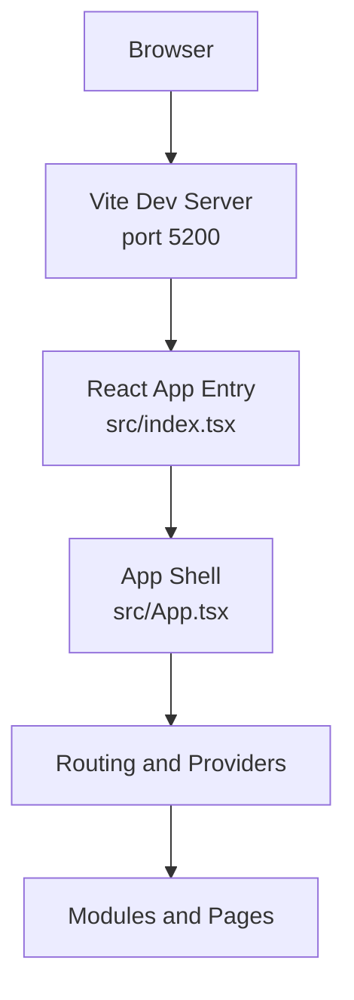
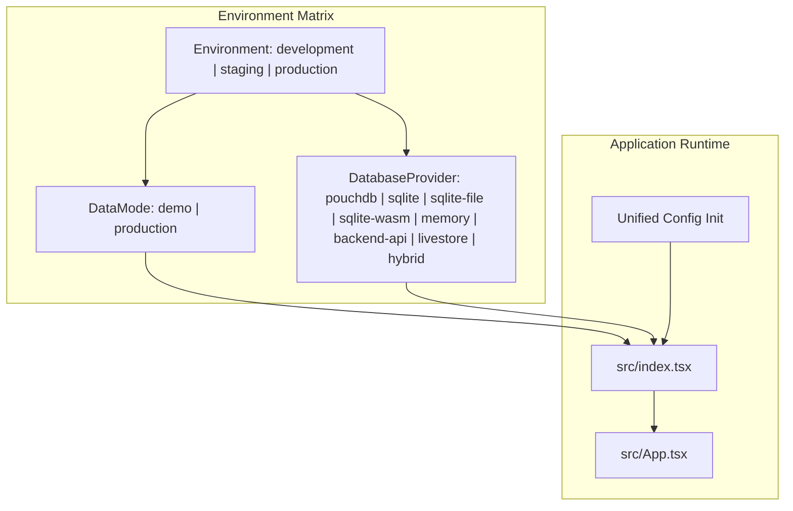
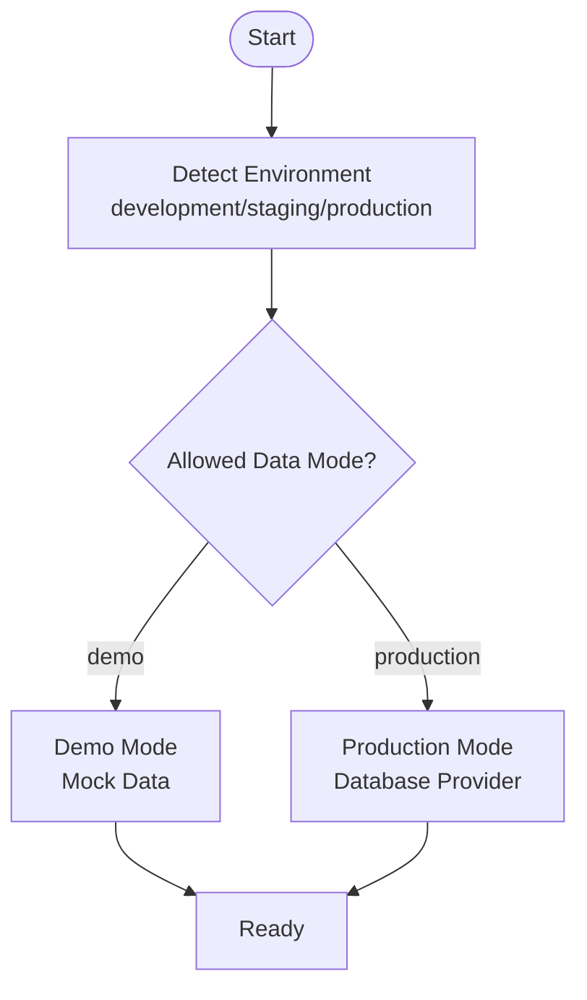
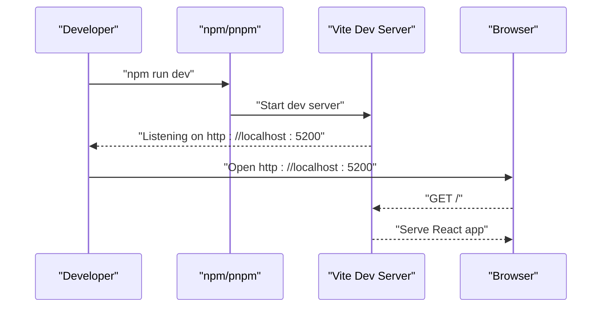
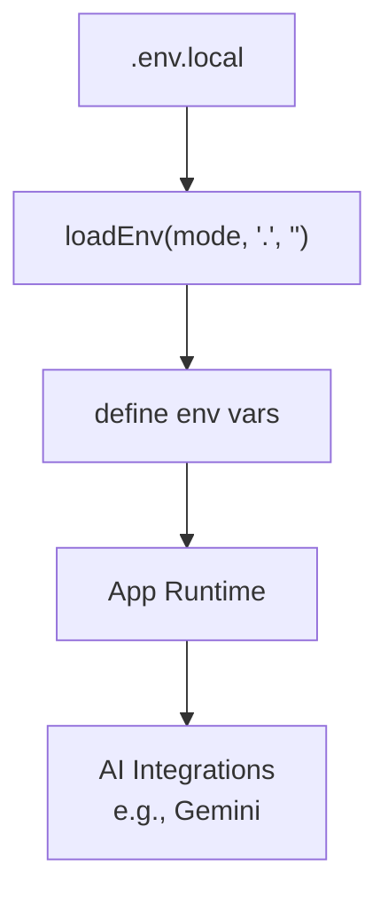
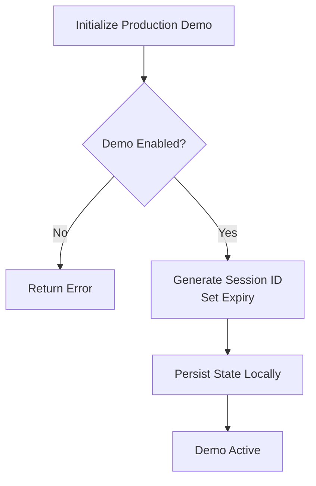
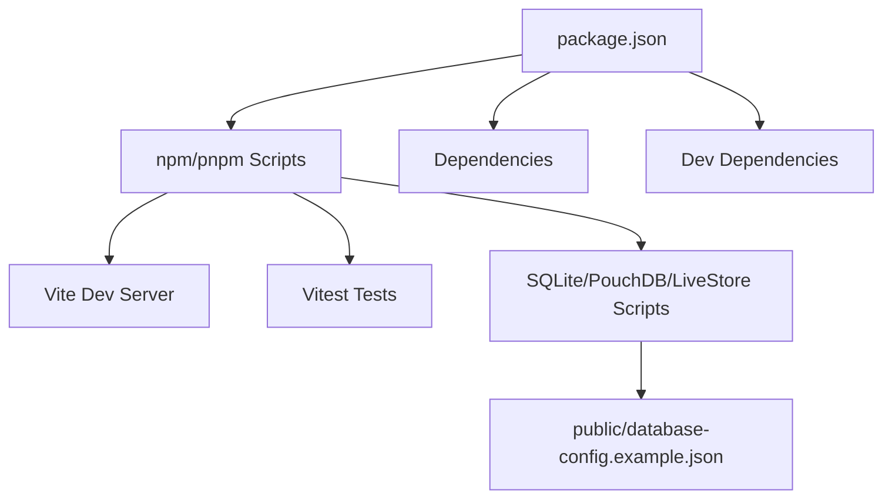

# Getting Started

<cite>
**Referenced Files in This Document**
- [README.md](file://README.md)
- [package.json](file://package.json)
- [vite.config.ts](file://vite.config.ts)
- [src/index.tsx](file://src/index.tsx)
- [src/App.tsx](file://src/App.tsx)
- [src/config/environmentMatrix.ts](file://src/config/environmentMatrix.ts)
- [src/config/dataModePolicies.ts](file://src/config/dataModePolicies.ts)
- [src/config/dataMode.ts](file://src/config/dataMode.ts)
- [src/config/productionDemo.ts](file://src/config/productionDemo.ts)
- [public/database-config.example.json](file://public/database-config.example.json)
</cite>

## Table of Contents
1. [Introduction](#introduction)
2. [Project Structure](#project-structure)
3. [Core Components](#core-components)
4. [Architecture Overview](#architecture-overview)
5. [Detailed Component Analysis](#detailed-component-analysis)
6. [Dependency Analysis](#dependency-analysis)
7. [Performance Considerations](#performance-considerations)
8. [Troubleshooting Guide](#troubleshooting-guide)
9. [Conclusion](#conclusion)
10. [Appendices](#appendices)

## Introduction
SchoolPilot3 is an enterprise-grade educational management system built with React, TypeScript, and Vite. It features a modular architecture and a dual-mode data layer designed to support both rapid development (demo mode) and production-grade database-backed development (production mode). The system emphasizes type safety, reactive data flows, and a scalable module structure across domains such as administration, academics, finance, HR, inventory, library, nutrition, and reporting.

This guide focuses on prerequisites, installation, environment configuration, running the development server, verifying your setup, navigating the application, and troubleshooting common issues.

## Project Structure
At a high level, the project is organized into:
- Source code under src/
- Build and dev tooling via Vite
- Scripts for development, testing, and database-related tasks
- Extensive documentation under docs/

Key entry points:
- Application bootstrap and rendering occur in src/index.tsx and src/App.tsx
- Development server configuration is defined in vite.config.ts
- Environment and data mode policies are configured under src/config/

**Diagram sources**
- [vite.config.ts:93-102](file://vite.config.ts#L93-L102)
- [src/index.tsx:41-72](file://src/index.tsx#L41-L72)
- [src/App.tsx:25-46](file://src/App.tsx#L25-L46)

**Section sources**
- [README.md:77-123](file://README.md#L77-L123)
- [vite.config.ts:7-200](file://vite.config.ts#L7-L200)
- [src/index.tsx:1-78](file://src/index.tsx#L1-L78)
- [src/App.tsx:1-49](file://src/App.tsx#L1-L49)

## Core Components
- Prerequisites: Node.js 16+ is required to run the development server and build the application.
- Package manager: npm or pnpm can be used to install dependencies.
- Development server: Vite runs on port 5200 by default and serves the React application.
- Environment configuration: .env.local is used to set environment variables such as GEMINI_API_KEY.
- Dual-mode architecture: The system supports demo mode (mock data) and production mode (database-backed), selectable via configuration.

Quick-start commands:
- Install dependencies: npm install or pnpm install
- Run development server: npm run dev
- Access the application: http://localhost:5200

**Section sources**
- [README.md:124-146](file://README.md#L124-L146)
- [package.json:6-65](file://package.json#L6-L65)
- [vite.config.ts:93-102](file://vite.config.ts#L93-L102)

## Architecture Overview
SchoolPilot3 uses a dual-mode data layer:
- Demo mode: Rich mock data for quick development and demonstrations; no database initialization is required.
- Production mode: Database-backed data using providers such as SQLite WASM, PouchDB, or LiveStore, depending on environment.

The environment matrix defines allowed data modes and providers per environment (development, staging, production), and data mode policies govern switching and validation.

**Diagram sources**
- [src/config/environmentMatrix.ts:32-86](file://src/config/environmentMatrix.ts#L32-L86)
- [src/config/dataModePolicies.ts:60-83](file://src/config/dataModePolicies.ts#L60-L83)
- [src/index.tsx:18-39](file://src/index.tsx#L18-L39)
- [src/App.tsx:25-46](file://src/App.tsx#L25-L46)

**Section sources**
- [README.md:59-70](file://README.md#L59-L70)
- [README.md:288-301](file://README.md#L288-L301)
- [src/config/environmentMatrix.ts:1-152](file://src/config/environmentMatrix.ts#L1-L152)
- [src/config/dataModePolicies.ts:1-190](file://src/config/dataModePolicies.ts#L1-L190)

## Detailed Component Analysis

### Dual-Mode Architecture: Demo vs Production
- Demo mode: Ideal for rapid setup and demonstrations. It avoids database initialization and uses mock data.
- Production mode: Suitable for database-backed development and testing with real data persistence and reactive subscriptions.
- Mode switching: Controlled via environment and configuration APIs. In production and staging, switching may require confirmation.

**Diagram sources**
- [src/config/environmentMatrix.ts:88-115](file://src/config/environmentMatrix.ts#L88-L115)
- [src/config/dataModePolicies.ts:85-104](file://src/config/dataModePolicies.ts#L85-L104)

**Section sources**
- [README.md:288-301](file://README.md#L288-L301)
- [src/config/environmentMatrix.ts:32-86](file://src/config/environmentMatrix.ts#L32-L86)
- [src/config/dataModePolicies.ts:106-162](file://src/config/dataModePolicies.ts#L106-L162)

### Development Server Startup and Access
- The development server is powered by Vite and runs on port 5200 by default.
- The server configuration sets host, port, and security headers suitable for local development.
- After starting the server, open http://localhost:5200 in your browser.

**Diagram sources**
- [package.json:6-65](file://package.json#L6-L65)
- [vite.config.ts:93-102](file://vite.config.ts#L93-L102)

**Section sources**
- [README.md:139-146](file://README.md#L139-L146)
- [vite.config.ts:7-200](file://vite.config.ts#L7-L200)

### Environment Configuration and AI Integration
- Environment variables are loaded via Vite’s loadEnv and exposed to the app via define.
- GEMINI_API_KEY is required for AI-related integrations and is passed into the app’s environment.
- The default port is 5200, but can be overridden via VITE_PORT.

**Diagram sources**
- [vite.config.ts:8-112](file://vite.config.ts#L8-L112)
- [README.md:444-446](file://README.md#L444-L446)

**Section sources**
- [README.md:135-137](file://README.md#L135-L137)
- [vite.config.ts:8-112](file://vite.config.ts#L8-L112)

### Production Demo Mode Capabilities
- Production demo mode enables controlled demo sessions with optional transitions to live mode.
- Configuration includes session duration, expiry, and optional data retention.
- State is persisted locally and cleaned up when expired.

**Diagram sources**
- [src/config/productionDemo.ts:134-194](file://src/config/productionDemo.ts#L134-L194)

**Section sources**
- [src/config/productionDemo.ts:1-301](file://src/config/productionDemo.ts#L1-L301)

## Dependency Analysis
- Build and dev dependencies are managed via Vite and TypeScript.
- The application exposes numerous scripts for development, testing, linting, and database migration/testing.
- Database configuration examples are provided under public/database-config.example.json.

**Diagram sources**
- [package.json:6-65](file://package.json#L6-L65)
- [package.json:132-159](file://package.json#L132-L159)
- [public/database-config.example.json:1-49](file://public/database-config.example.json#L1-L49)

**Section sources**
- [package.json:1-161](file://package.json#L1-L161)
- [public/database-config.example.json:1-49](file://public/database-config.example.json#L1-L49)

## Performance Considerations
- The build configuration includes manual chunking strategies to optimize vendor and module bundles.
- Code splitting is applied per module and shared application areas to improve load performance.
- PWA caching is enabled in production mode to accelerate subsequent visits.

[No sources needed since this section provides general guidance]

## Troubleshooting Guide
Common setup and runtime issues:
- Database initialization failures: The system gracefully falls back to demo mode if database initialization fails. Check the console for initialization errors; the app will notify “Running in Demo Mode.”
- Missing translations: Ensure translation keys exist in the appropriate namespace files under src/i18n/locales/.
- Type errors after adding new features: Update central type definitions in src/core/types.ts and module-specific types under modules/[module]/data/types.ts.
- Performance issues: Verify you are not inadvertently running in production mode during development; monitor bundle size and consider optimizing chunking.

**Section sources**
- [README.md:456-481](file://README.md#L456-L481)

## Conclusion
You are now equipped to install, configure, and run SchoolPilot3 locally. Use demo mode for quick starts and production mode for database-backed development. Leverage the environment and data mode configuration to tailor the system to your needs, and consult the troubleshooting section if you encounter issues.

[No sources needed since this section summarizes without analyzing specific files]

## Appendices

### Quick Verification Checklist
- Node.js 16+ installed
- Dependencies installed (npm install or pnpm install)
- .env.local created with GEMINI_API_KEY
- Development server running (npm run dev)
- Application accessible at http://localhost:5200

**Section sources**
- [README.md:126-146](file://README.md#L126-L146)

### Practical Examples
- Running the development server:
  - npm run dev
- Accessing the dashboard:
  - Open http://localhost:5200 in your browser

**Section sources**
- [README.md:139-146](file://README.md#L139-L146)