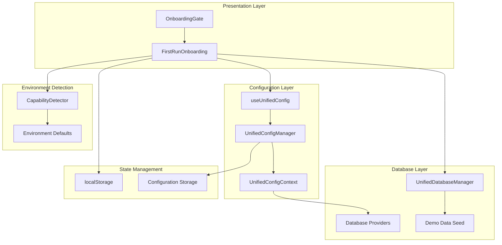
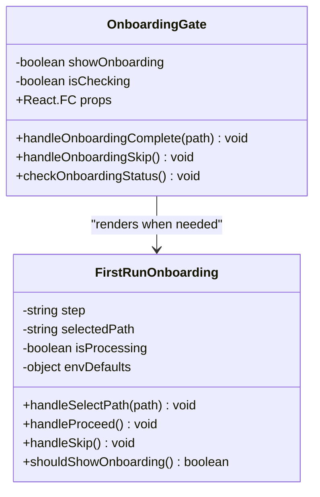
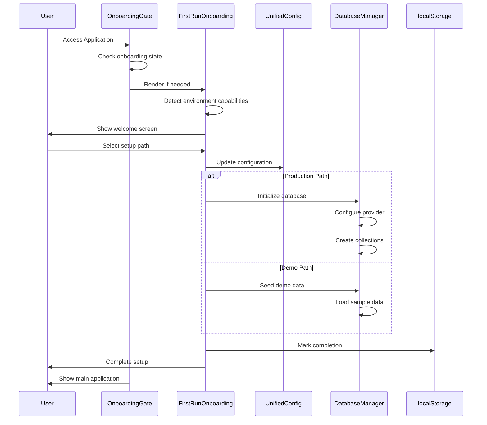
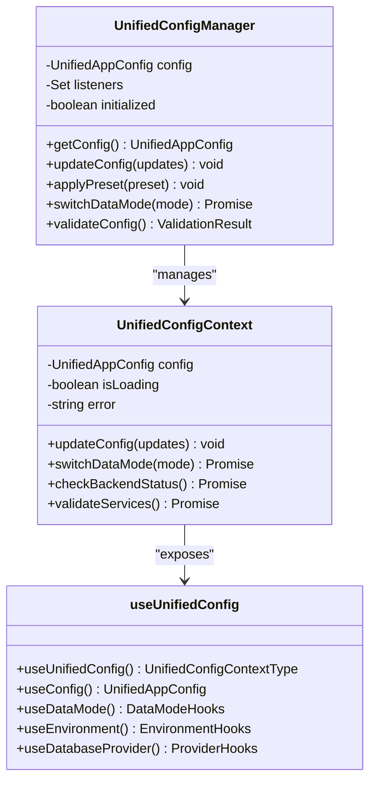
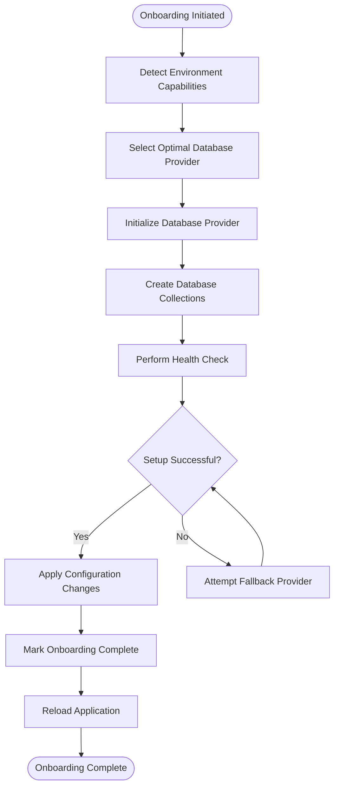
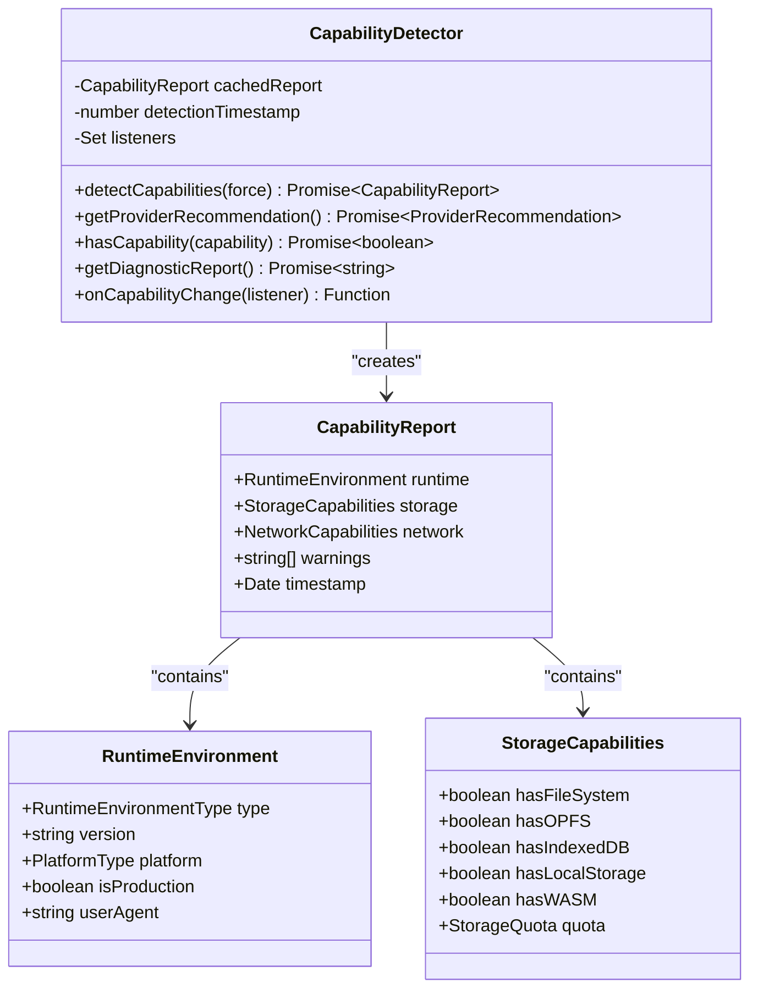

# Onboarding System Documentation

<cite>
**Referenced Files in This Document**
- [FirstRunOnboarding.tsx](file://src/components/FirstRunOnboarding.tsx)
- [OnboardingGate.tsx](file://src/components/OnboardingGate.tsx)
- [UnifiedDatabaseManager.ts](file://src/services/database/UnifiedDatabaseManager.ts)
- [CapabilityDetector.ts](file://src/services/database/detection/CapabilityDetector.ts)
- [demoDataSeed.ts](file://src/services/database/demoDataSeed.ts)
- [useUnifiedConfig.ts](file://src/hooks/useUnifiedConfig.ts)
- [UnifiedConfigContext.tsx](file://src/contexts/UnifiedConfigContext.tsx)
- [unifiedConfig.ts](file://src/config/unifiedConfig.ts)
- [App.tsx](file://src/App.tsx)
- [onboarding.md](file://docs/guides/onboarding.md)
</cite>

## Update Summary
**Changes Made**
- Comprehensive onboarding system implementation with FirstRunOnboarding component
- Integrated CapabilityDetector for intelligent environment detection
- Enhanced database provider selection logic with fallback chains
- Added demo data system with configurable volume controls
- Updated architecture diagrams to reflect new hybrid data layer integration
- Enhanced troubleshooting guide with new component-specific guidance

## Table of Contents
1. [Introduction](#introduction)
2. [System Architecture](#system-architecture)
3. [Core Components](#core-components)
4. [Onboarding Workflow](#onboarding-workflow)
5. [Configuration Management](#configuration-management)
6. [Database Integration](#database-integration)
7. [Environment Detection](#environment-detection)
8. [Demo Data System](#demo-data-system)
9. [Security and State Management](#security-and-state-management)
10. [Troubleshooting Guide](#troubleshooting-guide)
11. [Conclusion](#conclusion)

## Introduction

The SchoolPilot 3 Onboarding System represents a comprehensive first-run experience designed to guide users through the initial setup of the educational management system. This system provides two distinct pathways: a production-focused setup for immediate data entry and a demo exploration mode for evaluation purposes. The onboarding system integrates deeply with the application's unified configuration management, database abstraction layer, and environment detection capabilities to provide an intelligent, adaptive setup experience.

The system addresses the critical need for schools and educational institutions to quickly understand and adopt the platform while ensuring data integrity and user experience. It supports multiple deployment environments including web browsers, desktop applications (Electron/Tauri), and various storage backends through its unified database manager.

**Updated** Enhanced with comprehensive environment detection, hybrid data layer integration, and intelligent provider selection logic.

## System Architecture

The onboarding system follows a layered architecture that separates concerns between user interface, configuration management, environment detection, and database operations.

**Diagram sources**
- [OnboardingGate.tsx:15-73](file://src/components/OnboardingGate.tsx#L15-L73)
- [FirstRunOnboarding.tsx:97-493](file://src/components/FirstRunOnboarding.tsx#L97-L493)
- [UnifiedDatabaseManager.ts:43-800](file://src/services/database/UnifiedDatabaseManager.ts#L43-L800)

## Core Components

### OnboardingGate Component

The OnboardingGate serves as the primary entry point interceptor that determines whether a user needs to complete the onboarding process. It operates as a transparent wrapper around the main application, checking onboarding status and conditionally rendering the onboarding interface.

**Diagram sources**
- [OnboardingGate.tsx:15-73](file://src/components/OnboardingGate.tsx#L15-L73)
- [FirstRunOnboarding.tsx:97-493](file://src/components/FirstRunOnboarding.tsx#L97-L493)

**Section sources**
- [OnboardingGate.tsx:15-73](file://src/components/OnboardingGate.tsx#L15-L73)
- [FirstRunOnboarding.tsx:97-493](file://src/components/FirstRunOnboarding.tsx#L97-L493)

### FirstRunOnboarding Component

The FirstRunOnboarding component provides an interactive three-step wizard interface guiding users through their setup choices. It features intelligent environment detection, pathway selection, and seamless configuration application.

**Section sources**
- [FirstRunOnboarding.tsx:1-493](file://src/components/FirstRunOnboarding.tsx#L1-L493)

## Onboarding Workflow

The onboarding process follows a structured three-step workflow designed to minimize cognitive load while maximizing user confidence.

**Diagram sources**
- [OnboardingGate.tsx:19-44](file://src/components/OnboardingGate.tsx#L19-L44)
- [FirstRunOnboarding.tsx:125-189](file://src/components/FirstRunOnboarding.tsx#L125-L189)

### Step 1: Environment Detection and Recommendation

The system begins by analyzing the user's environment to provide intelligent setup recommendations. This includes detecting runtime environments (browser, Electron, Tauri), storage capabilities (OPFS, IndexedDB, WASM), and network conditions.

**Section sources**
- [FirstRunOnboarding.tsx:106-118](file://src/components/FirstRunOnboarding.tsx#L106-L118)
- [CapabilityDetector.ts:198-227](file://src/services/database/detection/CapabilityDetector.ts#L198-L227)

### Step 2: Pathway Selection

Users are presented with two clear options: Explore with Demo Data or Go Direct to Production. Each option provides detailed information about the implications and benefits of the chosen path.

**Section sources**
- [FirstRunOnboarding.tsx:272-372](file://src/components/FirstRunOnboarding.tsx#L272-L372)

### Step 3: Confirmation and Execution

The final step confirms the user's choice and executes the appropriate setup procedure, applying configurations and initializing the chosen data mode.

**Section sources**
- [FirstRunOnboarding.tsx:374-451](file://src/components/FirstRunOnboarding.tsx#L374-L451)

## Configuration Management

The onboarding system integrates with the unified configuration management system, which provides comprehensive control over application settings, environment detection, and data mode switching.

**Diagram sources**
- [UnifiedConfigContext.tsx:34-93](file://src/contexts/UnifiedConfigContext.tsx#L34-L93)
- [useUnifiedConfig.ts:24-181](file://src/hooks/useUnifiedConfig.ts#L24-L181)

**Section sources**
- [UnifiedConfigContext.tsx:111-488](file://src/contexts/UnifiedConfigContext.tsx#L111-L488)
- [useUnifiedConfig.ts:1-181](file://src/hooks/useUnifiedConfig.ts#L1-L181)

### Configuration Storage and Persistence

The system uses localStorage for persistent storage of onboarding state and configuration preferences, ensuring continuity across browser sessions and application restarts.

**Section sources**
- [FirstRunOnboarding.tsx:35-59](file://src/components/FirstRunOnboarding.tsx#L35-L59)
- [unifiedConfig.ts:677-800](file://src/config/unifiedConfig.ts#L677-L800)

## Database Integration

The onboarding system seamlessly integrates with the unified database management system, which abstracts multiple database providers behind a common interface supporting SQLite, PouchDB, RxDB, and backend APIs.

**Diagram sources**
- [UnifiedDatabaseManager.ts:98-168](file://src/services/database/UnifiedDatabaseManager.ts#L98-L168)
- [FirstRunOnboarding.tsx:134-159](file://src/components/FirstRunOnboarding.tsx#L134-L159)

**Section sources**
- [UnifiedDatabaseManager.ts:43-800](file://src/services/database/UnifiedDatabaseManager.ts#L43-L800)
- [FirstRunOnboarding.tsx:131-189](file://src/components/FirstRunOnboarding.tsx#L131-L189)

### Provider Selection Logic

The database provider selection considers multiple factors including environment type, storage capabilities, and performance requirements to choose the optimal backend for the user's setup.

**Section sources**
- [UnifiedDatabaseManager.ts:221-314](file://src/services/database/UnifiedDatabaseManager.ts#L221-L314)
- [CapabilityDetector.ts:635-681](file://src/services/database/detection/CapabilityDetector.ts#L635-L681)

## Environment Detection

The CapabilityDetector service performs comprehensive analysis of the user's runtime environment, storage capabilities, and network conditions to provide intelligent setup recommendations.

**Diagram sources**
- [CapabilityDetector.ts:87-104](file://src/services/database/detection/CapabilityDetector.ts#L87-L104)
- [CapabilityDetector.ts:60-66](file://src/services/database/detection/CapabilityDetector.ts#L60-L66)

**Section sources**
- [CapabilityDetector.ts:87-693](file://src/services/database/detection/CapabilityDetector.ts#L87-L693)

### Environment Classification

The system distinguishes between different runtime environments and storage capabilities to provide appropriate setup recommendations:

- **Desktop Environments**: Electron and Tauri applications with file system access
- **Browser Environments**: Web browsers with varying storage capabilities
- **Server Environments**: SSR scenarios requiring backend API integration

**Section sources**
- [CapabilityDetector.ts:302-341](file://src/services/database/detection/CapabilityDetector.ts#L302-L341)
- [CapabilityDetector.ts:635-681](file://src/services/database/detection/CapabilityDetector.ts#L635-L681)

## Demo Data System

The demo data system provides comprehensive sample data across all school management modules, enabling users to explore the system's capabilities without entering real data.

```mermaid
flowchart LR
Start([Demo Data Request]) --> LoadModules["Load Module Definitions"]
LoadModules --> ResolveCollections["Resolve Collection Names"]
ResolveCollections --> NormalizeRecords["Normalize Record Formats"]
NormalizeRecords --> VolumeFactor["Apply Volume Factor"]
VolumeFactor --> InsertData["Insert into Database"]
InsertData --> TrackStats["Track Generation Statistics"]
TrackStats --> VerifyData["Verify Data Integrity"]
VerifyData --> Complete([Demo Data Ready])
```

**Diagram sources**
- [demoDataSeed.ts:328-390](file://src/services/database/demoDataSeed.ts#L328-L390)
- [demoDataSeed.ts:186-229](file://src/services/database/demoDataSeed.ts#L186-L229)

**Section sources**
- [demoDataSeed.ts:1-390](file://src/services/database/demoDataSeed.ts#L1-L390)

### Data Volume Control

The system supports multiple data volumes (tiny, small, medium, large, enterprise) allowing users to control the amount of sample data generated during onboarding.

**Section sources**
- [demoDataSeed.ts:112-118](file://src/services/database/demoDataSeed.ts#L112-L118)
- [demoDataSeed.ts:231-239](file://src/services/database/demoDataSeed.ts#L231-L239)

## Security and State Management

The onboarding system implements robust security measures and state management to ensure data integrity and user privacy throughout the setup process.

### State Persistence

Onboarding state is persisted using localStorage with JSON serialization, providing continuity across browser sessions and application restarts.

**Section sources**
- [FirstRunOnboarding.tsx:35-59](file://src/components/FirstRunOnboarding.tsx#L35-L59)

### Data Integrity Controls

The system implements several mechanisms to prevent accidental data loss and ensure proper state transitions:

- **Demo Data Protection**: Prevents re-seeding after production transition
- **State Validation**: Validates configuration changes before application
- **Error Recovery**: Implements graceful fallbacks for failed operations

**Section sources**
- [FirstRunOnboarding.tsx:471-490](file://src/components/FirstRunOnboarding.tsx#L471-L490)
- [demoDataSeed.ts:312-326](file://src/services/database/demoDataSeed.ts#L312-L326)

## Troubleshooting Guide

### Common Issues and Solutions

**Onboarding Not Appearing**
- Verify localStorage access permissions
- Check for JavaScript errors in browser console
- Ensure proper initialization of UnifiedConfigProvider

**Database Initialization Failures**
- Verify environment capabilities detection
- Check provider availability and compatibility
- Review fallback chain configuration

**Demo Data Loading Issues**
- Confirm module registration and availability
- Verify collection definitions and schemas
- Check storage quotas and permissions

**Configuration Persistence Problems**
- Validate localStorage quota limits
- Check for cross-origin restrictions
- Review configuration migration procedures

**Environment Detection Failures**
- Verify CapabilityDetector initialization
- Check browser compatibility for storage APIs
- Review periodic re-detection configuration

**Provider Selection Issues**
- Validate fallback chain configuration
- Check provider availability in current environment
- Review capability-based recommendations

**Section sources**
- [FirstRunOnboarding.tsx:185-188](file://src/components/FirstRunOnboarding.tsx#L185-L188)
- [UnifiedDatabaseManager.ts:155-167](file://src/services/database/UnifiedDatabaseManager.ts#L155-L167)

## Conclusion

The SchoolPilot 3 Onboarding System represents a sophisticated approach to application setup, combining intelligent environment detection, flexible configuration management, and seamless database integration. The system successfully addresses the diverse needs of educational institutions by providing both immediate productivity (production mode) and thorough evaluation capabilities (demo mode).

The modular architecture ensures maintainability and extensibility, while the comprehensive error handling and state management provide reliability across various deployment scenarios. The integration with the unified configuration system demonstrates best practices in modern web application development, offering developers and administrators a robust foundation for educational management software.

The comprehensive environment detection capabilities through CapabilityDetector ensure optimal provider selection, while the hybrid data layer integration provides flexibility across different deployment scenarios. The demo data system offers extensive sample data generation with configurable volumes, enabling thorough system evaluation.

Future enhancements could include expanded environment detection for emerging platforms, additional database provider support, and enhanced analytics for onboarding effectiveness measurement.