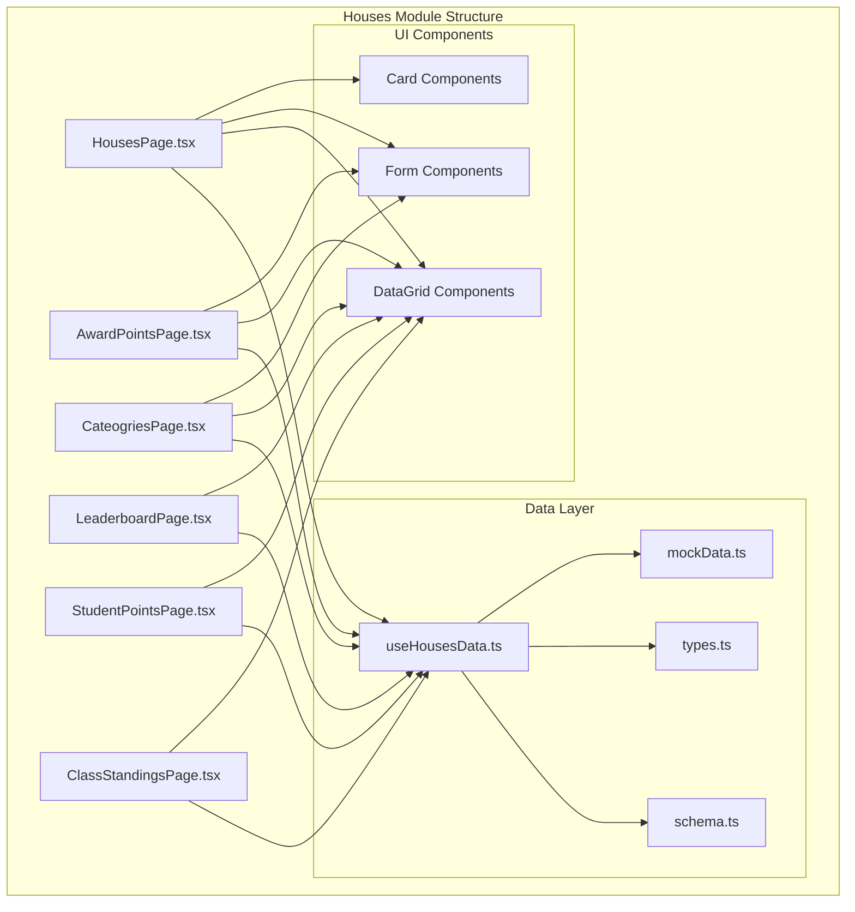
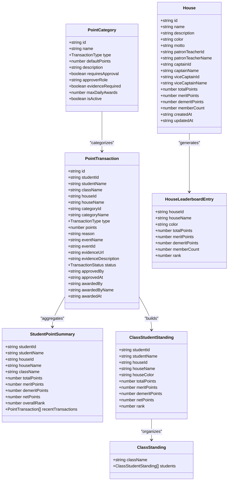
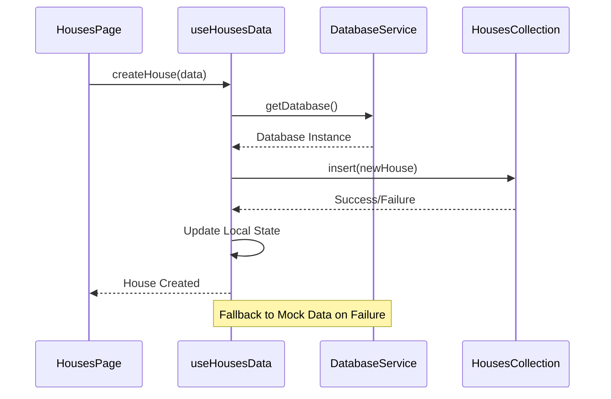
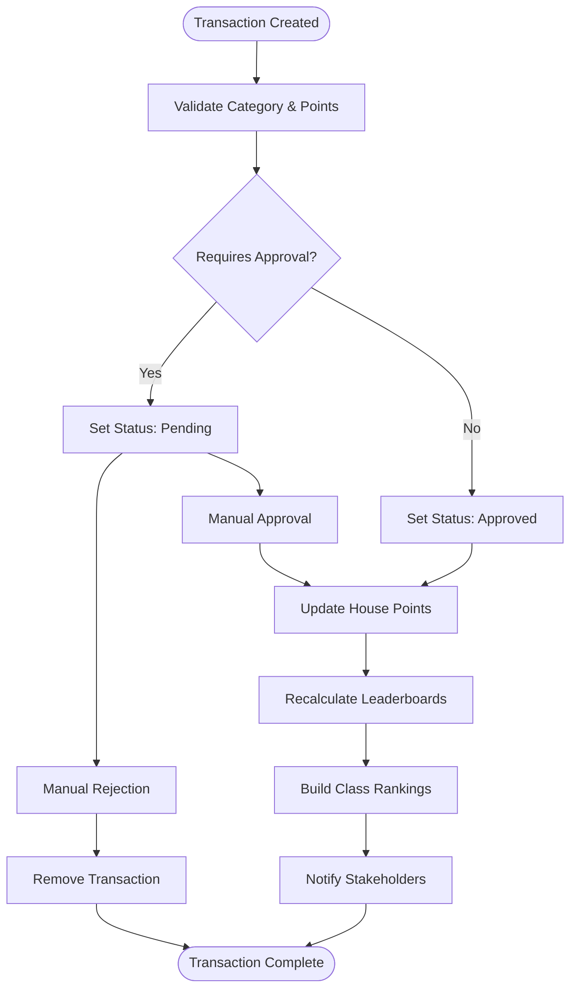
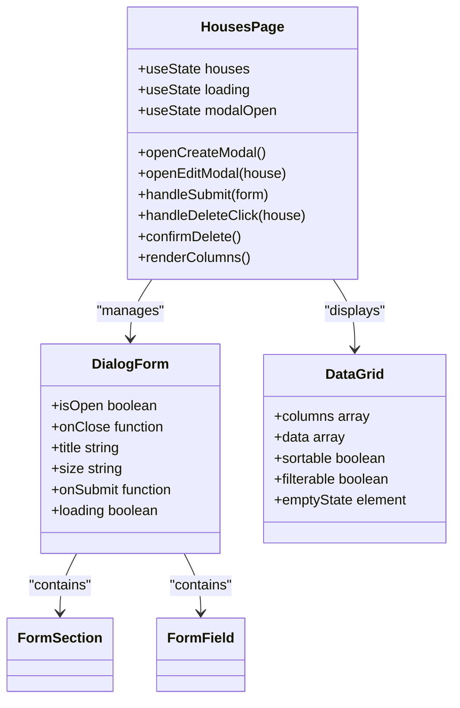
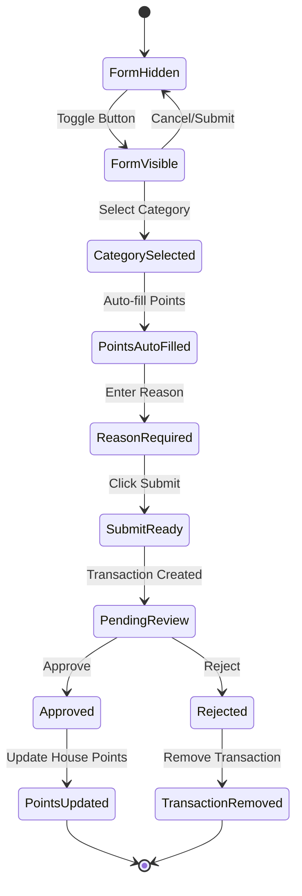
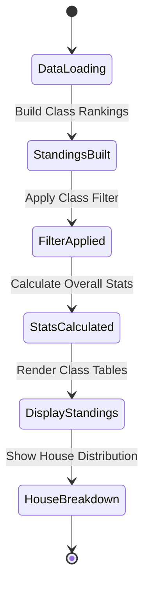
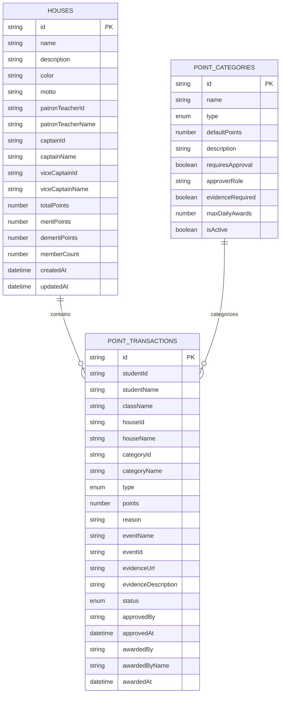
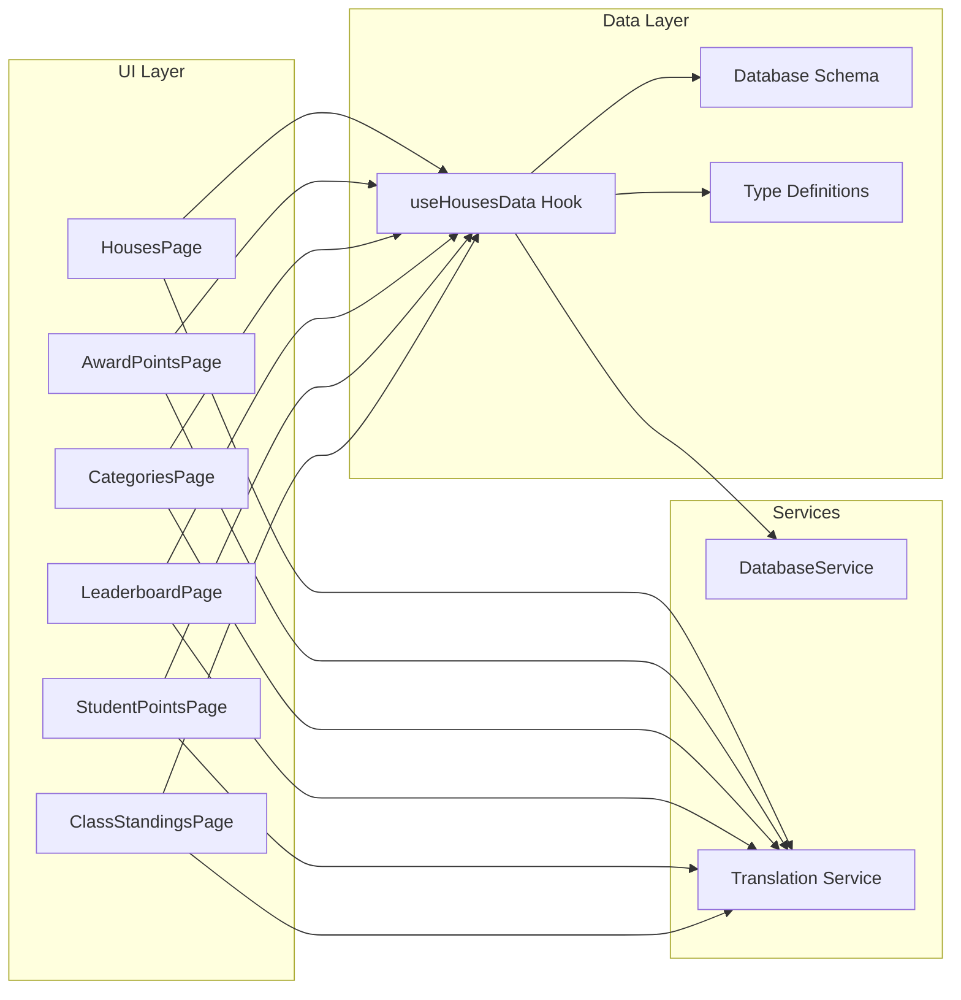

# Houses Module Overview

<cite>
**Referenced Files in This Document**
- [HousesPage.tsx](file://src/modules/administration/pages/houses/HousesPage.tsx)
- [AwardPointsPage.tsx](file://src/modules/administration/pages/houses/AwardPointsPage.tsx)
- [CategoriesPage.tsx](file://src/modules/administration/pages/houses/CategoriesPage.tsx)
- [LeaderboardPage.tsx](file://src/modules/administration/pages/houses/LeaderboardPage.tsx)
- [StudentPointsPage.tsx](file://src/modules/administration/pages/houses/StudentPointsPage.tsx)
- [ClassStandingsPage.tsx](file://src/modules/administration/pages/houses/ClassStandingsPage.tsx)
- [useHousesData.ts](file://src/modules/administration/data/houses/useHousesData.ts)
- [schema.ts](file://src/modules/administration/data/houses/schema.ts)
- [types.ts](file://src/modules/administration/data/houses/types.ts)
- [mockData.ts](file://src/modules/administration/data/houses/mockData.ts)
</cite>

## Update Summary
**Changes Made**
- Updated module architecture to reflect all six pages (HousesPage, AwardPointsPage, CategoriesPage, LeaderboardPage, StudentPointsPage, ClassStandingsPage)
- Enhanced data layer documentation with complete implementation details
- Expanded point system documentation with new class ranking functionality
- Updated internationalization support section to cover all components
- Added new performance considerations for class standings calculations

## Table of Contents
1. [Introduction](#introduction)
2. [Module Architecture](#module-architecture)
3. [Core Components](#core-components)
4. [Data Management](#data-management)
5. [Point System](#point-system)
6. [User Interface Components](#user-interface-components)
7. [Database Schema](#database-schema)
8. [Mock Data Implementation](#mock-data-implementation)
9. [Internationalization Support](#internationalization-support)
10. [Module Dependencies](#module-dependencies)
11. [Performance Considerations](#performance-considerations)
12. [Conclusion](#conclusion)

## Introduction

The Houses module is a comprehensive student house management system integrated into the Education Management Platform. This module provides functionality for managing school houses, awarding points, tracking student achievements, and maintaining house leaderboards. The system supports both academic excellence and behavioral point systems with configurable categories and approval workflows.

The module consists of six main pages: House management, Point awarding, Category management, Leaderboard viewing, Student point tracking, and Class standings reporting. It utilizes a reactive data architecture with mock data fallback capabilities and comprehensive internationalization support.

## Module Architecture

The Houses module follows a structured React-based architecture with clear separation of concerns:

**Diagram sources**
- [HousesPage.tsx:1-391](file://src/modules/administration/pages/houses/HousesPage.tsx#L1-L391)
- [useHousesData.ts:1-271](file://src/modules/administration/data/houses/useHousesData.ts#L1-L271)
- [schema.ts:1-86](file://src/modules/administration/data/houses/schema.ts#L1-L86)

## Core Components

### Houses Management System

The Houses Management System provides CRUD operations for house entities with comprehensive point tracking:

**Diagram sources**
- [types.ts:12-95](file://src/modules/administration/data/houses/types.ts#L12-L95)

### Data Management Hooks

The `useHousesData` hook serves as the central data management component, providing:

- **CRUD Operations**: Create, read, update, and delete house records
- **Point Tracking**: Automatic calculation and updating of house and student points
- **Transaction Management**: Complete lifecycle management for point transactions
- **Leaderboard Generation**: Real-time ranking calculations
- **Class Standings**: Comprehensive class-wise student rankings
- **Mock Data Fallback**: Graceful degradation when database is unavailable

**Section sources**
- [useHousesData.ts:14-271](file://src/modules/administration/data/houses/useHousesData.ts#L14-L271)

## Data Management

### Database Integration

The module integrates with a database service for persistent storage:

**Diagram sources**
- [useHousesData.ts:46-80](file://src/modules/administration/data/houses/useHousesData.ts#L46-L80)

### State Management Architecture

The data management system employs a dual-state approach:

1. **Local State**: React state for immediate UI updates
2. **Database State**: Persistent storage for data durability
3. **Mock Data**: Fallback mechanism for offline scenarios

**Section sources**
- [useHousesData.ts:28-43](file://src/modules/administration/data/houses/useHousesData.ts#L28-L43)
- [mockData.ts:1-100](file://src/modules/administration/data/houses/mockData.ts#L1-L100)

## Point System

### Transaction Lifecycle

The point system implements a comprehensive transaction lifecycle:

**Diagram sources**
- [useHousesData.ts:153-190](file://src/modules/administration/data/houses/useHousesData.ts#L153-L190)

### Point Categories

The system supports configurable point categories with approval workflows:

| Category Type | Default Points | Approval Required | Evidence Required |
|---------------|----------------|-------------------|-------------------|
| Academic Excellence | +10 | No | No |
| Sports Achievement | +15 | No | No |
| Leadership | +12 | Yes | No |
| Community Service | +8 | No | Yes |
| Good Behavior | +5 | No | No |
| Late Coming | -3 | No | No |
| Uniform Violation | -2 | No | No |
| Misconduct | -10 | Yes | Yes |

**Section sources**
- [mockData.ts:82-91](file://src/modules/administration/data/houses/mockData.ts#L82-L91)

## User Interface Components

### Houses Management Interface

The Houses Management interface provides a comprehensive CRUD experience:

**Diagram sources**
- [HousesPage.tsx:42-391](file://src/modules/administration/pages/houses/HousesPage.tsx#L42-L391)

### Point Awarding Interface

The Point Awarding interface streamlines the point distribution process:

**Diagram sources**
- [AwardPointsPage.tsx:32-475](file://src/modules/administration/pages/houses/AwardPointsPage.tsx#L32-L475)

**Section sources**
- [AwardPointsPage.tsx:18-156](file://src/modules/administration/pages/houses/AwardPointsPage.tsx#L18-L156)

### Class Standings Interface

The Class Standings interface provides detailed student rankings within academic classes:

**Diagram sources**
- [ClassStandingsPage.tsx:139-351](file://src/modules/administration/pages/houses/ClassStandingsPage.tsx#L139-L351)

**Section sources**
- [ClassStandingsPage.tsx:118-350](file://src/modules/administration/pages/houses/ClassStandingsPage.tsx#L118-L350)

## Database Schema

### Collection Definitions

The module defines three primary collections with comprehensive schemas:

**Diagram sources**
- [schema.ts:3-86](file://src/modules/administration/data/houses/schema.ts#L3-L86)

**Section sources**
- [schema.ts:1-86](file://src/modules/administration/data/houses/schema.ts#L1-L86)

## Mock Data Implementation

### Initial Data Sets

The module provides comprehensive mock data for demonstration and development:

#### Sample Houses
| House Name | Motto | Total Points | Member Count | Patron Teacher |
|------------|-------|--------------|--------------|----------------|
| Unity | Unity is Strength | 1,250 | 45 | Mr. James Wilson |
| Courage | Fortune Favors the Brave | 1,180 | 42 | Ms. Sarah Chen |
| Wisdom | Knowledge is Power | 1,320 | 48 | Dr. Robert Kim |
| Excellence | Excellence in All Things | 1,290 | 46 | Mrs. Grace Lee |

#### Point Categories
- **Academic Excellence**: +10 points, No approval required
- **Sports Achievement**: +15 points, No approval required  
- **Leadership**: +12 points, Requires house master approval
- **Community Service**: +8 points, Evidence required
- **Good Behavior**: +5 points, Daily limit of 1 award
- **Late Coming**: -3 points, No approval required
- **Uniform Violation**: -2 points, No approval required
- **Misconduct**: -10 points, Requires administrator approval

**Section sources**
- [mockData.ts:3-100](file://src/modules/administration/data/houses/mockData.ts#L3-L100)

## Internationalization Support

### Translation Keys

The module supports comprehensive internationalization with the following key namespaces:

#### Houses Management
- `houses.title`: "House Management"
- `houses.create`: "Create House"
- `houses.edit`: "Edit House"
- `houses.delete`: "Delete House"
- `houses.description`: "Manage school houses and their details"

#### House Fields
- `houses.fields.name`: "House Name"
- `houses.fields.description`: "Description"
- `houses.fields.color`: "House Color"
- `houses.fields.motto`: "Motto"
- `houses.fields.patronTeacher`: "Patron Teacher"
- `houses.fields.captain`: "House Captain"
- `houses.fields.viceCaptain`: "Vice Captain"
- `houses.fields.memberCount`: "Member Count"
- `houses.fields.totalPoints`: "Total Points"

#### Messages
- `houses.messages.createSuccess`: "Successfully created your first house!"
- `houses.messages.deleteConfirm`: "Are you sure you want to delete house"

#### Categories Management
- `categories.title`: "Point Categories"
- `categories.create`: "Create Category"
- `categories.edit`: "Edit Category"
- `categories.types.merit`: "Merit"
- `categories.types.demerit`: "Demerit"

#### Transactions
- `transactions.award`: "Award Points"
- `transactions.title`: "Point Transactions"
- `transactions.fields.student`: "Student"
- `transactions.fields.category`: "Category"
- `transactions.fields.points`: "Points"
- `transactions.fields.reason`: "Reason"
- `transactions.fields.status`: "Status"
- `transactions.status.pending`: "Pending"
- `transactions.status.approved`: "Approved"
- `transactions.status.rejected`: "Rejected"

#### Leaderboard
- `leaderboard.rank`: "Rank"
- `leaderboard.house`: "House"
- `leaderboard.totalPoints`: "Total Points"
- `leaderboard.merits`: "Merits"
- `leaderboard.demerits`: "Demerits"
- `leaderboard.members`: "Members"
- `leaderboard.title`: "House Leaderboard"

#### Student Points
- `houses.studentPoints`: "Student Points"

#### Class Standings
- `houses.classStandings`: "Class Standings"

**Section sources**
- [HousesPage.tsx:43](file://src/modules/administration/pages/houses/HousesPage.tsx#L43)
- [AwardPointsPage.tsx:34](file://src/modules/administration/pages/houses/AwardPointsPage.tsx#L34)
- [CategoriesPage.tsx:32](file://src/modules/administration/pages/houses/CategoriesPage.tsx#L32)
- [LeaderboardPage.tsx:22](file://src/modules/administration/pages/houses/LeaderboardPage.tsx#L22)
- [StudentPointsPage.tsx:60](file://src/modules/administration/pages/houses/StudentPointsPage.tsx#L60)
- [ClassStandingsPage.tsx:139](file://src/modules/administration/pages/houses/ClassStandingsPage.tsx#L139)

## Module Dependencies

### External Dependencies

The Houses module relies on several key dependencies:

#### UI Components
- **DataGrid**: Advanced data display with sorting and filtering
- **DialogForm**: Modal form management
- **Form Components**: Input, Select, Textarea components
- **Card**: Content container with various variants
- **Button**: Interactive button components with variants

#### Internal Services
- **DatabaseService**: Centralized database access
- **Translation Service**: i18n integration
- **React Hooks**: State management and lifecycle

#### Type Definitions
- **TypeScript Interfaces**: Strongly typed data structures
- **Enum Types**: Transaction type and status definitions
- **Generic Types**: Reusable type definitions

### Component Dependencies

**Diagram sources**
- [useHousesData.ts:2](file://src/modules/administration/data/houses/useHousesData.ts#L2)
- [HousesPage.tsx:14](file://src/modules/administration/pages/houses/HousesPage.tsx#L14)

## Performance Considerations

### Data Loading Strategies

The module implements several performance optimization techniques:

1. **Lazy Loading**: Database queries are executed only when needed
2. **State Caching**: Local state maintains recent data for quick access
3. **Memoization**: Complex calculations are cached using React hooks
4. **Mock Data Fallback**: Immediate UI responsiveness during database failures

### Memory Management

- **Efficient State Updates**: Batched updates prevent unnecessary re-renders
- **Cleanup Functions**: Proper cleanup of event listeners and subscriptions
- **Optimized Rendering**: Conditional rendering based on data availability

### Database Optimization

- **Index Usage**: Strategic indexing on frequently queried fields
- **Query Optimization**: Efficient filtering and sorting mechanisms
- **Connection Pooling**: Reuse of database connections for better performance

### Class Standings Performance

- **Efficient Ranking Algorithms**: Optimized sorting and ranking calculations
- **Real-time Updates**: Incremental updates to class standings
- **Filtering Optimization**: Fast class and student filtering mechanisms
- **Aggregate Calculations**: Cached calculations for house distribution statistics

## Conclusion

The Houses module represents a comprehensive solution for school house management with robust point tracking capabilities. The module's architecture emphasizes modularity, maintainability, and user experience through:

- **Comprehensive Functionality**: Complete CRUD operations with advanced point management across six specialized pages
- **Flexible Data Model**: Support for both academic and behavioral point systems with class-level granularity
- **User-Friendly Interface**: Intuitive forms and data grids with real-time updates and comprehensive filtering
- **Robust Data Management**: Database integration with mock data fallback and efficient state management
- **Internationalization**: Complete i18n support for multi-language deployments across all components
- **Performance Optimization**: Efficient data loading, caching strategies, and optimized calculations for class standings
- **Advanced Analytics**: Comprehensive leaderboard generation, student point tracking, and class-wise performance analysis

The module successfully balances functionality with simplicity, providing administrators with powerful tools for house management while maintaining an intuitive interface for end-users. The modular architecture ensures easy maintenance and future extensibility for additional features, supporting both individual student tracking and comprehensive class-level analytics.