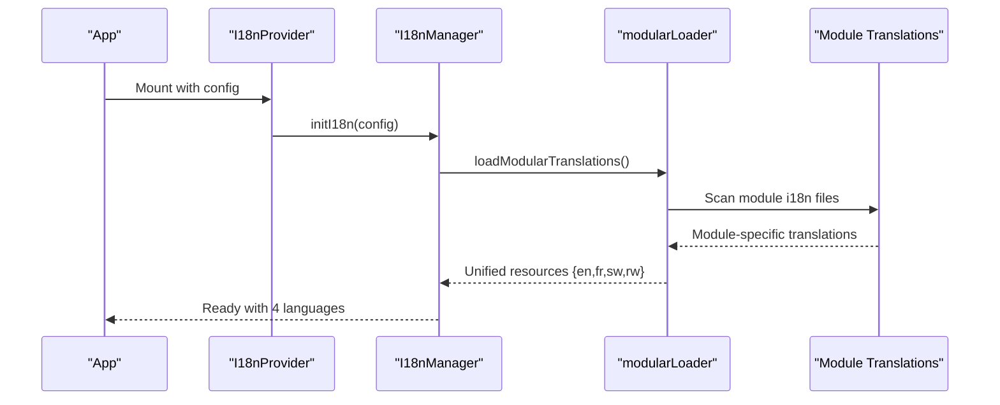
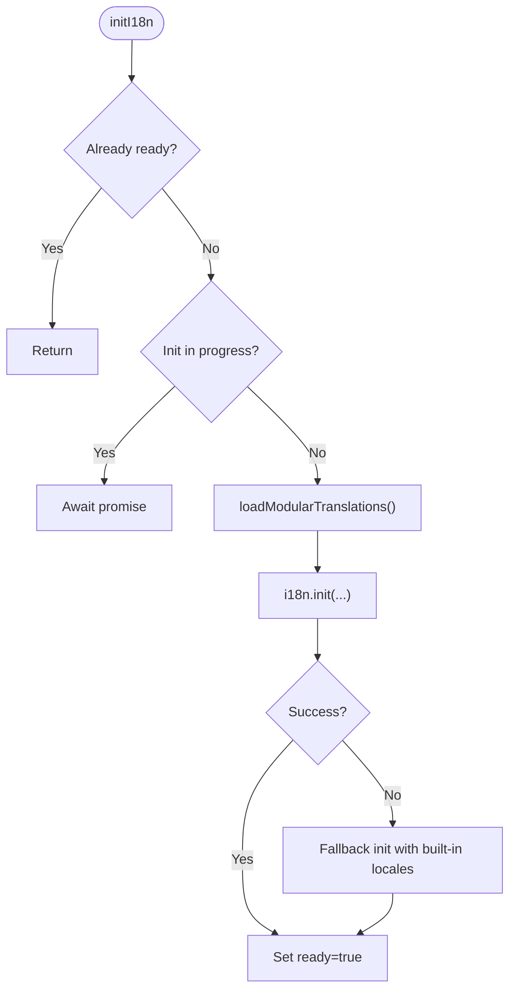
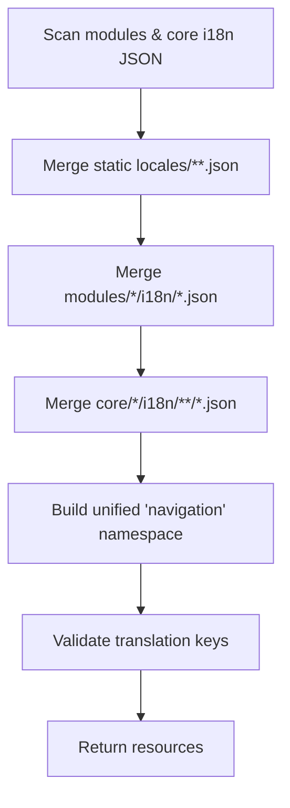
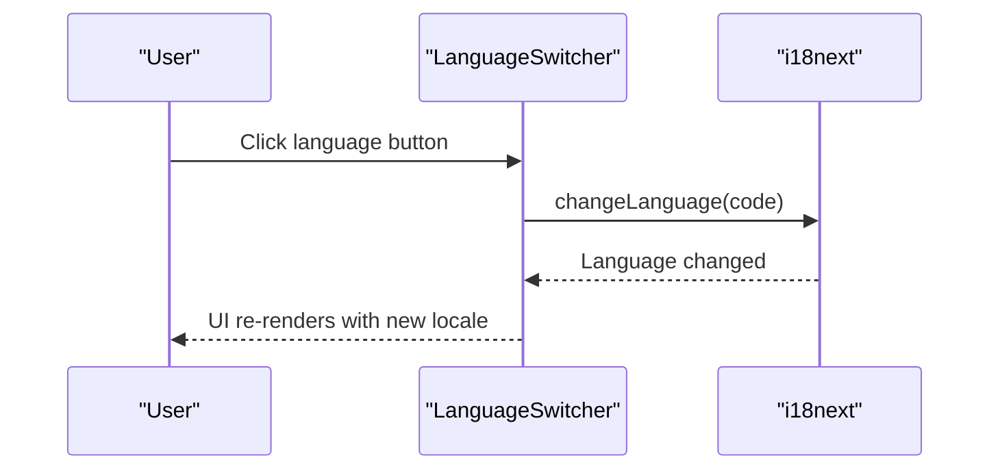
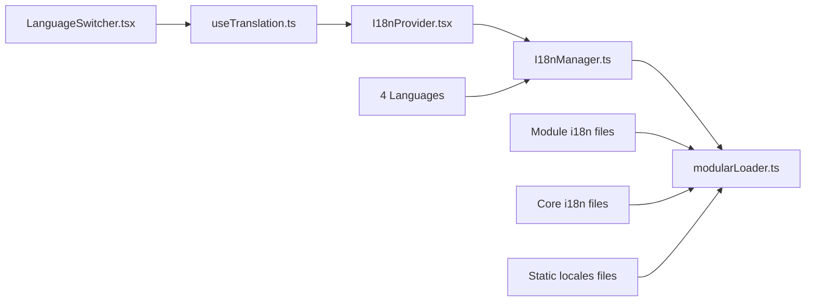

# Internationalization

<cite>
**Referenced Files in This Document**
- [index.ts](file://src/i18n/index.ts)
- [types.ts](file://src/i18n/types.ts)
- [I18nManager.ts](file://src/i18n/I18nManager.ts)
- [I18nProvider.tsx](file://src/i18n/I18nProvider.tsx)
- [useTranslation.ts](file://src/i18n/useTranslation.ts)
- [LanguageSwitcher.tsx](file://src/components/ui/LanguageSwitcher.tsx)
- [common.json](file://src/locales/en/common.json)
- [modularLoader.ts](file://src/i18n/modularLoader.ts)
- [i18n.ts](file://src/i18n/i18n.ts)
- [loader.ts](file://src/i18n/loader.ts)
- [translationIntegrity.test.ts](file://src/tests/integration/translationIntegrity.test.ts)
</cite>

## Update Summary
**Changes Made**
- Updated internationalization system to reflect complete architectural transformation from centralized to decentralized i18n system
- Removed references to old centralized navigation.json files in favor of module-specific translation files
- Updated supported locales list to include new languages (en, fr, sw, rw) with enhanced modular translation loader
- Enhanced modular translation architecture with per-module i18n directories and unified navigation namespace
- Updated translation key structure and language switching functionality

## Table of Contents
1. [Introduction](#introduction)
2. [Project Structure](#project-structure)
3. [Core Components](#core-components)
4. [Architecture Overview](#architecture-overview)
5. [Detailed Component Analysis](#detailed-component-analysis)
6. [Multi-Language Support Enhancement](#multi-language-support-enhancement)
7. [Decentralized Translation Architecture](#decentralized-translation-architecture)
8. [Translation Key Standardization](#translation-key-standardization)
9. [Dependency Analysis](#dependency-analysis)
10. [Performance Considerations](#performance-considerations)
11. [Troubleshooting Guide](#troubleshooting-guide)
12. [Conclusion](#conclusion)
13. [Appendices](#appendices)

## Introduction
This document explains SchoolPilot3's internationalization (i18n) system. The system has been completely restructured from a centralized to a decentralized architecture, where navigation translations are now managed at the module level rather than being centralized in navigation.json files. The system supports four languages: English (en), French (fr), Swahili (sw), and Kinyarwanda (rw). It documents the new modular translation loader that aggregates translations from module-specific sources, the enhanced language switching functionality, and the improved translation key structure with fallback systems.

## Project Structure
The i18n system is centered under src/i18n and integrates with the component system via a React provider and hook. The new decentralized architecture organizes translations at the module level with support for multiple languages:

```mermaid
graph TB
subgraph "i18n Core"
IDX["index.ts"]
TM["types.ts"]
IM["I18nManager.ts"]
IP["I18nProvider.tsx"]
UT["useTranslation.ts"]
ML["modularLoader.ts"]
I18N["i18n.ts"]
LD["loader.ts"]
end
subgraph "Components"
LS["LanguageSwitcher.tsx"]
end
subgraph "Supported Languages"
EN["English (en)"]
FR["French (fr)"]
SW["Swahili (sw)"]
RW["Kinyarwanda (rw)"]
end
subgraph "Module Translations"
MOD["Module i18n files"]
CORE["Core module i18n files"]
STATIC["Static locales files"]
END
IDX --> TM
IDX --> IM
IDX --> IP
IDX --> UT
IDX --> ML
IP --> IM
UT --> IP
IM --> ML
LS --> UT
EN --> IM
FR --> IM
SW --> IM
RW --> IM
MOD --> ML
CORE --> ML
STATIC --> ML
I18N --> ML
LD --> I18N
```

**Diagram sources**
- [index.ts:1-56](file://src/i18n/index.ts#L1-L56)
- [types.ts:1-59](file://src/i18n/types.ts#L1-L59)
- [I18nManager.ts:1-415](file://src/i18n/I18nManager.ts#L1-L415)
- [I18nProvider.tsx:1-76](file://src/i18n/I18nProvider.tsx#L1-L76)
- [useTranslation.ts:1-114](file://src/i18n/useTranslation.ts#L1-L114)
- [modularLoader.ts:1-92](file://src/i18n/modularLoader.ts#L1-L92)
- [i18n.ts:1-117](file://src/i18n/i18n.ts#L1-L117)
- [loader.ts:1-69](file://src/i18n/loader.ts#L1-L69)
- [LanguageSwitcher.tsx:1-119](file://src/components/ui/LanguageSwitcher.tsx#L1-L119)

**Section sources**
- [index.ts:1-56](file://src/i18n/index.ts#L1-L56)
- [types.ts:1-59](file://src/i18n/types.ts#L1-L59)
- [I18nManager.ts:1-415](file://src/i18n/I18nManager.ts#L1-L415)
- [I18nProvider.tsx:1-76](file://src/i18n/I18nProvider.tsx#L1-L76)
- [useTranslation.ts:1-114](file://src/i18n/useTranslation.ts#L1-L114)
- [modularLoader.ts:1-92](file://src/i18n/modularLoader.ts#L1-L92)
- [i18n.ts:1-117](file://src/i18n/i18n.ts#L1-L117)
- [loader.ts:1-69](file://src/i18n/loader.ts#L1-L69)
- [LanguageSwitcher.tsx:1-119](file://src/components/ui/LanguageSwitcher.tsx#L1-L119)

## Core Components
- **I18nManager**: Core internationalization manager with locale management, translation lookup, formatting, and pluralization support
- **Modular Loader**: Aggregates translation resources from module-specific JSON files into unified resource maps
- **Provider and Hook**: Expose translation and formatting functions and manage locale lifecycle
- **Language Switcher**: Enhanced UI component supporting 4 languages with proper error handling
- **Type System**: Comprehensive type definitions for locale data, translation values, and formatting options

Key responsibilities:
- **Decentralized Architecture**: Namespaces are derived from module-specific translation files and merged into unified structures
- **Multi-language Support**: Supports 4 languages with enhanced fallback and error handling
- **Dynamic Loading**: Resources are loaded at runtime via modular loader from per-module JSON files
- **Enhanced Formatting**: Supports date, time, number, and relative time formatting with locale-aware patterns

**Section sources**
- [I18nManager.ts:17-415](file://src/i18n/I18nManager.ts#L17-L415)
- [modularLoader.ts:12-92](file://src/i18n/modularLoader.ts#L12-L92)
- [I18nProvider.tsx:37-76](file://src/i18n/I18nProvider.tsx#L37-L76)
- [useTranslation.ts:42-114](file://src/i18n/useTranslation.ts#L42-L114)
- [LanguageSwitcher.tsx:30-119](file://src/components/ui/LanguageSwitcher.tsx#L30-L119)
- [types.ts:7-59](file://src/i18n/types.ts#L7-L59)

## Architecture Overview
The new i18n pipeline follows a decentralized approach where each module manages its own translations. The system now supports 4 languages with enhanced modular translation loading and improved error handling.



**Diagram sources**
- [I18nProvider.tsx:41-53](file://src/i18n/I18nProvider.tsx#L41-L53)
- [I18nManager.ts:277-313](file://src/i18n/I18nManager.ts#L277-L313)
- [modularLoader.ts:12-92](file://src/i18n/modularLoader.ts#L12-L92)

## Detailed Component Analysis

### I18nManager: Core Internationalization System
The I18nManager provides comprehensive internationalization capabilities with enhanced support for multiple locales and formatting options.



**Diagram sources**
- [I18nManager.ts:24-32](file://src/i18n/I18nManager.ts#L24-L32)
- [I18nManager.ts:277-313](file://src/i18n/I18nManager.ts#L277-L313)

**Section sources**
- [I18nManager.ts:17-415](file://src/i18n/I18nManager.ts#L17-L415)

### Modular Translation Loader
The modular loader scans module directories for JSON translation files and merges them into unified resource maps. Each module can now have its own translation files in multiple languages.



**Diagram sources**
- [modularLoader.ts:6-10](file://src/i18n/modularLoader.ts#L6-L10)
- [modularLoader.ts:12-92](file://src/i18n/modularLoader.ts#L12-L92)

**Section sources**
- [modularLoader.ts:12-92](file://src/i18n/modularLoader.ts#L12-L92)

### Enhanced Language Switcher Component
The LanguageSwitcher now supports 4 languages with proper error handling and improved user experience.



**Diagram sources**
- [LanguageSwitcher.tsx:30-49](file://src/components/ui/LanguageSwitcher.tsx#L30-L49)

**Section sources**
- [LanguageSwitcher.tsx:30-119](file://src/components/ui/LanguageSwitcher.tsx#L30-L119)

## Multi-Language Support Enhancement

### Supported Languages
The system now supports 4 languages with comprehensive translation coverage:

| Language | Code | Coverage | Status |
|----------|------|----------|--------|
| English | en | Complete | ✅ Active |
| French | fr | Complete | ✅ Active |
| Swahili | sw | Complete | ✅ Active |
| Kinyarwanda | rw | Complete | ✅ Active |

### Language Detection and Fallback
- Language detection prioritizes localStorage, navigator, then HTML tag
- Fallback to English for missing translations
- Automatic language switching with persistence
- Enhanced error handling for unsupported locales

**Section sources**
- [I18nManager.ts:55-72](file://src/i18n/I18nManager.ts#L55-L72)
- [I18nManager.ts:114-126](file://src/i18n/I18nManager.ts#L114-L126)

## Decentralized Translation Architecture

### New Translation Organization
The internationalization system has been completely restructured from centralized to decentralized architecture:

**Old Architecture (Centralized)**:
- Navigation translations stored in centralized `src/i18n/locales/*/navigation.json` files
- All translations managed in single location
- Limited scalability for module-specific translations

**New Architecture (Decentralized)**:
- Navigation and module translations stored in `src/modules/*/i18n/*.json` files
- Each module manages its own translation files
- Enhanced scalability and maintainability
- Improved separation of concerns

### Module-Specific Translation Files
Each module now contains its own translation files organized by language:

```
src/modules/
├── academics/
│   ├── i18n/
│   │   ├── en.json
│   │   ├── fr.json
│   │   ├── sw.json
│   │   └── rw.json
├── administration/
│   ├── i18n/
│   │   ├── en.json
│   │   ├── fr.json
│   │   ├── sw.json
│   │   └── rw.json
└── core/
    └── [core modules with similar structure]
```

### Unified Navigation Namespace
The modular loader automatically extracts navigation translations from all modules and merges them into a unified navigation namespace:

```javascript
// Example of navigation translation extraction
{
  "navigation": {
    "dashboard": "Dashboard",
    "students": "Students", 
    "teachers": "Teachers",
    "academics": "Academics",
    "administration": "Administration"
    // ... merged from all module navigation files
  }
}
```

**Section sources**
- [modularLoader.ts:63-86](file://src/i18n/modularLoader.ts#L63-L86)

## Translation Key Standardization

### Key Naming Conventions
- **Dot notation**: `module.namespace.key` structure for consistent organization
- **Descriptive keys**: Human-readable and context-specific for better maintainability
- **Consistent hierarchy**: Module → Section → Specific functionality
- **Pluralization support**: Enhanced pluralization handling for all supported languages

### Standardized Key Structure Examples

#### Common Keys
```json
{
  "common": {
    "desktop": "Desktop",
    "workspaces": "Workspaces", 
    "website": "Website",
    "reload": "Reload"
  }
}
```

#### Module-Specific Keys
```json
{
  "academics": {
    "title": "Academics",
    "courses": "Courses",
    "grades": "Grades",
    "schedule": "Schedule"
  },
  "administration": {
    "title": "Administration",
    "staff": "Staff Management",
    "departments": "Departments"
  }
}
```

#### Navigation Keys
```json
{
  "navigation": {
    "dashboard": "Dashboard",
    "academics": "Academics",
    "administration": "Administration",
    "finance": "Finance",
    "hr": "Human Resources"
  }
}
```

**Section sources**
- [common.json:1-41](file://src/locales/en/common.json#L1-L41)

## Dependency Analysis
The decentralized architecture creates new dependency relationships:

- **Provider depends on Manager** for locale lifecycle and translation services
- **Hook depends on Provider** context and Manager for translation and formatting
- **I18nManager depends on modular loader** for dynamic resource aggregation
- **Language Switcher depends on react-i18next** for language change functionality
- **Modular Loader depends on module filesystem** for translation file discovery
- **Enhanced dependency tracking** for multi-language support across 4 languages



**Diagram sources**
- [I18nProvider.tsx:37-76](file://src/i18n/I18nProvider.tsx#L37-L76)
- [useTranslation.ts:42-114](file://src/i18n/useTranslation.ts#L42-L114)
- [I18nManager.ts:277-313](file://src/i18n/I18nManager.ts#L277-L313)
- [modularLoader.ts:12-92](file://src/i18n/modularLoader.ts#L12-L92)
- [LanguageSwitcher.tsx:30-119](file://src/components/ui/LanguageSwitcher.tsx#L30-L119)

**Section sources**
- [index.ts:34-56](file://src/i18n/index.ts#L34-L56)
- [I18nManager.ts:17-415](file://src/i18n/I18nManager.ts#L17-L415)
- [modularLoader.ts:12-92](file://src/i18n/modularLoader.ts#L12-L92)
- [I18nProvider.tsx:37-76](file://src/i18n/I18nProvider.tsx#L37-L76)
- [useTranslation.ts:42-114](file://src/i18n/useTranslation.ts#L42-L114)
- [LanguageSwitcher.tsx:30-119](file://src/components/ui/LanguageSwitcher.tsx#L30-L119)

## Performance Considerations
- **Lazy initialization**: Prevents redundant initialization and tracks initialization promises
- **Efficient resource building**: Modular loader consolidates resources once during initialization
- **Enhanced caching**: Built-in locale fallback reduces network requests
- **Optimized loading**: Supports preloading multiple locales for better user experience
- **Improved error handling**: Graceful degradation when translation files are missing
- **Memory management**: Proper cleanup of loading states and event listeners

## Troubleshooting Guide
Common issues and resolutions for the new decentralized architecture:

- **Missing translation keys**: Manager returns the key itself when translation is not found; verify key paths and namespaces
- **Module translations not loading**: Verify module i18n JSON paths and filenames; ensure proper JSON syntax
- **Language switching issues**: Confirm LanguageSwitcher is properly integrated and supported locales are configured
- **Navigation not updating**: Ensure module navigation files contain proper navigation namespace structure
- **Pluralization errors**: Verify pluralization keys follow the pattern `_one`, `_other` or language-specific variants
- **RTL language support**: Arabic and other RTL languages require proper direction handling in CSS
- **Enhanced debugging**: Use console warnings for missing keys and failed locale loads

**Section sources**
- [I18nManager.ts:114-126](file://src/i18n/I18nManager.ts#L114-L126)
- [modularLoader.ts:277-306](file://src/i18n/modularLoader.ts#L277-L306)
- [LanguageSwitcher.tsx:30-49](file://src/components/ui/LanguageSwitcher.tsx#L30-L49)

## Conclusion
SchoolPilot3's i18n system has been completely restructured to support a decentralized architecture that enhances scalability, maintainability, and localization capabilities. The new system supports 4 languages with comprehensive translation coverage and provides a robust foundation for future international expansion. The modular loader efficiently aggregates translations from module-specific files, while the enhanced LanguageSwitcher provides seamless language switching across all supported locales. The system maintains strong fallback mechanisms and offers comprehensive formatting capabilities for dates, times, numbers, and relative time displays.

## Appendices

### Translation Key Structure and Best Practices
- **Keys are dot-separated paths** (e.g., module.namespace.key) for consistent organization
- **Prefer short, descriptive namespaces** aligned with modules (e.g., academics, administration, finance)
- **Keep keys stable** to avoid breaking references across languages
- **Use pluralization consistently** with count-based options; define plural variants in translation files
- **Maintain consistency across all 4 supported languages** for unified user experience
- **Follow language-specific conventions** for date formats, number formatting, and cultural preferences

**Section sources**
- [I18nManager.ts:109-150](file://src/i18n/I18nManager.ts#L109-L150)
- [I18nManager.ts:343-357](file://src/i18n/I18nManager.ts#L343-L357)

### Adding New Translations in Decentralized Architecture
- **Module-specific translations**: Place JSON files under `src/modules/{module}/i18n/{lang}.json`
- **Core module translations**: Place JSON files under `src/modules/core/{coreModule}/i18n/{lang}.json`
- **Static translations**: Add JSON files under `src/locales/{lang}/{namespace}.json`
- **Navigation translations**: Include navigation keys in module-specific files under navigation namespace
- **Ensure complete coverage**: All 4 languages should have identical key structures
- **Validate JSON syntax**: Use proper JSON formatting without trailing commas or comments

**Section sources**
- [modularLoader.ts:51-87](file://src/i18n/modularLoader.ts#L51-L87)

### Managing Translation Keys
- **Centralize shared keys** in common namespaces for frequently used terms
- **For module UI**, use module-specific namespaces to avoid collisions
- **Use the unified navigation namespace** to consolidate navigation labels across modules
- **Maintain standardized key structures** across all 4 supported languages
- **Implement pluralization** consistently for count-based translations
- **Follow language-specific formatting rules** for dates, numbers, and currencies

**Section sources**
- [modularLoader.ts:63-86](file://src/i18n/modularLoader.ts#L63-L86)

### Language-Specific Formatting
- **Dates/times**: Use formatting helpers to produce locale-aware strings with proper calendar systems
- **Numbers/currency**: Use number formatter with optional currency codes and proper decimal separators
- **Relative time**: Utilize relative date formatting for human-friendly timestamps
- **RTL languages**: Support Arabic and other right-to-left languages with proper direction handling
- **Enhanced formatting support** for all 4 languages with proper pluralization rules

**Section sources**
- [I18nManager.ts:167-225](file://src/i18n/I18nManager.ts#L167-L225)
- [I18nManager.ts:230-252](file://src/i18n/I18nManager.ts#L230-L252)

### Translation Workflow and Quality Assurance
- **Workflow**:
  - Define keys in code using the translation hook
  - Add English translations in module files
  - Add all 4 language translations alongside English
  - Validate rendering across modules and verify navigation labels
  - Test language switching functionality
- **QA**:
  - Run tests that assert translation presence and formatting
  - Verify language switching works without breaking UI
  - Monitor console warnings for missing keys
  - Test JSON parsing for all translation files
  - Validate navigation key consistency across languages
  - Ensure proper pluralization handling for all languages

### Multi-Language Implementation Guide
- **JSON Structure**: Ensure all translation files follow the same structure and namespace organization
- **Key Consistency**: Maintain identical key hierarchies across all 4 languages
- **Error Handling**: Implement proper JSON parsing validation and error recovery
- **Testing Strategy**: Test each language independently and together for regressions
- **Documentation**: Keep translation key documentation updated with new modules and features
- **Performance**: Monitor loading times for multiple language files and optimize as needed
- **Accessibility**: Ensure all languages support proper screen reader navigation and ARIA labels

**Section sources**
- [modularLoader.ts:20](file://src/i18n/modularLoader.ts#L20)
- [types.ts:7](file://src/i18n/types.ts#L7)