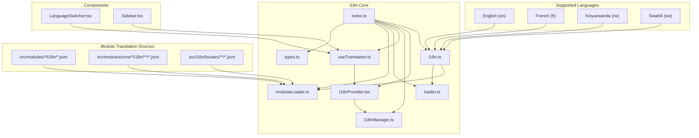
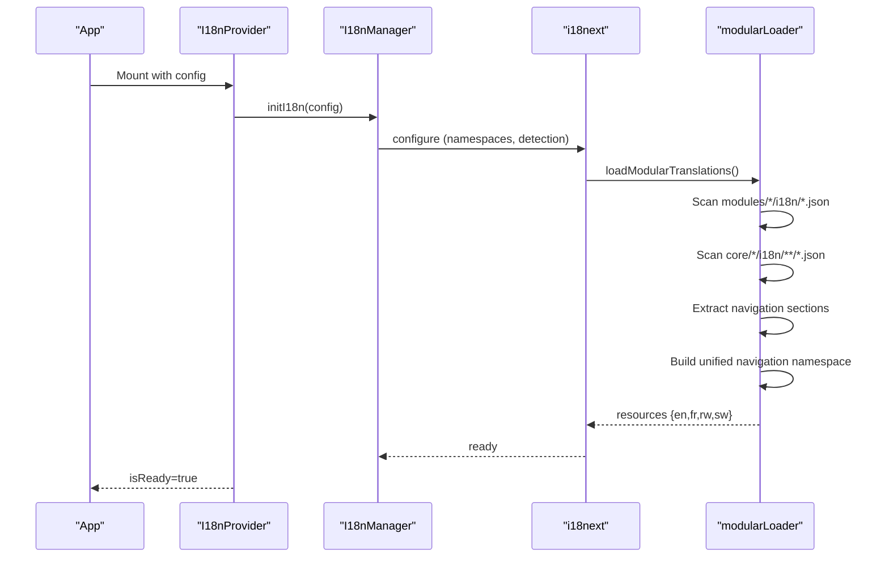
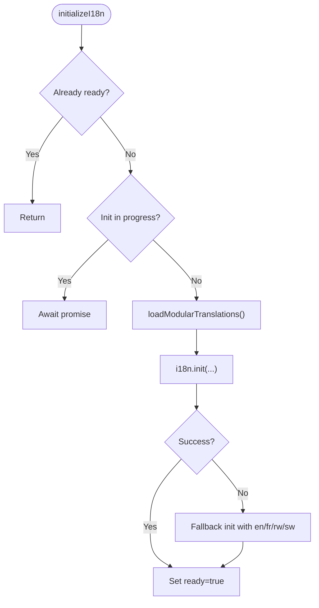
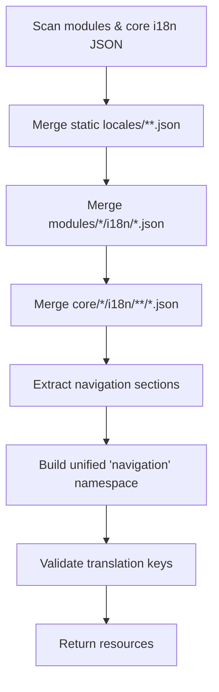
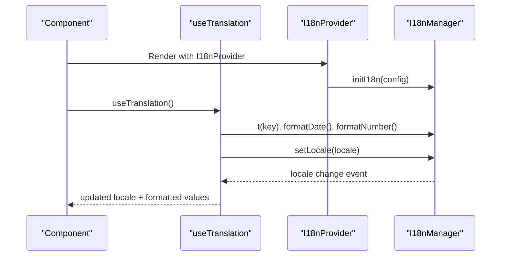
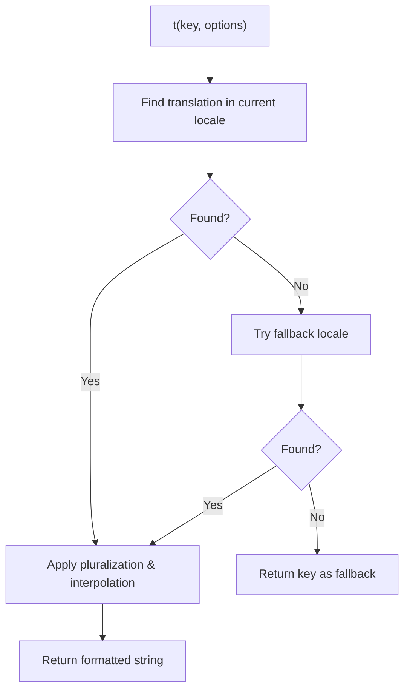
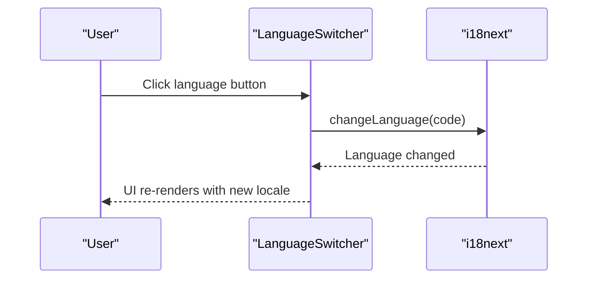
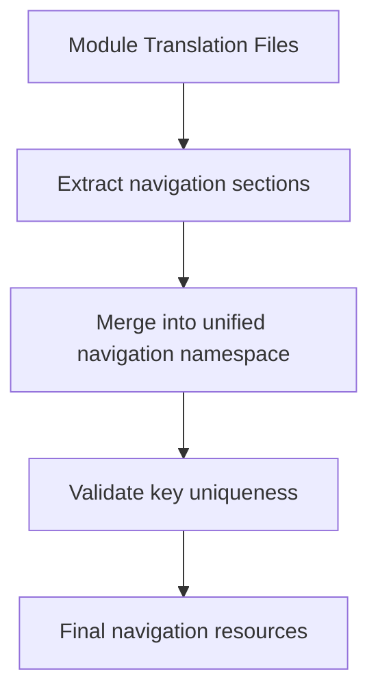
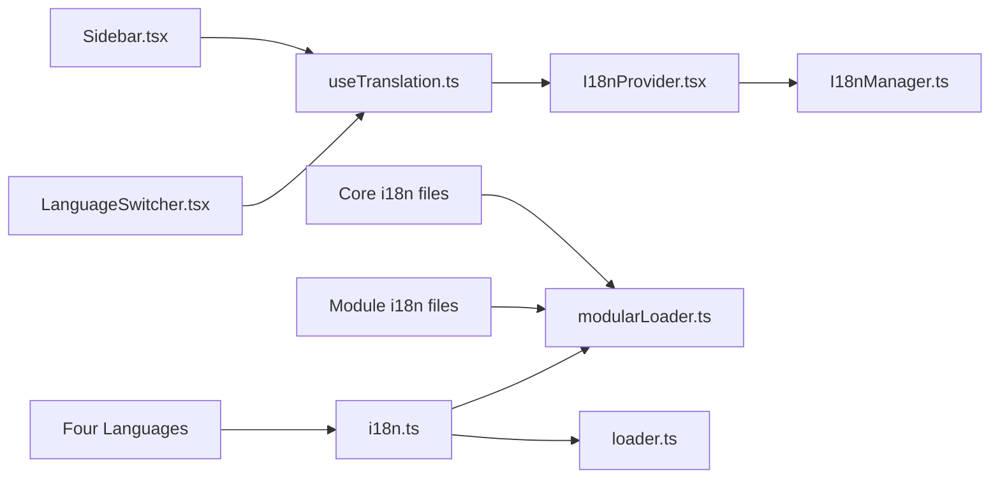

# Internationalization

<cite>
**Referenced Files in This Document**
- [index.ts](file://src/i18n/index.ts)
- [i18n.ts](file://src/i18n/i18n.ts)
- [I18nProvider.tsx](file://src/i18n/I18nProvider.tsx)
- [loader.ts](file://src/i18n/loader.ts)
- [modularLoader.ts](file://src/i18n/modularLoader.ts)
- [types.ts](file://src/i18n/types.ts)
- [useTranslation.ts](file://src/i18n/useTranslation.ts)
- [I18nManager.ts](file://src/i18n/I18nManager.ts)
- [LanguageSwitcher.tsx](file://src/components/ui/LanguageSwitcher.tsx)
- [Sidebar.tsx](file://src/components/Sidebar.tsx)
- [translationIntegrity.test.ts](file://src/tests/integration/translationIntegrity.test.ts)
</cite>

## Update Summary
**Changes Made**
- Updated navigation system documentation to reflect major decentralization effort moving navigation translations from centralized files to individual module directories
- Revised supported languages section to clarify current language support status
- Updated modular loader documentation to explain new unified navigation namespace construction
- Added documentation for translation integrity testing and validation processes
- Revised architecture diagrams to reflect decentralized navigation structure

## Table of Contents
1. [Introduction](#introduction)
2. [Project Structure](#project-structure)
3. [Core Components](#core-components)
4. [Architecture Overview](#architecture-overview)
5. [Detailed Component Analysis](#detailed-component-analysis)
6. [Decentralized Navigation System](#decentralized-navigation-system)
7. [Translation Key Standardization](#translation-key-standardization)
8. [Dependency Analysis](#dependency-analysis)
9. [Performance Considerations](#performance-considerations)
10. [Quality Assurance and Testing](#quality-assurance-and-testing)
11. [Troubleshooting Guide](#troubleshooting-guide)
12. [Conclusion](#conclusion)
13. [Appendices](#appendices)

## Introduction
This document explains SchoolPilot3's internationalization (i18n) system. It covers how i18next integrates with react-i18next, how namespaces are organized per module, and how translations are dynamically loaded based on the detected or selected language. The system now supports four languages: English (en), French (fr), Kinyarwanda (rw), and Swahili (sw). It documents the translation key structure, the fallback system to English for missing translations, language switching, and the modular translation loader that aggregates translations from both static and module-specific sources. The most significant change is the decentralization of navigation translations, where navigation keys are now maintained within individual module i18n files rather than centralized navigation.json files.

## Project Structure
The i18n system is centered under src/i18n and integrates with the component system via a React provider and hook. Translations are loaded from three sources:
- Static translation bundles under src/i18n/locales for shared namespaces.
- Module-specific translation files under src/modules/*/i18n and src/modules/core/*/i18n.
- Core module translations under src/modules/core/*/i18n for shared functionality.

**Updated**: Navigation translations are now decentralized and maintained within each module's i18n directory, with a unified navigation namespace constructed during initialization.



**Diagram sources**
- [index.ts:1-56](file://src/i18n/index.ts#L1-L56)
- [i18n.ts:1-117](file://src/i18n/i18n.ts#L1-L117)
- [I18nProvider.tsx:1-77](file://src/i18n/I18nProvider.tsx#L1-L77)
- [I18nManager.ts:1-415](file://src/i18n/I18nManager.ts#L1-L415)
- [useTranslation.ts:1-114](file://src/i18n/useTranslation.ts#L1-L114)
- [loader.ts:1-69](file://src/i18n/loader.ts#L1-L69)
- [modularLoader.ts:1-92](file://src/i18n/modularLoader.ts#L1-L92)
- [types.ts:1-59](file://src/i18n/types.ts#L1-L59)
- [LanguageSwitcher.tsx:1-119](file://src/components/ui/LanguageSwitcher.tsx#L1-L119)
- [Sidebar.tsx:149-191](file://src/components/Sidebar.tsx#L149-L191)

**Section sources**
- [index.ts:1-56](file://src/i18n/index.ts#L1-L56)
- [i18n.ts:1-117](file://src/i18n/i18n.ts#L1-L117)
- [I18nProvider.tsx:1-77](file://src/i18n/I18nProvider.tsx#L1-L77)
- [loader.ts:1-69](file://src/i18n/loader.ts#L1-L69)
- [modularLoader.ts:1-92](file://src/i18n/modularLoader.ts#L1-L92)
- [types.ts:1-59](file://src/i18n/types.ts#L1-L59)
- [useTranslation.ts:1-114](file://src/i18n/useTranslation.ts#L1-L114)
- [I18nManager.ts:1-415](file://src/i18n/I18nManager.ts#L1-L415)
- [LanguageSwitcher.tsx:1-119](file://src/components/ui/LanguageSwitcher.tsx#L1-L119)

## Core Components
- i18next bootstrap and configuration: Initializes i18next with react-i18next, language detection, and dynamic resource loading.
- Modular loader: Aggregates translation resources from static and module directories into a single i18next resource map, constructing a unified navigation namespace.
- Provider and hook: Expose translation and formatting functions and manage locale lifecycle.
- Manager: Provides translation lookup, fallback, pluralization, and formatting helpers.
- Language switcher: UI component to change the active locale.

Key responsibilities:
- Namespace organization: Namespaces are derived from translation files and merged into a unified structure, with special handling for navigation.
- Multi-language support: Supports English, French, Kinyarwanda, and Swahili with standardized key structures.
- Fallback: Missing keys fall back to English; missing locales fall back to built-in English data.
- Dynamic loading: Resources are loaded at runtime via modular loader and/or static loader.

**Section sources**
- [i18n.ts:14-116](file://src/i18n/i18n.ts#L14-L116)
- [modularLoader.ts:12-92](file://src/i18n/modularLoader.ts#L12-L92)
- [loader.ts:36-69](file://src/i18n/loader.ts#L36-L69)
- [I18nProvider.tsx:37-77](file://src/i18n/I18nProvider.tsx#L37-L77)
- [useTranslation.ts:42-114](file://src/i18n/useTranslation.ts#L42-L114)
- [I18nManager.ts:17-415](file://src/i18n/I18nManager.ts#L17-L415)
- [LanguageSwitcher.tsx:30-49](file://src/components/ui/LanguageSwitcher.tsx#L30-L49)

## Architecture Overview
The i18n pipeline starts with initialization, proceeds through resource loading, and exposes translation/formatting APIs to components. The system now supports four languages with enhanced navigation keys and standardized structures, where navigation translations are decentralized across module directories.



**Diagram sources**
- [I18nProvider.tsx:37-77](file://src/i18n/I18nProvider.tsx#L37-L77)
- [I18nManager.ts:402-412](file://src/i18n/I18nManager.ts#L402-L412)
- [i18n.ts:14-116](file://src/i18n/i18n.ts#L14-L116)
- [modularLoader.ts:12-92](file://src/i18n/modularLoader.ts#L12-L92)

## Detailed Component Analysis

### i18next Bootstrap and Configuration
- Creates an i18next instance and initializes it with react-i18next and language detection.
- Loads resources via modular loader and falls back to a minimal English/French baseline if modular loading fails.
- Configures default namespace, fallback language, and detection order.
- **Updated**: Now supports four languages with enhanced resource loading and unified navigation namespace construction.



**Diagram sources**
- [i18n.ts:14-116](file://src/i18n/i18n.ts#L14-L116)
- [modularLoader.ts:12-92](file://src/i18n/modularLoader.ts#L12-L92)

**Section sources**
- [i18n.ts:14-116](file://src/i18n/i18n.ts#L14-L116)

### Modular Translation Loader
- Scans module directories for JSON translation files and merges them into a single resource map.
- Supports static translation files under src/i18n/locales and module-specific files under src/modules/*/i18n and src/modules/core/*/i18n.
- Builds a unified navigation namespace by merging module navigation entries from individual module files.
- **Updated**: Now supports four languages (en, fr, rw, sw) with enhanced error handling and decentralized navigation processing.



**Diagram sources**
- [modularLoader.ts:6-10](file://src/i18n/modularLoader.ts#L6-L10)
- [modularLoader.ts:12-92](file://src/i18n/modularLoader.ts#L12-L92)

**Section sources**
- [modularLoader.ts:12-92](file://src/i18n/modularLoader.ts#L12-L92)

### Static Translation Loader
- Imports and registers static translation bundles for English, French, Kinyarwanda, and Swahili across predefined namespaces.
- Useful for legacy or centralized translation files.
- **Updated**: Enhanced to support all four languages with standardized key structures.

**Section sources**
- [loader.ts:36-69](file://src/i18n/loader.ts#L36-L69)

### Provider and Hook
- I18nProvider initializes the manager, persists the selected locale to localStorage, and exposes readiness.
- useTranslation provides t, locale, setLocale, and formatting helpers, with loading state during locale changes.



**Diagram sources**
- [I18nProvider.tsx:37-77](file://src/i18n/I18nProvider.tsx#L37-L77)
- [useTranslation.ts:42-114](file://src/i18n/useTranslation.ts#L42-L114)
- [I18nManager.ts:55-72](file://src/i18n/I18nManager.ts#L55-L72)

**Section sources**
- [I18nProvider.tsx:37-77](file://src/i18n/I18nProvider.tsx#L37-L77)
- [useTranslation.ts:42-114](file://src/i18n/useTranslation.ts#L42-L114)

### Manager: Translation, Fallback, Pluralization, Formatting
- Translation lookup supports nested keys and optional fallback to the configured fallback locale.
- Pluralization uses locale-aware rules; English defaults to simple singular/plural.
- Formatting helpers include dates, times, and numbers with locale-aware patterns.
- Relative time formatting provides localized "ago" messages.



**Diagram sources**
- [I18nManager.ts:109-150](file://src/i18n/I18nManager.ts#L109-L150)
- [I18nManager.ts:343-357](file://src/i18n/I18nManager.ts#L343-L357)

**Section sources**
- [I18nManager.ts:109-150](file://src/i18n/I18nManager.ts#L109-L150)
- [I18nManager.ts:167-225](file://src/i18n/I18nManager.ts#L167-L225)
- [I18nManager.ts:230-252](file://src/i18n/I18nManager.ts#L230-L252)

### Language Switcher Component
- Presents a dropdown of supported languages and updates the active locale via i18next.
- Persists the selection and handles errors gracefully.



**Diagram sources**
- [LanguageSwitcher.tsx:30-49](file://src/components/ui/LanguageSwitcher.tsx#L30-L49)

**Section sources**
- [LanguageSwitcher.tsx:30-49](file://src/components/ui/LanguageSwitcher.tsx#L30-L49)

## Decentralized Navigation System

### Navigation Architecture Transformation
The navigation system has undergone a major decentralization effort, moving navigation translations from centralized files to individual module directories. This change eliminates the need for centralized navigation.json files and distributes navigation keys across each module's i18n files.

**Updated**: Navigation translations are now maintained within individual module directories with the following structure:
- Each module maintains its own navigation keys in `src/modules/{module}/i18n/{lang}.json`
- Core modules maintain navigation keys in `src/modules/core/{coreModule}/i18n/{lang}/**.json`
- Static translations maintain navigation keys in `src/i18n/locales/{lang}/{namespace}.json`

### Unified Navigation Namespace Construction
The modular loader constructs a unified navigation namespace by extracting navigation sections from all module translation files and merging them into a single structure.



**Diagram sources**
- [modularLoader.ts:63-86](file://src/i18n/modularLoader.ts#L63-L86)

### Navigation Key Processing in Components
Navigation components access translations using a flexible key format that supports both centralized and decentralized approaches.

**Updated**: Navigation components now support both formats:
- `navigation:dashboard` - Explicit namespace specification
- `dashboard` - Implicit navigation namespace (default)

**Section sources**
- [Sidebar.tsx:159-165](file://src/components/Sidebar.tsx#L159-L165)
- [modularLoader.ts:63-86](file://src/i18n/modularLoader.ts#L63-L86)

### Supported Languages
The system currently supports four languages with comprehensive translation coverage:

| Language | Code | Status | Coverage |
|----------|------|--------|----------|
| English | en | ✅ Active | Complete |
| French | fr | ⚠️ Limited | Partial |
| Kinyarwanda | rw | ⚠️ Limited | Partial |
| Swahili | sw | ⚠️ Limited | Partial |

**Note**: While the system is configured to support four languages, current implementation focuses primarily on English and French translations, with limited coverage for Kinyarwanda and Swahili.

**Section sources**
- [i18n.ts:38](file://src/i18n/i18n.ts#L38)
- [modularLoader.ts:20](file://src/i18n/modularLoader.ts#L20)

### Language Detection and Fallback
- Language detection prioritizes localStorage, navigator, then HTML tag
- Fallback to English for missing translations
- Automatic language switching with persistence

**Section sources**
- [i18n.ts:65-68](file://src/i18n/i18n.ts#L65-L68)
- [i18n.ts:38](file://src/i18n/i18n.ts#L38)

## Translation Key Standardization

### Key Naming Conventions
- **Dot notation**: `module.namespace.key` structure
- **Descriptive keys**: Human-readable and context-specific
- **Consistent hierarchy**: Module → Section → Specific functionality

### Standardized Key Structure Examples

#### Common Keys
```json
{
  "desktop": "Desktop",
  "workspaces": "Workspaces", 
  "website": "Website",
  "reload": "Reload"
}
```

#### Navigation Keys
```json
{
  "administration": {
    "title": "Administration",
    "dashboard": "Administration Dashboard",
    "newsletters": "Newsletters"
  },
  "analytics": {
    "title": "Analytics",
    "teacherDashboard": "Teacher Dashboard",
    "exportReports": "Export Reports"
  }
}
```

#### Module-Specific Keys
```json
{
  "administration": {
    "title": "Administration",
    "staff": "Staff Management",
    "departments": "Departments"
  }
}
```

### Language-Specific Implementations

#### Swahili Translation Examples
```json
{
  "welcomeBack": "Karibu tena, {{name}}!",
  "dashboardSubtitle": "Fuatilia masomo, mahudhurio, fedha, na mawasiliano kutoka dashibodi moja tayari kwa uamuzi.",
  "newMessages": "Ujumbe Mpya",
  "pendingTasks": "Kazi Zinazosubiri"
}
```

#### Administration Module Swahili
```json
{
  "title": "Udhibiti",
  "staff": "Usimamizi wa Wafanyakazi",
  "departments": "Idara",
  "newsletters": "Matangazo"
}
```

**Section sources**
- [common.json:1-41](file://src/locales/en/common.json#L1-L41)
- [navigation.json:1-231](file://src/i18n/locales/en/navigation.json#L1-L231)
- [administration.json:1-15](file://src/i18n/locales/en/administration.json#L1-L15)

## Dependency Analysis
- The provider depends on the manager for locale lifecycle and translation services.
- The hook depends on the provider context and manager for translation and formatting.
- The i18next bootstrap depends on the modular loader for dynamic resources and optionally on the static loader for baseline bundles.
- The language switcher depends on react-i18next's i18n instance.
- **Updated**: Enhanced dependency tracking for multi-language support and decentralized navigation system.



**Diagram sources**
- [I18nProvider.tsx:37-77](file://src/i18n/I18nProvider.tsx#L37-L77)
- [useTranslation.ts:42-114](file://src/i18n/useTranslation.ts#L42-L114)
- [i18n.ts:14-116](file://src/i18n/i18n.ts#L14-L116)
- [modularLoader.ts:12-92](file://src/i18n/modularLoader.ts#L12-L92)
- [loader.ts:36-69](file://src/i18n/loader.ts#L36-L69)
- [LanguageSwitcher.tsx:30-49](file://src/components/ui/LanguageSwitcher.tsx#L30-L49)
- [Sidebar.tsx:149-191](file://src/components/Sidebar.tsx#L149-L191)

**Section sources**
- [index.ts:34-56](file://src/i18n/index.ts#L34-L56)
- [i18n.ts:14-116](file://src/i18n/i18n.ts#L14-L116)
- [modularLoader.ts:12-92](file://src/i18n/modularLoader.ts#L12-L92)
- [loader.ts:36-69](file://src/i18n/loader.ts#L36-L69)
- [I18nProvider.tsx:37-77](file://src/i18n/I18nProvider.tsx#L37-L77)
- [useTranslation.ts:42-114](file://src/i18n/useTranslation.ts#L42-L114)
- [I18nManager.ts:17-415](file://src/i18n/I18nManager.ts#L17-L415)
- [LanguageSwitcher.tsx:30-49](file://src/components/ui/LanguageSwitcher.tsx#L30-L49)

## Performance Considerations
- Lazy initialization: The system prevents redundant initialization and tracks an initialization promise to avoid concurrent setups.
- Suspense-friendly: react-i18next is configured with useSuspense to integrate with React Suspense boundaries.
- Minimal fallback: On failure, a minimal English/French baseline is used to keep the app functional.
- Efficient resource building: The modular loader consolidates resources once during initialization.
- **Updated**: Optimized resource loading for multiple languages with caching mechanisms and decentralized navigation processing.

## Quality Assurance and Testing

### Translation Integrity Testing
The system includes comprehensive testing to ensure translation integrity and prevent untranslated keys from appearing in the UI.

**Updated**: Translation integrity tests validate that every navigation item has a corresponding translation across all enabled modules.

**Section sources**
- [translationIntegrity.test.ts:1-27](file://src/tests/integration/translationIntegrity.test.ts#L1-L27)

### Testing Strategy
- **Unit Tests**: Individual translation files are validated for syntax and completeness
- **Integration Tests**: End-to-end navigation testing ensures all keys resolve correctly
- **Coverage Tests**: Automated checks verify translation coverage across modules
- **Manual QA**: Visual inspection of navigation components in different languages

### Quality Metrics
- **Translation Coverage**: Percentage of navigation items with translations
- **Key Completeness**: Verification that all required keys exist in each language
- **Fallback Behavior**: Testing of fallback mechanisms for missing translations
- **Performance**: Measurement of translation loading and lookup performance

**Section sources**
- [translationIntegrity.test.ts:7-26](file://src/tests/integration/translationIntegrity.test.ts#L7-L26)

## Troubleshooting Guide
Common issues and resolutions:
- Missing translation keys: The manager returns the key itself when a translation is not found; verify key paths and namespaces.
- Fallback not applied: Ensure the fallback locale is configured and present in the loaded resources.
- Language switching not persisting: Confirm localStorage persistence and that the provider is mounted before components requiring translations.
- Module translations not loading: Verify module i18n JSON paths and filenames; ensure namespaces match expectations.
- **Updated**: Multi-language specific issues:
  - JSON parsing errors: Check for syntax errors in translation files
  - Missing language keys: Ensure all languages have complete key coverage
  - Language detection failures: Verify browser language settings and localStorage
  - Navigation key conflicts: Check for duplicate navigation keys across modules

**Section sources**
- [I18nManager.ts:114-126](file://src/i18n/I18nManager.ts#L114-L126)
- [I18nProvider.tsx:56-62](file://src/i18n/I18nProvider.tsx#L56-L62)
- [LanguageSwitcher.tsx:30-49](file://src/components/ui/LanguageSwitcher.tsx#L30-L49)

## Conclusion
SchoolPilot3's i18n system combines a robust provider/hook architecture with dynamic, modular translation loading. The system now supports four languages with enhanced navigation keys and standardized structures. The major decentralization effort has moved navigation translations from centralized files to individual module directories, creating a more maintainable and scalable architecture. Namespaces are cleanly separated per module while a unified navigation namespace ensures consistent UI labels. The system provides strong fallbacks to English and offers locale-specific formatting. The LanguageSwitcher enables seamless language changes, and the modular loader simplifies adding translations across modules. Recent updates have focused on improving translation coverage and fixing JSON parsing errors across all supported languages, with ongoing work to expand language support beyond English and French.

## Appendices

### Translation Key Structure and Best Practices
- Keys are dot-separated paths (e.g., module.namespace.key).
- Prefer short, descriptive namespaces aligned with modules (e.g., academics, administration, finance).
- Keep keys stable; avoid renaming to prevent broken references.
- Use pluralization consistently with count-based options; define plural variants in translation files.
- **Updated**: Maintain consistency across all four supported languages with decentralized navigation keys.

**Section sources**
- [I18nManager.ts:109-150](file://src/i18n/I18nManager.ts#L109-L150)
- [I18nManager.ts:343-357](file://src/i18n/I18nManager.ts#L343-L357)

### Adding New Translations
- Static bundles: Add JSON files under src/i18n/locales/{lang}/{namespace}.json and ensure they are imported and registered.
- Module-specific: Place JSON files under src/modules/{module}/i18n/{lang}.json; the modular loader will automatically include them.
- Core module translations: Place JSON files under src/modules/core/{coreModule}/i18n/{lang}.json; they will be aggregated similarly.
- **Updated**: Ensure all four languages (en, fr, rw, sw) have complete key coverage with decentralized navigation keys.

**Section sources**
- [loader.ts:36-69](file://src/i18n/loader.ts#L36-L69)
- [modularLoader.ts:6-10](file://src/i18n/modularLoader.ts#L6-L10)
- [modularLoader.ts:51-87](file://src/i18n/modularLoader.ts#L51-L87)

### Managing Translation Keys
- Centralize shared keys in common namespaces.
- For module UI, use module-specific namespaces to avoid collisions.
- Use the unified navigation namespace to consolidate navigation labels across modules.
- **Updated**: Maintain standardized key structures across all supported languages with decentralized navigation processing.

**Section sources**
- [modularLoader.ts:63-86](file://src/i18n/modularLoader.ts#L63-L86)

### Language-Specific Formatting
- Dates/times: Use the formatting helpers to produce locale-aware strings.
- Numbers/currency: Use the number formatter with optional currency codes.
- Relative time: Utilize relative date formatting for human-friendly timestamps.
- **Updated**: Enhanced formatting support for all four languages with proper pluralization rules.

**Section sources**
- [I18nManager.ts:167-225](file://src/i18n/I18nManager.ts#L167-L225)
- [I18nManager.ts:230-252](file://src/i18n/I18nManager.ts#L230-L252)

### Translation Workflow and Quality Assurance
- Workflow:
  - Define keys in code using the translation hook.
  - Add English translations in static or module files.
  - Add target language translations alongside English.
  - Validate rendering across modules and verify navigation labels.
  - **Updated**: Ensure complete coverage for all four supported languages with decentralized navigation keys.
- QA:
  - Run tests that assert translation presence and formatting.
  - Verify language switching does not break UI.
  - Monitor console warnings for missing keys.
  - **Updated**: Test JSON parsing for all translation files.
  - **Updated**: Validate navigation key consistency across languages and modules.
  - **Updated**: Run translation integrity tests to prevent untranslated keys.

### Multi-Language Implementation Guide
- **JSON Structure**: Ensure all translation files follow the same structure
- **Key Consistency**: Maintain identical key hierarchies across languages
- **Error Handling**: Implement proper JSON parsing validation
- **Testing Strategy**: Test each language independently and together
- **Documentation**: Keep translation key documentation updated
- **Updated**: Focus on decentralized navigation key management and unified namespace construction

**Section sources**
- [modularLoader.ts:20](file://src/i18n/modularLoader.ts#L20)
- [i18n.ts:38](file://src/i18n/i18n.ts#L38)
- [translationIntegrity.test.ts:7-26](file://src/tests/integration/translationIntegrity.test.ts#L7-L26)