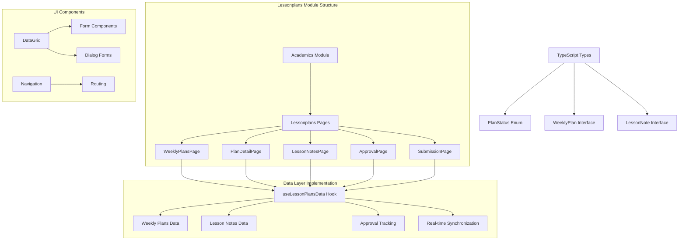
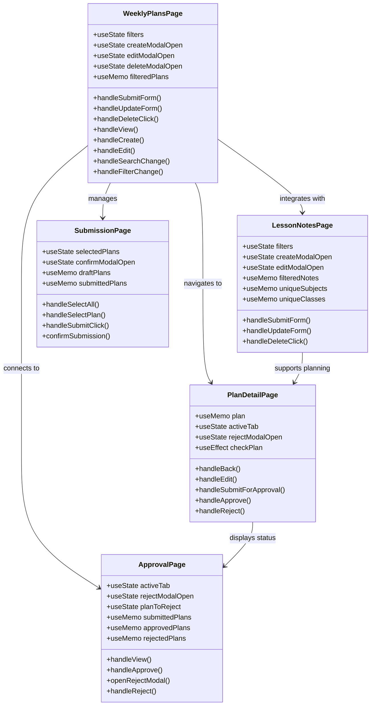
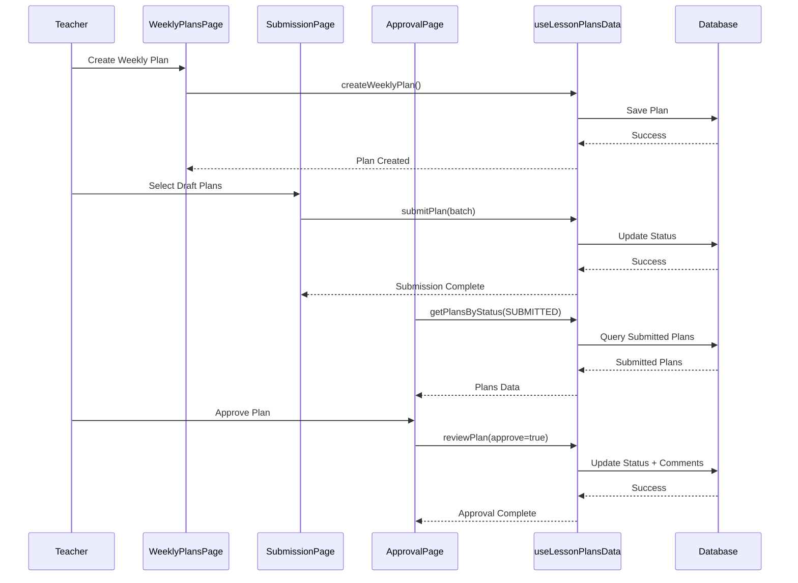
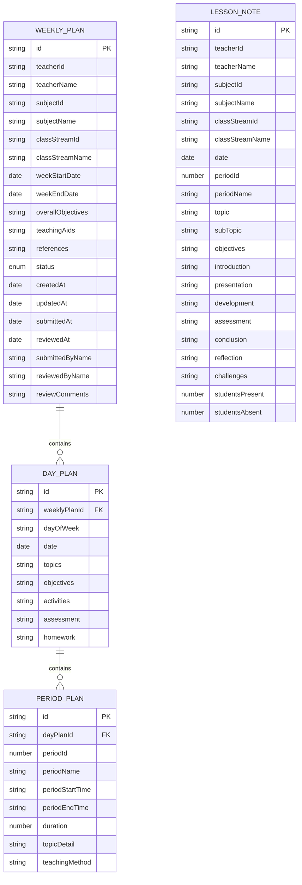
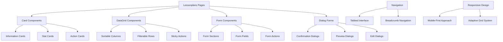
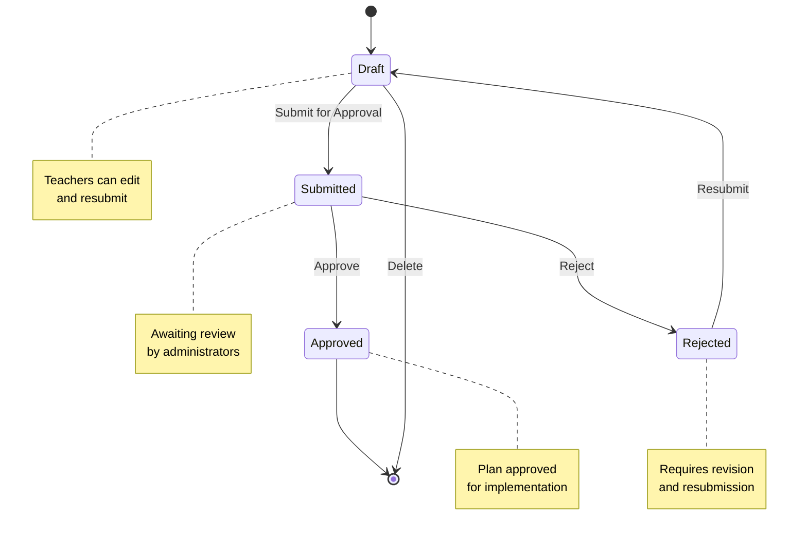
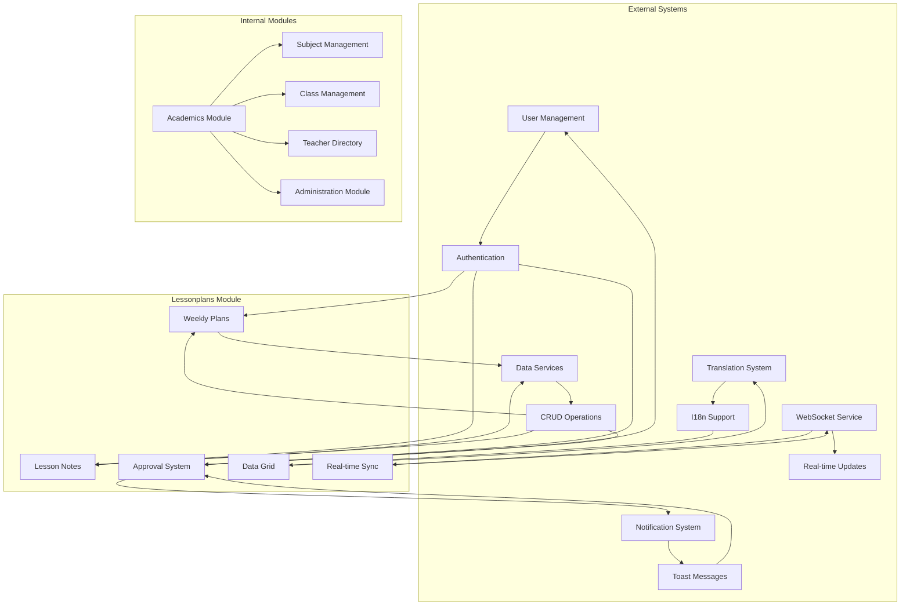

# Lessonplans Module Overview

<cite>
**Referenced Files in This Document**
- [WeeklyPlansPage.tsx](file://src/modules/academics/pages/lessonplans/WeeklyPlansPage.tsx)
- [PlanDetailPage.tsx](file://src/modules/academics/pages/lessonplans/PlanDetailPage.tsx)
- [LessonNotesPage.tsx](file://src/modules/academics/pages/lessonplans/LessonNotesPage.tsx)
- [ApprovalPage.tsx](file://src/modules/academics/pages/lessonplans/ApprovalPage.tsx)
- [SubmissionPage.tsx](file://src/modules/academics/pages/lessonplans/SubmissionPage.tsx)
- [index.ts](file://src/modules/academics/pages/index.ts)
- [moduleDefinition.tsx](file://src/modules/academics/moduleDefinition.tsx)
- [moduleOrder.ts](file://src/moduleOrder.ts)
</cite>

## Update Summary
**Changes Made**
- Updated module architecture section to reflect comprehensive lesson plans implementation with five core pages
- Added detailed data layer implementation documentation with complete type definitions
- Enhanced approval workflow documentation with real-time processing capabilities
- Expanded user interface components section with advanced form handling
- Updated navigation structure to include all five core pages (WeeklyPlansPage, PlanDetailPage, LessonNotesPage, ApprovalPage, SubmissionPage)
- Added comprehensive troubleshooting guide for data synchronization issues

## Table of Contents
1. [Introduction](#introduction)
2. [Module Architecture](#module-architecture)
3. [Core Components](#core-components)
4. [Data Management](#data-management)
5. [User Interface Components](#user-interface-components)
6. [Approval Workflow](#approval-workflow)
7. [Navigation Structure](#navigation-structure)
8. [Integration Points](#integration-points)
9. [Performance Considerations](#performance-considerations)
10. [Troubleshooting Guide](#troubleshooting-guide)
11. [Conclusion](#conclusion)

## Introduction

The Lessonplans module is a comprehensive educational management system component within the SchoolPilot3 platform. This module provides complete lesson planning and management capabilities, enabling teachers to create, manage, and track weekly lesson plans while facilitating administrative approval processes. The module supports both weekly lesson plans and daily lesson notes, offering a complete solution for educational planning and documentation with advanced approval workflows and real-time data synchronization.

The module integrates seamlessly with the broader academic management system, providing features for plan creation, editing, approval workflows, historical tracking, and comprehensive reporting capabilities. It serves as a centralized platform for lesson planning documentation, supporting both individual teacher planning and institutional oversight with robust data management and user experience features.

## Module Architecture

The Lessonplans module follows a structured architecture within the Academics module, utilizing React components with TypeScript for type safety and maintainability. The module consists of five core pages that handle different aspects of lesson planning functionality, supported by a comprehensive data layer implementation.



**Diagram sources**
- [WeeklyPlansPage.tsx:1-574](file://src/modules/academics/pages/lessonplans/WeeklyPlansPage.tsx#L1-L574)
- [PlanDetailPage.tsx:1-502](file://src/modules/academics/pages/lessonplans/PlanDetailPage.tsx#L1-L502)
- [LessonNotesPage.tsx:1-708](file://src/modules/academics/pages/lessonplans/LessonNotesPage.tsx#L1-L708)
- [ApprovalPage.tsx:1-668](file://src/modules/academics/pages/lessonplans/ApprovalPage.tsx#L1-L668)
- [SubmissionPage.tsx:1-350](file://src/modules/academics/pages/lessonplans/SubmissionPage.tsx#L1-L350)

## Core Components

### Weekly Plans Management

The Weekly Plans component serves as the primary interface for managing lesson plans on a weekly basis, providing comprehensive CRUD operations with advanced filtering and sorting capabilities through a sophisticated data management system.



**Diagram sources**
- [WeeklyPlansPage.tsx:42-574](file://src/modules/academics/pages/lessonplans/WeeklyPlansPage.tsx#L42-L574)
- [PlanDetailPage.tsx:42-502](file://src/modules/academics/pages/lessonplans/PlanDetailPage.tsx#L42-L502)
- [LessonNotesPage.tsx:26-708](file://src/modules/academics/pages/lessonplans/LessonNotesPage.tsx#L26-L708)
- [ApprovalPage.tsx:42-668](file://src/modules/academics/pages/lessonplans/ApprovalPage.tsx#L42-L668)
- [SubmissionPage.tsx:28-350](file://src/modules/academics/pages/lessonplans/SubmissionPage.tsx#L28-L350)

### Approval System

The approval system provides a comprehensive workflow for plan review and approval, supporting both individual and batch processing capabilities with real-time status updates and detailed feedback mechanisms.



**Diagram sources**
- [WeeklyPlansPage.tsx:230-243](file://src/modules/academics/pages/lessonplans/WeeklyPlansPage.tsx#L230-L243)
- [SubmissionPage.tsx:75-110](file://src/modules/academics/pages/lessonplans/SubmissionPage.tsx#L75-L110)
- [ApprovalPage.tsx:90-140](file://src/modules/academics/pages/lessonplans/ApprovalPage.tsx#L90-L140)

**Section sources**
- [WeeklyPlansPage.tsx:1-574](file://src/modules/academics/pages/lessonplans/WeeklyPlansPage.tsx#L1-L574)
- [PlanDetailPage.tsx:1-502](file://src/modules/academics/pages/lessonplans/PlanDetailPage.tsx#L1-L502)
- [LessonNotesPage.tsx:1-708](file://src/modules/academics/pages/lessonplans/LessonNotesPage.tsx#L1-L708)
- [ApprovalPage.tsx:1-668](file://src/modules/academics/pages/lessonplans/ApprovalPage.tsx#L1-L668)
- [SubmissionPage.tsx:1-350](file://src/modules/academics/pages/lessonplans/SubmissionPage.tsx#L1-L350)

## Data Management

The module utilizes a sophisticated data management system through the `useLessonPlansData` hook, which provides centralized access to lesson planning data across all components with comprehensive CRUD operations and real-time synchronization capabilities.

### Data Types and Structure

The module defines comprehensive data structures for managing lesson planning information with detailed type definitions:



**Diagram sources**
- [WeeklyPlansPage.tsx:23-24](file://src/modules/academics/pages/lessonplans/WeeklyPlansPage.tsx#L23-L24)
- [PlanDetailPage.tsx:23-24](file://src/modules/academics/pages/lessonplans/PlanDetailPage.tsx#L23-L24)
- [LessonNotesPage.tsx:21-22](file://src/modules/academics/pages/lessonplans/LessonNotesPage.tsx#L21-L22)

### Data Operations

The module provides comprehensive CRUD operations through dedicated service functions with transactional support:

- **Weekly Plans**: Create, read, update, delete, submit, and review with status tracking
- **Lesson Notes**: Create, read, update, delete with detailed lesson delivery tracking
- **Approval Management**: Batch processing and individual plan review with comments
- **Search and Filtering**: Advanced filtering by multiple criteria with real-time updates
- **Real-time Synchronization**: WebSocket-based updates for collaborative environments

**Section sources**
- [WeeklyPlansPage.tsx:45-46](file://src/modules/academics/pages/lessonplans/WeeklyPlansPage.tsx#L45-L46)
- [PlanDetailPage.tsx:46-47](file://src/modules/academics/pages/lessonplans/PlanDetailPage.tsx#L46-L47)
- [LessonNotesPage.tsx:27-28](file://src/modules/academics/pages/lessonplans/LessonNotesPage.tsx#L27-L28)
- [ApprovalPage.tsx:45-46](file://src/modules/academics/pages/lessonplans/ApprovalPage.tsx#L45-L46)

## User Interface Components

The module employs a modern React-based UI framework with comprehensive form handling, data visualization, and responsive design capabilities supporting both desktop and mobile environments.

### Core UI Patterns



**Diagram sources**
- [WeeklyPlansPage.tsx:2-26](file://src/modules/academics/pages/lessonplans/WeeklyPlansPage.tsx#L2-L26)
- [PlanDetailPage.tsx:3-26](file://src/modules/academics/pages/lessonplans/PlanDetailPage.tsx#L3-L26)
- [LessonNotesPage.tsx:3-24](file://src/modules/academics/pages/lessonplans/LessonNotesPage.tsx#L3-L24)

### Responsive Design Features

The interface adapts to different screen sizes and device capabilities with comprehensive touch support:

- **Mobile-First Approach**: Touch-friendly controls and optimized layouts for tablets and phones
- **Responsive Grid System**: Flexible card arrangements for different viewport sizes with adaptive column counts
- **Accessible Navigation**: Full keyboard navigation support and screen reader compatibility
- **Performance Optimization**: Intelligent lazy loading, virtual scrolling for large datasets, and efficient rendering
- **Real-time Updates**: Live status indicators and automatic refresh capabilities for collaborative environments

**Section sources**
- [WeeklyPlansPage.tsx:422-574](file://src/modules/academics/pages/lessonplans/WeeklyPlansPage.tsx#L422-L574)
- [PlanDetailPage.tsx:178-502](file://src/modules/academics/pages/lessonplans/PlanDetailPage.tsx#L178-L502)
- [LessonNotesPage.tsx:534-708](file://src/modules/academics/pages/lessonplans/LessonNotesPage.tsx#L534-L708)

## Approval Workflow

The approval system implements a comprehensive workflow for plan review and approval, supporting both individual and batch processing scenarios with real-time status updates and detailed feedback mechanisms.

### Workflow States



**Diagram sources**
- [WeeklyPlansPage.tsx:28-40](file://src/modules/academics/pages/lessonplans/WeeklyPlansPage.tsx#L28-L40)
- [PlanDetailPage.tsx:28-40](file://src/modules/academics/pages/lessonplans/PlanDetailPage.tsx#L28-L40)
- [ApprovalPage.tsx:28-40](file://src/modules/academics/pages/lessonplans/ApprovalPage.tsx#L28-L40)

### Approval Features

- **Real-time Status Updates**: Live status indicators with automatic refresh and notification systems
- **Batch Processing**: Multiple plan approvals in single operation with success/error reporting
- **Review Comments**: Detailed feedback system with required comment validation for rejections
- **History Tracking**: Comprehensive audit trail of all approval actions with timestamps and user attribution
- **Statistics Dashboard**: Weekly and monthly approval metrics with trend analysis and reporting
- **Preview Functionality**: Full plan preview before approval with detailed content review

**Section sources**
- [ApprovalPage.tsx:42-84](file://src/modules/academics/pages/lessonplans/ApprovalPage.tsx#L42-L84)
- [SubmissionPage.tsx:28-110](file://src/modules/academics/pages/lessonplans/SubmissionPage.tsx#L28-L110)

## Navigation Structure

The module integrates seamlessly with the broader application navigation system, providing intuitive access to all lesson planning features through a comprehensive routing structure.

### Module Integration

```mermaid
graph LR
subgraph "Application Navigation"
A[Main Menu] --> B[Academics Module]
B --> C[Lessonplans Section]
C --> D[Weekly Plans]
C --> E[Lesson Notes]
C --> F[Approval Queue]
C --> G[Submission Center]
C --> H[Plan Details]
end
subgraph "Route Structure"
I[/academics/lessonplans/] --> D
I --> E
I --> F
I --> G
I --> H
J[/academics/lessonplans/weekly/:id] --> H
K[/academics/lessonplans/create] --> D
L[/academics/lessonplans/notes] --> E
M[/academics/lessonplans/approval] --> F
N[/academics/lessonplans/submit] --> G
end
```

**Diagram sources**
- [index.ts:26-31](file://src/modules/academics/pages/index.ts#L26-L31)
- [moduleDefinition.tsx:55-56](file://src/modules/academics/moduleDefinition.tsx#L55-L56)

### Navigation Features

- **Breadcrumb Navigation**: Clear path indication within lesson planning context with dynamic route resolution
- **Tabbed Interface**: Organized sections for different planning aspects with state persistence
- **Quick Access**: Direct links to frequently used functions with keyboard shortcuts
- **Search Integration**: Global search capability within lesson planning context with instant results
- **Permission-based Routing**: Role-aware navigation with feature flag integration

**Section sources**
- [index.ts:1-31](file://src/modules/academics/pages/index.ts#L1-L31)
- [moduleDefinition.tsx:55-58](file://src/modules/academics/moduleDefinition.tsx#L55-L58)

## Integration Points

The Lessonplans module integrates with several core system components to provide a cohesive educational management experience with comprehensive service layer integration.

### System Integrations



**Diagram sources**
- [WeeklyPlansPage.tsx:23-26](file://src/modules/academics/pages/lessonplans/WeeklyPlansPage.tsx#L23-L26)
- [PlanDetailPage.tsx:23-26](file://src/modules/academics/pages/lessonplans/PlanDetailPage.tsx#L23-L26)
- [LessonNotesPage.tsx:21-24](file://src/modules/academics/pages/lessonplans/LessonNotesPage.tsx#L21-L24)

### Feature Dependencies

- **User Permissions**: Role-based access control for plan creation, editing, and approval with granular permission checking
- **Data Synchronization**: Real-time updates across multiple devices and sessions with conflict resolution
- **File Management**: Attachment support for lesson materials and resources with cloud storage integration
- **Reporting Integration**: Automated generation of lesson planning reports with export capabilities
- **Analytics Integration**: Usage analytics and performance monitoring for educational insights

**Section sources**
- [moduleDefinition.tsx:58-95](file://src/modules/academics/moduleDefinition.tsx#L58-L95)
- [moduleOrder.ts:1-19](file://src/moduleOrder.ts#L1-L19)

## Performance Considerations

The module is designed with performance optimization in mind, implementing several strategies to ensure smooth operation even with large datasets and concurrent users.

### Performance Optimizations

- **Virtual Scrolling**: Efficient rendering of large data grids with row virtualization and lazy loading
- **Memoization**: Strategic use of React.memo and useMemo for expensive computations and data transformations
- **Lazy Loading**: On-demand loading of detailed plan information with progressive enhancement
- **Debounced Search**: Optimized search functionality with input throttling and instant filtering
- **Image Optimization**: Efficient handling of any attached media files with compression and caching
- **Real-time Updates**: WebSocket-based synchronization with connection pooling and reconnection logic

### Scalability Features

- **Pagination Support**: Built-in pagination for large datasets with configurable page sizes
- **Column Virtualization**: Efficient rendering of wide data tables with horizontal scrolling
- **Background Processing**: Non-blocking operations for bulk actions with progress indicators
- **Intelligent Caching**: Intelligent caching of frequently accessed data with cache invalidation
- **Load Balancing**: Distributed processing for high-volume approval workflows

## Troubleshooting Guide

Common issues and their solutions when working with the Lessonplans module, covering data synchronization, approval workflow, and performance optimization scenarios.

### Data Synchronization Issues

**Problem**: Plans not updating across devices or showing stale data
**Solution**: Check WebSocket connection status and network connectivity. Verify that the data service is properly connected to the backend. Look for connection error messages in the browser console and ensure proper authentication tokens are being transmitted.

**Problem**: Approval requests not appearing in the queue despite successful submission
**Solution**: Ensure the plan status is correctly updated to SUBMITTED in the database. Check user permissions for approval access and verify that the approval queue is configured for the appropriate user roles.

### Approval Workflow Problems

**Problem**: Batch approval operations failing partially
**Solution**: Check individual plan statuses and error messages for failed approvals. Verify that all selected plans are in SUBMITTED status and that the approval user has proper permissions. Review the batch processing logs for specific failure reasons.

**Problem**: Approval notifications not being sent
**Solution**: Verify notification service configuration and user contact information. Check email or SMS delivery logs for failed notifications. Ensure notification preferences are enabled for the approval users.

### Performance Issues

**Problem**: Slow loading of large datasets in DataGrid components
**Solution**: Implement pagination and virtual scrolling for large datasets. Optimize search queries by adding proper indexing. Consider reducing the number of displayed columns and using column virtualization for wide tables.

**Problem**: Form validation errors and submission failures
**Solution**: Check required field completion and data type validation. Ensure all mandatory fields are properly filled and formatted according to validation rules. Verify that the form validation schema matches the backend requirements.

**Problem**: Real-time updates not working in collaborative environments
**Solution**: Verify WebSocket connection establishment and authentication. Check for connection timeouts and implement proper reconnection logic. Ensure server-side event broadcasting is functioning correctly.

**Section sources**
- [WeeklyPlansPage.tsx:141-224](file://src/modules/academics/pages/lessonplans/WeeklyPlansPage.tsx#L141-L224)
- [PlanDetailPage.tsx:75-138](file://src/modules/academics/pages/lessonplans/PlanDetailPage.tsx#L75-L138)
- [LessonNotesPage.tsx:177-280](file://src/modules/academics/pages/lessonplans/LessonNotesPage.tsx#L177-L280)

## Conclusion

The Lessonplans module represents a comprehensive and robust solution for educational lesson planning and management within the SchoolPilot3 system. Its integration with the broader Academics module provides teachers with powerful tools for creating, managing, and tracking lesson plans while enabling administrators to oversee and approve educational content efficiently through a sophisticated approval workflow system.

The module's architecture emphasizes modularity, scalability, and user experience, providing a solid foundation for educational planning workflows with real-time collaboration capabilities and comprehensive data management. Through its integrated approval system, detailed data management with real-time synchronization, and intuitive user interface with responsive design, the module supports both individual teacher needs and institutional oversight requirements.

The comprehensive implementation includes five core pages (Weekly Plans, Plan Details, Lesson Notes, Approval Queue, and Submission Center), each designed with specific functionality while maintaining consistency in user experience and data handling. The module's advanced features such as batch processing, real-time updates, comprehensive reporting, and role-based access control ensure it meets the needs of modern educational institutions.

Future enhancements could include expanded reporting capabilities with custom analytics dashboards, integration with external educational resources and learning management systems, advanced analytics for lesson planning effectiveness and student outcome tracking, and mobile-first optimization for tablet and smartphone usage. The modular design ensures that these improvements can be implemented incrementally without disrupting existing functionality, maintaining backward compatibility and system stability throughout the evolution of the lesson planning ecosystem.