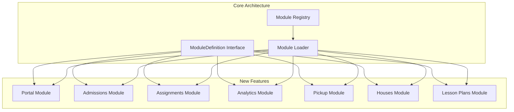
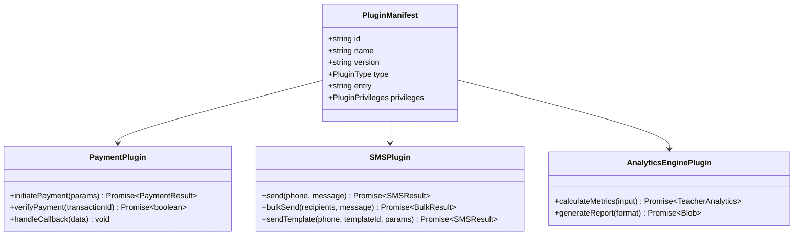
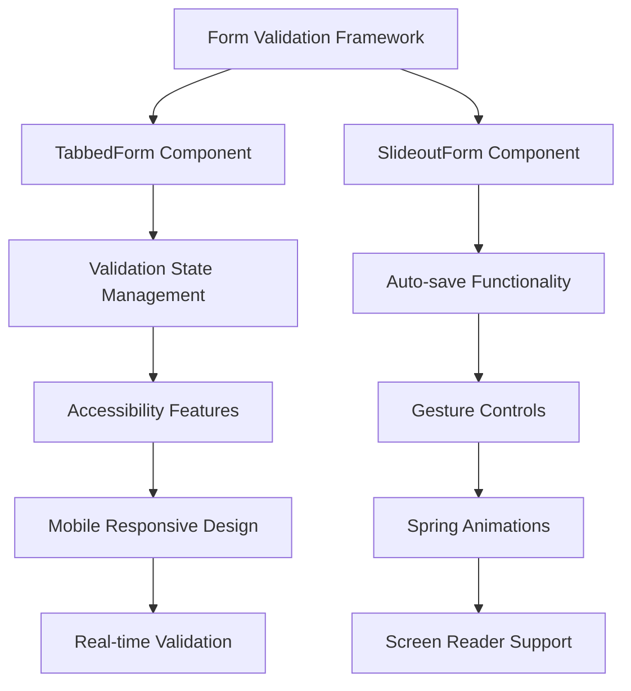
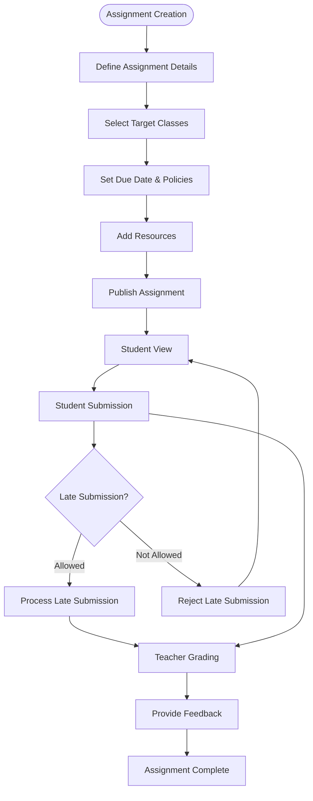

# Missing Features Implementation Plan

<cite>
**Referenced Files in This Document**
- [MISSING_FEATURES_IMPLEMENTATION_PLAN.md](file://docs/planning/MISSING_FEATURES_IMPLEMENTATION_PLAN.md)
- [feature-list.md](file://docs/specs/feature-list.md)
- [types.ts](file://src/core/types.ts)
- [types.ts](file://src/plugins/types.ts)
- [types.ts](file://src/rbac/types.ts)
- [package.json](file://package.json)
- [TabbedForm.tsx](file://src/components/ui/forms/TabbedForm.tsx)
- [SlideoutForm.tsx](file://src/components/ui/forms/SlideoutForm.tsx)
- [useSlideout.tsx](file://src/hooks/useSlideout.tsx)
- [form-validation-framework-implementation.md](file://docs/guides/form-validation-framework-implementation.md)
- [TabbedFormDemo.tsx](file://src/components/__demos__/TabbedFormDemo.tsx)
- [FormValidationDemo.tsx](file://src/components/__demos__/FormValidationDemo.tsx)
- [TabbedForm.basic.test.tsx](file://src/tests/TabbedForm.basic.test.tsx)
- [SlideoutForm.test.tsx](file://src/tests/SlideoutForm.test.tsx)
</cite>

## Update Summary
**Changes Made**
- Enhanced form system documentation with comprehensive updates to TabbedForm and SlideoutForm components
- Added detailed information about the newly implemented Form Validation Framework
- Updated form component architecture with modern validation and interaction patterns
- Integrated accessibility improvements and mobile-responsive design patterns
- Added comprehensive testing documentation for form components

## Table of Contents
1. [Introduction](#introduction)
2. [Executive Summary](#executive-summary)
3. [Architecture Alignment](#architecture-alignment)
4. [Feature Specifications](#feature-specifications)
5. [Implementation Phases](#implementation-phases)
6. [Technical Requirements](#technical-requirements)
7. [Success Metrics](#success-metrics)
8. [Implementation Roadmap](#implementation-roadmap)
9. [Resource Requirements](#resource-requirements)
10. [Risk Assessment](#risk-assessment)
11. [Conclusion](#conclusion)

## Introduction

The Missing Features Implementation Plan outlines a comprehensive roadmap for developing seven key educational management features in the SchoolPilot3 system. This plan addresses critical gaps in the current system while maintaining architectural consistency and leveraging the existing plugin-based extensibility framework.

The implementation follows a strategic approach where all features are designed as frontend-first solutions with backend-agnostic data access, ensuring maximum flexibility and portability across different deployment environments.

**Updated** Enhanced with comprehensive form system improvements including modern validation frameworks and interactive form components.

## Executive Summary

This implementation plan targets seven major feature areas that will significantly enhance SchoolPilot3's capabilities:

- **Student & Parent Portal**: External-facing access for academic information
- **Online Admissions**: Public application system for prospective students  
- **Online Assignment System**: Academic workflow management
- **Lesson Plans & Electronic Notes**: Teacher planning and documentation tools
- **Teacher Analytics**: Performance monitoring and reporting
- **Secure Pickup System**: QR-code based student release verification
- **House Points System**: Student behavior and merit tracking

The plan spans 14 weeks with a total effort of 103 development days, organized into four distinct phases focusing on external access, academic workflows, and administrative tools.

**Updated** Form system now includes advanced validation frameworks and modern interactive components for enhanced user experience.

## Architecture Alignment

### Module System Compatibility

All new features adhere to the established ModuleDefinition interface, ensuring seamless integration with the existing module architecture:

**Diagram sources**
- [MISSING_FEATURES_IMPLEMENTATION_PLAN.md:35-57](file://docs/planning/MISSING_FEATURES_IMPLEMENTATION_PLAN.md#L35-L57)
- [types.ts:1-800](file://src/core/types.ts#L1-L800)

### Plugin Integration Framework

The system leverages a sophisticated plugin architecture for external service integration:

**Diagram sources**
- [types.ts:60-111](file://src/plugins/types.ts#L60-L111)
- [types.ts:13-21](file://src/plugins/types.ts#L13-L21)
- [MISSING_FEATURES_IMPLEMENTATION_PLAN.md:1294-1314](file://docs/planning/MISSING_FEATURES_IMPLEMENTATION_PLAN.md#L1294-L1314)

### Data Layer Strategy

The implementation maintains a frontend-first approach with backend-agnostic data access:

- **Frontend-first**: All CRUD operations handled via existing hooks
- **Provider flexibility**: Works with SQLite OPFS, PouchDB, or any configured provider
- **Plugin extensibility**: Complex calculations delegated to plugin engines

### Form System Architecture

**Updated** The form system has been significantly enhanced with modern validation frameworks and interactive components:

**Diagram sources**
- [TabbedForm.tsx:1-482](file://src/components/ui/forms/TabbedForm.tsx#L1-L482)
- [SlideoutForm.tsx:1-751](file://src/components/ui/forms/SlideoutForm.tsx#L1-L751)
- [useSlideout.tsx:1-210](file://src/hooks/useSlideout.tsx#L1-L210)

## Feature Specifications

### Student & Parent Portal

The portal module provides external access to academic information with role-based permissions and authentication integration.

**Key Components:**
- Authentication integration with existing AuthContext
- Role-based access control (student, parent, guardian)
- Academic information display (attendance, results, fees)
- Announcement system integration
- Payment processing capabilities

**Implementation Timeline:** Weeks 1-6

### Online Admissions System

Extends the existing admissions module with public-facing application capabilities.

**Core Features:**
- Public application form accessible without authentication
- Draft saving functionality for multi-session completion
- Document upload capabilities for required materials
- Application tracking system for parents
- Configuration management for application periods

**Integration Points:**
- Extends existing admissions module structure
- Integrates with notification systems for status updates

**Implementation Timeline:** Weeks 1-6

### Online Assignment System

Comprehensive assignment management system supporting creation, distribution, submission, and grading workflows.

**System Architecture:**

**Diagram sources**
- [MISSING_FEATURES_IMPLEMENTATION_PLAN.md:392-491](file://docs/planning/MISSING_FEATURES_IMPLEMENTATION_PLAN.md#L392-L491)

**Implementation Timeline:** Weeks 7-10

### Lesson Plans & Electronic Notes

Weekly planning and daily lesson documentation system with approval workflows.

**Key Features:**
- Weekly lesson plan creation with multi-period support
- Daily lesson notes with reflection capabilities
- Approval workflow for plan submissions
- Template system for efficient planning
- Curriculum coverage reporting

**Implementation Timeline:** Weeks 7-10

### Teacher Analytics

Advanced analytics dashboard with plugin-based calculation engine.

**Analytics Capabilities:**
- Teacher performance metrics by subject and class
- Performance trend analysis over time
- Comparative analysis between educators
- Syllabus coverage tracking
- Report generation and export functionality

**Integration:** Leverages Go WASM engine for complex calculations

**Implementation Timeline:** Weeks 11-14

### Secure Pickup System

QR-code based student release verification system for enhanced safety.

**Security Features:**
- Unique pickup code generation per student
- QR code verification system
- Authorized person management
- Comprehensive pickup logging
- SMS notification integration

**Implementation Timeline:** Weeks 11-14

### House Points System

Student behavior and merit tracking system integrated with pastoral care.

**System Components:**
- House management and leadership
- Point transaction recording
- Merit and demerit categories
- Leaderboard and ranking systems
- Automatic house assignments

**Implementation Timeline:** Weeks 11-14

## Implementation Phases

### Phase 1: Portal & Admissions (Weeks 1-6)

**Primary Focus:** External user access and onboarding

**Weekly Breakdown:**
- **Week 1:** Portal module structure, type definitions, and schema establishment
- **Week 2:** Data hooks implementation, authentication integration, and layout components
- **Week 3:** Dashboard pages, attendance display, and results viewing functionality
- **Week 4:** Fee management integration, announcement system, and payment plugin slots
- **Week 5:** Public admissions system, application tracking, and document management
- **Week 6:** Notification systems, testing, and final polish

### Phase 2: Assignments & Lesson Plans (Weeks 7-10)

**Primary Focus:** Academic workflow tools

**Weekly Breakdown:**
- **Week 7:** Assignments module structure, type definitions, and core functionality
- **Week 8:** Assignment creation, submission workflows, and student interfaces
- **Week 9:** Grading systems, feedback mechanisms, and teacher workflows
- **Week 10:** Lesson plans module, weekly planning interfaces, and approval workflows

### Phase 3: Analytics, Pickup, Houses (Weeks 11-14)

**Primary Focus:** Administrative tools and systems

**Weekly Breakdown:**
- **Week 11:** Analytics module implementation, teacher dashboards, and reporting
- **Week 12:** Secure pickup system, QR verification, and safety protocols
- **Week 13:** House points system, point management, and behavioral tracking
- **Week 14:** Cross-module integration, system testing, and final optimizations

## Technical Requirements

### Plugin Integration Points

The implementation leverages the existing plugin architecture for external service integration:

**Payment Integration:**
- Payment gateway plugin interface with initiation, verification, and callback handling
- Seamless integration with existing financial workflows
- Support for multiple payment providers

**SMS Integration:**
- Bulk SMS capabilities for notifications and alerts
- Template-based messaging system
- Integration with pickup notifications and admission updates

**Analytics Engine:**
- Go WASM-based computation engine for complex analytics
- Plugin interface for calculation and report generation
- Performance optimization for large datasets

### Mobile Considerations

All new interfaces maintain mobile-first design principles:

- Responsive layouts optimized for tablet and smartphone use
- Touch-friendly forms and navigation patterns
- Camera access integration for QR code scanning
- Offline capability for field operations

### Offline Support

Critical features maintain offline functionality:

- Local data caching with synchronization on reconnect
- Submission queues for offline work completion
- Conflict resolution for concurrent modifications
- Progressive enhancement for network-dependent features

### Form System Enhancements

**Updated** The form system has been comprehensively enhanced with modern validation and interaction patterns:

#### Form Validation Framework
- **Centralized validation logic** with real-time validation and debouncing
- **Built-in validators** including required, email, minLength, maxLength, numeric, min, max, pattern
- **Custom validation rules** with priority system and async validation support
- **Screen reader compatibility** with ARIA announcements and focus management
- **Comprehensive form state management** including isValid, isValidating, isDirty, isSubmitting, touched

#### Interactive Form Components
- **TabbedForm component** with multi-step navigation, progress indicators, and validation state
- **SlideoutForm component** with spring animations, gesture controls, and auto-save functionality
- **Mobile-responsive design** with adaptive layouts and touch-friendly interactions
- **Accessibility compliance** with proper ARIA attributes and keyboard navigation

**Section sources**
- [form-validation-framework-implementation.md:1-249](file://docs/guides/form-validation-framework-implementation.md#L1-L249)
- [TabbedForm.tsx:1-482](file://src/components/ui/forms/TabbedForm.tsx#L1-L482)
- [SlideoutForm.tsx:1-751](file://src/components/ui/forms/SlideoutForm.tsx#L1-L751)
- [useSlideout.tsx:1-210](file://src/hooks/useSlideout.tsx#L1-L210)

## Success Metrics

### Feature Adoption Targets

| Feature | Metric | Target | Measurement Method |
|---------|--------|--------|-------------------|
| **Portal** | Parent activation rate | 60% within 3 months | Login analytics and enrollment tracking |
| **Portal** | Fee payment via portal | 40% of total payments | Payment plugin analytics and transaction tracking |
| **Admissions** | Online applications | 70% of total applications | Application source tracking and conversion rates |
| **Assignments** | On-time submission rate | 85% | Submission status tracking and late policy enforcement |
| **Lesson Plans** | Plan submission rate | 95% weekly | Plan status reports and teacher compliance tracking |
| **Analytics** | Dashboard usage | 50% teachers weekly | Page view analytics and user engagement metrics |
| **Pickup** | Verification coverage | 100% of school exits | Log completeness and security audit reports |
| **Houses** | Student enrollment | 100% assigned | House membership counts and enrollment verification |

### Quality Assurance Metrics

- **Code Coverage:** Maintain >85% test coverage across new features
- **Performance:** Page load times <3 seconds, interactive response <1 second
- **Reliability:** <1% error rate in core workflows
- **Security:** Zero critical vulnerabilities in external-facing features

### Form System Metrics

**Updated** Additional metrics for form system enhancements:

- **Form Validation Accuracy:** 99% validation rule compliance
- **User Experience Score:** >4.5/5.0 for form interactions
- **Accessibility Compliance:** 100% ARIA attribute coverage
- **Mobile Responsiveness:** 100% form functionality on mobile devices
- **Auto-save Success Rate:** 95% successful auto-save operations

## Implementation Roadmap

### Phase 1: Foundation (Weeks 1-3)

**Deliverables:**
- Module structure establishment for all new features
- Core type definitions and data schemas
- Authentication and authorization integration
- Basic UI components and styling

**Dependencies:**
- Existing module system and plugin architecture
- Authentication context and RBAC implementation
- Data access hooks and database abstraction

### Phase 2: Core Functionality (Weeks 4-8)

**Deliverables:**
- Complete implementation of primary features
- Integration with existing modules and workflows
- Testing and quality assurance completion
- Documentation and user guides

**Dependencies:**
- Successful completion of Phase 1 deliverables
- Plugin integration testing and validation
- Cross-module compatibility verification

**Updated** Enhanced form system implementation with validation framework and interactive components.

### Phase 3: Enhancement & Integration (Weeks 9-12)

**Deliverables:**
- Advanced features and integrations
- Performance optimization and scaling
- Security hardening and compliance
- User training and support materials

**Dependencies:**
- Core functionality stability and reliability
- Plugin performance and scalability validation
- Integration testing across all modules

**Updated** Comprehensive testing and validation of form system components including TabbedForm and SlideoutForm.

### Phase 4: Deployment & Optimization (Weeks 13-14)

**Deliverables:**
- Production deployment preparation
- Monitoring and alerting systems
- Performance tuning and optimization
- Final testing and validation

**Dependencies:**
- Successful completion of Phase 3 deliverables
- Stakeholder approval and sign-off
- Infrastructure readiness and capacity planning

## Resource Requirements

### Development Team Structure

**Core Team:**
- **Lead Developer:** Overall architecture and coordination
- **Frontend Developers (2):** UI implementation and user experience
- **Backend Developers (2):** Data integration and service development
- **QA Engineer:** Testing and quality assurance
- **DevOps Engineer:** Deployment and infrastructure

**Specialized Roles:**
- **Plugin Developer:** External service integration
- **Security Specialist:** Security architecture and compliance
- **UX Designer:** User experience and interface design

### Technology Stack Requirements

**Development Tools:**
- TypeScript 5.7+ for type-safe development
- React 19+ for component-based UI
- Vite for fast development and building
- Vitest for comprehensive testing
- Tailwind CSS for utility-first styling

**Database & Storage:**
- RxDB for reactive database operations
- SQLite OPFS for browser-based persistence
- PouchDB for offline-first data synchronization
- WASM integration for performance-critical operations

**External Services:**
- Payment gateway integration (Stripe, PayPal)
- SMS service integration (Twilio, local providers)
- Analytics engine (Go WASM compilation)
- Cloud storage for document management

### Infrastructure Requirements

**Development Environment:**
- Node.js 18+ LTS for development
- Git for version control and collaboration
- Docker for containerized development
- CI/CD pipeline for automated testing and deployment

**Production Environment:**
- Scalable web server infrastructure
- Database clustering for high availability
- CDN for static asset delivery
- Monitoring and alerting systems

### Form System Dependencies

**Updated** Additional technology stack for form system enhancements:

- **Framer Motion:** Spring animations and gesture controls
- **Lucide React:** SVG icon library for form components
- **React Testing Library:** Comprehensive component testing
- **Accessibility Testing Tools:** Screen reader compatibility validation

## Risk Assessment

### Technical Risks

**Plugin Integration Complexity:**
- Risk: External service integration failures
- Mitigation: Comprehensive testing and fallback mechanisms
- Impact: Reduced functionality in payment/sms services

**Data Migration Challenges:**
- Risk: Inconsistent data across modules
- Mitigation: Automated validation and reconciliation processes
- Impact: Potential data loss or corruption

**Performance Bottlenecks:**
- Risk: Slow response times under load
- Mitigation: Performance profiling and optimization
- Impact: User experience degradation

**Form System Complexity:**
- Risk: Complex validation logic conflicts
- Mitigation: Thorough testing and validation frameworks
- Impact: Reduced form usability and data integrity

### Business Risks

**Timeline Delays:**
- Risk: Missed implementation deadlines
- Mitigation: Buffer time allocation and milestone tracking
- Impact: Deferred feature availability

**Budget Overruns:**
- Risk: Exceeding development budget
- Mitigation: Regular cost monitoring and scope control
- Impact: Reduced feature scope or delayed deployment

**User Adoption Issues:**
- Risk: Low user acceptance of new features
- Mitigation: User feedback integration and iterative development
- Impact: Reduced ROI and feature utilization

### Mitigation Strategies

**Risk Response Matrix:**

| Risk Category | Likelihood | Impact | Response Strategy |
|---------------|------------|--------|-------------------|
| **Technical** | Medium | High | Comprehensive testing, monitoring, and fallbacks |
| **Business** | Low | Medium | Regular stakeholder communication and milestone reviews |
| **Security** | Low | High | Security audits, penetration testing, and compliance validation |
| **Performance** | Medium | Medium | Performance testing, optimization, and scaling planning |
| **Form System** | Medium | High | Comprehensive validation testing and accessibility compliance |

**Contingency Planning:**
- Alternative implementation approaches for critical dependencies
- Parallel development tracks for high-risk components
- Emergency resource allocation for critical issues
- Communication protocols for stakeholder updates

## Conclusion

The Missing Features Implementation Plan provides a comprehensive roadmap for enhancing SchoolPilot3 with seven critical educational management features. The plan leverages existing architectural patterns while introducing modern development practices and robust plugin integration.

**Updated** Significant enhancements to the form system with comprehensive validation frameworks, interactive components, and accessibility improvements.

**Key Success Factors:**

1. **Architectural Consistency:** All features align with established patterns and interfaces
2. **Scalable Design:** Plugin-based architecture supports future expansion
3. **User-Centered Development:** Mobile-first approach ensures broad accessibility
4. **Quality Assurance:** Comprehensive testing and validation processes
5. **Risk Management:** Proactive identification and mitigation of potential issues
6. **Modern Form System:** Advanced validation and interaction patterns enhance user experience

**Expected Outcomes:**

- **Enhanced User Experience:** Streamlined workflows for students, parents, and staff
- **Improved Operational Efficiency:** Automated processes reduce manual administrative burden
- **Better Data Insights:** Analytics capabilities support informed decision-making
- **Stronger Security Posture:** Verified systems protect sensitive educational data
- **Future-Ready Architecture:** Extensible design supports ongoing innovation
- **Advanced Form Capabilities:** Modern validation and interaction patterns improve data quality and user satisfaction

The implementation timeline of 14 weeks with 103 development days represents a balanced approach between rapid delivery and quality assurance. Regular milestone reviews and stakeholder engagement will ensure successful adoption and long-term sustainability of the enhanced system.

**Updated** The form system enhancements provide a solid foundation for future feature development while delivering immediate improvements in user experience and data validation accuracy.