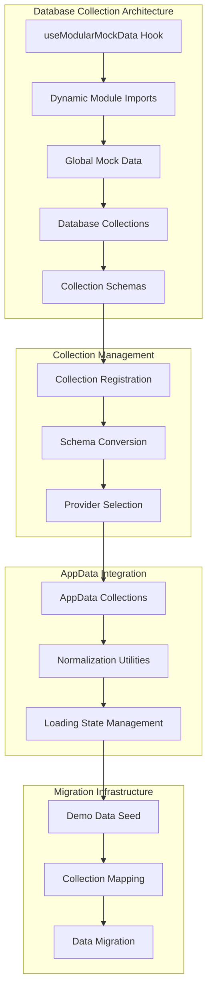
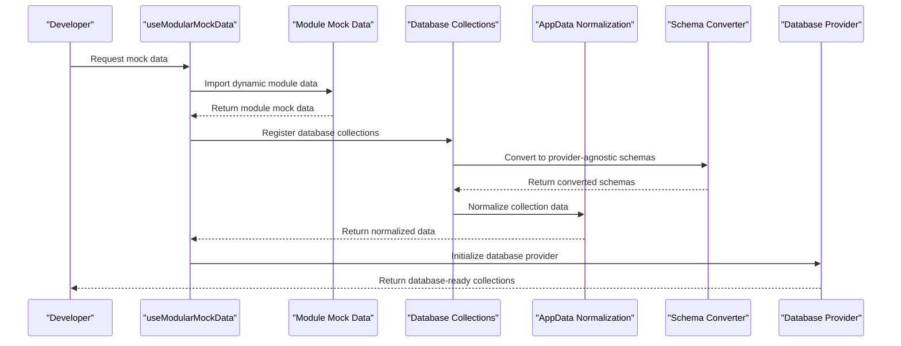
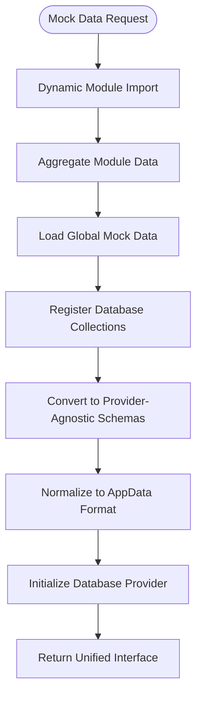
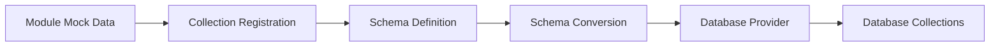
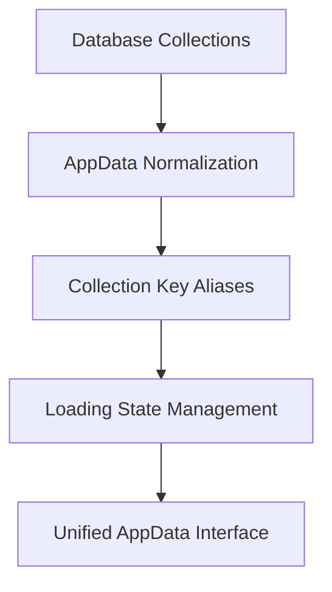
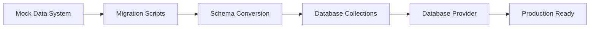

# Mock Data Development Guide

<cite>
**Referenced Files in This Document**
- [useModularMockData.ts](file://src/hooks/useModularMockData.ts)
- [globalMockData.ts](file://src/globalMockData.ts)
- [mockData.ts](file://src/modules/academics/data/mockData.ts)
- [mockData.ts](file://src/modules/reports/data/mockData.ts)
- [useDatabaseProvider.ts](file://src/hooks/useDatabaseProvider.ts)
- [demoDataSeed.ts](file://src/services/database/demoDataSeed.ts)
- [collections.ts](file://src/services/database/collections.ts)
- [collections.ts](file://src/modules/academics/data/collections.ts)
- [collections.ts](file://src/modules/administration/data/collections.ts)
- [collections.ts](file://src/modules/finance/data/collections.ts)
- [collections.ts](file://src/modules/hr/data/collections.ts)
- [collections.ts](file://src/modules/inventory/data/collections.ts)
- [collections.ts](file://src/modules/library/data/collections.ts)
- [collections.ts](file://src/modules/nutrition/data/collections.ts)
- [collections.ts](file://src/modules/administration/data/houses/collections.ts)
- [collections.ts](file://src/modules/administration/data/pickup/collections.ts)
- [appDataCollections.ts](file://src/contexts/appData/appDataCollections.ts)
- [SchemaConverter.ts](file://src/services/database/SchemaConverter.ts)
- [databaseConfigSchema.ts](file://src/config/databaseConfigSchema.ts)
- [interfaces.ts](file://src/services/database/interfaces.ts)
- [Advanced Database Handler Architecture](file://docs/architecture/advanced-database-handler-architecture.md)
- [Database Modernization Plan](file://docs/database/DATA-layer-modernization-plan.md)
- [Database README](file://docs/database/README.md)
</cite>

## Update Summary
**Changes Made**
- Updated documentation to reflect centralized database collections architecture with 17 new database schemas across modules
- Revised architecture to show enhanced AppData integration and comprehensive mock data generation patterns
- Updated development workflows to emphasize database collection registration and provider-agnostic schemas
- Added new sections covering database collection management and centralized AppData normalization
- Revised troubleshooting guidance to focus on collection-based data management and schema conversion

## Table of Contents
1. [Introduction](#introduction)
2. [Project Structure](#project-structure)
3. [Core Components](#core-components)
4. [Architecture Overview](#architecture-overview)
5. [Detailed Component Analysis](#detailed-component-analysis)
6. [Database Collection Management](#database-collection-management)
7. [AppData Integration](#appdata-integration)
8. [Migration Strategies](#migration-strategies)
9. [Development Workflows](#development-workflows)
10. [Troubleshooting Guide](#troubleshooting-guide)
11. [Conclusion](#conclusion)

## Introduction
This guide explains how to develop and maintain the mock data system within the SchoolPilot3 application. The system has evolved from a primary development data source to a centralized database collection management system that supports provider-agnostic schemas and comprehensive collection registration. Mock data now serves as seed data for database collections rather than direct application data, with all mockData.ts files renamed and collection registration updated across 17 new database schemas. The system now features enhanced AppData integration that normalizes collection data into a unified interface for the application context.

## Project Structure
The mock data development ecosystem now centers around database collection management with provider-agnostic schemas and centralized collection registration:

**Diagram sources**
- [useModularMockData.ts:46-57](file://src/hooks/useModularMockData.ts#L46-L57)
- [useDatabaseProvider.ts:62-63](file://src/hooks/useDatabaseProvider.ts#L62-L63)
- [demoDataSeed.ts:28](file://src/services/database/demoDataSeed.ts#L28)
- [collections.ts:10-22](file://src/services/database/collections.ts#L10-L22)
- [appDataCollections.ts:1-222](file://src/contexts/appData/appDataCollections.ts#L1-L222)

## Core Components
The mock data system now consists of several key components that manage database collections and provider-agnostic schemas:

- **useModularMockData Hook**: Central orchestrator that aggregates module-specific mock data and provides unified interface
- **Dynamic Module Import System**: Automatically discovers and imports mock data from all modules for database seeding
- **Global Mock Data Repository**: Shared canonical data for cross-module references
- **Database Collection Management**: Provider-agnostic collection definitions across 17 modules
- **Schema Conversion System**: Converts mock data to database collection schemas
- **Collection Registration**: Centralized registration of all database collections
- **AppData Integration**: Normalizes collection data into unified application interface
- **Loading State Management**: Tracks loading states for all collection categories

Key responsibilities:
- Automatic discovery and aggregation of module mock data for database seeding
- Managing 17 new database schemas across academic, administration, finance, and other modules
- Supporting provider-agnostic collection definitions
- Enabling seamless migration from mock data to database-backed operations
- Providing fallback mechanisms for error scenarios
- Normalizing collection data into AppData format
- Managing loading states for comprehensive data categories

## Architecture Overview
The mock data architecture now implements a provider-agnostic approach that supports database collections and centralized schema management with enhanced AppData integration:

**Diagram sources**
- [useModularMockData.ts:62](file://src/hooks/useModularMockData.ts#L62)
- [useDatabaseProvider.ts:147-176](file://src/hooks/useDatabaseProvider.ts#L147-L176)
- [demoDataSeed.ts:206-219](file://src/services/database/demoDataSeed.ts#L206-L219)
- [appDataCollections.ts:197-221](file://src/contexts/appData/appDataCollections.ts#L197-L221)

## Detailed Component Analysis

### useModularMockData Hook
The central orchestrator that manages the entire mock data ecosystem with database collection integration:

**Diagram sources**
- [useModularMockData.ts:46-57](file://src/hooks/useModularMockData.ts#L46-L57)
- [useModularMockData.ts:137-186](file://src/hooks/useModularMockData.ts#L137-L186)

### Dynamic Module Import System
The system automatically discovers and imports mock data from all modules for database seeding:

- **Automatic Discovery**: Uses `import.meta.glob()` to find all `mockData.ts` files across modules
- **Module Aggregation**: Combines data from multiple modules into unified database collection structure
- **Fallback Mechanism**: Provides backup data when modules are unavailable
- **Version Compatibility**: Supports different mock data formats across modules for migration

### Database Collection Management
The system now manages 17 new database schemas across multiple modules with comprehensive collection definitions:

#### Academic Collections
- **subjects**: Subject definitions and configurations
- **subject_papers**: Paper specifications for each subject
- **exam_sessions**: Academic examination periods
- **exam_schedules**: Individual exam scheduling
- **result_approvals**: Academic result approval workflows
- **grading_schemes**: Academic grading systems
- **student_exam_results**: Student examination results
- **class_subject_allocations**: Subject allocation to class streams
- **teacher_subject_assignments**: Teacher subject assignments
- **student_subject_enrollments**: Student subject enrollment tracking
- **timetable_period_definitions**: Period timing configurations
- **timetable_entries**: Daily timetable entries

#### Administration Collections
- **student_clearances**: Student clearance processes
- **disciplinary_cases**: Disciplinary case management
- **certificate_requests**: Certificate issuance requests
- **visitor_logs**: Visitor management logs
- **bulk_imports**: Bulk data import processes
- **student_import_sessions**: Student data import sessions
- **student_import_records**: Individual student import records

#### Finance Collections
- **fee_templates**: Fee structure templates
- **fee_template_items**: Individual fee components
- **student_invoices**: Student billing records
- **student_payments**: Payment processing
- **chart_of_accounts**: Financial accounting structure
- **expense_categories**: Expense categorization
- **bank_accounts**: Banking information
- **suppliers**: Supplier management
- **supplier_invoices**: Supplier billing records
- **expense_claims**: Expense reimbursement claims
- **fee_adjustments**: Fee modification records
- **transport_routes**: Transportation routes
- **invoice_payment_applications**: Payment application tracking
- **general_payments**: General payment processing
- **general_ledger_entries**: Accounting ledger entries

#### Additional Collections
- **report and view collections**: 17 new schemas for reporting and analytics
- **module-specific collections**: Specialized collections for each module

**Section sources**
- [collections.ts:10-22](file://src/services/database/collections.ts#L10-L22)
- [collections.ts:1-51](file://src/modules/academics/data/collections.ts#L1-L51)
- [collections.ts:44-98](file://src/modules/administration/data/collections.ts#L44-L98)

## Database Collection Management

### Collection Registration System
The system now features centralized collection registration across all modules with comprehensive schema definitions:

**Diagram sources**
- [collections.ts:10-22](file://src/services/database/collections.ts#L10-L22)
- [demoDataSeed.ts:28](file://src/services/database/demoDataSeed.ts#L28)

### Provider-Agnostic Schemas
All collection schemas are now provider-agnostic, supporting multiple database providers:

- **PouchDB Support**: Local document storage
- **SQLite Integration**: File-based database support
- **Backend API Compatibility**: Remote synchronization
- **Schema Normalization**: Consistent data structure across providers

### Collection Naming Conventions
The system uses standardized naming conventions for database collections:

- **Snake Case**: `student_exam_results` → `student_exam_results`
- **Plural Forms**: Collections use plural naming (`students`, `staff`)
- **Module Prefixes**: Some collections include module prefixes for clarity
- **Exception Handling**: Special cases handled through COLLECTION_NAME_EXCEPTIONS mapping

**Section sources**
- [demoDataSeed.ts:30-95](file://src/services/database/demoDataSeed.ts#L30-L95)
- [collections.ts:1-200](file://src/services/database/collections.ts#L1-L200)

## AppData Integration

### AppData Collections Normalization
The system provides comprehensive AppData integration that normalizes collection data into a unified interface:

**Diagram sources**
- [appDataCollections.ts:197-221](file://src/contexts/appData/appDataCollections.ts#L197-L221)
- [appDataCollections.ts:94-180](file://src/contexts/appData/appDataCollections.ts#L94-L180)

### Loading State Management
The system tracks loading states for all collection categories with comprehensive coverage:

- **Array Keys Tracking**: 89 different collection categories tracked
- **School Details**: Dedicated loading state for school configuration
- **Conditional Loading**: Loading states update based on data availability
- **Performance Optimization**: Efficient loading state management

### Collection Key Aliases
The system provides comprehensive mapping between collection names and AppData keys:

- **Direct Mappings**: One-to-one relationships between collections and AppData keys
- **Snake Case Conversion**: Automatic conversion from snake_case to camelCase
- **Module-Specific Aliases**: Special handling for module-specific collection names
- **Comprehensive Coverage**: 89 different collection categories supported

**Section sources**
- [appDataCollections.ts:6-90](file://src/contexts/appData/appDataCollections.ts#L6-L90)
- [appDataCollections.ts:182-184](file://src/contexts/appData/appDataCollections.ts#L182-L184)
- [appDataCollections.ts:185-195](file://src/contexts/appData/appDataCollections.ts#L185-L195)

## Migration Strategies

### Mock Data to Database Migration
The system provides comprehensive migration strategies for transitioning from mock data to database-backed operations:

**Diagram sources**
- [useDatabaseProvider.ts:147-176](file://src/hooks/useDatabaseProvider.ts#L147-L176)
- [demoDataSeed.ts:206-219](file://src/services/database/demoDataSeed.ts#L206-L219)

### Provider Switching Strategy
Seamless switching between database providers during development and production:

- **Development Provider**: SQLite with local file persistence
- **Production Provider**: Backend API with remote synchronization
- **Testing Provider**: In-memory database for unit tests
- **Fallback Provider**: Mock data system for error scenarios

**Section sources**
- [Database Modernization Plan:222-244](file://docs/database/DATA-layer-modernization-plan.md#L222-L244)
- [Advanced Database Handler Architecture:513-553](file://docs/architecture/advanced-database-handler-architecture.md#L513-L553)

## Development Workflows

### Database Collection Development Workflow
The current workflow emphasizes database collection management and provider-agnostic schemas:

1. **Module Development**: Create mock data for new modules using established patterns
2. **Collection Definition**: Define database schemas for each collection
3. **Collection Registration**: Register collections in the centralized collections system
4. **Schema Conversion**: Convert mock data to provider-agnostic schemas
5. **Data Seeding**: Seed database collections with mock data
6. **Migration Preparation**: Prepare collections for potential migration scenarios
7. **Backward Compatibility**: Maintain mock data for legacy feature support

### Module Development Pattern
Each module follows a consistent development pattern for database collections:

- **Data Types**: Define TypeScript interfaces for all entities
- **Mock Data Generation**: Create representative mock data sets
- **Collection Schemas**: Define database schemas for each collection
- **Cross-Module References**: Establish relationships with other modules
- **Global Data Sharing**: Share common data through global mock repository
- **Collection Registration**: Register all collections in centralized system
- **Testing Coverage**: Include comprehensive test scenarios

**Section sources**
- [mockData.ts:1-200](file://src/modules/academics/data/mockData.ts#L1-L200)
- [mockData.ts:1-66](file://src/modules/reports/data/mockData.ts#L1-L66)
- [collections.ts:1-51](file://src/modules/academics/data/collections.ts#L1-L51)

## Troubleshooting Guide

### Common Database Collection Issues
- **Collection Registration Failures**: Check that collections are properly registered in collections.ts
- **Schema Conversion Errors**: Verify mock data conforms to schema requirements
- **Provider Compatibility Issues**: Ensure schemas work across all supported providers
- **Migration Conflicts**: Resolve conflicts between mock data and database collections
- **Performance Issues**: Monitor memory usage with large database collections
- **AppData Normalization Issues**: Verify collection data is properly normalized

### Debugging Database Collection Operations
- **Enable Debug Logging**: Set debug flags for collection operations
- **Monitor Collection Loading**: Track dynamic import success rates for collections
- **Validate Data Flow**: Trace data through aggregation and conversion processes
- **Test Migration Scenarios**: Verify seamless switching between mock and database modes
- **Collection Health Checks**: Monitor collection initialization and registration
- **AppData State Tracking**: Monitor loading states and data normalization

**Section sources**
- [Database README:363-389](file://docs/database/README.md#L363-L389)
- [Advanced Database Handler Architecture:629-649](file://docs/architecture/advanced-database-handler-architecture.md#L629-L649)

## Conclusion
The mock data system now provides a robust foundation for centralized database collection management while supporting the transition to provider-agnostic database operations. By serving as seed data for 17 new database schemas across multiple modules and integrating seamlessly with AppData, the system enables smooth evolution toward modern database architectures while preserving existing functionality and development workflows.

The shift from primary development data source to centralized collection management represents a strategic evolution that maintains developer productivity while preparing the application for future database-centric operations. This approach ensures that mock data continues to provide value through comprehensive testing, demonstration capabilities, and seamless migration support across all 17 database collection schemas, while the enhanced AppData integration provides a unified interface for application data access.