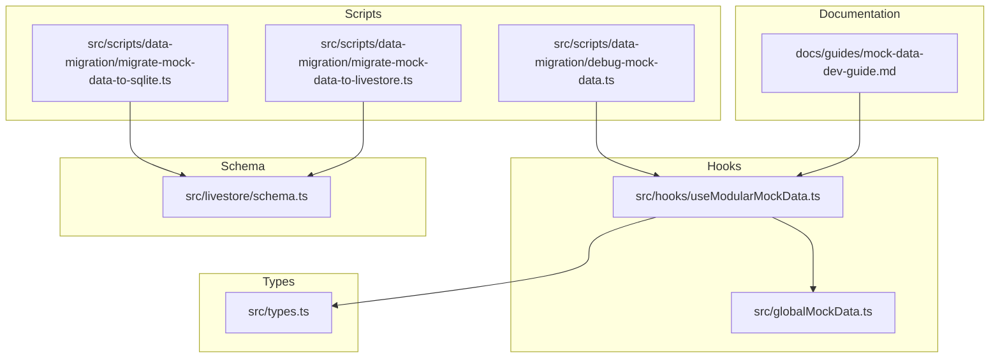
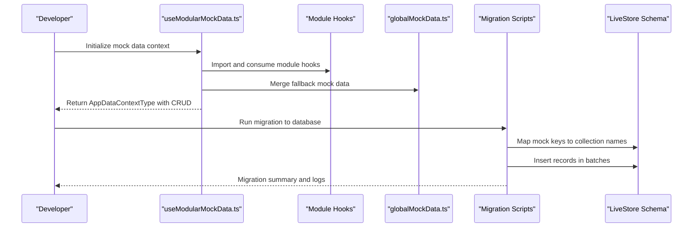
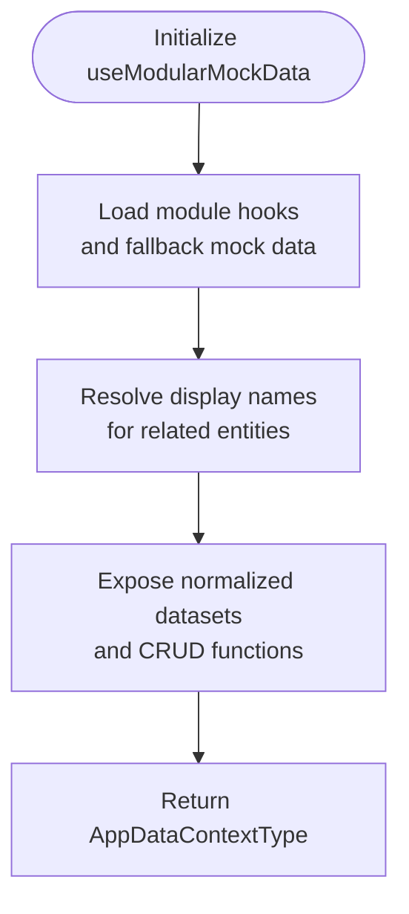
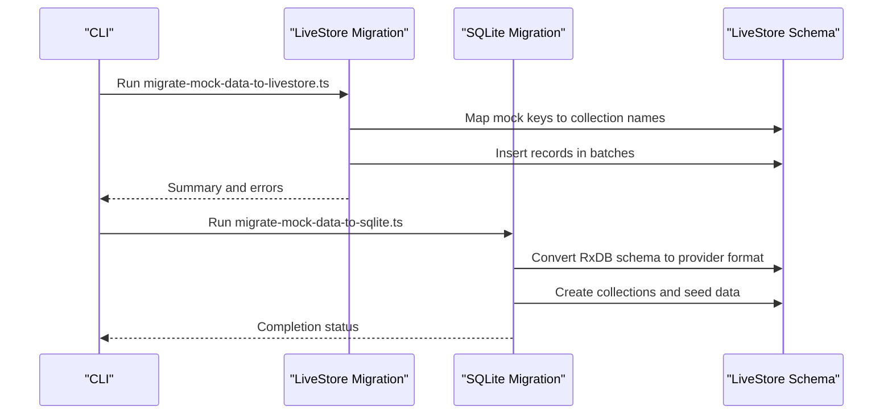
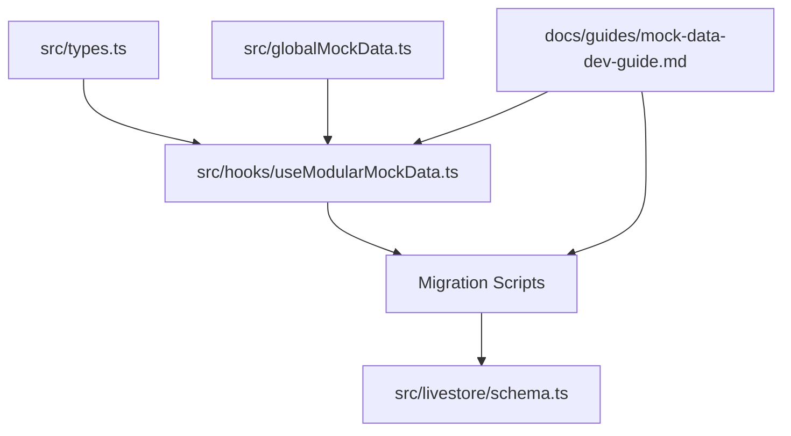

# Mock Data Dev Guide

<cite>
**Referenced Files in This Document**
- [mock-data-dev-guide.md](file://docs/guides/mock-data-dev-guide.md)
- [useModularMockData.ts](file://src/hooks/useModularMockData.ts)
- [globalMockData.ts](file://src/globalMockData.ts)
- [debug-mock-data.ts](file://src/scripts/data-migration/debug-mock-data.ts)
- [migrate-mock-data-to-livestore.ts](file://src/scripts/data-migration/migrate-mock-data-to-livestore.ts)
- [migrate-mock-data-to-sqlite.ts](file://src/scripts/data-migration/migrate-mock-data-to-sqlite.ts)
- [schema.ts](file://src/livestore/schema.ts)
- [types.ts](file://src/types.ts)
</cite>

## Table of Contents
1. [Introduction](#introduction)
2. [Project Structure](#project-structure)
3. [Core Components](#core-components)
4. [Architecture Overview](#architecture-overview)
5. [Detailed Component Analysis](#detailed-component-analysis)
6. [Dependency Analysis](#dependency-analysis)
7. [Performance Considerations](#performance-considerations)
8. [Troubleshooting Guide](#troubleshooting-guide)
9. [Conclusion](#conclusion)

## Introduction
This guide explains how to develop and maintain mock data for the SchoolPilot3 application. The mock data system enables full UI development, testing, and demonstrations without external dependencies by providing an in-memory simulation of the backend and database. It supports both a centralized hook-based approach and provider-agnostic migration scripts for seeding databases.

## Project Structure
The mock data development ecosystem spans documentation, hooks, global shared data, and migration scripts:

**Diagram sources**
- [mock-data-dev-guide.md:1-83](file://docs/guides/mock-data-dev-guide.md#L1-L83)
- [useModularMockData.ts:1-583](file://src/hooks/useModularMockData.ts#L1-L583)
- [globalMockData.ts:1-26](file://src/globalMockData.ts#L1-L26)
- [debug-mock-data.ts:1-34](file://src/scripts/data-migration/debug-mock-data.ts#L1-L34)
- [migrate-mock-data-to-livestore.ts:1-270](file://src/scripts/data-migration/migrate-mock-data-to-livestore.ts#L1-L270)
- [migrate-mock-data-to-sqlite.ts:1-176](file://src/scripts/data-migration/migrate-mock-data-to-sqlite.ts#L1-L176)
- [schema.ts:1-475](file://src/livestore/schema.ts#L1-L475)
- [types.ts:1-6](file://src/types.ts#L1-L6)

**Section sources**
- [mock-data-dev-guide.md:1-83](file://docs/guides/mock-data-dev-guide.md#L1-L83)
- [useModularMockData.ts:1-583](file://src/hooks/useModularMockData.ts#L1-L583)
- [globalMockData.ts:1-26](file://src/globalMockData.ts#L1-L26)
- [debug-mock-data.ts:1-34](file://src/scripts/data-migration/debug-mock-data.ts#L1-L34)
- [migrate-mock-data-to-livestore.ts:1-270](file://src/scripts/data-migration/migrate-mock-data-to-livestore.ts#L1-L270)
- [migrate-mock-data-to-sqlite.ts:1-176](file://src/scripts/data-migration/migrate-mock-data-to-sqlite.ts#L1-L176)
- [schema.ts:1-475](file://src/livestore/schema.ts#L1-L475)
- [types.ts:1-6](file://src/types.ts#L1-L6)

## Core Components
- Centralized mock data hook: Aggregates module-specific mock data and exposes CRUD operations conforming to the application data context interface.
- Global shared mock data: Provides canonical entities reused across modules (e.g., suppliers and invoices).
- Migration scripts: Support moving mock data into LiveStore and SQLite providers for production-like environments.
- Debug script: Inspects available mock data across modules for verification and troubleshooting.

Key responsibilities:
- Dynamic discovery and aggregation of mock data from module directories.
- Maintaining normalized state and denormalized display fields for related entities.
- Providing CRUD functions that update in-memory state consistently.
- Enabling seamless migration to provider-backed databases.

**Section sources**
- [mock-data-dev-guide.md:14-83](file://docs/guides/mock-data-dev-guide.md#L14-L83)
- [useModularMockData.ts:62-583](file://src/hooks/useModularMockData.ts#L62-L583)
- [globalMockData.ts:1-26](file://src/globalMockData.ts#L1-L26)

## Architecture Overview
The mock data architecture combines a modular hook system with provider-agnostic migration capabilities:

**Diagram sources**
- [useModularMockData.ts:9-583](file://src/hooks/useModularMockData.ts#L9-L583)
- [globalMockData.ts:1-26](file://src/globalMockData.ts#L1-L26)
- [migrate-mock-data-to-livestore.ts:61-161](file://src/scripts/data-migration/migrate-mock-data-to-livestore.ts#L61-L161)
- [migrate-mock-data-to-sqlite.ts:20-176](file://src/scripts/data-migration/migrate-mock-data-to-sqlite.ts#L20-L176)
- [schema.ts:29-379](file://src/livestore/schema.ts#L29-L379)

## Detailed Component Analysis

### useModularMockData Hook
The hook orchestrates mock data across modules, dynamically importing module-specific hooks and aggregating fallback mock data. It exposes normalized datasets and CRUD functions while maintaining loading states.

Key behaviors:
- Imports module hooks for academics and finance domains.
- Aggregates raw initial data from module mock files via globbing.
- Resolves display names for related entities (e.g., student names, supplier names).
- Returns a complete AppDataContextType with CRUD operations and loading flags.

**Diagram sources**
- [useModularMockData.ts:62-583](file://src/hooks/useModularMockData.ts#L62-L583)

**Section sources**
- [useModularMockData.ts:62-583](file://src/hooks/useModularMockData.ts#L62-L583)

### Global Shared Mock Data
Provides canonical entities used across multiple modules, ensuring consistency in demos and tests.

Highlights:
- Suppliers array with contact details and metadata.
- Supplier invoices with amounts, statuses, and related supplier names.

**Section sources**
- [globalMockData.ts:1-26](file://src/globalMockData.ts#L1-L26)

### Migration Scripts
Two migration scripts support seeding databases from mock data:

- LiveStore migration: Initializes a provider, aggregates mock data, maps keys to collection names, and inserts records in batches with error tracking.
- SQLite migration: Converts RxDB schemas to provider-agnostic formats, creates collections, and seeds data with batched inserts.

**Diagram sources**
- [migrate-mock-data-to-livestore.ts:28-270](file://src/scripts/data-migration/migrate-mock-data-to-livestore.ts#L28-L270)
- [migrate-mock-data-to-sqlite.ts:20-176](file://src/scripts/data-migration/migrate-mock-data-to-sqlite.ts#L20-L176)
- [schema.ts:29-379](file://src/livestore/schema.ts#L29-L379)

**Section sources**
- [migrate-mock-data-to-livestore.ts:28-270](file://src/scripts/data-migration/migrate-mock-data-to-livestore.ts#L28-L270)
- [migrate-mock-data-to-sqlite.ts:20-176](file://src/scripts/data-migration/migrate-mock-data-to-sqlite.ts#L20-L176)

### Debug Script
Inspects available mock data across modules to verify structure and counts.

Usage:
- Logs keys and lengths for each module's mock data exports.
- Helps validate that new mock data files are properly recognized.

**Section sources**
- [debug-mock-data.ts:1-34](file://src/scripts/data-migration/debug-mock-data.ts#L1-L34)

## Dependency Analysis
The mock data system exhibits clear separation of concerns:

**Diagram sources**
- [types.ts:1-6](file://src/types.ts#L1-L6)
- [useModularMockData.ts:62-583](file://src/hooks/useModularMockData.ts#L62-L583)
- [globalMockData.ts:1-26](file://src/globalMockData.ts#L1-L26)
- [migrate-mock-data-to-livestore.ts:61-161](file://src/scripts/data-migration/migrate-mock-data-to-livestore.ts#L61-L161)
- [migrate-mock-data-to-sqlite.ts:20-176](file://src/scripts/data-migration/migrate-mock-data-to-sqlite.ts#L20-L176)
- [schema.ts:29-379](file://src/livestore/schema.ts#L29-L379)
- [mock-data-dev-guide.md:1-83](file://docs/guides/mock-data-dev-guide.md#L1-L83)

**Section sources**
- [types.ts:1-6](file://src/types.ts#L1-L6)
- [useModularMockData.ts:62-583](file://src/hooks/useModularMockData.ts#L62-L583)
- [globalMockData.ts:1-26](file://src/globalMockData.ts#L1-L26)
- [migrate-mock-data-to-livestore.ts:61-161](file://src/scripts/data-migration/migrate-mock-data-to-livestore.ts#L61-L161)
- [migrate-mock-data-to-sqlite.ts:20-176](file://src/scripts/data-migration/migrate-mock-data-to-sqlite.ts#L20-L176)
- [schema.ts:29-379](file://src/livestore/schema.ts#L29-L379)
- [mock-data-dev-guide.md:1-83](file://docs/guides/mock-data-dev-guide.md#L1-L83)

## Performance Considerations
- Batched insertion: Migration scripts insert records in batches to manage memory usage and improve throughput.
- Loading states: The hook initializes loading flags and transitions them off after a short timeout to simulate realistic initialization delays.
- Denormalization: Display fields are resolved within CRUD functions to mimic backend enrichment, reducing downstream computation needs.

[No sources needed since this section provides general guidance]

## Troubleshooting Guide
Common issues and resolutions:
- Missing mock data keys: Use the debug script to verify that expected keys exist and contain data.
- Provider initialization failures: Check migration script logs for initialization errors and schema conversion issues.
- Inconsistent entity relationships: Ensure denormalized fields (e.g., display names) are populated consistently in CRUD functions.
- Schema mismatches: Confirm that mock data keys align with collection names and that schema conversions are applied correctly.

**Section sources**
- [debug-mock-data.ts:1-34](file://src/scripts/data-migration/debug-mock-data.ts#L1-L34)
- [migrate-mock-data-to-livestore.ts:33-59](file://src/scripts/data-migration/migrate-mock-data-to-livestore.ts#L33-L59)
- [migrate-mock-data-to-sqlite.ts:47-58](file://src/scripts/data-migration/migrate-mock-data-to-sqlite.ts#L47-L58)

## Conclusion
The mock data development system provides a robust, modular foundation for building and validating UI features without backend dependencies. By leveraging dynamic imports, normalized state management, and provider-agnostic migration scripts, developers can efficiently create, iterate, and deploy mock data across modules while maintaining consistency and performance.