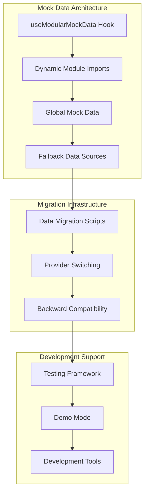
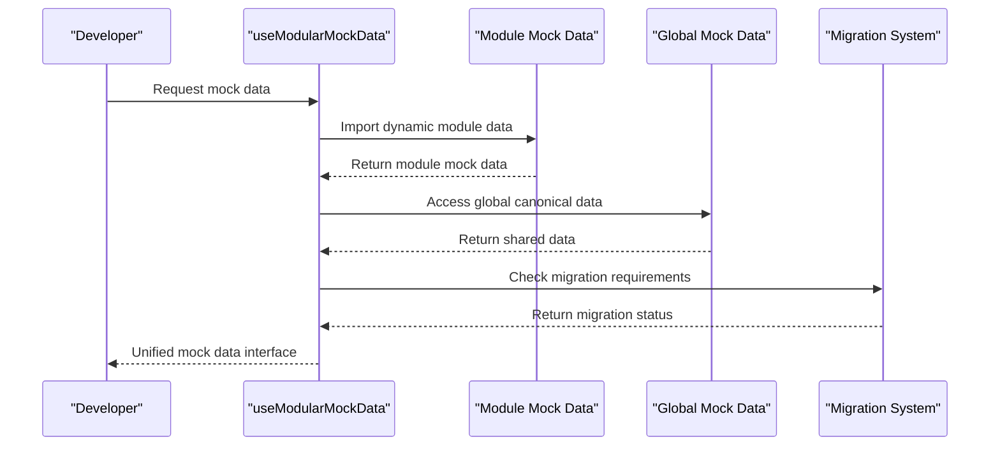
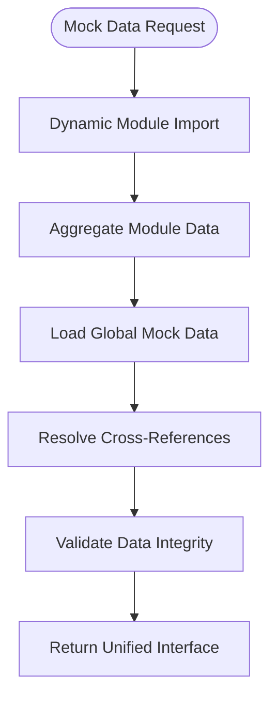

# Mock Data Development Guide

<cite>
**Referenced Files in This Document**
- [useModularMockData.ts](file://src/hooks/useModularMockData.ts)
- [globalMockData.ts](file://src/globalMockData.ts)
- [mockData.ts](file://src/modules/academics/data/mockData.ts)
- [mockData.ts](file://src/modules/administration/data/mockData.ts)
- [useDatabaseProvider.ts](file://src/hooks/useDatabaseProvider.ts)
- [demoDataSeed.ts](file://src/services/database/demoDataSeed.ts)
- [Advanced Database Handler Architecture](file://docs/architecture/advanced-database-handler-architecture.md)
- [Database Modernization Plan](file://docs/database/DATA-layer-modernization-plan.md)
- [Database README](file://docs/database/README.md)
</cite>

## Update Summary
**Changes Made**
- Updated documentation to reflect the transition from mock data development system to migration/testing infrastructure
- Revised architecture diagrams to show mock data's current role as fallback and migration support
- Updated development workflows to emphasize mock data's role in backward compatibility
- Added new sections covering migration strategies and provider switching
- Revised troubleshooting guidance to focus on migration scenarios

## Table of Contents
1. [Introduction](#introduction)
2. [Project Structure](#project-structure)
3. [Core Components](#core-components)
4. [Architecture Overview](#architecture-overview)
5. [Detailed Component Analysis](#detailed-component-analysis)
6. [Migration Strategies](#migration-strategies)
7. [Development Workflows](#development-workflows)
8. [Troubleshooting Guide](#troubleshooting-guide)
9. [Conclusion](#conclusion)

## Introduction
This guide explains how to develop and maintain the mock data system within the SchoolPilot3 application. The system has evolved from a primary development data source to a specialized migration and testing infrastructure that maintains backward compatibility while supporting database-backed operations. Mock data now serves as fallback data for development, testing, and migration scenarios rather than primary application data.

## Project Structure
The mock data development ecosystem focuses on modular data services, migration capabilities, and fallback mechanisms:

**Diagram sources**
- [useModularMockData.ts:46-57](file://src/hooks/useModularMockData.ts#L46-L57)
- [useDatabaseProvider.ts:62-63](file://src/hooks/useDatabaseProvider.ts#L62-L63)
- [demoDataSeed.ts:28](file://src/services/database/demoDataSeed.ts#L28)

## Core Components
The mock data system consists of several key components that serve different purposes in the application lifecycle:

- **useModularMockData Hook**: Central orchestrator that aggregates module-specific mock data and provides unified interface
- **Dynamic Module Import System**: Automatically discovers and imports mock data from all modules
- **Global Mock Data Repository**: Shared canonical data for cross-module references
- **Fallback Data Mechanisms**: Provides safe defaults when database operations fail
- **Migration Support**: Enables seamless transition from mock data to database-backed operations

Key responsibilities:
- Automatic discovery and aggregation of module mock data
- Maintaining backward compatibility for legacy features
- Supporting development and testing workflows
- Enabling smooth migration to database-backed operations
- Providing fallback mechanisms for error scenarios

## Architecture Overview
The mock data architecture implements a hybrid approach that supports both development and migration scenarios:

**Diagram sources**
- [useModularMockData.ts:62](file://src/hooks/useModularMockData.ts#L62)
- [useDatabaseProvider.ts:147-176](file://src/hooks/useDatabaseProvider.ts#L147-L176)

## Detailed Component Analysis

### useModularMockData Hook
The central orchestrator that manages the entire mock data ecosystem:

**Diagram sources**
- [useModularMockData.ts:46-57](file://src/hooks/useModularMockData.ts#L46-L57)
- [useModularMockData.ts:137-186](file://src/hooks/useModularMockData.ts#L137-L186)

### Dynamic Module Import System
The system automatically discovers and imports mock data from all modules:

- **Automatic Discovery**: Uses `import.meta.glob()` to find all `mockData.ts` files
- **Module Aggregation**: Combines data from multiple modules into unified structure
- **Fallback Mechanism**: Provides backup data when modules are unavailable
- **Version Compatibility**: Supports different mock data formats across modules

### Global Mock Data Repository
Provides canonical data used across multiple modules:

- **Shared Suppliers**: Standard supplier data for procurement modules
- **Invoice Templates**: Common invoice structures for financial modules
- **Cross-Module References**: Consistent data for inter-module relationships
- **Canonical Examples**: Representative data for demonstration purposes

**Section sources**
- [globalMockData.ts:6-26](file://src/globalMockData.ts#L6-L26)

## Migration Strategies

### Mock Data to Database Migration
The system provides comprehensive migration strategies for transitioning from mock data to database-backed operations:

**Diagram sources**
- [useDatabaseProvider.ts:147-176](file://src/hooks/useDatabaseProvider.ts#L147-L176)
- [demoDataSeed.ts:206-219](file://src/services/database/demoDataSeed.ts#L206-L219)

### Provider Switching Strategy
Seamless switching between database providers during development and production:

- **Development Provider**: SQLite with local file persistence
- **Production Provider**: Backend API with remote synchronization
- **Testing Provider**: In-memory database for unit tests
- **Fallback Provider**: Mock data system for error scenarios

**Section sources**
- [Database Modernization Plan:222-244](file://docs/database/DATA-layer-modernization-plan.md#L222-L244)
- [Advanced Database Handler Architecture:513-553](file://docs/architecture/advanced-database-handler-architecture.md#L513-L553)

## Development Workflows

### Mock Data Development Workflow
The current workflow emphasizes mock data's role in backward compatibility and migration:

1. **Module Development**: Create mock data for new modules using established patterns
2. **Data Validation**: Ensure mock data conforms to application requirements
3. **Integration Testing**: Test mock data integration with other modules
4. **Migration Preparation**: Prepare mock data for potential migration scenarios
5. **Backward Compatibility**: Maintain mock data for legacy feature support

### Module Development Pattern
Each module follows a consistent development pattern for mock data:

- **Data Types**: Define TypeScript interfaces for all entities
- **Mock Data Generation**: Create representative mock data sets
- **Cross-Module References**: Establish relationships with other modules
- **Global Data Sharing**: Share common data through global mock repository
- **Testing Coverage**: Include comprehensive test scenarios

**Section sources**
- [mockData.ts:1-200](file://src/modules/academics/data/mockData.ts#L1-L200)
- [mockData.ts:1-200](file://src/modules/administration/data/mockData.ts#L1-L200)

## Troubleshooting Guide

### Common Mock Data Issues
- **Module Import Failures**: Check that mock data files follow naming conventions
- **Data Validation Errors**: Verify mock data conforms to schema requirements
- **Cross-Module Reference Issues**: Ensure proper data relationships between modules
- **Migration Conflicts**: Resolve conflicts between mock data and database operations
- **Performance Issues**: Monitor memory usage with large mock datasets

### Debugging Mock Data Operations
- **Enable Debug Logging**: Set debug flags for mock data operations
- **Monitor Module Loading**: Track dynamic import success rates
- **Validate Data Flow**: Trace data through aggregation and resolution processes
- **Test Migration Scenarios**: Verify seamless switching between mock and database modes

**Section sources**
- [Database README:363-389](file://docs/database/README.md#L363-L389)
- [Advanced Database Handler Architecture:629-649](file://docs/architecture/advanced-database-handler-architecture.md#L629-L649)

## Conclusion
The mock data system provides a robust foundation for maintaining backward compatibility while supporting the transition to database-backed operations. By serving as migration infrastructure and fallback mechanism, the system enables smooth evolution toward modern database architectures while preserving existing functionality and development workflows.

The shift from primary development data source to specialized migration/testing infrastructure represents a strategic evolution that maintains developer productivity while preparing the application for future database-centric operations. This approach ensures that mock data continues to provide value through comprehensive testing, demonstration capabilities, and seamless migration support.