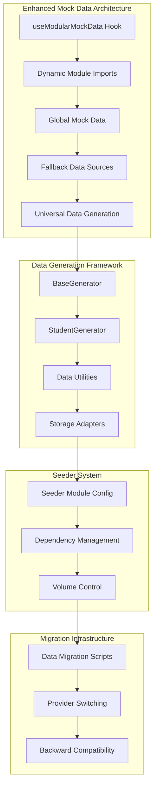
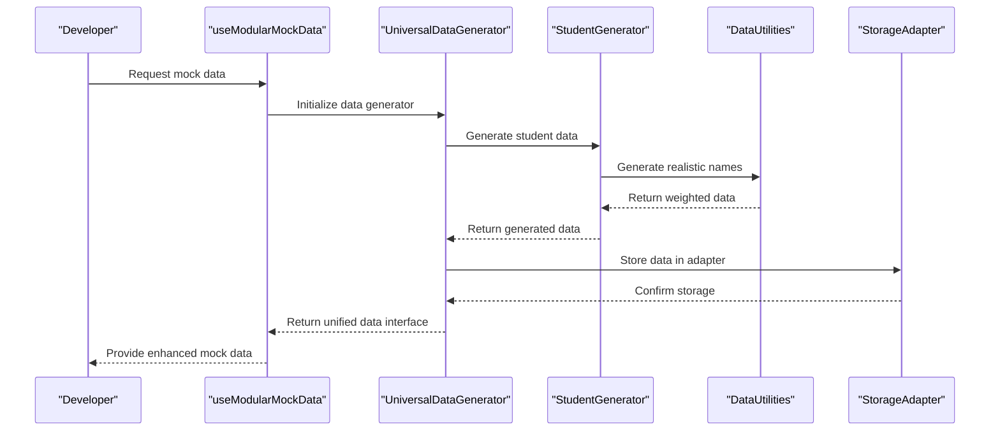
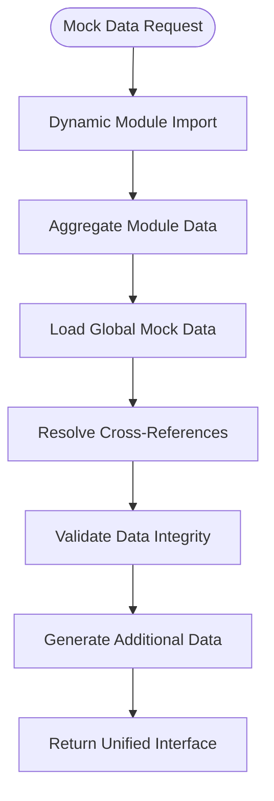
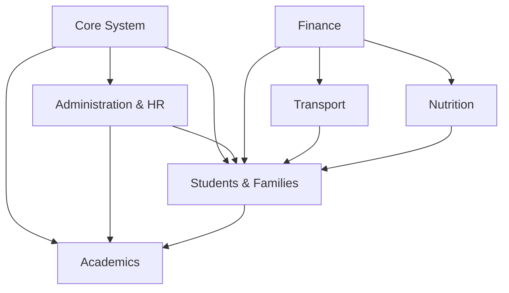
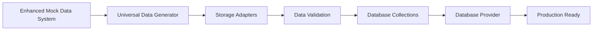

# Mock Data Development Guide

<cite>
**Referenced Files in This Document**
- [useModularMockData.ts](file://src/hooks/useModularMockData.ts)
- [globalMockData.ts](file://src/globalMockData.ts)
- [mockData.ts](file://src/modules/academics/data/mockData.ts)
- [mockData.ts](file://src/modules/administration/data/mockData.ts)
- [useDatabaseProvider.ts](file://src/hooks/useDatabaseProvider.ts)
- [demoDataSeed.ts](file://src/services/database/demoDataSeed.ts)
- [README.md](file://src/services/dataGeneration/README.md)
- [seederModuleConfig.ts](file://src/services/database/seederModuleConfig.ts)
- [studentGenerator.ts](file://src/services/dataGeneration/generators/studentGenerator.ts)
- [dataUtils.ts](file://src/services/dataGeneration/generators/dataUtils.ts)
- [BaseGenerator.ts](file://src/services/dataGeneration/generators/BaseGenerator.ts)
- [UniversalDataGenerator.ts](file://src/services/dataGeneration/UniversalDataGenerator.ts)
- [MockAdapter.ts](file://src/services/dataGeneration/adapters/MockAdapter.ts)
- [Advanced Database Handler Architecture](file://docs/architecture/advanced-database-handler-architecture.md)
- [Database Modernization Plan](file://docs/database/DATA-layer-modernization-plan.md)
- [Database README](file://docs/database/README.md)
</cite>

## Update Summary
**Changes Made**
- Enhanced documentation to reflect the new comprehensive Universal Data Generation System
- Added documentation for advanced student data generation capabilities with realistic family relationships
- Integrated seeder module configuration for granular database seeding control
- Documented weighted random selection and realistic name generation utilities
- Updated architecture diagrams to show the new data generation framework
- Revised development workflows to emphasize the new generation capabilities

## Table of Contents
1. [Introduction](#introduction)
2. [Project Structure](#project-structure)
3. [Core Components](#core-components)
4. [Architecture Overview](#architecture-overview)
5. [Detailed Component Analysis](#detailed-component-analysis)
6. [Universal Data Generation System](#universal-data-generation-system)
7. [Advanced Student Data Generation](#advanced-student-data-generation)
8. [Seeder Module Configuration](#seeder-module-configuration)
9. [Data Generation Utilities](#data-generation-utilities)
10. [Migration Strategies](#migration-strategies)
11. [Development Workflows](#development-workflows)
12. [Troubleshooting Guide](#troubleshooting-guide)
13. [Conclusion](#conclusion)

## Introduction
This guide explains how to develop and maintain the enhanced mock data system within the SchoolPilot3 application. The system has evolved from a simple mock data provider to a comprehensive Universal Data Generation System that creates realistic educational data across all modules. The new system provides sophisticated data generation capabilities with weighted random selection, realistic name generation, and comprehensive student data generation with family relationship scenarios.

## Project Structure
The enhanced mock data ecosystem now includes a comprehensive data generation framework alongside traditional mock data services:

**Diagram sources**
- [useModularMockData.ts:46-57](file://src/hooks/useModularMockData.ts#L46-L57)
- [useDatabaseProvider.ts:62-63](file://src/hooks/useDatabaseProvider.ts#L62-L63)
- [demoDataSeed.ts:28](file://src/services/database/demoDataSeed.ts#L28)
- [README.md:152-180](file://src/services/dataGeneration/README.md#L152-L180)
- [seederModuleConfig.ts:27-276](file://src/services/database/seederModuleConfig.ts#L27-L276)

## Core Components
The enhanced mock data system consists of several key components that work together to provide comprehensive data generation and management:

- **useModularMockData Hook**: Central orchestrator that aggregates module-specific mock data and provides unified interface
- **Dynamic Module Import System**: Automatically discovers and imports mock data from all modules
- **Global Mock Data Repository**: Shared canonical data for cross-module references
- **Universal Data Generation System**: Comprehensive framework for generating realistic educational data
- **Advanced Student Generator**: Sophisticated student data generation with family relationship scenarios
- **Seeder Module Configuration**: Granular control over database seeding with dependency management
- **Data Generation Utilities**: Weighted random selection and realistic name generation functions
- **Storage Adapters**: Multiple storage backends for different environments

Key responsibilities:
- Automatic discovery and aggregation of module mock data
- Maintaining backward compatibility for legacy features
- Supporting development and testing workflows
- Enabling smooth migration to database-backed operations
- Providing comprehensive data generation with realistic distributions
- Managing complex data relationships and dependencies

## Architecture Overview
The enhanced mock data architecture implements a hybrid approach that supports both traditional mock data and comprehensive data generation:

**Diagram sources**
- [useModularMockData.ts:62](file://src/hooks/useModularMockData.ts#L62)
- [useDatabaseProvider.ts:147-176](file://src/hooks/useDatabaseProvider.ts#L147-L176)
- [UniversalDataGenerator.ts:98-141](file://src/services/dataGeneration/UniversalDataGenerator.ts#L98-L141)
- [studentGenerator.ts:66-221](file://src/services/dataGeneration/generators/studentGenerator.ts#L66-L221)

## Detailed Component Analysis

### useModularMockData Hook
The central orchestrator that manages the entire enhanced mock data ecosystem:

**Diagram sources**
- [useModularMockData.ts:46-57](file://src/hooks/useModularMockData.ts#L46-L57)
- [useModularMockData.ts:137-186](file://src/hooks/useModularMockData.ts#L137-L186)

### Universal Data Generation System
The new comprehensive framework that provides sophisticated data generation capabilities:

- **Multiple Storage Backends**: SQLite with OPFS, SQLite with Livestore, PouchDB, and in-memory mock storage
- **Comprehensive Data Coverage**: 500+ students, 100+ staff, and extensive data across all modules
- **Realistic Data Generation**: Uses Faker.js for authentic-looking educational data
- **Modular Architecture**: Generate data for specific modules or all modules at once
- **Data Validation**: Built-in validation to ensure referential integrity
- **Performance Optimization**: Batch processing and efficient data generation

**Section sources**
- [README.md:1-311](file://src/services/dataGeneration/README.md#L1-L311)

## Universal Data Generation System

### Core Components
The Universal Data Generation System consists of several key components that work together to provide comprehensive data generation:

- **UniversalDataGenerator**: Main orchestrator that coordinates data generation across all modules
- **BaseGenerator**: Abstract base class providing common utilities for all generators
- **Storage Adapters**: Abstraction layer for different storage backends
- **RelationshipManager**: Manages data dependencies and foreign key relationships
- **Data Generators**: Module-specific generators for realistic data creation

### Storage Adapters
The system supports multiple storage backends for different environments:

- **MockAdapter**: In-memory storage for testing and development
- **SQLiteOPFSAdapter**: SQLite with Origin Private File System (browser)
- **PouchDBAdapter**: PouchDB for offline-first applications
- **SQLiteLivestoreAdapter**: SQLite with Livestore for real-time sync

### Data Generators
The system includes comprehensive generators for all major modules:

- **AdministrationGenerator**: Students, staff, and administrative data
- **AcademicsGenerator**: Academic structures and schedules
- **FinanceGenerator**: Financial accounts and transactions
- **ClubsGenerator**: Clubs, societies, and activities
- **DormitoryGenerator**: Dormitory management data
- **LibraryGenerator**: Library catalog and operations
- **NutritionGenerator**: Meal planning and nutrition data
- **PayrollGenerator**: Salary and payroll data
- **InventoryGenerator**: Inventory and asset management
- **TransportGenerator**: Transportation and logistics data
- **CommunicationGenerator**: Communication templates and campaigns
- **HealthGenerator**: Student health records and medical data

**Section sources**
- [README.md:152-180](file://src/services/dataGeneration/README.md#L152-L180)
- [UniversalDataGenerator.ts:44-78](file://src/services/dataGeneration/UniversalDataGenerator.ts#L44-L78)

## Advanced Student Data Generation

### Student Generator Capabilities
The enhanced student generator provides sophisticated data generation with realistic family relationship scenarios:

- **Family Distribution**: 60% two-parent, 15% single-mother, 10% single-father, 8% grandparent, 5% other guardian, 2% institutional
- **Student Categories**: Boarder (40%), Day Scholar (55%), Special (5%)
- **Student Status**: Active (92%), Suspended (3%), Alumni (4%), Withdrawn (1%)
- **Sibling Generation**: Intelligent sibling relationships with shared family structures
- **Guardian Generation**: Realistic guardian relationships with appropriate occupations
- **Health Records**: Comprehensive health records with realistic medical conditions
- **Attendance Records**: Historical attendance data with realistic patterns

### Weighted Random Selection
The system uses sophisticated weighted random selection for realistic data distribution:

- **Family Structure Distribution**: Realistic family composition based on East African demographics
- **Student Category Distribution**: Reflects actual school enrollment patterns
- **Student Status Distribution**: Represents typical student retention rates
- **Medical Condition Distribution**: Based on real-world prevalence rates

**Section sources**
- [studentGenerator.ts:1-315](file://src/services/dataGeneration/generators/studentGenerator.ts#L1-L315)
- [dataUtils.ts:160-172](file://src/services/dataGeneration/generators/dataUtils.ts#L160-L172)

## Seeder Module Configuration

### Module Seeder System
The seeder module configuration provides granular control over database seeding with comprehensive dependency management:

- **Module Types**: Core system, Administration & HR, Students & Families, Academics, Finance & Fees, HR & Payroll, Library, Inventory & Procurement, Transport, Nutrition & Canteen, Communications
- **Dependency Management**: Topological sorting ensures proper seeding order
- **Volume Control**: Tiny, Small, Medium, Large, Enterprise volume levels
- **Collection Management**: Automatic collection name resolution for selected modules
- **Estimated Records**: Realistic record count estimates for each module and volume level

### Dependency Resolution
The system automatically resolves module dependencies using topological sorting:

**Diagram sources**
- [seederModuleConfig.ts:282-328](file://src/services/database/seederModuleConfig.ts#L282-L328)

**Section sources**
- [seederModuleConfig.ts:1-358](file://src/services/database/seederModuleConfig.ts#L1-L358)

## Data Generation Utilities

### Data Utilities Framework
The data generation utilities provide comprehensive functions for creating realistic educational data:

- **Realistic Names**: East African context-aware first names and last names
- **Kenyan Phone Numbers**: Valid Kenyan phone number generation
- **Realistic Addresses**: East African towns and streets
- **Occupation Lists**: Relevant occupations for guardians and staff
- **Relationship Types**: Comprehensive family relationship definitions
- **Weighted Random Functions**: Sophisticated weighted selection algorithms

### Faker.js Integration
The system integrates with Faker.js for authentic data generation:

- **Dynamic Import**: Lazy loading of Faker.js for performance optimization
- **Locale Support**: Multi-language support with configurable locales
- **Fallback Generation**: Basic data generation when Faker.js is unavailable
- **Custom Generators**: Enhanced generators for educational context

**Section sources**
- [dataUtils.ts:1-172](file://src/services/dataGeneration/generators/dataUtils.ts#L1-L172)
- [BaseGenerator.ts:14-28](file://src/services/dataGeneration/generators/BaseGenerator.ts#L14-L28)

## Migration Strategies

### Mock Data to Database Migration
The system provides comprehensive migration strategies for transitioning from mock data to database-backed operations:

**Diagram sources**
- [useDatabaseProvider.ts:147-176](file://src/hooks/useDatabaseProvider.ts#L147-L176)
- [demoDataSeed.ts:206-219](file://src/services/database/demoDataSeed.ts#L206-L219)

### Provider Switching Strategy
Seamless switching between database providers during development and production:

- **Development Provider**: SQLite with local file persistence
- **Production Provider**: Backend API with remote synchronization
- **Testing Provider**: In-memory database for unit tests
- **Fallback Provider**: Enhanced mock data system for error scenarios

**Section sources**
- [Database Modernization Plan:222-244](file://docs/database/DATA-layer-modernization-plan.md#L222-L244)
- [Advanced Database Handler Architecture:513-553](file://docs/architecture/advanced-database-handler-architecture.md#L513-L553)

## Development Workflows

### Enhanced Mock Data Development Workflow
The current workflow emphasizes the enhanced capabilities of the mock data system:

1. **Module Development**: Create mock data for new modules using established patterns
2. **Data Generation**: Utilize Universal Data Generation System for comprehensive data sets
3. **Student Generation**: Leverage advanced student generator for realistic family relationships
4. **Seeder Configuration**: Configure seeder modules for granular database seeding control
5. **Data Validation**: Ensure generated data conforms to application requirements
6. **Integration Testing**: Test generated data integration with other modules
7. **Migration Preparation**: Prepare generated data for potential migration scenarios
8. **Backward Compatibility**: Maintain mock data for legacy feature support

### Module Development Pattern
Each module follows a consistent development pattern for enhanced mock data:

- **Data Types**: Define TypeScript interfaces for all entities
- **Mock Data Generation**: Create representative mock data sets using Universal Data Generator
- **Cross-Module References**: Establish relationships with other modules
- **Global Data Sharing**: Share common data through global mock repository
- **Testing Coverage**: Include comprehensive test scenarios with generated data
- **Performance Optimization**: Utilize batch processing and efficient data generation

**Section sources**
- [mockData.ts:1-200](file://src/modules/academics/data/mockData.ts#L1-L200)
- [mockData.ts:1-200](file://src/modules/administration/data/mockData.ts#L1-L200)
- [README.md:76-113](file://src/services/dataGeneration/README.md#L76-L113)

## Troubleshooting Guide

### Common Mock Data Issues
- **Module Import Failures**: Check that mock data files follow naming conventions
- **Data Generation Errors**: Verify Universal Data Generator configuration
- **Student Generation Failures**: Check family distribution and relationship constraints
- **Seeder Configuration Issues**: Validate module dependencies and volume settings
- **Storage Adapter Problems**: Ensure proper adapter initialization and cleanup
- **Data Validation Errors**: Verify referential integrity and business rules compliance
- **Performance Issues**: Monitor memory usage with large generated datasets

### Debugging Mock Data Operations
- **Enable Debug Logging**: Set debug flags for mock data and data generation operations
- **Monitor Module Loading**: Track dynamic import success rates
- **Validate Data Flow**: Trace data through aggregation and resolution processes
- **Test Generation Scenarios**: Verify seamless switching between mock and database modes
- **Check Storage Adapter Performance**: Monitor adapter-specific performance metrics
- **Validate Generated Data Quality**: Ensure generated data meets realism requirements

**Section sources**
- [Database README:363-389](file://docs/database/README.md#L363-L389)
- [Advanced Database Handler Architecture:629-649](file://docs/architecture/advanced-database-handler-architecture.md#L629-L649)
- [README.md:280-300](file://src/services/dataGeneration/README.md#L280-L300)

## Conclusion
The enhanced mock data system provides a comprehensive foundation for maintaining backward compatibility while supporting the transition to database-backed operations. The addition of the Universal Data Generation System, advanced student data generation capabilities, and seeder module configuration represents a significant evolution in the application's data management capabilities.

The system now supports sophisticated data generation with realistic distributions, intelligent family relationship modeling, and comprehensive dependency management. By serving as both a migration infrastructure and enhanced development tool, the system enables smooth evolution toward modern database architectures while preserving existing functionality and development workflows.

The integration of weighted random selection, realistic name generation, and comprehensive data validation ensures that generated data closely resembles real-world educational environments. This approach maintains developer productivity while preparing the application for future database-centric operations through comprehensive testing, demonstration capabilities, and seamless migration support.

The enhanced mock data system represents a strategic advancement that maintains backward compatibility while providing powerful new capabilities for data generation, validation, and management across the entire SchoolPilot3 ecosystem.