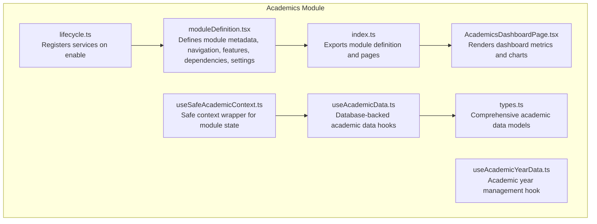
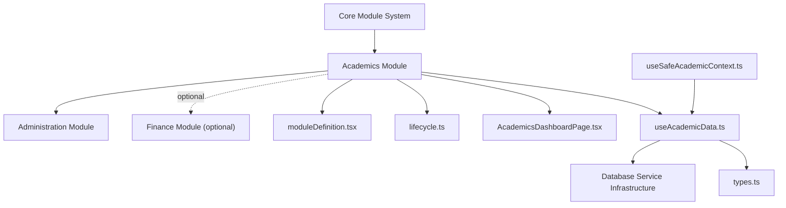
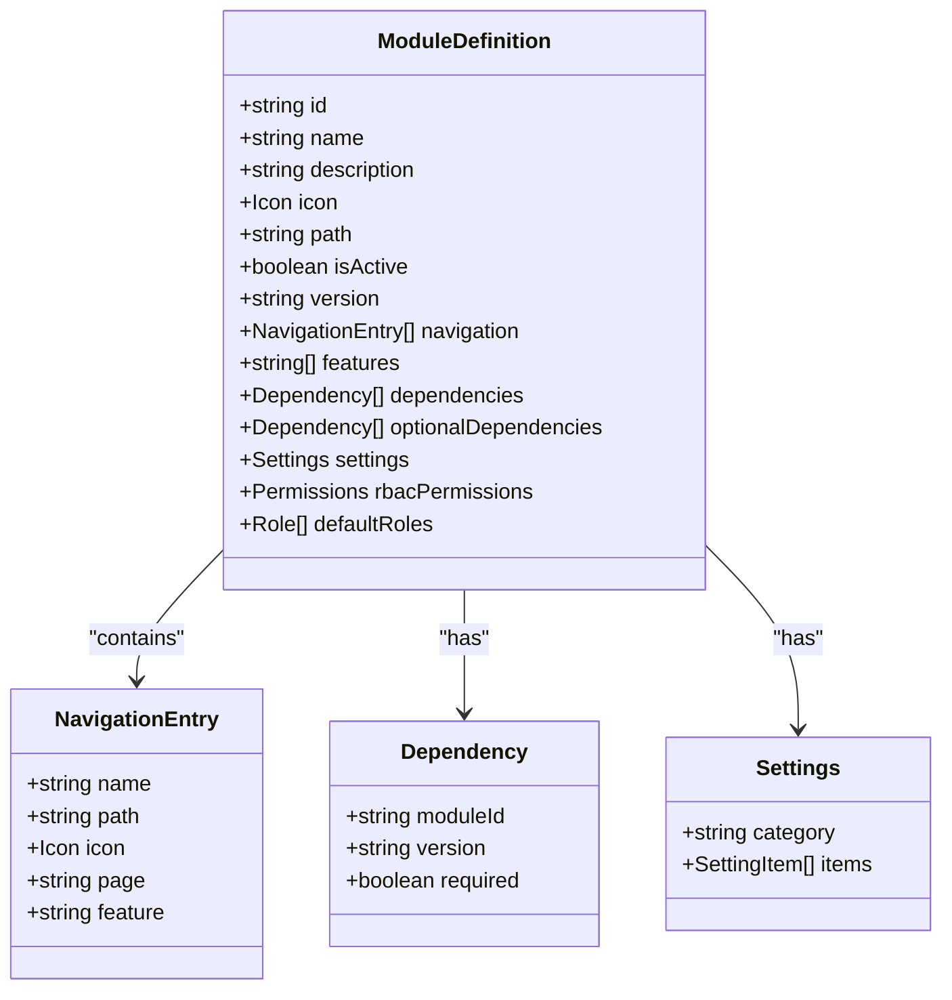
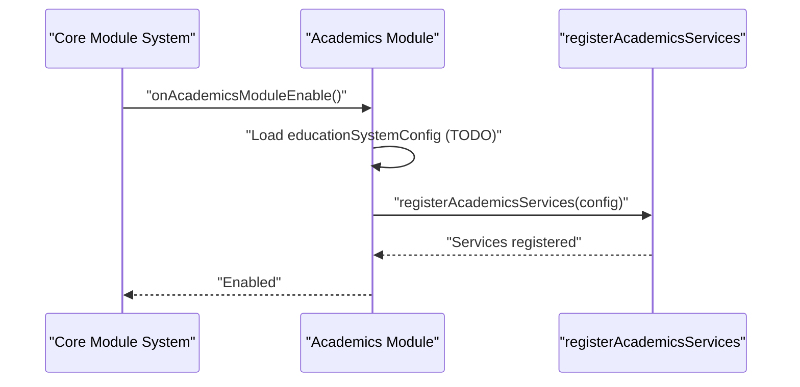
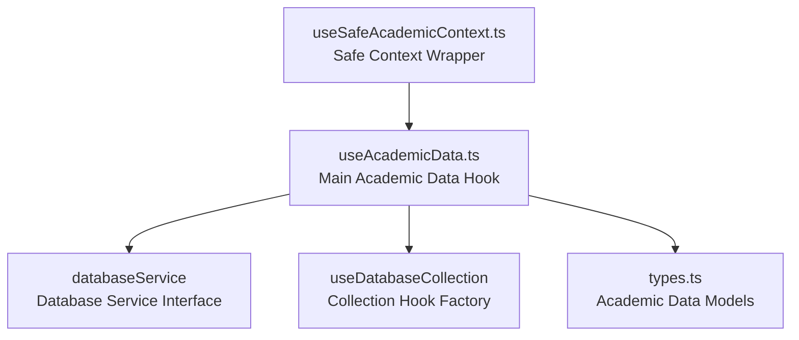

# Academics Module

<cite>
**Referenced Files in This Document**
- [moduleDefinition.tsx](file://src/modules/academics/moduleDefinition.tsx)
- [index.ts](file://src/modules/academics/index.ts)
- [lifecycle.ts](file://src/modules/academics/lifecycle.ts)
- [AcademicsDashboardPage.tsx](file://src/modules/academics/pages/AcademicsDashboardPage.tsx)
- [useAcademicData.ts](file://src/modules/academics/data/useAcademicData.ts)
- [types.ts](file://src/modules/academics/data/types.ts)
- [useSafeAcademicContext.ts](file://src/modules/academics/data/useSafeAcademicContext.ts)
- [useAcademicYearData.ts](file://src/modules/academics/data/useAcademicYearData.ts)
</cite>

## Update Summary
**Changes Made**
- Updated data layer architecture to reflect database service integration
- Added comprehensive academic data hooks documentation
- Enhanced facade pattern implementation details
- Updated data model specifications and validation rules
- Added audit trail and result processing workflows

## Table of Contents
1. [Introduction](#introduction)
2. [Project Structure](#project-structure)
3. [Core Components](#core-components)
4. [Architecture Overview](#architecture-overview)
5. [Detailed Component Analysis](#detailed-component-analysis)
6. [Data Layer Architecture](#data-layer-architecture)
7. [Academic Data Models](#academic-data-models)
8. [Validation Rules and Business Logic](#validation-rules-and-business-logic)
9. [Audit Trail and Compliance](#audit-trail-and-compliance)
10. [Performance Considerations](#performance-considerations)
11. [Troubleshooting Guide](#troubleshooting-guide)
12. [Conclusion](#conclusion)

## Introduction
This document describes the Academics module functionality and its integration within the broader educational management system. The module has undergone significant refactoring to eliminate mock data dependencies and integrate with the new database service infrastructure. It now provides comprehensive academic management capabilities including education system configuration, grading schemes, subject management, academic calendars, exam scheduling, paper setting management, and result processing workflows.

## Project Structure
The Academics module is organized as a self-contained module with enhanced data layer integration:
- A module definition that declares navigation entries, features, dependencies, and settings
- A lifecycle that registers services upon enabling the module
- A comprehensive data layer using database service integration
- A dashboard page that visualizes academic metrics and departmental subject counts
- Facade pattern implementation for seamless database operations

**Diagram sources**
- [moduleDefinition.tsx:25-96](file://src/modules/academics/moduleDefinition.tsx#L25-L96)
- [index.ts:4-8](file://src/modules/academics/index.ts#L4-L8)
- [lifecycle.ts:9-23](file://src/modules/academics/lifecycle.ts#L9-L23)
- [AcademicsDashboardPage.tsx:13-82](file://src/modules/academics/pages/AcademicsDashboardPage.tsx#L13-L82)
- [useAcademicData.ts:1-279](file://src/modules/academics/data/useAcademicData.ts#L1-L279)
- [types.ts:1-363](file://src/modules/academics/data/types.ts#L1-L363)
- [useSafeAcademicContext.ts:1-27](file://src/modules/academics/data/useSafeAcademicContext.ts#L1-L27)
- [useAcademicYearData.ts:1-36](file://src/modules/academics/data/useAcademicYearData.ts#L1-L36)

**Section sources**
- [moduleDefinition.tsx:25-96](file://src/modules/academics/moduleDefinition.tsx#L25-L96)
- [index.ts:4-8](file://src/modules/academics/index.ts#L4-L8)
- [lifecycle.ts:9-23](file://src/modules/academics/lifecycle.ts#L9-L23)
- [AcademicsDashboardPage.tsx:13-82](file://src/modules/academics/pages/AcademicsDashboardPage.tsx#L13-L82)

## Core Components
- **Module definition**: Declares navigation entries for subjects, timetables, exam scheduling, papers, allocations, assignments, and lesson plans; defines features and dependencies; exposes settings toggles.
- **Lifecycle**: Provides hooks for registration, enabling (service registration), and disabling (placeholder).
- **Data layer**: Comprehensive database-backed hooks for all academic entities including subjects, exams, timetables, grading schemes, and student management.
- **Dashboard**: Aggregates and visualizes academic metrics such as total subjects, subject papers, exam sessions, grading schemes, and departmental subject distribution.
- **Facade pattern**: Centralized academic data access through useAcademicData hook with specialized CRUD operations for each entity type.

**Section sources**
- [moduleDefinition.tsx:33-58](file://src/modules/academics/moduleDefinition.tsx#L33-L58)
- [moduleDefinition.tsx:59-95](file://src/modules/academics/moduleDefinition.tsx#L59-L95)
- [lifecycle.ts:9-23](file://src/modules/academics/lifecycle.ts#L9-L23)
- [AcademicsDashboardPage.tsx:37-68](file://src/modules/academics/pages/AcademicsDashboardPage.tsx#L37-L68)
- [useAcademicData.ts:10-279](file://src/modules/academics/data/useAcademicData.ts#L10-L279)

## Architecture Overview
The module integrates with the core module system and database service infrastructure. It depends on administrative services and optionally integrates with financial services. The dashboard consumes application data to render metrics and charts, while the data layer provides robust database-backed operations.

**Diagram sources**
- [moduleDefinition.tsx:60-73](file://src/modules/academics/moduleDefinition.tsx#L60-L73)
- [lifecycle.ts:3-34](file://src/modules/academics/lifecycle.ts#L3-L34)
- [AcademicsDashboardPage.tsx:15-22](file://src/modules/academics/pages/AcademicsDashboardPage.tsx#L15-L22)
- [useAcademicData.ts:5-8](file://src/modules/academics/data/useAcademicData.ts#L5-L8)

## Detailed Component Analysis

### Module Definition
The module definition encapsulates comprehensive navigation for academic workflows and maintains strict dependency management:
- Navigation entries for core academic workflows (dashboard, subjects, timetable periods/entries, exam scheduling, subject papers, allocations, student enrollment, exam sessions, analysis, results entry, grading schemes, education systems)
- Sub-features merged from assignments and lesson plans modules
- Features list indicating capabilities (subject-management, class-management, timetable, exam-management, grading, assignment-management, lesson-planning)
- Dependencies on administration (required) and finance (optional)
- Settings toggles for enabling/disabling exam management, timetable management, and grading schemes

**Diagram sources**
- [moduleDefinition.tsx:25-96](file://src/modules/academics/moduleDefinition.tsx#L25-L96)

**Section sources**
- [moduleDefinition.tsx:33-58](file://src/modules/academics/moduleDefinition.tsx#L33-L58)
- [moduleDefinition.tsx:59-95](file://src/modules/academics/moduleDefinition.tsx#L59-L95)

### Lifecycle Management
The lifecycle manages service registration when the module is enabled and logs registration/disable events. The service registration mechanism is delegated to a dedicated registration function.

**Diagram sources**
- [lifecycle.ts:18-23](file://src/modules/academics/lifecycle.ts#L18-L23)

**Section sources**
- [lifecycle.ts:9-23](file://src/modules/academics/lifecycle.ts#L9-L23)

### Dashboard Metrics and Charts
The dashboard aggregates academic metrics and departmental subject distribution using the new database-backed data layer:
- Metrics: Total subjects, total subject papers, exam sessions, grading schemes
- Chart: Bar chart of subjects per academic department
- Notifications: Status messages based on department availability

**Diagram sources**
- [AcademicsDashboardPage.tsx:15-68](file://src/modules/academics/pages/AcademicsDashboardPage.tsx#L15-L68)

**Section sources**
- [AcademicsDashboardPage.tsx:15-68](file://src/modules/academics/pages/AcademicsDashboardPage.tsx#L15-L68)

## Data Layer Architecture
The academic module now implements a comprehensive database service integration with facade pattern implementation:

### Database Service Integration
The useAcademicData hook serves as the central facade for all academic data operations, utilizing the database service infrastructure:

**Diagram sources**
- [useAcademicData.ts:5-8](file://src/modules/academics/data/useAcademicData.ts#L5-L8)
- [useSafeAcademicContext.ts:1-27](file://src/modules/academics/data/useSafeAcademicContext.ts#L1-L27)

### Academic Year Management
The useAcademicYearData hook demonstrates the transition from mock data to database-backed operations:

**Updated** Eliminated local initial data storage and integrated with database service for persistent academic year management.

**Section sources**
- [useAcademicYearData.ts:10-36](file://src/modules/academics/data/useAcademicYearData.ts#L10-L36)

### Safe Context Implementation
The useSafeAcademicContext hook provides module-aware data access with automatic fallback when the module is disabled:

**Updated** Enhanced to properly handle module state detection and provide empty data structures when the academics module is not enabled.

**Section sources**
- [useSafeAcademicContext.ts:5-27](file://src/modules/academics/data/useSafeAcademicContext.ts#L5-L27)

## Academic Data Models
The module defines comprehensive data models for all academic entities, consolidated from core/types/academic.ts:

### Core Academic Entities
- **Subject**: Academic subject with grouping, department association, and paper relationships
- **SubjectPaper**: Individual paper variants of subjects with subject associations
- **ClassSubjectAllocation**: Class-stream subject allocation with academic year context
- **StudentSubjectEnrollment**: Student enrollment in subject allocations with status tracking
- **TeacherSubjectAssignment**: Teacher assignments to subject allocations
- **TimetableEntry**: Daily schedule entries with day-of-week and period associations
- **ExamSession**: Academic examination sessions with status management
- **ExamPaperSetting**: Paper-specific exam configurations with marking schemes
- **GradingScheme**: Academic grading systems with level definitions
- **StudentExamResult**: Student examination results with mark breakdowns
- **StudentPaperMark**: Individual paper marks within exam results

### Education System Configuration
Comprehensive configuration models for different educational systems:
- **EducationSystemConfiguration**: Complete system setup with grading, assessment, and competency tracking
- **AcademicYearStructure**: Academic year period definitions and hierarchies
- **SchoolPeriod**: Defined school periods within academic years
- **AcademicPeriodDefinition**: Period type definitions and academic calendar structures

### Result Processing and Analytics
Advanced result processing capabilities:
- **StudentExamResultWithDetails**: Enhanced result records with student and subject details
- **StudentPaperMarkWithDetails**: Detailed mark records with subject paper information
- **ResultApprovalEntity**: Complete audit trail for result modifications
- **AuditLog**: Comprehensive change tracking for compliance

**Section sources**
- [types.ts:49-363](file://src/modules/academics/data/types.ts#L49-L363)

## Validation Rules and Business Logic
The academic data models implement comprehensive validation and business logic:

### Entity Validation Rules
- **Subject**: Unique subject codes, mandatory grouping, department association
- **StudentEnrollment**: Status validation, academic year constraints, uniqueness per allocation
- **ExamSession**: Status transitions, date validation, paper setting synchronization
- **GradingScheme**: Level validation, minimum-maximum score ranges, unique grade values
- **TimetableEntry**: Day-of-week validation, period conflicts, resource availability

### Business Logic Constraints
- **Result Processing**: Automatic grade calculation, pass/fail determination, rank computation
- **Enrollment Management**: Prerequisite checking, capacity limits, status transitions
- **Exam Scheduling**: Room availability, invigilator scheduling, paper distribution
- **Grade Calculation**: Weighted average computation, competency-based grading, audit trails

### Data Integrity Measures
- **Foreign Key Constraints**: Automatic cascade deletion, referential integrity
- **Unique Constraints**: Subject codes, enrollment uniqueness, exam session names
- **Temporal Validity**: Academic year boundaries, session status transitions
- **Business Rule Validation**: Automated checks before data persistence

**Section sources**
- [types.ts:16-363](file://src/modules/academics/data/types.ts#L16-L363)

## Audit Trail and Compliance
The academic module implements comprehensive audit trail functionality for compliance and quality assurance:

### Audit Trail Architecture
- **ResultApprovalEntity**: Centralized audit trail for all result modifications
- **AuditLog**: Detailed change tracking with timestamps and user identification
- **Change Detection**: Automatic comparison of previous and new states
- **Compliance Reporting**: Structured data for regulatory requirements

### Compliance Features
- **Modification Tracking**: Complete history of all data changes
- **User Accountability**: Individual user actions with timestamps
- **Regulatory Compliance**: Support for educational authority requirements
- **Data Integrity**: Immutable audit logs with tamper-evident properties

### Result Processing Workflows
- **Grade Calculation**: Automated scoring with manual override capabilities
- **Approval Workflow**: Multi-level approval process for result publication
- **Reassessment Tracking**: History of remedial exam attempts and modifications
- **Performance Analytics**: Aggregate reporting for academic quality monitoring

**Section sources**
- [types.ts:328-347](file://src/modules/academics/data/types.ts#L328-L347)

## Performance Considerations
- Dashboard rendering defers until all relevant data loads to avoid partial renders
- Database service integration provides efficient querying and caching mechanisms
- Collection hooks optimize data fetching and reduce unnecessary re-renders
- Facade pattern minimizes direct database service dependencies throughout the application
- Chart rendering uses responsive containers and tooltips for efficient presentation
- Filtering and aggregation of departmental data occur client-side with database-backed optimization

## Troubleshooting Guide
- If the dashboard remains blank, verify that loading flags for subjects, subject papers, exam sessions, grading schemes, and departments are resolved
- If departmental chart does not appear, confirm that academic departments exist and are properly filtered
- If navigation links are missing, check the navigation array in the module definition for correct page references
- For database connectivity issues, verify database service initialization and collection access
- If academic data operations fail, check collection permissions and entity validation rules
- For audit trail issues, ensure proper user authentication and authorization for result modifications

**Section sources**
- [AcademicsDashboardPage.tsx:24-28](file://src/modules/academics/pages/AcademicsDashboardPage.tsx#L24-L28)
- [AcademicsDashboardPage.tsx:30-34](file://src/modules/academics/pages/AcademicsDashboardPage.tsx#L30-L34)
- [moduleDefinition.tsx:33-58](file://src/modules/academics/moduleDefinition.tsx#L33-L58)

## Conclusion
The Academics module has been significantly enhanced with comprehensive database service integration and facade pattern implementation. The refactoring eliminates mock data dependencies while providing robust academic management capabilities. The module now offers complete support for education system configuration, grading schemes, subject management, academic calendars, exam scheduling, paper setting management, and result processing workflows with comprehensive audit trail functionality. Future development should focus on optimizing database queries, enhancing real-time synchronization capabilities, and expanding analytics features for comprehensive academic reporting.