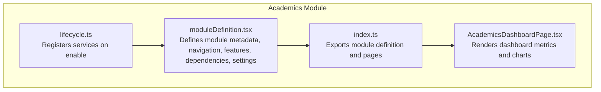
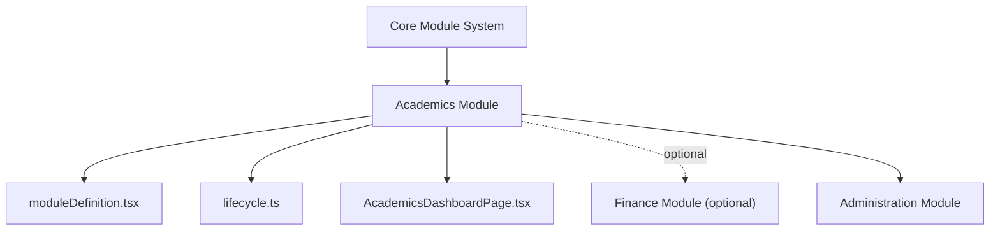
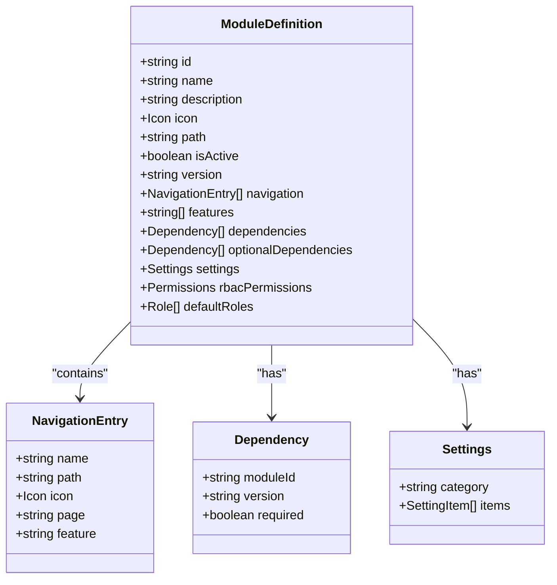
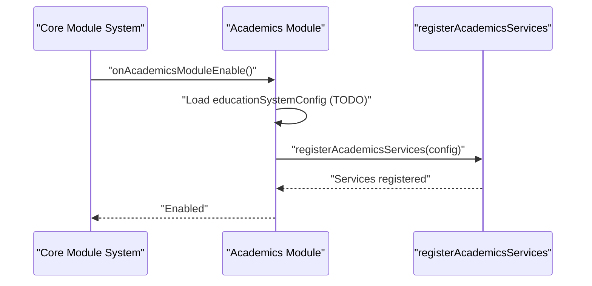
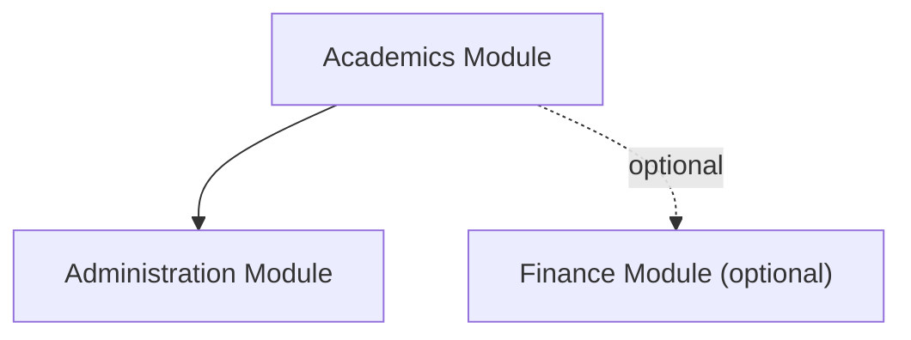

# Academics Module

<cite>
**Referenced Files in This Document**
- [moduleDefinition.tsx](file://src/modules/academics/moduleDefinition.tsx)
- [index.ts](file://src/modules/academics/index.ts)
- [lifecycle.ts](file://src/modules/academics/lifecycle.ts)
- [AcademicsDashboardPage.tsx](file://src/modules/academics/pages/AcademicsDashboardPage.tsx)
</cite>

## Table of Contents
1. [Introduction](#introduction)
2. [Project Structure](#project-structure)
3. [Core Components](#core-components)
4. [Architecture Overview](#architecture-overview)
5. [Detailed Component Analysis](#detailed-component-analysis)
6. [Dependency Analysis](#dependency-analysis)
7. [Performance Considerations](#performance-considerations)
8. [Troubleshooting Guide](#troubleshooting-guide)
9. [Conclusion](#conclusion)

## Introduction
This document describes the Academics module functionality and its integration within the broader system. It focuses on the module's navigation structure, feature set, and the dashboard that surfaces academic metrics. The module exposes capabilities for managing subjects, timetables, exams, grading schemes, and related academic workflows, while integrating with administrative and optional financial systems.

## Project Structure
The Academics module is defined as a self-contained module with:
- A module definition that declares navigation entries, features, dependencies, and settings
- A lifecycle that registers services upon enabling the module
- A dashboard page that visualizes academic metrics and departmental subject counts

**Diagram sources**
- [moduleDefinition.tsx:25-96](file://src/modules/academics/moduleDefinition.tsx#L25-L96)
- [index.ts:4-8](file://src/modules/academics/index.ts#L4-L8)
- [lifecycle.ts:9-23](file://src/modules/academics/lifecycle.ts#L9-L23)
- [AcademicsDashboardPage.tsx:13-82](file://src/modules/academics/pages/AcademicsDashboardPage.tsx#L13-L82)

**Section sources**
- [moduleDefinition.tsx:25-96](file://src/modules/academics/moduleDefinition.tsx#L25-L96)
- [index.ts:4-8](file://src/modules/academics/index.ts#L4-L8)
- [lifecycle.ts:9-23](file://src/modules/academics/lifecycle.ts#L9-L23)
- [AcademicsDashboardPage.tsx:13-82](file://src/modules/academics/pages/AcademicsDashboardPage.tsx#L13-L82)

## Core Components
- Module definition: Declares navigation entries for subjects, timetables, exam scheduling, papers, allocations, assignments, and lesson plans; defines features and dependencies; exposes settings toggles.
- Lifecycle: Provides hooks for registration, enabling (service registration), and disabling (placeholder).
- Dashboard: Aggregates and visualizes academic metrics such as total subjects, subject papers, exam sessions, grading schemes, and departmental subject distribution.

**Section sources**
- [moduleDefinition.tsx:33-58](file://src/modules/academics/moduleDefinition.tsx#L33-L58)
- [moduleDefinition.tsx:59-95](file://src/modules/academics/moduleDefinition.tsx#L59-L95)
- [lifecycle.ts:9-23](file://src/modules/academics/lifecycle.ts#L9-L23)
- [AcademicsDashboardPage.tsx:37-68](file://src/modules/academics/pages/AcademicsDashboardPage.tsx#L37-L68)

## Architecture Overview
The module integrates with the core module system and depends on administrative services. It optionally integrates with financial services. The dashboard consumes application data to render metrics and charts.

**Diagram sources**
- [moduleDefinition.tsx:60-73](file://src/modules/academics/moduleDefinition.tsx#L60-L73)
- [lifecycle.ts:3-34](file://src/modules/academics/lifecycle.ts#L3-L34)
- [AcademicsDashboardPage.tsx:15-22](file://src/modules/academics/pages/AcademicsDashboardPage.tsx#L15-L22)

## Detailed Component Analysis

### Module Definition
The module definition encapsulates:
- Navigation entries for core academic workflows (dashboard, subjects, timetable periods/entries, exam scheduling, subject papers, allocations, student enrollment, exam sessions, analysis, results entry, grading schemes, education systems)
- Sub-features merged from other modules (assignments and lesson plans)
- Features list indicating capabilities (subject-management, class-management, timetable, exam-management, grading, assignment-management, lesson-planning)
- Dependencies on administration (required) and finance (optional)
- Settings toggles for enabling/disabling exam management, timetable management, and grading schemes

**Diagram sources**
- [moduleDefinition.tsx:25-96](file://src/modules/academics/moduleDefinition.tsx#L25-L96)

**Section sources**
- [moduleDefinition.tsx:33-58](file://src/modules/academics/moduleDefinition.tsx#L33-L58)
- [moduleDefinition.tsx:59-95](file://src/modules/academics/moduleDefinition.tsx#L59-L95)

### Lifecycle Management
The lifecycle manages service registration when the module is enabled and logs registration/disable events. The service registration mechanism is delegated to a dedicated registration function.

**Diagram sources**
- [lifecycle.ts:18-23](file://src/modules/academics/lifecycle.ts#L18-L23)

**Section sources**
- [lifecycle.ts:9-23](file://src/modules/academics/lifecycle.ts#L9-L23)

### Dashboard Metrics and Charts
The dashboard aggregates academic metrics and departmental subject distribution:
- Metrics: Total subjects, total subject papers, exam sessions, grading schemes
- Chart: Bar chart of subjects per academic department
- Notifications: Status messages based on department availability

**Diagram sources**
- [AcademicsDashboardPage.tsx:15-68](file://src/modules/academics/pages/AcademicsDashboardPage.tsx#L15-L68)

**Section sources**
- [AcademicsDashboardPage.tsx:15-68](file://src/modules/academics/pages/AcademicsDashboardPage.tsx#L15-L68)

## Dependency Analysis
The module declares:
- Required dependency on the administration module
- Optional dependency on the finance module
- Navigation entries for assignments and lesson plans sub-features

**Diagram sources**
- [moduleDefinition.tsx:60-73](file://src/modules/academics/moduleDefinition.tsx#L60-L73)

**Section sources**
- [moduleDefinition.tsx:60-73](file://src/modules/academics/moduleDefinition.tsx#L60-L73)

## Performance Considerations
- Dashboard rendering defers until all relevant data loads to avoid partial renders
- Chart rendering uses responsive containers and tooltips for efficient presentation
- Filtering and aggregation of departmental data occur client-side; consider pagination or virtualization for large datasets

## Troubleshooting Guide
- If the dashboard remains blank, verify that loading flags for subjects, subject papers, exam sessions, grading schemes, and departments are resolved
- If departmental chart does not appear, confirm that academic departments exist and are properly filtered
- If navigation links are missing, check the navigation array in the module definition for correct page references

**Section sources**
- [AcademicsDashboardPage.tsx:24-28](file://src/modules/academics/pages/AcademicsDashboardPage.tsx#L24-L28)
- [AcademicsDashboardPage.tsx:30-34](file://src/modules/academics/pages/AcademicsDashboardPage.tsx#L30-L34)
- [moduleDefinition.tsx:33-58](file://src/modules/academics/moduleDefinition.tsx#L33-L58)

## Conclusion
The Academics module provides a structured foundation for academic workflows, including navigation, feature flags, and a dashboard for key metrics. Its lifecycle integrates with the core module system, and its dashboard offers immediate visibility into academic activity. Future development should focus on implementing service registration, data models, and workflows for exam scheduling, paper setting, results processing, student enrollment, teacher allocations, timetables, grading engines, merit lists, and analytics.