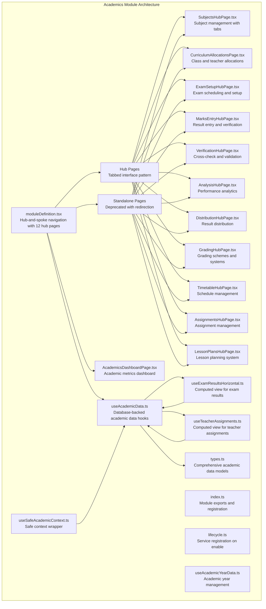
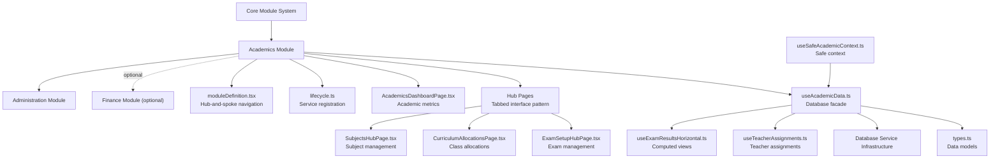
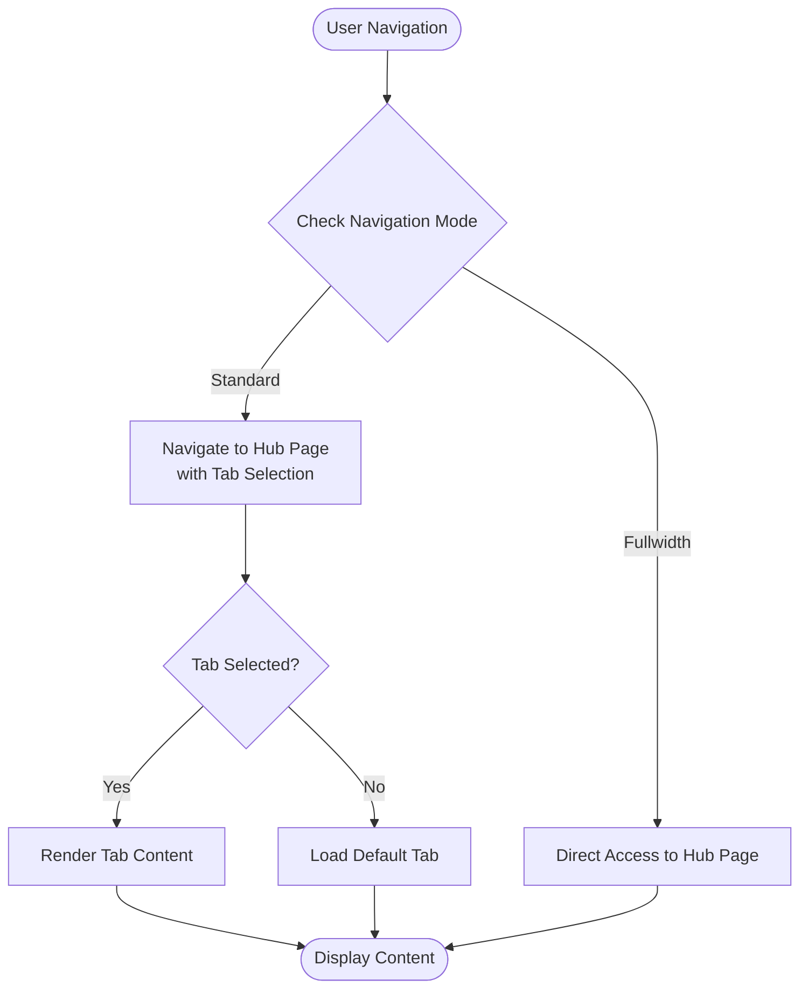
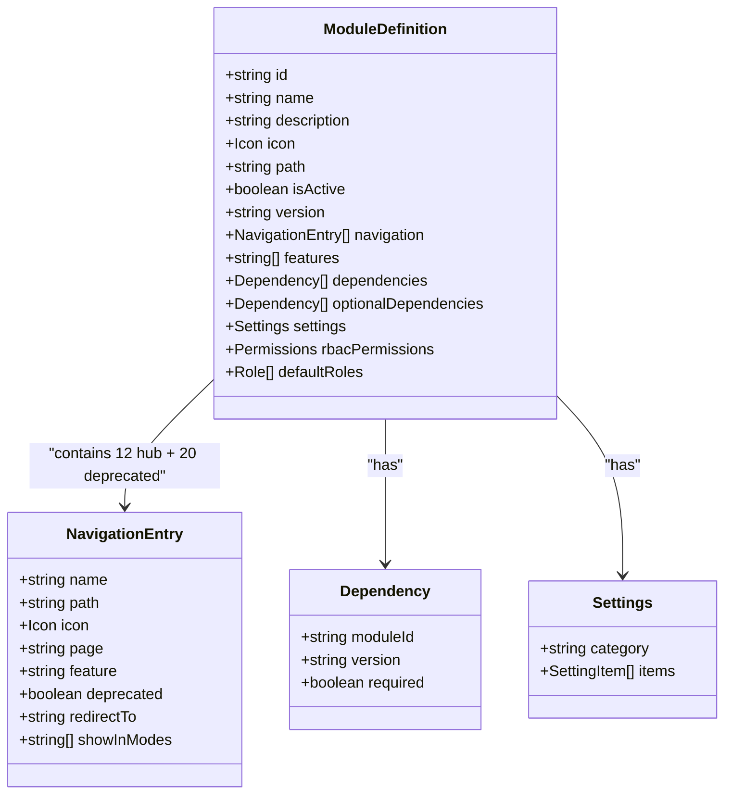
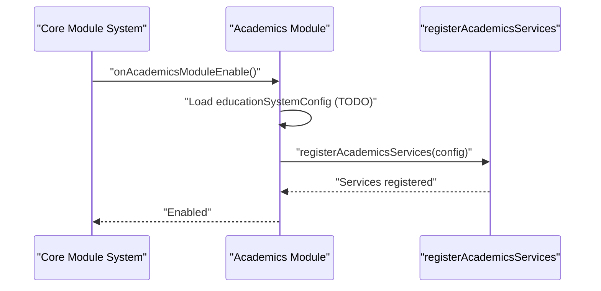
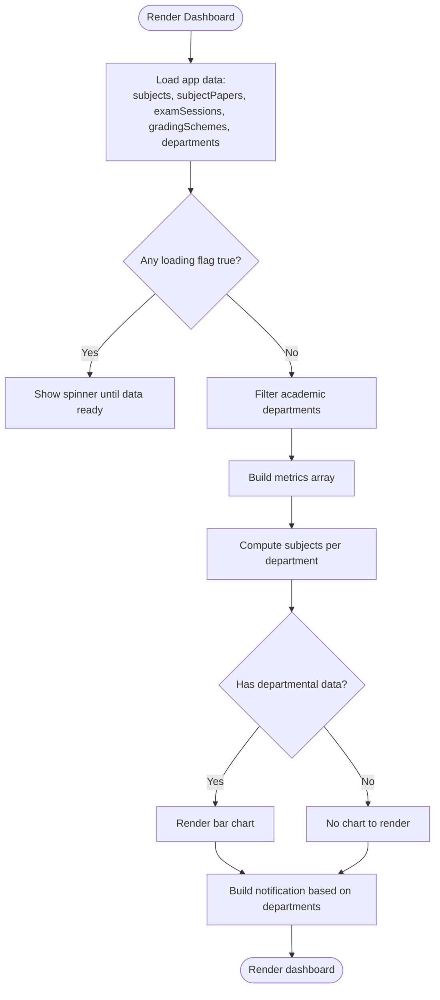
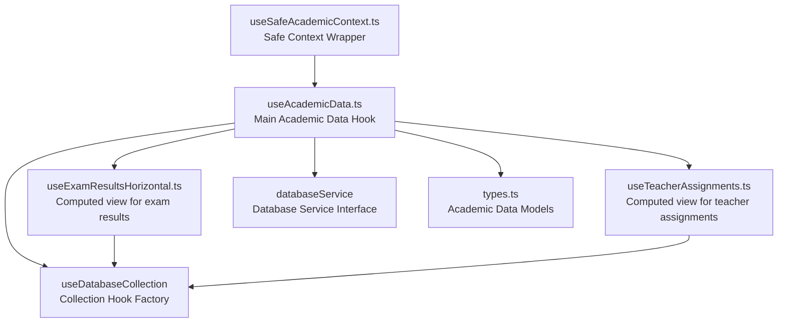
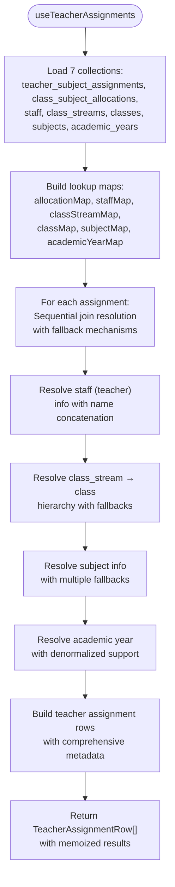

# Academics Module

<cite>
**Referenced Files in This Document**
- [moduleDefinition.tsx](file://src/modules/academics/moduleDefinition.tsx)
- [index.ts](file://src/modules/academics/index.ts)
- [lifecycle.ts](file://src/modules/academics/lifecycle.ts)
- [AcademicsDashboardPage.tsx](file://src/modules/academics/pages/AcademicsDashboardPage.tsx)
- [SubjectsHubPage.tsx](file://src/modules/academics/pages/SubjectsHubPage.tsx)
- [CurriculumAllocationsPage.tsx](file://src/modules/academics/pages/CurriculumAllocationsPage.tsx)
- [ExamSetupHubPage.tsx](file://src/modules/academics/pages/ExamSetupHubPage.tsx)
- [AssignmentsHubPage.tsx](file://src/modules/academics/pages/AssignmentsHubPage.tsx)
- [LessonPlansHubPage.tsx](file://src/modules/academics/pages/LessonPlansHubPage.tsx)
- [useAcademicData.ts](file://src/modules/academics/data/useAcademicData.ts)
- [types.ts](file://src/modules/academics/data/types.ts)
- [useSafeAcademicContext.ts](file://src/modules/academics/data/useSafeAcademicContext.ts)
- [useAcademicYearData.ts](file://src/modules/academics/data/useAcademicYearData.ts)
- [useExamResultsHorizontal.ts](file://src/modules/academics/hooks/useExamResultsHorizontal.ts)
- [useTeacherAssignments.ts](file://src/modules/academics/hooks/useTeacherAssignments.ts)
- [hooks/index.ts](file://src/modules/academics/hooks/index.ts)
</cite>

## Update Summary
**Changes Made**
- Added comprehensive hub page system with tabbed interface pattern for centralized academic management
- Introduced SubjectsHubPage, CurriculumAllocationsPage, ExamSetupHubPage, AssignmentsHubPage, and LessonPlansHubPage
- Implemented centralized navigation with hub-and-spoke architecture replacing standalone pages
- Enhanced navigation structure with standard and fullwidth modes supporting tabbed workflows
- Added deprecated standalone pages with redirection to hub pages for backward compatibility

## Table of Contents
1. [Introduction](#introduction)
2. [Project Structure](#project-structure)
3. [Core Components](#core-components)
4. [Architecture Overview](#architecture-overview)
5. [Hub Page System](#hub-page-system)
6. [Detailed Component Analysis](#detailed-component-analysis)
7. [Data Layer Architecture](#data-layer-architecture)
8. [Computed View Hooks](#computed-view-hooks)
9. [Academic Data Models](#academic-data-models)
10. [Validation Rules and Business Logic](#validation-rules-and-business-logic)
11. [Audit Trail and Compliance](#audit-trail-and-compliance)
12. [Performance Considerations](#performance-considerations)
13. [Troubleshooting Guide](#troubleshooting-guide)
14. [Conclusion](#conclusion)

## Introduction
This document describes the Academics module functionality and its integration within the broader educational management system. The module has undergone significant architectural transformation to implement a comprehensive hub page system with tabbed interface pattern, replacing individual standalone pages with centralized navigation. The module now provides advanced academic management capabilities including education system configuration, grading schemes, subject management, academic calendars, exam scheduling, paper setting management, result processing workflows, and sophisticated computed view functionality for exam results and teacher assignments. The introduction of hub pages represents a major enhancement in user experience and system organization, featuring centralized navigation with tabbed workflows and backward compatibility through deprecated page redirections.

## Project Structure
The Academics module is organized as a self-contained module with enhanced hub page architecture and computed view capabilities:
- A comprehensive module definition with hub-and-spoke navigation pattern
- Lifecycle management for service registration upon module enablement
- Hub pages with tabbed interface pattern for centralized academic workflows
- Standalone pages with deprecation notices and automatic redirection
- Enhanced data layer using database service integration with computed view hooks
- Dashboard page for academic metrics visualization
- Facade pattern implementation for seamless database operations
- Computed view hooks for advanced analytics and reporting

**Diagram sources**
- [moduleDefinition.tsx:35-85](file://src/modules/academics/moduleDefinition.tsx#L35-L85)
- [moduleDefinition.tsx:121-138](file://src/modules/academics/moduleDefinition.tsx#L121-L138)
- [AcademicsDashboardPage.tsx:13-82](file://src/modules/academics/pages/AcademicsDashboardPage.tsx#L13-L82)
- [SubjectsHubPage.tsx:1-200](file://src/modules/academics/pages/SubjectsHubPage.tsx#L1-L200)
- [CurriculumAllocationsPage.tsx:1-200](file://src/modules/academics/pages/CurriculumAllocationsPage.tsx#L1-L200)
- [ExamSetupHubPage.tsx:1-200](file://src/modules/academics/pages/ExamSetupHubPage.tsx#L1-L200)
- [AssignmentsHubPage.tsx:1-200](file://src/modules/academics/pages/AssignmentsHubPage.tsx#L1-L200)
- [LessonPlansHubPage.tsx:1-200](file://src/modules/academics/pages/LessonPlansHubPage.tsx#L1-L200)

**Section sources**
- [moduleDefinition.tsx:27-141](file://src/modules/academics/moduleDefinition.tsx#L27-L141)
- [index.ts:4-8](file://src/modules/academics/index.ts#L4-L8)
- [lifecycle.ts:9-23](file://src/modules/academics/lifecycle.ts#L9-L23)
- [AcademicsDashboardPage.tsx:13-82](file://src/modules/academics/pages/AcademicsDashboardPage.tsx#L13-L82)

## Core Components
- **Hub-and-Spoke Architecture**: Comprehensive navigation system with 12 hub pages plus dashboard, featuring tabbed interface pattern for centralized academic workflows
- **Centralized Navigation**: Standard and fullwidth modes supporting tabbed workflows with automatic page redirection for deprecated standalone pages
- **Hub Pages**: Specialized pages with tabbed interfaces for subjects, curriculum allocations, exam setup, marks entry, verification, analysis, distribution, grading, timetable, assignments, and lesson plans
- **Lifecycle Management**: Service registration upon module enablement with proper cleanup on disable
- **Data Layer**: Database-backed hooks for all academic entities enhanced with computed view functionality for advanced analytics
- **Dashboard**: Academic metrics visualization with departmental subject distribution and performance indicators
- **Computed View Hooks**: Sophisticated client-side data processing for exam results and teacher assignments with enhanced performance
- **Facade Pattern**: Centralized academic data access through useAcademicData hook with specialized CRUD operations

**Section sources**
- [moduleDefinition.tsx:35-85](file://src/modules/academics/moduleDefinition.tsx#L35-L85)
- [moduleDefinition.tsx:121-138](file://src/modules/academics/moduleDefinition.tsx#L121-L138)
- [lifecycle.ts:9-23](file://src/modules/academics/lifecycle.ts#L9-L23)
- [AcademicsDashboardPage.tsx:37-68](file://src/modules/academics/pages/AcademicsDashboardPage.tsx#L37-L68)
- [useAcademicData.ts:10-279](file://src/modules/academics/data/useAcademicData.ts#L10-L279)
- [useExamResultsHorizontal.ts:34-54](file://src/modules/academics/hooks/useExamResultsHorizontal.ts#L34-L54)
- [useTeacherAssignments.ts:29-45](file://src/modules/academics/hooks/useTeacherAssignments.ts#L29-L45)

## Architecture Overview
The module implements a sophisticated hub-and-spoke architecture with centralized navigation and tabbed interface pattern. The hub pages provide comprehensive academic management capabilities while maintaining backward compatibility through deprecated standalone pages with automatic redirection. The architecture supports both standard and fullwidth navigation modes, enabling flexible user experiences across different screen sizes and use cases.

**Diagram sources**
- [moduleDefinition.tsx:60-73](file://src/modules/academics/moduleDefinition.tsx#L60-L73)
- [lifecycle.ts:3-34](file://src/modules/academics/lifecycle.ts#L3-L34)
- [AcademicsDashboardPage.tsx:15-22](file://src/modules/academics/pages/AcademicsDashboardPage.tsx#L15-L22)
- [SubjectsHubPage.tsx:1-50](file://src/modules/academics/pages/SubjectsHubPage.tsx#L1-L50)
- [CurriculumAllocationsPage.tsx:1-50](file://src/modules/academics/pages/CurriculumAllocationsPage.tsx#L1-L50)
- [ExamSetupHubPage.tsx:1-50](file://src/modules/academics/pages/ExamSetupHubPage.tsx#L1-L50)

## Hub Page System
The Academics module implements a comprehensive hub page system with tabbed interface pattern, providing centralized navigation for all academic workflows:

### Hub Page Architecture
- **Dashboard Hub**: Central academic metrics and overview page
- **Subject Management Hub**: Comprehensive subject and paper management with multiple tabs
- **Curriculum Allocation Hub**: Class and teacher subject allocation management
- **Exam Setup Hub**: Complete exam scheduling and paper setting management
- **Marks Entry Hub**: Result entry and verification workflows
- **Verification Hub**: Cross-check and validation processes
- **Analysis Hub**: Performance analytics and reporting
- **Distribution Hub**: Result distribution and gazette management
- **Grading Hub**: Grading schemes and education system configuration
- **Timetable Hub**: Schedule management and periods
- **Assignment Hub**: Assignment creation and grading
- **Lesson Plan Hub**: Weekly lesson planning and approval

### Tabbed Interface Pattern
Each hub page implements a tabbed interface pattern with:
- Centralized navigation within the hub page
- Tab-specific content rendering
- URL parameter-based tab selection
- Consistent styling and user experience
- Responsive design for different screen sizes

### Navigation Modes
- **Standard Mode**: Traditional sidebar navigation with hub pages
- **Fullwidth Mode**: Expanded navigation with direct access to hub pages
- **Automatic Redirection**: Deprecated standalone pages redirect to appropriate hub tabs

**Diagram sources**
- [moduleDefinition.tsx:39-51](file://src/modules/academics/moduleDefinition.tsx#L39-L51)
- [moduleDefinition.tsx:121-138](file://src/modules/academics/moduleDefinition.tsx#L121-L138)

**Section sources**
- [moduleDefinition.tsx:35-85](file://src/modules/academics/moduleDefinition.tsx#L35-L85)
- [moduleDefinition.tsx:121-138](file://src/modules/academics/moduleDefinition.tsx#L121-L138)

## Detailed Component Analysis

### Module Definition
The module definition encapsulates comprehensive hub-and-spoke navigation for academic workflows with centralized management:
- **Hub Pages**: 12 specialized pages with tabbed interface pattern for different academic functions
- **Dashboard**: Central academic metrics and overview page
- **Deprecated Pages**: 20 standalone pages with automatic redirection to hub equivalents
- **Features**: Subject management, class management, timetable, exam management, grading, assignment management, lesson planning
- **Dependencies**: Administration (required), Finance (optional)
- **Settings**: Exam management, timetable management, grading schemes toggle

**Diagram sources**
- [moduleDefinition.tsx:27-141](file://src/modules/academics/moduleDefinition.tsx#L27-L141)

**Section sources**
- [moduleDefinition.tsx:27-141](file://src/modules/academics/moduleDefinition.tsx#L27-L141)

### Lifecycle Management
The lifecycle manages service registration when the module is enabled and provides proper cleanup on disable. The service registration mechanism is delegated to a dedicated registration function.

**Diagram sources**
- [lifecycle.ts:18-23](file://src/modules/academics/lifecycle.ts#L18-L23)

**Section sources**
- [lifecycle.ts:9-23](file://src/modules/academics/lifecycle.ts#L9-L23)

### Dashboard Metrics and Charts
The dashboard aggregates academic metrics and departmental subject distribution using the enhanced database-backed data layer:
- **Metrics**: Total subjects, total subject papers, exam sessions, grading schemes
- **Chart**: Bar chart of subjects per academic department
- **Notifications**: Status messages based on department availability

**Diagram sources**
- [AcademicsDashboardPage.tsx:15-68](file://src/modules/academics/pages/AcademicsDashboardPage.tsx#L15-L68)

**Section sources**
- [AcademicsDashboardPage.tsx:15-68](file://src/modules/academics/pages/AcademicsDashboardPage.tsx#L15-L68)

## Data Layer Architecture
The academic module implements a comprehensive database service integration with facade pattern and computed view functionality:

### Database Service Integration
The useAcademicData hook serves as the central facade for all academic data operations, utilizing the database service infrastructure and enhanced with computed view hooks:

**Diagram sources**
- [useAcademicData.ts:5-8](file://src/modules/academics/data/useAcademicData.ts#L5-L8)
- [useExamResultsHorizontal.ts:55-62](file://src/modules/academics/hooks/useExamResultsHorizontal.ts#L55-L62)
- [useTeacherAssignments.ts:46-53](file://src/modules/academics/hooks/useTeacherAssignments.ts#L46-L53)
- [useSafeAcademicContext.ts:1-27](file://src/modules/academics/data/useSafeAcademicContext.ts#L1-L27)

### Academic Year Management
The useAcademicYearData hook demonstrates the transition from mock data to database-backed operations:

**Updated** Eliminated local initial data storage and integrated with database service for persistent academic year management.

**Section sources**
- [useAcademicYearData.ts:10-36](file://src/modules/academics/data/useAcademicYearData.ts#L10-L36)

### Safe Context Implementation
The useSafeAcademicContext hook provides module-aware data access with automatic fallback when the module is disabled:

**Updated** Enhanced to properly handle module state detection and provide empty data structures when the academics module is not enabled.

**Section sources**
- [useSafeAcademicContext.ts:5-27](file://src/modules/academics/data/useSafeAcademicContext.ts#L5-L27)

## Computed View Hooks

### useExamResultsHorizontal Hook
The useExamResultsHorizontal hook represents a sophisticated replacement for the vw_edm_exam_results_horizontal database view, implementing comprehensive client-side data processing and aggregation:

**Purpose**: Pivots student exam results into a horizontal format with subject scores as columns, mirroring the SQL view functionality but executed client-side with enhanced performance and flexibility.

**Data Sources**: Aggregates data from seven collections including student_exam_results, student_paper_marks, exam_paper_settings, subject_papers, subjects, exam_sessions, and students.

**Processing Logic**: Computes weighted scores using the formula `(score / marks_out_of) * 100 * (weight_percentage / 100)`, groups by result_id, and pivots subject abbreviations into columns with sophisticated data transformation and validation.

**Output Format**: Returns ExamResultsHorizontalRow objects containing resultId, admissionNo, studentName, examName, totalMarks, meanGrade, streamRank, classRank, and subjectScores with comprehensive type safety.

**Advanced Features**:
- Concurrent data loading from multiple collections with loading state coordination
- Sophisticated lookup map construction for O(1) access patterns
- Weighted score calculation with precision control and fallback handling
- Graceful error handling and data validation
- Memoized computations to prevent unnecessary recalculations
- Batch refresh operations for optimal performance

**Diagram sources**
- [useExamResultsHorizontal.ts:64-182](file://src/modules/academics/hooks/useExamResultsHorizontal.ts#L64-L182)

**Section sources**
- [useExamResultsHorizontal.ts:34-54](file://src/modules/academics/hooks/useExamResultsHorizontal.ts#L34-L54)
- [useExamResultsHorizontal.ts:55-227](file://src/modules/academics/hooks/useExamResultsHorizontal.ts#L55-L227)

### useTeacherAssignments Hook
The useTeacherAssignments hook represents a comprehensive replacement for the vw_edm_teacher_assignments database view, implementing sophisticated client-side data processing and aggregation:

**Purpose**: Joins teacher_subject_assignments with class_subject_allocations, staff, class_streams, classes, subjects, and academic_years to produce a flat table of academic assignments with enhanced data resolution capabilities.

**Data Sources**: Aggregates data from seven collections including teacher_subject_assignments, class_subject_allocations, staff, class_streams, classes, subjects, and academic_years.

**Processing Logic**: Performs sequential joins to resolve teacher assignments to class streams, subjects, and academic years, with comprehensive fallback mechanisms to denormalized fields for backward compatibility and data resilience.

**Output Format**: Returns TeacherAssignmentRow objects containing academicYear, className, streamName, subjectName, teacherName, teacherId, and allocationId with complete type safety and validation.

**Advanced Features**:
- Hierarchical data resolution with multiple join levels
- Comprehensive fallback mechanisms for denormalized data
- Robust error handling and data validation
- Optimized lookup map construction for efficient processing
- Batch refresh operations for coordinated data updates
- Memoized computations with dependency tracking

**Processing Workflow**:
1. Load all seven collections with concurrent data fetching
2. Build lookup maps for O(1) access to all referenced entities
3. Process each teacher assignment through sequential joins
4. Resolve staff information with fallback to denormalized fields
5. Resolve class_stream → class hierarchy with fallback mechanisms
6. Resolve subject information with multiple fallback options
7. Resolve academic year information with denormalized field support
8. Construct final TeacherAssignmentRow objects with comprehensive metadata

**Diagram sources**
- [useTeacherAssignments.ts:55-171](file://src/modules/academics/hooks/useTeacherAssignments.ts#L55-L171)

**Section sources**
- [useTeacherAssignments.ts:29-45](file://src/modules/academics/hooks/useTeacherAssignments.ts#L29-L45)
- [useTeacherAssignments.ts:46-216](file://src/modules/academics/hooks/useTeacherAssignments.ts#L46-L216)

### Barrel Exports
The hooks/index.ts file provides barrel exports for computed view hooks, making them easily importable throughout the application with comprehensive type exports for both the hooks and their return types.

**Section sources**
- [hooks/index.ts:1-8](file://src/modules/academics/hooks/index.ts#L1-L8)

## Academic Data Models
The module defines comprehensive data models for all academic entities, consolidated from core/types/academic.ts:

### Core Academic Entities
- **Subject**: Academic subject with grouping, department association, and paper relationships
- **SubjectPaper**: Individual paper variants of subjects with subject associations
- **ClassSubjectAllocation**: Class-stream subject allocation with academic year context
- **StudentSubjectEnrollment**: Student enrollment in subject allocations with status tracking
- **TeacherSubjectAssignment**: Teacher assignments to subject allocations
- **TimetableEntry**: Daily schedule entries with day-of-week and period associations
- **ExamSession**: Academic examination sessions with status management
- **ExamPaperSetting**: Paper-specific exam configurations with marking schemes
- **GradingScheme**: Academic grading systems with level definitions
- **StudentExamResult**: Student examination results with mark breakdowns
- **StudentPaperMark**: Individual paper marks within exam results

### Education System Configuration
Comprehensive configuration models for different educational systems:
- **EducationSystemConfiguration**: Complete system setup with grading, assessment, and competency tracking
- **AcademicYearStructure**: Academic year period definitions and hierarchies
- **SchoolPeriod**: Defined school periods within academic years
- **AcademicPeriodDefinition**: Period type definitions and academic calendar structures

### Result Processing and Analytics
Advanced result processing capabilities:
- **StudentExamResultWithDetails**: Enhanced result records with student and subject details
- **StudentPaperMarkWithDetails**: Detailed mark records with subject paper information
- **ResultApprovalEntity**: Complete audit trail for result modifications
- **AuditLog**: Comprehensive change tracking for compliance

**Section sources**
- [types.ts:49-363](file://src/modules/academics/data/types.ts#L49-L363)

## Validation Rules and Business Logic
The academic data models implement comprehensive validation and business logic:

### Entity Validation Rules
- **Subject**: Unique subject codes, mandatory grouping, department association
- **StudentEnrollment**: Status validation, academic year constraints, uniqueness per allocation
- **ExamSession**: Status transitions, date validation, paper setting synchronization
- **GradingScheme**: Level validation, minimum-maximum score ranges, unique grade values
- **TimetableEntry**: Day-of-week validation, period conflicts, resource availability

### Business Logic Constraints
- **Result Processing**: Automatic grade calculation, pass/fail determination, rank computation
- **Enrollment Management**: Prerequisite checking, capacity limits, status transitions
- **Exam Scheduling**: Room availability, invigilator scheduling, paper distribution
- **Grade Calculation**: Weighted average computation, competency-based grading, audit trails

### Data Integrity Measures
- **Foreign Key Constraints**: Automatic cascade deletion, referential integrity
- **Unique Constraints**: Subject codes, enrollment uniqueness, exam session names
- **Temporal Validity**: Academic year boundaries, session status transitions
- **Business Rule Validation**: Automated checks before data persistence

### Computed View Business Logic
- **Weighted Score Calculation**: Client-side computation using paper settings and marks with precision control
- **Data Aggregation**: Efficient grouping and pivoting of exam results with mathematical accuracy
- **Fallback Resolution**: Graceful handling of missing or denormalized data with comprehensive error handling
- **Performance Optimization**: Memoization and concurrent data loading with dependency tracking
- **Sophisticated Data Transformation**: Complex join operations with hierarchical data resolution

**Section sources**
- [types.ts:16-363](file://src/modules/academics/data/types.ts#L16-L363)
- [useExamResultsHorizontal.ts:46-48](file://src/modules/academics/hooks/useExamResultsHorizontal.ts#L46-L48)
- [useTeacherAssignments.ts:119-157](file://src/modules/academics/hooks/useTeacherAssignments.ts#L119-L157)

## Audit Trail and Compliance
The academic module implements comprehensive audit trail functionality for compliance and quality assurance:

### Audit Trail Architecture
- **ResultApprovalEntity**: Centralized audit trail for all result modifications
- **AuditLog**: Detailed change tracking with timestamps and user identification
- **Change Detection**: Automatic comparison of previous and new states
- **Compliance Reporting**: Structured data for regulatory requirements

### Compliance Features
- **Modification Tracking**: Complete history of all data changes
- **User Accountability**: Individual user actions with timestamps
- **Regulatory Compliance**: Support for educational authority requirements
- **Data Integrity**: Immutable audit logs with tamper-evidence properties

### Result Processing Workflows
- **Grade Calculation**: Automated scoring with manual override capabilities
- **Approval Workflow**: Multi-level approval process for result publication
- **Reassessment Tracking**: History of remedial exam attempts and modifications
- **Performance Analytics**: Aggregate reporting for academic quality monitoring

**Section sources**
- [types.ts:328-347](file://src/modules/academics/data/types.ts#L328-L347)

## Performance Considerations
- Dashboard rendering defers until all relevant data loads to avoid partial renders
- Database service integration provides efficient querying and caching mechanisms
- Collection hooks optimize data fetching and reduce unnecessary re-renders
- Facade pattern minimizes direct database service dependencies throughout the application
- Chart rendering uses responsive containers and tooltips for efficient presentation
- Filtering and aggregation of departmental data occur client-side with database-backed optimization
- Computed view hooks implement sophisticated memoization to prevent unnecessary recomputation
- Concurrent data loading optimizes performance for multi-collection operations
- Client-side processing reduces database load and improves response times
- Advanced lookup map construction provides O(1) access patterns for efficient data resolution
- Weighted score calculations include precision control and mathematical accuracy
- Batch refresh operations coordinate multiple collection updates efficiently
- Hub pages implement tabbed interface pattern for optimized content loading
- Navigation mode switching provides responsive user experience across different devices

## Troubleshooting Guide
- If the dashboard remains blank, verify that loading flags for subjects, subject papers, exam sessions, grading schemes, and departments are resolved
- If departmental chart does not appear, confirm that academic departments exist and are properly filtered
- If navigation links are missing, check the navigation array in the module definition for correct page references
- If hub pages don't display tabs correctly, verify tab parameter handling and URL routing
- If deprecated pages redirect incorrectly, check redirectTo configuration and tab parameter mapping
- For database connectivity issues, verify database service initialization and collection access
- If academic data operations fail, check collection permissions and entity validation rules
- For audit trail issues, ensure proper user authentication and authorization for result modifications
- If computed view hooks fail, verify that all required collections are loaded and data types match expected formats
- For exam results horizontal processing issues, check that paper settings and subject papers are properly linked with weighted score calculations
- For teacher assignment resolution problems, verify that allocation IDs and staff records are correctly mapped with fallback mechanisms
- If hub page performance is slow, consider implementing pagination or filtering for large datasets
- For memory issues with computed views, monitor the size of lookup maps and consider implementing data pagination
- If tabbed interface fails to render content, check tab selection logic and content mapping
- If navigation mode switching causes issues, verify showInModes configuration and responsive design implementation

**Section sources**
- [AcademicsDashboardPage.tsx:24-28](file://src/modules/academics/pages/AcademicsDashboardPage.tsx#L24-L28)
- [AcademicsDashboardPage.tsx:30-34](file://src/modules/academics/pages/AcademicsDashboardPage.tsx#L30-L34)
- [moduleDefinition.tsx:35-85](file://src/modules/academics/moduleDefinition.tsx#L35-L85)
- [moduleDefinition.tsx:53-85](file://src/modules/academics/moduleDefinition.tsx#L53-L85)
- [useExamResultsHorizontal.ts:64-75](file://src/modules/academics/hooks/useExamResultsHorizontal.ts#L64-L75)
- [useTeacherAssignments.ts:55-66](file://src/modules/academics/hooks/useTeacherAssignments.ts#L55-L66)

## Conclusion
The Academics module has been significantly enhanced with a comprehensive hub page system featuring tabbed interface pattern and centralized navigation. The implementation of hub pages represents a major architectural advancement, replacing individual standalone pages with sophisticated centralized workflows while maintaining backward compatibility through deprecated page redirections. The module now provides complete support for education system configuration, grading schemes, subject management, academic calendars, exam scheduling, paper setting management, result processing workflows, and comprehensive audit trail functionality. The hub page system enhances user experience through intuitive navigation, tabbed interface pattern for focused workflows, and responsive design supporting multiple navigation modes. The addition of computed view hooks further strengthens the module's analytical capabilities with efficient client-side data processing and sophisticated aggregation features. Future development should focus on optimizing hub page performance, enhancing real-time synchronization capabilities, expanding analytics features for comprehensive academic reporting, implementing advanced filtering and search capabilities for large-scale academic data management, and adding support for additional computed view scenarios beyond exam results and teacher assignments.