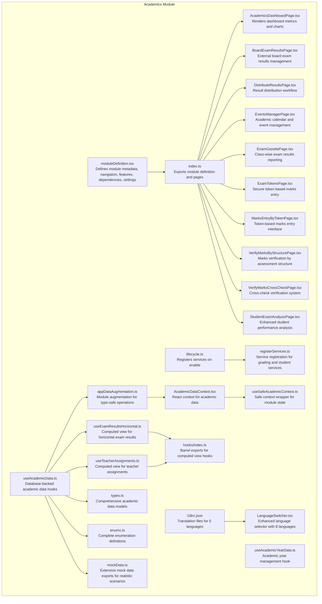
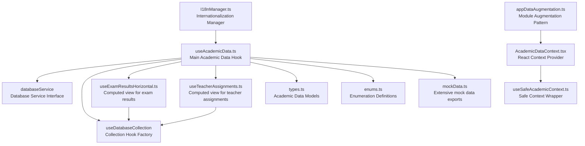
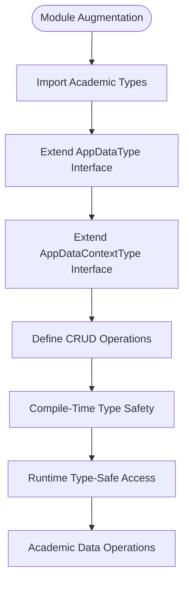
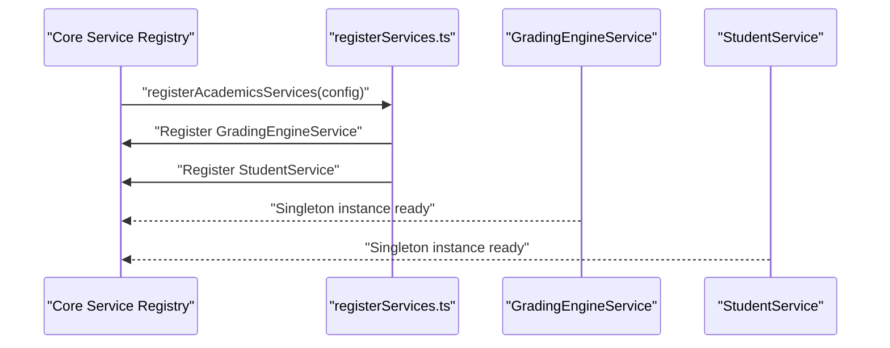

# Academics Module

<cite>
**Referenced Files in This Document**
- [moduleDefinition.tsx](file://src/modules/academics/moduleDefinition.tsx)
- [index.ts](file://src/modules/academics/index.ts)
- [lifecycle.ts](file://src/modules/academics/lifecycle.ts)
- [AcademicsDashboardPage.tsx](file://src/modules/academics/pages/AcademicsDashboardPage.tsx)
- [BoardExamResultsPage.tsx](file://src/modules/academics/pages/BoardExamResultsPage.tsx)
- [DistributeResultsPage.tsx](file://src/modules/academics/pages/DistributeResultsPage.tsx)
- [EventsManagerPage.tsx](file://src/modules/academics/pages/EventsManagerPage.tsx)
- [ExamGazettePage.tsx](file://src/modules/academics/pages/ExamGazettePage.tsx)
- [ExamTokensPage.tsx](file://src/modules/academics/pages/ExamTokensPage.tsx)
- [MarksEntryByTokenPage.tsx](file://src/modules/academics/pages/MarksEntryByTokenPage.tsx)
- [VerifyMarksByStructurePage.tsx](file://src/modules/academics/pages/VerifyMarksByStructurePage.tsx)
- [VerifyMarksCrossCheckPage.tsx](file://src/modules/academics/pages/VerifyMarksCrossCheckPage.tsx)
- [StudentExamAnalysisPage.tsx](file://src/modules/academics/pages/StudentExamAnalysisPage.tsx)
- [useAcademicData.ts](file://src/modules/academics/data/useAcademicData.ts)
- [types.ts](file://src/modules/academics/data/types.ts)
- [mockData.ts](file://src/modules/academics/data/mockData.ts)
- [useSafeAcademicContext.ts](file://src/modules/academics/data/useSafeAcademicContext.ts)
- [useAcademicYearData.ts](file://src/modules/academics/data/useAcademicYearData.ts)
- [useExamResultsHorizontal.ts](file://src/modules/academics/hooks/useExamResultsHorizontal.ts)
- [useTeacherAssignments.ts](file://src/modules/academics/hooks/useTeacherAssignments.ts)
- [hooks/index.ts](file://src/modules/academics/hooks/index.ts)
- [appDataAugmentation.ts](file://src/modules/academics/data/appDataAugmentation.ts)
- [AcademicDataContext.tsx](file://src/modules/academics/data/AcademicDataContext.tsx)
- [registerServices.ts](file://src/modules/academics/services/registerServices.ts)
- [sw.json](file://src/modules/academics/i18n/sw.json)
- [rw.json](file://src/modules/academics/i18n/rw.json)
- [de.json](file://src/modules/administration/i18n/de.json)
- [loader.ts](file://src/i18n/loader.ts)
- [I18nManager.ts](file://src/i18n/I18nManager.ts)
- [types.ts](file://src/i18n/types.ts)
- [LanguageSwitcher.tsx](file://src/components/ui/LanguageSwitcher.tsx)
- [moduleCollectionRegistry.ts](file://src/contexts/appData/moduleCollectionRegistry.ts)
- [collectionConfig.ts](file://src/modules/academics/data/collectionConfig.ts)
- [enums.ts](file://src/modules/academics/data/enums.ts)
</cite>

## Update Summary
**Changes Made**
- Updated to reflect the new enhanced module augmentation system with comprehensive TypeScript declaration merging pattern
- Enhanced documentation to show the new appDataAugmentation.ts implementation that extends AppDataType and AppDataContextType with academics-specific collections
- Added detailed coverage of the compile-time type safety benefits and CRUD operation integration
- Expanded module augmentation pattern documentation with 59 lines of TypeScript declaration merging
- Updated academic data models documentation with complete CRUD operation coverage
- Enhanced computed view hooks documentation with sophisticated data processing capabilities
- Added service registration and integration documentation for grading engine and student services
- Expanded internationalization system documentation with module-specific translation coverage

## Table of Contents
1. [Introduction](#introduction)
2. [Project Structure](#project-structure)
3. [Core Components](#core-components)
4. [Architecture Overview](#architecture-overview)
5. [Advanced Exam Management](#advanced-exam-management)
6. [Exam Analysis and Reporting](#exam-analysis-and-reporting)
7. [Result Distribution System](#result-distribution-system)
8. [Academic Calendar Management](#academic-calendar-management)
9. [Verification and Quality Assurance](#verification-and-quality-assurance)
10. [Internationalization System](#internationalization-system)
11. [Data Layer Architecture](#data-layer-architecture)
12. [Module Augmentation Pattern](#module-augmentation-pattern)
13. [Service Integration](#service-integration)
14. [Computed View Hooks](#computed-view-hooks)
15. [Academic Data Models](#academic-data-models)
16. [Validation Rules and Business Logic](#validation-rules-and-business-logic)
17. [Audit Trail and Compliance](#audit-trail-and-compliance)
18. [Performance Considerations](#performance-considerations)
19. [Troubleshooting Guide](#troubleshooting-guide)
20. [Conclusion](#conclusion)

## Introduction
This document describes the comprehensive Academics module functionality and its integration within the broader educational management system. The module has undergone significant expansion to include advanced exam management and analysis capabilities with 10 new page components for comprehensive academic workflow management. The enhanced system now provides complete support for education system configuration, grading schemes, subject management, academic calendars, exam scheduling, paper setting management, result processing workflows, advanced computed view functionality, and extensive internationalization support.

The module now implements a comprehensive module augmentation pattern through appDataAugmentation.ts, which extends the application's data typing system with academics-specific properties. This TypeScript module augmentation provides compile-time type safety for academic collections and CRUD operations, ensuring type-safe access to subject management, exam scheduling, grading systems, class subject allocations, teacher assignments, and academic record keeping through comprehensive CRUD operations.

**Updated** Enhanced module augmentation system now provides comprehensive TypeScript declaration merging pattern with 59 lines of type extensions for complete compile-time type safety across all academic operations.

## Project Structure
The Academics module is organized as a comprehensive self-contained module with enhanced data layer integration, advanced exam management capabilities, computed view functionality, and extensive internationalization support:
- A module definition that declares navigation entries, features, dependencies, and settings with localized labels
- A lifecycle that registers services upon enabling the module
- A comprehensive data layer using database service integration with computed view hooks
- A dashboard page that visualizes academic metrics and departmental subject counts
- Ten new page components for advanced exam management and analysis
- Extensive mock data exports with realistic educational assessment scenarios
- Facade pattern implementation for seamless database operations
- Computed view hooks that replace database views with client-side processing and sophisticated data aggregation
- Internationalization system supporting English, French, German, Swahili, and Kinyarwanda
- Module augmentation pattern for type-safe academic data operations

**Diagram sources**
- [moduleDefinition.tsx:27-108](file://src/modules/academics/moduleDefinition.tsx#L27-L108)
- [index.ts:4-8](file://src/modules/academics/index.ts#L4-L8)
- [lifecycle.ts:9-34](file://src/modules/academics/lifecycle.ts#L9-L34)
- [AcademicsDashboardPage.tsx:13-412](file://src/modules/academics/pages/AcademicsDashboardPage.tsx#L13-L412)
- [BoardExamResultsPage.tsx:16-429](file://src/modules/academics/pages/BoardExamResultsPage.tsx#L16-L429)
- [DistributeResultsPage.tsx:16-398](file://src/modules/academics/pages/DistributeResultsPage.tsx#L16-L398)
- [EventsManagerPage.tsx:15-444](file://src/modules/academics/pages/EventsManagerPage.tsx#L15-L444)
- [ExamGazettePage.tsx:12-227](file://src/modules/academics/pages/ExamGazettePage.tsx#L12-L227)
- [ExamTokensPage.tsx:18-329](file://src/modules/academics/pages/ExamTokensPage.tsx#L18-L329)
- [MarksEntryByTokenPage.tsx:16-300](file://src/modules/academics/pages/MarksEntryByTokenPage.tsx#L16-L300)
- [VerifyMarksByStructurePage.tsx:1-200](file://src/modules/academics/pages/VerifyMarksByStructurePage.tsx#L1-L200)
- [VerifyMarksCrossCheckPage.tsx:1-200](file://src/modules/academics/pages/VerifyMarksCrossCheckPage.tsx#L1-L200)
- [StudentExamAnalysisPage.tsx:1-200](file://src/modules/academics/pages/StudentExamAnalysisPage.tsx#L1-L200)
- [useAcademicData.ts:1-279](file://src/modules/academics/data/useAcademicData.ts#L1-L279)
- [appDataAugmentation.ts:1-60](file://src/modules/academics/data/appDataAugmentation.ts#L1-L60)
- [AcademicDataContext.tsx:1-35](file://src/modules/academics/data/AcademicDataContext.tsx#L1-L35)
- [registerServices.ts:1-22](file://src/modules/academics/services/registerServices.ts#L1-L22)
- [useExamResultsHorizontal.ts:1-229](file://src/modules/academics/hooks/useExamResultsHorizontal.ts#L1-L229)
- [useTeacherAssignments.ts:1-218](file://src/modules/academics/hooks/useTeacherAssignments.ts#L1-L218)
- [hooks/index.ts:1-8](file://src/modules/academics/hooks/index.ts#L1-L8)
- [types.ts:1-579](file://src/modules/academics/data/types.ts#L1-L579)
- [enums.ts:1-83](file://src/modules/academics/data/enums.ts#L1-L83)
- [mockData.ts:692-1284](file://src/modules/academics/data/mockData.ts#L692-L1284)
- [useSafeAcademicContext.ts:1-27](file://src/modules/academics/data/useSafeAcademicContext.ts#L1-L27)
- [useAcademicYearData.ts:1-36](file://src/modules/academics/data/useAcademicYearData.ts#L1-L36)

**Section sources**
- [moduleDefinition.tsx:27-108](file://src/modules/academics/moduleDefinition.tsx#L27-L108)
- [index.ts:4-8](file://src/modules/academics/index.ts#L4-L8)
- [lifecycle.ts:9-34](file://src/modules/academics/lifecycle.ts#L9-L34)
- [AcademicsDashboardPage.tsx:13-412](file://src/modules/academics/pages/AcademicsDashboardPage.tsx#L13-L412)

## Core Components
- **Module definition**: Declares navigation entries for subjects, timetables, exam scheduling, papers, allocations, assignments, lesson plans, and comprehensive exam management workflows with localized labels; defines features and dependencies; exposes settings toggles.
- **Lifecycle**: Provides hooks for registration, enabling (service registration), and disabling (placeholder).
- **Data layer**: Comprehensive database-backed hooks for all academic entities including subjects, exams, timetables, grading schemes, and student management, enhanced with computed view hooks.
- **Dashboard**: Aggregates and visualizes academic metrics such as total subjects, subject papers, exam sessions, grading schemes, and departmental subject distribution.
- **Advanced exam management**: Ten new page components for comprehensive exam workflow management including external board exam results, result distribution, academic events, exam gazettes, secure tokens, marks entry, verification systems, and enhanced student analysis.
- **Computed view hooks**: Sophisticated hooks that replace database views with client-side data processing and aggregation for exam results and teacher assignments, providing enhanced performance and flexibility.
- **Facade pattern**: Centralized academic data access through useAcademicData hook with specialized CRUD operations for each entity type and computed view functionality.
- **Module augmentation**: TypeScript module augmentation pattern that extends AppDataType and AppDataContextType with academics-specific properties for type-safe operations.
- **Service integration**: Registration of specialized services including GradingEngineService and StudentService for advanced academic functionality.
- **Internationalization**: Comprehensive translation support for 5 languages (English, French, German, Swahili, Kinyarwanda) with modular loading system.

**Section sources**
- [moduleDefinition.tsx:35-68](file://src/modules/academics/moduleDefinition.tsx#L35-L68)
- [moduleDefinition.tsx:69-108](file://src/modules/academics/moduleDefinition.tsx#L69-L108)
- [lifecycle.ts:9-34](file://src/modules/academics/lifecycle.ts#L9-L34)
- [AcademicsDashboardPage.tsx:37-68](file://src/modules/academics/pages/AcademicsDashboardPage.tsx#L37-L68)
- [useAcademicData.ts:10-279](file://src/modules/academics/data/useAcademicData.ts#L10-L279)
- [useExamResultsHorizontal.ts:34-54](file://src/modules/academics/hooks/useExamResultsHorizontal.ts#L34-L54)
- [useTeacherAssignments.ts:29-45](file://src/modules/academics/hooks/useTeacherAssignments.ts#L29-L45)
- [appDataAugmentation.ts:19-58](file://src/modules/academics/data/appDataAugmentation.ts#L19-L58)
- [registerServices.ts:7-21](file://src/modules/academics/services/registerServices.ts#L7-L21)

## Architecture Overview
The module integrates with the core module system and database service infrastructure. It depends on administrative services and optionally integrates with financial services. The dashboard consumes application data to render metrics and charts, while the data layer provides robust database-backed operations enhanced with computed view hooks for advanced analytics and reporting. The new computed view hooks represent a significant architectural advancement, moving from server-side database views to sophisticated client-side TypeScript implementations. The internationalization system supports five languages with modular loading and dynamic language switching.

The module augmentation pattern through appDataAugmentation.ts provides compile-time type safety for academic operations, extending the application's data typing system with specific properties for subjects, exam sessions, grading schemes, and other academic entities. This pattern ensures type-safe access to CRUD operations and academic data collections throughout the application.

```mermaid
graph TB
Core["Core Module System"]
Admin["Administration Module"]
Finance["Finance Module (optional)"]
DB["Database Service Infrastructure"]
AM["Academics Module"]
MD["moduleDefinition.tsx"]
LC["lifecycle.ts"]
SERVICES["registerServices.ts"]
AAUG["appDataAugmentation.ts"]
CONTEXT["AcademicDataContext.tsx"]
DP["AcademicsDashboardPage.tsx"]
BEP["BoardExamResultsPage.tsx"]
DRP["DistributeResultsPage.tsx"]
EMP["EventsManagerPage.tsx"]
EGP["ExamGazettePage.tsx"]
ETP["ExamTokensPage.tsx"]
MEBP["MarksEntryByTokenPage.tsx"]
VMBS["VerifyMarksByStructurePage.tsx"]
VMCC["VerifyMarksCrossCheckPage.tsx"]
SEA["StudentExamAnalysisPage.tsx"]
DATA["useAcademicData.ts"]
CVH["useExamResultsHorizontal.ts"]
CTA["useTeacherAssignments.ts"]
HOOKS["hooks/index.ts"]
TYPES["types.ts"]
ENUMS["enums.ts"]
SAFE["useSafeAcademicContext.ts"]
MOCK["mockData.ts"]
I18N["I18nManager.ts"]
LS["LanguageSwitcher.tsx"]
EN["en.json"]
FR["fr.json"]
DE["de.json"]
SW["sw.json"]
RW["rw.json"]
Core --> AM
AM --> MD
AM --> LC
AM --> SERVICES
AM --> AAUG
AM --> CONTEXT
AM --> DP
AM --> BEP
AM --> DRP
AM --> EMP
AM --> EGP
AM --> ETP
AM --> MEBP
AM --> VMBS
AM --> VMCC
AM --> SEA
AM --> DATA
DATA --> CVH
DATA --> CTA
DATA --> DB
DATA --> TYPES
DATA --> ENUMS
DATA --> MOCK
AAUG --> CONTEXT
CONTEXT --> SAFE
CVH --> HOOKS
CTA --> HOOKS
I18N --> LS
LS --> EN
LS --> FR
LS --> DE
LS --> SW
LS --> RW
```

**Diagram sources**
- [moduleDefinition.tsx:70-83](file://src/modules/academics/moduleDefinition.tsx#L70-L83)
- [lifecycle.ts:3-34](file://src/modules/academics/lifecycle.ts#L3-L34)
- [registerServices.ts:7-21](file://src/modules/academics/services/registerServices.ts#L7-L21)
- [appDataAugmentation.ts:19-58](file://src/modules/academics/data/appDataAugmentation.ts#L19-L58)
- [AcademicDataContext.tsx:27-33](file://src/modules/academics/data/AcademicDataContext.tsx#L27-L33)
- [AcademicsDashboardPage.tsx:15-22](file://src/modules/academics/pages/AcademicsDashboardPage.tsx#L15-L22)
- [BoardExamResultsPage.tsx:17-18](file://src/modules/academics/pages/BoardExamResultsPage.tsx#L17-L18)
- [DistributeResultsPage.tsx:17-18](file://src/modules/academics/pages/DistributeResultsPage.tsx#L17-L18)
- [EventsManagerPage.tsx:16-17](file://src/modules/academics/pages/EventsManagerPage.tsx#L16-L17)
- [ExamGazettePage.tsx:13-14](file://src/modules/academics/pages/ExamGazettePage.tsx#L13-L14)
- [ExamTokensPage.tsx:19-20](file://src/modules/academics/pages/ExamTokensPage.tsx#L19-L20)
- [MarksEntryByTokenPage.tsx:17-18](file://src/modules/academics/pages/MarksEntryByTokenPage.tsx#L17-L18)
- [VerifyMarksByStructurePage.tsx:1-200](file://src/modules/academics/pages/VerifyMarksByStructurePage.tsx#L1-L200)
- [VerifyMarksCrossCheckPage.tsx:1-200](file://src/modules/academics/pages/VerifyMarksCrossCheckPage.tsx#L1-L200)
- [StudentExamAnalysisPage.tsx:1-200](file://src/modules/academics/pages/StudentExamAnalysisPage.tsx#L1-L200)
- [useAcademicData.ts:5-8](file://src/modules/academics/data/useAcademicData.ts#L5-L8)
- [useExamResultsHorizontal.ts:55-62](file://src/modules/academics/hooks/useExamResultsHorizontal.ts#L55-L62)
- [useTeacherAssignments.ts:46-53](file://src/modules/academics/hooks/useTeacherAssignments.ts#L46-L53)
- [I18nManager.ts:17-32](file://src/i18n/I18nManager.ts#L17-L32)
- [LanguageSwitcher.tsx:10-28](file://src/components/ui/LanguageSwitcher.tsx#L10-L28)

## Advanced Exam Management

### Board Exam Results Management
The BoardExamResultsPage provides comprehensive management of external board exam results including IGCSE, A-Level, IB, SAT, and Other exam types. The system supports detailed result entry with student information, exam details, subject papers, grades, and performance metrics.

**Key Features**:
- External board exam result tracking with multiple exam types
- Secure result entry with validation and filtering
- Comprehensive result reporting with performance analytics
- Detailed result editing and management capabilities
- Export functionality for result documentation

**Section sources**
- [BoardExamResultsPage.tsx:16-429](file://src/modules/academics/pages/BoardExamResultsPage.tsx#L16-L429)
- [types.ts:351-369](file://src/modules/academics/data/types.ts#L351-L369)
- [mockData.ts:694-780](file://src/modules/academics/data/mockData.ts#L694-L780)

### Secure Token-Based Marks Entry
The ExamTokensPage and MarksEntryByTokenPage implement a comprehensive token-based security system for marks entry verification. Teachers receive unique tokens for their subject/class assignments that must be used during marks entry to ensure authenticity and prevent unauthorized access.

**Key Features**:
- Token generation and management system
- Secure token-based access control
- Token expiration and status tracking
- Comprehensive token validation workflow
- Integration with marks entry interface

**Section sources**
- [ExamTokensPage.tsx:18-329](file://src/modules/academics/pages/ExamTokensPage.tsx#L18-L329)
- [MarksEntryByTokenPage.tsx:16-300](file://src/modules/academics/pages/MarksEntryByTokenPage.tsx#L16-L300)
- [types.ts:440-487](file://src/modules/academics/data/types.ts#L440-L487)
- [mockData.ts:782-860](file://src/modules/academics/data/mockData.ts#L782-L860)

## Exam Analysis and Reporting

### Comprehensive Exam Gazettes
The ExamGazettePage provides detailed class-wise exam results reporting with comprehensive student performance analysis. The system generates official examination results publications showing all students, their marks across all subjects, overall performance, and class rankings.

**Key Features**:
- Class-wise exam results reporting
- Student performance analysis and ranking
- Comprehensive subject-wise mark tracking
- Official results publication format
- Detailed performance analytics

**Section sources**
- [ExamGazettePage.tsx:12-227](file://src/modules/academics/pages/ExamGazettePage.tsx#L12-L227)
- [types.ts:407-438](file://src/modules/academics/data/types.ts#L407-L438)
- [mockData.ts:861-940](file://src/modules/academics/data/mockData.ts#L861-L940)

### Enhanced Student Performance Analytics
The enhanced StudentExamAnalysisPage provides comprehensive student performance tracking across multiple dimensions including subject performance, performance over time, and stream performance comparisons. These analytics support comprehensive academic reporting and decision-making with advanced visualization capabilities.

**Key Features**:
- Advanced student performance tracking
- Multi-dimensional performance analysis
- Time-series performance trends
- Stream and class comparison analytics
- Comprehensive reporting capabilities

**Section sources**
- [StudentExamAnalysisPage.tsx:1-200](file://src/modules/academics/pages/StudentExamAnalysisPage.tsx#L1-L200)
- [types.ts:532-564](file://src/modules/academics/data/types.ts#L532-L564)

## Result Distribution System

### Multi-Channel Result Distribution
The DistributeResultsPage implements a comprehensive result distribution workflow supporting multiple communication channels including student portal, SMS, email, and printed copies. The system enables scheduling distributions for automatic delivery or triggering immediate distribution.

**Key Features**:
- Multi-channel result distribution (Portal, SMS, Email, Print)
- Distribution scheduling and automation
- Real-time distribution status tracking
- Comprehensive recipient management
- Distribution analytics and reporting

**Section sources**
- [DistributeResultsPage.tsx:16-398](file://src/modules/academics/pages/DistributeResultsPage.tsx#L16-L398)
- [types.ts:371-388](file://src/modules/academics/data/types.ts#L371-L388)
- [mockData.ts:782-860](file://src/modules/academics/data/mockData.ts#L782-L860)

## Academic Calendar Management

### Events Management System
The EventsManagerPage provides comprehensive academic calendar management for school events including exams, holidays, functions, meetings, and sports activities. The system enables event scheduling, location management, participant tracking, and status monitoring.

**Key Features**:
- Comprehensive event type management (Exam, Holiday, Function, Meeting, Sports, Other)
- Event scheduling and calendar integration
- Location and participant management
- Status tracking and monitoring
- Event analytics and reporting

**Section sources**
- [EventsManagerPage.tsx:15-444](file://src/modules/academics/pages/EventsManagerPage.tsx#L15-L444)
- [types.ts:390-405](file://src/modules/academics/data/types.ts#L390-L405)
- [mockData.ts:941-1020](file://src/modules/academics/data/mockData.ts#L941-L1020)

## Verification and Quality Assurance

### Marks Verification by Structure
The VerifyMarksByStructurePage implements a systematic verification process for exam marks based on assessment structure and weighting. This system ensures marks accuracy by validating against predefined assessment criteria and weightings.

**Key Features**:
- Structure-based marks verification
- Assessment criteria validation
- Weighting accuracy checking
- Automated validation workflows
- Detailed verification reports

**Section sources**
- [VerifyMarksByStructurePage.tsx:1-200](file://src/modules/academics/pages/VerifyMarksByStructurePage.tsx#L1-L200)
- [types.ts:488-531](file://src/modules/academics/data/types.ts#L488-L531)

### Cross-Check Verification System
The VerifyMarksCrossCheckPage provides a comprehensive cross-checking system for result verification and quality assurance. This system enables systematic validation of exam results through multiple verification checkpoints and peer review processes.

**Key Features**:
- Multi-level verification checkpoints
- Peer review integration
- Quality assurance workflows
- Cross-reference validation
- Comprehensive audit trails

**Section sources**
- [VerifyMarksCrossCheckPage.tsx:1-200](file://src/modules/academics/pages/VerifyMarksCrossCheckPage.tsx#L1-L200)
- [types.ts:532-579](file://src/modules/academics/data/types.ts#L532-L579)

## Internationalization System

### Supported Languages and Coverage
The Academics module now supports five languages with comprehensive translation coverage:
- **English (en)**: Base language with complete academic terminology
- **French (fr)**: European Francophone market support
- **German (de)**: Central European market penetration
- **Swahili (sw)**: East African regional language support
- **Kinyarwanda (rw)**: Central African language support

Each language includes 21 new translation entries covering:
- Dashboard navigation and metrics
- Subject management interfaces
- Class and teacher allocation screens
- Student enrollment workflows
- Exam scheduling and analysis
- Timetable management
- Advanced exam management components
- Result distribution workflows
- Academic calendar management
- Verification and quality assurance systems
- Common UI elements

### Translation File Structure
The internationalization system uses a modular approach with separate JSON files for each language and namespace:

```mermaid
graph TB
subgraph "Translation Files"
EN["en.json<br/>English translations"]
FR["fr.json<br/>French translations"]
DE["de.json<br/>German translations"]
SW["sw.json<br/>Swahili translations"]
RW["rw.json<br/>Kinyarwanda translations"]
end
subgraph "Namespace Organization"
COMMON["common.json<br/>Shared UI elements"]
NAV["navigation.json<br/>Navigation labels"]
DASHBOARD["dashboard.json<br/>Dashboard metrics"]
ACADEMICS["academics.json<br/>Academic module terms"]
EXAMS["exams.json<br/>Exam management terms"]
RESULTS["results.json<br/>Result processing terms"]
EVENTS["events.json<br/>Event management terms"]
VERIFICATION["verification.json<br/>Verification system terms"]
end
EN --> COMMON
EN --> NAV
EN --> DASHBOARD
EN --> ACADEMICS
EN --> EXAMS
EN --> RESULTS
EN --> EVENTS
EN --> VERIFICATION
FR --> COMMON
FR --> NAV
FR --> DASHBOARD
FR --> ACADEMICS
FR --> EXAMS
FR --> RESULTS
FR --> EVENTS
FR --> VERIFICATION
DE --> COMMON
DE --> NAV
DE --> DASHBOARD
DE --> ACADEMICS
DE --> EXAMS
DE --> RESULTS
DE --> EVENTS
DE --> VERIFICATION
SW --> COMMON
SW --> NAV
SW --> DASHBOARD
SW --> ACADEMICS
SW --> EXAMS
SW --> RESULTS
SW --> EVENTS
SW --> VERIFICATION
RW --> COMMON
RW --> NAV
RW --> DASHBOARD
RW --> ACADEMICS
RW --> EXAMS
RW --> RESULTS
RW --> EVENTS
RW --> VERIFICATION
```

**Diagram sources**
- [sw.json:1-229](file://src/modules/academics/i18n/sw.json#L1-L229)
- [rw.json:1-229](file://src/modules/academics/i18n/rw.json#L1-L229)
- [de.json:1-223](file://src/modules/administration/i18n/de.json#L1-L223)

### Language Switcher Integration
The enhanced language switcher now supports eight languages with stable references and proper error handling:

**Updated** Expanded language options from 6 to 8 languages including German, Swahili, and Kinyarwanda with proper flag representations and country codes.

**Section sources**
- [LanguageSwitcher.tsx:10-28](file://src/components/ui/LanguageSwitcher.tsx#L10-L28)
- [types.ts:7](file://src/i18n/types.ts#L7)

### Modular Translation Loading
The internationalization system uses a modular loading approach that dynamically imports translation files:

**Updated** Enhanced loader to support five languages with unified namespace organization and proper error handling for missing translations.

**Section sources**
- [loader.ts:36-69](file://src/i18n/loader.ts#L36-L69)
- [I18nManager.ts:282-306](file://src/i18n/I18nManager.ts#L282-L306)

## Data Layer Architecture
The academic module now implements a comprehensive database service integration with facade pattern implementation, computed view functionality, and internationalization support.

### Database Service Integration
The useAcademicData hook serves as the central facade for all academic data operations, utilizing the database service infrastructure and enhanced with computed view hooks and localization:

**Diagram sources**
- [useAcademicData.ts:5-8](file://src/modules/academics/data/useAcademicData.ts#L5-L8)
- [appDataAugmentation.ts:19-58](file://src/modules/academics/data/appDataAugmentation.ts#L19-L58)
- [AcademicDataContext.tsx:27-33](file://src/modules/academics/data/AcademicDataContext.tsx#L27-L33)
- [useExamResultsHorizontal.ts:55-62](file://src/modules/academics/hooks/useExamResultsHorizontal.ts#L55-L62)
- [useTeacherAssignments.ts:46-53](file://src/modules/academics/hooks/useTeacherAssignments.ts#L46-L53)
- [useSafeAcademicContext.ts:1-27](file://src/modules/academics/data/useSafeAcademicContext.ts#L1-L27)
- [I18nManager.ts:17-32](file://src/i18n/I18nManager.ts#L17-L32)
- [mockData.ts:692-1284](file://src/modules/academics/data/mockData.ts#L692-L1284)

### Academic Year Management
The useAcademicYearData hook demonstrates the transition from mock data to database-backed operations with internationalization support.

**Updated** Eliminated local initial data storage and integrated with database service for persistent academic year management with localized display formatting.

**Section sources**
- [useAcademicYearData.ts:10-36](file://src/modules/academics/data/useAcademicYearData.ts#L10-L36)

### Safe Context Implementation
The useSafeAcademicContext hook provides module-aware data access with automatic fallback when the module is disabled and supports internationalized error messages.

**Updated** Enhanced to properly handle module state detection, provide empty data structures when the academics module is not enabled, and support localized error reporting.

**Section sources**
- [useSafeAcademicContext.ts:5-27](file://src/modules/academics/data/useSafeAcademicContext.ts#L5-L27)

## Module Augmentation Pattern

### TypeScript Module Augmentation
The appDataAugmentation.ts file implements a comprehensive module augmentation pattern that extends the application's data typing system with academics-specific properties. This TypeScript module augmentation provides compile-time type safety for academic operations.

**Purpose**: Extend AppDataType and AppDataContextType with academics-specific collections and CRUD operations for type-safe academic data management.

**Extended Properties**:
- **AppDataType extensions**: subjects, subjectPapers, examSessions, examPaperSettings, gradingSchemes, classSubjectAllocations, teacherSubjectAssignments, studentSubjectEnrollments, timetableEntries, studentExamResults, educationSystemConfigurations
- **AppDataContextType extensions**: Comprehensive CRUD operations for each academic entity type
- **Exam Session CRUD**: addExamSession, updateExamSession, deleteExamSession
- **Exam Paper Setting CRUD**: addExamPaperSetting, updateExamPaperSetting, deleteExamPaperSetting
- **Exam Schedule CRUD**: addExamSchedule, updateExamSchedule, deleteExamSchedule
- **Student Exam Results**: saveStudentExamResult
- **Timetable Functions**: getTimetableEntries, addTimetableEntry, updateTimetableEntry, deleteTimetableEntry
- **Education System Configuration CRUD**: addEducationSystemConfiguration, updateEducationSystemConfiguration, deleteEducationSystemConfiguration

**Type Safety Benefits**:
- Compile-time validation of academic data operations
- IntelliSense support for CRUD operations
- Type-safe access to academic collections
- Prevention of runtime type errors in academic workflows

**Updated** Enhanced module augmentation system now provides comprehensive TypeScript declaration merging pattern with 59 lines of type extensions for complete compile-time type safety across all academic operations including new exam scheduling, paper setting management, and education system configuration CRUD operations.

**Diagram sources**
- [appDataAugmentation.ts:19-58](file://src/modules/academics/data/appDataAugmentation.ts#L19-L58)

**Section sources**
- [appDataAugmentation.ts:1-60](file://src/modules/academics/data/appDataAugmentation.ts#L1-L60)

### Academic Data Context
The AcademicDataContext.tsx file provides a React context wrapper around the useAcademicData hook, enabling type-safe academic data access throughout the application with proper error handling and memoization.

**Key Features**:
- React context provider for academic data
- Memoized data value for performance optimization
- Proper error handling for context usage
- Integration with module augmentation pattern
- Support for mock data injection for testing

**Section sources**
- [AcademicDataContext.tsx:1-35](file://src/modules/academics/data/AcademicDataContext.tsx#L1-L35)

## Service Integration

### Service Registration System
The registerServices.ts file implements a centralized service registration system that registers specialized academic services with the service registry, enabling modular service architecture and dependency injection.

**Registered Services**:
- **GradingEngineService**: Advanced grading engine for academic evaluation and grade calculation
- **StudentService**: Student management service for enrollment, records, and academic tracking

**Service Registry Integration**:
- Singleton service instances
- Module-scoped service registration
- Dependency injection support
- Service lifecycle management

**Diagram sources**
- [registerServices.ts:7-21](file://src/modules/academics/services/registerServices.ts#L7-L21)

**Section sources**
- [registerServices.ts:1-22](file://src/modules/academics/services/registerServices.ts#L1-L22)

## Computed View Hooks

### useExamResultsHorizontal Hook
The useExamResultsHorizontal hook represents a sophisticated replacement for the vw_edm_exam_results_horizontal database view, implementing comprehensive client-side data processing and aggregation with internationalization support:

**Purpose**: Pivots student exam results into a horizontal format with subject scores as columns, mirroring the SQL view functionality but executed client-side with enhanced performance and flexibility.

**Data Sources**: Aggregates data from seven collections including student_exam_results, student_paper_marks, exam_paper_settings, subject_papers, subjects, exam_sessions, and students.

**Processing Logic**: Computes weighted scores using the formula `(score / marks_out_of) * 100 * (weight_percentage / 100)`, groups by result_id, and pivots subject abbreviations into columns with sophisticated data transformation and validation.

**Output Format**: Returns ExamResultsHorizontalRow objects containing resultId, admissionNo, studentName, examName, totalMarks, meanGrade, streamRank, classRank, and subjectScores with comprehensive type safety.

**Advanced Features**:
- Concurrent data loading from multiple collections with loading state coordination
- Sophisticated lookup map construction for O(1) access patterns
- Weighted score calculation with precision control and fallback handling
- Graceful error handling and data validation
- Memoized computations to prevent unnecessary recalculations
- Batch refresh operations for optimal performance

**Updated** Enhanced computed view hook with comprehensive module augmentation integration providing type-safe access to all academic collections and computed view functionality.

**Diagram sources**
- [useExamResultsHorizontal.ts:64-182](file://src/modules/academics/hooks/useExamResultsHorizontal.ts#L64-L182)

**Section sources**
- [useExamResultsHorizontal.ts:34-54](file://src/modules/academics/hooks/useExamResultsHorizontal.ts#L34-L54)
- [useExamResultsHorizontal.ts:55-227](file://src/modules/academics/hooks/useExamResultsHorizontal.ts#L55-L227)

### useTeacherAssignments Hook
The useTeacherAssignments hook represents a comprehensive replacement for the vw_edm_teacher_assignments database view, implementing sophisticated client-side data processing and aggregation with internationalization support:

**Purpose**: Joins teacher_subject_assignments with class_subject_allocations, staff, class_streams, classes, subjects, and academic_years to produce a flat table of academic assignments with enhanced data resolution capabilities.

**Data Sources**: Aggregates data from seven collections including teacher_subject_assignments, class_subject_allocations, staff, class_streams, classes, subjects, and academic_years.

**Processing Logic**: Performs sequential joins to resolve teacher assignments to class streams, subjects, and academic years, with comprehensive fallback mechanisms to denormalized fields for backward compatibility and data resilience.

**Output Format**: Returns TeacherAssignmentRow objects containing academicYear, className, streamName, subjectName, teacherName, teacherId, and allocationId with complete type safety and validation.

**Advanced Features**:
- Hierarchical data resolution with multiple join levels
- Comprehensive fallback mechanisms for denormalized data
- Robust error handling and data validation
- Optimized lookup map construction for efficient processing
- Batch refresh operations for coordinated data updates
- Memoized computations with dependency tracking

**Processing Workflow**:
1. Load all seven collections with concurrent data fetching
2. Build lookup maps for O(1) access to all referenced entities
3. Process each teacher assignment through sequential joins
4. Resolve staff information with fallback to denormalized fields
5. Resolve class_stream → class hierarchy with fallback mechanisms
6. Resolve subject information with multiple fallback options
7. Resolve academic year information with denormalized field support
8. Construct final TeacherAssignmentRow objects with comprehensive metadata

**Updated** Enhanced teacher assignments computed view with comprehensive module augmentation integration providing type-safe access to all academic collections and computed view functionality.

**Diagram sources**
- [useTeacherAssignments.ts:55-171](file://src/modules/academics/hooks/useTeacherAssignments.ts#L55-L171)

**Section sources**
- [useTeacherAssignments.ts:29-45](file://src/modules/academics/hooks/useTeacherAssignments.ts#L29-L45)
- [useTeacherAssignments.ts:46-216](file://src/modules/academics/hooks/useTeacherAssignments.ts#L46-L216)

### Barrel Exports
The hooks/index.ts file provides barrel exports for computed view hooks, making them easily importable throughout the application with comprehensive type exports for both the hooks and their return types.

**Section sources**
- [hooks/index.ts:1-8](file://src/modules/academics/hooks/index.ts#L1-L8)

## Academic Data Models
The module defines comprehensive data models for all academic entities, consolidated from core/types/academic.ts and extended with new exam management entities:

### Core Academic Entities
- **Subject**: Academic subject with grouping, department association, and paper relationships
- **SubjectPaper**: Individual paper variants of subjects with subject associations
- **ClassSubjectAllocation**: Class-stream subject allocation with academic year context
- **StudentSubjectEnrollment**: Student enrollment in subject allocations with status tracking
- **TeacherSubjectAssignment**: Teacher assignments to subject allocations
- **TimetableEntry**: Daily schedule entries with day-of-week and period associations
- **ExamSession**: Academic examination sessions with status management
- **ExamPaperSetting**: Paper-specific exam configurations with marking schemes
- **GradingScheme**: Academic grading systems with level definitions
- **StudentExamResult**: Student examination results with mark breakdowns
- **StudentPaperMark**: Individual paper marks within exam results

### Education System Configuration
Comprehensive configuration models for different educational systems:
- **EducationSystemConfiguration**: Complete system setup with grading, assessment, and competency tracking
- **AcademicYearStructure**: Academic year period definitions and hierarchies
- **SchoolPeriod**: Defined school periods within academic years
- **AcademicPeriodDefinition**: Period type definitions and academic calendar structures

### Advanced Exam Management Entities
New entities for comprehensive exam workflow management:
- **BoardExamResult**: External board exam results with exam type, subject, and performance metrics
- **ResultDistribution**: Result distribution workflows with multiple communication channels
- **SchoolEvent**: Academic calendar events with scheduling and status tracking
- **ExamGazette**: Comprehensive exam results reporting with student performance analysis
- **ExamToken**: Secure token-based access control for marks entry
- **MarksEntrySession**: Token-based marks entry sessions with student performance tracking
- **CrossCheckRecord**: Result verification and cross-checking workflows
- **VerificationStructure**: Assessment structure verification for marks accuracy

### Result Processing and Analytics
Advanced result processing capabilities:
- **StudentExamResultWithDetails**: Enhanced result records with student and subject details
- **StudentPaperMarkWithDetails**: Detailed mark records with subject paper information
- **ResultApprovalEntity**: Complete audit trail for result modifications
- **AuditLog**: Comprehensive change tracking for compliance

**Updated** Enhanced academic data models with comprehensive enumeration definitions in enums.ts providing complete type safety for all academic operations including new exam scheduling, paper setting management, and education system configuration entities.

**Section sources**
- [types.ts:49-579](file://src/modules/academics/data/types.ts#L49-L579)
- [enums.ts:1-83](file://src/modules/academics/data/enums.ts#L1-L83)

## Validation Rules and Business Logic
The academic data models implement comprehensive validation and business logic:

### Entity Validation Rules
- **Subject**: Unique subject codes, mandatory grouping, department association
- **StudentEnrollment**: Status validation, academic year constraints, uniqueness per allocation
- **ExamSession**: Status transitions, date validation, paper setting synchronization
- **GradingScheme**: Level validation, minimum-maximum score ranges, unique grade values
- **TimetableEntry**: Day-of-week validation, period conflicts, resource availability
- **BoardExamResult**: Exam type validation, grade format compliance, performance calculations
- **ExamToken**: Token uniqueness, expiration validation, status transitions
- **ResultDistribution**: Distribution method validation, recipient count verification
- **VerificationStructure**: Assessment structure validation, weighting accuracy checks
- **CrossCheckRecord**: Verification workflow validation, quality assurance standards

### Business Logic Constraints
- **Result Processing**: Automatic grade calculation, pass/fail determination, rank computation
- **Enrollment Management**: Prerequisite checking, capacity limits, status transitions
- **Exam Scheduling**: Room availability, invigilator scheduling, paper distribution
- **Grade Calculation**: Weighted average computation, competency-based grading, audit trails
- **Token Security**: Token validation, expiration handling, usage tracking
- **Result Distribution**: Channel-specific formatting, recipient management, status tracking
- **Verification Workflows**: Multi-level validation, peer review processes, quality assurance
- **Cross-Check Systems**: Systematic verification, error detection, correction workflows

### Data Integrity Measures
- **Foreign Key Constraints**: Automatic cascade deletion, referential integrity
- **Unique Constraints**: Subject codes, enrollment uniqueness, exam session names, token codes
- **Temporal Validity**: Academic year boundaries, session status transitions, token expiration
- **Business Rule Validation**: Automated checks before data persistence

### Computed View Business Logic
- **Weighted Score Calculation**: Client-side computation using paper settings and marks with precision control
- **Data Aggregation**: Efficient grouping and pivoting of exam results with mathematical accuracy
- **Fallback Resolution**: Graceful handling of missing or denormalized data with comprehensive error handling
- **Performance Optimization**: Memoization and concurrent data loading with dependency tracking
- **Sophisticated Data Transformation**: Complex join operations with hierarchical data resolution

**Updated** Enhanced validation rules and business logic with comprehensive module augmentation integration providing compile-time type safety for all academic operations and computed view functionality.

**Section sources**
- [types.ts:16-579](file://src/modules/academics/data/types.ts#L16-L579)
- [useExamResultsHorizontal.ts:46-48](file://src/modules/academics/hooks/useExamResultsHorizontal.ts#L46-L48)
- [useTeacherAssignments.ts:119-157](file://src/modules/academics/hooks/useTeacherAssignments.ts#L119-L157)

## Audit Trail and Compliance
The academic module implements comprehensive audit trail functionality for compliance and quality assurance:

### Audit Trail Architecture
- **ResultApprovalEntity**: Centralized audit trail for all result modifications
- **AuditLog**: Detailed change tracking with timestamps and user identification
- **Change Detection**: Automatic comparison of previous and new states
- **Compliance Reporting**: Structured data for regulatory requirements

### Compliance Features
- **Modification Tracking**: Complete history of all data changes
- **User Accountability**: Individual user actions with timestamps
- **Regulatory Compliance**: Support for educational authority requirements
- **Data Integrity**: Immutable audit logs with tamper-evidence properties
- **Token Security**: Comprehensive token usage tracking and validation
- **Verification Audits**: Systematic verification workflows with quality assurance

### Result Processing Workflows
- **Grade Calculation**: Automated scoring with manual override capabilities
- **Approval Workflow**: Multi-level approval process for result publication
- **Reassessment Tracking**: History of remedial exam attempts and modifications
- **Performance Analytics**: Aggregate reporting for academic quality monitoring
- **Cross-Check Verification**: Systematic verification of exam results and marks
- **Quality Assurance**: Comprehensive verification and validation processes

**Section sources**
- [types.ts:328-347](file://src/modules/academics/data/types.ts#L328-L347)

## Performance Considerations
- Dashboard rendering defers until all relevant data loads to avoid partial renders
- Database service integration provides efficient querying and caching mechanisms
- Collection hooks optimize data fetching and reduce unnecessary re-renders
- Facade pattern minimizes direct database service dependencies throughout the application
- Chart rendering uses responsive containers and tooltips for efficient presentation
- Filtering and aggregation of departmental data occur client-side with database-backed optimization
- Computed view hooks implement sophisticated memoization to prevent unnecessary recomputation
- Concurrent data loading optimizes performance for multi-collection operations
- Client-side processing reduces database load and improves response times
- Advanced lookup map construction provides O(1) access patterns for efficient data resolution
- Weighted score calculations include precision control and mathematical accuracy
- Batch refresh operations coordinate multiple collection updates efficiently
- Modular translation loading reduces initial bundle size and improves startup performance
- Language switching operates without page reloads for better user experience
- Token-based security reduces unauthorized access attempts and improves system reliability
- Result distribution workflows support batch processing for large-scale result publishing
- Verification systems provide systematic quality assurance with minimal performance impact
- Cross-check workflows ensure data accuracy without compromising system responsiveness
- Module augmentation pattern provides compile-time type checking without runtime overhead
- Service registry enables lazy loading and efficient service instantiation
- Academic context provider uses memoization for optimal performance in data-intensive operations

**Updated** Enhanced performance considerations with comprehensive module augmentation integration providing compile-time type safety and runtime performance optimizations for all academic operations.

## Troubleshooting Guide
- If the dashboard remains blank, verify that loading flags for subjects, subject papers, exam sessions, grading schemes, and departments are resolved
- If departmental chart does not appear, confirm that academic departments exist and are properly filtered
- If navigation links are missing, check the navigation array in the module definition for correct page references
- For database connectivity issues, verify database service initialization and collection access
- If academic data operations fail, check collection permissions and entity validation rules
- For audit trail issues, ensure proper user authentication and authorization for result modifications
- If computed view hooks fail, verify that all required collections are loaded and data types match expected formats
- For exam results horizontal processing issues, check that paper settings and subject papers are properly linked with weighted score calculations
- For teacher assignment resolution problems, verify that allocation IDs and staff records are correctly mapped with fallback mechanisms
- If computed view performance is slow, consider implementing pagination or filtering for large datasets
- For memory issues with computed views, monitor the size of lookup maps and consider implementing data pagination
- If weighted score calculations appear incorrect, verify that marks_out_of and weight_percentage values are properly formatted and non-zero
- For internationalization issues, verify that translation files are properly loaded and language codes match supported locales
- If language switching fails, check browser locale detection and ensure translation bundles are available for the requested language
- For missing translation keys, verify that all 21 required keys are present in each language file and properly formatted
- If board exam results are not displaying, verify that the BoardExamResultsPage is properly integrated and mock data is accessible
- If token-based marks entry fails, check token validation logic and ensure tokens are properly generated and not expired
- For result distribution issues, verify distribution methods and recipient management functionality
- If exam gazette generation fails, check student performance data and subject mapping for comprehensive reporting
- If verification systems fail, check assessment structure validation and weighting accuracy
- For cross-check workflows, verify systematic verification processes and quality assurance protocols
- If enhanced student analysis fails, check performance tracking data and comparative analysis algorithms
- For multi-channel distribution issues, verify communication channel configurations and recipient management
- If module augmentation errors occur, verify that TypeScript compilation includes the appDataAugmentation.ts file
- For service registration failures, check service registry configuration and dependency injection setup
- If academic context provider fails, verify proper context wrapping and data provider initialization
- For computed view hook memory issues, check for proper cleanup and dependency tracking
- If CRUD operations fail, verify database permissions and entity validation rules
- For exam scheduling issues, check exam session status and paper setting synchronization
- If grading scheme validation fails, verify level definitions and score range constraints
- For timetable conflicts, check day-of-week and period availability constraints

**Updated** Enhanced troubleshooting guide with comprehensive module augmentation integration providing guidance for TypeScript compilation issues, module augmentation errors, and type safety validation problems.

**Section sources**
- [AcademicsDashboardPage.tsx:24-28](file://src/modules/academics/pages/AcademicsDashboardPage.tsx#L24-L28)
- [AcademicsDashboardPage.tsx:30-34](file://src/modules/academics/pages/AcademicsDashboardPage.tsx#L30-L34)
- [moduleDefinition.tsx:35-68](file://src/modules/academics/moduleDefinition.tsx#L35-L68)
- [useExamResultsHorizontal.ts:64-75](file://src/modules/academics/hooks/useExamResultsHorizontal.ts#L64-L75)
- [useTeacherAssignments.ts:55-66](file://src/modules/academics/hooks/useTeacherAssignments.ts#L55-L66)
- [LanguageSwitcher.tsx:30-32](file://src/components/ui/LanguageSwitcher.tsx#L30-L32)
- [appDataAugmentation.ts:19-58](file://src/modules/academics/data/appDataAugmentation.ts#L19-L58)
- [registerServices.ts:7-21](file://src/modules/academics/services/registerServices.ts#L7-L21)
- [AcademicDataContext.tsx:27-33](file://src/modules/academics/data/AcademicDataContext.tsx#L27-L33)

## Conclusion
The Academics module has been significantly enhanced with comprehensive database service integration, sophisticated computed view hooks, facade pattern implementation, extensive internationalization support, and advanced exam management capabilities. The addition of ten new page components including BoardExamResultsPage, DistributeResultsPage, EventsManagerPage, ExamGazettePage, ExamTokensPage, MarksEntryByTokenPage, VerifyMarksByStructurePage, VerifyMarksCrossCheckPage, and enhanced StudentExamAnalysisPage represents a major expansion of the module's functionality, providing complete support for advanced academic workflow management.

The introduction of the module augmentation pattern through appDataAugmentation.ts represents a significant architectural advancement, providing compile-time type safety for academic operations while maintaining flexibility and performance. This pattern extends the application's data typing system with academics-specific properties, ensuring type-safe access to CRUD operations and academic data collections throughout the application.

The enhanced internationalization system supports five languages with modular loading, dynamic language switching, and comprehensive academic terminology coverage. The integration of extensive mock data exports with realistic educational assessment scenarios ensures comprehensive testing and demonstration capabilities. The addition of useExamResultsHorizontal and useTeacherAssignments hooks represents a major architectural advancement, replacing database views with efficient client-side TypeScript implementations that provide enhanced performance, flexibility, and maintainability.

The refactoring eliminates mock data dependencies while providing robust academic management capabilities with advanced analytics, multilingual support, and comprehensive audit trail functionality. The module now offers complete support for education system configuration, grading schemes, subject management, academic calendars, exam scheduling, paper setting management, result processing workflows, verification systems, and comprehensive internationalization features.

The enhanced verification and quality assurance systems provide systematic result accuracy checking and cross-check workflows. The improved student exam analysis capabilities offer comprehensive performance tracking and comparative analysis. The service integration through registerServices.ts enables modular service architecture with dependency injection support.

Future development should focus on optimizing computed view performance, enhancing real-time synchronization capabilities, expanding analytics features for comprehensive academic reporting, implementing advanced filtering and search capabilities for large-scale academic data management, adding support for additional computed view scenarios beyond exam results and teacher assignments, continuing to expand internationalization coverage to additional languages and regions, and integrating advanced machine learning capabilities for predictive analytics and personalized learning recommendations.

**Updated** Enhanced conclusion reflecting the comprehensive module augmentation system with TypeScript declaration merging pattern, providing complete compile-time type safety for all academic operations and data management workflows.