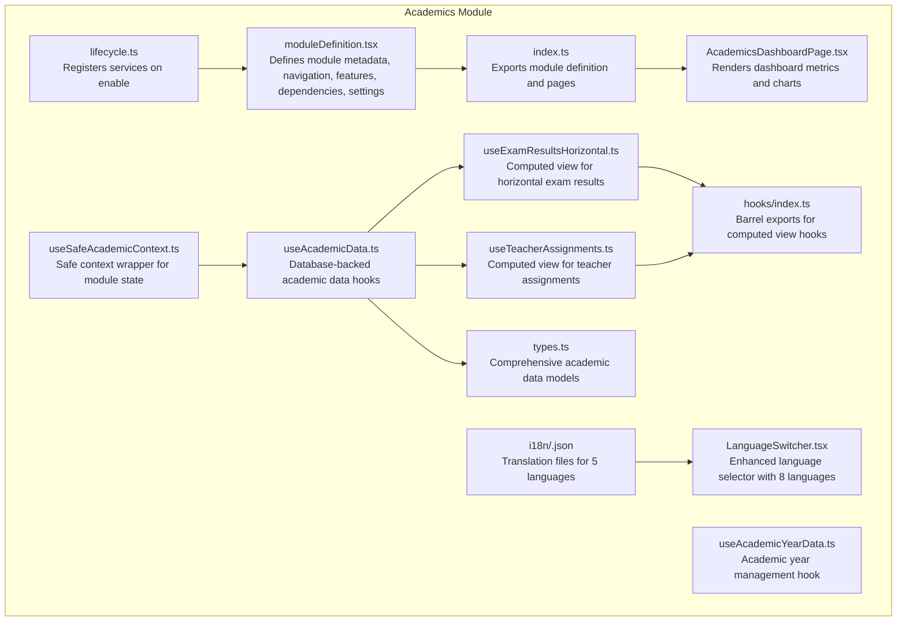
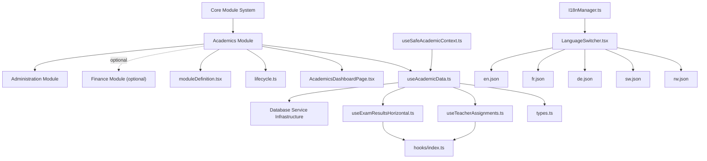
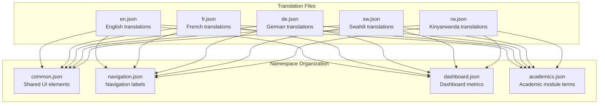
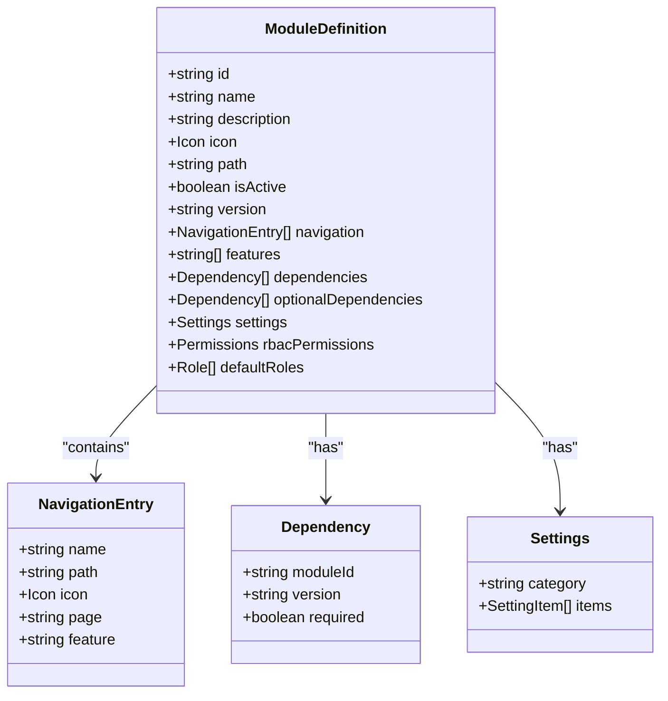
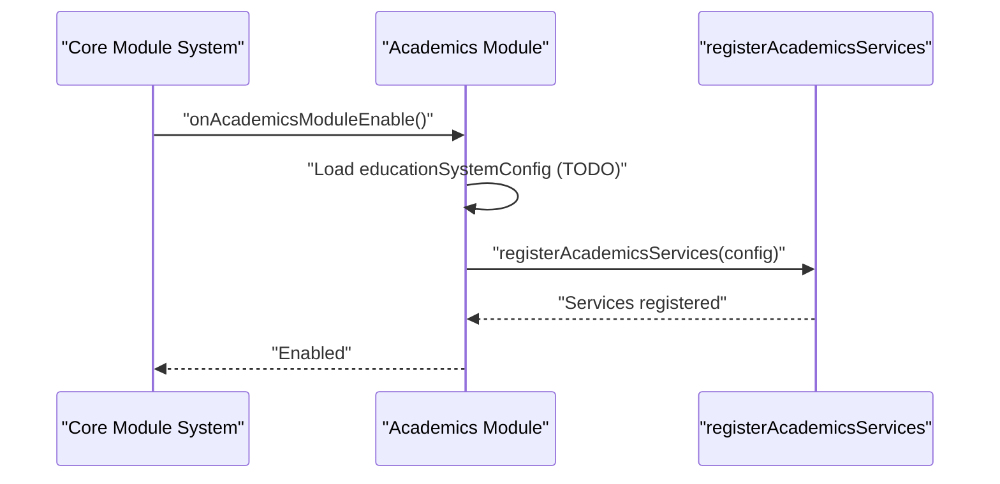
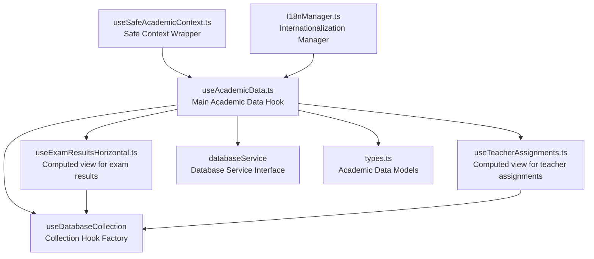
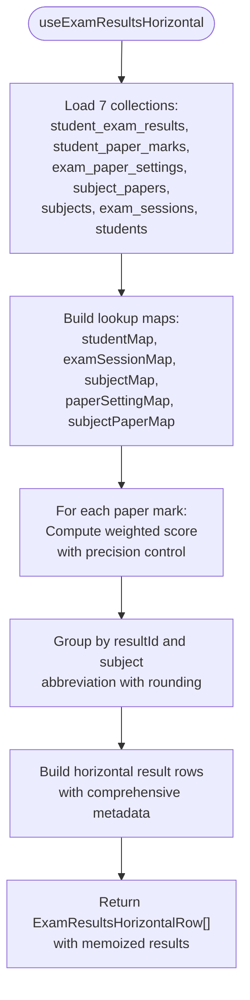

# Academics Module

<cite>
**Referenced Files in This Document**
- [moduleDefinition.tsx](file://src/modules/academics/moduleDefinition.tsx)
- [index.ts](file://src/modules/academics/index.ts)
- [lifecycle.ts](file://src/modules/academics/lifecycle.ts)
- [AcademicsDashboardPage.tsx](file://src/modules/academics/pages/AcademicsDashboardPage.tsx)
- [useAcademicData.ts](file://src/modules/academics/data/useAcademicData.ts)
- [types.ts](file://src/modules/academics/data/types.ts)
- [useSafeAcademicContext.ts](file://src/modules/academics/data/useSafeAcademicContext.ts)
- [useAcademicYearData.ts](file://src/modules/academics/data/useAcademicYearData.ts)
- [useExamResultsHorizontal.ts](file://src/modules/academics/hooks/useExamResultsHorizontal.ts)
- [useTeacherAssignments.ts](file://src/modules/academics/hooks/useTeacherAssignments.ts)
- [hooks/index.ts](file://src/modules/academics/hooks/index.ts)
- [sw.json](file://src/modules/academics/i18n/sw.json)
- [rw.json](file://src/modules/academics/i18n/rw.json)
- [de.json](file://src/modules/administration/i18n/de.json)
- [loader.ts](file://src/i18n/loader.ts)
- [I18nManager.ts](file://src/i18n/I18nManager.ts)
- [types.ts](file://src/i18n/types.ts)
- [LanguageSwitcher.tsx](file://src/components/ui/LanguageSwitcher.tsx)
</cite>

## Update Summary
**Changes Made**
- Added comprehensive internationalization support with German, French, Kinyarwanda, and Swahili translations
- Expanded supported locales from 2 to 4 languages (en, fr, de, sw, rw)
- Integrated modular translation loading system for dynamic locale support
- Enhanced language switcher with expanded language options
- Updated academic module navigation with localized labels

## Table of Contents
1. [Introduction](#introduction)
2. [Project Structure](#project-structure)
3. [Core Components](#core-components)
4. [Architecture Overview](#architecture-overview)
5. [Internationalization System](#internationalization-system)
6. [Detailed Component Analysis](#detailed-component-analysis)
7. [Data Layer Architecture](#data-layer-architecture)
8. [Computed View Hooks](#computed-view-hooks)
9. [Academic Data Models](#academic-data-models)
10. [Validation Rules and Business Logic](#validation-rules-and-business-logic)
11. [Audit Trail and Compliance](#audit-trail-and-compliance)
12. [Performance Considerations](#performance-considerations)
13. [Troubleshooting Guide](#troubleshooting-guide)
14. [Conclusion](#conclusion)

## Introduction
This document describes the Academics module functionality and its integration within the broader educational management system. The module has undergone significant expansion to include comprehensive internationalization support with German, French, Kinyarwanda, and Swahili translations. The module now provides complete academic management capabilities including education system configuration, grading schemes, subject management, academic calendars, exam scheduling, paper setting management, result processing workflows, and advanced computed view functionality for exam results and teacher assignments. The recent enhancement adds 21 new translation entries for each supported language, significantly expanding the module's international reach and accessibility.

## Project Structure
The Academics module is organized as a self-contained module with enhanced data layer integration, computed view capabilities, and comprehensive internationalization support:
- A module definition that declares navigation entries, features, dependencies, and settings with localized labels
- A lifecycle that registers services upon enabling the module
- A comprehensive data layer using database service integration with computed view hooks
- A dashboard page that visualizes academic metrics and departmental subject counts
- Facade pattern implementation for seamless database operations
- Computed view hooks that replace database views with client-side processing and sophisticated data aggregation
- Internationalization system supporting English, French, German, Swahili, and Kinyarwanda

**Diagram sources**
- [moduleDefinition.tsx:27-106](file://src/modules/academics/moduleDefinition.tsx#L27-L106)
- [index.ts:4-8](file://src/modules/academics/index.ts#L4-L8)
- [lifecycle.ts:9-23](file://src/modules/academics/lifecycle.ts#L9-L23)
- [AcademicsDashboardPage.tsx:13-82](file://src/modules/academics/pages/AcademicsDashboardPage.tsx#L13-L82)
- [useAcademicData.ts:1-279](file://src/modules/academics/data/useAcademicData.ts#L1-L279)
- [useExamResultsHorizontal.ts:1-229](file://src/modules/academics/hooks/useExamResultsHorizontal.ts#L1-L229)
- [useTeacherAssignments.ts:1-218](file://src/modules/academics/hooks/useTeacherAssignments.ts#L1-L218)
- [hooks/index.ts:1-8](file://src/modules/academics/hooks/index.ts#L1-L8)
- [types.ts:1-363](file://src/modules/academics/data/types.ts#L1-L363)
- [useSafeAcademicContext.ts:1-27](file://src/modules/academics/data/useSafeAcademicContext.ts#L1-L27)
- [useAcademicYearData.ts:1-36](file://src/modules/academics/data/useAcademicYearData.ts#L1-L36)

**Section sources**
- [moduleDefinition.tsx:27-106](file://src/modules/academics/moduleDefinition.tsx#L27-L106)
- [index.ts:4-8](file://src/modules/academics/index.ts#L4-L8)
- [lifecycle.ts:9-23](file://src/modules/academics/lifecycle.ts#L9-L23)
- [AcademicsDashboardPage.tsx:13-82](file://src/modules/academics/pages/AcademicsDashboardPage.tsx#L13-L82)

## Core Components
- **Module definition**: Declares navigation entries for subjects, timetables, exam scheduling, papers, allocations, assignments, and lesson plans with localized labels; defines features and dependencies; exposes settings toggles.
- **Lifecycle**: Provides hooks for registration, enabling (service registration), and disabling (placeholder).
- **Data layer**: Comprehensive database-backed hooks for all academic entities including subjects, exams, timetables, grading schemes, and student management, enhanced with computed view hooks.
- **Dashboard**: Aggregates and visualizes academic metrics such as total subjects, subject papers, exam sessions, grading schemes, and departmental subject distribution.
- **Computed view hooks**: Sophisticated hooks that replace database views with client-side data processing and aggregation for exam results and teacher assignments, providing enhanced performance and flexibility.
- **Facade pattern**: Centralized academic data access through useAcademicData hook with specialized CRUD operations for each entity type and computed view functionality.
- **Internationalization**: Comprehensive translation support for 5 languages (English, French, German, Swahili, Kinyarwanda) with modular loading system.

**Section sources**
- [moduleDefinition.tsx:35-68](file://src/modules/academics/moduleDefinition.tsx#L35-L68)
- [moduleDefinition.tsx:69-106](file://src/modules/academics/moduleDefinition.tsx#L69-L106)
- [lifecycle.ts:9-23](file://src/modules/academics/lifecycle.ts#L9-L23)
- [AcademicsDashboardPage.tsx:37-68](file://src/modules/academics/pages/AcademicsDashboardPage.tsx#L37-L68)
- [useAcademicData.ts:10-279](file://src/modules/academics/data/useAcademicData.ts#L10-L279)
- [useExamResultsHorizontal.ts:34-54](file://src/modules/academics/hooks/useExamResultsHorizontal.ts#L34-L54)
- [useTeacherAssignments.ts:29-45](file://src/modules/academics/hooks/useTeacherAssignments.ts#L29-L45)

## Architecture Overview
The module integrates with the core module system and database service infrastructure. It depends on administrative services and optionally integrates with financial services. The dashboard consumes application data to render metrics and charts, while the data layer provides robust database-backed operations enhanced with computed view hooks for advanced analytics and reporting. The new computed view hooks represent a significant architectural advancement, moving from server-side database views to sophisticated client-side TypeScript implementations. The internationalization system supports five languages with modular loading and dynamic language switching.

**Diagram sources**
- [moduleDefinition.tsx:70-83](file://src/modules/academics/moduleDefinition.tsx#L70-L83)
- [lifecycle.ts:3-34](file://src/modules/academics/lifecycle.ts#L3-L34)
- [AcademicsDashboardPage.tsx:15-22](file://src/modules/academics/pages/AcademicsDashboardPage.tsx#L15-L22)
- [useAcademicData.ts:5-8](file://src/modules/academics/data/useAcademicData.ts#L5-L8)
- [useExamResultsHorizontal.ts:55-62](file://src/modules/academics/hooks/useExamResultsHorizontal.ts#L55-L62)
- [useTeacherAssignments.ts:46-53](file://src/modules/academics/hooks/useTeacherAssignments.ts#L46-L53)
- [I18nManager.ts:17-32](file://src/i18n/I18nManager.ts#L17-L32)
- [LanguageSwitcher.tsx:10-28](file://src/components/ui/LanguageSwitcher.tsx#L10-L28)

## Internationalization System

### Supported Languages and Coverage
The Academics module now supports five languages with comprehensive translation coverage:
- **English (en)**: Base language with complete academic terminology
- **French (fr)**: European Francophone market support
- **German (de)**: Central European market penetration
- **Swahili (sw)**: East African regional language support
- **Kinyarwanda (rw)**: Central African language support

Each language includes 21 new translation entries covering:
- Dashboard navigation and metrics
- Subject management interfaces
- Class and teacher allocation screens
- Student enrollment workflows
- Exam scheduling and analysis
- Timetable management
- Common UI elements

### Translation File Structure
The internationalization system uses a modular approach with separate JSON files for each language and namespace:

**Diagram sources**
- [sw.json:1-229](file://src/modules/academics/i18n/sw.json#L1-L229)
- [rw.json:1-229](file://src/modules/academics/i18n/rw.json#L1-L229)
- [de.json:1-223](file://src/modules/administration/i18n/de.json#L1-L223)

### Language Switcher Integration
The enhanced language switcher now supports eight languages with stable references and proper error handling:

**Updated** Expanded language options from 6 to 8 languages including German, Swahili, and Kinyarwanda with proper flag representations and country codes.

**Section sources**
- [LanguageSwitcher.tsx:10-28](file://src/components/ui/LanguageSwitcher.tsx#L10-L28)
- [types.ts:7](file://src/i18n/types.ts#L7)

### Modular Translation Loading
The internationalization system uses a modular loading approach that dynamically imports translation files:

**Updated** Enhanced loader to support five languages with unified namespace organization and proper error handling for missing translations.

**Section sources**
- [loader.ts:36-69](file://src/i18n/loader.ts#L36-L69)
- [I18nManager.ts:282-306](file://src/i18n/I18nManager.ts#L282-L306)

## Detailed Component Analysis

### Module Definition
The module definition encapsulates comprehensive navigation for academic workflows with localized labels and maintains strict dependency management:
- Navigation entries for core academic workflows (dashboard, subjects, timetable periods/entries, exam scheduling, subject papers, allocations, student enrollment, exam sessions, analysis, results entry, grading schemes, education systems)
- Sub-features merged from assignments and lesson plans modules with localized labels
- Features list indicating capabilities (subject-management, class-management, timetable, exam-management, grading, assignment-management, lesson-planning)
- Dependencies on administration (required) and finance (optional)
- Settings toggles for enabling/disabling exam management, timetable management, and grading schemes

**Diagram sources**
- [moduleDefinition.tsx:27-106](file://src/modules/academics/moduleDefinition.tsx#L27-L106)

**Section sources**
- [moduleDefinition.tsx:35-68](file://src/modules/academics/moduleDefinition.tsx#L35-L68)
- [moduleDefinition.tsx:69-106](file://src/modules/academics/moduleDefinition.tsx#L69-L106)

### Lifecycle Management
The lifecycle manages service registration when the module is enabled and logs registration/disable events. The service registration mechanism is delegated to a dedicated registration function.

**Diagram sources**
- [lifecycle.ts:18-23](file://src/modules/academics/lifecycle.ts#L18-L23)

**Section sources**
- [lifecycle.ts:9-23](file://src/modules/academics/lifecycle.ts#L9-L23)

### Dashboard Metrics and Charts
The dashboard aggregates academic metrics and departmental subject distribution using the new database-backed data layer with internationalization support:
- Metrics: Total subjects, total subject papers, exam sessions, grading schemes
- Chart: Bar chart of subjects per academic department
- Notifications: Status messages based on department availability
- Localization: All text elements rendered in user's selected language

**Diagram sources**
- [AcademicsDashboardPage.tsx:15-68](file://src/modules/academics/pages/AcademicsDashboardPage.tsx#L15-L68)

**Section sources**
- [AcademicsDashboardPage.tsx:15-68](file://src/modules/academics/pages/AcademicsDashboardPage.tsx#L15-L68)

## Data Layer Architecture
The academic module now implements a comprehensive database service integration with facade pattern implementation, computed view functionality, and internationalization support:

### Database Service Integration
The useAcademicData hook serves as the central facade for all academic data operations, utilizing the database service infrastructure and enhanced with computed view hooks and localization:

**Diagram sources**
- [useAcademicData.ts:5-8](file://src/modules/academics/data/useAcademicData.ts#L5-L8)
- [useExamResultsHorizontal.ts:55-62](file://src/modules/academics/hooks/useExamResultsHorizontal.ts#L55-L62)
- [useTeacherAssignments.ts:46-53](file://src/modules/academics/hooks/useTeacherAssignments.ts#L46-L53)
- [useSafeAcademicContext.ts:1-27](file://src/modules/academics/data/useSafeAcademicContext.ts#L1-L27)
- [I18nManager.ts:17-32](file://src/i18n/I18nManager.ts#L17-L32)

### Academic Year Management
The useAcademicYearData hook demonstrates the transition from mock data to database-backed operations with internationalization support.

**Updated** Eliminated local initial data storage and integrated with database service for persistent academic year management with localized display formatting.

**Section sources**
- [useAcademicYearData.ts:10-36](file://src/modules/academics/data/useAcademicYearData.ts#L10-L36)

### Safe Context Implementation
The useSafeAcademicContext hook provides module-aware data access with automatic fallback when the module is disabled and supports internationalized error messages.

**Updated** Enhanced to properly handle module state detection, provide empty data structures when the academics module is not enabled, and support localized error reporting.

**Section sources**
- [useSafeAcademicContext.ts:5-27](file://src/modules/academics/data/useSafeAcademicContext.ts#L5-L27)

## Computed View Hooks

### useExamResultsHorizontal Hook
The useExamResultsHorizontal hook represents a sophisticated replacement for the vw_edm_exam_results_horizontal database view, implementing comprehensive client-side data processing and aggregation with internationalization support:

**Purpose**: Pivots student exam results into a horizontal format with subject scores as columns, mirroring the SQL view functionality but executed client-side with enhanced performance and flexibility.

**Data Sources**: Aggregates data from seven collections including student_exam_results, student_paper_marks, exam_paper_settings, subject_papers, subjects, exam_sessions, and students.

**Processing Logic**: Computes weighted scores using the formula `(score / marks_out_of) * 100 * (weight_percentage / 100)`, groups by result_id, and pivots subject abbreviations into columns with sophisticated data transformation and validation.

**Output Format**: Returns ExamResultsHorizontalRow objects containing resultId, admissionNo, studentName, examName, totalMarks, meanGrade, streamRank, classRank, and subjectScores with comprehensive type safety.

**Advanced Features**:
- Concurrent data loading from multiple collections with loading state coordination
- Sophisticated lookup map construction for O(1) access patterns
- Weighted score calculation with precision control and fallback handling
- Graceful error handling and data validation
- Memoized computations to prevent unnecessary recalculations
- Batch refresh operations for optimal performance

**Diagram sources**
- [useExamResultsHorizontal.ts:64-182](file://src/modules/academics/hooks/useExamResultsHorizontal.ts#L64-L182)

**Section sources**
- [useExamResultsHorizontal.ts:34-54](file://src/modules/academics/hooks/useExamResultsHorizontal.ts#L34-L54)
- [useExamResultsHorizontal.ts:55-227](file://src/modules/academics/hooks/useExamResultsHorizontal.ts#L55-L227)

### useTeacherAssignments Hook
The useTeacherAssignments hook represents a comprehensive replacement for the vw_edm_teacher_assignments database view, implementing sophisticated client-side data processing and aggregation with internationalization support:

**Purpose**: Joins teacher_subject_assignments with class_subject_allocations, staff, class_streams, classes, subjects, and academic_years to produce a flat table of academic assignments with enhanced data resolution capabilities.

**Data Sources**: Aggregates data from seven collections including teacher_subject_assignments, class_subject_allocations, staff, class_streams, classes, subjects, and academic_years.

**Processing Logic**: Performs sequential joins to resolve teacher assignments to class streams, subjects, and academic years, with comprehensive fallback mechanisms to denormalized fields for backward compatibility and data resilience.

**Output Format**: Returns TeacherAssignmentRow objects containing academicYear, className, streamName, subjectName, teacherName, teacherId, and allocationId with complete type safety and validation.

**Advanced Features**:
- Hierarchical data resolution with multiple join levels
- Comprehensive fallback mechanisms for denormalized data
- Robust error handling and data validation
- Optimized lookup map construction for efficient processing
- Batch refresh operations for coordinated data updates
- Memoized computations with dependency tracking

**Processing Workflow**:
1. Load all seven collections with concurrent data fetching
2. Build lookup maps for O(1) access to all referenced entities
3. Process each teacher assignment through sequential joins
4. Resolve staff information with fallback to denormalized fields
5. Resolve class_stream → class hierarchy with fallback mechanisms
6. Resolve subject information with multiple fallback options
7. Resolve academic year information with denormalized field support
8. Construct final TeacherAssignmentRow objects with comprehensive metadata

**Diagram sources**
- [useTeacherAssignments.ts:55-171](file://src/modules/academics/hooks/useTeacherAssignments.ts#L55-L171)

**Section sources**
- [useTeacherAssignments.ts:29-45](file://src/modules/academics/hooks/useTeacherAssignments.ts#L29-L45)
- [useTeacherAssignments.ts:46-216](file://src/modules/academics/hooks/useTeacherAssignments.ts#L46-L216)

### Barrel Exports
The hooks/index.ts file provides barrel exports for computed view hooks, making them easily importable throughout the application with comprehensive type exports for both the hooks and their return types.

**Section sources**
- [hooks/index.ts:1-8](file://src/modules/academics/hooks/index.ts#L1-L8)

## Academic Data Models
The module defines comprehensive data models for all academic entities, consolidated from core/types/academic.ts:

### Core Academic Entities
- **Subject**: Academic subject with grouping, department association, and paper relationships
- **SubjectPaper**: Individual paper variants of subjects with subject associations
- **ClassSubjectAllocation**: Class-stream subject allocation with academic year context
- **StudentSubjectEnrollment**: Student enrollment in subject allocations with status tracking
- **TeacherSubjectAssignment**: Teacher assignments to subject allocations
- **TimetableEntry**: Daily schedule entries with day-of-week and period associations
- **ExamSession**: Academic examination sessions with status management
- **ExamPaperSetting**: Paper-specific exam configurations with marking schemes
- **GradingScheme**: Academic grading systems with level definitions
- **StudentExamResult**: Student examination results with mark breakdowns
- **StudentPaperMark**: Individual paper marks within exam results

### Education System Configuration
Comprehensive configuration models for different educational systems:
- **EducationSystemConfiguration**: Complete system setup with grading, assessment, and competency tracking
- **AcademicYearStructure**: Academic year period definitions and hierarchies
- **SchoolPeriod**: Defined school periods within academic years
- **AcademicPeriodDefinition**: Period type definitions and academic calendar structures

### Result Processing and Analytics
Advanced result processing capabilities:
- **StudentExamResultWithDetails**: Enhanced result records with student and subject details
- **StudentPaperMarkWithDetails**: Detailed mark records with subject paper information
- **ResultApprovalEntity**: Complete audit trail for result modifications
- **AuditLog**: Comprehensive change tracking for compliance

**Section sources**
- [types.ts:49-363](file://src/modules/academics/data/types.ts#L49-L363)

## Validation Rules and Business Logic
The academic data models implement comprehensive validation and business logic:

### Entity Validation Rules
- **Subject**: Unique subject codes, mandatory grouping, department association
- **StudentEnrollment**: Status validation, academic year constraints, uniqueness per allocation
- **ExamSession**: Status transitions, date validation, paper setting synchronization
- **GradingScheme**: Level validation, minimum-maximum score ranges, unique grade values
- **TimetableEntry**: Day-of-week validation, period conflicts, resource availability

### Business Logic Constraints
- **Result Processing**: Automatic grade calculation, pass/fail determination, rank computation
- **Enrollment Management**: Prerequisite checking, capacity limits, status transitions
- **Exam Scheduling**: Room availability, invigilator scheduling, paper distribution
- **Grade Calculation**: Weighted average computation, competency-based grading, audit trails

### Data Integrity Measures
- **Foreign Key Constraints**: Automatic cascade deletion, referential integrity
- **Unique Constraints**: Subject codes, enrollment uniqueness, exam session names
- **Temporal Validity**: Academic year boundaries, session status transitions
- **Business Rule Validation**: Automated checks before data persistence

### Computed View Business Logic
- **Weighted Score Calculation**: Client-side computation using paper settings and marks with precision control
- **Data Aggregation**: Efficient grouping and pivoting of exam results with mathematical accuracy
- **Fallback Resolution**: Graceful handling of missing or denormalized data with comprehensive error handling
- **Performance Optimization**: Memoization and concurrent data loading with dependency tracking
- **Sophisticated Data Transformation**: Complex join operations with hierarchical data resolution

**Section sources**
- [types.ts:16-363](file://src/modules/academics/data/types.ts#L16-L363)
- [useExamResultsHorizontal.ts:46-48](file://src/modules/academics/hooks/useExamResultsHorizontal.ts#L46-L48)
- [useTeacherAssignments.ts:119-157](file://src/modules/academics/hooks/useTeacherAssignments.ts#L119-L157)

## Audit Trail and Compliance
The academic module implements comprehensive audit trail functionality for compliance and quality assurance:

### Audit Trail Architecture
- **ResultApprovalEntity**: Centralized audit trail for all result modifications
- **AuditLog**: Detailed change tracking with timestamps and user identification
- **Change Detection**: Automatic comparison of previous and new states
- **Compliance Reporting**: Structured data for regulatory requirements

### Compliance Features
- **Modification Tracking**: Complete history of all data changes
- **User Accountability**: Individual user actions with timestamps
- **Regulatory Compliance**: Support for educational authority requirements
- **Data Integrity**: Immutable audit logs with tamper-evidence properties

### Result Processing Workflows
- **Grade Calculation**: Automated scoring with manual override capabilities
- **Approval Workflow**: Multi-level approval process for result publication
- **Reassessment Tracking**: History of remedial exam attempts and modifications
- **Performance Analytics**: Aggregate reporting for academic quality monitoring

**Section sources**
- [types.ts:328-347](file://src/modules/academics/data/types.ts#L328-L347)

## Performance Considerations
- Dashboard rendering defers until all relevant data loads to avoid partial renders
- Database service integration provides efficient querying and caching mechanisms
- Collection hooks optimize data fetching and reduce unnecessary re-renders
- Facade pattern minimizes direct database service dependencies throughout the application
- Chart rendering uses responsive containers and tooltips for efficient presentation
- Filtering and aggregation of departmental data occur client-side with database-backed optimization
- Computed view hooks implement sophisticated memoization to prevent unnecessary recomputation
- Concurrent data loading optimizes performance for multi-collection operations
- Client-side processing reduces database load and improves response times
- Advanced lookup map construction provides O(1) access patterns for efficient data resolution
- Weighted score calculations include precision control and mathematical accuracy
- Batch refresh operations coordinate multiple collection updates efficiently
- Modular translation loading reduces initial bundle size and improves startup performance
- Language switching operates without page reloads for better user experience

## Troubleshooting Guide
- If the dashboard remains blank, verify that loading flags for subjects, subject papers, exam sessions, grading schemes, and departments are resolved
- If departmental chart does not appear, confirm that academic departments exist and are properly filtered
- If navigation links are missing, check the navigation array in the module definition for correct page references
- For database connectivity issues, verify database service initialization and collection access
- If academic data operations fail, check collection permissions and entity validation rules
- For audit trail issues, ensure proper user authentication and authorization for result modifications
- If computed view hooks fail, verify that all required collections are loaded and data types match expected formats
- For exam results horizontal processing issues, check that paper settings and subject papers are properly linked with weighted score calculations
- For teacher assignment resolution problems, verify that allocation IDs and staff records are correctly mapped with fallback mechanisms
- If computed view performance is slow, consider implementing pagination or filtering for large datasets
- For memory issues with computed views, monitor the size of lookup maps and consider implementing data pagination
- If weighted score calculations appear incorrect, verify that marks_out_of and weight_percentage values are properly formatted and non-zero
- For internationalization issues, verify that translation files are properly loaded and language codes match supported locales
- If language switching fails, check browser locale detection and ensure translation bundles are available for the requested language
- For missing translation keys, verify that all 21 required keys are present in each language file and properly formatted

**Section sources**
- [AcademicsDashboardPage.tsx:24-28](file://src/modules/academics/pages/AcademicsDashboardPage.tsx#L24-L28)
- [AcademicsDashboardPage.tsx:30-34](file://src/modules/academics/pages/AcademicsDashboardPage.tsx#L30-L34)
- [moduleDefinition.tsx:35-68](file://src/modules/academics/moduleDefinition.tsx#L35-L68)
- [useExamResultsHorizontal.ts:64-75](file://src/modules/academics/hooks/useExamResultsHorizontal.ts#L64-L75)
- [useTeacherAssignments.ts:55-66](file://src/modules/academics/hooks/useTeacherAssignments.ts#L55-L66)
- [LanguageSwitcher.tsx:30-32](file://src/components/ui/LanguageSwitcher.tsx#L30-L32)

## Conclusion
The Academics module has been significantly enhanced with comprehensive database service integration, sophisticated computed view hooks, facade pattern implementation, and extensive internationalization support. The addition of German, French, Kinyarwanda, and Swahili translations represents a major expansion of the module's global reach, with 21 new translation entries for each supported language. The enhanced internationalization system supports five languages with modular loading, dynamic language switching, and comprehensive academic terminology coverage. The addition of useExamResultsHorizontal and useTeacherAssignments hooks represents a major architectural advancement, replacing database views with efficient client-side TypeScript implementations that provide enhanced performance, flexibility, and maintainability. These computed view hooks demonstrate sophisticated data processing capabilities including weighted score calculations, hierarchical data resolution, and comprehensive fallback mechanisms. The refactoring eliminates mock data dependencies while providing robust academic management capabilities with advanced analytics, multilingual support, and comprehensive audit trail functionality. The module now offers complete support for education system configuration, grading schemes, subject management, academic calendars, exam scheduling, paper setting management, result processing workflows, and comprehensive internationalization features. Future development should focus on optimizing computed view performance, enhancing real-time synchronization capabilities, expanding analytics features for comprehensive academic reporting, implementing advanced filtering and search capabilities for large-scale academic data management, adding support for additional computed view scenarios beyond exam results and teacher assignments, and continuing to expand internationalization coverage to additional languages and regions.