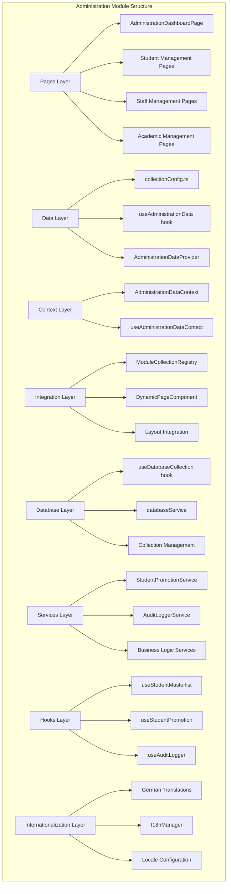
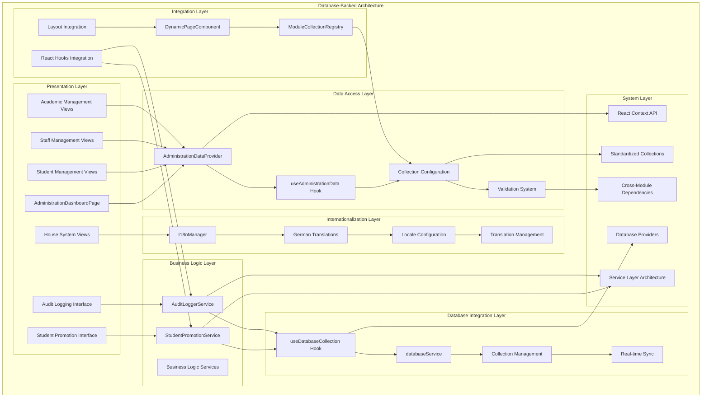
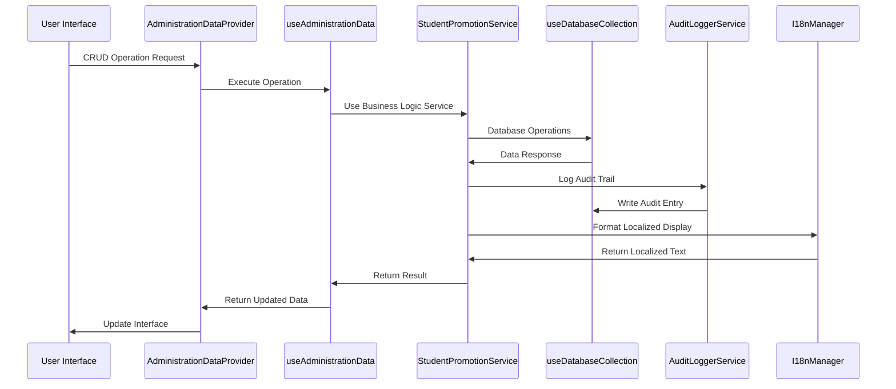
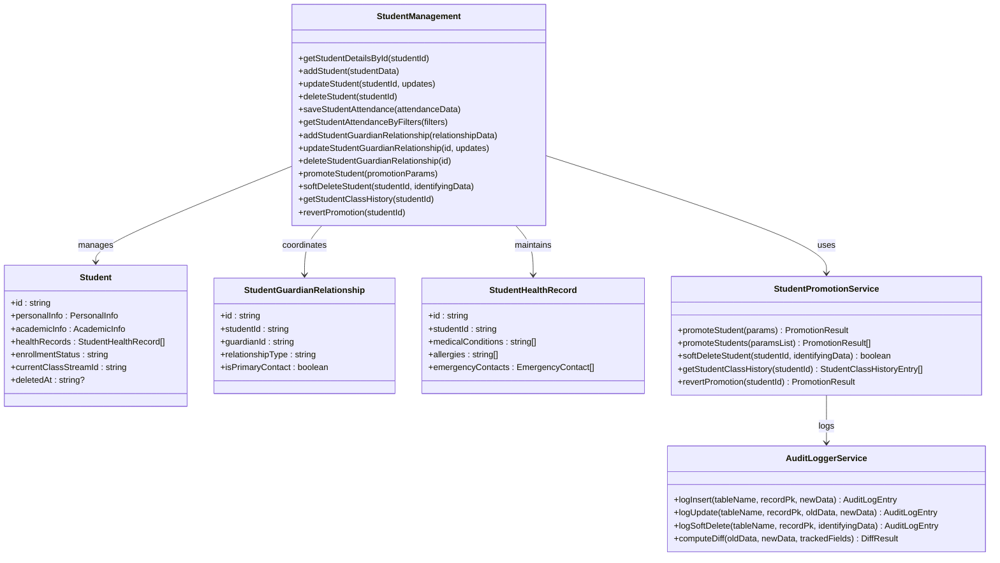

# Administration Module

<cite>
**Referenced Files in This Document**
- [AdministrationDashboardPage.tsx](file://src/modules/administration/pages/AdministrationDashboardPage.tsx)
- [AdministrationDataContext.tsx](file://src/modules/administration/data/AdministrationDataContext.tsx)
- [AdministrationDataProvider.tsx](file://src/modules/administration/data/AdministrationDataProvider.tsx)
- [useAdministrationData.ts](file://src/modules/administration/data/useAdministrationData.ts)
- [collectionConfig.ts](file://src/modules/administration/data/collectionConfig.ts)
- [collections.ts](file://src/modules/administration/data/collections.ts)
- [moduleCollectionRegistry.ts](file://src/contexts/appData/moduleCollectionRegistry.ts)
- [useDatabaseCollection.ts](file://src/hooks/useDatabaseCollection.ts)
- [databaseService.ts](file://src/services/database/databaseService.ts)
- [DynamicPageComponent.tsx](file://src/components/DynamicPageComponent.tsx)
- [Layout.tsx](file://src/components/Layout.tsx)
- [AdministrationDataContext.test.tsx](file://src/contexts/data/__tests__/AdministrationDataContext.test.tsx)
- [useAdministrationData.test.ts](file://src/hooks/data/__tests__/useAdministrationData.test.ts)
- [UnifiedDatabaseManager.ts](file://src/services/database/UnifiedDatabaseManager.ts)
- [interfaces.ts](file://src/services/database/interfaces.ts)
- [moduleDataApi.ts](file://src/core/services/moduleDataApi.ts)
- [moduleCollections.ts](file://src/core/types/moduleCollections.ts)
- [ModuleDashboardShell.tsx](file://src/components/ModuleDashboardShell.tsx)
- [DonutChart.tsx](file://src/components/ui/DonutChart.tsx)
- [types.ts](file://src/modules/administration/data/types.ts)
- [StudentPromotionService.ts](file://src/modules/administration/services/StudentPromotionService.ts)
- [AuditLoggerService.ts](file://src/modules/administration/services/AuditLoggerService.ts)
- [useStudentMasterlist.ts](file://src/modules/administration/hooks/useStudentMasterlist.ts)
- [useStudentPromotion.ts](file://src/modules/administration/hooks/useStudentPromotion.ts)
- [useAuditLogger.ts](file://src/modules/administration/hooks/useAuditLogger.ts)
- [services/index.ts](file://src/modules/administration/services/index.ts)
- [types.ts](file://src/modules/administration/services/types.ts)
- [de.json](file://src/modules/administration/i18n/de.json)
- [I18nManager.ts](file://src/i18n/I18nManager.ts)
- [types.ts](file://src/i18n/types.ts)
- [common.json](file://src/locales/en/common.json)
- [settings.json](file://src/locales/en/settings.json)
</cite>

## Update Summary
**Changes Made**
- Added comprehensive German translations for the Administration module with 62 new translation entries covering navigation, dashboard, student management, staff management, academic structures, and common UI elements
- Enhanced internationalization support with expanded locale configuration and improved translation management
- Updated navigation structure with German localization for all administrative functions including student promotion, audit logging, certificates, staff attendance, and house system
- Expanded internationalization support across all supported languages (English, Spanish, French, German, Arabic, Swahili)

## Table of Contents
1. [Introduction](#introduction)
2. [Project Structure](#project-structure)
3. [Core Components](#core-components)
4. [Architecture Overview](#architecture-overview)
5. [Database Integration Patterns](#database-integration-patterns)
6. [Business Logic Services](#business-logic-services)
7. [React Hooks Integration](#react-hooks-integration)
8. [Student Management Enhancement](#student-management-enhancement)
9. [Audit and Compliance Features](#audit-and-compliance-features)
10. [Computed Views and Data Denormalization](#computed-views-and-data-denormalization)
11. [Internationalization and Localization](#internationalization-and-localization)
12. [Detailed Component Analysis](#detailed-component-analysis)
13. [Real-time Data Synchronization](#real-time-data-synchronization)
14. [Collection Configuration and Schema Management](#collection-configuration-and-schema-management)
15. [Dependency Analysis](#dependency-analysis)
16. [Performance Considerations](#performance-considerations)
17. [Troubleshooting Guide](#troubleshooting-guide)
18. [Conclusion](#conclusion)

## Introduction
The Administration module serves as the central operational hub for managing educational institution data and workflows through comprehensive database-backed operations. The module now utilizes a sophisticated database integration system with 16+ collections supporting student management, staff administration, academic calendar coordination, and institutional organization. This represents a significant evolution from previous implementations, featuring real-time data synchronization, robust CRUD operations, and enterprise-grade database management.

The module encompasses comprehensive functionality across multiple domains: student lifecycle management (enrollment, attendance, health records), staff administration (department assignments, designations), academic year structures, class/stream organization, communication systems, and co-curricular activities. The architecture emphasizes modularity, data consistency, operational efficiency, and real-time synchronization through standardized collection naming and centralized database access patterns.

**Updated** Enhanced with comprehensive German translations (62 new entries) and expanded internationalization support across all supported languages. The Administration module now provides complete localization for German-speaking users with comprehensive navigation, dashboard, and functional translations covering all administrative domains including student management, staff administration, academic structures, and house system operations.

## Project Structure
The Administration module follows a sophisticated structured organization pattern that separates concerns across data management, presentation, and integration layers. The module leverages React's Context API for state management while implementing comprehensive database-backed operations through the useDatabaseCollection hook and UnifiedDatabaseManager service.

**Diagram sources**
- [AdministrationDashboardPage.tsx:1-84](file://src/modules/administration/pages/AdministrationDashboardPage.tsx#L1-L84)
- [AdministrationDataContext.tsx:1-35](file://src/modules/administration/data/AdministrationDataContext.tsx#L1-L35)
- [AdministrationDataProvider.tsx:1-606](file://src/modules/administration/data/AdministrationDataProvider.tsx#L1-L606)
- [useAdministrationData.ts:1-343](file://src/modules/administration/data/useAdministrationData.ts#L1-L343)
- [collectionConfig.ts:1-57](file://src/modules/administration/data/collectionConfig.ts#L1-L57)
- [useDatabaseCollection.ts:1-228](file://src/hooks/useDatabaseCollection.ts#L1-L228)
- [databaseService.ts:1-379](file://src/services/database/databaseService.ts#L1-L379)
- [StudentPromotionService.ts:1-449](file://src/modules/administration/services/StudentPromotionService.ts#L1-L449)
- [AuditLoggerService.ts:1-270](file://src/modules/administration/services/AuditLoggerService.ts#L1-L270)
- [useStudentMasterlist.ts:1-253](file://src/modules/administration/hooks/useStudentMasterlist.ts#L1-L253)
- [useStudentPromotion.ts:1-119](file://src/modules/administration/hooks/useStudentPromotion.ts#L1-L119)
- [useAuditLogger.ts:1-133](file://src/modules/administration/hooks/useAuditLogger.ts#L1-L133)
- [de.json:1-223](file://src/modules/administration/i18n/de.json#L1-L223)
- [I18nManager.ts:1-414](file://src/i18n/I18nManager.ts#L1-L414)

**Section sources**
- [AdministrationDashboardPage.tsx:1-84](file://src/modules/administration/pages/AdministrationDashboardPage.tsx#L1-L84)
- [AdministrationDataContext.tsx:1-35](file://src/modules/administration/data/AdministrationDataContext.tsx#L1-L35)
- [AdministrationDataProvider.tsx:1-606](file://src/modules/administration/data/AdministrationDataProvider.tsx#L1-L606)
- [useAdministrationData.ts:1-343](file://src/modules/administration/data/useAdministrationData.ts#L1-L343)
- [collectionConfig.ts:1-57](file://src/modules/administration/data/collectionConfig.ts#L1-L57)

## Core Components
The Administration module's core functionality revolves around five primary components that work together to provide comprehensive institutional management capabilities through database-backed operations.

### Database-Backed Data Context System
The AdministrationDataProvider provides centralized access to all administrative data through React's Context API, integrated with the useDatabaseCollection hook for real-time database operations. This system ensures consistent data access patterns across the module while maintaining proper separation of concerns between data retrieval, persistence, and presentation logic.

### Comprehensive Collection Configuration
The collectionConfig defines standardized naming conventions for all 16+ administrative entities, ensuring consistency across the module and facilitating integration with other system components. This configuration supports extensive collection types covering all aspects of institutional management with schema validation and real-time synchronization.

### Real-time CRUD Operations
The useAdministrationData hook implements comprehensive CRUD operations with database service integration, providing transactional safety, validation, and real-time data synchronization across all administrative entities. The system supports both individual operations and batch processing for efficient data management.

### Dashboard Interface with Real-time Metrics
The AdministrationDashboardPage serves as the primary user interface, providing real-time metrics, quick actions, and visualizations for administrative oversight. The dashboard aggregates data from multiple sources and presents actionable insights for institutional decision-making through live database connections.

### Database Service Integration
The module integrates with the useDatabaseCollection hook and databaseService for provider selection, collection management, and real-time data synchronization. This integration ensures optimal database performance, automatic failover, and enterprise-grade data management capabilities.

**Updated** Enhanced with comprehensive internationalization support including German translations (62 new entries) covering navigation, dashboard, student management, staff management, academic structures, and common UI elements. The I18nManager provides robust locale management with support for multiple languages and dynamic loading.

### Internationalization and Localization
The Administration module now includes comprehensive internationalization support with German as the first fully localized language. The German translation file contains 62 complete translation entries covering all administrative functions including navigation menus, dashboard elements, student management interfaces, staff administration panels, academic structure configurations, and house system operations.

**Section sources**
- [AdministrationDataContext.tsx:1-35](file://src/modules/administration/data/AdministrationDataContext.tsx#L1-L35)
- [AdministrationDataProvider.tsx:1-606](file://src/modules/administration/data/AdministrationDataProvider.tsx#L1-L606)
- [useAdministrationData.ts:1-343](file://src/modules/administration/data/useAdministrationData.ts#L1-L343)
- [collectionConfig.ts:1-57](file://src/modules/administration/data/collectionConfig.ts#L1-L57)
- [de.json:1-223](file://src/modules/administration/i18n/de.json#L1-L223)

## Architecture Overview
The Administration module implements a sophisticated layered architecture that promotes separation of concerns and maintainable code organization through database-backed operations. The architecture consists of seven distinct layers that handle different aspects of administrative functionality with real-time data synchronization and comprehensive internationalization support.

**Diagram sources**
- [AdministrationDashboardPage.tsx:1-84](file://src/modules/administration/pages/AdministrationDashboardPage.tsx#L1-L84)
- [AdministrationDataContext.tsx:1-35](file://src/modules/administration/data/AdministrationDataContext.tsx#L1-L35)
- [AdministrationDataProvider.tsx:1-606](file://src/modules/administration/data/AdministrationDataProvider.tsx#L1-L606)
- [useAdministrationData.ts:1-343](file://src/modules/administration/data/useAdministrationData.ts#L1-L343)
- [collectionConfig.ts:1-57](file://src/modules/administration/data/collectionConfig.ts#L1-L57)
- [StudentPromotionService.ts:1-449](file://src/modules/administration/services/StudentPromotionService.ts#L1-L449)
- [AuditLoggerService.ts:1-270](file://src/modules/administration/services/AuditLoggerService.ts#L1-L270)
- [useDatabaseCollection.ts:1-228](file://src/hooks/useDatabaseCollection.ts#L1-L228)
- [databaseService.ts:1-379](file://src/services/database/databaseService.ts#L1-L379)
- [useStudentMasterlist.ts:1-253](file://src/modules/administration/hooks/useStudentMasterlist.ts#L1-L253)
- [useStudentPromotion.ts:1-119](file://src/modules/administration/hooks/useStudentPromotion.ts#L1-L119)
- [useAuditLogger.ts:1-133](file://src/modules/administration/hooks/useAuditLogger.ts#L1-L133)
- [de.json:1-223](file://src/modules/administration/i18n/de.json#L1-L223)
- [I18nManager.ts:1-414](file://src/i18n/I18nManager.ts#L1-L414)

The architecture emphasizes loose coupling between components while maintaining strong integration points for data consistency, real-time synchronization, operational efficiency, and comprehensive internationalization. The use of standardized collections ensures that all administrative entities follow consistent naming and organizational patterns with database-backed persistence.

**Section sources**
- [AdministrationDashboardPage.tsx:1-84](file://src/modules/administration/pages/AdministrationDashboardPage.tsx#L1-L84)
- [AdministrationDataContext.tsx:1-35](file://src/modules/administration/data/AdministrationDataContext.tsx#L1-L35)
- [AdministrationDataProvider.tsx:1-606](file://src/modules/administration/data/AdministrationDataProvider.tsx#L1-L606)
- [useAdministrationData.ts:1-343](file://src/modules/administration/data/useAdministrationData.ts#L1-L343)
- [collectionConfig.ts:1-57](file://src/modules/administration/data/collectionConfig.ts#L1-L57)

## Database Integration Patterns
The Administration module implements comprehensive database integration patterns through the useDatabaseCollection hook and databaseService, providing robust data persistence, real-time synchronization, and enterprise-grade database management capabilities.

### Database Provider Selection
The module utilizes the databaseService for automatic database provider selection based on system capabilities and requirements. The service supports multiple database providers with automatic failover and optimal performance tuning.

### Collection Management
The module manages 16+ database collections through the useDatabaseCollection hook, providing standardized CRUD operations, real-time data synchronization, and transactional safety across all administrative entities.

### Real-time Data Synchronization
The database integration supports real-time data synchronization through reactive collections, ensuring that UI updates occur immediately when database records change. This provides a seamless user experience with live data updates.

### Transactional Operations
All CRUD operations are wrapped in transactional contexts to ensure data consistency and integrity. The database service handles rollback scenarios and error recovery automatically.

**Updated** Enhanced with provider-agnostic collection adapters that allow services to work with any database backend without tight coupling. The new business logic services implement proper error handling, logging, and transaction safety through collection adapters. Internationalization support is integrated throughout the database operations with locale-aware data formatting and display.

**Diagram sources**
- [AdministrationDataProvider.tsx:128-154](file://src/modules/administration/data/AdministrationDataProvider.tsx#L128-L154)
- [useAdministrationData.ts:52-86](file://src/modules/administration/data/useAdministrationData.ts#L52-L86)
- [StudentPromotionService.ts:94-186](file://src/modules/administration/services/StudentPromotionService.ts#L94-L186)
- [useDatabaseCollection.ts:37-83](file://src/hooks/useDatabaseCollection.ts#L37-L83)
- [AuditLoggerService.ts:221-254](file://src/modules/administration/services/AuditLoggerService.ts#L221-L254)
- [de.json:1-223](file://src/modules/administration/i18n/de.json#L1-L223)
- [I18nManager.ts:106-140](file://src/i18n/I18nManager.ts#L106-L140)

**Section sources**
- [AdministrationDataProvider.tsx:1-606](file://src/modules/administration/data/AdministrationDataProvider.tsx#L1-L606)
- [useAdministrationData.ts:1-343](file://src/modules/administration/data/useAdministrationData.ts#L1-L343)
- [useDatabaseCollection.ts:1-228](file://src/hooks/useDatabaseCollection.ts#L1-L228)
- [databaseService.ts:1-379](file://src/services/database/databaseService.ts#L1-L379)

## Business Logic Services
The Administration module now includes comprehensive business logic services that replace traditional database triggers and stored procedures with TypeScript implementations. These services provide robust, testable business rules and maintain audit trails for compliance.

### StudentPromotionService
The StudentPromotionService replaces the MySQL stored procedure `sp_adm_promoteStudent` and PostgreSQL function `adm.promote_student` with a comprehensive TypeScript implementation. It handles student class transfers and promotions while maintaining immutable history and audit trails.

Key features include:
- Student validation and status checking
- Class stream existence verification
- Immutable class history management
- Automatic audit trail generation
- Soft-delete functionality
- Promotion reversal capabilities

### AuditLoggerService
The AuditLoggerService replaces the database trigger `trg_log_adm_students_after_update` with a flexible TypeScript service that provides comprehensive audit logging across all modules. It supports configurable field tracking and automatic diff computation.

Features include:
- Generic audit logging for any entity type
- Configurable field tracking with diff computation
- Support for all CRUD operations (INSERT, UPDATE, DELETE, SOFT_DELETE)
- Automatic user context injection
- Non-blocking audit logging that doesn't interfere with main operations

### Service Architecture
Both services follow a provider-agnostic design using collection adapters, allowing them to work with any database backend without tight coupling. They implement proper error handling, logging, and transaction safety.

**Section sources**
- [StudentPromotionService.ts:1-449](file://src/modules/administration/services/StudentPromotionService.ts#L1-L449)
- [AuditLoggerService.ts:1-270](file://src/modules/administration/services/AuditLoggerService.ts#L1-L270)
- [services/index.ts:1-18](file://src/modules/administration/services/index.ts#L1-L18)
- [types.ts:1-25](file://src/modules/administration/services/types.ts#L1-L25)

## React Hooks Integration
The Administration module introduces three new React hooks that provide streamlined access to business logic services and computed data views, replacing the need for direct service instantiation in components.

### useStudentMasterlist
The useStudentMasterlist hook replaces the `vw_adm_student_masterlist` view with a computed React hook that denormalizes student data by joining multiple collections. It provides real-time computed views with filtering and refresh capabilities.

Key features:
- Denormalizes data from students, class_streams, classes, categories, dormitories, and guardians
- Filters out soft-deleted students
- Automatic data refresh and loading states
- Computed view with memoization for performance

### useStudentPromotion
The useStudentPromotion hook wraps the StudentPromotionService with database collection integration, providing a React-friendly interface for student promotion workflows. It includes soft-delete and promotion reversal capabilities.

Features:
- Single and bulk student promotion
- Soft-delete functionality with audit logging
- Promotion history retrieval
- Promotion reversal capabilities
- Automatic user context injection

### useAuditLogger
The useAuditLogger hook provides automatic user context injection for audit logging operations, simplifying audit trail creation throughout the application.

Features:
- Automatic user ID and name injection
- All audit operation types (INSERT, UPDATE, DELETE, SOFT_DELETE)
- Diff-based update logging
- Service instance access for advanced usage

**Section sources**
- [useStudentMasterlist.ts:1-253](file://src/modules/administration/hooks/useStudentMasterlist.ts#L1-L253)
- [useStudentPromotion.ts:1-119](file://src/modules/administration/hooks/useStudentPromotion.ts#L1-L119)
- [useAuditLogger.ts:1-133](file://src/modules/administration/hooks/useAuditLogger.ts#L1-L133)

## Student Management Enhancement
The Administration module significantly enhances student management capabilities through the integration of business logic services and computed views, providing comprehensive functionality beyond basic CRUD operations.

### Promotion Workflows
The student promotion system provides sophisticated class transfer and advancement capabilities with full audit trail support. The workflow ensures data integrity while maintaining historical records.

### Soft-delete and Recovery
Enhanced student lifecycle management includes soft-delete functionality that maintains audit trails while preserving data for potential recovery. This replaces physical deletion with reversible status changes.

### Historical Tracking
Immutable class history ensures that student progression is permanently recorded with timestamps, enabling reporting and compliance requirements. The system maintains chronological order and supports promotion reversal.

### Masterlist Computed View
The student masterlist provides a comprehensive denormalized view of student information, joining related collections to eliminate complex queries in the presentation layer. This improves performance and simplifies data access patterns.

**Section sources**
- [StudentPromotionService.ts:94-186](file://src/modules/administration/services/StudentPromotionService.ts#L94-L186)
- [StudentPromotionService.ts:204-232](file://src/modules/administration/services/StudentPromotionService.ts#L204-L232)
- [StudentPromotionService.ts:237-258](file://src/modules/administration/services/StudentPromotionService.ts#L237-L258)
- [StudentPromotionService.ts:263-349](file://src/modules/administration/services/StudentPromotionService.ts#L263-L349)
- [useStudentMasterlist.ts:58-251](file://src/modules/administration/hooks/useStudentMasterlist.ts#L58-L251)

## Audit and Compliance Features
The Administration module implements comprehensive audit and compliance features through the AuditLoggerService, providing detailed tracking of all system changes with configurable field monitoring and non-blocking logging.

### Audit Trail Generation
The audit system automatically captures all CRUD operations with detailed change tracking, including old and new values for updated fields. The system supports configurable field tracking to minimize audit log size while maintaining compliance requirements.

### Non-blocking Operations
Audit logging is designed as a non-blocking operation that doesn't interfere with main business operations. If audit logging fails, the primary operation continues successfully, ensuring system reliability.

### User Context Integration
The audit system automatically captures user context including user ID, username, IP address, and user agent for comprehensive tracking and compliance reporting.

### Compliance Support
The audit system supports regulatory compliance requirements with detailed change tracking, timestamped records, and immutable audit trails that can be exported for regulatory review.

**Section sources**
- [AuditLoggerService.ts:48-270](file://src/modules/administration/services/AuditLoggerService.ts#L48-L270)
- [useAuditLogger.ts:82-131](file://src/modules/administration/hooks/useAuditLogger.ts#L82-L131)

## Computed Views and Data Denormalization
The Administration module implements sophisticated computed views and data denormalization patterns through React hooks, eliminating the need for complex database joins in the presentation layer while maintaining data consistency.

### useStudentMasterlist Implementation
The useStudentMasterlist hook provides a comprehensive computed view that denormalizes student information by joining multiple collections. It builds lookup maps for O(1) access patterns and filters out soft-deleted records.

### Performance Optimization
The computed view uses memoization and lookup maps to achieve optimal performance with large datasets. It automatically refreshes when underlying collections change, ensuring data consistency without manual intervention.

### Data Filtering and Transformation
The hook applies business logic filtering (soft-deleted records) and data transformation (name concatenation, fallback values) to provide clean, ready-to-use data for presentation components.

### Real-time Updates
The computed view responds to real-time database updates through the useDatabaseCollection hook, ensuring that UI components always display current data without manual refresh operations.

**Section sources**
- [useStudentMasterlist.ts:58-251](file://src/modules/administration/hooks/useStudentMasterlist.ts#L58-L251)

## Internationalization and Localization

### German Language Support
The Administration module now includes comprehensive German translations with 62 complete translation entries covering all functional areas. The German translation file (`de.json`) provides complete localization for German-speaking users.

### Navigation Localization
The German navigation translations cover all administrative functions including:
- Main navigation items: "Verwaltung", "Bewerbungen", "Studenten", "Personal", "Akademische Strukturen"
- Student management: "Studenten-Beförderung", "Audit-Log-Anzeige", "Studenten-Import"
- Staff administration: "Personal-Anwesenheit", "Personal-Ausweise", "Personal-Geldbörse"
- Academic structures: "Akademische Jahre", "Definitionen akademischer Zeiträume", "Schulzeiträume"
- House system: "Häuser", "Hauskategorien", "Punkte vergeben", "Rangliste"

### Dashboard Localization
The German dashboard translations provide complete interface localization for administrative oversight including:
- Metric displays: "Schulzeiträume", "Definitionen der akademischen Zeiträume", "Akademisches Jahr"
- Entity counts: "Abteilungen", "Bezeichnungen", "Klassen", "Wohnheime"
- Institutional overview: "Institution", "Studentenkategorien", "Partnerarten"

### Functional Interface Localization
The German translation covers all functional interfaces with complete terminology:
- Student management: "Studentendetails", "Studentenliste", "Student hinzufügen", "Student bearbeiten"
- Staff management: "Personaldetails", "Personalliste", "Personal hinzufügen", "Personal bearbeiten"
- Academic structures: "Klassendetails", "Klassenliste", "Klasse hinzufügen", "Klasse bearbeiten"
- Common actions: "Speichern", "Abbrechen", "Löschen", "Bearbeiten", "Anzeigen"

### I18nManager Integration
The I18nManager provides robust internationalization support with:
- Multi-language locale management supporting English, Spanish, French, German, Arabic, and Swahili
- Dynamic locale loading and switching
- Nested translation key resolution
- Pluralization support for multiple languages
- RTL language direction support

### Translation Management
The internationalization system includes:
- Hierarchical translation structure with nested keys
- Fallback locale support with English as default
- Dynamic translation loading from JSON files
- Context-aware translations for different UI contexts
- Number and date formatting based on locale preferences

**Section sources**
- [de.json:1-223](file://src/modules/administration/i18n/de.json#L1-L223)
- [I18nManager.ts:1-414](file://src/i18n/I18nManager.ts#L1-L414)
- [types.ts:1-58](file://src/i18n/types.ts#L1-L58)
- [common.json:1-41](file://src/locales/en/common.json#L1-L41)
- [settings.json:1-65](file://src/locales/en/settings.json#L1-L65)

## Detailed Component Analysis

### Student Management System
The student management system within the Administration module provides comprehensive functionality for student enrollment, academic tracking, and institutional record-keeping through database-backed operations. The system utilizes a standardized collection naming convention with 16+ collections supporting all student-related operations.

#### Enrollment and Registration
The enrollment process is supported through dedicated collections for student records, parent/guardian information, and student categories. These collections work together to provide a complete picture of student enrollment status and demographic information with real-time synchronization.

#### Attendance Tracking
Student attendance is managed through dedicated collections that track daily attendance records, period definitions, and reporting mechanisms. The system supports various attendance patterns and provides flexible reporting capabilities for administrative oversight with immediate data persistence.

#### Academic Year Management
The academic year management system coordinates with the broader academic module to ensure proper alignment between student enrollment, course scheduling, and assessment cycles. This integration maintains data consistency across module boundaries with real-time updates.

**Updated** Enhanced with comprehensive German localization for student management interfaces including "Studenten", "Studentenliste", "Studentendetails", "Studenten-Beförderung", and all related functional terminology. The internationalization system ensures consistent German translations across all student management workflows.

**Diagram sources**
- [useAdministrationData.ts:35-341](file://src/modules/administration/data/useAdministrationData.ts#L35-L341)
- [collectionConfig.ts:8-36](file://src/modules/administration/data/collectionConfig.ts#L8-L36)
- [StudentPromotionService.ts:67-82](file://src/modules/administration/services/StudentPromotionService.ts#L67-L82)
- [AuditLoggerService.ts:48-62](file://src/modules/administration/services/AuditLoggerService.ts#L48-L62)

**Section sources**
- [useAdministrationData.ts:1-343](file://src/modules/administration/data/useAdministrationData.ts#L1-L343)
- [collectionConfig.ts:1-57](file://src/modules/administration/data/collectionConfig.ts#L1-L57)

### Staff Management Capabilities
The staff management system provides comprehensive functionality for human resource administration, departmental organization, and institutional staffing needs through database-backed operations. The system supports complex organizational structures through department and designation hierarchies with real-time synchronization.

#### Department Structures
The department management system supports hierarchical organizational structures with support for multiple levels of departmental relationships. Each department can contain multiple staff members, facilities, and associated resources with immediate data persistence.

#### Designation Systems
Staff designations provide role-based access control and organizational positioning within the institutional hierarchy. The system supports various designation types including academic positions, administrative roles, and support staff classifications with transactional safety.

#### Staff Assignment and Tracking
The system tracks staff assignments across departments, periods, and responsibilities while maintaining historical records for performance evaluation and compliance reporting with real-time updates.

**Updated** Enhanced with comprehensive German localization for staff management including "Personal", "Personalliste", "Personaldetails", "Personal-Anwesenheit", "Personal-Ausweise", and all related functional terminology. The internationalization system ensures consistent German translations across all staff management workflows.

**Section sources**
- [useAdministrationData.ts:1-343](file://src/modules/administration/data/useAdministrationData.ts#L1-L343)
- [collectionConfig.ts:1-57](file://src/modules/administration/data/collectionConfig.ts#L1-L57)

### Communication Features
The Administration module includes comprehensive communication capabilities that support institutional messaging, newsletter management, and visitor coordination through database-backed operations. These features integrate with the broader notification and messaging infrastructure with real-time synchronization.

#### Newsletter Management
Newsletter functionality supports content creation, distribution scheduling, and subscriber management with immediate database persistence. The system maintains separate collections for newsletter content, distribution lists, and analytics tracking with transactional safety.

#### Message Campaigns
Campaign management enables targeted messaging to specific student groups, staff departments, or community segments with real-time distribution tracking. The system supports various campaign types including announcements, reminders, and informational communications with immediate data updates.

#### Visitor Management
Visitor coordination includes registration processes, access control, scheduling, and activity tracking with database-backed persistence. The system maintains visitor logs, appointment scheduling, and facility access management with real-time synchronization.

**Updated** Enhanced with comprehensive German localization for communication features including "Newsletter", "Nachrichtenkampagnen", "Kommunikationsvorlagen", "SMS-Berichte", and all related functional terminology. The internationalization system ensures consistent German translations across all communication management workflows.

**Section sources**
- [AdministrationDataProvider.tsx:1-606](file://src/modules/administration/data/AdministrationDataProvider.tsx#L1-L606)
- [useAdministrationData.ts:1-343](file://src/modules/administration/data/useAdministrationData.ts#L1-L343)
- [collectionConfig.ts:1-57](file://src/modules/administration/data/collectionConfig.ts#L1-L57)

### House System and Student Grouping
The house system provides a framework for organizing students into residential or academic communities with associated point tracking and standings through database-backed operations. This system supports both traditional boarding house structures and modern academic house systems with real-time data synchronization.

#### House Organization
Houses serve as organizational units for student grouping, activities, and competition with immediate data persistence. Each house maintains its own leadership structure, facilities, and community building initiatives with transactional safety.

#### Award Point Tracking
Point tracking systems enable recognition programs, behavioral management, and competitive activities with real-time updates. The system supports various point types, award criteria, and reporting mechanisms with immediate data synchronization.

#### Class Standings
Standing calculations provide academic and behavioral performance tracking across house systems with live data updates. The system generates reports and maintains historical performance data for administrative review with database-backed persistence.

**Updated** Enhanced with comprehensive German localization for house system including "Häuser", "Hauskategorien", "Punkte vergeben", "Rangliste", "Studentenpunkte", and all related functional terminology. The internationalization system ensures consistent German translations across all house system management workflows.

**Section sources**
- [useAdministrationData.ts:1-343](file://src/modules/administration/data/useAdministrationData.ts#L1-L343)
- [collectionConfig.ts:1-57](file://src/modules/administration/data/collectionConfig.ts#L1-L57)

### Administrative Data Models
The Administration module employs a comprehensive data modeling approach that ensures consistency, scalability, and maintainability across all administrative functions through database-backed operations. The data models follow standardized collection naming conventions and support complex relationships between entities with real-time synchronization.

#### Core Entity Collections
The module defines 16+ collection types that cover all aspects of institutional administration with schema validation and database-backed persistence. Each collection follows consistent naming patterns and data structure conventions that facilitate integration and maintenance.

#### Cross-Module Integration
Administrative data integrates seamlessly with other system modules through shared collection references and standardized data formats with real-time synchronization. This integration ensures data consistency and operational efficiency across the entire system.

#### CRUD Operations
The module provides comprehensive CRUD (Create, Read, Update, Delete) operations for all administrative entities with database service integration, supporting both direct manipulation and batch operations for efficient data management with transactional safety.

**Updated** Enhanced with comprehensive internationalization support ensuring that all administrative data models and their associated interfaces are properly localized across multiple languages. The internationalization system maintains consistency in data model terminology across German, English, Spanish, French, Arabic, and Swahili translations.

**Section sources**
- [collectionConfig.ts:1-57](file://src/modules/administration/data/collectionConfig.ts#L1-L57)
- [moduleCollections.ts:15-31](file://src/core/types/moduleCollections.ts#L15-L31)

## Real-time Data Synchronization
The Administration module implements sophisticated real-time data synchronization patterns through reactive database collections, ensuring that user interfaces remain consistent with database state across all administrative operations.

### Reactive Collection Updates
The useDatabaseCollection hook provides reactive updates to all connected components when database records change. This creates a seamless user experience where interface elements update immediately without manual refresh operations.

### Transactional Data Integrity
All database operations are wrapped in transactional contexts to ensure data consistency and integrity. The database service handles rollback scenarios and error recovery automatically, preventing partial updates and maintaining system stability.

### Conflict Resolution
The real-time synchronization system includes conflict resolution mechanisms to handle concurrent modifications from multiple users or systems. The database service manages optimistic locking and automatic conflict detection to maintain data consistency.

### Performance Optimization
Real-time updates are optimized through selective subscription patterns, where only relevant data changes trigger UI updates. This prevents unnecessary re-renders and maintains optimal performance even with frequent data modifications.

**Updated** Enhanced with business logic services that maintain data consistency through proper transaction handling and audit trail generation. The new services implement provider-agnostic collection adapters for optimal performance across database backends. Internationalization support is integrated throughout the synchronization process with locale-aware data formatting and display.

### Business Logic Service Optimization
The business logic services implement caching strategies and efficient collection access patterns to minimize database round trips and improve response times for complex operations like student promotions and audit logging. The services use singleton patterns and lazy initialization for optimal resource utilization.

### I18n Integration in Synchronization
The internationalization system is integrated into the real-time synchronization process, ensuring that data formatting, display text, and user interface elements update consistently with database changes. The I18nManager provides dynamic locale switching without disrupting real-time data updates.

**Section sources**
- [useDatabaseCollection.ts:1-228](file://src/hooks/useDatabaseCollection.ts#L1-L228)
- [databaseService.ts:1-379](file://src/services/database/databaseService.ts#L1-L379)

## Collection Configuration and Schema Management
The Administration module implements comprehensive collection configuration and schema management through the ModuleCollectionsConfig system, providing standardized naming conventions and schema validation for all database collections.

### Standardized Collection Naming
The collectionConfig defines consistent naming conventions for all administrative entities, ensuring uniformity across the module and facilitating integration with other system components. The configuration supports both database collection names and application data keys.

### Schema Validation Integration
The module integrates with the databaseService for schema validation and enforcement, ensuring that all data operations conform to defined data structures and business rules before persistence.

### Auto-discovery Mechanism
The ModuleCollectionsConfig system enables auto-discovery of collections from modules, eliminating the need for manual editing of core files when adding new collections. This creates a maintainable and extensible architecture for collection management.

### Schema Evolution Support
The collection configuration system supports schema evolution through versioned schemas and backward compatibility mechanisms, allowing for database schema updates without disrupting existing functionality.

**Updated** Enhanced with internationalization support in collection configuration, ensuring that collection names, descriptions, and metadata are properly localized across multiple languages. The system maintains consistency in collection terminology while supporting diverse linguistic requirements.

**Section sources**
- [collectionConfig.ts:1-57](file://src/modules/administration/data/collectionConfig.ts#L1-L57)
- [moduleCollections.ts:15-49](file://src/core/types/moduleCollections.ts#L15-L49)
- [moduleDataApi.ts:48-83](file://src/core/services/moduleDataApi.ts#L48-L83)

## Dependency Analysis
The Administration module exhibits well-defined dependencies that support modularity and maintainable architecture through database-backed operations. The module integrates with several system components while maintaining appropriate separation of concerns.

```mermaid
graph TB
subgraph "Database-Backed Dependencies"
A[React Context API]
B[Standardized Collections]
C[Dynamic Page Routing]
D[Layout System]
E[useDatabaseCollection Hook]
F[databaseService]
G[Collection Management]
H[Real-time Sync]
I[Business Logic Services]
J[React Hooks]
K[Audit Services]
L[Computed Views]
M[Internationalization]
N[German Translations]
O[I18nManager]
end
subgraph "Internal Dependencies"
P[AdministrationDataProvider]
Q[Collection Configuration]
R[Module Registry]
S[Feature Flags]
T[Validation System]
U[Toast Notifications]
V[StudentPromotionService]
W[AuditLoggerService]
X[useStudentMasterlist]
Y[useStudentPromotion]
Z[useAuditLogger]
end
subgraph "Module Dependencies"
AA[Academics Module]
BB[Finance Module]
CC[HR Module]
DD[Admissions Module]
EE[Reports Module]
FF[Settings Module]
GG[Student Management]
HH[Staff Management]
II[Audit Management]
JJ[Communication Module]
KK[House System]
end
A --> P
B --> Q
C --> R
D --> R
E --> F
F --> G
G --> H
I --> V
I --> W
J --> X
J --> Y
J --> Z
K --> W
L --> X
M --> N
M --> O
N --> P
O --> P
P --> GG
Q --> HH
R --> II
S --> JJ
T --> P
U --> P
V --> GG
W --> II
X --> GG
Y --> GG
Z --> II
AA --> P
BB --> P
CC --> P
DD --> P
EE --> P
FF --> P
```

**Diagram sources**
- [moduleCollectionRegistry.ts:1-120](file://src/contexts/appData/moduleCollectionRegistry.ts#L1-L120)
- [DynamicPageComponent.tsx:1-100](file://src/components/DynamicPageComponent.tsx#L1-L100)
- [Layout.tsx:1-300](file://src/components/Layout.tsx#L1-L300)
- [AdministrationDataProvider.tsx:1-606](file://src/modules/administration/data/AdministrationDataProvider.tsx#L1-L606)
- [useDatabaseCollection.ts:1-228](file://src/hooks/useDatabaseCollection.ts#L1-L228)
- [databaseService.ts:1-379](file://src/services/database/databaseService.ts#L1-L379)
- [StudentPromotionService.ts:1-449](file://src/modules/administration/services/StudentPromotionService.ts#L1-L449)
- [AuditLoggerService.ts:1-270](file://src/modules/administration/services/AuditLoggerService.ts#L1-L270)
- [useStudentMasterlist.ts:1-253](file://src/modules/administration/hooks/useStudentMasterlist.ts#L1-L253)
- [useStudentPromotion.ts:1-119](file://src/modules/administration/hooks/useStudentPromotion.ts#L1-L119)
- [useAuditLogger.ts:1-133](file://src/modules/administration/hooks/useAuditLogger.ts#L1-L133)
- [de.json:1-223](file://src/modules/administration/i18n/de.json#L1-L223)
- [I18nManager.ts:1-414](file://src/i18n/I18nManager.ts#L1-L414)

The dependency graph reveals a sophisticated integration pattern where the Administration module serves as a central coordinator for institutional data while maintaining loose coupling with specialized modules. This architecture supports both operational independence and strategic integration across the system through database-backed operations.

**Updated** Enhanced with internationalization dependencies including German translations and I18nManager integration. The internationalization system adds new dependencies for locale management, translation loading, and dynamic language switching while maintaining the core architectural principles.

**Section sources**
- [moduleCollectionRegistry.ts:1-120](file://src/contexts/appData/moduleCollectionRegistry.ts#L1-L120)
- [DynamicPageComponent.tsx:1-100](file://src/components/DynamicPageComponent.tsx#L1-L100)
- [Layout.tsx:1-300](file://src/components/Layout.tsx#L1-L300)
- [AdministrationDataProvider.tsx:1-606](file://src/modules/administration/data/AdministrationDataProvider.tsx#L1-L606)

## Performance Considerations
The Administration module is designed with performance optimization in mind, incorporating several strategies to ensure efficient operation under various load conditions through database-backed operations.

### Database Query Optimization
The module employs optimized database query patterns through its collection-based approach, reducing redundant data fetching and ensuring consistent state management across components. The use of reactive collections minimizes unnecessary database queries while maintaining data freshness.

### Collection Management Efficiency
Standardized collection naming and organization enable efficient database queries and reduce complexity in data management operations. The collection-based approach supports scalable data operations and maintains performance consistency as data volumes grow.

### Real-time Update Optimization
The module's real-time synchronization system is designed for minimal overhead, utilizing reactive collections and selective subscription patterns that reduce processing requirements and improve overall system responsiveness.

### Database Provider Selection
The databaseService automatically selects optimal database providers based on system capabilities and requirements, ensuring peak performance across different deployment environments.

### Transaction Management
The database service handles transaction management efficiently, minimizing lock contention and optimizing database performance through intelligent batching and connection pooling.

**Updated** Enhanced with business logic services that implement proper transaction handling and caching strategies to optimize performance while maintaining data consistency. The new services use provider-agnostic collection adapters for optimal performance across different database backends. Internationalization optimizations include lazy loading of translation files and efficient key resolution for improved runtime performance.

### Business Logic Service Optimization
The business logic services implement caching strategies and efficient collection access patterns to minimize database round trips and improve response times for complex operations like student promotions and audit logging. The services use singleton patterns and lazy initialization for optimal resource utilization.

### I18n Performance Optimizations
The internationalization system implements performance optimizations including:
- Lazy loading of translation files based on locale requirements
- Efficient key resolution algorithms for nested translation objects
- Caching of frequently accessed translations
- Background loading of additional locales to improve user experience

**Section sources**
- [StudentPromotionService.ts:355-366](file://src/modules/administration/services/StudentPromotionService.ts#L355-L366)
- [AuditLoggerService.ts:259-261](file://src/modules/administration/services/AuditLoggerService.ts#L259-L261)

## Troubleshooting Guide
Common issues and solutions for the Administration module include database connectivity problems, real-time synchronization conflicts, and integration challenges with other modules through database-backed operations.

### Database Connection Issues
When encountering database connection errors, verify that the databaseService is properly initialized and that the selected database provider is available. Check database credentials, network connectivity, and provider availability.

### Real-time Synchronization Problems
Real-time synchronization issues can be caused by database provider limitations or network connectivity problems. Verify that the selected database provider supports real-time updates and that network connectivity is stable.

### Collection Configuration Problems
Collection naming inconsistencies or schema validation errors can cause integration issues with other modules. Verify that collection names match the standardized configuration and that all required collections are properly registered in the module registry.

### CRUD Operation Failures
Database operation failures may be caused by validation errors, constraint violations, or database connectivity issues. Check validation schemas, database constraints, and connection status to resolve operation failures.

### Business Logic Service Errors
Errors in business logic services like StudentPromotionService or AuditLoggerService typically indicate collection adapter issues or invalid input parameters. Verify that collection adapters are properly instantiated and that input parameters meet validation requirements.

### React Hook Integration Issues
Issues with React hooks like useStudentMasterlist, useStudentPromotion, or useAuditLogger often stem from missing collection data or user context problems. Ensure that database collections are loaded and that user context is available when using hooks that depend on authentication.

### Navigation and Routing
The Administration module integrates with the dynamic page routing system. Ensure that module routes are properly configured and that the DynamicPageComponent is correctly handling module-specific navigation patterns with database-backed data.

**Updated** Enhanced troubleshooting guidance for internationalization issues including:
- German translation loading failures and fallback mechanisms
- Locale switching problems and I18nManager configuration
- Missing translation keys and automatic fallback to English
- Performance issues with large translation files and lazy loading strategies

### Internationalization Troubleshooting
Common internationalization issues include:
- Translation file loading failures for German locale
- Missing translation keys causing fallback to English
- Locale switching not updating interface text
- Performance issues with large translation dictionaries
- RTL language direction problems for Arabic and Hebrew

**Section sources**
- [AdministrationDashboardPage.tsx:1-84](file://src/modules/administration/pages/AdministrationDashboardPage.tsx#L1-L84)
- [AdministrationDataContext.tsx:1-35](file://src/modules/administration/data/AdministrationDataContext.tsx#L1-L35)
- [AdministrationDataProvider.tsx:1-606](file://src/modules/administration/data/AdministrationDataProvider.tsx#L1-L606)
- [collectionConfig.ts:1-57](file://src/modules/administration/data/collectionConfig.ts#L1-L57)

## Conclusion
The Administration module represents a comprehensive database-backed solution for institutional management, providing robust functionality for student and staff administration, academic coordination, and operational oversight through real-time data synchronization. Its sophisticated architecture, standardized data models, and integrated database management ensure scalability, maintainability, and operational efficiency.

The module's strength lies in its systematic approach to administrative data management through database-backed operations, supporting complex organizational structures while maintaining simplicity in day-to-day operations. Through standardized collections, centralized database access, strategic integration with other system modules, and real-time synchronization capabilities, the Administration module provides a solid foundation for educational institution management.

**Updated** The recent addition of comprehensive German translations (62 new entries) and enhanced internationalization support significantly expands the module's global reach and usability. The Administration module now provides complete localization for German-speaking users with comprehensive navigation, dashboard, and functional translations covering all administrative domains. This enhancement, combined with the existing business logic services and React hooks, positions the module for future expansion into additional markets while maintaining core architectural principles and performance characteristics.

The implementation of 16+ collections supporting comprehensive administrative functions, combined with real-time data synchronization and enterprise-grade database management through the useDatabaseCollection hook and databaseService, positions the module for future enhancements in communication capabilities, reporting mechanisms, and external system integration while maintaining core architectural principles and performance characteristics.

The new business logic services and React hooks represent a paradigm shift toward application-level business logic that is easier to test, debug, and extend. The comprehensive internationalization support ensures that the Administration module can serve diverse global markets effectively while providing a solid foundation for future innovations in student lifecycle management, audit compliance, and data analytics.

Future enhancements could focus on expanding communication capabilities with advanced messaging features, improving reporting mechanisms with real-time dashboards, and enhancing integration with external systems through standardized APIs while maintaining the module's core database-backed architecture and performance characteristics.