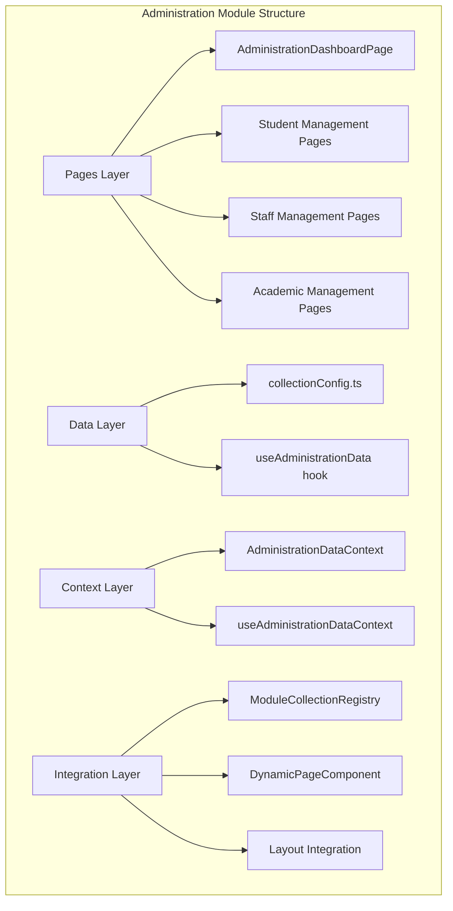
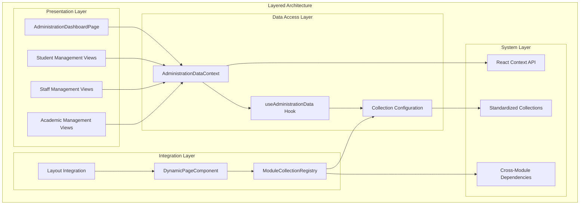
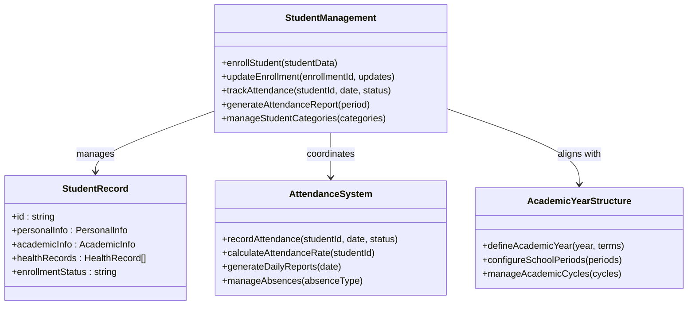
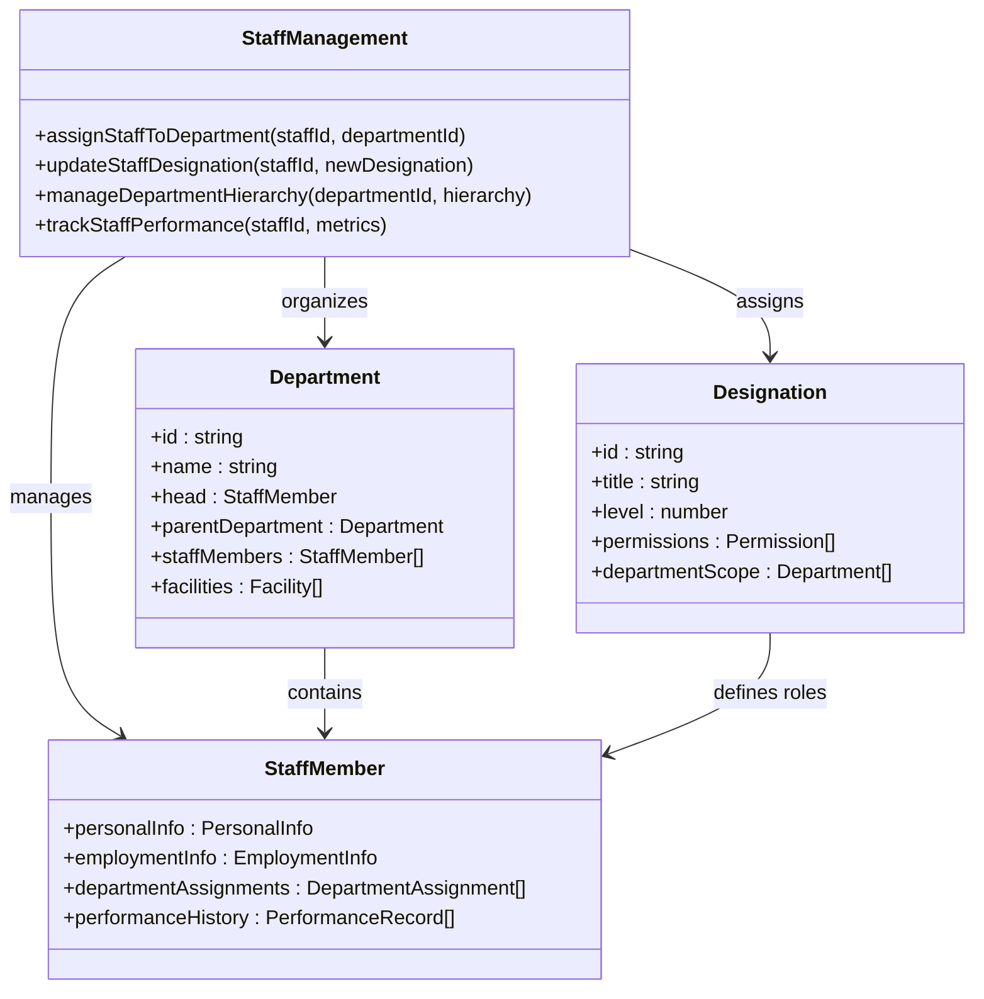
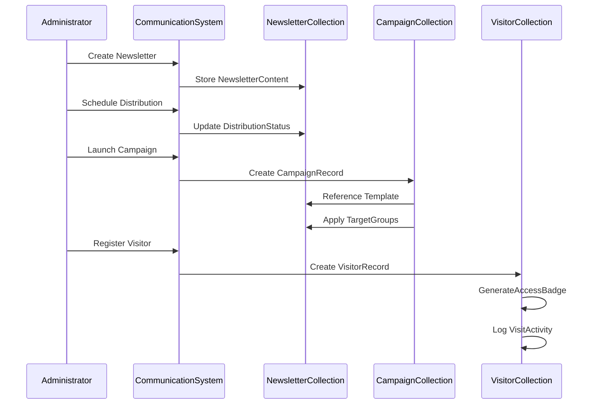
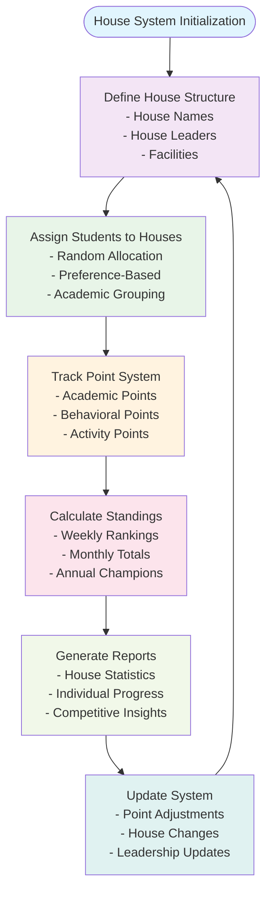
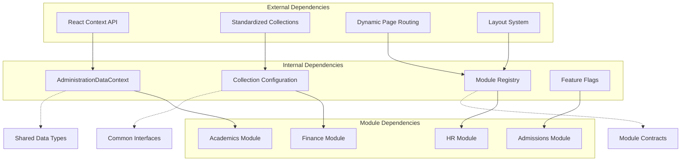

# Administration Module

<cite>
**Referenced Files in This Document**
- [AdministrationDashboardPage.tsx](file://src/modules/administration/pages/AdministrationDashboardPage.tsx)
- [AdministrationDataContext.tsx](file://src/modules/administration/data/AdministrationDataContext.tsx)
- [collectionConfig.ts](file://src/modules/administration/data/collectionConfig.ts)
- [moduleCollectionRegistry.ts](file://src/contexts/appData/moduleCollectionRegistry.ts)
- [DynamicPageComponent.tsx](file://src/components/DynamicPageComponent.tsx)
- [Layout.tsx](file://src/components/Layout.tsx)
- [PrimarySidebar.tsx](file://src/components/PrimarySidebar.tsx)
- [ModuleMetadataLoader.test.ts](file://src/core/__tests__/ModuleMetadataLoader.test.ts)
- [ModuleRegistry.integration.test.ts](file://src/core/__tests__/ModuleRegistry.integration.test.ts)
- [tabbedModeConfig.ts](file://src/config/tabbedModeConfig.ts)
- [features.test.ts](file://src/config/__tests__/features.test.ts)
- [quickEditConfig.ts](file://src/config/quickEditConfig.ts)
- [ModuleDashboardShell.tsx](file://src/components/ModuleDashboardShell.tsx)
- [DonutChart.tsx](file://src/components/ui/DonutChart.tsx)
</cite>

## Table of Contents
1. [Introduction](#introduction)
2. [Project Structure](#project-structure)
3. [Core Components](#core-components)
4. [Architecture Overview](#architecture-overview)
5. [Detailed Component Analysis](#detailed-component-analysis)
6. [Dependency Analysis](#dependency-analysis)
7. [Performance Considerations](#performance-considerations)
8. [Troubleshooting Guide](#troubleshooting-guide)
9. [Conclusion](#conclusion)

## Introduction
The Administration module serves as the central operational hub for managing educational institution data and workflows. It provides comprehensive functionality for student lifecycle management, staff administration, academic calendar coordination, and institutional organization. The module integrates tightly with the broader system through shared data contexts and standardized collection configurations, enabling seamless cross-module operations.

The module encompasses several key domains: student management (enrollment, attendance, health records), staff administration (department assignments, designations), academic year structures, class/stream organization, communication systems, and co-curricular activities. Its architecture emphasizes modularity, data consistency, and operational efficiency through standardized collection naming and centralized data access patterns.

## Project Structure
The Administration module follows a structured organization pattern that separates concerns across data management, presentation, and integration layers. The module leverages React's Context API for state management and employs a collection-based data model for consistent entity management.

**Diagram sources**
- [AdministrationDashboardPage.tsx:1-84](file://src/modules/administration/pages/AdministrationDashboardPage.tsx#L1-L84)
- [AdministrationDataContext.tsx:1-35](file://src/modules/administration/data/AdministrationDataContext.tsx#L1-L35)
- [collectionConfig.ts:1-57](file://src/modules/administration/data/collectionConfig.ts#L1-L57)

**Section sources**
- [AdministrationDashboardPage.tsx:1-84](file://src/modules/administration/pages/AdministrationDashboardPage.tsx#L1-L84)
- [AdministrationDataContext.tsx:1-35](file://src/modules/administration/data/AdministrationDataContext.tsx#L1-L35)
- [collectionConfig.ts:1-57](file://src/modules/administration/data/collectionConfig.ts#L1-L57)

## Core Components
The Administration module's core functionality revolves around three primary components that work together to provide comprehensive institutional management capabilities.

### Data Context System
The AdministrationDataContext provides centralized access to all administrative data through React's Context API. This system ensures consistent data access patterns across the module while maintaining proper separation of concerns between data retrieval and presentation logic.

### Collection Configuration
The collectionConfig defines standardized naming conventions for all administrative entities, ensuring consistency across the module and facilitating integration with other system components. This configuration supports over 30 different collection types covering all aspects of institutional management.

### Dashboard Interface
The AdministrationDashboardPage serves as the primary user interface, providing metrics, quick actions, and visualizations for administrative oversight. The dashboard aggregates data from multiple sources and presents actionable insights for institutional decision-making.

**Section sources**
- [AdministrationDataContext.tsx:1-35](file://src/modules/administration/data/AdministrationDataContext.tsx#L1-L35)
- [collectionConfig.ts:1-57](file://src/modules/administration/data/collectionConfig.ts#L1-L57)
- [AdministrationDashboardPage.tsx:1-84](file://src/modules/administration/pages/AdministrationDashboardPage.tsx#L1-L84)

## Architecture Overview
The Administration module implements a layered architecture that promotes separation of concerns and maintainable code organization. The architecture consists of four distinct layers that handle different aspects of administrative functionality.

**Diagram sources**
- [AdministrationDashboardPage.tsx:1-84](file://src/modules/administration/pages/AdministrationDashboardPage.tsx#L1-L84)
- [AdministrationDataContext.tsx:1-35](file://src/modules/administration/data/AdministrationDataContext.tsx#L1-L35)
- [collectionConfig.ts:1-57](file://src/modules/administration/data/collectionConfig.ts#L1-L57)
- [moduleCollectionRegistry.ts:1-50](file://src/contexts/appData/moduleCollectionRegistry.ts#L1-L50)

The architecture emphasizes loose coupling between components while maintaining strong integration points for data consistency and operational efficiency. The use of standardized collections ensures that all administrative entities follow consistent naming and organizational patterns.

**Section sources**
- [AdministrationDashboardPage.tsx:1-84](file://src/modules/administration/pages/AdministrationDashboardPage.tsx#L1-L84)
- [AdministrationDataContext.tsx:1-35](file://src/modules/administration/data/AdministrationDataContext.tsx#L1-L35)
- [collectionConfig.ts:1-57](file://src/modules/administration/data/collectionConfig.ts#L1-L57)

## Detailed Component Analysis

### Student Management System
The student management system within the Administration module provides comprehensive functionality for student enrollment, academic tracking, and institutional record-keeping. The system utilizes a standardized collection naming convention that ensures consistency across all student-related operations.

#### Enrollment and Registration
The enrollment process is supported through dedicated collections for student records, parent/guardian information, and student categories. These collections work together to provide a complete picture of student enrollment status and demographic information.

#### Attendance Tracking
Student attendance is managed through dedicated collections that track daily attendance records, period definitions, and reporting mechanisms. The system supports various attendance patterns and provides flexible reporting capabilities for administrative oversight.

#### Academic Year Management
The academic year management system coordinates with the broader academic module to ensure proper alignment between student enrollment, course scheduling, and assessment cycles. This integration maintains data consistency across module boundaries.

**Diagram sources**
- [collectionConfig.ts:1-57](file://src/modules/administration/data/collectionConfig.ts#L1-L57)

**Section sources**
- [collectionConfig.ts:1-57](file://src/modules/administration/data/collectionConfig.ts#L1-L57)

### Staff Management Capabilities
The staff management system provides comprehensive functionality for human resource administration, departmental organization, and institutional staffing needs. The system supports complex organizational structures through department and designation hierarchies.

#### Department Structures
The department management system supports hierarchical organizational structures with support for multiple levels of departmental relationships. Each department can contain multiple staff members, facilities, and associated resources.

#### Designation Systems
Staff designations provide role-based access control and organizational positioning within the institutional hierarchy. The system supports various designation types including academic positions, administrative roles, and support staff classifications.

#### Staff Assignment and Tracking
The system tracks staff assignments across departments, periods, and responsibilities while maintaining historical records for performance evaluation and compliance reporting.

**Diagram sources**
- [collectionConfig.ts:1-57](file://src/modules/administration/data/collectionConfig.ts#L1-L57)

**Section sources**
- [collectionConfig.ts:1-57](file://src/modules/administration/data/collectionConfig.ts#L1-L57)

### Communication Features
The Administration module includes comprehensive communication capabilities that support institutional messaging, newsletter management, and visitor coordination. These features integrate with the broader notification and messaging infrastructure.

#### Newsletter Management
Newsletter functionality supports content creation, distribution scheduling, and subscriber management. The system maintains separate collections for newsletter content, distribution lists, and analytics tracking.

#### Message Campaigns
Campaign management enables targeted messaging to specific student groups, staff departments, or community segments. The system supports various campaign types including announcements, reminders, and informational communications.

#### Visitor Management
Visitor coordination includes registration processes, access control, scheduling, and activity tracking. The system maintains visitor logs, appointment scheduling, and facility access management.

**Diagram sources**
- [collectionConfig.ts:1-57](file://src/modules/administration/data/collectionConfig.ts#L1-L57)

**Section sources**
- [collectionConfig.ts:1-57](file://src/modules/administration/data/collectionConfig.ts#L1-L57)

### House System and Student Grouping
The house system provides a framework for organizing students into residential or academic communities with associated point tracking and standings. This system supports both traditional boarding house structures and modern academic house systems.

#### House Organization
Houses serve as organizational units for student grouping, activities, and competition. Each house maintains its own leadership structure, facilities, and community building initiatives.

#### Award Point Tracking
Point tracking systems enable recognition programs, behavioral management, and competitive activities. The system supports various point types, award criteria, and reporting mechanisms.

#### Class Standings
Standing calculations provide academic and behavioral performance tracking across house systems. The system generates reports and maintains historical performance data for administrative review.

**Diagram sources**
- [collectionConfig.ts:1-57](file://src/modules/administration/data/collectionConfig.ts#L1-L57)

**Section sources**
- [collectionConfig.ts:1-57](file://src/modules/administration/data/collectionConfig.ts#L1-L57)

### Administrative Data Models
The Administration module employs a comprehensive data modeling approach that ensures consistency, scalability, and maintainability across all administrative functions. The data models follow standardized collection naming conventions and support complex relationships between entities.

#### Core Entity Collections
The module defines over 30 collection types that cover all aspects of institutional administration. Each collection follows consistent naming patterns and data structure conventions that facilitate integration and maintenance.

#### Cross-Module Integration
Administrative data integrates seamlessly with other system modules through shared collection references and standardized data formats. This integration ensures data consistency and operational efficiency across the entire system.

#### CRUD Operations
The module provides comprehensive CRUD (Create, Read, Update, Delete) operations for all administrative entities, supporting both direct manipulation and batch operations for efficient data management.

**Section sources**
- [collectionConfig.ts:1-57](file://src/modules/administration/data/collectionConfig.ts#L1-L57)

## Dependency Analysis
The Administration module exhibits well-defined dependencies that support modularity and maintainable architecture. The module integrates with several system components while maintaining appropriate separation of concerns.

**Diagram sources**
- [moduleCollectionRegistry.ts:1-50](file://src/contexts/appData/moduleCollectionRegistry.ts#L1-L50)
- [DynamicPageComponent.tsx:1-100](file://src/components/DynamicPageComponent.tsx#L1-L100)
- [Layout.tsx:1-300](file://src/components/Layout.tsx#L1-L300)

The dependency graph reveals a sophisticated integration pattern where the Administration module serves as a central coordinator for institutional data while maintaining loose coupling with specialized modules. This architecture supports both operational independence and strategic integration across the system.

**Section sources**
- [moduleCollectionRegistry.ts:1-50](file://src/contexts/appData/moduleCollectionRegistry.ts#L1-L50)
- [DynamicPageComponent.tsx:1-100](file://src/components/DynamicPageComponent.tsx#L1-L100)
- [Layout.tsx:1-300](file://src/components/Layout.tsx#L1-L300)

## Performance Considerations
The Administration module is designed with performance optimization in mind, incorporating several strategies to ensure efficient operation under various load conditions.

### Data Access Patterns
The module employs optimized data access patterns through its centralized context system, reducing redundant data fetching and ensuring consistent state management across components. The use of React's Context API minimizes unnecessary re-renders while maintaining data freshness.

### Collection Management
Standardized collection naming and organization enable efficient data queries and reduce complexity in data management operations. The collection-based approach supports scalable data operations and maintains performance consistency as data volumes grow.

### Integration Efficiency
The module's integration with other system components is designed for minimal overhead, utilizing shared data structures and standardized interfaces that reduce processing requirements and improve overall system responsiveness.

## Troubleshooting Guide
Common issues and solutions for the Administration module include data synchronization problems, navigation conflicts, and integration challenges with other modules.

### Data Context Issues
When encountering data context errors, verify that components are properly wrapped within the AdministrationDataProvider and that the context is being consumed correctly. The useAdministrationDataContext hook requires proper provider setup to function correctly.

### Collection Configuration Problems
Collection naming inconsistencies can cause integration issues with other modules. Verify that collection names match the standardized configuration and that all required collections are properly registered in the module registry.

### Navigation and Routing
The Administration module integrates with the dynamic page routing system. Ensure that module routes are properly configured and that the DynamicPageComponent is correctly handling module-specific navigation patterns.

**Section sources**
- [AdministrationDashboardPage.tsx:1-84](file://src/modules/administration/pages/AdministrationDashboardPage.tsx#L1-L84)
- [AdministrationDataContext.tsx:1-35](file://src/modules/administration/data/AdministrationDataContext.tsx#L1-L35)
- [collectionConfig.ts:1-57](file://src/modules/administration/data/collectionConfig.ts#L1-L57)

## Conclusion
The Administration module represents a comprehensive solution for institutional management, providing robust functionality for student and staff administration, academic coordination, and operational oversight. Its modular architecture, standardized data models, and integrated design ensure scalability, maintainability, and operational efficiency.

The module's strength lies in its systematic approach to administrative data management, supporting complex organizational structures while maintaining simplicity in day-to-day operations. Through standardized collections, centralized data access, and strategic integration with other system modules, the Administration module provides a solid foundation for educational institution management.

Future enhancements could focus on expanding communication capabilities, improving reporting mechanisms, and enhancing integration with external systems while maintaining the module's core architectural principles and performance characteristics.