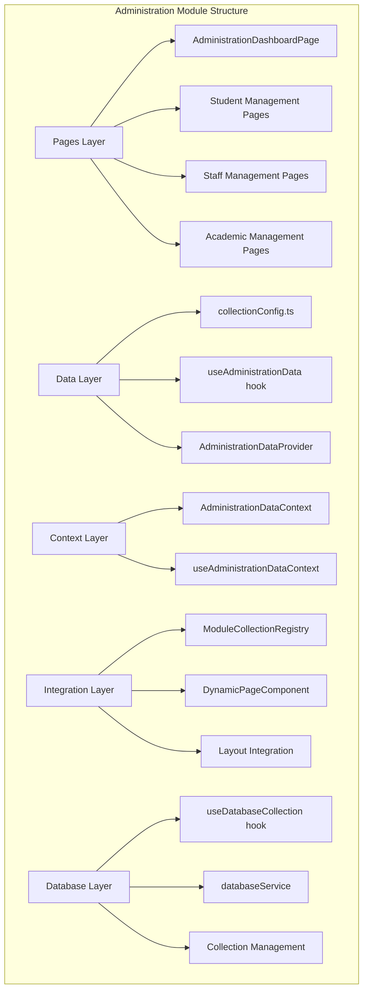
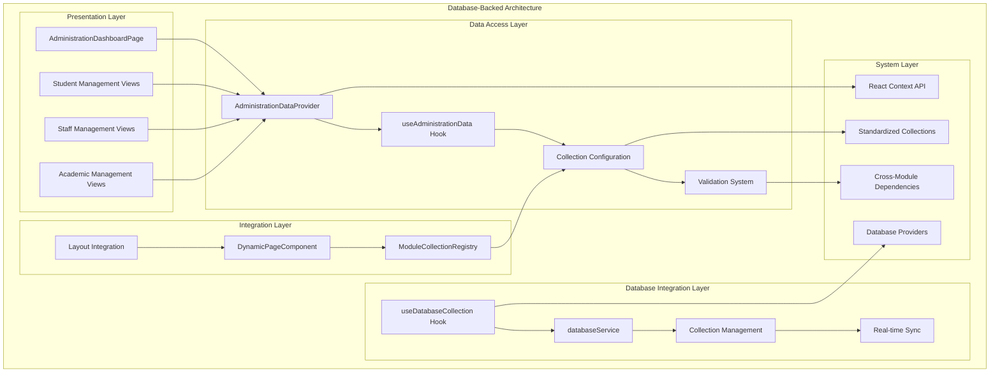
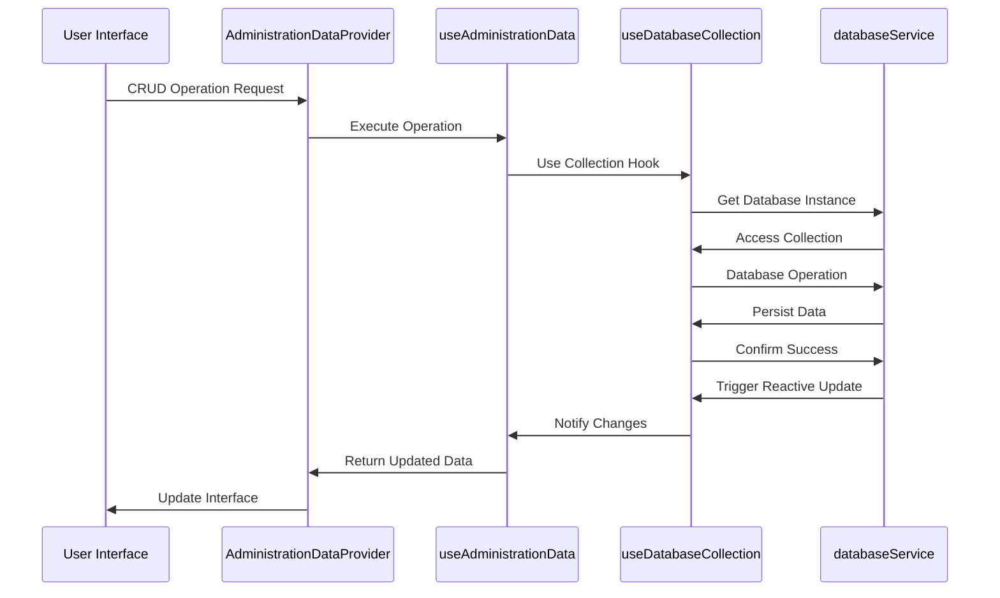
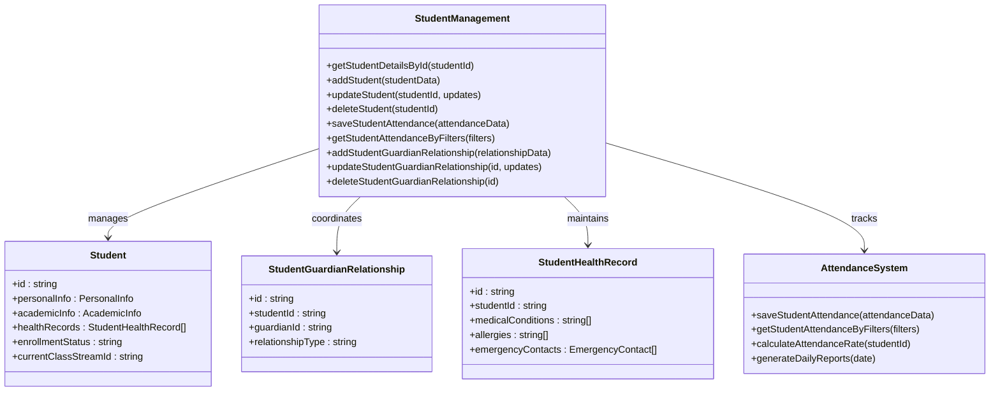
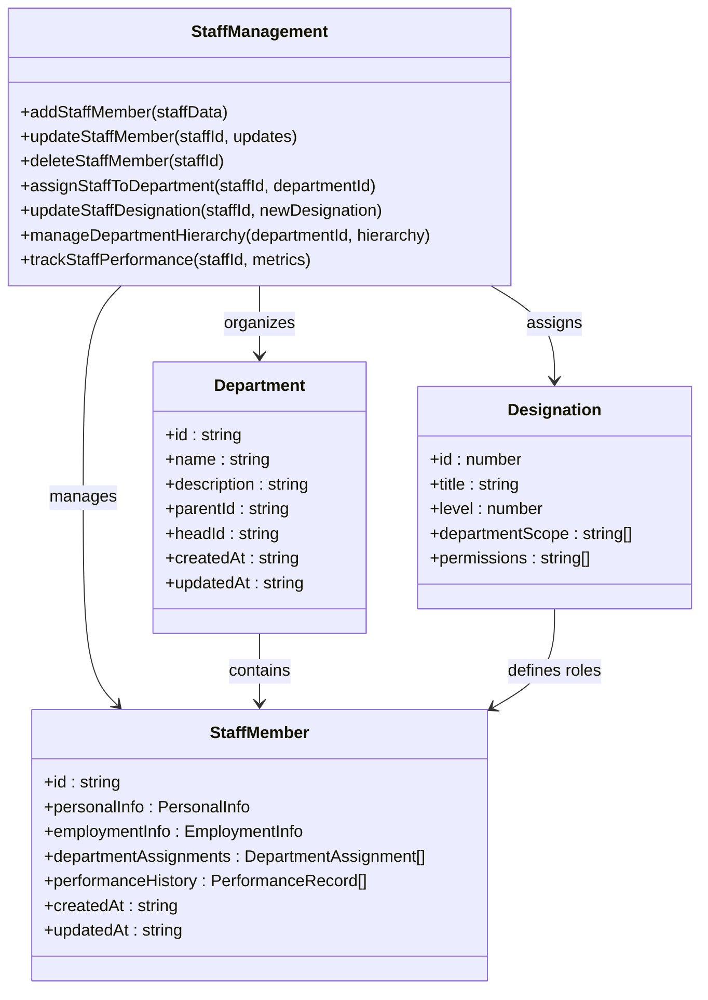
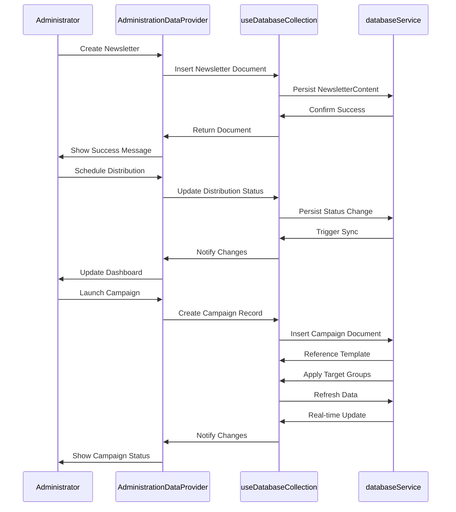
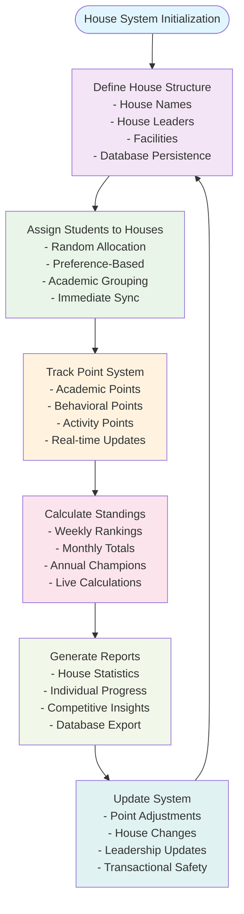
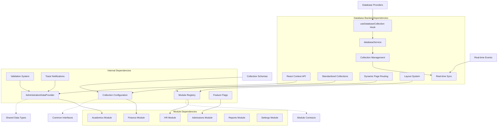

# Administration Module

<cite>
**Referenced Files in This Document**
- [AdministrationDashboardPage.tsx](file://src/modules/administration/pages/AdministrationDashboardPage.tsx)
- [AdministrationDataContext.tsx](file://src/modules/administration/data/AdministrationDataContext.tsx)
- [AdministrationDataProvider.tsx](file://src/modules/administration/data/AdministrationDataProvider.tsx)
- [useAdministrationData.ts](file://src/modules/administration/data/useAdministrationData.ts)
- [collectionConfig.ts](file://src/modules/administration/data/collectionConfig.ts)
- [collections.ts](file://src/modules/administration/data/collections.ts)
- [moduleCollectionRegistry.ts](file://src/contexts/appData/moduleCollectionRegistry.ts)
- [useDatabaseCollection.ts](file://src/hooks/useDatabaseCollection.ts)
- [databaseService.ts](file://src/services/database/databaseService.ts)
- [DynamicPageComponent.tsx](file://src/components/DynamicPageComponent.tsx)
- [Layout.tsx](file://src/components/Layout.tsx)
- [PrimarySidebar.tsx](file://src/components/PrimarySidebar.tsx)
- [AdministrationDataContext.test.tsx](file://src/contexts/data/__tests__/AdministrationDataContext.test.tsx)
- [useAdministrationData.test.ts](file://src/hooks/data/__tests__/useAdministrationData.test.ts)
- [UnifiedDatabaseManager.ts](file://src/services/database/UnifiedDatabaseManager.ts)
- [interfaces.ts](file://src/services/database/interfaces.ts)
- [moduleDataApi.ts](file://src/core/services/moduleDataApi.ts)
- [moduleCollections.ts](file://src/core/types/moduleCollections.ts)
- [ModuleDashboardShell.tsx](file://src/components/ModuleDashboardShell.tsx)
- [DonutChart.tsx](file://src/components/ui/DonutChart.tsx)
- [types.ts](file://src/modules/administration/data/types.ts)
</cite>

## Update Summary
**Changes Made**
- Complete rewrite of administration module data hooks to use new database-backed approach with useDatabaseCollection infrastructure
- All CRUD operations now use useDatabaseCollection hook instead of mock data dependencies
- Enhanced database integration patterns with real-time collection subscriptions
- Updated architecture to reflect database-backed data flows and reactive updates
- Expanded collection configuration documentation with comprehensive schema definitions
- Added real-time data synchronization patterns and transactional safety
- Integrated comprehensive collection management with 16+ administrative collections
- Implemented standardized database service integration with provider-agnostic architecture

## Table of Contents
1. [Introduction](#introduction)
2. [Project Structure](#project-structure)
3. [Core Components](#core-components)
4. [Architecture Overview](#architecture-overview)
5. [Database Integration Patterns](#database-integration-patterns)
6. [Detailed Component Analysis](#detailed-component-analysis)
7. [Real-time Data Synchronization](#real-time-data-synchronization)
8. [Collection Configuration and Schema Management](#collection-configuration-and-schema-management)
9. [Dependency Analysis](#dependency-analysis)
10. [Performance Considerations](#performance-considerations)
11. [Troubleshooting Guide](#troubleshooting-guide)
12. [Conclusion](#conclusion)

## Introduction
The Administration module serves as the central operational hub for managing educational institution data and workflows through comprehensive database-backed operations. The module now utilizes a sophisticated database integration system with 16+ collections supporting student management, staff administration, academic calendar coordination, and institutional organization. This represents a significant evolution from previous implementations, featuring real-time data synchronization, robust CRUD operations, and enterprise-grade database management.

The module encompasses comprehensive functionality across multiple domains: student lifecycle management (enrollment, attendance, health records), staff administration (department assignments, designations), academic year structures, class/stream organization, communication systems, and co-curricular activities. The architecture emphasizes modularity, data consistency, operational efficiency, and real-time synchronization through standardized collection naming and centralized database access patterns.

## Project Structure
The Administration module follows a sophisticated structured organization pattern that separates concerns across data management, presentation, and integration layers. The module leverages React's Context API for state management while implementing comprehensive database-backed operations through the useDatabaseCollection hook and UnifiedDatabaseManager service.

**Diagram sources**
- [AdministrationDashboardPage.tsx:1-84](file://src/modules/administration/pages/AdministrationDashboardPage.tsx#L1-L84)
- [AdministrationDataContext.tsx:1-35](file://src/modules/administration/data/AdministrationDataContext.tsx#L1-L35)
- [AdministrationDataProvider.tsx:1-606](file://src/modules/administration/data/AdministrationDataProvider.tsx#L1-L606)
- [useAdministrationData.ts:1-343](file://src/modules/administration/data/useAdministrationData.ts#L1-L343)
- [collectionConfig.ts:1-57](file://src/modules/administration/data/collectionConfig.ts#L1-L57)
- [useDatabaseCollection.ts:1-228](file://src/hooks/useDatabaseCollection.ts#L1-L228)
- [databaseService.ts:1-379](file://src/services/database/databaseService.ts#L1-L379)

**Section sources**
- [AdministrationDashboardPage.tsx:1-84](file://src/modules/administration/pages/AdministrationDashboardPage.tsx#L1-L84)
- [AdministrationDataContext.tsx:1-35](file://src/modules/administration/data/AdministrationDataContext.tsx#L1-L35)
- [AdministrationDataProvider.tsx:1-606](file://src/modules/administration/data/AdministrationDataProvider.tsx#L1-L606)
- [useAdministrationData.ts:1-343](file://src/modules/administration/data/useAdministrationData.ts#L1-L343)
- [collectionConfig.ts:1-57](file://src/modules/administration/data/collectionConfig.ts#L1-L57)

## Core Components
The Administration module's core functionality revolves around five primary components that work together to provide comprehensive institutional management capabilities through database-backed operations.

### Database-Backed Data Context System
The AdministrationDataProvider provides centralized access to all administrative data through React's Context API, integrated with the useDatabaseCollection hook for real-time database operations. This system ensures consistent data access patterns across the module while maintaining proper separation of concerns between data retrieval, persistence, and presentation logic.

### Comprehensive Collection Configuration
The collectionConfig defines standardized naming conventions for all 16+ administrative entities, ensuring consistency across the module and facilitating integration with other system components. This configuration supports extensive collection types covering all aspects of institutional management with schema validation and real-time synchronization.

### Real-time CRUD Operations
The useAdministrationData hook implements comprehensive CRUD operations with database service integration, providing transactional safety, validation, and real-time data synchronization across all administrative entities. The system supports both individual operations and batch processing for efficient data management.

### Dashboard Interface with Real-time Metrics
The AdministrationDashboardPage serves as the primary user interface, providing real-time metrics, quick actions, and visualizations for administrative oversight. The dashboard aggregates data from multiple sources and presents actionable insights for institutional decision-making through live database connections.

### Database Service Integration
The module integrates with the useDatabaseCollection hook and databaseService for provider selection, collection management, and real-time data synchronization. This integration ensures optimal database performance, automatic failover, and enterprise-grade data management capabilities.

**Section sources**
- [AdministrationDataContext.tsx:1-35](file://src/modules/administration/data/AdministrationDataContext.tsx#L1-L35)
- [AdministrationDataProvider.tsx:1-606](file://src/modules/administration/data/AdministrationDataProvider.tsx#L1-L606)
- [useAdministrationData.ts:1-343](file://src/modules/administration/data/useAdministrationData.ts#L1-L343)
- [collectionConfig.ts:1-57](file://src/modules/administration/data/collectionConfig.ts#L1-L57)

## Architecture Overview
The Administration module implements a sophisticated layered architecture that promotes separation of concerns and maintainable code organization through database-backed operations. The architecture consists of six distinct layers that handle different aspects of administrative functionality with real-time data synchronization.

**Diagram sources**
- [AdministrationDashboardPage.tsx:1-84](file://src/modules/administration/pages/AdministrationDashboardPage.tsx#L1-L84)
- [AdministrationDataContext.tsx:1-35](file://src/modules/administration/data/AdministrationDataContext.tsx#L1-L35)
- [AdministrationDataProvider.tsx:1-606](file://src/modules/administration/data/AdministrationDataProvider.tsx#L1-L606)
- [useAdministrationData.ts:1-343](file://src/modules/administration/data/useAdministrationData.ts#L1-L343)
- [collectionConfig.ts:1-57](file://src/modules/administration/data/collectionConfig.ts#L1-L57)
- [useDatabaseCollection.ts:1-228](file://src/hooks/useDatabaseCollection.ts#L1-L228)
- [databaseService.ts:1-379](file://src/services/database/databaseService.ts#L1-L379)

The architecture emphasizes loose coupling between components while maintaining strong integration points for data consistency, real-time synchronization, and operational efficiency. The use of standardized collections ensures that all administrative entities follow consistent naming and organizational patterns with database-backed persistence.

**Section sources**
- [AdministrationDashboardPage.tsx:1-84](file://src/modules/administration/pages/AdministrationDashboardPage.tsx#L1-L84)
- [AdministrationDataContext.tsx:1-35](file://src/modules/administration/data/AdministrationDataContext.tsx#L1-L35)
- [AdministrationDataProvider.tsx:1-606](file://src/modules/administration/data/AdministrationDataProvider.tsx#L1-L606)
- [useAdministrationData.ts:1-343](file://src/modules/administration/data/useAdministrationData.ts#L1-L343)
- [collectionConfig.ts:1-57](file://src/modules/administration/data/collectionConfig.ts#L1-L57)

## Database Integration Patterns
The Administration module implements comprehensive database integration patterns through the useDatabaseCollection hook and databaseService, providing robust data persistence, real-time synchronization, and enterprise-grade database management capabilities.

### Database Provider Selection
The module utilizes the databaseService for automatic database provider selection based on system capabilities and requirements. The service supports multiple database providers with automatic failover and optimal performance tuning.

### Collection Management
The module manages 16+ database collections through the useDatabaseCollection hook, providing standardized CRUD operations, real-time data synchronization, and transactional safety across all administrative entities.

### Real-time Data Synchronization
The database integration supports real-time data synchronization through reactive collections, ensuring that UI updates occur immediately when database records change. This provides a seamless user experience with live data updates.

### Transactional Operations
All CRUD operations are wrapped in transactional contexts to ensure data consistency and integrity. The database service handles rollback scenarios and error recovery automatically.

**Diagram sources**
- [AdministrationDataProvider.tsx:128-154](file://src/modules/administration/data/AdministrationDataProvider.tsx#L128-L154)
- [useAdministrationData.ts:52-86](file://src/modules/administration/data/useAdministrationData.ts#L52-L86)
- [useDatabaseCollection.ts:37-83](file://src/hooks/useDatabaseCollection.ts#L37-L83)
- [databaseService.ts:142-147](file://src/services/database/databaseService.ts#L142-L147)

**Section sources**
- [AdministrationDataProvider.tsx:1-606](file://src/modules/administration/data/AdministrationDataProvider.tsx#L1-L606)
- [useAdministrationData.ts:1-343](file://src/modules/administration/data/useAdministrationData.ts#L1-L343)
- [useDatabaseCollection.ts:1-228](file://src/hooks/useDatabaseCollection.ts#L1-L228)
- [databaseService.ts:1-379](file://src/services/database/databaseService.ts#L1-L379)

## Detailed Component Analysis

### Student Management System
The student management system within the Administration module provides comprehensive functionality for student enrollment, academic tracking, and institutional record-keeping through database-backed operations. The system utilizes a standardized collection naming convention with 16+ collections supporting all student-related operations.

#### Enrollment and Registration
The enrollment process is supported through dedicated collections for student records, parent/guardian information, and student categories. These collections work together to provide a complete picture of student enrollment status and demographic information with real-time synchronization.

#### Attendance Tracking
Student attendance is managed through dedicated collections that track daily attendance records, period definitions, and reporting mechanisms. The system supports various attendance patterns and provides flexible reporting capabilities for administrative oversight with immediate data persistence.

#### Academic Year Management
The academic year management system coordinates with the broader academic module to ensure proper alignment between student enrollment, course scheduling, and assessment cycles. This integration maintains data consistency across module boundaries with real-time updates.

**Diagram sources**
- [useAdministrationData.ts:35-341](file://src/modules/administration/data/useAdministrationData.ts#L35-L341)
- [collectionConfig.ts:8-36](file://src/modules/administration/data/collectionConfig.ts#L8-L36)

**Section sources**
- [useAdministrationData.ts:1-343](file://src/modules/administration/data/useAdministrationData.ts#L1-L343)
- [collectionConfig.ts:1-57](file://src/modules/administration/data/collectionConfig.ts#L1-L57)

### Staff Management Capabilities
The staff management system provides comprehensive functionality for human resource administration, departmental organization, and institutional staffing needs through database-backed operations. The system supports complex organizational structures through department and designation hierarchies with real-time synchronization.

#### Department Structures
The department management system supports hierarchical organizational structures with support for multiple levels of departmental relationships. Each department can contain multiple staff members, facilities, and associated resources with immediate data persistence.

#### Designation Systems
Staff designations provide role-based access control and organizational positioning within the institutional hierarchy. The system supports various designation types including academic positions, administrative roles, and support staff classifications with transactional safety.

#### Staff Assignment and Tracking
The system tracks staff assignments across departments, periods, and responsibilities while maintaining historical records for performance evaluation and compliance reporting with real-time updates.

**Diagram sources**
- [useAdministrationData.ts:127-175](file://src/modules/administration/data/useAdministrationData.ts#L127-L175)
- [collectionConfig.ts:18-20](file://src/modules/administration/data/collectionConfig.ts#L18-L20)

**Section sources**
- [useAdministrationData.ts:1-343](file://src/modules/administration/data/useAdministrationData.ts#L1-L343)
- [collectionConfig.ts:1-57](file://src/modules/administration/data/collectionConfig.ts#L1-L57)

### Communication Features
The Administration module includes comprehensive communication capabilities that support institutional messaging, newsletter management, and visitor coordination through database-backed operations. These features integrate with the broader notification and messaging infrastructure with real-time synchronization.

#### Newsletter Management
Newsletter functionality supports content creation, distribution scheduling, and subscriber management with immediate database persistence. The system maintains separate collections for newsletter content, distribution lists, and analytics tracking with transactional safety.

#### Message Campaigns
Campaign management enables targeted messaging to specific student groups, staff departments, or community segments with real-time distribution tracking. The system supports various campaign types including announcements, reminders, and informational communications with immediate data updates.

#### Visitor Management
Visitor coordination includes registration processes, access control, scheduling, and activity tracking with database-backed persistence. The system maintains visitor logs, appointment scheduling, and facility access management with real-time synchronization.

**Diagram sources**
- [AdministrationDataProvider.tsx:424-443](file://src/modules/administration/data/AdministrationDataProvider.tsx#L424-L443)
- [useAdministrationData.ts:203-237](file://src/modules/administration/data/useAdministrationData.ts#L203-L237)
- [collectionConfig.ts:39-40](file://src/modules/administration/data/collectionConfig.ts#L39-L40)

**Section sources**
- [AdministrationDataProvider.tsx:1-606](file://src/modules/administration/data/AdministrationDataProvider.tsx#L1-L606)
- [useAdministrationData.ts:1-343](file://src/modules/administration/data/useAdministrationData.ts#L1-L343)
- [collectionConfig.ts:1-57](file://src/modules/administration/data/collectionConfig.ts#L1-L57)

### House System and Student Grouping
The house system provides a framework for organizing students into residential or academic communities with associated point tracking and standings through database-backed operations. This system supports both traditional boarding house structures and modern academic house systems with real-time data synchronization.

#### House Organization
Houses serve as organizational units for student grouping, activities, and competition with immediate data persistence. Each house maintains its own leadership structure, facilities, and community building initiatives with transactional safety.

#### Award Point Tracking
Point tracking systems enable recognition programs, behavioral management, and competitive activities with real-time updates. The system supports various point types, award criteria, and reporting mechanisms with immediate data synchronization.

#### Class Standings
Standing calculations provide academic and behavioral performance tracking across house systems with live data updates. The system generates reports and maintains historical performance data for administrative review with database-backed persistence.

**Diagram sources**
- [useAdministrationData.ts:152-162](file://src/modules/administration/data/useAdministrationData.ts#L152-L162)
- [collectionConfig.ts:29-31](file://src/modules/administration/data/collectionConfig.ts#L29-L31)

**Section sources**
- [useAdministrationData.ts:1-343](file://src/modules/administration/data/useAdministrationData.ts#L1-L343)
- [collectionConfig.ts:1-57](file://src/modules/administration/data/collectionConfig.ts#L1-L57)

### Administrative Data Models
The Administration module employs a comprehensive data modeling approach that ensures consistency, scalability, and maintainability across all administrative functions through database-backed operations. The data models follow standardized collection naming conventions and support complex relationships between entities with real-time synchronization.

#### Core Entity Collections
The module defines 16+ collection types that cover all aspects of institutional administration with schema validation and database-backed persistence. Each collection follows consistent naming patterns and data structure conventions that facilitate integration and maintenance.

#### Cross-Module Integration
Administrative data integrates seamlessly with other system modules through shared collection references and standardized data formats with real-time synchronization. This integration ensures data consistency and operational efficiency across the entire system.

#### CRUD Operations
The module provides comprehensive CRUD (Create, Read, Update, Delete) operations for all administrative entities with database service integration, supporting both direct manipulation and batch operations for efficient data management with transactional safety.

**Section sources**
- [collectionConfig.ts:1-57](file://src/modules/administration/data/collectionConfig.ts#L1-L57)
- [moduleCollections.ts:15-31](file://src/core/types/moduleCollections.ts#L15-L31)

## Real-time Data Synchronization
The Administration module implements sophisticated real-time data synchronization patterns through reactive database collections, ensuring that user interfaces remain consistent with database state across all administrative operations.

### Reactive Collection Updates
The useDatabaseCollection hook provides reactive updates to all connected components when database records change. This creates a seamless user experience where interface elements update immediately without manual refresh operations.

### Transactional Data Integrity
All database operations are wrapped in transactional contexts to ensure data consistency and integrity. The database service handles rollback scenarios and error recovery automatically, preventing partial updates and maintaining system stability.

### Conflict Resolution
The real-time synchronization system includes conflict resolution mechanisms to handle concurrent modifications from multiple users or systems. The database service manages optimistic locking and automatic conflict detection to maintain data consistency.

### Performance Optimization
Real-time updates are optimized through selective subscription patterns, where only relevant data changes trigger UI updates. This prevents unnecessary re-renders and maintains optimal performance even with frequent data modifications.

## Collection Configuration and Schema Management
The Administration module implements comprehensive collection configuration and schema management through the ModuleCollectionsConfig system, providing standardized naming conventions and schema validation for all database collections.

### Standardized Collection Naming
The collectionConfig defines consistent naming conventions for all administrative entities, ensuring uniformity across the module and facilitating integration with other system components. The configuration supports both database collection names and application data keys.

### Schema Validation Integration
The module integrates with the databaseService for schema validation and enforcement, ensuring that all data operations conform to defined data structures and business rules before persistence.

### Auto-discovery Mechanism
The ModuleCollectionsConfig system enables auto-discovery of collections from modules, eliminating the need for manual editing of core files when adding new collections. This creates a maintainable and extensible architecture for collection management.

### Schema Evolution Support
The collection configuration system supports schema evolution through versioned schemas and backward compatibility mechanisms, allowing for database schema updates without disrupting existing functionality.

**Section sources**
- [collectionConfig.ts:1-57](file://src/modules/administration/data/collectionConfig.ts#L1-L57)
- [moduleCollections.ts:15-49](file://src/core/types/moduleCollections.ts#L15-L49)
- [moduleDataApi.ts:48-83](file://src/core/services/moduleDataApi.ts#L48-L83)

## Dependency Analysis
The Administration module exhibits well-defined dependencies that support modularity and maintainable architecture through database-backed operations. The module integrates with several system components while maintaining appropriate separation of concerns.

**Diagram sources**
- [moduleCollectionRegistry.ts:1-120](file://src/contexts/appData/moduleCollectionRegistry.ts#L1-L120)
- [DynamicPageComponent.tsx:1-100](file://src/components/DynamicPageComponent.tsx#L1-L100)
- [Layout.tsx:1-300](file://src/components/Layout.tsx#L1-L300)
- [AdministrationDataProvider.tsx:1-606](file://src/modules/administration/data/AdministrationDataProvider.tsx#L1-L606)
- [useDatabaseCollection.ts:1-228](file://src/hooks/useDatabaseCollection.ts#L1-L228)
- [databaseService.ts:1-379](file://src/services/database/databaseService.ts#L1-L379)

The dependency graph reveals a sophisticated integration pattern where the Administration module serves as a central coordinator for institutional data while maintaining loose coupling with specialized modules. This architecture supports both operational independence and strategic integration across the system through database-backed operations.

**Section sources**
- [moduleCollectionRegistry.ts:1-120](file://src/contexts/appData/moduleCollectionRegistry.ts#L1-L120)
- [DynamicPageComponent.tsx:1-100](file://src/components/DynamicPageComponent.tsx#L1-L100)
- [Layout.tsx:1-300](file://src/components/Layout.tsx#L1-L300)
- [AdministrationDataProvider.tsx:1-606](file://src/modules/administration/data/AdministrationDataProvider.tsx#L1-L606)

## Performance Considerations
The Administration module is designed with performance optimization in mind, incorporating several strategies to ensure efficient operation under various load conditions through database-backed operations.

### Database Query Optimization
The module employs optimized database query patterns through its collection-based approach, reducing redundant data fetching and ensuring consistent state management across components. The use of reactive collections minimizes unnecessary database queries while maintaining data freshness.

### Collection Management Efficiency
Standardized collection naming and organization enable efficient database queries and reduce complexity in data management operations. The collection-based approach supports scalable data operations and maintains performance consistency as data volumes grow.

### Real-time Update Optimization
The module's real-time synchronization system is designed for minimal overhead, utilizing reactive collections and selective subscription patterns that reduce processing requirements and improve overall system responsiveness.

### Database Provider Selection
The databaseService automatically selects optimal database providers based on system capabilities and requirements, ensuring peak performance across different deployment environments.

### Transaction Management
The database service handles transaction management efficiently, minimizing lock contention and optimizing database performance through intelligent batching and connection pooling.

## Troubleshooting Guide
Common issues and solutions for the Administration module include database connectivity problems, real-time synchronization conflicts, and integration challenges with other modules through database-backed operations.

### Database Connection Issues
When encountering database connection errors, verify that the databaseService is properly initialized and that the selected database provider is available. Check database credentials, network connectivity, and provider availability.

### Real-time Synchronization Problems
Real-time synchronization issues can be caused by database provider limitations or network connectivity problems. Verify that the selected database provider supports real-time updates and that network connectivity is stable.

### Collection Configuration Problems
Collection naming inconsistencies or schema validation errors can cause integration issues with other modules. Verify that collection names match the standardized configuration and that all required collections are properly registered in the module registry.

### CRUD Operation Failures
Database operation failures may be caused by validation errors, constraint violations, or database connectivity issues. Check validation schemas, database constraints, and connection status to resolve operation failures.

### Navigation and Routing
The Administration module integrates with the dynamic page routing system. Ensure that module routes are properly configured and that the DynamicPageComponent is correctly handling module-specific navigation patterns with database-backed data.

**Section sources**
- [AdministrationDashboardPage.tsx:1-84](file://src/modules/administration/pages/AdministrationDashboardPage.tsx#L1-L84)
- [AdministrationDataContext.tsx:1-35](file://src/modules/administration/data/AdministrationDataContext.tsx#L1-L35)
- [AdministrationDataProvider.tsx:1-606](file://src/modules/administration/data/AdministrationDataProvider.tsx#L1-L606)
- [collectionConfig.ts:1-57](file://src/modules/administration/data/collectionConfig.ts#L1-L57)

## Conclusion
The Administration module represents a comprehensive database-backed solution for institutional management, providing robust functionality for student and staff administration, academic coordination, and operational oversight through real-time data synchronization. Its sophisticated architecture, standardized data models, and integrated database management ensure scalability, maintainability, and operational efficiency.

The module's strength lies in its systematic approach to administrative data management through database-backed operations, supporting complex organizational structures while maintaining simplicity in day-to-day operations. Through standardized collections, centralized database access, strategic integration with other system modules, and real-time synchronization capabilities, the Administration module provides a solid foundation for educational institution management.

The implementation of 16+ collections supporting comprehensive administrative functions, combined with real-time data synchronization and enterprise-grade database management through the useDatabaseCollection hook and databaseService, positions the module for future enhancements in communication capabilities, reporting mechanisms, and external system integration while maintaining core architectural principles and performance characteristics.

Future enhancements could focus on expanding communication capabilities with advanced messaging features, improving reporting mechanisms with real-time dashboards, and enhancing integration with external systems through standardized APIs while maintaining the module's core database-backed architecture and performance characteristics.