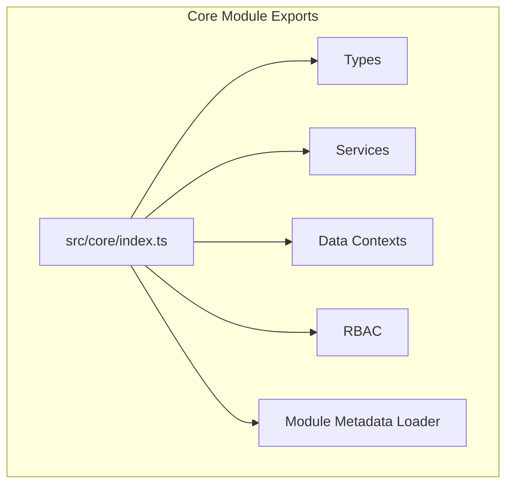
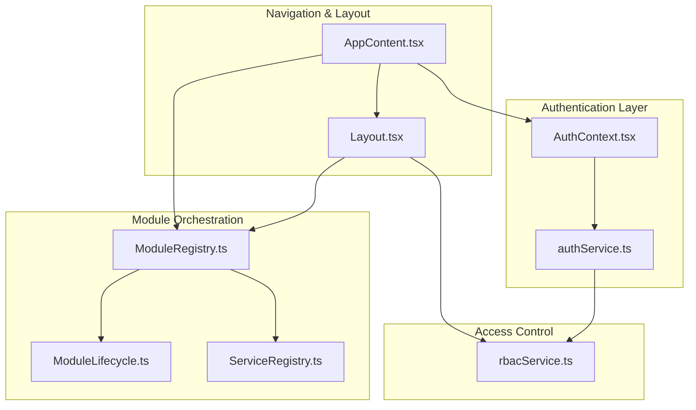
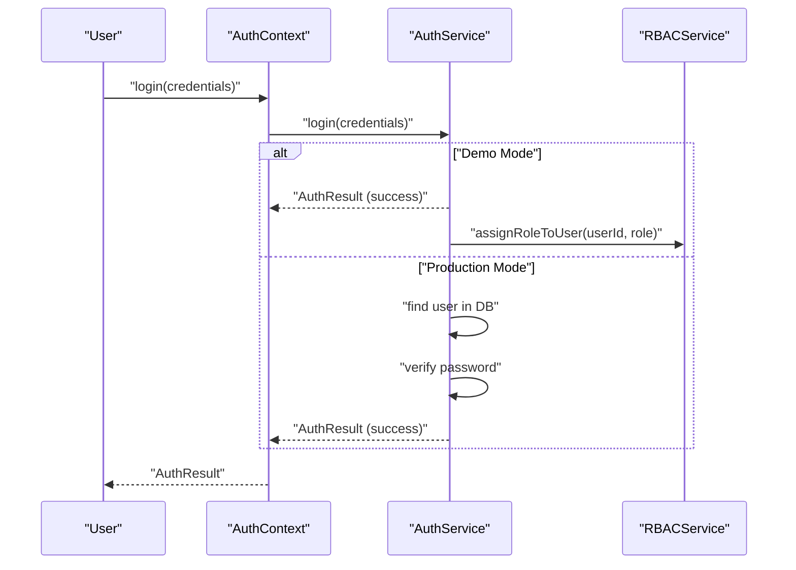
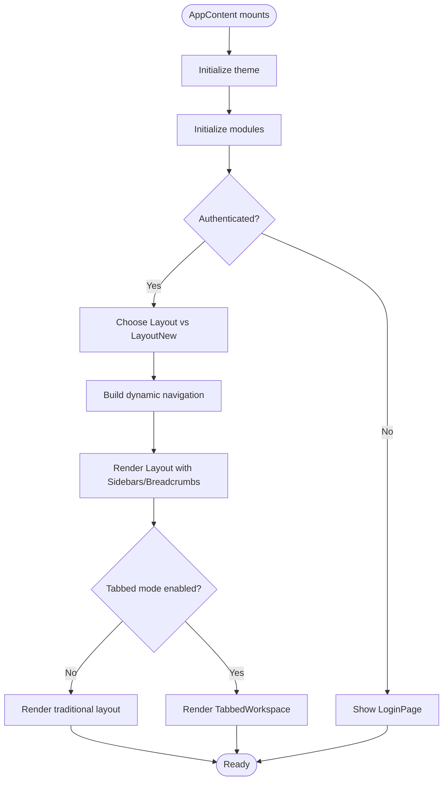
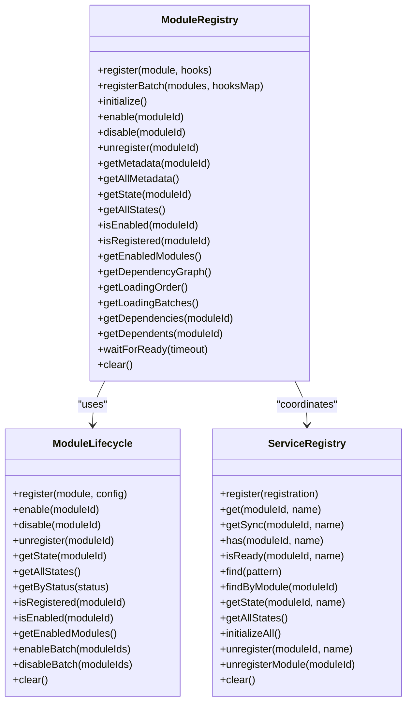
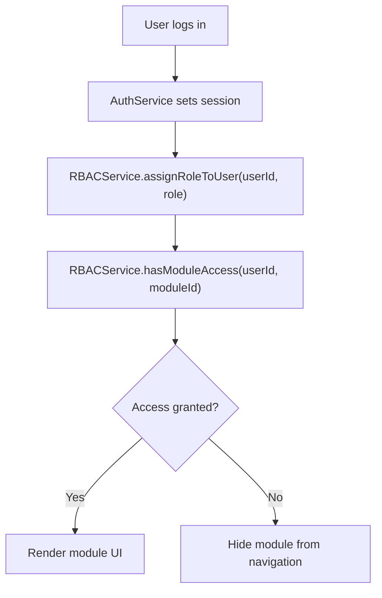
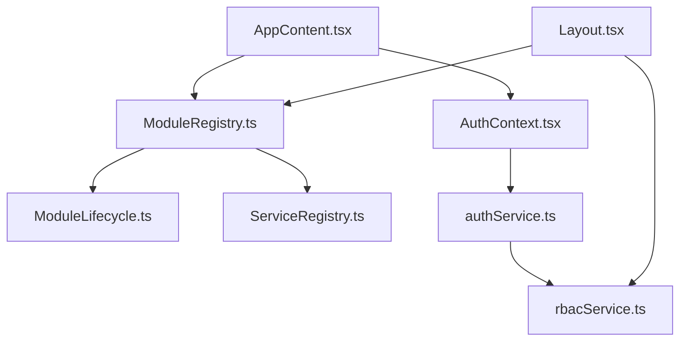

# Core Module

<cite>
**Referenced Files in This Document**
- [src/core/index.ts](file://src/core/index.ts)
- [src/core/moduleRegistry.ts](file://src/core/moduleRegistry.ts)
- [src/core/ModuleLifecycle.ts](file://src/core/ModuleLifecycle.ts)
- [src/core/ServiceRegistry.ts](file://src/core/ServiceRegistry.ts)
- [src/core/rbacService.ts](file://src/core/rbacService.ts)
- [src/services/auth/authService.ts](file://src/services/auth/authService.ts)
- [src/contexts/AuthContext.tsx](file://src/contexts/AuthContext.tsx)
- [src/routing/AppContent.tsx](file://src/routing/AppContent.tsx)
- [src/components/Layout.tsx](file://src/components/Layout.tsx)
- [src/hooks/useAppData.ts](file://src/hooks/useAppData.ts)
- [src/utils/index.ts](file://src/utils/index.ts)
</cite>

## Table of Contents
1. [Introduction](#introduction)
2. [Project Structure](#project-structure)
3. [Core Components](#core-components)
4. [Architecture Overview](#architecture-overview)
5. [Detailed Component Analysis](#detailed-component-analysis)
6. [Dependency Analysis](#dependency-analysis)
7. [Performance Considerations](#performance-considerations)
8. [Troubleshooting Guide](#troubleshooting-guide)
9. [Conclusion](#conclusion)

## Introduction
The Core module serves as the foundation for the entire application, orchestrating module lifecycle, service discovery, authentication, and RBAC. It provides the infrastructure that other modules depend on, ensuring consistent initialization, dependency resolution, and runtime orchestration. This document explains the authentication system, navigation structure, core UI components, and the foundational services that enable system initialization and user context management.

## Project Structure
The Core module exposes a centralized barrel for types, services, data contexts, RBAC, and metadata loaders. It also defines the module registry, lifecycle manager, and service registry that power the modular architecture.

**Diagram sources**
- [src/core/index.ts:1-22](file://src/core/index.ts#L1-L22)

**Section sources**
- [src/core/index.ts:1-22](file://src/core/index.ts#L1-L22)

## Core Components
- Module Registry: Central coordinator for module registration, dependency resolution, and initialization order. Emits lifecycle events and supports both sequential and parallel loading modes.
- Module Lifecycle: Manages module states (registered, enabled, disabled, error) and executes lifecycle hooks for each module.
- Service Registry: Cross-module service discovery, initialization, and dependency injection with support for singletons and asynchronous initialization.
- RBAC Service: Role-based access control with permission evaluation, module access checks, and navigation filtering.
- Authentication Service and Context: Handles login/logout, session persistence, demo vs production modes, and permission checks.
- Navigation and Layout: Dynamic navigation, tabbed workspace integration, breadcrumbs, and responsive layouts.

**Section sources**
- [src/core/moduleRegistry.ts:24-348](file://src/core/moduleRegistry.ts#L24-L348)
- [src/core/ModuleLifecycle.ts:37-295](file://src/core/ModuleLifecycle.ts#L37-L295)
- [src/core/ServiceRegistry.ts:32-277](file://src/core/ServiceRegistry.ts#L32-L277)
- [src/core/rbacService.ts:70-405](file://src/core/rbacService.ts#L70-L405)
- [src/services/auth/authService.ts:56-674](file://src/services/auth/authService.ts#L56-L674)
- [src/contexts/AuthContext.tsx:28-167](file://src/contexts/AuthContext.tsx#L28-L167)
- [src/routing/AppContent.tsx:48-220](file://src/routing/AppContent.tsx#L48-L220)
- [src/components/Layout.tsx:26-317](file://src/components/Layout.tsx#L26-L317)

## Architecture Overview
The Core module integrates authentication, navigation, and module orchestration. The authentication system initializes asynchronously, determines demo or production mode, and exposes permission checks. The navigation layer dynamically builds accessible modules and routes, while the tabbed workspace provides modern navigation for supported modules. The module registry and lifecycle manager coordinate initialization and runtime state changes.

**Diagram sources**
- [src/contexts/AuthContext.tsx:28-167](file://src/contexts/AuthContext.tsx#L28-L167)
- [src/services/auth/authService.ts:56-674](file://src/services/auth/authService.ts#L56-L674)
- [src/routing/AppContent.tsx:48-220](file://src/routing/AppContent.tsx#L48-L220)
- [src/components/Layout.tsx:26-317](file://src/components/Layout.tsx#L26-L317)
- [src/core/moduleRegistry.ts:24-348](file://src/core/moduleRegistry.ts#L24-L348)
- [src/core/ModuleLifecycle.ts:37-295](file://src/core/ModuleLifecycle.ts#L37-L295)
- [src/core/ServiceRegistry.ts:32-277](file://src/core/ServiceRegistry.ts#L32-L277)
- [src/core/rbacService.ts:70-405](file://src/core/rbacService.ts#L70-L405)

## Detailed Component Analysis

### Authentication System
The authentication system manages user sessions, mode detection (demo vs production), and permission checks. It initializes asynchronously, restores sessions, and provides login/logout methods. In demo mode, it validates usernames against predefined accounts and assigns roles to the RBAC service. In production mode, it authenticates against the database, verifies passwords, and updates last login timestamps.

**Diagram sources**
- [src/contexts/AuthContext.tsx:77-98](file://src/contexts/AuthContext.tsx#L77-L98)
- [src/services/auth/authService.ts:215-419](file://src/services/auth/authService.ts#L215-L419)
- [src/core/rbacService.ts:200-219](file://src/core/rbacService.ts#L200-L219)

**Section sources**
- [src/contexts/AuthContext.tsx:28-167](file://src/contexts/AuthContext.tsx#L28-L167)
- [src/services/auth/authService.ts:56-674](file://src/services/auth/authService.ts#L56-L674)
- [src/core/rbacService.ts:70-405](file://src/core/rbacService.ts#L70-L405)

### Navigation Structure and Layout
The navigation system dynamically constructs accessible modules and routes based on user permissions and configuration. The Layout component manages primary and secondary sidebars, breadcrumbs, and tabbed workspace integration. It selects between traditional layout and tabbed workspace depending on feature flags and module capabilities.

**Diagram sources**
- [src/routing/AppContent.tsx:156-220](file://src/routing/AppContent.tsx#L156-L220)
- [src/components/Layout.tsx:26-317](file://src/components/Layout.tsx#L26-L317)

**Section sources**
- [src/routing/AppContent.tsx:48-220](file://src/routing/AppContent.tsx#L48-L220)
- [src/components/Layout.tsx:26-317](file://src/components/Layout.tsx#L26-L317)

### Core UI Components
- Header and Settings: Provide top-level controls and settings popup.
- Sidebars: Primary and secondary navigation with module selection and submenu toggling.
- Breadcrumb Navigation: Context-aware breadcrumbs for traditional layout.
- Tabbed Workspace: Modern tabbed navigation with persistence, action bar, and hierarchical mode.
- Scroll Helpers: Floating buttons to navigate back to menu or scroll to top.

These components integrate with the tab store and RBAC service to tailor the UI to user roles and module permissions.

**Section sources**
- [src/components/Layout.tsx:26-317](file://src/components/Layout.tsx#L26-L317)

### Core Data Context and Shared Utilities
- App Data Context: Provides application-wide data access via a dedicated hook for Fast Refresh compatibility.
- Design System Utilities: Centralized exports for design tokens, responsive utilities, accessibility, animations, theme management, and logging.

**Section sources**
- [src/hooks/useAppData.ts:9-21](file://src/hooks/useAppData.ts#L9-L21)
- [src/utils/index.ts:1-20](file://src/utils/index.ts#L1-L20)

### Module Orchestration
The module registry coordinates registration, dependency resolution, and initialization. It supports sequential and parallel loading, emits lifecycle events, and ensures safe enabling/disabling. The lifecycle manager tracks module states and executes hooks. The service registry provides cross-module service discovery and dependency injection.

**Diagram sources**
- [src/core/moduleRegistry.ts:24-348](file://src/core/moduleRegistry.ts#L24-L348)
- [src/core/ModuleLifecycle.ts:37-295](file://src/core/ModuleLifecycle.ts#L37-L295)
- [src/core/ServiceRegistry.ts:32-277](file://src/core/ServiceRegistry.ts#L32-L277)

**Section sources**
- [src/core/moduleRegistry.ts:24-348](file://src/core/moduleRegistry.ts#L24-L348)
- [src/core/ModuleLifecycle.ts:37-295](file://src/core/ModuleLifecycle.ts#L37-L295)
- [src/core/ServiceRegistry.ts:32-277](file://src/core/ServiceRegistry.ts#L32-L277)

### RBAC Integration
The RBAC service evaluates user permissions and module access, filters navigation items, and exposes methods for role assignment and permission queries. It integrates with the authentication service to assign roles during demo login and with the navigation system to restrict access to unauthorized modules.

**Diagram sources**
- [src/services/auth/authService.ts:410-418](file://src/services/auth/authService.ts#L410-L418)
- [src/core/rbacService.ts:200-219](file://src/core/rbacService.ts#L200-L219)
- [src/core/rbacService.ts:152-164](file://src/core/rbacService.ts#L152-L164)

**Section sources**
- [src/core/rbacService.ts:70-405](file://src/core/rbacService.ts#L70-L405)
- [src/services/auth/authService.ts:56-674](file://src/services/auth/authService.ts#L56-L674)

## Dependency Analysis
The Core module’s components are tightly coupled to provide cohesive orchestration. The module registry depends on the lifecycle manager and service registry. The authentication context depends on the authentication service, which in turn integrates with RBAC and configuration systems. The layout and navigation components depend on the module registry and RBAC service to build accessible UIs.

**Diagram sources**
- [src/core/moduleRegistry.ts:24-348](file://src/core/moduleRegistry.ts#L24-L348)
- [src/core/ModuleLifecycle.ts:37-295](file://src/core/ModuleLifecycle.ts#L37-L295)
- [src/core/ServiceRegistry.ts:32-277](file://src/core/ServiceRegistry.ts#L32-L277)
- [src/contexts/AuthContext.tsx:28-167](file://src/contexts/AuthContext.tsx#L28-L167)
- [src/services/auth/authService.ts:56-674](file://src/services/auth/authService.ts#L56-L674)
- [src/core/rbacService.ts:70-405](file://src/core/rbacService.ts#L70-L405)
- [src/routing/AppContent.tsx:48-220](file://src/routing/AppContent.tsx#L48-L220)
- [src/components/Layout.tsx:26-317](file://src/components/Layout.tsx#L26-L317)

**Section sources**
- [src/core/moduleRegistry.ts:24-348](file://src/core/moduleRegistry.ts#L24-L348)
- [src/core/ModuleLifecycle.ts:37-295](file://src/core/ModuleLifecycle.ts#L37-L295)
- [src/core/ServiceRegistry.ts:32-277](file://src/core/ServiceRegistry.ts#L32-L277)
- [src/contexts/AuthContext.tsx:28-167](file://src/contexts/AuthContext.tsx#L28-L167)
- [src/services/auth/authService.ts:56-674](file://src/services/auth/authService.ts#L56-L674)
- [src/core/rbacService.ts:70-405](file://src/core/rbacService.ts#L70-L405)
- [src/routing/AppContent.tsx:48-220](file://src/routing/AppContent.tsx#L48-L220)
- [src/components/Layout.tsx:26-317](file://src/components/Layout.tsx#L26-L317)

## Performance Considerations
- Module Initialization Timeout: The application enforces an emergency timeout during module initialization to prevent indefinite hangs.
- Asynchronous Initialization: Authentication and database initialization are performed asynchronously with timeouts and fallbacks to demo mode.
- Parallel Loading: The module registry supports parallel loading of modules in batches to improve startup performance.
- Lazy Loading: Routes and components are loaded lazily to reduce initial bundle size.

**Section sources**
- [src/routing/AppContent.tsx:180-212](file://src/routing/AppContent.tsx#L180-L212)
- [src/services/auth/authService.ts:70-138](file://src/services/auth/authService.ts#L70-L138)
- [src/core/moduleRegistry.ts:152-171](file://src/core/moduleRegistry.ts#L152-L171)

## Troubleshooting Guide
- Authentication Initialization Timeout: If the authentication service fails to initialize within the expected timeframe, the system falls back to demo mode and logs a warning. Verify database availability and configuration.
- Session Restoration Failure: If session restoration fails, the system clears the session and proceeds without authentication. Check local storage and session validity.
- Module Initialization Failure: If module initialization fails, the system logs the error and continues. Review module dependencies and lifecycle hooks.
- RBAC Permission Denied: If a user lacks permission to access a module, the navigation system hides it. Verify user roles and module access configuration.
- Tabbed Workspace Issues: If the tabbed workspace fails to initialize, the system falls back to traditional layout. Check tab store initialization and feature flags.

**Section sources**
- [src/services/auth/authService.ts:129-137](file://src/services/auth/authService.ts#L129-L137)
- [src/services/auth/authService.ts:154-180](file://src/services/auth/authService.ts#L154-L180)
- [src/routing/AppContent.tsx:204-207](file://src/routing/AppContent.tsx#L204-L207)
- [src/core/rbacService.ts:152-164](file://src/core/rbacService.ts#L152-L164)
- [src/components/Layout.tsx:75-98](file://src/components/Layout.tsx#L75-L98)

## Conclusion
The Core module provides the backbone of the application by orchestrating authentication, navigation, module lifecycle, and RBAC. Its registries and lifecycle managers ensure robust initialization and runtime management, while the authentication and navigation components deliver a secure and user-friendly experience. By leveraging the service registry and RBAC service, the system maintains modularity and scalability across modules.