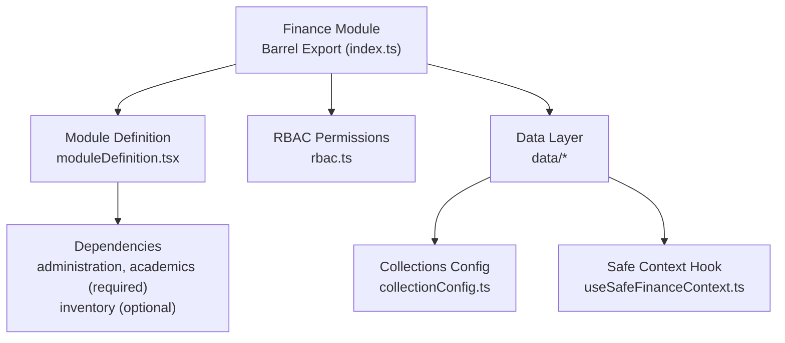
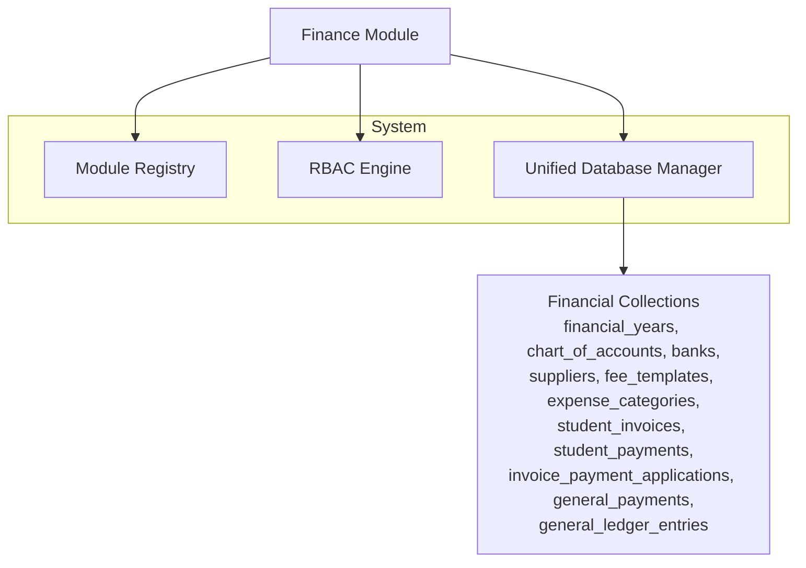
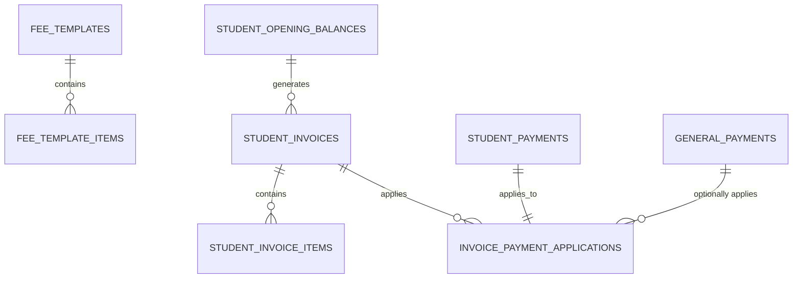
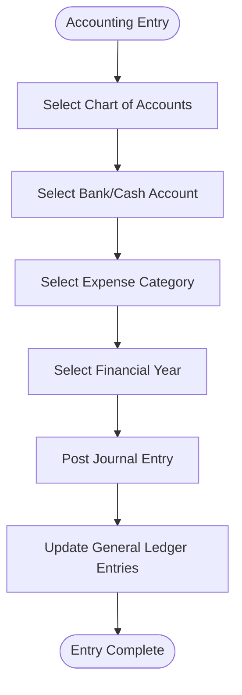
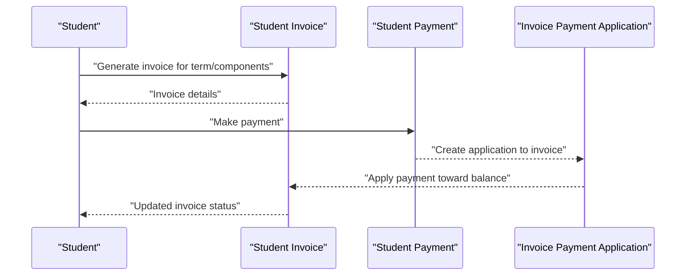
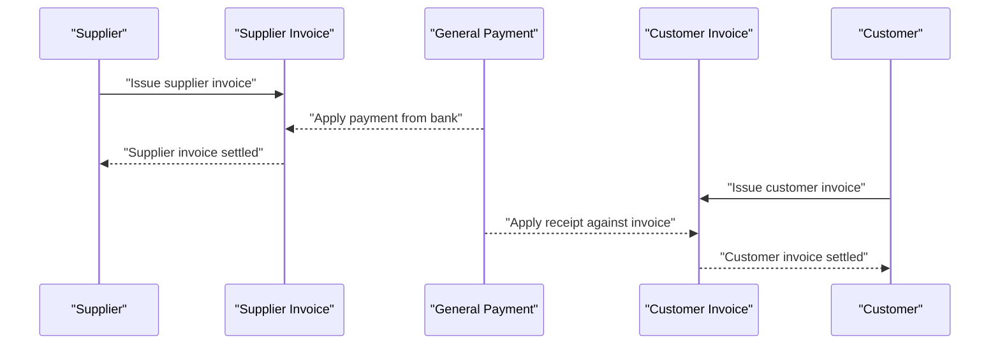
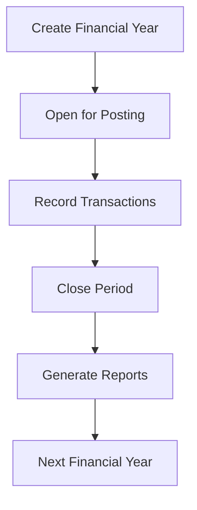
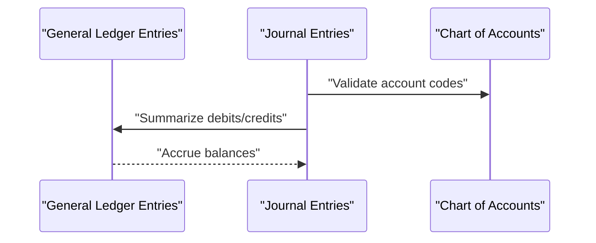
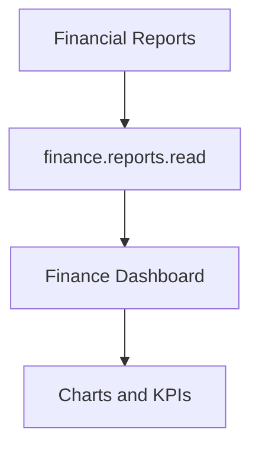
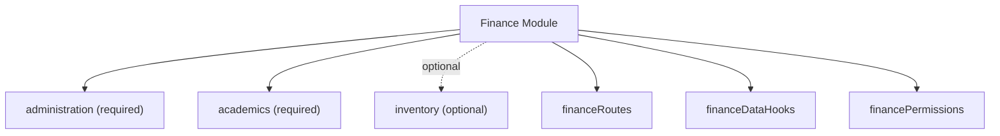

# Finance Module

<cite>
**Referenced Files in This Document**
- [index.ts](file://src/modules/finance/index.ts)
- [moduleDefinition.tsx](file://src/modules/finance/moduleDefinition.tsx)
- [rbac.ts](file://src/modules/finance/rbac.ts)
- [collectionConfig.ts](file://src/modules/finance/data/collectionConfig.ts)
- [useSafeFinanceContext.ts](file://src/modules/finance/data/useSafeFinanceContext.ts)
- [CONTEXT.md](file://CONTEXT.md)
</cite>

## Table of Contents
1. [Introduction](#introduction)
2. [Project Structure](#project-structure)
3. [Core Components](#core-components)
4. [Architecture Overview](#architecture-overview)
5. [Detailed Component Analysis](#detailed-component-analysis)
6. [Dependency Analysis](#dependency-analysis)
7. [Performance Considerations](#performance-considerations)
8. [Troubleshooting Guide](#troubleshooting-guide)
9. [Conclusion](#conclusion)

## Introduction
This document describes the Finance module functionality within the system. It focuses on the fee management system (templates, adjustments, collection tracking), accounting integration (chart of accounts, bank management, expense tracking), student payment processing and invoicing, financial year management, general ledger integration, supplier management, payment application workflows, financial data models, transaction processing, and reporting capabilities. The content is derived from the module’s barrel exports, module definition, RBAC permissions, data collection configuration, and safe context hook.

## Project Structure
The Finance module follows a standardized modular structure with clear separation of concerns:
- Module definition and registration
- RBAC permissions and roles
- Data layer with typed schemas, collections, and hooks
- Pages, components, services, and lifecycle hooks
- Safe context hook for graceful module disablement

**Diagram sources**
- [index.ts:1-31](file://src/modules/finance/index.ts#L1-L31)
- [moduleDefinition.tsx](file://src/modules/finance/moduleDefinition.tsx)
- [rbac.ts:1-51](file://src/modules/finance/rbac.ts#L1-L51)
- [collectionConfig.ts:46-79](file://src/modules/finance/data/collectionConfig.ts#L46-L79)
- [useSafeFinanceContext.ts:1-35](file://src/modules/finance/data/useSafeFinanceContext.ts#L1-L35)

**Section sources**
- [index.ts:1-31](file://src/modules/finance/index.ts#L1-L31)
- [CONTEXT.md:312-356](file://CONTEXT.md#L312-L356)

## Core Components
- Module definition and registration: Declares module identity, version, dependencies, routes, data hooks, and permissions.
- RBAC permissions: Defines granular permissions for payment processing and financial reporting.
- Data collections: Centralized configuration of RxDB schemas and collection aliases for all financial entities.
- Safe context hook: Provides a fallback set of empty arrays when the module is disabled, ensuring robust UI rendering.

Key responsibilities:
- Fee management: Templates, adjustments, and collection tracking via dedicated collections.
- Accounting integration: Chart of accounts, bank management, and expense categories/claims.
- Student financials: Invoices, payments, and applications against invoices.
- Supplier/customer management: Invoices and payments for external parties.
- General ledger: Entries and financial year boundaries.
- Reporting: Permissions to view financial reports.

**Section sources**
- [moduleDefinition.tsx](file://src/modules/finance/moduleDefinition.tsx)
- [rbac.ts:1-51](file://src/modules/finance/rbac.ts#L1-L51)
- [collectionConfig.ts:46-79](file://src/modules/finance/data/collectionConfig.ts#L46-L79)
- [useSafeFinanceContext.ts:1-35](file://src/modules/finance/data/useSafeFinanceContext.ts#L1-L35)

## Architecture Overview
The Finance module integrates with the broader system through:
- Module registration and lifecycle
- Data layer auto-discovery via collection configuration
- RBAC enforcement for sensitive operations
- Safe context pattern for optional module enablement

**Diagram sources**
- [moduleDefinition.tsx](file://src/modules/finance/moduleDefinition.tsx)
- [rbac.ts:1-51](file://src/modules/finance/rbac.ts#L1-L51)
- [collectionConfig.ts:46-79](file://src/modules/finance/data/collectionConfig.ts#L46-L79)

## Detailed Component Analysis

### Fee Management System
Fee templates, adjustments, and collection tracking are represented by dedicated collections. The system supports:
- Template creation and inheritance for fee components
- Adjustment records for exceptions or waivers
- Tracking of fee collections and application to student balances

**Diagram sources**
- [collectionConfig.ts:46-79](file://src/modules/finance/data/collectionConfig.ts#L46-L79)

**Section sources**
- [collectionConfig.ts:46-79](file://src/modules/finance/data/collectionConfig.ts#L46-L79)

### Accounting Integration
The accounting backbone includes:
- Chart of accounts for posting transactions
- Bank management for cash/bank accounts
- Expense categories and claims for operational costs
- Financial years to bound accounting periods

**Diagram sources**
- [collectionConfig.ts:46-79](file://src/modules/finance/data/collectionConfig.ts#L46-L79)

**Section sources**
- [collectionConfig.ts:46-79](file://src/modules/finance/data/collectionConfig.ts#L46-L79)

### Student Payment Processing and Invoicing
Student financials are modeled with separate entities for invoices and payments, with application logic linking payments to invoices.

**Diagram sources**
- [collectionConfig.ts:46-79](file://src/modules/finance/data/collectionConfig.ts#L46-L79)

**Section sources**
- [collectionConfig.ts:46-79](file://src/modules/finance/data/collectionConfig.ts#L46-L79)

### Supplier and Customer Management
Supplier and customer invoice workflows support procurement and revenue recording.

**Diagram sources**
- [collectionConfig.ts:46-79](file://src/modules/finance/data/collectionConfig.ts#L46-L79)

**Section sources**
- [collectionConfig.ts:46-79](file://src/modules/finance/data/collectionConfig.ts#L46-L79)

### Financial Year Management
Financial years bound accounting periods and ensure proper cutoffs for ledger entries and reporting.

**Diagram sources**
- [collectionConfig.ts:46-79](file://src/modules/finance/data/collectionConfig.ts#L46-L79)

**Section sources**
- [collectionConfig.ts:46-79](file://src/modules/finance/data/collectionConfig.ts#L46-L79)

### General Ledger Integration
General ledger entries capture summarized postings from journals and support financial reporting.

**Diagram sources**
- [collectionConfig.ts:46-79](file://src/modules/finance/data/collectionConfig.ts#L46-L79)

**Section sources**
- [collectionConfig.ts:46-79](file://src/modules/finance/data/collectionConfig.ts#L46-L79)

### Reporting Capabilities
The module exposes read permissions for financial reports, enabling dashboards and analytics.

**Diagram sources**
- [rbac.ts:40-49](file://src/modules/finance/rbac.ts#L40-L49)

**Section sources**
- [rbac.ts:1-51](file://src/modules/finance/rbac.ts#L1-L51)

## Dependency Analysis
The Finance module declares explicit dependencies on other modules and defines its own permissions and routes.

**Diagram sources**
- [moduleDefinition.tsx](file://src/modules/finance/moduleDefinition.tsx)
- [rbac.ts:1-51](file://src/modules/finance/rbac.ts#L1-L51)

**Section sources**
- [moduleDefinition.tsx](file://src/modules/finance/moduleDefinition.tsx)
- [rbac.ts:1-51](file://src/modules/finance/rbac.ts#L1-L51)

## Performance Considerations
- Use the safe context hook to avoid heavy computations when the module is disabled.
- Leverage RxDB reactive queries and indexing for efficient financial data retrieval.
- Batch general ledger updates during period-end close to minimize write amplification.
- Apply pagination and virtualization for large datasets like invoices and payments.

## Troubleshooting Guide
Common issues and resolutions:
- Module disabled: The safe context hook returns empty arrays; verify module enablement in the registry.
- Missing collections: Ensure collection configuration is loaded by the unified database manager.
- Permission denied: Confirm RBAC grants for payment processing and report viewing.
- Data inconsistencies: Validate financial year boundaries and chart of accounts mappings.

**Section sources**
- [useSafeFinanceContext.ts:1-35](file://src/modules/finance/data/useSafeFinanceContext.ts#L1-L35)
- [collectionConfig.ts:46-79](file://src/modules/finance/data/collectionConfig.ts#L46-L79)
- [rbac.ts:1-51](file://src/modules/finance/rbac.ts#L1-L51)

## Conclusion
The Finance module provides a structured foundation for fee management, accounting integration, student payment processing, supplier/customer workflows, general ledger posting, and reporting. Its modular design, RBAC permissions, and collection-driven data model enable scalable and maintainable financial operations across the system.