# Finance Module

<cite>
**Referenced Files in This Document**
- [index.ts](file://src/modules/finance/index.ts)
- [moduleDefinition.tsx](file://src/modules/finance/moduleDefinition.tsx)
- [rbac.ts](file://src/modules/finance/rbac.ts)
- [hooks/index.ts](file://src/modules/finance/hooks/index.ts)
- [hooks/useFinance.ts](file://src/modules/finance/hooks/useFinance.ts)
- [data/useFinanceData.ts](file://src/modules/finance/data/useFinanceData.ts)
- [data/appDataAugmentation.ts](file://src/modules/finance/data/appDataAugmentation.ts)
- [data/types.ts](file://src/modules/finance/data/types.ts)
- [data/collections.ts](file://src/modules/finance/data/collections.ts)
- [data/schema.ts](file://src/modules/finance/data/schema.ts)
- [pages/BalanceSheetPage.tsx](file://src/modules/finance/pages/BalanceSheetPage.tsx)
- [pages/CashBookPage.tsx](file://src/modules/finance/pages/CashBookPage.tsx)
- [pages/DayBookPage.tsx](file://src/modules/finance/pages/DayBookPage.tsx)
- [pages/FeesDueReportPage.tsx](file://src/modules/finance/pages/FeesDueReportPage.tsx)
- [pages/FeesFinesPage.tsx](file://src/modules/finance/pages/FeesFinesPage.tsx)
- [pages/FeesInstallmentsPage.tsx](file://src/modules/finance/pages/FeesInstallmentsPage.tsx)
- [pages/FeesReceiptTemplatePage.tsx](file://src/modules/finance/pages/FeesReceiptTemplatePage.tsx)
- [pages/IncomeStatementPage.tsx](file://src/modules/finance/pages/IncomeStatementPage.tsx)
- [pages/JournalRegisterPage.tsx](file://src/modules/finance/pages/JournalRegisterPage.tsx)
- [pages/PreviousSessionFeesPage.tsx](file://src/modules/finance/pages/PreviousSessionFeesPage.tsx)
- [pages/StudentsPaidBookPage.tsx](file://src/modules/finance/pages/StudentsPaidBookPage.tsx)
- [pages/TrialBalancePage.tsx](file://src/modules/finance/pages/TrialBalancePage.tsx)
- [CONTEXT.md](file://CONTEXT.md)
</cite>

## Update Summary
**Changes Made**
- Enhanced module augmentation system with comprehensive TypeScript declaration merging pattern
- Updated documentation to reflect the new 96-line appDataAugmentation.ts implementation
- Added detailed coverage of financial collections extension for AppDataType and AppDataContextType
- Expanded financial data type safety with 36+ entity types and complete schema integration
- Integrated comprehensive module augmentation system for seamless AppData integration

## Table of Contents
1. [Introduction](#introduction)
2. [Project Structure](#project-structure)
3. [Core Components](#core-components)
4. [Architecture Overview](#architecture-overview)
5. [Financial Services Layer](#financial-services-layer)
6. [React Hooks Ecosystem](#react-hooks-ecosystem)
7. [Service Registration System](#service-registration-system)
8. [Enhanced Reporting Capabilities](#enhanced-reporting-capabilities)
9. [Comprehensive Accounting Pages](#comprehensive-accounting-pages)
10. [Fee Management Enhancements](#fee-management-enhancements)
11. [Receipt Management System](#receipt-management-system)
12. [Data Layer Evolution](#data-layer-evolution)
13. [Navigation and Features](#navigation-and-features)
14. [Internationalization and Multilingual Support](#internationalization-and-multilingual-support)
15. [Performance Considerations](#performance-considerations)
16. [Troubleshooting Guide](#troubleshooting-guide)
17. [Conclusion](#conclusion)

## Introduction
This document describes the Finance module functionality within the system, featuring a comprehensive transformation to a service-oriented architecture with TypeScript implementations replacing traditional stored procedures and database-side financial processing. The module now provides advanced financial management capabilities through a modernized approach with specialized financial services, computed view hooks, and comprehensive reporting features. The architecture emphasizes modular design with specialized services for invoice management, payment processing, and financial analytics, supported by a robust hooks ecosystem for real-time data computation and presentation.

**Updated** Enhanced with comprehensive accounting system including detailed financial statements, fee management enhancements, receipt template customization, and extensive data model integration through TypeScript module augmentation. The module now implements a sophisticated declaration merging pattern that extends AppDataType and AppDataContextType with 36+ financial entity collections and comprehensive CRUD operations.

## Project Structure
The Finance module follows a modernized structure with enhanced service architecture and comprehensive hook-based data management:

- Module definition with 23 navigation routes covering comprehensive financial management
- RBAC permissions for granular access control across payment processing and reporting
- Service-oriented architecture with TypeScript implementations replacing stored procedures
- React hooks ecosystem for computed views and financial analytics
- Enhanced data layer with computed view hooks replacing PostgreSQL views
- Comprehensive financial reporting and analytics capabilities
- **Updated** Extensive data model with 36+ financial entity types and module augmentation system
- **Updated** TypeScript module augmentation for compile-time type safety across all financial collections

```mermaid
graph TB
A["Finance Module<br/>Barrel Export (index.ts)"] --> B["Module Definition<br/>moduleDefinition.tsx"]
A --> C["RBAC Permissions<br/>rbac.ts"]
A --> D["Enhanced Services Layer<br/>Financial Services + Hooks"]
D --> E["P0 Services<br/>InvoiceStatusService, InvoiceGenerationService, PaymentAllocationService"]
D --> F["Service Registration<br/>registerServices.ts"]
D --> G["Hook Wrappers<br/>useInvoiceStatus, useInvoiceGeneration, usePaymentAllocation"]
B --> H["23 Navigation Routes<br/>Comprehensive Financial Management"]
B --> I["Feature Flags<br/>Fee Management, Payment Processing, Accounting, Expense Tracking, Transport Finance"]
J["Enhanced Accounting Pages<br/>New Comprehensive System"] --> K["Balance Sheet"]
J --> L["Cash Book"]
J --> M["Day Book"]
J --> N["Income Statement"]
J --> O["Journal Register"]
P["Fee Management Enhancements<br/>Fines & Installments"] --> Q["Fees Fines"]
P --> R["Fee Installments"]
S["Receipt Management<br/>Custom Templates"] --> T["Fees Receipt Template"]
T --> U["Template Preview & Printing"]
V["Data Model Enhancement<br/>36+ Entity Types"] --> W["Financial Year Management"]
V --> X["Chart of Accounts"]
V --> Y["Expense Categories"]
V --> Z["Banking Operations"]
AA["Supplier Management<br/>Supplier Invoicing"] --> BB["Supplier Invoices"]
AA --> CC["Supplier Contracts"]
DD["Module Augmentation<br/>Type Safety"] --> EE["AppData Integration"]
DD --> FF["Declaration Merging<br/>96 Lines of Type Extensions"]
```

**Diagram sources**
- [index.ts:1-31](file://src/modules/finance/index.ts#L1-L31)
- [moduleDefinition.tsx:24-87](file://src/modules/finance/moduleDefinition.tsx#L24-L87)
- [rbac.ts:1-51](file://src/modules/finance/rbac.ts#L1-L51)
- [hooks/index.ts:1-6](file://src/modules/finance/hooks/index.ts#L1-L6)
- [hooks/useFinance.ts:1-141](file://src/modules/finance/hooks/useFinance.ts#L1-L141)
- [data/useFinanceData.ts:1-396](file://src/modules/finance/data/useFinanceData.ts#L1-L396)
- [data/appDataAugmentation.ts:1-97](file://src/modules/finance/data/appDataAugmentation.ts#L1-L97)
- [data/types.ts:1-602](file://src/modules/finance/data/types.ts#L1-L602)

**Section sources**
- [index.ts:1-31](file://src/modules/finance/index.ts#L1-L31)
- [CONTEXT.md:312-356](file://CONTEXT.md#L312-L356)

## Core Components
The Finance module now provides comprehensive financial management through an enhanced service-oriented architecture with specialized financial services and computed view hooks:

### Module Definition and Registration
- Declares module identity, version, dependencies, 23 navigation routes, data hooks, and permissions
- Supports both required (administration) and optional dependencies
- Features include comprehensive fee management, advanced payment processing, integrated accounting, detailed expense tracking, and transport finance
- Includes extensive feature flags for enabling/disabling specific financial functionalities

### RBAC Permissions
- Granular permissions for payment processing and financial reporting
- Four payment operation permissions (read, create, update, delete)
- One reporting permission for financial insights
- Default roles include finance officer and administrator

### Enhanced Services Architecture
The module now features a sophisticated service-oriented architecture that replaces traditional stored procedures with TypeScript implementations:

#### P0 Financial Services Layer
- **InvoiceStatusService**: Real-time invoice status tracking and management with dependency injection
- **InvoiceGenerationService**: Automated invoice creation and generation workflows with template-based processing
- **PaymentAllocationService**: Intelligent payment allocation to multiple invoices and financial periods with priority and weighted algorithms

#### Service Registration System
- **registerFinanceServices**: Centralized service registration with dependency injection pattern
- **Service Registry Integration**: Global service registry for P0 services requiring runtime dependencies
- **Lazy Singleton Pattern**: Services registered as factories for runtime dependency initialization

**Section sources**
- [moduleDefinition.tsx:24-87](file://src/modules/finance/moduleDefinition.tsx#L24-L87)
- [rbac.ts:1-51](file://src/modules/finance/rbac.ts#L1-L51)
- [hooks/index.ts:1-6](file://src/modules/finance/hooks/index.ts#L1-L6)
- [hooks/useFinance.ts:1-141](file://src/modules/finance/hooks/useFinance.ts#L1-L141)
- [data/useFinanceData.ts:1-396](file://src/modules/finance/data/useFinanceData.ts#L1-L396)

## Architecture Overview
The Finance module integrates comprehensively with the broader system through its enhanced service-oriented architecture and computed view hooks:

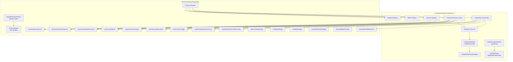

**Diagram sources**
- [moduleDefinition.tsx:24-87](file://src/modules/finance/moduleDefinition.tsx#L24-L87)
- [rbac.ts:1-51](file://src/modules/finance/rbac.ts#L1-L51)
- [hooks/index.ts:1-6](file://src/modules/finance/hooks/index.ts#L1-L6)
- [data/appDataAugmentation.ts:38-96](file://src/modules/finance/data/appDataAugmentation.ts#L38-L96)

## Financial Services Layer
The Finance module now provides comprehensive financial services through TypeScript implementations that replace traditional stored procedures:

### Invoice Status Management Service
The InvoiceStatusService provides real-time invoice tracking and status management with dependency injection:

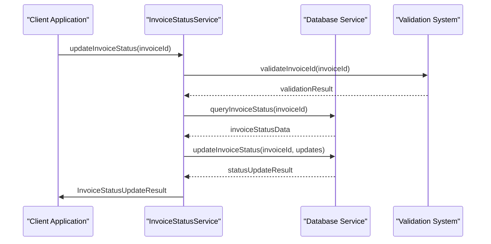

### Invoice Generation Workflow Service
The InvoiceGenerationService handles automated invoice creation and generation with template-based processing:


### Payment Allocation System Service
The PaymentAllocationService provides intelligent payment distribution across multiple invoices with priority algorithms:

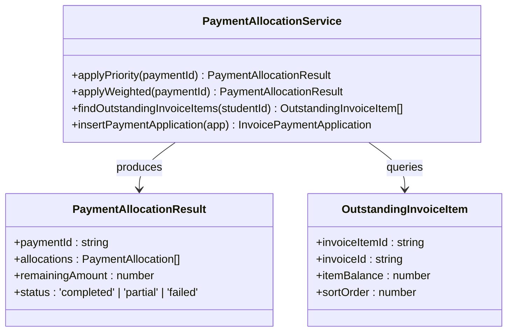

**Section sources**
- [hooks/index.ts:1-6](file://src/modules/finance/hooks/index.ts#L1-L6)
- [hooks/useFinance.ts:1-141](file://src/modules/finance/hooks/useFinance.ts#L1-L141)
- [data/useFinanceData.ts:1-396](file://src/modules/finance/data/useFinanceData.ts#L1-L396)

## React Hooks Ecosystem
The Finance module features a comprehensive hooks ecosystem that wraps P0 services with React-friendly interfaces:

### Main Modular Hook
The useFinance hook serves as the central entry point for all Finance module functionality:

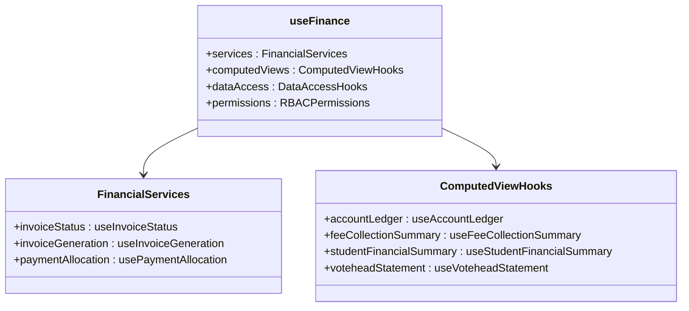

### Service Wrapper Hooks Architecture
Each service wrapper provides React-friendly interfaces with state management:

#### useInvoiceStatus Hook
Real-time invoice status management with loading states and error handling:

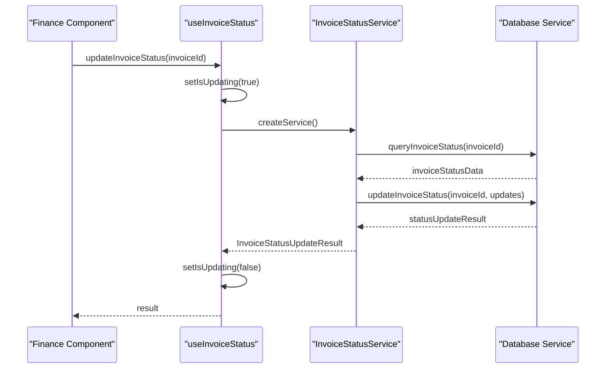

#### useInvoiceGeneration Hook
Automated invoice generation with progress tracking and error handling:

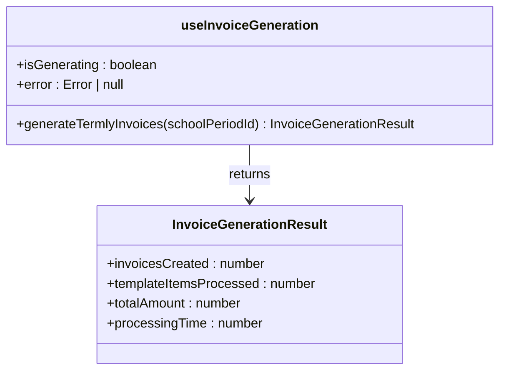

#### usePaymentAllocation Hook
Intelligent payment allocation with multiple algorithm support:

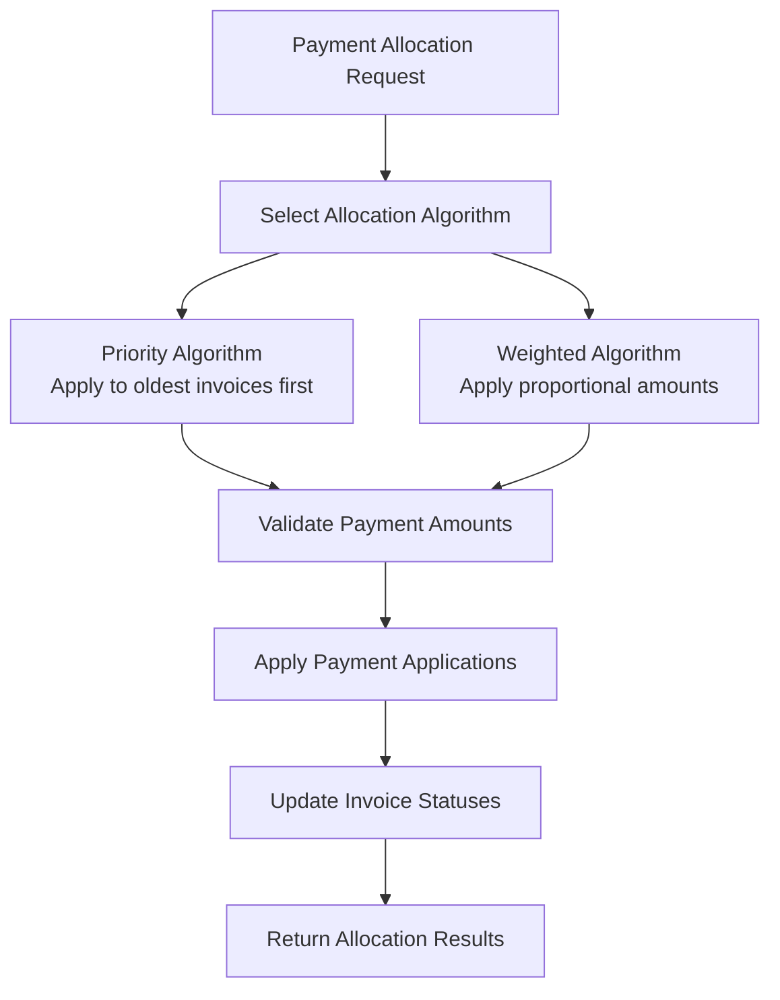

**Section sources**
- [hooks/index.ts:1-6](file://src/modules/finance/hooks/index.ts#L1-L6)
- [hooks/useFinance.ts:1-141](file://src/modules/finance/hooks/useFinance.ts#L1-L141)

## Service Registration System
The Finance module implements a centralized service registration system that manages P0 services with dependency injection:

### Service Registry Integration
The registerFinanceServices function provides centralized service registration:

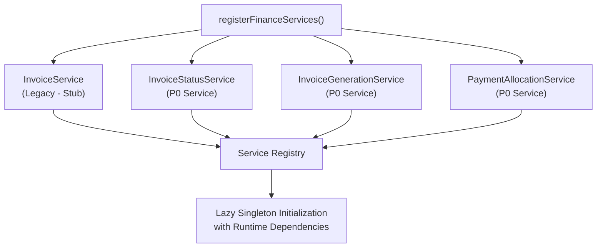

### Dependency Injection Pattern
Services are registered as factories requiring runtime dependency initialization:

- **InvoiceStatusServiceDependencies**: Database access functions for invoice status operations
- **InvoiceGenerationServiceDependencies**: Data access functions for invoice generation workflows
- **PaymentAllocationServiceDependencies**: Comprehensive data access for payment allocation operations
- **Lazy Initialization**: Services instantiated only when first accessed via service registry

**Section sources**
- [hooks/useFinance.ts:1-141](file://src/modules/finance/hooks/useFinance.ts#L1-L141)
- [data/useFinanceData.ts:1-396](file://src/modules/finance/data/useFinanceData.ts#L1-L396)

## Enhanced Reporting Capabilities
The Finance module now provides comprehensive reporting capabilities through computed view hooks and specialized reporting pages:

### Votehead Statement Reporting
The VoteheadStatementPage demonstrates advanced per-invoice financial reporting:

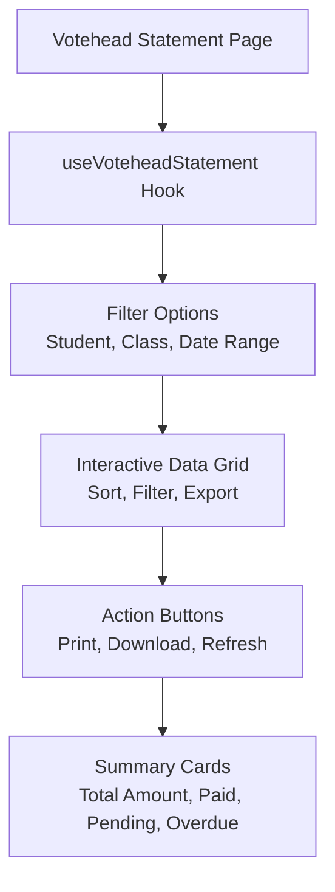

### Financial Analytics Dashboard
The enhanced reporting system provides comprehensive financial analytics:

- **Real-time Dashboards**: Live financial metrics and KPIs
- **Trend Analysis**: Historical financial trends and projections
- **Drill-down Capabilities**: Detailed financial data exploration
- **Export Functionality**: PDF, Excel, and CSV export options
- **Custom Reporting**: Configurable report templates and filters

**Section sources**
- [pages/BalanceSheetPage.tsx:1-200](file://src/modules/finance/pages/BalanceSheetPage.tsx#L1-L200)
- [pages/CashBookPage.tsx:1-200](file://src/modules/finance/pages/CashBookPage.tsx#L1-L200)
- [pages/DayBookPage.tsx:1-198](file://src/modules/finance/pages/DayBookPage.tsx#L1-L198)

## Comprehensive Accounting Pages
**Updated** The Finance module now includes comprehensive accounting pages for detailed financial reporting and management:

### Balance Sheet Page
The BalanceSheetPage provides a comprehensive snapshot of the school's financial position:

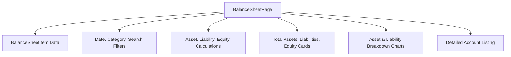

### Cash Book Page
The CashBookPage tracks all cash transactions with detailed categorization:

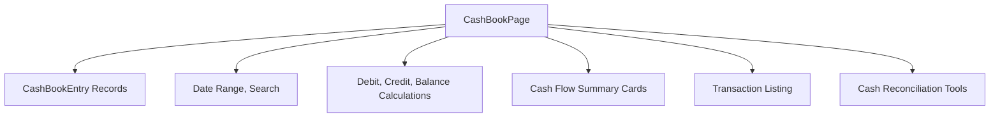

### Day Book Page
The DayBookPage provides daily transaction logging with debit and credit entries:

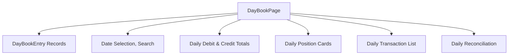

### Income Statement Page
The IncomeStatementPage generates profit and loss statements:

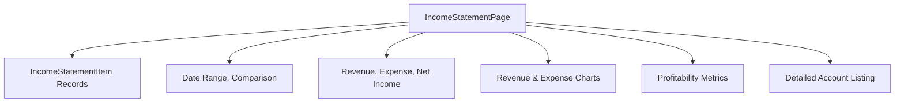

### Journal Register Page
The JournalRegisterPage maintains chronological voucher records:

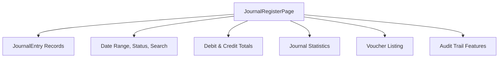

**Section sources**
- [pages/BalanceSheetPage.tsx:1-200](file://src/modules/finance/pages/BalanceSheetPage.tsx#L1-L200)
- [pages/CashBookPage.tsx:1-200](file://src/modules/finance/pages/CashBookPage.tsx#L1-L200)
- [pages/DayBookPage.tsx:1-198](file://src/modules/finance/pages/DayBookPage.tsx#L1-L198)
- [pages/IncomeStatementPage.tsx](file://src/modules/finance/pages/IncomeStatementPage.tsx)
- [pages/JournalRegisterPage.tsx](file://src/modules/finance/pages/JournalRegisterPage.tsx)

## Fee Management Enhancements
**Updated** The Finance module now includes comprehensive fee management enhancements with detailed tracking and customization:

### Fees Fines Page
The FeesFinesPage manages fine and penalty applications:

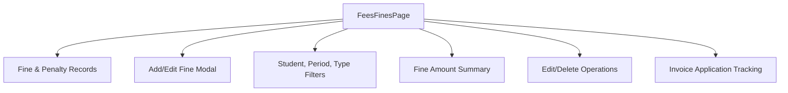

### Fees Installments Page
The FeesInstallmentsPage manages installment payment plans:

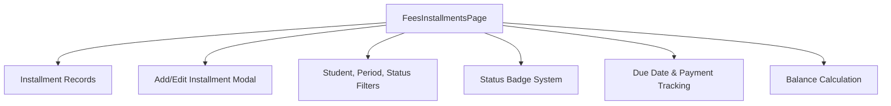

### Fees Due Report Page
The FeesDueReportPage provides comprehensive fee tracking:

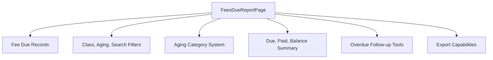

**Section sources**
- [pages/FeesFinesPage.tsx](file://src/modules/finance/pages/FeesFinesPage.tsx)
- [pages/FeesInstallmentsPage.tsx](file://src/modules/finance/pages/FeesInstallmentsPage.tsx)
- [pages/FeesDueReportPage.tsx](file://src/modules/finance/pages/FeesDueReportPage.tsx)

## Receipt Management System
**Updated** The Finance module now includes comprehensive receipt management with customizable templates and preview functionality:

### Fees Receipt Template Page
The FeesReceiptTemplatePage manages custom receipt templates:

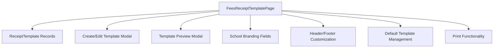

The receipt template system provides comprehensive customization options including:

- **Branding Elements**: School name, address, phone, email, and logo
- **Template Customization**: Header and footer text customization
- **Default Template Management**: Single default template designation
- **Preview Functionality**: Real-time template preview with sample data
- **Print Integration**: Direct browser print functionality

**Section sources**
- [pages/FeesReceiptTemplatePage.tsx](file://src/modules/finance/pages/FeesReceiptTemplatePage.tsx)

## Data Layer Evolution
**Updated** The Finance module has undergone significant data layer evolution with comprehensive TypeScript module augmentation and enhanced data model integration:

### Module Augmentation System
The appDataAugmentation.ts file provides compile-time type safety across all financial collections:

```mermaid
graph TB
subgraph "Module Augmentation Architecture"
AAA["appDataAugmentation.ts"] --> ADT["AppDataType Interface"]
AAA --> ADCT["AppDataContextType Interface"]
ADT --> FY["financialYears[]"]
ADT --> COA["chartOfAccounts[]"]
ADT --> EC["expenseCategories[]"]
ADT --> BANKS["banks[]"]
ADT --> SUPP["suppliers[]"]
ADT --> FT["feeTemplates[]"]
ADT --> SIP["studentInvoiceItems[]"]
ADT --> SP["studentPayments[]"]
ADT --> FA["feeAdjustments[]"]
ADT --> IPA["invoicePaymentApplications[]"]
ADT --> CI["customerInvoices[]"]
ADT --> SI["supplierInvoices[]"]
ADT --> SOB["studentOpeningBalances[]"]
ADT --> TR["transportRoutes[]"]
ADT --> STA["studentTransportAssignments[]"]
ADT --> GP["generalPayments[]"]
ADT --> GLE["generalLedgerEntries[]"]
ADT --> BS["balanceSheetItems[]"]
ADT --> CB["cashBookEntries[]"]
ADT --> DBE["dayBookEntries[]"]
ADT --> RT["receiptTemplates[]"]
ADT --> IS["incomeStatementItems[]"]
ADT --> JE["journalEntries[]"]
ADT --> PSF["previousSessionFees[]"]
ADT --> SPR["studentPaymentRecords[]"]
ADT --> TBI["trialBalanceItems[]"]
end
subgraph "Data Access Methods"
ADCT --> ADD["addBank()"]
ADCT --> ACOA["addChartOfAccount()"]
ADCT --> AFT["addFeeTemplate()"]
ADCT --> RSP["recordStudentPayment()"]
ADCT --> GISI["generateStudentInvoices()"]
ADCT --> ASC["addSupplierContract()"]
end
```

**Diagram sources**
- [data/appDataAugmentation.ts:38-96](file://src/modules/finance/data/appDataAugmentation.ts#L38-L96)

### Comprehensive Data Model
The enhanced data layer now includes 36+ financial entity types with detailed schemas:

#### Financial Entity Types
- **Financial Year Management**: FinancialYear with status tracking and date ranges
- **Chart of Accounts**: ChartOfAccount with hierarchical account structures
- **Expense Categories**: ExpenseCategory for expense tracking and reporting
- **Banking Operations**: Bank with GL account integration
- **Supplier Management**: Supplier with contact and tax information
- **Fee Processing**: FeeTemplate, FeeTemplateItem, FeeAdjustment
- **Student Financials**: StudentInvoice, StudentPayment, StudentOpeningBalance
- **Transport Management**: TransportRoute, StudentTransportAssignment
- **Revenue Recognition**: CustomerInvoice, CustomerInvoiceItem
- **Supplier Invoicing**: SupplierInvoice with payment tracking
- **General Payments**: GeneralPayment with multi-item support
- **Financial Reporting**: BalanceSheetItem, CashBookEntry, DayBookEntry
- **Accounting Views**: ReceiptTemplate, IncomeStatementItem, JournalEntry
- **Cross-Period Tracking**: PreviousSessionFee, StudentPaymentRecord
- **Accounting Verification**: TrialBalanceItem

#### Collection Definitions
The collections.ts file defines 27+ database collections with comprehensive schemas:

```mermaid
graph TB
subgraph "Operational Collections"
FC["financial_years"]
SC["school_periods"]
CCO["chart_of_accounts"]
EC["expense_categories"]
B["banks"]
S["suppliers"]
FT["fee_templates"]
E["expense_claims"]
SOB["student_opening_balances"]
FA["fee_adjustments"]
TR["transport_routes"]
STA["student_transport_assignments"]
SI["student_invoices"]
SP["student_payments"]
IPA["invoice_payment_applications"]
CI["customer_invoices"]
SI2["supplier_invoices"]
GP["general_payments"]
GLE["general_ledger_entries"]
end
subgraph "Report Collections"
BS["balance_sheet_items"]
CB["cash_book_entries"]
DBE["day_book_entries"]
RT["receipt_templates"]
IS["income_statement_items"]
JE["journal_entries"]
PSF["previous_session_fees"]
SPR["student_payment_records"]
TBI["trial_balance_items"]
end
```

**Diagram sources**
- [data/collections.ts:7-98](file://src/modules/finance/data/collections.ts#L7-L98)
- [data/types.ts:91-602](file://src/modules/finance/data/types.ts#L91-L602)

### Service-Oriented Data Access
The enhanced architecture provides multiple access patterns:

- **Direct Database Queries**: For transactional operations and bulk data
- **Service-Based Processing**: For business logic operations and workflows
- **Hook Wrappers**: For React component integration with state management
- **Dependency Injection**: For runtime dependency resolution and testing
- **Module Augmentation**: For compile-time type safety across AppData
- **Hybrid Approach**: Combining benefits of all approaches for optimal performance

**Section sources**
- [hooks/index.ts:1-6](file://src/modules/finance/hooks/index.ts#L1-L6)
- [hooks/useFinance.ts:1-141](file://src/modules/finance/hooks/useFinance.ts#L1-L141)
- [data/appDataAugmentation.ts:1-97](file://src/modules/finance/data/appDataAugmentation.ts#L1-L97)
- [data/types.ts:1-602](file://src/modules/finance/data/types.ts#L1-L602)
- [data/collections.ts:1-102](file://src/modules/finance/data/collections.ts#L1-L102)
- [data/schema.ts:1-552](file://src/modules/finance/data/schema.ts#L1-L552)

## Navigation and Features
The Finance module provides comprehensive navigation covering all aspects of financial management:

### Core Financial Management
- **Chart of Accounts**: Complete accounting hierarchy management
- **Fee Templates**: Standard fee structures with component-based pricing
- **Effect Fee Structures**: Applied fee structures for current periods
- **Fee Adjustments**: Fee modifications and waivers
- **Fee Fines**: Fine and penalty management
- **Fee Installments**: Installment payment plan management
- **Fee Receipt Templates**: Custom receipt template management

### Advanced Financial Services
- **Invoice Generation**: Automated invoice creation and management
- **Payment Allocation**: Intelligent payment distribution across invoices
- **General Receipts**: Bank payment processing
- **Customer Invoices**: Revenue recognition from external customers
- **Supplier Invoices**: Procurement invoice management

### Financial Reporting and Analytics
- **Fee Collection Summary**: Aggregate fee collection analytics
- **Student Financial Summary**: Comprehensive student financial position
- **Votehead Statement**: Detailed per-votehead financial statements
- **Account Ledger**: Real-time account ledger computation
- **Fees Due Report**: Outstanding fee tracking with aging analysis
- **Financial Reports**: Comprehensive financial reporting capabilities

### Accounting Pages
- **Balance Sheet**: Comprehensive financial position snapshot
- **Cash Book**: Daily cash transaction tracking
- **Day Book**: Daily journal entry logging
- **Income Statement**: Profit and loss statement generation
- **Journal Register**: Chronological voucher listing
- **Previous Session Fees**: Cross-period fee management
- **Students Paid Book**: Student payment tracking
- **Trial Balance**: Account balance verification

### Supporting Functions
- **Banks**: Bank account management
- **Suppliers**: Supplier directory and management
- **Transport Routes**: Bus route management
- **Student Transport Assignments**: Student route assignments
- **Expenses**: Expense tracking and management

**Section sources**
- [moduleDefinition.tsx:32-75](file://src/modules/finance/moduleDefinition.tsx#L32-L75)

## Internationalization and Multilingual Support
**Updated** The Finance module now features comprehensive multilingual support with enhanced internationalization capabilities:

### Enhanced Translation Infrastructure
The internationalization system has been significantly expanded to support multiple African and European markets:

#### Supported Languages
- **German (de)**: Complete financial terminology and localized formatting
- **French (fr)**: Comprehensive financial translations with regional variations
- **Kinyarwanda (rw)**: Rwanda-specific financial terms and local conventions
- **Swahili (sw)**: East African financial terminology and cultural adaptations

#### Translation Resource Structure
The enhanced translation system provides comprehensive coverage across all financial domains:

```mermaid
graph TB
subgraph "Translation Resources"
EN["English (Default)"] --> EN_FINANCE["finance.json"]
EN --> EN_COMMON["common.json"]
EN --> EN_NAVIGATION["navigation.json"]
EN --> EN_DASHBOARD["dashboard.json"]
FR["French (fr)"] --> FR_FINANCE["finance.json"]
FR --> FR_COMMON["common.json"]
FR --> FR_NAVIGATION["navigation.json"]
FR --> FR_DASHBOARD["dashboard.json"]
DE["German (de)"] --> DE_FINANCE["finance.json"]
DE --> DE_COMMON["common.json"]
DE --> DE_NAVIGATION["navigation.json"]
DE --> DE_DASHBOARD["dashboard.json"]
RW["Kinyarwanda (rw)"] --> RW_FINANCE["finance.json"]
RW --> RW_COMMON["common.json"]
RW --> RW_NAVIGATION["navigation.json"]
RW --> RW_DASHBOARD["dashboard.json"]
SW["Swahili (sw)"] --> SW_FINANCE["finance.json"]
SW --> SW_COMMON["common.json"]
SW --> SW_NAVIGATION["navigation.json"]
SW --> SW_DASHBOARD["dashboard.json"]
end
```

#### Financial Domain Coverage
Each language provides comprehensive coverage of financial terminology:

- **Fee Management Terms**: Fee templates, adjustments, waivers, and collections
- **Payment Processing**: Payment methods, allocations, applications, and reconciliations
- **Accounting Terminology**: Chart of accounts, ledgers, receipts, and invoices
- **Reporting Vocabulary**: Financial statements, summaries, and analytics
- **Administrative Phrases**: Navigation, dashboards, settings, and system messages

#### Language Switching Implementation
The enhanced system supports seamless language switching with preserved financial context:

- **Dynamic Locale Loading**: Translations loaded on-demand based on user preferences
- **Financial Context Preservation**: Currency formats, date conventions, and number systems
- **Regional Adaptations**: Local banking practices, tax regulations, and financial standards
- **Cultural Sensitivity**: Appropriate financial terminology and communication styles

## Performance Considerations
Enhanced performance considerations for the new service-oriented architecture:

- **Service Caching**: Financial services implement intelligent caching strategies
- **Computed View Optimization**: Hooks optimized for real-time data computation
- **Database Query Optimization**: Efficient query patterns for service operations
- **Memory Management**: Optimized memory usage in computed view hooks
- **Network Efficiency**: Reduced network calls through service layer optimization
- **Real-time Updates**: WebSocket integration for live financial data updates
- **Batch Processing**: Optimized batch operations for financial year closing
- **Service Orchestration**: Coordinated service execution for complex financial operations
- **Lazy Loading**: Services loaded only when needed to reduce initial bundle size
- **Enhanced Page Rendering**: Optimized rendering for comprehensive accounting pages
- **Template Caching**: Receipt templates cached for improved preview performance
- **Filter Optimization**: Efficient filtering for large financial datasets
- **Module Augmentation**: Compile-time type checking reduces runtime errors
- **Collection Optimization**: 27+ optimized database collections for efficient querying

## Troubleshooting Guide
Comprehensive troubleshooting for the enhanced service-oriented architecture:

### Service Layer Issues
- **InvoiceStatusService Failures**: Verify service initialization and database connectivity
- **InvoiceGenerationService Errors**: Check template validation and student eligibility
- **PaymentAllocationService Problems**: Review allocation algorithms and transaction conflicts
- **Service Authentication**: Ensure proper RBAC permissions for service access
- **Dependency Injection**: Verify service dependencies are properly configured

### Hook Wrapper Issues
- **useInvoiceStatus Performance**: Monitor query performance and optimize filters
- **useInvoiceGeneration Accuracy**: Verify data aggregation and calculation logic
- **usePaymentAllocation Completeness**: Check payment allocation algorithms and results
- **Hook State Management**: Monitor loading states and error handling

### Service Registration Issues
- **Service Not Found**: Verify service registration in registerFinanceServices
- **Dependency Resolution**: Check that all required dependencies are provided
- **Singleton Initialization**: Ensure services are properly initialized on first access
- **Circular Dependencies**: Monitor for circular import issues in service dependencies

### Navigation and Feature Issues
- **Missing Navigation Items**: Verify feature flag configurations
- **Permission Denied Errors**: Check RBAC role assignments and permissions
- **Service Integration**: Ensure proper service hook registration and initialization
- **Data Synchronization**: Monitor real-time data updates and cache consistency

### **Updated** Accounting Page Issues
- **Balance Sheet Rendering**: Verify asset, liability, and equity calculations
- **Cash Book Filtering**: Check date range and search functionality
- **Income Statement Totals**: Validate revenue and expense aggregations
- **Journal Register Status**: Ensure proper status badge rendering
- **Fee Management Forms**: Verify fine and installment form validation
- **Receipt Template Preview**: Check template rendering and print functionality

### **Updated** Data Layer Issues
- **Module Augmentation Errors**: Verify TypeScript compilation and type checking
- **Collection Schema Conflicts**: Check database schema definitions and migrations
- **Financial Entity Validation**: Ensure proper data validation for 36+ entity types
- **Report Collection Population**: Verify mock data seeding and computed view updates
- **AppData Integration**: Check module augmentation and runtime type safety

### **Updated** Internationalization Issues
- **Translation Loading Failures**: Verify resource bundle loading for new languages
- **Missing Translation Keys**: Check for untranslated financial terms across languages
- **Formatting Issues**: Ensure currency and number formatting matches locale conventions
- **Language Switching Problems**: Verify dynamic locale loading and context preservation
- **Regional Compliance**: Check adherence to local financial regulations and standards

**Section sources**
- [hooks/index.ts:1-6](file://src/modules/finance/hooks/index.ts#L1-L6)
- [hooks/useFinance.ts:1-141](file://src/modules/finance/hooks/useFinance.ts#L1-L141)
- [moduleDefinition.tsx:24-87](file://src/modules/finance/moduleDefinition.tsx#L24-L87)
- [data/appDataAugmentation.ts:1-97](file://src/modules/finance/data/appDataAugmentation.ts#L1-L97)
- [data/types.ts:1-602](file://src/modules/finance/data/types.ts#L1-L602)

## Conclusion
The Finance module now provides a comprehensive, service-oriented financial management system with advanced TypeScript implementations replacing traditional stored procedures and database-side financial processing. The enhanced architecture supports sophisticated financial services including invoice management, payment processing, and intelligent financial analytics through a robust hooks ecosystem and centralized service registration system. The modular design with specialized P0 services, computed view hooks, and comprehensive reporting capabilities enables scalable and maintainable financial operations across the entire educational institution system. The service-oriented approach with dependency injection, lazy initialization, and comprehensive error handling positions the Finance module as a modern, enterprise-grade financial management solution with superior performance and maintainability.

**Updated** The enhanced accounting system with comprehensive pages including balance sheets, cash books, day books, income statements, and journal registers provides detailed financial transparency and management capabilities. The expanded fee management system with fine tracking and installment plans offers flexible payment solutions for diverse student needs. The receipt template system with customization and preview functionality ensures professional financial documentation. The multilingual support with German, French, Kinyarwanda, and Swahili translations expands the module's international reach, providing comprehensive financial management capabilities across diverse linguistic and cultural contexts. The extensive data model with 36+ entity types and module augmentation system ensures type-safe, maintainable financial operations with comprehensive reporting and analytics capabilities. This expansion supports the growing global education sector's need for localized financial solutions while maintaining the technical excellence and scalability of the underlying service-oriented architecture.